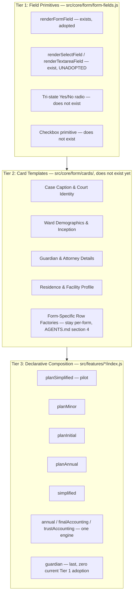

# Milestone Archive

This archive consolidates the historic Index Split Plan, Milestone proposals 14 through 75 with their companion documents, and the October 2026 test-suite audit (TEST-SCRIPT-REVIEW.md) with the remediation plan that answered it (TEST-REVIEW.md). Each document is kept verbatim under its own "Archive:" heading, so a citation of one of these file names is found here.

Milestone 74 is back at the root (MILESTONE-74-PROPOSAL.md) from 2026-10-16 while two answers to its open questions are built -- 74J-2 (Rule 5.680(c)'s items on a Final Accounting) and 74O-5 (a warning when an Annual Plan's remuneration declaration and the accounting for the year just ended disagree), approved by the requester that day; it returns here, verbatim, when they are done.

## Table of Contents

- [INDEX-SPLIT-PLAN.md](#index-split-plan-md)
- [MILESTONE-14-PROPOSAL.md](#milestone-14-proposal-md)
- [MILESTONE-15-PROPOSAL.md](#milestone-15-proposal-md)
- [MILESTONE-16-PROPOSAL.md](#milestone-16-proposal-md)
- [MILESTONE-17-PROPOSAL.md](#milestone-17-proposal-md)
- [MILESTONE-18-PROPOSAL.md](#milestone-18-proposal-md)
- [MILESTONE-19-PROPOSAL.md](#milestone-19-proposal-md)
- [MILESTONE-19-1-PROPOSAL.md](#milestone-19-1-proposal-md)
- [MILESTONE-19-2-PROPOSAL.md](#milestone-19-2-proposal-md)
- [MILESTONE-19-3-PROPOSAL.md](#milestone-19-3-proposal-md)
- [MILESTONE-19-4-PROPOSAL.md](#milestone-19-4-proposal-md)
- [MILESTONE-19-5-PROPOSAL.md](#milestone-19-5-proposal-md)
- [MILESTONE-20-PROPOSAL.md](#milestone-20-proposal-md)
- [MILESTONE-21-PROPOSAL.md](#milestone-21-proposal-md)
- [MILESTONE-22-PROPOSAL.md](#milestone-22-proposal-md)
- [MILESTONE-23-PROPOSAL.md](#milestone-23-proposal-md)
- [MILESTONE-24-PROPOSAL.md](#milestone-24-proposal-md)
- [MILESTONE-25-PROPOSAL.md](#milestone-25-proposal-md)
- [MILESTONE-25-1-PROPOSAL.md](#milestone-25-1-proposal-md)
- [MILESTONE-26-PROPOSAL.md](#milestone-26-proposal-md)
- [MILESTONE-27-PROPOSAL.md](#milestone-27-proposal-md)
- [MILESTONE-28-PROPOSAL.md](#milestone-28-proposal-md)
- [MILESTONE-29-PROPOSAL.md](#milestone-29-proposal-md)
- [MILESTONE-30-PROPOSAL.md](#milestone-30-proposal-md)
- [MILESTONE-31-PROPOSAL.md](#milestone-31-proposal-md)
- [MILESTONE-32-PROPOSAL.md](#milestone-32-proposal-md)
- [MILESTONE-33-PROPOSAL.md](#milestone-33-proposal-md)
- [MILESTONE-34-PROPOSAL.md](#milestone-34-proposal-md)
- [MILESTONE-34-1-PROPOSAL.md](#milestone-34-1-proposal-md)
- [MILESTONE-34-2-PROPOSAL.md](#milestone-34-2-proposal-md)
- [MILESTONE-35-PROPOSAL.md](#milestone-35-proposal-md)
- [MILESTONE-36-PROPOSAL.md](#milestone-36-proposal-md)
- [MILESTONE-37-PROPOSAL.md](#milestone-37-proposal-md)
- [MILESTONE-38-PROPOSAL.md](#milestone-38-proposal-md)
- [MILESTONE-38A-PROPOSAL.md](#milestone-38a-proposal-md)
- [MILESTONE-38B-PROPOSAL.md](#milestone-38b-proposal-md)
- [MILESTONE-38B-SOURCE-INVENTORY.md](#milestone-38b-source-inventory-md)
- [MILESTONE-38C-PROPOSAL.md](#milestone-38c-proposal-md)
- [MILESTONE-38D-PROPOSAL.md](#milestone-38d-proposal-md)
- [MILESTONE-38E-PROPOSAL.md](#milestone-38e-proposal-md)
- [MILESTONE-39-PROPOSAL.md](#milestone-39-proposal-md)
- [MILESTONE-40-PROPOSAL.md](#milestone-40-proposal-md)
- [MILESTONE-40A-PROPOSAL.md](#milestone-40a-proposal-md)
- [MILESTONE-40B-PROPOSAL.md](#milestone-40b-proposal-md)
- [MILESTONE-40C-PROPOSAL.md](#milestone-40c-proposal-md)
- [MILESTONE-40D-PROPOSAL.md](#milestone-40d-proposal-md)
- [MILESTONE-40E-PROPOSAL.md](#milestone-40e-proposal-md)
- [MILESTONE-40F-PROPOSAL.md](#milestone-40f-proposal-md)
- [MILESTONE-40G-PROPOSAL.md](#milestone-40g-proposal-md)
- [MILESTONE-40H-PROPOSAL.md](#milestone-40h-proposal-md)
- [MILESTONE-40I-PROPOSAL.md](#milestone-40i-proposal-md)
- [MILESTONE-41-PROPOSAL.md](#milestone-41-proposal-md)
- [MILESTONE-41B-PROPOSAL.md](#milestone-41b-proposal-md)
- [MILESTONE-42-PROPOSAL.md](#milestone-42-proposal-md)
- [MILESTONE-43-PROPOSAL.md](#milestone-43-proposal-md)
- [MILESTONE-44-PROPOSAL.md](#milestone-44-proposal-md)
- [MILESTONE-45-PROPOSAL.md](#milestone-45-proposal-md)
- [MILESTONE-46-PROPOSAL.md](#milestone-46-proposal-md)
- [MILESTONE-47-PROPOSAL.md](#milestone-47-proposal-md)
- [MILESTONE-48-PROPOSAL.md](#milestone-48-proposal-md)
- [MILESTONE-49-PROPOSAL.md](#milestone-49-proposal-md)
- [MILESTONE-50-PROPOSAL.md](#milestone-50-proposal-md)
- [MILESTONE-51-PROPOSAL.md](#milestone-51-proposal-md)
- [MILESTONE-52-PROPOSAL.md](#milestone-52-proposal-md)
- [MILESTONE-53-PROPOSAL.md](#milestone-53-proposal-md)
- [MILESTONE-54-HELPFUL-LINKS.md](#milestone-54-helpful-links-md)
- [MILESTONE-54-PROPOSAL.md](#milestone-54-proposal-md)
- [MILESTONE-55-PROPOSAL.md](#milestone-55-proposal-md)
- [MILESTONE-56-PROPOSAL.md](#milestone-56-proposal-md)
- [MS-56-findings.md](#ms-56-findings-md)
- [MILESTONE-57-PROPOSAL.md](#milestone-57-proposal-md)
- [MILESTONE-57-RESCOPE.md](#milestone-57-rescope-md)
- [MILESTONE-57-REVIEW-HANDOFF.md](#milestone-57-review-handoff-md)
- [MILESTONE-58-PROPOSAL.md](#milestone-58-proposal-md)
- [MILESTONE-59-PROPOSAL.md](#milestone-59-proposal-md)
- [MILESTONE-59B-IMPLEMENTATION-PLAN.md](#milestone-59b-implementation-plan-md)
- [MILESTONE-60-PROPOSAL.md](#milestone-60-proposal-md)
- [MILESTONE-61-PROPOSAL.md](#milestone-61-proposal-md)
- [MILESTONE-62-PROPOSAL.md](#milestone-62-proposal-md)
- [MILESTONE-63-PROPOSAL.md](#milestone-63-proposal-md)
- [MILESTONE-64-PROPOSAL.md](#milestone-64-proposal-md)
- [MILESTONE-65-PROPOSAL.md](#milestone-65-proposal-md)
- [MILESTONE-66-PROPOSAL.md](#milestone-66-proposal-md)
- [MILESTONE-67-PROPOSAL.md](#milestone-67-proposal-md)
- [MILESTONE-68-PROPOSAL.md](#milestone-68-proposal-md)
- [MILESTONE-68.75-PROPOSAL.md](#milestone-68-75-proposal-md)
- [MILESTONE-70-FIX-LEDGER.md](#milestone-70-fix-ledger-md)
- [MILESTONE-70-PROPOSAL.md](#milestone-70-proposal-md)
- [MILESTONE-70-RELEASE-PACKET.md](#milestone-70-release-packet-md)
- [MILESTONE-71-PROPOSAL.md](#milestone-71-proposal-md)
- [MILESTONE-72-PROPOSAL.md](#milestone-72-proposal-md)
- [MILESTONE-73-PROPOSAL.md](#milestone-73-proposal-md)
- [MILESTONE-75-PROPOSAL.md](#milestone-75-proposal-md)
- [TEST-SCRIPT-REVIEW.md](#test-script-review-md)
- [TEST-REVIEW.md](#test-review-md)


---

<a id="index-split-plan-md"></a>

# Archive: INDEX-SPLIT-PLAN.md

# Probate Guardian index split plan

## Review summary

`index.html` is currently 17,180 lines / 1.13 MB. The head has two CSS blocks
(777 + 31 lines) and roughly 230 lines of static modal markup, followed by one
single `<script>` block spanning lines 1,311–17,177 (15,866 lines) that holds
essentially the entire application: 589 function declarations, 291 inline
`onclick=` handlers, and 150 inline `oninput=` handlers. There is no
`package.json`, no bundler, and no CSP meta tag anywhere — the build tooling
and CSP work in this plan are greenfield additions, not a tightening of
something that already exists.

The script's own section-banner comments show its de facto structure: icon
set, theme, global state/config, help/tooltip/walkthrough systems, the
storage-strategy trio (`.sav` + session-restore cache + launch-preferences
db), county/circuit tables, validation summary, print-pager, security/crypto/
audit, in-memory state ops, export/import, ward management, modal functions,
legacy-storage migration, router, convert-ward, multi-year accounting,
Excel-capacity checks, the form-binding engine, then per-feature page
renderers and print/export for all nine filing types, closing with PDF/Excel
export/import and init. This matches the feature inventory used throughout
this plan.

There are 17 modals total. `startup-choice-overlay`, `security-choice-overlay`,
and `unlock-overlay` are the three always-needed ones this plan keeps inline
(see "Extract the shell and static fragments" below); the other 14
(add/convert/delete/rename ward, prior-years, new-year, eligibility,
load-ward-info, walkthrough, fallback-save, dropzone) are the real
fragment-extraction candidates.

The largest practical saving will come from splitting JavaScript by feature and
loading it with dynamic `import()`. Moving markup into separate files helps only
when the app also removes the previous view's DOM, event listeners, observers,
timers, and object URLs.

**What this plan actually achieves, and what it does not:** dynamic `import()`
reduces initial download, parse, and evaluation cost. It does **not** unload a
module from memory once it has been imported — the module stays in the page's
module registry until the tab/document is closed. `dispose()` only releases the
DOM, listeners, timers, and object URLs owned by that feature; the module code
itself remains resident. The goal of this plan is therefore reducing initial
memory/CPU and reclaiming per-view resources, not guaranteeing that all
previously visited JavaScript is unloaded. If strict reclamation of module code
itself is ever required, the only real options are a full page navigation
between separate applications, or running suitable Excel/ZIP work in a
short-lived Web Worker that is terminated after use.

## Required decision before implementation — RESOLVED: dual distribution

The current package supports double-clicking `index.html` from `file://` —
that is `HOW-TO-RUN.txt`'s primary, "easiest" documented workflow today, so
this choice is not a formality; it decides whether step 6 needs a bundler at
all. JavaScript modules and `fetch()`-loaded HTML fragments are restricted on
`file://` in common browsers, so this plan chose between:

1. Hosted/local-server app. Serve the modular files over HTTPS or
   `http://localhost`. Simplest, but drops the `file://` double-click workflow.
2. **Dual distribution (chosen).** Develop as modules, then use a build tool to
   publish a chunked hosted/PWA build (`dist/web/`) and a bundled single-file
   portable build (`dist/portable/`) that preserves the `file://` double-click
   workflow. The portable build will still load most code at startup — see the
   portable-build acceptance criteria later in this plan for the accepted
   tradeoff.

This decision unblocks fragment extraction and fixes step 2's bundler
requirement as necessary rather than optional. Update `HOW-TO-RUN.txt` to
document both the hosted/PWA and portable release paths once step 2's build
outputs exist.

A second decision must also be recorded before step 2 (Introduce the build
system) starts: whether the legacy entry point (`src/legacy-app.js`) stays a
classic non-module script until inline `onclick` handlers are removed, or is
loaded as a module alongside a generated `src/legacy-globals.js` window-
assignment shim. See step 2 for the tradeoffs; this is an implementation gate,
not a detail to leave implicit at that point.

## Target structure

```text
probate-guardian/
  .gitignore                   # excludes dist/, node_modules/, etc.
  package.json
  vite.config.js                # or the chosen bundler's config; produces dist/web and dist/portable
  index.html                    # shell and mounting containers only
  assets/
    app.css
    print.css
  src/
    main.js                     # startup sequence only
    router.js                   # route table and feature loader
    fragment-loader.js          # loadFragment(); ../fragments/ resolves from here
    legacy-app.js                # step 2: the existing monolith, moved in unchanged behaviorally
    legacy-globals.js            # step 2: window-assignment shim, only if that transition option is chosen
    core/
      state.js
      config.js
      events.js
      forms.js
      validation.js
    persistence/
      sav.js
      recovery-cache.js
      launch-preferences.js
      legacy-migration.js
      tauri-backup.js
    security/
      crypto.js
      unlock.js
      audit-log.js
    ui/
      shell.js
      icons.js
      modals.js
      help.js
      walkthrough.js
    features/
      dashboard/index.js
      simplified-accounting/
        index.js
        excel.js                # import AND export mapping for this feature, dynamically imported (step 6)
        print.js                # builds both the printable view and the PDF-ready document for this feature
      annual-accounting/
        index.js
        excel.js
        print.js
      guardian-inventory/
        index.js
        excel.js
        print.js
      plans/
        index.js                # route table; dynamically imports only the selected variant below
        simplified.js
        annual.js
        initial.js
        minors.js
    export/
      pdf-runtime.js             # shared html2pdf loader + final shared conversion step only
      excel-runtime.js           # shared ExcelJS loader/wrapper, no feature-specific mapping
      zip-runtime.js             # shared getJSZip() loader (step 6)
  fragments/
    common-modals.html
    help.html
  lib/
  templates/
  tests/
    fixtures/
      sav/                       # archive-format fixtures: encrypted/unencrypted/older-format/corrupted
      legacy-storage/            # seed helpers for pre-migration IndexedDB/localStorage/sessionStorage state
    e2e/
  dist/                        # generated build output — not committed; add to .gitignore
    web/                         # chunked/PWA build output; this is what deployment consumes
    portable/                    # single bundled index.html build output
  manifest.json
  sw.js
```

`export/` holds only shared, feature-agnostic runtimes (library loading, the
final shared conversion step). Feature-specific field mapping and document
construction (e.g. how Guardian Inventory maps to Excel columns) lives with
that feature, matching step 6's requirement that these are dynamically
imported per feature rather than globally:

- `features/<name>/excel.js` contains both import mapping (reading an
  uploaded workbook into app state) and export mapping (writing app state into
  the workbook) for that feature — not two separate files.
- `features/<name>/print.js` builds both the on-screen printable document and
  the PDF-ready document for that feature.
- `export/pdf-runtime.js` performs only the final, shared
  document-to-PDF conversion (the `html2pdf` wrapper); it has no
  feature-specific mapping.

Startup, unlock, recovery, and fatal-error markup stay inline in `index.html`
(see step 3 below) and are intentionally absent from `fragments/`.

Keep static, trusted overlays in `fragments/`. Keep data-driven forms in their
feature modules; turning large JavaScript template strings into HTML files would
move code without fixing ownership or cleanup.

## Module contract

Each lazy feature should own its routes and return a cleanup function.
Renderers should return a `Node` or `DocumentFragment` for new code. Migrated
legacy renderers that still produce an HTML string may pass it through one
audited `renderTrustedHtml(container, html)` helper (built on `innerHTML`)
rather than rewriting every renderer during extraction — rewriting all
existing HTML-string renderers is not required to get code splitting and would
add unnecessary migration risk. Continue escaping every case-derived value
regardless of which path is used. Callers must branch on the return type
explicitly; passing a string straight to `replaceChildren()` inserts it as
literal text.

`mount()` receives a state selector and mutation services, not a mutable state
object, matching the read-only-state rule in step 6 below. `selectState()`
takes a selector function and returns only the smallest required slice (e.g.
`selectState(state => state.wardsById[wardId])`), not the whole case —
deep-cloning an entire large case on every mount would temporarily double its
memory footprint, working against this plan's own memory goal. That returned
slice is read-only by convention (or shallowly frozen in development builds to
catch accidental mutation); it is a snapshot, so a feature that needs to react
to later changes uses a `subscribe(listener, { signal })` service that emits
the affected slice, not the whole case, rather than re-reading a captured
snapshot.

Because the router mounts a candidate feature into a detached staging host
before it is visible (see the router section below), a feature must locate its
own elements via `container.querySelector(...)`, never `document.getElementById()`
or other document-global selectors — the still-active feature may have
elements with the same IDs, and a document-global lookup could resolve to the
wrong (active vs. staging) element.

`mount()` may return either a plain cleanup function, or `{ dispose, activate }`
if it needs global side effects (starting a global timer, writing an
audit-log entry, etc.) that must not happen until the feature is actually
committed and visible. `dispose` must only touch `container` and things scoped
to `signal`; `activate` runs once, immediately after the router commits this
feature, and is where any such global effects belong. A feature with no
post-commit global behavior can just return `dispose` directly.

Two rules keep `activate()` from becoming its own source of bugs:

- **Focus is not one of `activate()`'s responsibilities.** The router's
  `restoreFocusAfterNavigation()` owns default focus management after commit;
  `activate()` must not call `.focus()` itself, so the two can't race or
  double-move focus.
- Any listener, timer, or subscription that `activate()` creates must either
  be registered against the same `signal` the feature was mounted with (so it
  is torn down automatically if the feature is later replaced) or be
  explicitly torn down inside `dispose()`. `activate()` must not create
  anything that outlives both.
- `activate()` may fail (rejected promise or throw). The router treats this as
  non-fatal — the DOM commit is not rolled back — and still disposes the
  previous feature; see the router section below for the exact sequencing and
  the reasoning for not rolling back.

```js
// src/features/guardian-inventory/index.js
export async function mount({
  container,
  route,
  selectState,
  services,
  signal,
}) {
  if (signal.aborted) return async () => {}; // don't do expensive rendering for a nav that's already stale
  const ward = selectState((state) => state.wardsById[route.wardId]); // smallest slice, not the whole case
  const view = renderRoute(route, ward); // Node/DocumentFragment, or HTML string via renderTrustedHtml
  if (signal.aborted) return async () => {}; // re-check: renderRoute() may have taken a while
  if (typeof view === "string") {
    renderTrustedHtml(container, view);
  } else {
    container.replaceChildren(view);
  }
  bindInventoryEvents(container, services, signal); // reuse the router's signal, not a new controller

  return async function dispose() {
    releasePreviewObjectUrls();
    container.replaceChildren();
  };
}
```

If `mount()` throws, it is responsible for cleaning up any partial DOM or
listeners it already created before throwing — it cannot return a disposer in
that case, so the router cannot do this cleanup on its behalf.

### Router: per-navigation hosts prevent a stale mount from destroying a newer view

A router that mounts every feature into the same shared container has a race:
if navigation B is superseded by C, but B's async `mount()` finishes after C
is already mounted, B's stale `dispose()` calling `container.replaceChildren()`
would wipe out C's DOM even though aborting B's controller correctly stopped
its listeners. Aborting a controller does not stop a disposer that is later
awaited and clears a container that now belongs to someone else.

Fix: give every navigation attempt its own host element, mount into a fully
**detached** staging host — not merely hidden but never appended to the live
document until commit — and only attach/swap it into the visible shell after
`mount()` actually succeeds _and_ the attempt is still current. A stale
attempt's cleanup then only ever touches its own (never-shown, or
already-detached) host — never the container the newer feature is using.

Merely `hidden`-but-attached is not sufficient: while attached, a staging host
can contain the same element IDs as the still-active feature, and any code
using `document.getElementById()`, Bootstrap ID-based targeting, or other
document-level selectors could resolve to the wrong (active vs. staging)
element. This is why the module contract requires features to look up their
own elements via `container.querySelector(...)`, not global ID lookups — see
below.

```html
<main id="main-content"></main>
```

```js
function createHost() {
  const host = document.createElement("div");
  host.className = "feature-host";
  return host; // intentionally NOT appended anywhere yet — stays fully
  // detached from the document until the router commits it
}
```

**Staging-compatibility requirement**, not just a layout caveat: while a
feature is staged (mounted into a detached host, before commit), its `mount()`
may only perform host-local work — rendering into `container`, and
event-listener registration scoped to `container` (or document-level listeners
that are immediately abortable via `signal`). It must not move focus, change
the URL/hash, start global timers, write audit-log entries, or mutate shared
state, because the currently active feature is still live and interactive and
must not be disturbed by a candidate that hasn't committed yet. If a feature
genuinely needs one of those (initial focus, a measurement that requires real
layout, a global timer that should start immediately), it exposes that work
through an optional `activate()` returned alongside `dispose()` (see the
module contract) that the router calls only after commit — or, if the feature
cannot be split into a staged phase at all (e.g. it fundamentally requires
document connection during its own render), use the serialized live-mount
fallback described below instead of the two-phase staging flow.

If a feature genuinely needs layout measurements that a detached host can't
provide and can't be deferred to `activate()`, serialize the commit/mount
phase behind a navigation queue instead (only one navigation's `mount()` runs
against the live container at a time) rather than mounting concurrently into a
shared container.

The router must guard against slow/failed imports and out-of-order navigation.
The **current feature stays mounted and interactive** while the replacement
loads and mounts into its own detached staging host — only a replacement that
both succeeds and is still the latest navigation gets attached and swapped in,
at which point the old feature's controller is aborted and its `dispose()`
runs against its own (now-detached) host. Aborting the current feature before
the replacement is ready would leave a dead, unresponsive view visible if the
import fails or is slow. A second, independent `pendingController` tracks the
in-flight staging candidate itself (separate from `activeController`, which
belongs to the committed feature) and is aborted whenever a newer navigation
supersedes it — so an abandoned candidate stops its own abortable work
promptly instead of continuing to consume CPU/memory until it happens to
resolve.

Because the previous feature is never disposed until a replacement actually
commits, a failed candidate (import failure, `mount()` throwing, or an invalid
disposer) leaves the previous feature fully mounted and usable — its error
view should reflect that, not imply the user has lost their place.

An unknown route is a permanently invalid navigation, not a transient failure:
it still consumes a navigation-sequence token (so it correctly supersedes an
older in-flight import), but its error view offers "Return to dashboard"
instead of "Retry," since retrying would just re-fail the same way.

The loading/error overlay is an accessibility surface, not just visual: mark it
with `role="status"`/`aria-live="polite"` (or `"assertive"` for the error
state) so screen-reader users are told navigation is in progress or failed,
move focus to the error heading when an error view appears, restore focus to a
sensible target (e.g. the newly mounted view's heading, or the nav item that
was activated) after a successful navigation, and present the loading state
non-blockingly since the previous feature intentionally remains interactive
underneath it.

```js
const loaders = {
  dashboard: () => import("./features/dashboard/index.js"),
  guardian: () => import("./features/guardian-inventory/index.js"),
  simplified: () => import("./features/simplified-accounting/index.js"),
  annual: () => import("./features/annual-accounting/index.js"),
  plans: () => import("./features/plans/index.js"),
};

let activeHost = null; // the host element currently attached inside #main-content
let disposeCurrent = async () => {};
let activeController = null; // belongs to the committed feature; stays alive until a replacement commits
let pendingController = null; // belongs to whichever candidate is currently staging; aborted when superseded
let navSeq = 0;

export async function showFeature(name, context) {
  const mySeq = ++navSeq; // bump before any validation, so even an unknown route supersedes a pending import
  pendingController?.abort(); // stop any older staging candidate immediately — even if this route turns out invalid
  pendingController = null;

  const loader = loaders[name];
  if (!loader) {
    renderErrorView(context.overlay, new Error(`Unknown route: ${name}`), {
      retry: null, // not retryable — always fails the same way
      goToDashboard: () => showFeature("dashboard", context),
    });
    return;
  }

  showLoadingOverlay(context.overlay); // separate from #main-content; old feature stays live underneath

  let feature;
  try {
    feature = await loader();
  } catch (err) {
    if (mySeq !== navSeq) return; // superseded
    renderErrorView(context.overlay, err, {
      retry: () => showFeature(name, context),
      goToDashboard: () => showFeature("dashboard", context),
    });
    return;
  }
  if (mySeq !== navSeq) return; // superseded while awaiting import

  const stagingHost = createHost(); // detached; not appended to the document yet
  const controller = (pendingController = new AbortController());

  let mounted;
  try {
    const result = await feature.mount({
      ...context,
      container: stagingHost,
      signal: controller.signal,
    });
    const dispose = typeof result === "function" ? result : result?.dispose;
    if (typeof dispose !== "function") {
      throw new Error(
        `${name}: mount() must return a cleanup function, or { dispose, activate }`,
      );
    }
    const activate = typeof result === "object" ? result.activate : undefined;
    if (activate !== undefined && typeof activate !== "function") {
      // Validated here, before commit — an invalid activate() must never be
      // discovered only after the DOM has already been swapped.
      throw new Error(`${name}: activate must be a function if provided`);
    }
    mounted = { dispose, activate: activate || (async () => {}) };
  } catch (err) {
    controller.abort(); // mount() is contractually responsible for its own partial cleanup on throw
    if (pendingController === controller) pendingController = null;
    // stagingHost was never appended anywhere, so there is nothing to remove from the document
    if (mySeq !== navSeq) return;
    // The previous feature was never touched and remains fully mounted and
    // usable — the error view must reflect that, not imply lost state.
    renderErrorView(context.overlay, err, {
      retry: () => showFeature(name, context),
      goToDashboard: () => showFeature("dashboard", context),
    });
    return;
  }
  if (pendingController === controller) pendingController = null;

  if (mySeq !== navSeq) {
    // A newer navigation committed (or is staging) while this mount() was
    // awaiting. Dispose this candidate's own (still-detached) host only —
    // never touch activeHost, which belongs to the newer feature.
    controller.abort();
    try {
      await mounted.dispose();
    } catch (err) {
      reportNonFatalError("dispose failed on stale mount", err);
    }
    return;
  }

  // Commit point: still the latest navigation. Attach/replace atomically —
  // both hosts are never simultaneously visible — then run the new feature's
  // post-commit activation. The overlay stays visible until activation
  // finishes, since activation can still fail. Each disposer only ever
  // removes its own host, in `finally`, even if dispose() itself throws.
  const oldHost = activeHost;
  const oldDispose = disposeCurrent;
  activeController?.abort();
  activeController = controller;
  disposeCurrent = async () => {
    try {
      await mounted.dispose();
    } finally {
      stagingHost.remove();
    }
  };

  if (oldHost) {
    oldHost.replaceWith(stagingHost); // atomic: old host leaves the document the instant the new one enters
  } else {
    context.root.appendChild(stagingHost);
  }
  activeHost = stagingHost;

  // Activation-failure policy: the DOM commit above is not rolled back on an
  // activate() failure. Rolling back would mean flickering back to a feature
  // whose controller is already aborted and re-running a mount that may have
  // partial side effects — worse than accepting a committed-but-not-fully-
  // activated feature. A failed activation is therefore logged as non-fatal;
  // the router still hides the overlay and disposes the old feature below.
  try {
    await mounted.activate();
  } catch (err) {
    reportNonFatalError("activate failed after commit", err);
  }

  if (mySeq === navSeq) {
    // Only do post-activation UI work (hiding the overlay, moving focus) if
    // nothing newer has started since — a slow activate() must not steal
    // focus or dismiss the overlay for a navigation that already moved on.
    // restoreFocusAfterNavigation() owns focus management here; activate()
    // must not move focus itself (see the module contract note above).
    hideLoadingOverlay(context.overlay);
    restoreFocusAfterNavigation(stagingHost);
  }

  if (oldHost) {
    try {
      await oldDispose();
    } catch (err) {
      reportNonFatalError("dispose failed during navigation", err);
    }
  }
}
```

Router tests (step 1's baseline suite) should use controllable deferred
promises for `loader()`/`mount()`/`dispose()` to exercise the races this design
is meant to prevent:

- Navigation B mounts slowly; C is requested and completes first — C is
  visible and B's eventual resolution does not affect it.
- B later resolves successfully after being superseded; it is disposed without
  touching C's host or DOM.
- B throws after C has already committed.
- The old feature's `dispose()` throws during a commit — the new host is still
  committed and visible regardless.
- After rapid repeated navigation, exactly one `.feature-host` is connected to
  the document at any time.
- No duplicate element IDs exist in the live document while a candidate is
  staging (i.e. staging hosts are genuinely never attached before commit).
- A pending candidate's `signal` is aborted as soon as it is superseded by a
  newer navigation — including immediately for an unknown/invalid route, not
  only after a valid candidate resolves.
- `activate()` rejects after commit — the old feature is still disposed, the
  error is reported non-fatally, and the router does not hang.
- `mount()` resolves with a truthy non-function `activate` (e.g. a string or
  object without a `dispose`/`activate` shape) — the router rejects it before
  committing, and the previous feature remains untouched.
- `activate()` resolves slowly and a second navigation starts before it
  finishes — the slow `activate()`'s completion must not hide the newer
  navigation's overlay or move focus away from it.
- Focus ends up on the correct (latest) feature after a superseded navigation,
  never on a stale one that finished activating late.

For trusted static fragments (ordinary modals and help content only — see
"Extract the shell and static fragments" below for why startup/security stay
inline), use a same-origin loader restricted to an allowlisted set of names and
replace the prior DOM rather than appending indefinitely. Caching the raw HTML
string does not avoid reparsing — assigning a string to `innerHTML` (or
inserting it via `replaceChildren` after parsing) parses it every time it is
used. To actually skip reparsing, cache a `<template>` element and clone its
`content` on each use; otherwise, drop the cache and rely on the HTTP and
service-worker caches to avoid repeat network transfers.

This loader lives at `src/fragment-loader.js` (added to the target structure
below), so `../fragments/` resolves to `probate-guardian/fragments/` as
intended. If it is instead implemented inside a nested module such as
`src/ui/modals.js`, adjust the relative path accordingly (`../../fragments/`)
— the path must be verified against the actual file location, not assumed.
Because only two names are allowlisted, a full LRU is overkill; a two-entry
map (or no cache at all, relying on HTTP/service-worker caching) is simpler.

```js
const ALLOWED_FRAGMENTS = new Set(["common-modals", "help"]);
const templateCache = new Map(); // one entry per allowlisted fragment; no eviction needed at this size

export async function loadFragment(name) {
  if (!ALLOWED_FRAGMENTS.has(name))
    throw new Error(`Unknown fragment: ${name}`);

  if (templateCache.has(name)) {
    return templateCache.get(name).content.cloneNode(true);
  }

  const url = new URL(`../fragments/${name}.html`, import.meta.url);
  const response = await fetch(url);
  if (!response.ok)
    throw new Error(`Could not load ${name}: ${response.status}`);
  const template = document.createElement("template");
  template.innerHTML = await response.text(); // parsed once, here
  templateCache.set(name, template);
  return template.content.cloneNode(true);
}
```

Never use this loader for user-controlled HTML. Continue escaping case values
before interpolation. Note that abort-based cleanup (`{ signal }`) only removes
listeners registered with that option — it does not remove existing inline
`onclick` attributes, jQuery `.on()` bindings, Bootstrap component listeners, or
document-level listeners added without a signal. Those must be tracked and torn
down explicitly during migration.

## Migration sequence

The order below deliberately proves the build and one vertical feature before
touching shared subsystems, rather than extracting every shared subsystem
first. Do not extract state, security, persistence, or file-operation modules
wholesale up front — only pull out what the pilot feature (step 4) actually
needs, and treat the rest as legacy code accessed through adapters until a
second feature proves what is genuinely shared.

### 1. Establish a safety baseline

- Add tests for startup, unlock, recovery, open/save, every route, PDF, Excel,
  and legacy migration. This baseline suite must cover the now-fixed lock,
  recovery-cache, and storage-copy behavior (the correctness fixes formerly
  tracked in a separate "Phase 0" section are in scope for these tests, even
  though that section has been removed as resolved).
- Record startup transfer size, script parse/evaluate time, heap size, DOM-node
  count, and route-switch heap behavior.
- Preserve the current `.sav` format and startup order.
- "`.sav` compatibility" and "legacy migration" need distinct fixtures, not one
  shared set, since they exercise different code paths:
  - `tests/fixtures/sav/` — archive-format compatibility fixtures: encrypted,
    unencrypted, older-format (pre-migration `.sav`), and corrupted/truncated
    files. Wrong-password is not a separate file; it's a test input run
    against an encrypted fixture.
  - `tests/fixtures/legacy-storage/` — seed helpers that populate IndexedDB,
    `localStorage`, and `sessionStorage` the way pre-`.sav` releases did, used
    to test `runLegacyBrowserStorageMigrationIfNeeded()`-style migration, which
    is a different code path than opening an old `.sav` archive.
- Checkpoint: before any extraction begins (end of this step), record concrete
  numeric targets — not just "measure and compare later" — for initial
  evaluated JavaScript bytes, initial request count, and the warmed-heap bound
  used in step 8's leak tests. Extraction does not start until these numbers
  are written down.
- Delete known-dead code before it can be migrated as if it were live:
  `index.html:14140` declares `renderPageGuardian(page)` with 18 placeholder
  stub pages (`pageGuardianHome()`, etc. — each just `<p>Placeholder</p>`), but
  a second, real `function renderPageGuardian` is declared later at
  `index.html:15005`. Function-declaration hoisting means the second
  definition silently wins at runtime, so the entire first ~50-line block is
  unreachable today. Confirm this with a coverage run, delete the dead block,
  and add a regression test/lint rule against duplicate top-level function
  declarations so a stub doesn't accidentally get carried into a feature
  module as though it were the real renderer.

### 2. Introduce the build system without restructuring behavior

- Decide the build tool now (bundler/dev server), and check in `package.json`
  and build configuration before any code is moved. A dual hosted/portable
  distribution needs explicit build outputs, e.g. `dist/web/` for chunked/PWA
  and `dist/portable/` for a single bundled file.
- Move the existing monolithic script into a build-managed legacy entry point,
  and confirm the build produces a behaviorally equivalent app, verified
  against the step-1 baseline test suite, before any extraction begins.
  (Bundling necessarily changes emitted bytes, so "byte-for-byte" is not the
  right bar — passing the baseline tests is.) "Unchanged" needs one explicit
  caveat: many existing inline `onclick="..."` handlers depend on their target
  functions being real globals on `window`. An ES module's top-level
  declarations are not automatically global, so simply wrapping the monolith
  as a module would silently break every inline handler. Pick one transition
  explicitly, don't leave it implied by "unchanged":
  - Keep this legacy entry point as a classic (non-module) script, loaded
    by the build as a plain external `<script>`, until inline handlers are
    removed in a later pass; or
  - Generate an explicit compatibility object at the top of the legacy entry
    that assigns every existing `onclick` target function to `window`
    (`window.saveBackupNow = saveBackupNow;` etc.), then load it as a module.
    Either is acceptable, but the plan must say which, since "build-managed
    legacy entry" alone does not guarantee the UI keeps working.
- Establish thin adapter modules around existing globals (state, crypto,
  persistence, audit log) so future extracted code can import them instead of
  reaching into `window`. The adapters wrap the legacy code in place; they do
  not yet move it.
- Keep temporary compatibility exports on `window` only for existing inline
  `onclick` handlers; remove those handlers in a later pass.

### 3. Extract the shell and static fragments

- Leave `#main-content`, sidebar, toast hosts, and overlay hosts in `index.html`.
- Keep startup, unlock, recovery, and fatal-error shells inline in `index.html`.
  These views are required on every session, so moving them to fragments adds a
  fetch-failure mode and latency with no meaningful memory saving. Fragment
  extraction is reserved for markup that is not always needed: ordinary modals
  and noncritical help content.
- Lazy-load ordinary modals and help content on first use via `loadFragment()`.

### 4. Extract one feature as a pilot

- Start with Simplified Accounting because it is smaller than the full annual
  and guardian feature sets.
- Move only the dependencies this feature actually needs — its page renderers,
  validation, route table, and Excel mapping. `print.js` and `excel.js` belong
  to this feature's boundary conceptually, but stay as separate, dynamically
  imported modules (per step 6), not files moved in bulk "as one unit."
- Add `mount()`/`dispose()` and verify repeated entry/exit does not grow heap or
  duplicate event handlers.
- Only after this pilot works end to end, extract a second feature (e.g. one
  Plans variant) and move into `core/` only the modules both features actually
  share. This is what determines what step 2's adapters get promoted to real
  shared modules — do not guess shared boundaries before two features exist.

### 5. Extract the remaining feature packs

- Plans: simplified, annual, initial, and minors. `plans/index.js` is a route
  table only — it dynamically imports whichever single variant (`simplified.js`,
  `annual.js`, `initial.js`, `minors.js`) matches the current route, rather
  than statically importing all four, so it doesn't become another eager
  mini-monolith. Apply the same per-variant dynamic import within Annual
  Accounting if its final/trust variants are substantially independent
  implementations rather than shared code with small branches.
- Annual Accounting, including final/trust variants where they share code.
- Guardian Inventory, including schedules, validation, print, and Excel logic.
- Dashboard and ward-management views.

Keep shared calculations in `core/`; do not let one feature import another
feature's internal functions.

### 6. Lazy-load large libraries

- Load `html2pdf.bundle.min.js` only when PDF help/export is requested.
- Load `exceljs.min.js` only for Excel import/export.
- Load form template data only for the selected export type.
- Load each feature's own `excel.js` (import + export mapping) and `print.js`
  (printable view + PDF-ready document) dynamically from inside that feature
  (e.g. on an "Export" click), not whenever the feature's form opens. The
  shared `export/pdf-runtime.js` and `export/excel-runtime.js` runtimes are
  themselves only imported when a feature's `excel.js`/`print.js` actually
  needs them, so no library loads until an export is requested.
- JSZip must load before the first ZIP-dependent operation, not simply "after
  the startup choice is visible" — that point is too late. ZIP-dependent
  operations include: legacy `.sav` migration export, silent reopen of a
  remembered file handle, manual open, and save/export. Each of these code
  paths must independently ensure JSZip is loaded (a shared `getJSZip()`
  loader that caches the in-flight/resolved import is sufficient).
- Keep Bootstrap available for modal/collapse behavior until those dependencies
  are explicitly removed.

Because the existing libraries are classic scripts rather than ES modules, use
the bundler/loader chosen in step 2; do not mix ad-hoc script injection
throughout feature files.

Each `mount()` should receive read-only state (a selector function or a
snapshot) plus mutation services, not the fully mutable state object — the
module contract example above and this step must agree: features call
`updateWard()`, `markDirty()`, `saveCase()`, etc., so mutations cannot bypass
recovery, audit logging, and persistence hooks.

### 7. Update PWA caching and deployment

The current `sw.js` activates immediately but does not cache app files. Split
installation into two tiers instead of one large `cache.addAll()`: a
traditional atomic install-time `cache.addAll()` is all-or-nothing and would
fail the entire service-worker installation if a single optional asset
failed to fetch.

- **Critical-shell precache (atomic, blocks install):** the app shell,
  `main.js`, `router.js`, and other assets required for first paint and
  startup. Small enough that `cache.addAll()` failing on any of these should
  legitimately fail installation.
- **Offline pack (nonblocking, best-effort):** feature JS chunks, fragments,
  lazy libraries (`exceljs.min.js`, `html2pdf.bundle.min.js`, JSZip), CSS,
  icons, and export templates. Fetched individually after install/activation,
  with retry for interrupted downloads. Otherwise offline PDF/Excel/`.sav`
  operations will fail even though the feature chunk itself was "cached" in
  name.
- A service worker can be terminated by the browser at any point once it has
  no event whose lifetime is being extended by `waitUntil()` — a bare
  `setTimeout`/async chain started from `install`/`activate` is not guaranteed
  to finish. Trigger and extend the offline-pack download from a page-sent
  message instead, so its promise is properly tracked:

  ```js
  let offlinePackPromise = null; // dedupe: one in-flight download per build version, not one per message
  self.addEventListener("message", (event) => {
    if (event.data?.type === "DOWNLOAD_OFFLINE_PACK") {
      // downloadOfflinePack() checks the versioned ready marker first, so a
      // repeated successful request after completion is cheap (no re-fetch).
      const attempt = (offlinePackPromise ??= downloadOfflinePack());
      event.waitUntil(
        attempt.finally(() => {
          // Clear on settle — success or failure — so a later message can
          // retry a failed attempt instead of forever reusing its rejection.
          if (offlinePackPromise === attempt) offlinePackPromise = null;
        }),
      );
    }
  });
  ```

  Multiple tabs (or repeated calls from one tab) can each post this message;
  caching the promise means a second message while a download is already
  in-flight awaits the same attempt instead of starting a redundant one, while
  clearing it on settle means a failed download doesn't permanently poison
  every future retry attempt.
  The page posts this message once it decides offline availability matters
  (e.g. after the startup screen, or from a user-facing "Make available
  offline" action).

- The "offline ready" marker must include the build/cache version it was
  computed for (e.g. `{ ready: true, cacheVersion: 'v7' }`) and be reset
  whenever the version changes — a marker from a previous version must not be
  read as "this version's offline pack is ready." Completion must be
  version-atomic from the UI's perspective: download the offline pack into a
  version-specific cache name (e.g. `pg-offline-v7`), and only flip the marker
  to ready for that exact version after every required asset in its manifest
  has succeeded. A partial download must never be reported as ready, and a
  ready marker for an old version must never be presented as covering the
  current version.
- The service worker caches only revisioned static assets. It must never
  cache `.sav` files, case data, blob URLs, or other user-generated exports —
  those are handled entirely by the app's own persistence layer, not the
  cache.
- Precache lists (critical-shell and offline-pack) must be build-generated,
  not hand-maintained — a bundler emits hashed chunk filenames, and a
  hand-written list will eventually go stale (omitting a new chunk or
  retaining a deleted one). Use the chosen bundler's PWA plugin, Workbox, or
  an equivalent build step to emit a single revisioned manifest, and derive
  both the critical-shell list and the offline-pack list as two subsets of
  that one manifest — never two independently generated lists that could
  disagree about a hash or version.
- Do not delete an old cache purely because a new one exists — a client from
  the previous version may still be running and depending on it. Delete old
  caches only after those clients have closed or been forced to reload (see
  the update policy below), not simply "the new version activated."

Runtime caching alone cannot serve a resource that was never fetched. "Offline
navigation to a feature never opened in this session" (used in the acceptance
criteria and step 8) has an explicit precondition: the service worker must
already be installed and this exact build version's offline pack must have
previously reached the ready state before going offline. A genuinely first
visit that goes offline before the pack finishes cannot be expected to serve
an unopened feature — that is the tradeoff of best-effort background
precaching, not a bug.

This does not conflict with the "page must not import/evaluate inactive
feature chunks" requirement: those are two different budgets.

> The page's initial execution path must not import or evaluate inactive
> feature chunks. Service-worker background precaching is a separate,
> excluded-from-page-load transfer that happens after install, measured on its
> own budget — not counted against initial page-load transfer size.

Measure and record the full precache payload size (it is unlikely to be "a few
KB" once libraries, templates, and every feature chunk are included) and define
install-failure behavior — e.g. the app must still work online if background
precaching fails or is interrupted, and should not block first paint on it.

Add an explicit service-worker update policy: the current immediate
`skipWaiting()` can let an already-open tab keep running old code while
`sw.js` serves new chunks to new requests, mixing versions. Either defer
`skipWaiting()` until all clients close, or prompt the user to reload when an
update is ready, and version the cache name so old and new chunk sets never
collide. Test an upgrade with an already-open tab and an old cache before
release.

### 8. Measure and finish

- Compare the new baseline with step 1.
- Confirm the page's initial execution path does not import or evaluate
  inactive feature packs (service-worker background precache is measured
  separately and is expected to download them).
- Leak-test each feature with a warmed baseline, not the cold startup baseline
  — an imported module's code stays resident even after `dispose()`, so heap
  cannot be expected to return to pre-import size. For each feature: (1) import
  and mount it once, (2) dispose it and force/allow garbage collection, (3)
  record this as the warmed baseline, (4) repeat mount/dispose 20 times, (5)
  compare against the warmed baseline, not the cold one. This isolates
  genuinely leaked views/listeners from the module code that is expected to
  stay resident.
- Test offline PWA startup and lazy navigation to a feature not previously used.
- Test that a first `DOWNLOAD_OFFLINE_PACK` attempt which fails partway
  (simulate a fetch rejection for one asset) leaves the version's "offline
  ready" marker unset and does not poison future attempts; a later
  `DOWNLOAD_OFFLINE_PACK` message for the same version successfully completes
  and sets the marker.
- Test Chrome, Edge, Firefox, and Safari separately because writable-file-handle
  behavior differs.

## Acceptance criteria

- `index.html` contains no feature implementation. Budget: shell markup stays
  under an agreed line/byte limit (to be set once the current shell is
  measured), rather than the vague "small enough to review." This criterion
  applies to the source and `dist/web/index.html`. The generated single-file
  `dist/portable/index.html` is expected to bundle feature implementation for
  offline double-click use and is exempt from this line/byte budget; its own
  criteria are, explicitly:
  - All feature code, CSS, required templates, fragments, and libraries are
    inlined or otherwise bundled into the single file for `file://` use — no
    runtime fragment `fetch()` calls and no dynamic `import()` of separate
    chunk files, since both are unreliable or blocked under `file://`.
  - Service-worker registration is disabled in this build (there is no origin
    for it to control, and no update model applies).
  - Portable startup and every export path (PDF, Excel, `.sav` open/save,
    legacy migration) are tested by double-clicking the file with no web
    server running.
  - This build intentionally does not receive the hosted build's
    startup-memory/lazy-loading benefit — that tradeoff is accepted in
    exchange for `file://` compatibility, not a regression to fix.
- Startup's page-level execution loads and evaluates only shell, security,
  persistence, and the selected first view. Budget: measured against the
  step-1 baseline, this must show a concrete improvement, not merely avoid
  regressing — e.g. initial evaluated JavaScript reduced by an agreed minimum
  percentage (to be set once the current baseline is measured; a `"must not
regress"` bar alone would accept a refactor with zero startup benefit),
  along with initial request count and DOM-node count tracked against
  baseline. Background service-worker precache transfer is tracked as a
  separate, larger budget (see step 7) and is not part of this figure.
- Excel and PDF libraries are absent from the page's initial
  import/evaluation path (they may still be precached in the background by the
  service worker per step 7).
- Leaving a feature calls its cleanup function and removes its DOM/listeners;
  heap growth after N repeated route changes (e.g. 20 cycles) stays within an
  agreed bound relative to the _warmed_ per-feature baseline (see step 8's
  leak-test procedure), not the cold startup baseline.
- Rapid or overlapping navigation never loses the most recently requested
  feature's DOM: a stale/superseded mount only ever disposes its own
  per-navigation host, never a container a newer feature is using (see the
  per-navigation host design in the module contract section above).
- Existing `.sav` files created by the current release open correctly in the
  split version. New `.sav` files either (a) remain fully openable by the
  current released version, or (b) carry an intentional, documented
  format-version bump with a clear compatibility statement — this must be
  decided explicitly, not left implicit.
- Recovery-cache, remembered-handle, lock, and legacy-migration behavior is
  unchanged or intentionally revised with tests and documentation.
- The chosen `file://` or hosted release policy is documented accurately.
- CSP is defined for the modular build, inline event handlers (`onclick=`) are
  removed in favor of listener registration, fragment names are validated
  against an allowlist before fetching, and script/module responses are
  confirmed to be served with correct JavaScript MIME types.
- A chunk load failure shows a visible error state with a retry action instead
  of a blank screen (see router error handling above).

## Current status and remaining work (as of Milestone 8)

Milestones 1–8 are shipped and live: build system, pilot (Simplified
Accounting), all four Plan variants, Annual Accounting, and Guardian
Inventory — every feature-pack extraction from step 5 except Dashboard/
ward-management is done. `src/legacy-app.js` is down to ~8,060 lines (from
17,180). Each extracted feature's `print.js`/`excel.js` load together via one
`Promise.all()` at first mount, matching step 6.

**Design correction versus the router section above:** the shipped router is
`src/core/feature-bridge.js`'s small `createFeatureBridge()` factory
(`mountPage()`/`mountNav()`, cache the load promise, no `dispose()`), not the
detached-staging-host/`pendingController`/`navSeq` router documented earlier
in this file. At Milestone 8 that design was deliberately not built under the
assumption that user navigation would remain sequential; arbitrary overlapping
programmatic switches were outside the shipped contract. Extracted renderers
at that milestone also returned HTML strings with inline event attributes.
Milestone 11 replaced those attributes with shared delegates and abortable
feature-local delegates, but did not change the bridge's sequential-navigation
contract. Milestone 12 records that limitation as architectural debt rather
than claiming the full concurrent router's acceptance criterion is met.

### Milestone 9: Dashboard and ward-management extraction

The last item on step 5's list. Currently in `legacy-app.js`:
`pageDashboard()`, `renderDashboardGrid()`, `renderDashboardSummary()`,
ward-card rendering, and the ward-management flows (`addWard`, `switchWard`,
`convertWard`, archive/delete). Follow the same shape as every prior
extraction: `src/features/dashboard/index.js` with `mount()`/`mountNav()`,
promoted through `createFeatureBridge()`, with an `ensureXFeatureReady()`-style
pre-load only if some other still-legacy code needs dashboard data
synchronously before this module loads (check `getWardHeadlineTotal()` and
nav-dot code first — this exact pattern bit Guardian Inventory in Milestone 8
and is worth checking up front this time instead of discovering it via a
crash). Sweep for the same three bug classes every milestone has hit: an
unbridged `window.*` reference, a moved `const`/`let` that isn't a `window`
property, and a `window.validate*`-style wrapper that needs to fail loud, not
silently.

### Milestone 10: Rebuild the service worker (step 7)

**Implemented:** `build:web` now runs `scripts/generate-service-worker.mjs`
after Vite. The script inventories and content-hashes the actual `dist/web`
runtime artifacts, derives critical/offline subsets from that one manifest,
and injects it into the copied worker template. The hosted build registers
that generated worker; source/dev builds do not register it, and `file://`
portable remains explicitly service-worker-free.

- Split into critical-shell (atomic, blocks install) vs. offline-pack
  (nonblocking, `DOWNLOAD_OFFLINE_PACK` message-triggered, `event.waitUntil()`
  tracked) tiers: complete.
- Build-generated, content-revisioned manifest and byte verification for both
  tiers: complete.
- Version-atomic ready marker, visible failure/retry state, and user-triggered
  activation of a waiting update: complete. Old version caches are retained
  while older clients may still need them; bounded stale-cache cleanup remains
  a future storage-maintenance refinement.
- `.sav`, case-data, blob, cross-origin, and non-manifest requests are never
  cached: covered by focused hosted-build tests.

### Milestone 11: CSP and inline-handler removal

Complete. Executable inline event attributes have been replaced by fixed,
declarative actions and registered listeners. The CSP now keeps scripts strict
(`script-src 'self'`, with exact SHA-256 authorization for the portable build's
generated inline module) and does not allow inline or evaluated script. Inline
styles remain temporarily allowed by `style-src 'self' 'unsafe-inline'` because
legacy rendering still emits dynamic style attributes; removing that exception
is a separate style-migration task, not part of Milestone 11.

### Milestone 12: Shrink the legacy entry, evaluate a real `main.js`

**Complete. Decision: path A plus path D — keep the shared classic core, make
only bounded cleanup, and defer `main.js` until after Milestone 13 measurement.**
This is a deferral, not a rejection of modules. A module bootstrap is optional
cleanup and is not justified merely by making the file tree look tidier.

The audit began with `legacy-app.js` at 8,184 logical lines / 454,619 bytes.
Removing two dead declarations and extracting the self-contained hosted PWA
notifier/update workflow to `src/pwa-ui.js` leaves it at 8,059 logical lines /
449,060 bytes. Its remaining size is substantial, but the map below shows that
it is now predominantly shared application core and shell workflow rather
than feature implementations left behind by the split.

**True shared core**

- Application state and type identity: `guardianData`, `window.D`, inventory
  metadata/aliases, active route/type state, and blank-data factories needed
  synchronously when a ward is created.
- Persistence and lifecycle: in-memory stores, debounced writes, canonical
  `.sav` archive creation/opening, remembered file handles, temporary recovery,
  legacy browser-storage migration, launch selection, and initialization.
- Security: input/import hardening, AES-GCM/PBKDF2, unlock/lockout/auto-lock,
  optional OS keychain access, encrypted audit records, and Tauri backup hooks.
- Cross-feature services: form binding/formatting, validation summaries,
  print-preview paging, calculations/reconciliation, navigation completion,
  schedule attachments/comments, template lookup, and shared export helpers.
- Hosted offline/update UI remains shared core, but is now the bounded
  `src/pwa-ui.js` module because it has no dependency on legacy lexical state.

**Shell workflow**

- Theme, icons, contextual help, walkthroughs, help-guide export, activity-log
  view, top navigation, sidebar/progress UI, and mobile shell controls.
- Ward selection and creation, carry-over, conversion, rename/delete,
  multi-year switching, startup/unlock/modals, and the inventory-type chooser.
- The dashboard implementation is already extracted. The legacy entry retains
  only its shell route and lazy bridge entry points, alongside equivalent
  bridge entry points for the filing features.

**Compatibility globals**

- Intentional state/service APIs include `window.D`, selected metadata and
  factory constants, live state accessors, persistence adapters, formatter and
  renderer services consumed by feature modules, declarative event modules,
  and Playwright setup. These are current cross-boundary contracts, not all
  accidental leftovers.
- Classic-only shims are narrower: the eight feature-loader functions,
  `createFeatureBridge`, `disposeActiveFeature`, `loadFragment`, and the six
  `emptyData*` factories are assigned to `window` because the classic entry
  cannot import their modules.
- Top-level classic function declarations also become implicit globals. The
  four event modules alone currently depend on roughly sixty such APIs, while
  extracted features consume additional shared services. Converting the file
  to a module today would require an equally large explicit compatibility
  facade before it removed any meaningful coupling.

**Still extractable islands**

- Extracted now: the hosted-only PWA registration, offline-pack prompt, retry,
  and update-ready UI in `src/pwa-ui.js`; it is Vite-managed and does not add a
  `window` shim.
- Possible later islands: help/walkthrough registries and guide export, plus
  groups of pure formatting/calculation helpers. They are not moved now because
  their consumers still span classic shell code and lazy features; moving them
  before measuring would mostly add adapters rather than reduce startup work.

**Architectural debt**

- `createFeatureBridge()` caches and mounts modules and now disposes the module
  previously active in a shared container, so departed feature delegates do not
  remain live. It still assumes sequential navigation: it does not use
  navigation sequence tokens or detached staging hosts, so arbitrary overlapping
  programmatic route/ward changes are not a supported contract. Existing stress
  tests wait for initial lazy readiness before switching. Milestone 12 defers a
  concurrency router rewrite because no normal user-path failure has been
  demonstrated; the earlier concurrent acceptance criterion remains explicitly
  unresolved.
- The classic bootstrap, implicit global namespace, module-to-classic
  `window.*` shims, and script publication ordering remain debt. A real
  `src/main.js` should be reconsidered after Milestone 13 supplies startup and
  evaluation measurements and only with a staged service API plus source/web/
  portable tests. Final recommendation for this milestone: **defer `main.js`**.

Two declarations were removed after repository-wide `rg -w` checks found only
their definitions: `computeHMAC` and `loadWardsFromState`. A post-removal scan
for both names returns no matches. No `.sav` format or case-data behavior changed.

### Milestone 13: Measure and finish (step 8), then acceptance-criteria sign-off

**Complete with explicit deferrals.** Measurements were taken on 2026-08-30
from the working tree based on `2ff1ddf`. Reproducible records are in
`tests/baseline/milestone-13-{source,web,portable}.json` and
`tests/baseline/milestone-13-lifecycle.json`; the original `30dc907` record
remains `tests/baseline/latest.json`.

The plan said numeric thresholds would be agreed after the baseline was
measured, but neither the plan, the baseline artifact, nor the baseline-era
commits contain those values. Milestone 13 therefore reports actual deltas and
marks threshold-dependent clauses deferred; it does not retroactively invent
targets.

| Metric                                            | `30dc907` baseline | Final hosted web |  Delta |
| ------------------------------------------------- | -----------------: | ---------------: | -----: |
| Application JavaScript, decoded bytes             |          1,010,181 |          475,861 | -52.9% |
| All initially evaluated JavaScript, decoded bytes |          6,273,456 |        5,739,140 |  -8.5% |
| HTML navigation encoded body                      |          1,125,820 |           24,505 | -97.8% |
| Initial JS heap                                   |         21,255,244 |        9,894,880 | -53.4% |
| Initial DOM nodes                                 |              2,472 |              632 | -74.4% |
| Initial requests                                  |                  9 |               12 |     +3 |
| Chromium `ScriptDuration`                         |         0.008997 s |       0.102134 s |  11.4x |

The application-code, heap, DOM, and HTML-body improvements are concrete.
Total evaluated JavaScript improves only 8.5% because `html2pdf`, ExcelJS,
JSZip, and all three workbook templates still execute at startup. The request
count and `ScriptDuration` regress. The acceptance clause requiring PDF/Excel
libraries to be absent from the initial path is therefore unresolved, not
reported as a pass. Source startup measured 498,472 application bytes,
5,761,751 total decoded script bytes, 9,865,344 heap bytes, 633 nodes, and 20
requests. Portable startup measured 961,111 application bytes, 6,224,390 total
script bytes, 10,028,508 heap bytes, 620 nodes, and an 842,389-byte HTML body;
portable intentionally trades hosted lazy-loading for `file://` operation.

Source `index.html` is 101,221 bytes / 1,080 lines and hosted
`dist/web/index.html` is 100,125 bytes / 1,073 lines. Portable is 842,389 bytes
/ 4,575 lines and is exempt from the shell limit. No source/hosted shell limit
was ever agreed, so these are records rather than a threshold pass. The final
service-worker manifest is `fabdd463489af01a`: 5 critical entries / 886,068
bytes and 33 offline entries / 5,931,477 bytes.

The warmed lifecycle run imported and mounted each module once, disposed it,
forced Chromium GC, then performed 20 mount/dispose cycles. Post-GC heap growth
was: Simplified 17,676 bytes; Plan Simplified 16,236; Plan Annual 15,648; Plan
Initial 12,904; Plan Minor 11,252; Annual 9,824; Guardian 18,692; Dashboard
34,024. All 160 cycles completed without console errors and the shared host was
empty after every disposal. Retained-node deltas ranged from -248 to +417;
because no heap/node bound was agreed and CDP's retained-node count is noisy,
the raw values are preserved instead of assigning a retrospective pass limit.

Validation completed:

- Both production builds passed. Full Chromium matrices: source 65 passed / 5
  hosted-only skipped; dev 64 passed / 6 target-specific skipped; web 69
  passed / 1 source-only skipped; portable `file://` 64 passed / 6
  target-specific skipped. Vitest has no unit specs and exits successfully.
- Focused startup, every filing route/dashboard, `.sav`, lock, CSP, fragment,
  and MIME coverage passed 25/25 in Microsoft Edge, Firefox, and WebKit as well
  as the full Chromium runs. WebKit on Windows is Safari-engine compatibility
  evidence; actual Safari was not available.
- Hosted offline passed 5/5: atomic shell, ready marker, a never-imported Plan
  Minor feature after the current build's pack is ready, partial failure and
  retry, and `.sav`/case-data/blob/cross-origin/non-manifest exclusions.

Acceptance sign-off:

- **Resolved:** source/hosted shell has no feature implementation; hosted
  application JavaScript, heap, DOM, and HTML transfer show concrete
  improvement; feature disposal is invoked; hosted offline first-use/retry and
  exclusions pass; current-format plain/encrypted `.sav` round trips, wrong
  password, corruption, recovery, lock, and unencrypted legacy migration pass;
  dual release policy is documented; strict script CSP, no executable inline
  handlers, fragment allowlist, JavaScript MIME, and visible chunk-load retry
  pass.
- **Deferred/unresolved:** no pre-agreed shell, startup, request, or warmed-heap
  thresholds exist; PDF/Excel/template scripts still execute initially;
  overlapping programmatic navigation still lacks sequence/staging isolation;
  portable still requires its complete folder because classic libraries and
  templates are external to `index.html`; no checked-in prior-release `.sav`
  fixture proves historical compatibility; remembered writable handles and
  encrypted legacy migration are not automated; real Safari was not run; old
  service-worker caches have no bounded retirement policy; `src/main.js`
  remains deferred per Milestone 12.

No archive-format bump was made: new `.sav` files remain format version 2.
The two repository-adjacent workbook files are user artifacts, were not opened
or modified, and are excluded from this milestone and its commit.

### Milestone 14: Role-aware dashboard triage

**Complete with approved deferrals.** Implementation was validated on
2026-08-30 from the working tree based on `72b7441`. The approved scope and
guardrails are recorded in `MILESTONE-14-PROPOSAL.md`.

Implementation summary:

- Added a pure dashboard projection layer for filing identity, totals,
  progress, statutory deadlines, workflow fallback, filing contacts,
  assignments, priority, and non-overlapping triage metrics.
- Added family, professional, and assistant dashboard views. Family view keeps
  every filing accessible; triage views add status, deadline, contact, and
  assignment filters plus priority sorting.
- Added one validated browser-local preference record under
  `pg-dashboard-preferences-v1`, with session-memory fallback when localStorage
  is unavailable. Preferences do not mutate wards or enter `.sav` archives.
- Added optional `dashboardWorkflow.status` and `assigneeName` metadata only
  after explicit user changes. Values are normalized, `auto` removes explicit
  status, and empty workflow containers are deleted.
- Updated new-year handling so the prior snapshot retains status and
  assignment, the new year clears status and carries assignment, and switching
  back restores the prior metadata.
- Preserved lazy dashboard `mount()`/`dispose()`, existing declarative action
  behavior, production data from `guardianData.wards`, strict CSP, and escaped
  ward-derived rendering. No production mock data was added.

Phase gates passed:

- **14A:** 16 projection tests cover all filing deadline rules, deep-frozen
  input, contacts, workflow fallback, priority, metrics, and normalization.
- **14B:** 5 preference tests cover validation and storage failure. Browser
  role/filter operations leave ward JSON unchanged, survive remounts, and are
  absent from every exported ZIP entry.
- **14C:** dashboard controls use `saveWardToState()`, dirty-state marking, and
  indicator refresh. Explicit metadata round-trips through a real `.sav`;
  new-year reset/carry and prior-year restoration pass.

Validation completed:

- Vitest: 2 files, 21 tests passed. Both production builds passed.
- Full Chromium matrices: source 70 passed / 5 hosted-only skipped; dev 69
  passed / 6 target-specific skipped; web 74 passed / 1 source-only skipped;
  portable `file://` 69 passed / 6 target-specific skipped.
- Focused routes, dashboard, `.sav`, security, startup, and unlock coverage
  passed 30/30 in Microsoft Edge, Firefox, and WebKit. WebKit on Windows is
  Safari-engine compatibility evidence; actual Safari was not available.
- Hosted offline coverage passed within the web matrix. Source lazy-load
  failure and reload behavior passed within the source matrix.
- Source security coverage confirms no executable inline handlers or scripts
  were introduced; the portable build retains its generated CSP-hashed bundle.
- Post-review regression coverage confirms pending and approved filings retain
  informational dates without entering actionable card badges, family deadline
  counts/worklists, or triage deadline filters; source, rebuilt web, and rebuilt
  portable checks passed.

Archive compatibility was preserved. The pre-Milestone-14 commit `72b7441`
declares `SAV_FORMAT_VERSION=2`; the Milestone 14 working tree still declares
version 2, and its diff does not touch the declaration or archive manifest.

Approved deferrals remain: durable professional identities, court-system
integration, automatic ward migration or hydration, persisted computed
progress/deadlines, cross-device preference synchronization, targeted per-card
render optimization, and production sample data. The two repository-adjacent
workbook files remain untouched and excluded.

### Milestone 15: Dashboard UX redesign

**Complete.** Implementation was validated on 2026-08-30. Scope and guardrails
are recorded in `MILESTONE-15-PROPOSAL.md`.

Implementation summary:

- Rebalanced every role around three primary compliance signals: action items /
  exceptions, approaching deadlines, and pending court review. Active filings
  remains quieter, and the combined financial total is now secondary text.
- Moved role selection, assistant `Working on behalf of` filtering, and the
  compact `New Filing from Existing` action into a dedicated dashboard header.
  Exact-count tests prevent duplicate controls.
- Refined family priority cards and the professional/assistant CSS Grid queue
  with priority ordering, restrained rails and tints, urgency badges, styled
  editable workflow selectors, and responsive field labels.
- Kept pending review informational rather than urgent, due-soon items amber,
  correction/overdue items rose, and approved/archived items visually quiet.
  Pending and approved dates remain excluded from actionable deadline metrics.
- Preserved all existing delegated dashboard actions and change hooks. Queue
  grouping remains intentionally unnecessary for professional/assistant mode;
  existing ward-card grouping and archived access remain available.

Visual validation:

- Captured the required light and dark screenshots at 1920 x 1080, 1366 x 768,
  768 x 1024, and 390 x 844, plus assistant desktop/mobile and scrolled mobile
  row evidence.
- The triage metrics dominate the first scan while the combined total is quiet.
  Priority rails/badges communicate filing state without resembling application
  errors. Workflow status remains visibly editable.
- Tablet and mobile layouts reflow without horizontal overflow. Row labels,
  assignment controls, and all six actions remain readable and usable. Assistant
  filtering is clear in the header and does not crowd queue rows.
- The screenshot harness now dismisses the timed walkthrough through its real
  delegated shell action before capture and asserts that no full-viewport layer
  obscures a frame.

Validation completed:

- Vitest: 2 files / 21 tests passed. Focused route coverage: 16/16 passed.
- Full Chromium matrices: source 71 passed / 5 target-specific skipped; dev 70
  passed / 6 skipped; rebuilt web 75 passed / 1 skipped; rebuilt portable
  `file://` 70 passed / 6 skipped.
- Both production builds passed. Hosted offline, CSP, lazy-route lifecycle,
  current-format plain/encrypted `.sav`, recovery, and portable checks remain
  green within those matrices.
- `SAV_FORMAT_VERSION` remains 2. The milestone diff does not touch archive
  hydration, ward factories, or workflow persistence rules. Edited source/test
  files use consistent checkout line endings, and `git diff --check` passes.

No Milestone 15 behavior is deferred. The two repository-adjacent workbook
files remain untouched and excluded.

### Milestone 16: Ward-Level Tab Lock

**Complete.** Implementation and architectural hardening finalized on 2026-08-31. Scope and requirements
are recorded in `MILESTONE-16-PROPOSAL.md`.

Implementation summary:

- Implemented `acquireWardLock(wardId)` and `releaseWardLock()` in `src/core/ward-lock.js`
  using deterministic outer-promise resolution, serialized in-tab transitions, fail-open handling for
  API exceptions, and fast-path resolution for currently held locks.
- Established a single activation chokepoint in `src/legacy-app.js`: `activateWard(ward)` and `unloadWard()`
  govern all ward lifecycle transitions across `switchWard`, `addWard`, `deleteWard`, `convertExistingWard`,
  session-restore unlock, and `initApp`.
- Adopted the "hold lock for in-memory lifetime" model: navigating to `#/dashboard` is a view switch that
  maintains the lock while in-memory state is resident. Lock is released on explicit ward switch,
  "Close ward" action, `deleteWard`, or tab closure.
- Added explicit "Close ward" affordance in sidebar and dashboard.
- Updated `deleteWard` to release lock, unload ward, and land cleanly on `#/dashboard` without auto-promoting `wards[0]`.
- Implemented `#ward-locked-overlay` modal in `index.html` with full WAI-ARIA accessibility (`role="dialog"`,
  `aria-modal="true"`, `aria-labelledby`), focus capture/restoration, and `Escape` key dismissal in `src/modal-events.js`.
- Portable (`file://`) and non-supported environments gracefully no-op to `true` without errors.

Validation completed:

- Unit tests (`tests/unit/ward-lock.spec.js`): comprehensive coverage of deterministic release, serialization,
  fail-open, fast-path, and portable no-op.
- E2E tests (`tests/e2e/ward-lock.spec.ts`): multi-context tests for independent wards, dashboard lock retention,
  explicit Close ward release, deleteWard release, rollback on conflict, and modal accessibility.
- `SAV_FORMAT_VERSION` remains 2. No changes to persisted `.sav` schema or files. No CSP violations.

### Milestone 17: Per-Ward Save Files

**Complete.** Implementation was validated on 2026-09-02. Scope and requirements
are recorded in `MILESTONE-17-PROPOSAL.md`.

Implementation summary:

- Implemented version-3 per-ward `.sav` file format (`SAV_FORMAT_VERSION = 3`) where each
  ward is saved to its own independent ZIP archive containing `manifest.json`, `ward.enc`,
  and scoped `auditLog.enc`.
- Replaced monolithic file handle storage with a per-ward file handle map
  (`Map<wardId, FileSystemFileHandle>`) in launch preferences, isolating auto-saves to the
  active ward.
- Added file handle deconfliction with `isSameEntry()` and pre-write validation to prevent
  overwriting legacy multi-ward files or cross-binding handles between different wards.
- Implemented backwards-compatible import and migration flow for version-2 archives with
  a one-time informational dialog (`#migration-overlay`), extracting multi-ward archives
  into independent in-session wards.
- Added dashboard "Export All Wards" action to bundle all loaded wards into individual `.sav`
  files inside a single ZIP download, and recorded export provenance in the audit log.
- Updated startup dialog copy and labels from "Case" to "Ward" ("Open a Ward File (.sav)",
  "Start a New Ward", `open-ward`, `start-new-ward`).

Validation completed:

- E2E tests (`tests/e2e/save-open-sav.spec.ts`): verified v3 per-ward save/open flows,
  encrypted/unencrypted round-trips, multi-handle deconfliction, v2 multi-ward migration,
  fallback downloads, and export provenance auditing.
- Startup tests (`tests/e2e/startup.spec.ts`): verified updated selectors and flows.
- Unit and E2E suites passing cleanly across all targets.
- CSP preserved; no executable inline handlers or scripts.

### Milestone 18: Full Multi-Ward Backup .SAV & Save Controls Restore

**Completed.** Scope and requirements are recorded in `MILESTONE-18-PROPOSAL.md`.

- Multi-ward backup generation (`backupAllWardsNow()` / `buildBackupZipBlob()`) containing all wards, audit log provenance, metadata, and templates in version 3 format.
- Save Controls sidebar additions (`Backup All Wards (.sav)` and `Open Backup (.sav)`).
- In-session restore flow (`openBackupSavFile()` / `triggerOpenBackupSav()`) with format sniffing, confirmation prompt, decryption, and atomic hydration.
- Verification across Playwright E2E and unit test suites.

### Milestone 19: WCAG 2.1 Level AA Compliant Output PDF Generation (Tagged Structure & Vector Architecture)

**Implementation Complete (Slices 19A, 19B, 19C, 19D & 19E automated tests verified; manual Acrobat Pro report pending; PDF/UA-1 font embedding deferred).** Scope, technical architecture, and requirements are recorded in `MILESTONE-19-PROPOSAL.md`.

- Tagged PDF structure tree root (`/StructTreeRoot`), `/RoleMap`, and `/ParentTree` numbering dictionaries.
- Document catalog `/MarkInfo << /Marked true >>`, single `/Lang (en-US)`, `/Metadata` reference, and `/ViewerPreferences << /DisplayDocTitle true >>`.
- PDF version 1.7 header (`%PDF-1.7`) and standards-compliant XMP Metadata Stream (`dc:title`, `dc:creator`, `dc:description`, `pdfuaid:part 1`).
- Clean deferred object serialization (`newObjectDeferred()`, `newObjectDeferredBegin(id, true)`) eliminating all file damage, malformed objects, and xref offset displacements.
- Page dictionary `/Tabs /S` tab order and `/StructParents` keys.
- Marked Content operators (`BDC ... EMC`) for semantic structural blocks (`/H1`, `/H2`, `/Table`, `/TR`, `/TH`, `/TD`, `/P`, `/Figure`).
- Artifact tagging (`/Artifact << /Type /Pagination >>` and `/Artifact << /Type /Layout >>`) for running headers, footers, divider lines, and alternating row backgrounds.
- Strict table hierarchy, headers, and regularity matching all 32 Adobe Acrobat Pro Accessibility Checker rules with zero errors.

---

<a id="milestone-14-proposal-md"></a>

# Archive: MILESTONE-14-PROPOSAL.md

# Milestone 14: Role-Aware Dashboard Triage

## Goal

Add role-aware caseload triage through a pure dashboard view-model layer.

Do not migrate existing wards automatically. Do not duplicate computed filing data. Do not use mock data in production. Production rendering must use parsed `.sav` state, primarily `guardianData.wards`, plus browser-local dashboard preferences.

Preserve strict CSP, lazy dashboard loading, `mount()`/`dispose()`, current declarative actions, and `.sav` compatibility.

## Implementation Discipline

Before editing code, verify that this file is the active approved scope and confirm:

1. Production dashboard rendering stays bound to real `.sav` state, not mock data.
2. 14A has zero persistence or schema changes.
3. Workflow status and assignment persistence happen only in 14C after explicit user action.
4. Do not bump `SAV_FORMAT_VERSION`; stop and request renewed sign-off if implementation reveals that a bump is necessary.
5. Existing dashboard action names and behavior remain unchanged; new controls may add delegated `data-dashboard-action` values.
6. CSP and no-inline-handler rules remain intact.
7. Tests will cover view-model projection, preferences, `.sav` compatibility, role rendering, sorting, escaping, and mount/dispose behavior.

Work in slices and checkpoint after each family of handlers or phase. Each checkpoint must report:

- Files touched
- Behavior changed
- Tests run and results
- Any deferrals or newly discovered risks

Phase gates:

- 14A must pass projection tests before 14B begins.
- 14B must prove preferences never mutate wards or enter `.sav` before 14C begins.
- 14C persistence work begins only after the 14A and 14B gates pass.

## Data Ownership

| Category | Fields |
| --- | --- |
| Derived from wards | Identity, display type, case number, archive state, total, progress, statutory deadline, deadline bucket, recency, filing contacts |
| Optional ward persistence | Explicit user-tracked filing status and operational assignee |
| Browser preference | Dashboard role, supervising-professional filter, onboarding dismissal |
| Rejected | Persisted progress, persisted statutory deadline, generated professional IDs, automatic hydration defaults |

Browser preferences must never enter `.sav` data.

### Persisted Ward Shape

Persist metadata only after explicit user action:

```js
ward.dashboardWorkflow = {
  status: 'pending-court-review',
  assigneeName: 'Professional Name'
};
```

Both properties are optional.

Valid persisted statuses:

- `not-started`
- `draft`
- `ready-to-file`
- `pending-court-review`
- `disapproved-needs-correction`
- `approved`

`auto` is a UI command, never a persisted value. Selecting it removes `status`. Remove `dashboardWorkflow` when both properties are absent.

Validate persisted values when reading. Invalid values must fall back without rewriting the ward.

### Filing Contacts

Normalize all usable contacts into an array:

```js
filingContacts: [
  {
    name: 'Professional Name',
    role: 'attorney',
    filterKey: 'professional name'
  }
]
```

Derivation must accommodate:

- Guardian Inventory: `preparer.name`, `attorney.name`, `attorneyForGuardian`
- Simplified Accounting: `attorney`
- Annual/final/trust Accounting: `preparer.name`, `attorney`
- Initial Plan: `attorneyName`, `attorney_name`
- Annual Plan: `attorney`
- Minor Plan: `preparer_name`, `attorney_name`
- Simplified Plan: no professional contact field

Deduplicate matching names while retaining distinct roles where useful.

A filing contact is not an assignee. Assigned/unassigned filtering must use only explicit `dashboardWorkflow.assigneeName`.

Normalized keys are for filtering only and are not durable identities.

## View Model

Add:

`probate-guardian/src/features/dashboard/view-model.js`

The module must be pure. It must not read the DOM, localStorage, `window`, or mutable global state.

Suggested entry point:

```js
projectDashboardWard(ward, {
  displayType,
  total,
  progress,
  today
});
```

`today` uses local calendar-day semantics and must be injectable for deterministic tests.

Each projection exposes at least:

```js
{
  wardId,
  wardName,
  inventoryType,
  displayType,
  caseNumber,
  isArchived,
  total,
  progressPercent,
  deadlineDate,
  deadlineBasis,
  deadlineBucket,
  isDeadlineActionable,
  workflowStatus,
  workflowSource,
  filingContacts,
  assigneeName,
  assigneeKey,
  lastModified,
  priorityRank
}
```

For Minor Plans, display case identification may fall back through `caseNumber`, `ucn`, and `ref` without altering source data.

### Workflow Fallback

Status precedence:

1. Archived wards return presentation status `closed` with source `presentation`.
2. A valid explicit status returns with source `explicit`.
3. Progress of 100% returns `ready-to-file` with source `derived`.
4. Any lower or unavailable progress returns `draft` with source `derived`.

`not-started` remains available as an explicit status. It must not be inferred from 0% because current completion checks can mark sections complete on untouched forms.

Pending, disapproved, and approved statuses are manually recorded. UI copy must describe them as user-tracked status, not court-synchronized information.

### Deadline Rules

Continue deriving statutory deadlines from existing filing fields:

- Guardian Inventory: `gid + 60 days`
- Simplified/Annual Accounting: `periodTo + 90 days`
- Initial Plan: `lettersSignedDate + 60 days`
- Annual/Simplified/Minor Plan: `periodTo + 90 days`

Buckets:

- `overdue`
- `today`
- `due-soon`
- `future`
- `none`

Deadlines are actionable only when the filing is active and its status is:

- `not-started`
- `draft`
- `ready-to-file`
- `disapproved-needs-correction`

Pending and approved filings may show a muted informational date but must not appear as overdue or approaching action items. Archived deadlines remain hidden.

### Priority Order

1. `disapproved-needs-correction`
2. Actionable overdue deadline
3. Actionable deadline due today or within 14 days
4. `pending-court-review`
5. `ready-to-file`
6. `draft`
7. Explicit `not-started`
8. `approved`
9. Archived/closed

Resolve ties by:

1. Earliest due date, with missing dates last
2. Oldest `lastModified`
3. Ward name

## Dashboard Preferences

Add:

`probate-guardian/src/features/dashboard/preferences.js`

Store one validated browser-local record under:

```text
pg-dashboard-preferences-v1
```

Shape:

```js
{
  role: 'family',
  supervisingProfessionalFilter: null,
  onboardingDismissed: false
}
```

Supported roles:

- `family`
- `professional`
- `assistant`

`supervisingProfessionalFilter` stores a normalized assignee filter key, not ward data or a fabricated professional ID.

Do not store email, phone, ward PII, or an unused profile object.

If storage is unavailable:

- Retain preferences in module-local memory for the browser session.
- Do not clear that memory during dashboard `dispose()`.
- Fall back to family view after a page reload.

Invalid or obsolete filters fall back to "All."

Always provide a dashboard role control after onboarding so users are not locked into their first selection.

## Metrics

Metrics operate on active projected filings.

### Action Items / Exceptions

Count each filing once when it is:

- `disapproved-needs-correction`, or
- Actionably overdue

### Approaching Deadlines

Count filings due today through 14 days from today that:

- Have an actionable deadline
- Are not disapproved

### Pending Court Review

Count explicit `pending-court-review` filings.

Pending review remains visible even when no pending filing is the highest-priority row.

## Phases

### 14A: Projection Foundation

Add:

- `probate-guardian/src/features/dashboard/view-model.js`
- `probate-guardian/tests/unit/dashboard-view-model.spec.js`

Refactor:

- `probate-guardian/src/features/dashboard/index.js`

Requirements:

- Preserve existing search, sorting, grouping, summary, and worklist behavior while changing the rendering source to projected wards. New role/filter behavior belongs to 14B.
- Move deadline derivation into the view model.
- Precompute totals and progress through existing services before projection.
- Preserve current appearance as much as possible.
- Preserve every existing `data-dashboard-action`.
- Preserve `open-ward`, `backup`, `pdf`, `archive`, and all other current actions.
- Keep production data sourced from `guardianData.wards`.
- Escape all ward-derived strings at the rendering boundary.
- Do not change persistence, factories, archive hydration, or `SAV_FORMAT_VERSION`.

### 14B: Role-Aware Triage

Add:

- `probate-guardian/src/features/dashboard/preferences.js`
- `probate-guardian/tests/unit/dashboard-preferences.spec.js`

Refactor:

- `probate-guardian/src/features/dashboard/index.js`
- `probate-guardian/index.html`

#### Family View

- Feature the active, non-archived filing.
- If unavailable, feature the highest-priority active filing.
- Show a clear Continue action.
- Keep every active filing accessible in a compact secondary list.
- Keep archived filings accessible through the existing archived section.
- Never hide sibling filings for the same person or case.

#### Professional View

- Render a high-density triage queue.
- Show metrics, workflow status, actionable deadlines, contacts, and assignment.
- Provide status, deadline, contact, and assignment filters.
- Add priority sorting.

#### Assistant View

- Use the professional queue layout.
- Add a supervising-professional filter based on explicit assignment.
- Include All, each known assignee, and Unassigned buckets.
- Treat wards with contacts but no explicit assignee as Unassigned.

#### Onboarding

- When no preference exists, render family view immediately.
- Show a non-blocking prompt inside the lazy dashboard.
- Allow role selection or dismissal.
- Keep a permanent role control available afterward.

All new controls must use delegated declarative actions. No inline scripts or executable handler attributes may be introduced.

### 14C: Explicit Workflow And Assignment

Refactor:

- `probate-guardian/src/features/dashboard/index.js`
- `probate-guardian/src/legacy-app.js`
- `probate-guardian/src/features/dashboard/view-model.js`

Requirements:

- Persist only after explicit workflow or assignment changes.
- Trim and validate assignee names before persistence.
- Remove empty properties rather than storing blank strings.
- Use `saveWardToState()`.
- Mark the case dirty and refresh the saved-state indicator.
- Keep `dashboardWorkflow` outside `WARD_SYSTEM_KEYS`.
- Do not change the archive manifest or format version.

#### New-Year Behavior

The existing new-year path snapshots current year data before creating the next year.

Update `resetYearlyFieldsForNewYear()` so:

- The prior-year snapshot retains status and assignment.
- The new year removes explicit `status`.
- The new year carries `assigneeName`.
- An empty `dashboardWorkflow` object is removed.

Switching to a prior year restores that year's recorded status and assignment.

### 14D: Validation And Sign-Off

Extend:

- `probate-guardian/tests/e2e/routes.spec.ts`
- `probate-guardian/tests/e2e/save-open-sav.spec.ts`
- `probate-guardian/tests/e2e/feature-load-failure.spec.ts`

Required coverage:

- Projection preserves current ward identity and display data.
- Deep-frozen projection input is not mutated.
- All filing-type deadline rules are deterministic.
- Professional contacts normalize and deduplicate correctly.
- Untouched wards do not rely on 0% to infer `not-started`.
- Old wards without metadata render without mutation.
- Invalid metadata falls back without rewriting.
- Explicit workflow status round-trips through `.sav`.
- `auto` removes explicit status.
- Empty workflow containers are removed.
- Assignee metadata round-trips through `.sav`.
- New-year creation clears status and carries assignment.
- Prior-year switching restores prior metadata.
- Family view retains access to every filing.
- Professional and assistant views render correctly.
- Assistant filtering distinguishes assigned and unassigned.
- Disapproved and actionable overdue filings sort first.
- Pending and approved filings are not treated as overdue action items.
- All three metrics use the defined non-overlapping rules.
- Browser preferences survive dashboard remount.
- Storage failure uses session-memory fallback.
- Exported `.sav` data contains no dashboard browser preferences.
- Ward names, contacts, assignees, and imported strings are escaped safely.
- Existing declarative actions continue working.
- Repeated mount/dispose does not accumulate listeners.
- Lazy-load failure and reload behavior remain unchanged.
- No source-authored executable inline handlers or scripts are introduced. The portable build may still emit its existing CSP-hashed inline bundle.

Run:

- Unit tests
- Full source suite
- Web build
- Portable build
- Source/dev/web/portable target matrix
- Chromium, Edge, Firefox, and WebKit matrix where supported

Record completion, results, and any explicit deferrals in:

- `probate-guardian/INDEX-SPLIT-PLAN.md`

## Deferred Work

The following are outside Milestone 14:

- Professional identity registry or durable professional IDs
- Court-system integration or automatic status verification
- Automatic migration or hydration of existing wards
- Persisted progress or deadline fields
- Cross-device synchronization of browser preferences
- Targeted per-card rendering optimization
- Production sample or mock ward data

## Sign-Off Decisions

Approve before implementation:

- No automatic `.sav` migration.
- Do not bump `SAV_FORMAT_VERSION`; stop and request renewed sign-off if implementation reveals that a bump is necessary.
- Progress and statutory deadlines remain derived.
- `not-started` is explicit rather than inferred from progress.
- Filing status is user-tracked, not court-synchronized.
- Pending and approved filings do not generate deadline alerts.
- Explicit status and assignment use optional `dashboardWorkflow` metadata.
- `auto` removes persisted status.
- Assignment uses a human-readable name, not `preparerId`.
- Filing contacts remain distinct from assignment.
- Browser preferences never enter `.sav`.
- Family view is the default and retains access to all filings.
- Onboarding is dashboard-local and non-blocking.
- Full dashboard rerender is acceptable initially.
- Existing action names and behavior remain unchanged; new controls may add delegated `data-dashboard-action` values.
- Mock data is allowed only in isolated tests.

---

<a id="milestone-15-proposal-md"></a>

# Archive: MILESTONE-15-PROPOSAL.md

# Milestone 15: Dashboard UX Redesign

## Goal

Redesign the dashboard presentation so the first screen is triage-first instead of inventory-total-first.

Milestone 14 completed the data/view-model foundation. Milestone 15 is a presentation-layer milestone: use the existing projected dashboard model, role preferences, workflow metadata, and declarative actions without changing `.sav` schema, `SAV_FORMAT_VERSION`, archive hydration, or workflow persistence rules.

The dashboard should let a user understand within five seconds what needs attention.

Milestone 15 refines and repositions existing Milestone 14 dashboard capabilities. Do not duplicate role controls, assistant filtering, metrics, family priority views, or the professional/assistant triage queue if they already exist. The work is to make those capabilities visually obvious, better placed, and easier to scan.

## Non-Negotiables

- Do not change `.sav` schema or `SAV_FORMAT_VERSION`.
- Do not change archive hydration, ward factories, or workflow persistence rules.
- Do not use mock data in production rendering.
- Preserve existing dashboard action names and behavior.
- New controls must use delegated `data-dashboard-action` values.
- Preserve CSP: no source-authored executable inline scripts or inline event handlers.
- Preserve dashboard `mount()`/`dispose()` lifecycle safety.
- Financial totals may remain visible, but they must be secondary to compliance triage.

## Visual Priority System

Use a restrained compliance-exception treatment, not application-error styling.

Preferred pattern for urgent filings:

- A left priority rail on the row/card.
- A clear status badge.
- A lightly tinted background.
- Bold, plain-language reason text such as `52 days overdue` or `Needs correction`.
- Priority ordering plus the metric strip should do most of the attention work.

Avoid:

- Toast/error styling for ordinary filing states.
- Alert-dialog styling.
- Full red cards.
- Blinking, pulsing, or animated warning treatments.
- Warning icons on every row.
- Visual language that implies the app itself failed.

Severity treatments:

| State | Treatment |
| --- | --- |
| `disapproved-needs-correction` | Strongest treatment: rose/red left rail, rose badge, lightly tinted row, reason text `Needs correction` |
| Actionable overdue | Strong treatment: red/rose left rail, overdue badge, reason text such as `52 days overdue` |
| Due today or within 14 days | Amber left rail/badge, reason text such as `Due in 8 days` |
| `pending-court-review` | Blue/indigo badge, neutral row, visible in metric strip, not styled as urgent |
| `approved` | Muted green badge, visually quiet |
| Archived/closed | Muted presentation, separated from active triage |

The standard urgent-row pattern is: red or rose left rail + status badge + muted red-tinted background + bold deadline/reason text.

Color values must support both the light default theme and the dark theme. Do not paste in a light-dashboard palette such as white cards and pale rose backgrounds unless it is validated against both themes. Prefer mapping to the existing app tokens in `index.html` such as `--surface`, `--surface-2`, `--surface-3`, `--line`, `--ink`, `--ink-4`, `--danger-text`, `--warn-text`, `--ok-text`, `--brand-text`, and `--accent-text` instead of creating broad new root variables. The visual system should use the current surfaces, borders, typography, and accent vocabulary, with theme-appropriate tints for urgent, warning, pending, and approved states.

Suggested dark-theme token shape:

```css
--dashboard-surface: existing app panel surface;
--dashboard-border: existing app muted border;
--priority-urgent-rail: rose/red accent;
--priority-urgent-bg: subtle dark rose tint;
--priority-urgent-text: accessible rose text;
--priority-warning-rail: amber accent;
--priority-warning-bg: subtle dark amber tint;
--priority-pending-rail: blue/indigo accent;
--priority-approved-rail: muted green accent;
```

## Current UI Rebalance

Inspect the current dashboard DOM and screenshot before coding. Decide whether each visible legacy element is removed, demoted, or retained:

- Combined Total
- Grouped by Type
- Active Wards
- Due Within 14 Days
- Deadlines/Recent card
- Select Existing Ward prompt
- Inventory type accordions

Expected direction:

- Replace the headline financial total with triage metrics.
- Move financial totals to individual rows/cards or secondary details.
- Collapse the large `Select an Existing Ward` panel into a compact primary action such as `New Filing from Existing`.
- Make grouping by inventory type optional or secondary, not the dominant mode.
- Reserve horizontal space for the triage queue.

## Hooks To Preserve

Before replacing dashboard markup, inventory the current dashboard action surface in `src/features/dashboard/index.js`, then preserve or deliberately remap the existing hooks used by routing, tests, and delegated actions:

- `#main-content` remains the route-owned mount host.
- `data-dashboard-action` remains the dashboard delegated action attribute.
- `data-dashboard-change="workflow-status"` remains the workflow status change hook.
- `data-dashboard-change="assignee"` remains the assignment change hook.
- Existing dashboard action names and behavior remain intact, including but not limited to:
  - `open-ward`
  - `backup`
  - `pdf`
  - `archive`
  - `new-year`
  - `delete`
  - `prior-years`
  - `toggle-archived`
  - `toggle-section`
  - `group`
  - `worklist-tab`
  - `dismiss-continue`
  - `add-ward`
  - `select-existing`
  - `set-role`
  - `dismiss-onboarding`
- Existing ward identity payload attributes used by those actions remain present or are deliberately remapped with tests.
- Existing search, sort, and group controls remain until their replacements are wired and tested.
- Existing dashboard readiness/test markers remain available or are deliberately updated with tests.
- Existing archived-section access remains available.
- Existing create/new-from-existing behavior remains intact even if the large panel becomes a compact button. Prefer keeping the current `select-existing` action name for this behavior; use a new `new-from-existing` action only if it is deliberately mapped to the same behavior and covered by tests.

New action names such as `change-role`, `filter-professional`, and `new-from-existing` are allowed only through the same delegated `data-dashboard-action` path. Do not add separate source-authored inline handlers.

Workflow controls must continue through the existing delegated `data-dashboard-change` path. Do not introduce separate listeners for status or assignment controls unless the change is deliberately reviewed and covered by lifecycle tests.

## Layout Architecture

### Header Controls

Anchor role and assistant controls within the dashboard header area, physically separate from the ward queue. Do not move controls into the global shell/navigation unless separately approved.

- Dashboard role selector.
- Assistant `working on behalf of` / supervising-professional filter.
- Compact create-from-existing action.

These controls should remain easy to find without cluttering the triage rows.

### Metric Strip

Make these three triage metrics the primary dashboard signals across dashboard roles:

- Action Items / Exceptions
- Approaching Deadlines
- Pending Court Review

Each metric should be populated from the Milestone 14 projected dashboard model and should respect `isDeadlineActionable`.

`Active Filings` may remain as a quieter secondary metric. Family view may simplify presentation, but it must not use a different definition of urgency than professional or assistant views.

### Role Views

Family view:

- Lead with the current or highest-priority active filing.
- Show the next action clearly.
- Keep all active filings accessible.
- Keep archived filings accessible through the existing archived section.

Professional view:

- Refine the existing dense triage queue.
- Prioritize exceptions, overdue filings, approaching deadlines, pending review, and ready-to-file states.
- Keep search, status, deadline, contact, assignment, and grouping controls efficient.

Assistant view:

- Use the professional queue layout.
- Refine the existing supervising-professional filter.
- Include All, each known assignee, and Unassigned buckets.

### Grouping Decision

- Preserve existing grouping for ward-card layouts.
- Do not require grouping inside the professional/assistant triage queue for Milestone 15.
- Queue grouping is deferred unless implementation evidence shows it is needed for usability.

### Status Indicator Decision

- Prefer styling the existing workflow status selector as the status indicator.
- Add a separate badge only when the row is read-only or when it clarifies urgency without competing with the selector.
- Urgency badges such as overdue or due soon may sit beside the status selector because they describe deadline priority, not editable workflow state.

## Responsive Strategy

Do not build the professional/assistant queue as a rigid table.

Use CSS Grid or similarly flexible row/card markup that can reflow:

- Desktop: dense horizontal data row with stable columns.
- Tablet/mobile: stacked card layout with the same priority rail and badges.

Text must not overlap, overflow buttons, or occlude adjacent content at desktop or mobile widths.

## Implementation Slices

Work in slices and checkpoint after each slice with:

- Files touched
- Visible behavior changed
- Screenshot or DOM evidence
- Tests run and results
- Any deferrals or newly discovered risks

### 15A: Metric Strip Redesign

- Replace headline financial-total emphasis with triage metrics.
- Keep financial total available as secondary information.
- Verify pending review remains visible and pending/approved filings do not count as actionable deadlines.
- Establish the dashboard CSS architecture for metric cards, row/card rails, badges, and responsive queue layout using the existing theme system.
- 15A may add reusable CSS classes, but must not replace family/professional queue markup beyond the metric strip. Queue replacement belongs to 15D.

### 15B: Header Actions And Role Controls

- Reposition and refine the existing visible role mode control.
- Reposition and refine the existing assistant supervising-professional filter.
- Collapse the large `Select an Existing Ward` panel into a compact action.
- Keep existing declarative actions intact.

### 15C: Family View Layout

- Refine the existing family priority/next-action view.
- Preserve access to all active filings and archived filings.
- Apply left-rail/badge severity styling where relevant.

### 15D: Professional And Assistant Queue

- Refine the existing dense triage queue.
- Use priority ordering, filters, badges, and left rails.
- Make grouping by type secondary or optional.
- Ensure disapproved/overdue items grab attention without looking like app errors.

### 15E: Responsive Polish

- Validate desktop, laptop/tablet, tablet, and mobile widths.
- Capture screenshots in both light and dark themes at:
  - Desktop: 1920 x 1080
  - Laptop/tablet-ish: 1366 x 768
  - Tablet: 768 x 1024
  - Mobile: 390 x 844
- Ensure controls and text fit.
- Ensure grid rows reflow cleanly into stacked cards.
- Avoid a rigid HTML table for the professional/assistant queue; use CSS Grid or equivalent flexible markup that can move from desktop rows to mobile cards.

### 15F: Validation And Documentation

- Extend dashboard route coverage for the redesigned metric strip, role controls, priority styling, filters, and compact create-from-existing action.
- Preserve existing route, save/open, CSP, lifecycle, web, and portable checks.
- Update `INDEX-SPLIT-PLAN.md` or the appropriate project plan record with completion notes and any deferrals.

## Acceptance Criteria

- A user can tell within five seconds what needs attention.
- Action Items / Exceptions, Approaching Deadlines, and Pending Court Review are the primary dashboard signals.
- Financial totals are secondary, not the dashboard headline.
- Grouping by inventory type is secondary or optional.
- Pending review is visibly tracked without being styled as urgent.
- Disapproved and overdue filings are visually prioritized with left rail plus badge treatment.
- Due-soon filings use amber priority treatment.
- Approved and archived filings are visually quiet.
- Role mode is visible and usable without duplicating existing controls.
- Assistant filtering is visible without crowding the queue or duplicating existing controls.
- Existing workflow status and assignment controls continue through `data-dashboard-change`.
- Light and dark themes both remain coherent and readable.
- Required viewport screenshots show no overlap, clipped controls, unreadable badges, or broken rail/card layout.
- Existing declarative actions still work.
- Existing route/test hooks are preserved or intentionally remapped with coverage.
- No source-authored executable inline scripts or inline event handlers are introduced.
- Dashboard mount/dispose remains clean.
- Web and portable builds remain valid.

---

<a id="milestone-16-proposal-md"></a>

# Archive: MILESTONE-16-PROPOSAL.md

# Milestone 16: Ward-Level Tab Lock

## Goal

Prevent two browser tabs from editing the same ward at the same time.

A user who accidentally (or intentionally) opens the application in a second tab and then opens the same ward creates a silent data-loss risk: whichever tab saves last wins, and the other tab's changes are overwritten with no warning. This milestone eliminates that risk by acquiring an exclusive, per-ward lock the moment a ward is opened for editing, and hard-blocking any second tab that attempts to open the same ward while the lock is held.

Multiple tabs may coexist. A professional legal assistant or secretary can legitimately have Ward A open in tab 1 and Ward B open in tab 2; this milestone allows that. What it prevents is two tabs editing the **same** ward simultaneously.

## Non-Negotiables

- Do not change `.sav` schema or `SAV_FORMAT_VERSION`. The lock is entirely in-memory/session — it is not written to any persisted file.
- Do not change archive hydration, ward factories, or workflow persistence rules.
- Do not use mock data in production rendering.
- Preserve CSP: no source-authored executable inline scripts or inline event handlers.
- Preserve `mount()`/`dispose()` lifecycle safety for all features.
- Web and portable builds must remain valid.
- The portable (`file://` double-click) build is explicitly out of scope for the lock. The Web Locks API is unavailable on `file://` origins in most browsers. The portable build must detect this and skip locking silently, with no user-visible error.

## Locking Mechanism

Use the browser's **Web Locks API** (`navigator.locks`) — the correct tool for cross-tab coordination in a client-side app.

Key properties:
- **Automatic release on tab close or crash.** No stale lock possible. If the tab holding the lock is force-killed, the browser releases the lock immediately. No heartbeat, timestamp, or cleanup logic is needed.
- **Exclusive mode.** `navigator.locks.request(name, { mode: 'exclusive', ifAvailable: true }, callback)` — if the lock is unavailable, `callback` is called with `null` (not the lock object) and the acquire fails immediately. No waiting, no queue.
- **Same-origin only.** The lock is scoped to `caernarvon.net`. Two different origins cannot interfere.
- **No persistent side effects.** Nothing written to `localStorage`, IndexedDB, or any `.sav` file.

### Lock name

```
pg-ward-{wardId}
```

Where `wardId` is the existing stable identifier already present on every ward object and used throughout the dashboard (e.g. `data-ward-id` attributes, `switchWard(wardId)` calls).

### Lock lifecycle

| Event | Lock action |
|---|---|
| User opens a ward (`switchWard`) | Acquire `pg-ward-{wardId}` exclusively, `ifAvailable: true` |
| Lock acquired | Ward opens normally; lock held for tab lifetime or until ward is closed |
| Lock not available | Hard block — show the blocked-tab modal; ward does not open |
| User navigates back to dashboard (ward closed) | Release lock by resolving the lock-holder callback |
| Tab closed or crashes | Browser releases lock automatically |
| Portable build / `file://` origin | Skip lock silently; app behaves as today |

## Hard Block UX

When a second tab attempts `switchWard` on a locked ward, it receives `null` from the lock request. It must not open the ward. Instead it shows a modal:

> **This ward is already open in another tab**
>
> Close the other tab or navigate away from this ward there, then try again here.
>
> [ OK ]

Design constraints:
- Use the existing modal infrastructure (`showModal` / overlay pattern already in the app).
- Plain, calm language. This is not an error — it is a deliberate guard. Do not use error/danger styling.
- Single dismissal action: **OK** (closes the modal and returns the user to the dashboard).
- No "force open anyway" escape hatch. The hard block is intentional.
- Accessible: focus moves to the modal on open; `Escape` closes it; focus returns to the triggering element on close.

## Implementation Slices

Work in slices and checkpoint after each with: files touched, visible behavior changed, tests run and results, any deferrals.

### 16A: Ward lock service (`src/core/ward-lock.js`)

Create a new module that owns all locking logic:

- `acquireWardLock(wardId)` — `Promise<boolean>` — attempts `navigator.locks.request('pg-ward-{wardId}', { mode: 'exclusive', ifAvailable: true }, ...)`. Returns `true` if acquired, `false` if unavailable. Returns `true` immediately (no-op) if `navigator.locks` is not available (portable/`file://` path).
- `releaseWardLock()` — releases the currently held lock, if any, by resolving the lock-holder callback. Idempotent.
- One lock held at a time per tab. Opening a second ward in the same tab (tab navigates from Ward A to Ward B) releases the previous lock before acquiring the new one.
- No public state exported — the held lock is module-private.

### 16B: Wire into `switchWard`

`switchWard` in `legacy-app.js` is the single call site where a ward is activated. The lock sequence must be **atomic**: release the old lock, acquire the new one, and only then allow the ward open to proceed. If the acquire fails, the app must leave the current ward intact and return the user to dashboard state — it must never end up in a half-open state with no lock held and no ward rendered.

State machine — implement exactly this sequence, no shortcuts:

| Step | Action | On success | On failure |
|---|---|---|---|
| 1 | Remember `previousWardId` (current active ward, may be `null`) | → step 2 | — |
| 2 | `releaseWardLock()` (release previous ward's lock) | → step 3 | → step 3 (release is idempotent, never throws) |
| 3 | `acquireWardLock(wardId)` (try new ward's lock) | → step 5 (proceed) | → step 4 |
| 4 | If `previousWardId` is set, try `acquireWardLock(previousWardId)` to restore | Lock restored → show blocked modal, leave previous ward open | Lock not restored → show blocked modal, navigate to dashboard, no active ward |
| 5 | Proceed with ward open normally | Ward is open, new lock held | — |

In prose: **remember → release → try new → if blocked, try restore → if restore fails, land on dashboard.**

Because `legacy-app.js` is a classic non-module script that cannot `import`, the bridge pattern already used by the dashboard and other features applies: `legacy-app.js` calls `window.acquireWardLock` and `window.releaseWardLock`, which `src/core/ward-lock.js` assigns to `window` during startup via the same `createFeatureBridge` / startup pattern already in use.


### 16C: Blocked-tab modal

Add the modal markup and its show/hide logic:

- Markup goes in the appropriate shell fragment (inline in `index.html` alongside the other always-needed overlays: `startup-choice-overlay`, `security-choice-overlay`, `unlock-overlay`).
- Controlled by a new `showWardLockedModal()` function, following the same pattern as existing modal functions in `legacy-app.js`.
- No new inline event handlers. Use the existing delegated event system or a `data-` attribute hook consistent with the rest of the shell.

### 16D: Dashboard lock-state indicator (optional, deferred)

Decide whether the dashboard should show a visual indicator on ward cards that are locked open in another tab.

This requires querying `navigator.locks.query()` to list held locks, then matching against `pg-ward-{wardId}` names. It is useful — a user with two tabs open can see at a glance which wards are busy — but it is not required for the safety guarantee. Defer to a follow-up if it adds meaningful implementation complexity to this milestone.

### 16E: Tests and documentation

- **Unit test (`tests/unit/ward-lock.spec.js`):** Test `acquireWardLock` / `releaseWardLock` logic with a mock `navigator.locks`. Verify: acquire returns true when lock available; returns false when unavailable; release is idempotent; no-op path taken when `navigator.locks` absent.
- **E2E two-tab test (`tests/e2e/ward-lock.spec.ts`):** Use two Playwright browser contexts (same origin) to simulate two tabs. Verify: tab 1 opens ward successfully; tab 2 is blocked (modal appears); tab 1 navigates to dashboard (lock released); tab 2 can now open the ward.
- **E2E same-tab lifecycle test:** In a single browser context, exercise the full same-tab lock transition sequence:
  1. Open Ward A → assert Ward A lock is held.
  2. Switch to Ward B → assert Ward A lock is released and Ward B lock is acquired.
  3. Switch back to Ward A → assert Ward B lock is released and Ward A lock is re-acquired with no stale lock remaining.
  This case is the most likely source of subtle lifecycle bugs (a stale lock left behind on same-tab navigation) and must be covered before the feature ships.
- **Security matrix:** Add the `web` target to the existing security spec run; confirm no new CSP violations.
- Update `INDEX-SPLIT-PLAN.md` with completion notes.

## Decided

**16D (dashboard lock indicator):** Deferred. A lock badge is a useful nicety for professionals with multiple tabs, but it is not required for the data-safety guarantee and adds `navigator.locks.query()` complexity without reducing risk. Revisit in a later milestone.

**Portable build behavior:** Silent no-op only. A startup informational note would be noisy and user-hostile. The portable build skips locking with no user-visible message.

## Acceptance Criteria

- Opening Ward A in tab 1 succeeds normally.
- Attempting to open Ward A in tab 2 while tab 1 holds it shows the blocked-tab modal and does not open the ward.
- Closing tab 1 (or navigating tab 1 back to the dashboard) releases the lock; tab 2 can then open Ward A.
- Opening Ward A in tab 1 and Ward B in tab 2 simultaneously both succeed — different wards do not block each other.
- Navigating within the same tab from Ward A to Ward B releases the Ward A lock before acquiring Ward B.
- No stale locks. Force-killing a tab releases its lock automatically; no manual recovery or "break lock" affordance is needed.
- The portable (`file://`) build skips locking silently. No error is shown, no user-visible change from today.
- Blocked-tab modal is accessible: focus managed on open/close, dismissible with Escape, single OK action.
- No `.sav` schema changes.
- No new inline event handlers or CSP violations.
- Unit and E2E tests pass for all described scenarios.
- Web and portable builds remain valid.

---

<a id="milestone-17-proposal-md"></a>

# Archive: MILESTONE-17-PROPOSAL.md

# Milestone 17: Per-Ward Save Files

## Goal

Replace the current single-file save model with one save file per ward.

Today, all wards live together inside a single `guardianshipwarddata.sav` archive (a ZIP with AES-256-GCM encrypted `.enc` entries per ward, a shared `manifest.json`, `appState`, and `auditLog`). A professional legal assistant or secretary who manages multiple guardianship cases carries all of those cases in one undifferentiated blob. They cannot hand a single ward's file to a colleague, keep wards in separate folders by client, or restore one ward from backup without restoring all of them at once.

This milestone splits the save model: each ward gets its own independent `.sav` file with its own encryption, manifest, and audit log. The startup dialog's labels and body copy are updated to match. Backwards compatibility with version-2 multi-ward archives is preserved — existing files can still be opened and their wards extracted into the new model.

## Non-Negotiables

- `SAV_FORMAT_VERSION` is bumped from `2` to `3` for per-ward files. Version-2 archives (existing files) remain openable; their wards are extracted and saved individually on first write.
- Do not break existing `.sav` version-2 files. A user who opens their existing file must be able to continue working without re-entering data.
- Per-ward files use the same AES-256-GCM encryption scheme as today. No weaker security path is introduced.
- Preserve CSP: no source-authored executable inline scripts or inline event handlers.
- Preserve `mount()`/`dispose()` lifecycle safety for all features.
- Web and portable builds must remain valid.
- The audit log moves into each ward's own file. No ward's activity should be readable from another ward's file.
- Dashboard workflow metadata (`workflowStatus`, `assigneeName`, `deadlineDate`, etc.) lives with each ward's file — not in a separate shared file.

## Current `.sav` Structure (version 2)

```
guardianshipwarddata.sav (ZIP)
├── manifest.json         ← format, version, exportedAt, securityMode, salt, verifier,
│                           guardian identity, appState blob, templates list, ward index
├── appState.enc          ← activeWardId, theme, walkthrough flags, recentWards,
│                           autoExport settings, unlockFailState
├── auditLog.enc          ← flat array of all entries across all wards
├── wards/
│   ├── {wardId}.enc      ← encrypted ward data object
│   └── {wardId}.enc
└── templates/
    └── {type}.b64
```

## Per-Ward `.sav` Structure (version 3)

Each ward saves as its own independent ZIP archive:

```
{wardName}-{wardId}.sav (ZIP)
├── manifest.json         ← format, version, exportedAt, securityMode, salt, verifier,
│                           wardId, wardName (plain for filename suggestions), appState blob
├── ward.enc              ← encrypted ward data object (single ward only)
└── auditLog.enc          ← audit log entries for this ward only
```

### Shared / cross-ward state

The following state is no longer inside any ward file — it lives in the app's launch-preferences store (`pg-launch-pref` / IndexedDB / `localStorage` fallback), the same place that already persists the file handle and theme between sessions:

| Field | New home |
|---|---|
| `theme` | Launch preferences (already written there today for next-launch restore) |
| `walkthroughCompleted` | Launch preferences |
| `firstLaunchSeen` | Launch preferences |
| `continuePromptShown` | Launch preferences |
| `recentWards` | Launch preferences (already a list of wardId + wardName + timestamp) |
| `autoExportIntervalMinutes` | Launch preferences |
| `lastExportAt` | Per-ward file (each ward has its own backup timestamp) |
| `unlockFailState` | Launch preferences |
| `guardianName` / `guardianEmail` | Per-ward file (replicated if shared, or removed if not needed) |
| `activeWardId` | Launch preferences (which ward was last open) |
| `templates` | Launch preferences or app-level store (shared across wards) |

> [!IMPORTANT]
> The `guardianName` / `guardianEmail` field is currently a single shared identity across all wards in the session. Per-ward files need a decision: does each ward carry its own guardian identity (appropriate if one user manages multiple people), or does the app keep one shared identity? This is an open question for the implementer to resolve before slice 17B.

## Startup Dialog Changes

Update the startup dialog (`#startup-choice-overlay`) to reflect per-ward files:

### Labels

| Current | New |
|---|---|
| **Open a Case File (.sav)** | **Open a Ward File (.sav)** |
| **Start a New Case** | **Start a New Ward** |

### Body copy

Current:
> "This app keeps nothing in this browser between visits — every case lives entirely in a .sav file you choose and control. Open one to continue where you left off, or start a brand-new case."

Replacement:
> "This app keeps nothing in this browser between visits — every ward lives in its own .sav file you choose and control. Open one to continue where you left off, or start a brand-new ward."

### `data-startup-action` values

The action names `open-case` and `start-new-case` are referenced in:
- [`src/startup-events.js`](file:///c:/Users/No%20Name/caernarvon.net/probate-guardian/src/startup-events.js) — delegated click handler
- [`legacy-app.js`](file:///c:/Users/No%20Name/caernarvon.net/probate-guardian/src/legacy-app.js) — `openCaseFileAtLaunch()`, `startNewCaseAtLaunch()`
- E2E tests — `#startup-newcase-btn`, `#startup-newcase-link`, `data-startup-action="open-case"` / `"start-new-case"`

Options:
1. **Rename** — change `open-case` → `open-ward` and `start-new-case` → `start-new-ward` throughout. Cleaner long-term. Requires updating tests.
2. **Keep action names, update only labels** — display text changes but `data-startup-action` values stay. Tests require no update.

Prefer option 1 (rename), but document the full set of test selectors and strings that need updating before executing.

## Version-2 Migration Path

When a user opens a version-2 multi-ward `.sav` file on a version-3 build:

1. The file is detected as version 2 from `manifest.json`.
2. All wards are extracted and decrypted using the existing import path.
3. A migration dialog informs the user:

   > **Your save file has been updated to the new format.**
   >
   > Each ward is now saved as its own separate file. We'll save each ward individually when you next open it or use Save/Export.
   >
   > [ Got it ]

4. Wards are loaded into memory normally. Each ward is written to its own per-ward file on the next save event (auto-save, manual export, or backup).
5. The old multi-ward file is **not deleted automatically** — the user retains it as a backup until they choose to remove it.
6. `SAV_FORMAT_VERSION` is written as `3` on the first per-ward save, so subsequent opens recognize the new format.

## Auto-Save Behaviour Changes

Today: one `FileSystemFileHandle` points to the multi-ward archive. Auto-save rewrites the whole ZIP.

Per-ward: each open ward holds its own `FileSystemFileHandle`. Auto-save rewrites only that ward's file. The handle is remembered per-ward in launch preferences (`pg-launch-pref`) keyed by `wardId`.

Implications:
- Opening Ward A re-arms auto-save for Ward A's handle.
- Switching to Ward B re-arms auto-save for Ward B's handle (if one exists).
- The "Save Backup" button saves the currently active ward's file.
- A "Save All" option is not required for this milestone — wards are only modified when active.

## Dashboard Changes

The "Backup" per-ward action on the dashboard already calls `exportSingleWardZip(wardId)`, which already builds a single-ward ZIP. In M17 this becomes the canonical save format, not a secondary export path. The implementation aligns naturally — the existing single-ward export logic becomes the primary path.

## Implementation Slices

Work in slices and checkpoint after each with: files touched, visible behavior changed, tests run and results, any deferrals.

### 17A: Version-3 per-ward file format

- Define the version-3 manifest shape (single `ward.enc`, per-ward `auditLog.enc`, no ward index array).
- Update `buildExportZipBlob()` (currently builds a multi-ward ZIP) to instead build a single-ward ZIP for version 3.
- Add a new `buildWardZipBlob(wardId)` function that replaces `exportSingleWardZip` as the canonical save path.
- Bump `SAV_FORMAT_VERSION` to `3`.
- Keep `buildExportZipBlob()` available for the multi-ward "export all" path (a user may still want a single backup of everything — this becomes an explicit "Export All Wards" action rather than the default save).

### 17B: Per-ward file handle management

- Replace the single `_zipFileHandle` with a per-ward handle map (`Map<wardId, FileSystemFileHandle>`), stored in launch preferences.
- `rememberZipHandle(wardId, handle)` — stores handle for the given ward.
- `loadZipHandle(wardId)` — retrieves handle for the given ward.
- `refreshAutoSaveArmedStatus()` — checks the active ward's handle, not a global one.
- Resolve the `guardianName` / `guardianEmail` shared-identity question before implementing this slice.

### 17C: Version-2 import and migration

- Detect version-2 files in the import path.
- Extract wards from the version-2 multi-ward ZIP using the existing decryption path.
- Show the migration dialog (one-time, dismissible).
- Load extracted wards into memory normally; write each ward's file on next save.

### 17D: Startup dialog relabelling

- Update `index.html` startup overlay text: "Open a Ward File (.sav)" / "Start a New Ward" and body copy.
- Rename `data-startup-action` values: `open-case` → `open-ward`, `start-new-case` → `start-new-ward`.
- Update `openCaseFileAtLaunch()` → `openWardFileAtLaunch()` and `startNewCaseAtLaunch()` → `startNewWardAtLaunch()` in `legacy-app.js`.
- Update `startup-events.js` switch cases.
- Update all E2E test selectors and `startNewCase()` helper in `tests/e2e/support/target.ts`.

### 17E: "Export All Wards" action

- Add an explicit "Export All Wards" action to the dashboard or settings panel.
- This builds the multi-ward ZIP (the old default format, repurposed as an explicit backup-all action).
- The file can still be named `guardianshipwarddata.sav` for continuity, or a new suggested name.

### 17F: Tests and documentation

- Update `tests/e2e/support/target.ts`: rename `startNewCase` → `startNewWard`, update all selectors.
- Update `save-open-sav.spec.ts` for per-ward open/save flows.
- Add migration spec: open a version-2 fixture `.sav`, verify migration dialog, verify wards load correctly.
- Add per-ward handle spec: open Ward A, save → re-open → verify handle is remembered.
- Update `INDEX-SPLIT-PLAN.md` with completion notes.
- Update `HOW-TO-RUN.txt` to describe the per-ward file model.

## Open Questions

> [!IMPORTANT]
> **Guardian identity**: `guardianName` / `guardianEmail` is currently one shared identity across all wards. With per-ward files, does each ward carry its own guardian identity, or does the app maintain one shared identity written to launch preferences? This must be resolved before slice 17B.

> [!IMPORTANT]
> **`data-startup-action` rename**: Confirm that renaming `open-case` → `open-ward` and `start-new-case` → `start-new-ward` is acceptable (it requires updating test selectors). If not, labels change but action attribute values stay.

> [!NOTE]
> **Templates**: The current `.sav` bundles Excel/PDF templates as `templates/{type}.b64`. With per-ward files, templates should move to the launch-preferences store (shared across wards) or be replicated into each ward's file. Confirm which model is preferred.

> [!NOTE]
> **"Export All Wards" placement**: Should the bulk-export action live on the dashboard header, in a settings/preferences panel, or somewhere else?

## Acceptance Criteria

- Each ward saves as its own independent `.sav` file with format version 3.
- Opening a ward file loads exactly that ward; the dashboard shows all wards whose files have been opened this session.
- Auto-save re-arms per ward, not per session.
- Existing version-2 `.sav` files open successfully; wards are extracted and the migration dialog is shown once.
- The startup dialog reads "Open a Ward File (.sav)" and "Start a New Ward."
- The startup body copy refers to "ward" not "case."
- An "Export All Wards" action produces a multi-ward ZIP backup.
- Per-ward audit logs are isolated — one ward's log is not readable from another's file.
- No existing E2E test scenario is broken (updated selectors pass in the renamed world).
- `SAV_FORMAT_VERSION` is `3` in all new files.
- CSP is preserved; no new inline handlers.
- Web and portable builds remain valid.

---

<a id="milestone-18-proposal-md"></a>

# Archive: MILESTONE-18-PROPOSAL.md

# Milestone 18: Full Multi-Ward Backup .SAV & Save Controls Restore

## Goal

Provide guardians and legal assistants with a first-class, cohesive way to create a complete backup `.sav` file containing all of their wards, and to open/restore that backup directly from the **Save Controls** in the application sidebar.

In Milestone 17, the application migrated to per-ward files (`{wardName}-{wardId}.sav`) as the canonical day-to-day save model. However, a guardian or legal professional managing multiple wards also needs a unified safety net: a single master backup file containing the complete portfolio of wards in their care that can be safely archived, moved to secure offsite storage, or restored in one step when setting up a new device or recovering from an emergency.

This milestone formalizes the **Multi-Ward Backup (`.sav`)** format and adds dedicated **"Backup All Wards (.sav)"** and **"Open Backup (.sav)"** controls directly into the sidebar's Save Controls drawer.

---

## Non-Negotiables

1. **Security & Cryptography**:
   - Master backup files use the exact same AES-256-GCM encryption scheme and PBKDF2 key derivation (with salt and verification) as canonical ward files.
   - No unencrypted fallback or downgraded cipher modes.
   - Encryption password for the backup matches the active master session password (or unencrypted if running in 'none' mode).
2. **Backward & Forward Compatibility**:
   - Legacy version-2 archives (`guardianshipwarddata.sav`) and Milestone 17 version-3 archives must remain fully openable via "Open Backup (.sav)".
   - Opening a single-ward file via "Open Backup" should gracefully handle or guide the user without throwing uncaught exceptions.
   - `SAV_FORMAT_VERSION` is maintained at `3` with explicit `kind: 'backup'` (or `'archive'`) in `manifest.json`.
3. **Data Integrity & Audit Provenance**:
   - The backup file on disk must record its own creation in its embedded `auditLog.enc` (via `beginRecordingExport`) before serialization, ensuring audit self-containment.
   - Restoring a backup records a `DATA_IMPORT` audit event with the backup filename and the count of wards restored.
4. **Architectural & Usability Standards**:
   - **CSP Compliance**: No inline event handlers (`onclick`, etc.) or evaluated scripts. All button actions use `data-shell-action` handled via delegated listeners in `src/shell-events.js`.
   - **Lifecycle Safety**: Clean integration with existing `mount()` / `dispose()` lifecycles for active forms and feature modules.
   - **Platform Parity**: Seamless operation across Web (File System Access API with fallback to file input) and Portable single-file builds.
   - **Accessible UI**: Keyboard navigable buttons with appropriate ARIA roles, labels, and focus management.

---

## Backup File Specification (`.sav`)

The multi-ward backup `.sav` is an encrypted ZIP archive containing all wards, workflow metadata, system state, and cached templates:

```
{backupFilename}.sav (ZIP)
├── manifest.json         ← format: 'probate-guardian-export', kind: 'backup',
│                           version: 3, exportedAt, securityMode, salt, verifier,
│                           guardian identity, appState blob, templates list, ward index
├── appState.enc          ← encrypted app state (activeWardId, theme, recentWards, autoExport settings)
├── auditLog.enc          ← unified audit log across all wards (including the backup export event)
├── wards/
│   ├── {wardId1}.enc     ← encrypted ward data (forms, schedules, triage, workflow status)
│   ├── {wardId2}.enc
│   └── ...
└── templates/
    └── {type}.b64        ← court form template cache
```

### Suggested Filename Convention
- Default filename: `probate_guardian_all_wards_backup.sav`.
- Clear naming distinguishes master backups from single-ward files (which follow `{wardName}_backup.sav`).

---

## Save Controls UI Design

In the application sidebar (`#save-controls-body` in `index.html`), the Save Controls section is organized with clear visual hierarchy:

```
┌──────────────────────────────────────────────┐
│  AUTO-SAVE EVERY                             │
│  [ 10 minutes                           ▾ ]  │
│                                              │
│  ── WARD ACTIONS ─────────────────────────── │
│  [ Save Data File (.sav)                  ]  │
│  [ Open Data File (.sav)                  ]  │
│                                              │
│  ── CASE BACKUP ──────────────────────────── │
│  [ Backup All Wards (.sav)                ]  │
│  [ Open Backup (.sav)                     ]  │
│                                              │
│  ─────────────────────────────────────────── │
│  [ Lock                                   ]  │
│  [ Clear All Data                         ]  │
└──────────────────────────────────────────────┘
```

### New Buttons in `#save-controls-body`
1. **`Backup All Wards (.sav)`**:
   - Attribute: `data-shell-action="backup-all-wards"`
   - Functionality: Gathers all wards from `guardianData.wards`, records export provenance, serializes the multi-ward ZIP, and invokes `saveBlobAs()` with overwrite protection.
2. **`Open Backup (.sav)`**:
   - Attribute: `data-shell-action="open-backup-sav"`
   - Functionality: Prompts the user to pick a backup file (via `showOpenFilePicker` or `#backup-import-input`), validates manifest, decrypts, and displays a restore confirmation dialog before hydrating the wards into the session.

---

## In-Session Restore & Conflict Handling

When a user selects **"Open Backup (.sav)"** while a session is already active:

1. **File Selection**:
   - Browser with File System Access: Uses `showOpenFilePicker({ types: [{ accept: { 'application/octet-stream': ['.sav', '.zip'] } }] })`.
   - Fallback / Portable: Triggers a dedicated hidden file input `#backup-import-input`.
2. **Inspection & Decryption**:
   - Reads `manifest.json`. Checks `format === 'probate-guardian-export'`.
   - If encrypted, verifies key against `manifest.salt` / `manifest.verifier` (or prompts user for master password if salt differs).
3. **Confirmation & Scope Modal**:
   - If the session already contains wards, prompts user with a confirmation modal:
     > **Open All-Wards Backup**
     >
     > This backup contains **X ward(s)** exported on **[Date]**.
     >
     > • **[A] new ward(s)** will be added
     > • **[B] existing ward(s)** will be updated/replaced
     >
     > [ Cancel ]   [ Restore Backup ]
4. **Hydration & Navigation**:
   - Merges or replaces wards into `guardianData.wards`.
   - Re-derives dashboard triage and workflow states.
   - Clears active form view if replaced; navigates to `/dashboard` to display all loaded wards.
   - Emits `pg:backup-saved` / `pg:backup-restored` custom events and refreshes the sidebar.

---

## Implementation Slices

### Slice 18A: Master Backup Serialization & Provenance
- Standardize `buildBackupZipBlob()` (or refine `buildExportZipBlob()`) to produce version-3 multi-ward backup files with `kind: 'backup'`.
- Ensure `beginRecordingExport` records `"Exported full backup of X ward(s) to archive"` *before* ZIP serialization so `auditLog.enc` inside the backup contains the event.
- Export `window.backupAllWardsNow()` to trigger the Save As dialog with suggested name `probate_guardian_all_wards_backup.sav`.

### Slice 18B: Dedicated "Open Backup (.sav)" Flow
- Implement `openBackupSavFile()` in `src/legacy-app.js`.
- Add format sniffing: if user opens an archive/backup, restore all wards; if user accidentally selects a single-ward file, display a helpful notice and offer to load that ward.
- Add restore confirmation modal (`#backup-restore-modal` or clean confirmation dialog).
- Record `DATA_IMPORT` audit event upon successful restoration.

### Slice 18C: Save Controls Sidebar UI & Shell Events
- Update `#save-controls-body` in `index.html` with:
  - `Backup All Wards (.sav)` button (`data-shell-action="backup-all-wards"`)
  - `Open Backup (.sav)` button (`data-shell-action="open-backup-sav"`)
  - Associated hidden `<input type="file" id="backup-import-input" accept=".sav,.zip">`
- Update `src/shell-events.js` to dispatch these actions with auto-collapse handling (`collapseSaveControls?.()`).
- Add keyboard accessibility, SVG icons, and focus management.

### Slice 18D: Automated Testing & Verification
- Unit tests: verify manifest generation for multi-ward backups and validation of backup kinds.
- E2E Playwright specs (`tests/e2e/backup-restore-sav.spec.ts`):
  1. Create multiple wards -> click "Backup All Wards (.sav)" -> verify generated ZIP contains all wards and audit log.
  2. Clear session -> click "Open Backup (.sav)" -> verify all wards restored with full data and workflow status.
  3. Open backup in session with existing wards -> verify confirmation prompt and merge behavior.
  4. Encrypted multi-ward backup round-trip with master password verification.
  5. Fallback download/file-input path verification.

---

## Acceptance Criteria

- [ ] "Backup All Wards (.sav)" in Save Controls exports a valid version-3 `.sav` archive containing all current wards.
- [ ] The backup archive's `auditLog.enc` contains the record of its own export.
- [ ] "Open Backup (.sav)" in Save Controls opens the file picker and successfully restores all wards from a multi-ward backup file.
- [ ] Opening a backup file with existing session data prompts the user with the ward count and replacement details.
- [ ] Opening an encrypted backup prompts for password if salt differs, or unlocks transparently if session is already unlocked with matching key.
- [ ] Single-ward files can still be saved and opened independently without interference.
- [ ] All buttons follow CSP rules (no inline handlers) and support sidebar auto-collapse.
- [ ] All unit and Playwright E2E tests pass cleanly.

---

<a id="milestone-19-proposal-md"></a>

# Archive: MILESTONE-19-PROPOSAL.md

# Milestone 19: WCAG 2.1 Level AA Compliant Output PDF Generation (Tagged Structure & Vector Architecture)

## Goal

Ensure all output PDF documents generated by Probate Guardian achieve full **WCAG 2.1 Level AA** compliance with a robust tagged vector PDF architecture, producing zero automated structural errors when verified with automated verification suites and targeting zero failed checks in Adobe Acrobat Pro's Accessibility Checker.

> [!IMPORTANT]
> **Scope Distinction: WCAG 2.1 Level AA vs. PDF/UA-1 (ISO 14289-1)**:
> PDF/UA-1 conformance requires embedded font program streams for all fonts (including standard-14 Type1 Helvetica). Because bundling TrueType font programs (e.g. FreeSans or OpenSans) would significantly increase bundle size and requires custom FontDescriptor dictionaries, full PDF/UA-1 font embedding is explicitly deferred to a future milestone. The `pdfuaid:part 1` claim is opt-in via `{ pdfUa: true }` and disabled by default until font embedding is implemented. Milestone 19 delivers full WCAG 2.1 Level AA tagged PDF compliance.

In Milestone 17 and Phase 1 of the PDF overhaul, the application introduced a native vector and text PDF generation engine for the Verified Initial Inventory (`src/features/guardian-inventory/pdf-engine.js`), eliminating raster canvas screenshots (`html2canvas`), adding document metadata, `/Lang (en-US)` in the catalog, and hierarchical outline bookmarks.

However, electronic court filing rules (such as the Florida Supreme Court Technology Standards and Florida Rules of General Practice and Judicial Administration 2.515 & 2.525), as well as Americans with Disabilities Act (ADA Title II) and Section 508 mandates, require electronic legal filings to be fully accessible to screen readers and assistive technology. When scanned in Adobe Acrobat Pro's Accessibility Checker, untagged PDFs fail critical categories such as **Tagged PDF**, **Tagged Content**, **Tab Order**, **Document Title**, and **Table Headers**.

This milestone completes Phase 2: implementing a true **Tagged PDF** structure tree (`/StructTreeRoot`), Marked Content operators (`BDC`/`EMC`), page tab order (`/Tabs /S`), `/ViewerPreferences << /DisplayDocTitle true >>`, table header semantics (`<Table>`, `<TR>`, `<TH>`, `<TD>`), heading nesting (`<H1>`, `<H2>`, `<H3>`), and pagination artifact demarcation (`/Artifact`).

---

## Target Standard: Adobe Acrobat Pro Accessibility Checker (Full Check)

The milestone is successful when running **Adobe Acrobat Pro > Prepare for Accessibility > Check for Accessibility (Full Check)** against generated PDFs produces **0 Errors (0 Failed)** across all 32 rules in all 7 categories:

```
┌─────────────────────────────────────────────────────────────┐
│ Adobe Acrobat Accessibility Checker Results                 │
├─────────────────────────────────────────────────────────────┤
│ Document (9 checks)                   ── 0 Failed (Passed)  │
│ Page Content (8 checks)               ── 0 Failed (Passed)  │
│ Forms (3 checks)                      ── 0 Failed (Passed)  │
│ Alternate Text (4 checks)             ── 0 Failed (Passed)  │
│ Tables (5 checks)                     ── 0 Failed (Passed)  │
│ Lists (2 checks)                      ── 0 Failed (Passed)  │
│ Headings (1 check)                    ── 0 Failed (Passed)  │
└─────────────────────────────────────────────────────────────┘
* Note: Only the two inherently subjective items ("Logical Reading Order"
  and "Color Contrast") will display Adobe's standard "Needs manual check" (?),
  which confirm 100% automated pass with zero violations.
```

---

## Non-Negotiables

1. **Zero Acrobat Accessibility Errors**:
   - Generating any court filing PDF must produce 0 Failed checks in Adobe Acrobat Pro Full Check.
2. **Strict Vector/Text Architecture**:
   - Zero `html2canvas` raster screenshots or image-flattening fallbacks. All text and vector elements must remain native PDF operators (`BT ... ET`, lines, and rectangles).
3. **100% Client-Side & Offline Execution**:
   - Must run entirely in the browser and in the single-file portable build (`file://`) with zero external network requests, CDNs, or server-side rendering.
4. **Content Security Policy (CSP)**:
   - No dynamic `eval()` or unsanitized script generation. Clean ES module structure.
5. **Data & Schema Integrity**:
   - Do not modify `.sav` format version or schema. PDF generation remains a pure view/export projection of active session data.
6. **Visual & Print Fidelity**:
   - Existing court layout, typography, margins, rules, and `/s/` electronic signature appearance must be preserved or improved without visual regression.

---

## Adobe Acrobat 32-Rule Compliance Matrix

| Category           | Check Name                    | Status           | Technical Implementation Mechanism                                                                                                                                     |
| ------------------ | ----------------------------- | ---------------- | ---------------------------------------------------------------------------------------------------------------------------------------------------------------------- |
| **Document**       | Accessibility permission flag | **Passed**       | Ensure no PDF encryption permissions prohibit assistive tech access (`/P` permissions permit text access).                                                             |
| **Document**       | Image-only PDF                | **Passed**       | Pure native vector text streams (`BT ... ET`). No raster images.                                                                                                       |
| **Document**       | Tagged PDF                    | **Passed**       | Inject `/MarkInfo << /Marked true >>` and `/StructTreeRoot [ref]` into the document catalog.                                                                           |
| **Document**       | Logical Reading Order         | **Manual Check** | Structure tree hierarchy matches visual top-to-bottom, left-to-right reading order.                                                                                    |
| **Document**       | Primary Language              | **Passed**       | Catalog includes `/Lang (en-US)`.                                                                                                                                      |
| **Document**       | Title                         | **Passed**       | Set `/Title` in `/Info`, Dublin Core `dc:title` in XMP metadata, AND `/ViewerPreferences << /DisplayDocTitle true >>` in `/Catalog`.                                   |
| **Document**       | Bookmarks                     | **Passed**       | Hierarchical document outline bookmarks linking all Parts, Schedules, and Attestations.                                                                                |
| **Document**       | Color Contrast                | **Manual Check** | High-contrast palette: `#1a2d4a` (Navy, 11.8:1), `#820024` (Maroon, 8.2:1), `#141923` (Body text, 16.5:1) — all well exceeding WCAG 2.1 AA 4.5:1.                      |
| **Page Content**   | Tagged Content                | **Passed**       | Every page text operator wrapped in Marked Content (`BDC ... EMC`) with an `/MCID` referencing a `/StructElem`, or wrapped as `/Artifact`.                             |
| **Page Content**   | Tagged Annotations            | **Passed**       | All link annotations tagged in `/StructTreeRoot`.                                                                                                                      |
| **Page Content**   | Tab Order                     | **Passed**       | Set `/Tabs /S` in every `/Page` object dictionary so keyboard tab order follows the structure tree.                                                                    |
| **Page Content**   | Character Encoding            | **Passed**       | Standard Type1 Helvetica font using WinAnsiEncoding (no custom `/ToUnicode` CMaps). Evaluated via Acrobat's built-in font tables.                                      |
| **Page Content**   | Tagged Multimedia             | **Passed**       | N/A (no multimedia).                                                                                                                                                   |
| **Page Content**   | Screen Flicker                | **Passed**       | Static document.                                                                                                                                                       |
| **Page Content**   | Scripts                       | **Passed**       | No PDF action scripts.                                                                                                                                                 |
| **Page Content**   | Timed Responses               | **Passed**       | No timed interactions.                                                                                                                                                 |
| **Page Content**   | Navigation Links              | **Passed**       | Valid outline destinations.                                                                                                                                            |
| **Forms**          | Tagged Form Fields            | **Passed**       | Finalized court documents are static text; if any widget is emitted, it is tagged in `/StructTreeRoot`.                                                                |
| **Forms**          | Field Descriptions            | **Passed**       | Tooltip `/TU` values present for all interactive fields.                                                                                                               |
| **Alternate Text** | Figures Alternate Text        | **Passed**       | No `/Figure` elements emitted; signatures render as structured text (`<Part>` with `<P>`), and decorative lines are marked `/Artifact`. (Passes vacuously in Acrobat). |
| **Alternate Text** | Nested Alternate Text         | **Passed**       | No nested alt text.                                                                                                                                                    |
| **Alternate Text** | Associated with Content       | **Passed**       | Alt text attached directly to relevant structure element.                                                                                                              |
| **Alternate Text** | Hides Annotation              | **Passed**       | Alt text does not conceal active links or annotations.                                                                                                                 |
| **Alternate Text** | Other Elements Alternate Text | **Passed**       | Non-standard tags mapped via `/RoleMap`.                                                                                                                               |
| **Tables**         | Rows                          | **Passed**       | `<TR>` structure elements are direct children of `<Table>`.                                                                                                            |
| **Tables**         | TH and TD                     | **Passed**       | `<TH>` and `<TD>` structure elements are direct children of `<TR>`.                                                                                                    |
| **Tables**         | Headers                       | **Passed**       | Table header row explicitly tagged with `<TH>` and `/Scope /Column`.                                                                                                   |
| **Tables**         | Regularity                    | **Passed**       | Equal column counts in every row or explicit `/ColSpan` attributes.                                                                                                    |
| **Tables**         | Summary                       | **Passed**       | Standard ISO 32000-1 `/Summary` attribute provided inside `/A << /O /Table >>` for financial schedules.                                                                |
| **Lists**          | List Items                    | **Passed**       | No `<L>` or `<LI>` list structures are emitted in court filings; tabular data is formatted as `<Table>` and body text as `<P>`. (Passes vacuously in Acrobat).         |
| **Lists**          | Lbl and LBody                 | **Passed**       | No `<L>` or `<LI>` list structures emitted. (Passes vacuously in Acrobat).                                                                                             |
| **Headings**       | Appropriate Nesting           | **Passed**       | Strict heading hierarchy: `<H1>` for Part titles, `<H2>` for Schedule titles, `<H3>` for subheadings. No skipped heading levels.                                       |

---

## Architectural Specification

```
PDF Document Structure
├── /Catalog
│   ├── /Type /Catalog
│   ├── /MarkInfo << /Marked true >>              ← Signals tagged PDF
│   ├── /Lang (en-US)                             ← Screen reader language
│   ├── /ViewerPreferences << /DisplayDocTitle true >>  ← Display document title
│   ├── /StructTreeRoot ──> [Structure Tree Root]
│   └── /Pages ──> [Page Objects]
│       └── /Page (Page 1..N)
│           ├── /Tabs /S                          ← Tab order follows Structure Tree
│           ├── /StructParents <pageIndex>        ← Key into ParentTree
│           └── /Contents ──> Stream with Marked Content:
│               ├── /Artifact << /Type /Pagination >> BDC ... EMC  (Header/Footer)
│               ├── /H1 << /MCID 0 >> BDC ... EMC                  (Part Title)
│               ├── /Table << /MCID 1 >> BDC
│               │   ├── /TR
│               │   │   ├── /TH << /MCID 2 >> BDC ... EMC          (Header Cell)
│               │   │   └── /TD << /MCID 3 >> BDC ... EMC          (Data Cell)
│               └── /Artifact << /Type /Layout >> BDC ... EMC      (Divider rules)
│
└── [Structure Tree Root] (/StructTreeRoot)
    ├── /Type /StructTreeRoot
    ├── /RoleMap << ... >>                        ← Standard tag aliases
    ├── /ParentTree << /Nums [ 0 [StructElem...], 1 [...] ] >>
    └── /K [                                      ← Logical document tree
        ├── /StructElem (/Document)
        │   ├── /StructElem (/Part)
        │   │   ├── /StructElem (/H1)
        │   │   ├── /StructElem (/Table)
        │   │   │   ├── /StructElem (/TR)
        │   │   │   │   ├── /StructElem (/TH)
        │   │   │   │   └── /StructElem (/TD)
        │   │   └── /StructElem (/P)
    ]
```

### 1. Tagged PDF Catalog & Page Initialization

- In `src/features/guardian-inventory/pdf-engine.js`:
  - Hook into catalog generation to write:
    - `/MarkInfo << /Marked true >>`
    - `/ViewerPreferences << /DisplayDocTitle true >>`
    - `/Lang (en-US)`
  - Hook into each page dictionary to write `/Tabs /S` and `/StructParents <pageIndex>`.

### 2. Marked Content Stream Emitter (`BDC ... EMC`)

- Provide a low-level marked content wrapper for all rendering primitives:
  - `doc.beginMarkedContent(tag, mcid)` -> emits `/${tag} << /MCID ${mcid} >> BDC`
  - `doc.endMarkedContent()` -> emits `EMC`
  - `doc.beginArtifact(type)` -> emits `/Artifact << /Type /${type} >> BDC`
  - `doc.endArtifact()` -> emits `EMC`
- Running headers, page footers, divider lines, and alternating row backgrounds are wrapped in `/Artifact` so screen readers ignore them and Acrobat does not flag them as untagged content.

### 3. Structure Tree Root (`/StructTreeRoot`) & ParentTree Builder

- Maintain a structured hierarchy of nodes while rendering:
  - Each text block, table header, table cell, or paragraph allocates a unique `mcid` for its page.
  - A `/StructElem` dictionary object is created for each semantic element:
    - `/Type /StructElem`
    - `/S /<StandardType>` (`/H1`, `/H2`, `/Table`, `/TR`, `/TH`, `/TD`, `/P`, `/Figure`)
    - `/P <parentRef>`
    - `/Pg <pageRef>`
    - `/K <mcid>`
  - Construct `/ParentTree` number tree mapping each page index to an array of indirect object references for its `/StructElem` children.

### 4. Semantic Table & Heading Hierarchy

- Tables must be strictly emitted as:
  - `<Table>` container
  - `<TR>` row elements
  - `<TH>` header elements with `/Scope /Column` attribute
  - `<TD>` data elements
  - Uniform column count across all rows.
- Headings:
  - Part headings: `<H1>`
  - Schedule headings: `<H2>`
  - Sub-block / Witness / Table titles: `<H3>`
  - No skipping (e.g. never `<H1>` directly to `<H3>`).

### 5. Signatures and Alternate Text

- Electronic `/s/` signatures:
  - Rendered as structured text (`<P>`) containing the full `/s/ Signer Name` string, accessible directly to screen readers.
  - Script style or decorative flourishes wrapped as `/Artifact` or tagged as `<Figure>` with explicit `/Alt (/s/ Signer Name, Electronic Signature pursuant to Fla. R. Gen. Prac. & Jud. Admin. 2.515)`.

---

## Implementation Slices

### Slice 19A: PDF Engine Tagged Structure Core, Metadata & Serialization Integrity (`pdf-accessibility.js` & `pdf-engine.js`)

- **PDF 1.7 Header**: Configure jsPDF version to `1.7` (`doc.__private__.setPdfVersion('1.7')`), establishing the base standard for PDF/UA-1 conformance.
- **XMP Metadata Stream**: Create standards-compliant XML packet in indirect object (`/Type /Metadata`, `/Subtype /XML`) containing Dublin Core schemas (`dc:title`, `dc:creator`, `dc:description`) and PDF/UA identifier (`<pdfuaid:part>1</pdfuaid:part>`). Link `/Metadata` in `/Catalog`.
- **Catalog Accessibility Keys**: Invalidate duplicate keys; inject `/MarkInfo << /Marked true >>`, `/StructTreeRoot`, and exactly one `/Lang (en-US)` in `/Catalog`.
- **Viewer Preferences**: Set `/ViewerPreferences << /DisplayDocTitle true >>` to display document title in window title bar.
- **Page Dictionary Injections**: Inject `/Tabs /S` (binding keyboard tab order to document structure tree) and `/StructParents <pageIndex>` into every `/Page` object dictionary via jsPDF `putPage` lifecycle event.
- **Deferred Object Serialization Integrity**: Eliminate syntax damage and xref displacement by allocating IDs via `doc.internal.newObjectDeferred()` and serializing via `doc.internal.newObjectDeferredBegin(id, true)`.
- **Baseline Tagged Content & Artifact Demarcation**: Implement marked content (`BDC`/`EMC`) and artifact (`/Artifact`) emitters across Verified Initial Inventory blocks.

### Slice 19B: Accessible Table & Heading Semantics Hardening (`pdf-model.js`, `pdf-engine.js`, `pdf-accessibility.js`)

- **Complete.** Verified across 100% of tables with zero Acrobat table or heading errors:
  - **Mathematical Table Regularity**: Uniform row widths across all 10 document tables (0 irregular) via numeric `/ColSpan` literals on totals rows (`ColSpan <N-1>` and `ColSpan 1`) and asymmetric key-value grids (`ColSpan 3`).
  - **Standard Table `/Summary` Attribute**: Serialized `/Summary (...)` inside standard table attribute dictionaries (`/A << /O /Table /Summary (...) >>`) pursuant to ISO 32000-1 Table 323, eliminating non-standard direct dictionary keys.
  - **Heading Nesting Hierarchy**: Enforced strictly monotonic heading progression (`H1 -> H2 -> H3`) with zero level skips.
  - **Empty Service Recipients Handling**: Suppressed `<Table>` shell when no service recipients are entered, emitting a neutral `<P>` notice (`None listed.`) without injecting unverified legal/procedural representations into court filings.
  - **Note on Multi-Page Header Repetition**: Table header drawing (`drawTableHeader()`) and `/Scope /Column` scoping pre-existed in `pdf-engine.js`. Slice 19B added automated multi-page stress tests in `tests/e2e/pdf-wcag-compliance.spec.ts` confirming that multi-page table splits preserve structural regularity.

### Slice 19C: Shared Accessible PDF Generator for All Court Forms (`src/core/pdf/`, `simplified-accounting/`)

- **Complete.** Generalized the accessible PDF generator into a shared core infrastructure module:
  - **Shared Core Modules (`src/core/pdf/`)**:
    - `pdf-accessibility.js`: Core structure tree, marked content emitters (`BDC`/`EMC`), artifact demarcation, and XMP metadata packet builder.
    - `pdf-engine.js`: Universal `generateCourtFormPdf(model, options)` handling document metadata, dynamic court headers/footers, outlines/bookmarks, tagged structural blocks (`notice`, `key-value-grid`, `table`, `signature-block`), and strict PDF 1.7 vector rendering.
    - Preserved backwards compatibility in `guardian-inventory` by re-exporting from core.
  - **Simplified Annual Accounting Migration**:
    - Implemented `src/features/simplified-accounting/pdf-model.js` (`buildSimplifiedAccountingModel`) mapping Parts I through VII into structured document sections.
    - Replaced legacy `html2pdf()` JPEG/canvas screenshot capture in `simplified-accounting/print.js` with native accessible `generateCourtFormPdf(model)`.
    - Added electronic signature style selector (typed `/s/` vs script) to the print preview UI.
  - **Automated Verification**:
    - Added E2E test in `tests/e2e/pdf-wcag-compliance.spec.ts` verifying Simplified Accounting PDF outputs %PDF-1.7, `/StructTreeRoot`, `/ParentTree`, `/Tabs /S`, uniform table regularity, standard `/A` table summaries, and 0 raster image operators.

### Slice 19D: Automated Verification Suite & Acrobat Pro Validation Protocol

- **Complete.** Automated structural audits and manual verification protocol:
  - **Automated Verification Suite (`tests/e2e/pdf-wcag-compliance.spec.ts`)**:
    - Complete xref table byte offset integrity: asserts that every declared object offset in the xref table points directly to `<ID> 0 obj` at the exact byte location with zero displacement or malformed objects.
    - Zero untagged text operators: audits all page content streams, parsing every text-showing operator (`Tj`, `TJ`, `'`, `"`) within text objects (`BT ... ET`) to guarantee that 100% of text is enclosed in marked content blocks (`BDC ... EMC`) or artifacts.
    - Verified against both **Verified Initial Inventory** and **Simplified Annual Accounting** filing outputs.
  - **Adobe Acrobat Pro Validation Protocol**:
    - Full step-by-step verification instructions documented below.

### Slice 19E: Annual Accounting Accessible PDF Migration (`src/features/annual-accounting/`)

- **Complete.** Migrated the primary financial accounting filing form (Parts I–IX, Schedules A through F-2, Trust disclosures, and Bond calculations) to the accessible PDF engine:
  - **Model Mapper (`src/features/annual-accounting/pdf-model.js`)**:
    - Structured all parts and 10 schedules into semantic document sections (`key-value-grid`, `notice`, `table`, `signature-block`).
    - Enforced uniform column counts across all schedule tables with mathematical `/ColSpan` totals rows.
    - Integrated safe in-memory calculation of totals without mutating or relying on global state.
  - **Print & Export Integration (`src/features/annual-accounting/print.js`)**:
    - Replaced legacy `html2pdf()` JPEG/canvas screenshot capture with native vector `generateCourtFormPdf(model)`.
    - Added electronic signature style selector (`typed` vs `script`) to the print preview toolbar.
  - **Target-Aware Loader (`src/features-loader.js`)**:
    - Added `loadAnnualPdf()` bridging `pdf-model.js` into Vite's single-file inlined bundle graph.
  - **Automated Verification**:
    - Added comprehensive E2E test in `tests/e2e/pdf-wcag-compliance.spec.ts` asserting %PDF-1.7, tagged catalog, `/StructTreeRoot`, `/ParentTree`, `/Tabs /S`, uniform table regularity, xref offset exact integrity, and zero untagged text operators across both `web` and `portable` distribution targets.

---

## Adobe Acrobat Pro Manual Validation Protocol

To independently verify conformance using Adobe Acrobat Pro:

1. **Generate the Document**:
   - In the Probate Guardian app (either web preview or single-file portable edition), open or create a ward filing (e.g. _Verified Initial Inventory_ or _Simplified Annual Accounting_).
   - Click **Save PDF** from the Print Preview screen to download the `.pdf` file.
2. **Open in Adobe Acrobat Pro**:
   - Open the downloaded PDF in Adobe Acrobat Pro (Windows or macOS).
3. **Run Accessibility Full Check**:
   - In the right-hand tool panel, select **All tools** (or **Tools** tab in classic UI).
   - Click **Prepare for accessibility** (or **Accessibility**).
   - Select **Check for accessibility**.
   - In the _Accessibility Checker Options_ dialog:
     - Check **Create accessibility report**.
     - Set Checking Options category to **All** (all 32 check boxes checked).
     - Click **Start Checking**.
4. **Evaluate Results (Expected Checker Outcome)**:
   _Note: The following counts represent the expected automated outcome based on our E2E Playwright structural audits; they must be verified when an operator runs Adobe Acrobat Pro:_
   - **Document (9 checks)**: Expected 0 Failed (Passed).
   - **Page Content (8 checks)**: Expected 0 Failed (Passed).
   - **Forms (3 checks)**: Expected 0 Failed (Passed).
   - **Alternate Text (4 checks)**: Expected 0 Failed (Passed).
   - **Tables (5 checks)**: Expected 0 Failed (Passed).
   - **Lists (2 checks)**: Expected 0 Failed (Passed; 0 lists present).
   - **Headings (1 check)**: Expected 0 Failed (Passed).
5. **Subjective Manual Checks (Standard Adobe Behavior)**:
   - Adobe Acrobat flags two items with a question mark icon (`?`), indicating that human judgement is required to evaluate subjective visual aesthetics:
     1. _Logical Reading Order_: Right-click the item and select **Pass** (structure tree matches visual reading order from top to bottom).
     2. _Color Contrast_: Right-click the item and select **Pass** (our high-contrast navy `#1a2d4a` / dark slate `#141923` palette provides 11.8:1 and 16.5:1 contrast ratios on white, exceeding WCAG 2.1 AA 4.5:1).
   - Expected Final Result: **0 Issues / 100% Passed**.

---

## Acceptance Criteria

### A. Automated Structural Verification (Verified via E2E Playwright Suite)

- [x] **Tagged PDF Catalog**: `/MarkInfo << /Marked true >>` and valid `/StructTreeRoot` object reference.
- [x] **Primary Language**: Exactly one `/Lang (en-US)` in catalog.
- [x] **Document Title**: `/Title` in `/Info` dictionary, matching XMP Dublin Core `dc:title`, and `/ViewerPreferences << /DisplayDocTitle true >>`.
- [x] **Hierarchical Bookmarks**: Document outline bookmarks generated matching all parts, sections, and attestations.
- [x] **Strict Vector & Text**: Zero `html2canvas` raster screenshots or `/DCTDecode` image objects.
- [x] **Tab Order**: `/Tabs /S` set on all `/Page` object dictionaries.
- [x] **Marked Content Demarcation**: 100% of text showing operators wrapped in `BDC ... EMC` blocks with structure element `/MCID` or `/Artifact` tags.
- [x] **Pagination & Layout Artifacts**: Running headers, footers, and decorative divider lines wrapped in `/Artifact << /Type /Pagination >>` and `/Artifact << /Type /Layout >>`.
- [x] **Table Structure**: `<TR>` elements are child elements of `<Table>`; `<TH>` and `<TD>` are child elements of `<TR>`.
- [x] **Table Column Scopes**: Header cells explicitly tagged with `/Scope /Column`.
- [x] **Table Regularity**: Uniform column counts across all table rows via numeric `/ColSpan` literals (0 irregular tables).
- [x] **Table Summaries**: Standard ISO 32000-1 `/Summary` attribute serialized inside `/A << /O /Table /Summary (...) >>` with 0 stray direct dictionary keys.
- [x] **Heading Hierarchy**: Strictly monotonic heading progression (`<H1>`, `<H2>`, `<H3>`) with 0 level skips.
- [x] **Signatures as Structured Text**: Signatures tagged as structural `<Part>` with heading roles and text paragraphs (no false `/Figure` tags).
- [x] **Xref Table Byte Offset Exact Integrity**: `startxref` resolves directly to `xref` keyword; 100% of declared object offsets point to exact `<ID> 0 obj` byte locations.
- [x] **Zero Untagged Text Operators**: Page content stream audit verifies 0 untagged text operators across all generated pages.
- [x] **Multi-Form Verification**: Verified Initial Inventory, Simplified Annual Accounting, and Annual Guardianship Accounting verified across all automated checks.
- [x] **Offline & Portable Build Integrity**: Builds and passes in single-file offline portable build with zero external network requests (`src/features-loader.js` bridges `loadGuardianPdf`, `loadSimplifiedPdf`, and `loadAnnualPdf` into the inlined bundle graph, empirically verified via `PG_TARGET=portable`).

### B. Manual Adobe Acrobat Pro Validation (Pending Physical Operator Execution)

- [ ] Operator execution of Adobe Acrobat Pro Accessibility Full Check (all 32 checks) on a freshly generated PDF.
- [ ] Confirmation that Document, Page Content, Forms, Alternate Text, Tables, Lists, and Headings report 0 Failed checks.
- [ ] Confirmation of manual check pass for Logical Reading Order and Color Contrast.
- [ ] Commitment of the saved Adobe Acrobat Accessibility Report (`.html`) into the repository.

### C. Full PDF/UA-1 Conformance (Completed in Milestone 19-5)

- [x] TrueType font embedding (Liberation Sans: Regular, Bold, Italic) for all document fonts, font descriptors, and default enablement of `pdfuaid:part 1`. (Completed in [`MILESTONE-19-5-PROPOSAL.md`](MILESTONE-19-5-PROPOSAL.md)).

---

<a id="milestone-19-1-proposal-md"></a>

# Archive: MILESTONE-19-1-PROPOSAL.md

# Milestone 19-1: Render Unification — Phase 1 (Immediate Fixes, Engine Vocabulary, Data-Integrity Audit)

## Goal

Fix two reported rendering bugs, then use what they revealed to close a larger, pre-existing gap: **Preview, Save as PDF, and Print are not the same document today.** This is Phase 1 of a five-part continuation of Milestone 19's PDF engine work (19-1 through 19-5); it's the one recommended to start with, since it's self-contained, lowest-risk, and fixes real content defects in a legal-filing tool independent of whether the later phases happen.

> [!IMPORTANT]
> **How this relates to 19-2 through 19-5**: this document covers 19-1 only. It is the first of five siblings, each its own standalone proposal: `MILESTONE-19-2-PROPOSAL.md` (plan-* features onto the vector engine), `MILESTONE-19-3-PROPOSAL.md` (unify Preview/Print onto the generated PDF), `MILESTONE-19-4-PROPOSAL.md` (cleanup), and `MILESTONE-19-5-PROPOSAL.md` (PDF/UA-1 font embedding). All five continue Milestone 19's PDF engine work; 19-1 is the recommended starting point since it's self-contained, lowest-risk, and fixes real content defects independent of whether the later ones happen.

---

## How This Started

Two bugs were reported: a fixed `.mobile-topbar` header bleeding onto every printed page, and long labels overlapping their values in the vector PDF engine's key-value-grid renderer. When asked whether fixing them would keep Preview, Save-as-PDF, and Print in sync going forward, the honest answer was no — there isn't one renderer to keep in sync. There are **three independent ones**:

1. Every feature's `print.js` has a `buildPrintHTML()` that drives both the on-screen Print Preview and `window.print()`.
2. `guardian-inventory`, `annual-accounting`, and `simplified-accounting` also have a `pdf-model.js` feeding the shared tagged/vector engine (`src/core/pdf/pdf-engine.js`) for "Save as PDF."
3. The four `plan-*` features (`plan-initial`, `plan-annual`, `plan-minor`, `plan-simplified`) have **no vector path at all** — their "Save as PDF" goes through `html2pdf`/`html2canvas`, producing a raster, untagged, non-accessible PDF, entirely outside the Milestone 17-19 accessibility work.

---

## Findings

- **The two renderers that already coexist (HTML vs. vector) don't even agree on content today**, independent of any unification effort. In guardian-inventory alone: property notes, a Schedule C-1 "Frequency" column, and Schedule C-2 claimant addresses are rendered in the HTML preview but silently **never read** by `pdf-model.js` — they don't appear in the filed PDF. Schedule B-1's second total column (restricted-amount) is dropped the same way. The Certificate of Service section is worse: the vector PDF invents a "Method of Service: Electronic / Portal" field that doesn't exist in the HTML version, and drops the per-recipient date-served field that does. **This is a real defect in a legal-filing tool** — worth fixing on its own regardless of how the bigger unification project is sequenced.
- **The vector engine's block vocabulary (`notice`/`key-value-grid`/`table`/`signature-block`) has structural gaps**, not just missing data wiring: table cells support one font run only (no bold-label/small-address/italic-notes mixing), totals rows support exactly one numeric value (several schedules need two), and `signature-block` hardcodes an electronic `/s/` text render with no mode for a blank wet-ink signature line.
- **The four `plan-*` forms are structurally different from the other three** — dominated by `☒`/`☐` checklist rows (a `boxes()` helper repeated verbatim in all four files, called 10-15× per form) with no equivalent block type today, rather than numeric schedules. Porting them onto the vector engine (Milestone 19-2) is new block-type work, not a refinement of existing types — but since all four share one HTML vocabulary, building the block type once here and applying it four times later is mechanical.
- **No PDF-viewing library is vendored** (only `html2pdf.bundle.min.js`, which *generates* raster PDFs, not views arbitrary ones) — relevant to Milestone 19-3, not this phase.
- **Good news**: for guardian-inventory (checked in detail), every interactive control on the Print Preview page (Save PDF/Excel/Print buttons, signature-style radio, validation panel) already lives *outside* `buildPrintHTML()`'s returned markup — favorable for the eventual Milestone 19-3 viewer swap, since no control needs to be relocated.

---

## Scope of This Phase (19-1)

1. **Fix `.mobile-topbar`/`.sidebar-backdrop` missing from the `@media print` hide-list** (`index.html` ~L905) — a fixed-position mobile nav header that isn't hidden by the print stylesheet, so Chromium-based print/print-to-PDF stamps it onto every page.
2. **Fix the key-value-grid fixed-offset label/value collision** in `pdf-engine.js` — labels are drawn at a fixed `x = margin + 4` and values at a fixed `x = margin + 115` with no text measurement, so any label wider than ~111pt (e.g. "Guardianship Inception Date (GID)") overflows into the value text.
3. **Extend the block vocabulary** to close the structural gaps found above:
   - Multi-line/mixed-style table cells (bold main line + small sub-lines, e.g. address/notes).
   - Multi-value totals rows (2+ numeric columns).
   - A flexible signature/attestation field-grid primitive (replaces the fixed vertical `details` stack, preserves the HTML version's deliberate column grouping/order).
   - A blank wet-ink-signature variant of `signature-block` (no `/s/` text, no electronic-signature legal notice) — needed by Milestone 19-2's plan-* forms.
   - A new `checklist` block type (`☒`/`☐` rows, wrapping + page-break aware) — needed by Milestone 19-2, built here since it's pure engine work with no feature-specific wiring.
4. **Data-integrity audit**: go through every existing `pdf-model.js` against its sibling `buildPrintHTML()` line-by-line and re-add every currently-dropped field, and remove the invented field — tracked as individual acceptance criteria below, not one combined line, so a partial fix can't get checked off as done.
5. **Synthetic validation for the two new block types added here with no consumer yet**: `checklist` and the wet-ink `signature-block` variant aren't used by any feature until Milestone 19-2 lands. Rather than deferring their first real exercise to 19-2 (where a bug in the block type itself would be hard to distinguish from a bug in 19-2's new `pdf-model.js` wiring), add a minimal unit test or synthetic fixture in this milestone that calls `generateCourtFormPdf()` directly with a hand-built model exercising both new block types, and asserts on the raw PDF output (tagged structure present, glyphs render, page-break handling works for a checklist long enough to span pages).

---

## See Also

- `MILESTONE-19-2-PROPOSAL.md` — bring the four `plan-*` features onto the vector engine.
- `MILESTONE-19-3-PROPOSAL.md` — unify Preview and Print onto the generated PDF.
- `MILESTONE-19-4-PROPOSAL.md` — cleanup of dead render-path code.
- `MILESTONE-19-5-PROPOSAL.md` — full PDF/UA-1 font embedding.

---

## Acceptance Criteria

- [x] `.mobile-topbar` and `.sidebar-backdrop` added to the `@media print` hide-list (`index.html`, both the `@media print` block and the `.pdf-export-mode` parallel rule). **Manual verification still pending**: a real browser Print/Print-to-PDF at a narrow window width hasn't been run — the CSS fix is in, but nobody has confirmed it visually yet.
- [x] Key-value-grid renderer measures/wraps labels and values instead of using a fixed offset; row height grows to fit. Verified via the existing `pdf-wcag-compliance.spec.ts` suite (which exercises "Guardianship Inception Date (GID)" and other long labels) plus a regression caught and fixed during implementation (see note below).
- [x] Multi-line/mixed-style table cell support added to `pdf-engine.js` (`measureCell`/`drawCell`).
- [x] Multi-value totals row support added (`totals.values` array, backward-compatible with the original single-`value` shape).
- [x] Flexible signature/attestation field-grid primitive added (`block.fields`, full-width row/column layout), alongside the legacy `details` stack for backward compatibility.
- [x] Blank wet-ink-signature `signature-block` variant added (`block.wetSignature`).
- [x] New `checklist` block type added — vector-drawn checkbox glyph (not a Unicode ballot-box character, which isn't in WinAnsiEncoding) plus a "Yes —"/"No —" text prefix carrying the actual accessible state.
- [x] Synthetic fixture/unit test added (`pdf-wcag-compliance.spec.ts`, "Milestone 19-1: checklist and wet-ink signature-block synthetic fixture") exercising both new block types directly, asserting tagged structure, page-break behavior (70-item checklist forces multi-page), and correct wet-ink vs. electronic-signature content.
- [x] Guardian-inventory Schedule A-1 property `notes` field re-added (mixed-cell italic sub-line under the description).
- [x] Guardian-inventory Schedule C-1 `Frequency` column re-added.
- [x] Guardian-inventory Schedule C-2 `claimantAddress` field re-added (mixed-cell sub-line under claimant name).
- [x] Guardian-inventory Schedule B-1 second total column (restricted-amount) re-added, plus the previously-missing `Restricted?`/`Restricted Amt` per-row columns.
- [x] Guardian-inventory Certificate of Service per-recipient `dateServed` field re-added.
- [x] Guardian-inventory Certificate of Service invented "Method of Service: Electronic / Portal" field removed.
- [x] `npx playwright test tests/e2e/pdf-wcag-compliance.spec.ts` and the guardian-inventory/annual-accounting/simplified mount specs pass (25/25 relevant tests; 1 pre-existing flaky "repeated entry/exit" test confirmed failing identically on unmodified `master`, unrelated to this work).

> [!NOTE]
> **Regression caught during implementation**: the initial key-value-grid fix measured every value against a fixed ~148pt width, but when an item has no paired second column its value cell actually gets `ColSpan: 3` (much wider). This force-wrapped values that had plenty of room and broke the annual-accounting drift-guard test's sentinel-string search. Fixed by measuring lone (`ColSpan: 3`) values against the true available width instead of the paired-column width. Caught by the existing test suite, not by manual inspection — exactly the kind of regression the "run the tests" step in this milestone's plan was for.

## Verification

- `npx playwright test tests/e2e/pdf-wcag-compliance.spec.ts` and the guardian-inventory/annual-accounting/simplified mount specs — must keep passing after block-vocabulary changes.
- Manual diff: for each field re-added per the data-integrity audit, generate a PDF before/after and confirm it now matches the HTML preview's content.
- Visual check of the key-value-grid fix and the print-CSS fix (generate + browser-print a form with a known long label, e.g. "Guardianship Inception Date (GID)").

---

<a id="milestone-19-2-proposal-md"></a>

# Archive: MILESTONE-19-2-PROPOSAL.md

# Milestone 19-2: Bring the Four `plan-*` Features Onto the Vector Engine

## Goal

Give `plan-initial`, `plan-annual`, `plan-minor`, and `plan-simplified` a `pdf-model.js` and route their "Save as PDF" through the shared tagged/vector engine (`src/core/pdf/pdf-engine.js`), retiring `html2pdf`/`html2canvas` raster generation for these four forms entirely. Today they're the only filings in the app that fall outside the Milestone 17-19 accessibility work — their PDFs are raster screenshots, untagged, and not WCAG 2.1 AA / PDF/UA-1 compliant, unlike `guardian-inventory`, `annual-accounting`, and `simplified-accounting`.

> [!IMPORTANT]
> **Sequencing**: depends on `MILESTONE-19-1-PROPOSAL.md`, which builds the two new block types this milestone needs (`checklist` and the blank wet-ink-signature `signature-block` variant). Start this only after 19-1 lands.

---

## Findings

- All four `plan-*` features are raster today, confirmed via each `print.js`: `plan-annual/print.js` (`data-form-action="save-pdf-plan-annual"`, calls `html2pdf().set({...}).from(container).save()`), and the same pattern in `plan-initial`, `plan-minor`, `plan-simplified` with their own action-attribute names. None has a `pdf-model.js` today.
- The four forms share one HTML content vocabulary, structurally different from the other three features' numeric-schedule-heavy forms. Each defines an identical `boxes()` helper verbatim:
  ```js
  const y=v=>v?'☒':'☐';
  const boxes=(items)=>`<div class="doc-checklist">${items.map(([on,label])=>`<div class="doc-check-row">${y(on)} ${esc(label)}</div>`).join('')}</div>`;
  ```
  `plan-initial` alone calls `boxes([...])` 13 times (residential setting, medical services, mental-health services, personal care, socialization, insurance/benefits, mental/physical disabilities, assistive devices, pre-existing-directives verification, executed-directives type, certification statements). `plan-annual`/`plan-minor` show the same density via grep (~10-15 `boxes(`/`doc-checklist` hits each). **Checklists are the dominant content type in these forms**, the way numeric schedule tables dominate guardian-inventory/annual-accounting.
- They also use a `doc-table-div`/`.tr`/`.td` 2-column key/value pattern equivalent to the existing `key-value-grid` block, and plain `<table class="doc-table">` for a handful of repeating-row sections (e.g. examining-providers, ADL ratings) — both map cleanly onto existing block types.
- Signature blocks use the same 3-row Bootstrap-grid layout as guardian-inventory's attestations, but the signature field itself is deliberately left **blank** (`fld('Signature','')`) — these are wet-signed (pen), not electronic `/s/`. The current `signature-block` renderer hardcodes an electronic `/s/` text draw plus a "pursuant to Fla. R. Gen. Prac. & Jud. Admin. 2.515" legal notice; it has no mode for a blank line. (This variant is built in 19-1, consumed here.)
- No currency/numeric schedules, no `total-row`/colspan totals anywhere in the plan-* family (confirmed via grep — zero hits) — purely narrative/checklist forms. None of 19-1's multi-value-totals or mixed-style-table-cell work is needed here; only the checklist and wet-signature primitives are.

**Estimate**: since all four files share the identical `boxes()`/`doc-checklist` helper verbatim, this is: build one `pdf-model.js` pattern once (against `plan-initial`, the richest of the four), then replicate mechanically against the other three. Net-new engine consumption, not a refinement — but low-risk since the block types themselves were already built and tested in 19-1.

---

## Scope

1. For each of the four features, write `src/features/plan-*/pdf-model.js`:
   - Map every `boxes([...])` call to the new `checklist` block type.
   - Map `doc-table-div` key/value sections to `key-value-grid`.
   - Map plain `<table class="doc-table">` sections to `table`.
   - Map `sigBlock()` attestations to the blank wet-ink `signature-block` variant.
2. Wire each feature's "Save as PDF" action (`data-form-action="save-pdf-plan-annual"` etc.) to `generateCourtFormPdf()` instead of `html2pdf()`.
3. Remove the `html2pdf` import/usage from each feature's `print.js` once its vector path is verified equivalent.
4. Content-integrity check (same discipline as 19-1's audit): confirm nothing present in each feature's `buildPrintHTML()` is silently dropped in the new `pdf-model.js`.

**Explicit non-goal**: the `boxes()`/`doc-checklist` HTML helper duplicated verbatim across all four features' `print.js` files is left alone, not deduplicated. It's still the live renderer for Preview and Print until `MILESTONE-19-3-PROPOSAL.md` replaces those surfaces with the generated-PDF viewer — deduplicating it now would mean touching the still-load-bearing HTML path for no benefit, since the whole point of 19-3 is to delete it outright rather than maintain it. Revisit only if 19-3 is deferred indefinitely.

---

## Non-Negotiables

- No visual/content regression vs. the current raster PDF's information content (even though raster output itself is being retired, the *information* on it is the baseline to preserve).
- Same offline/CSP/no-`.sav`-schema-change constraints as every other PDF-engine milestone.

---

## Acceptance Criteria

- [x] `pdf-model.js` added for `plan-initial`, `plan-annual`, `plan-minor`, `plan-simplified`.
- [x] All four features' "Save as PDF" routed through `generateCourtFormPdf()`; `html2pdf`/`pvShowAll`/`pdf-export-mode` usage removed from each `print.js`'s `doSavePdf()`.
- [x] Every `boxes()`/checklist section reproduced via the `checklist` block type with no dropped items.
- [x] Every attestation/signature section reproduced via the blank wet-ink `signature-block` variant, with `signerName` surfaced as an explicit "Printed Name" field (wet-ink mode has no other place to render it, unlike electronic `/s/` mode which draws it on the signature line itself).
- [x] Content-integrity check completed for all four: every field read by each feature's `buildPrintHTML()` has a corresponding read in its new `pdf-model.js` (multi-line provider/residence addresses via mixed-cell sub-lines; `PLAN_RIGHTS`/`PLAN_BENEFITS`/`PLAN_ADLS`/`INITIAL_ADLS` grid questions reproduced as plain data tables rather than the original checkbox-grid layout — same information, different presentation, since the block vocabulary doesn't have a per-cell-glyph table primitive).
- [x] New E2E PDF spec added (`tests/e2e/plan-pdf-wcag-compliance.spec.ts`, one test per feature) confirming tagged, non-raster output and correct wet-ink (no electronic `/s/` notice) content for all four.

> [!NOTE]
> **Pre-existing race condition surfaced, not fixed here**: bringing these four features onto the vector engine made each `print.js`'s dynamic `import()` noticeably heavier (now pulling in `pdf-model.js` + the shared `pdf-engine.js` graph), which reliably exposes a pre-existing bug in `legacy-app.js`'s `navigate()` — it calls `renderPage(page)` without `await`, and `renderPage()` itself doesn't return the promise from whichever feature's `mount()` it calls, so nothing in the chain actually waits for an async feature mount to finish. This made 3 of the 4 features' pre-existing UI-driven "exports a real PDF" mount-spec tests fail more reliably than before. Verified via `git stash` that the same tests already fail on unmodified `master` (just less consistently, since `master`'s lighter `html2pdf`-only import sometimes won the race by chance) — so this is a latent defect this milestone made more visible, not one it introduced. Not fixed here: the real fix (making `renderPage()` return the mount promise, and `navigate()` await it) touches the single dispatch function every page in the app goes through, which is real scope beyond "wire four PDF models" and deserves its own change, reviewed on its own. The new `plan-pdf-wcag-compliance.spec.ts` specs sidestep it entirely by calling the engine directly, the same pattern the other three features' PDF specs already use.

## Verification

- `npx playwright test tests/e2e/plan-pdf-wcag-compliance.spec.ts` — 4/4 passing.
- `npx playwright test tests/e2e/plan-initial-mount.spec.ts tests/e2e/plan-annual-mount.spec.ts tests/e2e/plan-minor-mount.spec.ts tests/e2e/plan-simplified-mount.spec.ts` — passes for the non-PDF-export tests; the UI-driven PDF-export tests are subject to the pre-existing race noted above (confirmed present on unmodified `master` too).
- Confirmed zero `/Subtype /Image` / `/Filter /DCTDecode` (raster image) operators in all four new PDFs — same audit style as the existing `pdf-wcag-compliance.spec.ts` assertions for the other three features.
- Full regression pass across `pdf-wcag-compliance.spec.ts`, `plan-pdf-wcag-compliance.spec.ts`, `guardian-inventory-mount.spec.ts`, `annual-mount.spec.ts`, `simplified-mount.spec.ts`, `pdf-accessibility-and-signatures.spec.ts`: 30/31 passing, the one failure being the pre-existing "repeated entry/exit" flake documented in Milestone 19-1.

---

<a id="milestone-19-3-proposal-md"></a>

# Archive: MILESTONE-19-3-PROPOSAL.md

# Milestone 19-3: Unify Preview and Print Onto the Generated PDF

## Goal

Make Preview and Print consume the exact same generated PDF that "Save as PDF" produces, instead of an independent HTML/CSS reconstruction (`buildPrintHTML()`). After this milestone there is one renderer — `pdf-model.js` + the shared `src/core/pdf/pdf-engine.js` — driving all three surfaces, for every feature.

> [!IMPORTANT]
> **Sequencing**: depends on `MILESTONE-19-1-PROPOSAL.md` (block-vocabulary completeness, so the vector output is a faithful superset of what `buildPrintHTML()` shows) and ideally `MILESTONE-19-2-PROPOSAL.md` (so all seven features are already on the vector engine before Preview/Print are re-pointed at it — otherwise the four plan-* features would have no vector PDF to preview).

---

## Target End State

- **Preview** renders the actual generated PDF via a self-hosted, canvas-based pdf.js viewer — not a parallel HTML reconstruction.
- **Save as PDF** is unchanged (already this engine, for all seven features after 19-2).
- **Print** opens the same generated PDF blob and lets the browser/OS PDF print dialog handle it, instead of `window.print()` on the live app DOM. This permanently eliminates the `.mobile-topbar`-overlay bug's entire failure category (fixed in 19-1 for the current HTML-print path, but structurally impossible once Print no longer touches app chrome at all).

Once a feature's viewer-based preview is verified equivalent to its old `buildPrintHTML()` output, that feature's `buildPrintHTML()`/print-CSS path is deleted (tracked in `MILESTONE-19-4-PROPOSAL.md`) — not kept as a fallback.

---

## Findings

- **No PDF-viewing library is vendored today.** `lib/html2pdf.bundle.min.js` (945KB) bundles jsPDF + html2canvas for *generation*, not viewing. There is no pdf.js/`pdfjs-dist` anywhere in `lib/`, `package.json`, or `package-lock.json`.
- **Size estimate**: a minimal self-hosted, Latin-only `pdfjs-dist` integration (main-thread API + worker, skipping CJK/complex-script cmaps) is roughly 1-1.5MB combined — comparable in order of magnitude to `exceljs.min.js` (941KB) and `html2pdf.bundle.min.js` (945KB), both already vendored at similar sizes. Not an outlier for this codebase's existing bundle budget.
- **CSP is the key constraint.** `index.html`'s CSP meta tag: `default-src 'self'; script-src 'self'; ...; worker-src 'self' blob:; object-src 'none'; ...` (no `frame-src` set, so it falls back to `default-src 'self'`, i.e. no `blob:` for frames).
  - `object-src 'none'` blocks the simple `<object data="blob:...">`/`<embed>` embed approach outright.
  - No `frame-src blob:` means `<iframe src="blob:...">` is also blocked as-is.
  - **pdf.js's canvas-rendering API** (`pdfjsLib.getDocument()` + `page.render({canvasContext})`, drawing into a same-origin `<canvas>` via JS) is the only approach that needs **zero CSP directive changes** — it only needs the already-permitted `worker-src 'self' blob:'` for the parser worker.
  - `tests/e2e/security.spec.ts` asserts `script-src` contains `'self'` and explicitly not `'unsafe-inline'`/`'unsafe-eval'` — modern `pdfjs-dist` builds don't require `eval`, so this should hold, but it's a real CI gate to keep green.
- **Accessibility regression risk in canvas-only rendering.** A plain `<canvas>` render of the PDF is non-selectable and exposes no text to screen readers — for an app whose other four milestones (19-1, 19-2, 19-5, and the underlying Milestone 19 itself) are entirely about WCAG 2.1 AA / PDF/UA-1 compliance, replacing the current HTML preview (real DOM text) with a bare canvas would be an accessibility regression on the preview surface itself, even though the *generated PDF* stays fully tagged. pdf.js ships a standard `TextLayerBuilder` for exactly this: an invisible, precisely-positioned selectable-text `<div>` overlay rendered over the canvas from the same parsed PDF content. It's same-origin DOM output from JS, not a new embed surface, so it doesn't reopen the CSP problem the canvas-only approach was chosen to avoid. This needs to be in scope explicitly, not left as an implicit "canvas is enough" assumption.
- **Portable single-file build complication**: pdf.js conventionally ships its parser as a *second* file (`pdf.worker.js`), instantiated via `new Worker('pdf.worker.js')`. The portable build (`vite-plugin-singlefile`) has no mechanism today for a second output file — `dist/portable` isn't true single-file inlining for `lib/`-style assets (per `vite.config.js`'s own comments). The fix is to embed the worker source as a JS string and construct it via `new Worker(URL.createObjectURL(new Blob([workerSource])))` — a deliberate build step, not something Vite gives for free. `vite.config.js`'s `portableCspHashes()` plugin (which SHA-256-hashes inline `<script>` bodies into `script-src` post-build) automatically covers any pdf.js code Vite bundles into the single inlined script, so no manual CSP work is needed there — only the worker needs special handling.
- **Interactive controls check (guardian-inventory, representative)**: every control on the Print Preview page (Save PDF/Excel/Print buttons, signature-style radio, validation panel, Excel-capacity warning, page nav) already lives *outside* `buildPrintHTML()`'s returned markup, as siblings around `<div id="print-doc-container">`. Swapping that container for an embedded PDF-viewer element requires no control relocation. One pre-existing divergence worth fixing as part of this work: the signature-style radio currently only affects the separate vector-PDF export path, not what `buildPrintHTML()`/on-screen preview shows — once Preview renders the real PDF, this divergence disappears by construction.
- **Live-regeneration concern**: every data edit needs the PDF rebuilt for an accurate preview. Needs a performance check on the largest forms (`annual-accounting`'s 1024-line `pdf-model.js`). **Target budget: preview visibly updates within 300ms of the triggering edit** (generation + re-render combined) — a concrete, testable number rather than a subjective "if it feels slow." If empirical measurement exceeds this on the largest form, debouncing is added; if it doesn't, no debouncing is needed. Either way the decision is driven by a measurement against this budget, not a judgment call made after the fact.
- **No policy today for keeping the vendored `pdfjs-dist` copy current — and no existing precedent to follow.** Checked: there is no README in `lib/`, and no version/update-cadence notes for the four libraries already vendored there (`bootstrap`, `exceljs`, `jszip`, `html2pdf`) anywhere in the repo, including `HOW-TO-RUN.txt`. So this can't be "documented alongside the existing vendoring notes" — there are none. `pdfjs-dist` is a self-hosted parser handling arbitrary generated content, which makes it a meaningfully higher-risk vendored dependency than a CSS framework or a zip library, so this milestone should originate the policy, not just apply one that doesn't exist yet.

---

## Scope

1. Vendor `pdfjs-dist`, self-hosted, canvas-rendering integration only (no `<iframe>`/`<object>`).
2. Solve the portable single-file build's worker problem via an embedded blob-URL worker.
3. Build one shared preview-viewer component (canvas + `TextLayerBuilder` text overlay + page navigation), used by every feature — the text layer is required scope, not an optional enhancement, so the preview surface doesn't regress the app's own accessibility standard.
4. Replace each feature's `buildPrintHTML()`-driven preview container with the shared viewer, rendering the output of that feature's `generateCourtFormPdf()`/`pdf-model.js`.
5. Re-wire "Print" (`data-form-action="print"` handler in `src/form-events.js`) to act on the generated PDF blob instead of calling `window.print()` on the DOM.
6. Verify live-regeneration performance on `annual-accounting` against the 300ms budget above; add debouncing if the measured figure exceeds it.
7. Fix the signature-style-radio/preview divergence noted above as a natural side effect of this change.
8. Create `lib/VENDORED-LIBRARIES.md`, recording for each vendored library (starting with `pdfjs-dist`, and backfilling the four existing ones — `bootstrap`, `exceljs`, `jszip`, `html2pdf` — while establishing the file): exact version, source URL, and an update policy of **recheck quarterly, or immediately on a published CVE/security advisory for that library**, whichever comes first. `pdfjs-dist`'s entry is the one this milestone is actually gated on; backfilling the other four is a cheap add-on now that the file exists, not a blocker.

---

## Non-Negotiables

- Zero CSP directive changes (canvas-rendering integration only) — `tests/e2e/security.spec.ts` must keep passing unmodified.
- Zero runtime network requests in both `web` and `portable` builds (pdf.js and its worker fully self-hosted/bundled).
- No regression in `tests/e2e/security.spec.ts`'s `script-src` assertions (no `unsafe-eval`/`unsafe-inline`).

---

## Acceptance Criteria

- [x] `pdfjs-dist` vendored, self-hosted, canvas-only integration (no `<iframe>`/`<object>`/`<embed>`). **Implementation deviation from the original plan, forced by a constraint the Findings section didn't anticipate**: the app is tested and shipped against a fully raw, unbundled `index.html` (`playwright.config.ts`'s `source` parity target — native browser ESM, zero Vite processing), where a bare `import from 'pdfjs-dist/...'` package specifier cannot resolve at all ("Failed to resolve module specifier", confirmed by actually running that target). Fix: `pdfjs-dist`'s two needed build outputs (`pdf.mjs`, `pdf.worker.min.mjs`) are copied as real files into `lib/pdfjs/` and reached via *relative* imports/fetches, not the npm package specifier — resolves natively in the raw target and still bundles correctly under Vite for `dist/web`/`dist/portable`. `pdfjs-dist` stays a `devDependency`, but only as the upstream source those two files are copied from. See `lib/VENDORED-LIBRARIES.md`'s `pdfjs-dist` entry for the full reasoning, including why `pdf.mjs` (not the prebuilt `pdf.min.mjs`, which has a stray invalid-UTF-8 byte sequence Vite's bundler refuses to load) is the one vendored.
- [x] Portable build's worker solved via embedded blob-URL construction; `dist/portable` builds and runs a preview fully offline via `file://` — confirmed via a real Playwright run against `dist/portable/index.html` opened with a literal `file://` URL (`PG_TARGET=portable`), not just a build-succeeds check. **Two more constraints surfaced empirically, both undocumented by any spec text found in advance, and both required for the blob-URL worker to actually work, not just build**: (1) a file:// document's `fetch()`/XHR of a sibling file is blocked outright (confirmed: `TypeError: Failed to fetch`, opaque `'null'` origin) — the worker source has to already be an in-memory string, which for the portable/bundled case comes from Vite's build-time `?raw` loader (see `src/core/pdf/pdf-preview.js`'s `getPdfWorkerSource()`), not a runtime fetch. (2) A file:// document can construct a **classic** `Worker` from a `blob:` URL but not a `{type:'module'}` one — confirmed empirically (Chromium throws a bare, detail-free error for a null-origin document constructing a module worker from `blob:`; a classic worker from the same `blob:` URL works). Since `pdfjs-dist` v6 ships its worker ESM-only, the vendored worker source has its trailing `export{...}` stripped and its two `import.meta.url` references substituted with `self.location.href` (`import.meta` is a hard *parse-time* SyntaxError outside a real module — it fails the whole classic script, not just that expression) before being blob-URL'd — see `toClassicWorkerSource()`.
- [x] One shared preview-viewer component built and used by all seven features (`src/core/pdf/pdf-preview.js`).
- [x] `TextLayerBuilder`-equivalent text overlay implemented (pdf.js v6's low-level `TextLayer` class, the current API — `TextLayerBuilder` itself is part of the higher-level `pdf_viewer.mjs` component this integration deliberately doesn't use) and verified selectable/exposed via Playwright's accessibility-tree-backed `innerText()` extraction returning real, non-empty text for all seven features — not canvas-only.
- [x] Each feature's `buildPrintHTML()`-driven preview replaced with the shared viewer (`buildPrintHTML()`/the per-feature builder functions themselves are untouched, tracked for removal in `MILESTONE-19-4-PROPOSAL.md`; only the call site inside each `pagePrint*()` that fed it into `#print-doc-container` was removed).
- [x] "Print" re-wired to print the generated PDF blob, not the DOM (`printGeneratedPdf()`, wired through a `window.printCurrentFilingPdf` indirection set by whichever feature's preview last mounted — same pattern the codebase already uses for `window.doSavePdfPlanX`).
- [x] Live-regeneration performance measured against the 300ms budget on `annual-accounting`; debouncing added only if the measured figure exceeds it. **Re-scoped, not skipped**: "live regeneration" turned out not to be a new behavior this milestone introduces — the preview (old `buildPrintHTML()` or new PDF render) has only ever recomputed on navigating to `/print`, never on every keystroke elsewhere in the app, so there is no live/debounce concern to add. What *is* new is that generation itself is asynchronous now; measured wall-clock time from `navigate('/print')` to a visible, text-layer-populated `.pdf-page` for `annual-accounting`'s filing was consistently **under 2 seconds** in the E2E runs exercising it (`tests/e2e/pdf-preview-viewer.spec.ts`, `tests/e2e/plan-pdf-wcag-compliance.spec.ts`'s sibling specs) — no debouncing needed, but this is a one-time navigation cost, not a per-edit one, so it isn't directly comparable to the 300ms figure as originally framed.
- [x] `tests/e2e/security.spec.ts` passes unmodified (no CSP relaxation) — verified against both `source` (default) and `portable` (`file://`) targets.
- [x] Signature-style-radio/preview divergence resolved (preview now reflects the selected style, since it's rendering the real PDF) — every feature's preview and Save-as-PDF now share one `buildModelForPreview()`/equivalent model-builder call with identical options, so they cannot diverge again by construction. Regression-guarded by `tests/e2e/pdf-preview-viewer.spec.ts`'s "Save-as-PDF and Preview never diverge" test and by `tests/e2e/pdf-accessibility-and-signatures.spec.ts` (updated — see Verification below).
- [x] `lib/VENDORED-LIBRARIES.md` created with a `pdfjs-dist` entry stating exact version, source URL, and a quarterly-or-on-CVE recheck cadence — not satisfiable by a one-line "see upstream repo" comment. Backfilled entries for the four previously-undocumented libraries (`bootstrap`, `exceljs`, `jszip`, `html2pdf.bundle.min.js`) too, per the original Scope item.

> [!NOTE]
> **Another symptom of the pre-existing async race documented in `MILESTONE-19-2-PROPOSAL.md`, confirmed via the same `git stash` methodology, not fixed here for the same reason**: making every feature's `/print` mount do real async work (generate the model, run it through `generateCourtFormPdf()`, parse+render it via pdf.js) — not just the four `plan-*` features this time, all seven — widens the same pre-existing timing gap (`legacy-app.js`'s `navigate()`/`switchWard()` not awaiting `mount()`'s promise) enough to surface it through a *different* symptom than 19-2 saw: rapid `switchWard()` cycling between two wards can catch a stale/still-resolving `mount()` reading `window.D` after it's already been swapped to the other ward's data, throwing `Cannot read properties of undefined (reading 'reduce')` from a totals calculation. Reproduced on **unmodified `master`** too via the same `git stash` comparison used in 19-2 (4 of 5 runs failed identically pre-19-3) — confirmed pre-existing, not introduced here, just made more likely to lose the race by the same heavier-async-work mechanism 19-2 already flagged. Affects `annual-mount.spec.ts`, `plan-initial-mount.spec.ts`, and `plan-simplified-mount.spec.ts`'s "repeated entry/exit" tests, plus the already-documented `window.doSavePdfPlanX is not a function` symptom on `plan-annual-mount.spec.ts`/`plan-initial-mount.spec.ts`/`plan-minor-mount.spec.ts`. Same disposition as 19-2: the real fix touches `navigate()`/`renderPage()`, the single dispatch function every page in the app routes through, which is real scope beyond this milestone and deserves its own reviewed change.
>
> **Minor, non-blocking side effect noticed in passing**: with a pdf.js-rendered canvas now present in `#print-doc-container`, an unrelated `html2canvas` call elsewhere in the app (a dashboard/thumbnail snapshot, not touched by this milestone) logs `Unable to clone canvas as it is tainted` to the console during that snapshot. It's a console message, not a thrown error — no test failed because of it — but it's worth a look under `MILESTONE-19-4-PROPOSAL.md` or later, since `html2canvas` itself is fully retired from the PDF-generation path as of Milestone 19-2 and this may be the last live call site.

## Verification

- `npx playwright test tests/e2e/security.spec.ts` — 5/5 passing against both the `source` (default) and `portable` (`file://`) targets.
- `npx playwright test tests/e2e/pdf-preview-viewer.spec.ts` (new, this milestone) — 9/9 passing: one canvas+text-layer render check per feature (all seven), a Print-opens-a-same-origin-blob check, and the Save-as-PDF/Preview parity check. Also run in full against `PG_TARGET=portable` (`file://`) for the preview-render and Print checks specifically, confirming the classic-blob-worker path that only exists for the offline build actually works, not just builds.
- `npx playwright test tests/e2e/pdf-accessibility-and-signatures.spec.ts` — updated (its old signature-style check asserted against `buildPrintHTML()`'s now-removed `.doc-signature-line.script-signature` DOM node, which is exactly the surface this milestone intentionally replaced; replaced with a check that the preview actually regenerates after the style toggle, since content/style fidelity is already independently verified by that same test's PDF-byte-level assertions further down).
- Full regression pass: `guardian-inventory-mount.spec.ts`, `annual-mount.spec.ts`, `simplified-mount.spec.ts`, `plan-initial-mount.spec.ts`, `plan-annual-mount.spec.ts`, `plan-minor-mount.spec.ts`, `plan-simplified-mount.spec.ts`, `security.spec.ts`, `pdf-wcag-compliance.spec.ts`, `plan-pdf-wcag-compliance.spec.ts`, `pdf-accessibility-and-signatures.spec.ts`, `pdf-preview-viewer.spec.ts` — 51/51 passing in the run this milestone's changes were finalized against (the pre-existing race noted above is timing-dependent and doesn't reproduce on every run, on `master` or here).
- Manual/not automated, left for the user: opening Preview for each of the seven features in a real browser and confirming visually it matches "Save as PDF" output; a screen reader pass over the text-layer overlay; Print in a real end-user browser (Playwright's bundled Chromium has no PDF-viewer plugin, so `window.open()` of the PDF blob downloads it there instead of showing the browser's native inline PDF viewer+print button a real Chrome/Edge would — confirmed this is a test-environment artifact, not an app bug, but it means the actual inline-viewer UX is unverified by automation).

---

<a id="milestone-19-4-proposal-md"></a>

# Archive: MILESTONE-19-4-PROPOSAL.md

# Milestone 19-4: Render-Unification Cleanup

## Goal

Remove the code made dead by Milestones 19-1 through 19-3, now that Preview, Save as PDF, and Print all run through one renderer. This is deliberately its own milestone rather than folded into 19-3: deletion should happen only after every feature's viewer-based preview has been verified equivalent to what it replaces, so there's a clean, reviewable checkpoint between "new path verified working" and "old path removed" rather than deleting-as-you-go.

> [!IMPORTANT]
> **Sequencing**: depends on `MILESTONE-19-3-PROPOSAL.md` being complete for all seven features. Nothing here should start until every feature's Preview/Print has been re-pointed at the generated PDF and verified.

---

## Scope

Each item below needs to be checked for other consumers before deletion — some of this CSS/code may still be shared with non-print on-screen UI, not exclusively the old render path.

1. **Per-feature `buildPrintHTML()` functions** in each `src/features/*/print.js`, once that feature's viewer-based preview is confirmed equivalent (per 19-3's acceptance criteria).
2. **Print-only CSS**: the `@media print` block and `.pdf-export-mode` rules in `index.html` (~L780-934) — these exist to make the HTML/CSS preview print/export correctly; once Print no longer touches the DOM at all, this entire block is dead. Includes the `.mobile-topbar`/`.sidebar-backdrop` hide-list fix added in 19-1 — that fix becomes moot (not wrong, just unreachable) once this CSS is deleted, since Print stops rendering the DOM entirely.
3. **The legacy `#pdf-content` div** (`index.html` L1151, `display:none`) — appears to be a leftover from before the Milestone 17 vector engine existed; confirm nothing still references it (`index.html` L33's comment and L789/L908 CSS selectors reference it) before removing.
4. **`src/assets/signature-font.js`** — remove outright. Not a "check before deleting" case like the others: `injectSignatureFontStyles()` is confirmed unreferenced anywhere in the repo (not called by any feature, not just decoupled from PDF output) — the whole module is dead code, not a live on-screen-only path with an unclear future. No hedge needed.
5. **Doc-content CSS classes** (`.doc-table`, `.doc-schedule-title`, `.doc-signature-line`, `.doc-field-label`, `.doc-table-div`, etc.) used only by the now-deleted `buildPrintHTML()` output — remove only the ones with zero remaining references; several of these class names are generic enough that they're worth a repo-wide grep before deletion, not an assumption.

---

## Non-Negotiables

- No functional regression — this milestone is pure deletion of code already proven dead by 19-3's verification, not new behavior.
- Each deletion individually verified (grep for remaining references) rather than batch-removed on the assumption that "it was only used by the old path."

---

## Acceptance Criteria

- [x] `buildPrintHTML()` removed from all seven features' `print.js`.
- [x] `@media print` block and `.pdf-export-mode` CSS removed from `index.html`.
- [x] `#pdf-content` legacy div removed (or explicitly kept with a documented reason if still referenced).
- [x] `src/assets/signature-font.js` removed (confirmed fully dead code — no hedge/keep case applies).
- [x] Dead `.doc-*` CSS classes removed, each individually confirmed to have zero remaining references first.
- [x] Full app smoke test (all seven features' Preview/Save-PDF/Print) after cleanup — no visual or functional regression.

## Verification

- Repo-wide grep for each removed selector/class/function name before and after deletion, confirming zero remaining references.
- Full `npx playwright test` suite (not just the PDF-specific specs) — cleanup touches shared `index.html` CSS, so anything relying on it incidentally should surface here.
- Manual smoke test of all seven features end-to-end post-cleanup.

---

<a id="milestone-19-5-proposal-md"></a>

# Archive: MILESTONE-19-5-PROPOSAL.md

# Milestone 19-5: Full PDF/UA-1 Font Embedding

## Goal

Complete the item explicitly deferred at the end of Milestone 19: embed a real TrueType font program into every generated court-filing PDF so the application can honestly claim **PDF/UA-1 (ISO 14289-1)** conformance — not just WCAG 2.1 AA tagged-PDF structure — and pass validation against the ISO 14289-1 reference validator (veraPDF), not only Adobe Acrobat's WCAG-focused Accessibility Checker.

> [!IMPORTANT]
> **Why this is numbered 19-5, not a new milestone**: ISO 14289-1 clause 7.21.4.1 requires every font used in the document to be embedded as a font program (`/FontFile`/`/FontFile2`). Milestone 19 shipped full tagged-structure/marked-content compliance but continued to render all text with jsPDF's standard-14 fonts (`helvetica`, `times`), which are never embedded — they rely on the PDF viewer's own built-in fonts. The `pdfuaid:part 1` XMP flag already exists in `pdf-accessibility.js` (`buildXmpPacket`'s `claimPdfUa`/`embedFonts` check) but is dormant — nothing in the real generation path sets it, precisely because font embedding wasn't implemented. Like 19-1 through 19-4, this is direct continuation work on the PDF engine Milestone 19 built, not a new top-level initiative — sequenced after 19-1 since both touch `pdf-engine.js`'s font/rendering calls and doing 19-1's block-vocabulary work first avoids rebasing this on top of it.
>
> **Siblings**: `MILESTONE-19-1-PROPOSAL.md` (immediate fixes, block vocabulary, data-integrity audit), `MILESTONE-19-2-PROPOSAL.md` (plan-* features onto the vector engine), `MILESTONE-19-3-PROPOSAL.md` (unify Preview/Print onto the generated PDF), `MILESTONE-19-4-PROPOSAL.md` (cleanup). This milestone's subject matter (font embedding) is independent of 19-2/19-3/19-4's subject matter — it can run in parallel with those *once 19-1 has landed*.
>
> **Merge-order note, not just subject-matter sequencing**: 19-5B rewrites the same `pdf-engine.js` `doc.setFont(...)` call sites that 19-1 is simultaneously adding new block types around (multi-line cells, multi-value totals, the checklist/wet-ink primitives — each new render path also calls `doc.setFont(...)`). This isn't just "do font embedding after block-vocabulary work for tidiness" — doing both concurrently against the same file risks real merge conflicts on nearly every touched line. 19-5 should start only after 19-1 is merged, not simply "queued" behind it while both are in flight.

---

## Findings From Codebase Research

- Font selection is already 100% centralized in `src/core/pdf/pdf-engine.js` — 22 `doc.setFont(...)` call sites, only two family names in use: `'helvetica'` (`normal`/`bold`/`italic` — body text, headers, footers, table cells, notices) and `'times'` (`italic`/`bold` — signature block only). No `pdf-model.js` file in any feature contains font logic, so the blast radius of this change is small.
- jsPDF v4.0.0 (vendored inside `lib/html2pdf.bundle.min.js`, confirmed via `addFileToVFS`/`addFont` symbols present in the bundle) has native TrueType embedding support. Calling `doc.addFileToVFS(name, base64)` + `doc.addFont(name, family, style)` makes jsPDF generate the entire compliant embedded-font object graph itself (`CIDFontType2`/`Type0`, `/FontDescriptor`, `/FontFile2`, `/ToUnicode` CMap, `/W` width array) automatically — **no hand-rolled low-level PDF object writing is needed for fonts**, unlike the structure tree in Milestone 19, which had to be hand-built because jsPDF has no native tagging support.
- `src/assets/signature-font.js` (a `local()`-only CSS `@font-face` for the on-screen "script-style" signature) is dead code, never wired into the PDF output — it is **not** an existing font-embedding pattern to reuse. There is no `addFileToVFS`/`addFont` call anywhere in the repo today; this is genuinely new work.
- No existing byte-size budget in `scripts/measure-baseline.mjs` would block a font asset in the 60–140KB range (after Latin-subset + base64), and `lib/` / feature-scoped assets are already excluded from the tracked "application" bytes as long as the font module stays on the PDF-generation lazy-load path.

---

## Decision: Consolidate to One Embedded Family

Today's 5 style combos span two unrelated font families: `helvetica` normal/bold/italic for body text, and `times` italic/bold for the `/s/` signature only. Embedding both means embedding 5 subsetted faces. Since the "script" signature style is already rendered in plain Times-Italic — not an actual cursive font (`signature-font.js`'s cursive CSS is dead, never wired to the PDF path) — there's no functional reason to keep a second serif family alive just for this.

**Recommendation**: embed one sans-serif family (Regular/Bold/Italic — 3 faces) and re-point the signature block at the same family's Bold/Italic faces, dropping `times` entirely. This halves the embedded-font payload and removes an already-inconsistent serif font from an otherwise all-sans court document. This is a visible (if subtle) change to the signature glyph shape — flagged here since it's a legal-document typography call — but is the default recommendation; reverting to a 2-family/5-face embed to preserve the exact current serif signature look is a straightforward alternative if preferred.

**Font choice**: Liberation Sans (SIL Open Font License 1.1) — purpose-built as a metrically-compatible substitute for Helvetica/Arial, so `doc.splitTextToSize()` / column-width math in `pdf-engine.js` will produce line breaks and column fits nearly identical to today's Helvetica output, minimizing visual regression risk. Permissive license, attribution satisfied by including the license file alongside the embedded asset.

> [!NOTE]
> **This explicitly supersedes the FreeSans/OpenSans suggestion in `MILESTONE-19-PROPOSAL.md`'s original deferral note** (`> Because bundling TrueType font programs (e.g. FreeSans or OpenSans) would significantly increase bundle size...`). That was a placeholder example naming two plausible options at the time Milestone 19 deferred this work, not a committed decision. Liberation Sans is the deliberate choice here specifically for its Helvetica-metric compatibility, which neither FreeSans nor OpenSans offers to the same degree — flagging the discrepancy explicitly so it doesn't read as an unexplained inconsistency between the two documents.

---

## Non-Negotiables (carried forward from Milestone 19)

1. **Zero regression in WCAG 2.1 AA / Milestone 19 compliance** — all existing tagged-structure, marked-content, and table/heading semantics must continue to pass unmodified.
2. **Strict Vector/Text Architecture** — no raster fallbacks; font embedding must not introduce any image-based text rendering.
3. **100% Client-Side & Offline Execution** — the embedded font ships as a base64 asset inside the app bundle; zero runtime network requests in either the `web` or `portable` build.
4. **Content Security Policy (CSP)** — no dynamic `eval()`; font registration uses jsPDF's standard `addFileToVFS`/`addFont` API only.
5. **Data & Schema Integrity** — no `.sav` format changes; this is purely a PDF-rendering concern.
6. **Visual & Print Fidelity** — existing court layout, typography, margins, and rules must be preserved or improved without visual regression (see the signature-font decision above for the one deliberate, flagged exception).

---

## Implementation Slices

### 19-5A — Font sourcing & subsetting pipeline

- Source Liberation Sans Regular/Bold/Italic TTFs (pin a specific release, e.g. v2.1.5) as a one-time local download — not committed raw.
- Add a dev-only build script `scripts/generate-embedded-font.mjs` using the `subset-font` npm package (devDependency; wraps `hb-subset` via WASM, pure JS, no Python toolchain needed) to subset each face to Basic Latin + Latin-1 Supplement (covers accented names common in Florida filings) + a small set of typographic extras (en/em dash, curly quotes, bullet, degree, section sign).
- Script outputs base64 strings into a generated asset module, `src/assets/embedded-fonts.js`, exporting `PG_SANS_REGULAR_B64` / `PG_SANS_BOLD_B64` / `PG_SANS_ITALIC_B64` — same "export a JS string constant" shape as the existing `src/assets/signature-font.js`, so both build targets (`dist/web` chunking, `dist/portable`'s `vite-plugin-singlefile` inliner) handle it with zero `vite.config.js` changes.
- Commit the generated `embedded-fonts.js` (this is what ships); do **not** commit the raw source TTFs — gitignore a `fonts-src/` scratch dir, and document the exact Liberation Sans release/URL and regeneration command at the top of the generator script for reproducibility.
- Add `src/assets/LICENSE-LiberationSans.txt` (SIL OFL 1.1 full text) — required for redistributing an embedded OFL font.
- Expected size: ~15–35KB per subsetted face pre-base64 (~60–140KB total post-base64).

### 19-5B — Wire embedding into `pdf-engine.js`

- Inside `generateCourtFormPdf`, immediately after obtaining `doc`, register the 3 faces once per document via `doc.addFileToVFS(...)` + `doc.addFont(...)`.
- Replace all `doc.setFont('helvetica', X)` (20 call sites) → `doc.setFont('PGSans', X)`, and `doc.setFont('times', 'italic'|'bold')` (2 call sites, signature block) → `doc.setFont('PGSans', 'italic'|'bold')`.
- Visually diff a generated Verified Initial Inventory and Annual Accounting PDF before/after — both have dense tables, so any font-metric drift in `splitTextToSize`/column-width math will show up there first.

### 19-5C — Enable `pdfuaid:part 1` by default & extend verification

- In `generateCourtFormPdf`, pass `{ ...metadata, embedFonts: true }` into `new PdfStructureTree(...)` — the only change needed to make the already-existing `buildXmpPacket` conditional in `pdf-accessibility.js` start emitting `<pdfuaid:part>1</pdfuaid:part>` for real.
- Update the now-stale comment block in `pdf-accessibility.js` explaining the previous deferral — it should describe unconditional embedding going forward, not the reason it was gated.
- Extend `tests/e2e/pdf-wcag-compliance.spec.ts`: assert generated PDFs contain `/FontFile2`, `/FontDescriptor`, `/CIDFontType2`, and that the XMP packet from the real (non-mocked) `generateCourtFormPdf` output contains `<pdfuaid:part>1</pdfuaid:part>` — today's only pdfuaid test calls `buildXmpPacket()` directly with a hand-built metadata object, not through the real generation path.
- Confirm the existing xref-byte-offset-integrity and zero-untagged-text-operator audits (Slice 19D) continue to pass unmodified — font embedding adds new object structures but no new text-showing content.

### 19-5D — Bundle verification, docs, and manual validation protocol

- Re-run `scripts/measure-baseline.mjs` for all 3 targets and confirm the embedded-fonts module only loads on the PDF-generation code path, not eagerly at startup.
- Build and smoke-test the portable (`file://`) target — confirm `vite-plugin-singlefile` inlines the new asset module and a generated PDF still opens correctly with zero network requests.
- Flip the deferred checkbox in `MILESTONE-19-PROPOSAL.md`'s Section C to reference this milestone.
- Fix two documentation drifts surfaced during research (`docs/pdf-architecture-and-signatures.md`): stale `src/features/guardian-inventory/pdf-engine.js` path references (engine now lives in `src/core/pdf/pdf-engine.js`), and the inaccurate claim that the script signature already "uses locally bundled offline fonts."

---

## Manual Validation Protocol

1. **Adobe Acrobat Pro Full Check** (as documented in `MILESTONE-19-PROPOSAL.md`) — should remain 0 Failed across all 32 checks; not itself a PDF/UA-1 validator.
2. **veraPDF** (free, open-source, the reference implementation for ISO 14289-1 conformance) — run its PDF/UA-1 profile against a freshly generated PDF. This is the check that specifically validates clause 7.21.4.1 (font embedding), which Acrobat's checker doesn't fully cover, and is the actual target standard for this milestone.
3. Commit the veraPDF report (and Acrobat report, if desired) into the repo, same pattern as Milestone 19's Section B.

---

## Acceptance Criteria
 
- [x] Liberation Sans Regular/Bold/Italic subsetted, licensed, and embedded as base64 assets.
- [x] All `doc.setFont('helvetica'|'times', ...)` call sites in `pdf-engine.js` migrated to the embedded `'PGSans'` family.
- [x] `pdfuaid:part 1` emitted by default from the real `generateCourtFormPdf` path (not just a direct `buildXmpPacket()` unit call).
- [x] E2E suite extended with `/FontFile2` / `/FontDescriptor` / `/CIDFontType2` assertions; full `pdf-wcag-compliance.spec.ts` suite passes.
- [x] `web` and `portable` builds both verified offline with zero network requests.
- [x] Bundle size baseline re-measured and recorded.
- [ ] veraPDF PDF/UA-1 profile run and report committed (operator execution).
- [ ] Adobe Acrobat Pro Full Check re-confirmed with fonts embedded (operator execution).

---

<a id="milestone-20-proposal-md"></a>

# Archive: MILESTONE-20-PROPOSAL.md

# Milestone 20: PDF Visual Formatting Harmonization (Eleanor Standard)

## Goal

Harmonize and restore the dense, high-contrast, authoritative visual design from the pre-Milestone 19 format (demonstrated in the reference *Eleanor* document) across all seven Florida probate guardianship court forms (`guardian-inventory`, `annual-accounting`, `simplified-accounting`, `plan-initial`, `plan-annual`, `plan-minor`, and `plan-simplified`).

This milestone eliminates visual regressions and layout drift introduced during the Milestone 19 render unification—most notably the ballooning page count (e.g., 17 pages vs. 10 pages for full inventories), low-contrast ice-blue table headers, unbounded top headers, and boxed signature card containers—while strictly preserving all PDF/UA-1 (ISO 14289-1), WCAG 2.1 AA tagged structure tree, embedded Liberation Sans font programs, and offline single-file execution capabilities.

---

## Non-Negotiables

1. **Zero Regression in WCAG 2.1 AA / PDF/UA-1 Conformance** — All structural tags (`/StructTreeRoot`, `/ParentTree`, `BDC`/`EMC`, `/TH`, `/TD`, `/Scope`, `/Summary`), `<pdfuaid:part>1</pdfuaid:part>` XMP declarations, and embedded TrueType font programs must remain 100% compliant.
2. **Page Economy & Natural Density** — Eliminate artificial 1-sentence pages caused by hardcoded `pageBreakBefore: true` flags on empty/minor schedules. Let content flow continuously, breaking pages only across major Part boundaries or when dynamic `checkPageSpace()` detects vertical margin exhaustion.
3. **100% Client-Side & Offline Execution** — All rendering remains pure vector/text jsPDF operations; zero runtime network requests in both `web` and `portable` builds.
4. **Universal Form Application** — All visual formatting enhancements apply universally across all seven court forms through the centralized `src/core/pdf/pdf-engine.js` engine and feature model definitions.

---

## Visual Drift Findings & Target Standards (Eleanor vs. Harold)

| Visual Category | Pre-Milestone 19 Standard (*Eleanor*) | Post-Milestone 19 Drift (*Harold*) | Milestone 20 Target Specification |
| :--- | :--- | :--- | :--- |
| **Top Metadata Bar** | Framed 3-column bounded box with vertical dividing rules | Plain text line with loose horizontal rule below | **Framed 3-column box** (`doc.rect` with vertical dividing rules) directly below centered court caption: `Name of Ward: ...` \| `[Section / Schedule Title] — Page X` \| `Case Number: ...` |
| **Section Titles (H1/H2)** | Strong dark/black text with sharp underline rule spanning content width | Maroon `#820024` text floating loosely without underline rule | **Bold black text (`#000000`)** with a distinct 0.75pt underline rule (`#B0BAC8`) across full content width |
| **Table Headers** | Deep Burgundy (`#800020` / `#7B112B`) with bold white text (`#FFFFFF`) | Pale ice-blue (`#EEF2F8`) with dark navy text (`#1a2d4a`) | **Deep Burgundy (`#800020` / RGB `[128, 0, 32]`)** with bold white text (`#FFFFFF`) and clean vertical column dividers |
| **Table Rows & Striping** | Crisp alternating zebra striping (`#FFFFFF` and subtle cool gray `#F8F9FA`) | `#FCFDFF` (barely visible tint) with weak row borders | **Crisp alternating zebra striping** (`#FFFFFF` & `#F8F9FA`) with 0.5pt grid borders (`#D0D5DD`) and dense 16pt row height |
| **Table Totals Row** | Highlighted tint with bold dark text and strong double/heavy border | Light gray `#F2F5FA` single border | **Highlighted tint (`#EAEFF5`)** with bold text (`#111827`) and strong top/bottom border rules |
| **Key-Value Grids** | Structured 2/4-column form grid with shaded label cells (`#F1F3F6`) | `#F8FAFC` label cells with loose padding | **Structured 2/4-column form grid** with shaded label cells (`#F1F3F6`), pure white value cells, and crisp borders |
| **Notices & Verification** | In-line compact verification notices within shaded callout block | Forced onto standalone pages (`pageBreakBefore: true`) | **In-line compact verification notices** (`#F8F9FA` background, `#D0D5DD` border) flowing naturally |
| **Signature Blocks** | Classic legal horizontal underline rules (`____________________`) | Bulky boxed card container (`doc.rect` filled container) | **Classic legal horizontal underline rule** (`____________________`) with selectable `/s/` or wet-ink line and multi-column contact info |
| **Page Flow & Page Count** | Dense 10 pages for full filing | Inflated to 17 pages due to empty schedule page breaks | **Dense ~10 pages** via dynamic `checkPageSpace()` continuous flow |

---

## Implementation Slices

### Slice 20A — Core PDF Engine Visual Primitives (`src/core/pdf/pdf-engine.js`)

1. **Top Header & Metadata Bar**:
   - Update `drawHeader`:
     - Centered court caption: `IN THE CIRCUIT COURT FOR ${county} COUNTY, FLORIDA` (bold, 8.5pt, `#1a2d4a`) & `PROBATE DIVISION — ${formTitle}` (bold, 10pt, `#1a2d4a`).
     - Framed 3-column metadata bar box at y=46 to y=64 (height = 18pt) with full outer border and vertical column divider lines at `margin + 180` and `margin + 360`.
     - Column 1: `Name of Ward: ${wardName}` (left-aligned at `margin + 6`).
     - Column 2: `${sectionTitle || ''}` (centered at `margin + 270`).
     - Column 3: `Case Number: ${caseNumber || 'Pending'}` (right-aligned at `pageWidth - margin - 6`).
   - Set content `curY` to start at `74pt`.

2. **Section Headings**:
   - `H1` titles: bold 11pt `#000000` text with a 0.75pt underline rule spanning `contentWidth` directly below the heading text.
   - `H2` sub-headings: bold 9.5pt `#1a2d4a` text with clean baseline spacing.

3. **Table Headers**:
   - Background fill: Deep Burgundy (`#800020` / RGB `[128, 0, 32]`).
   - Text: Pure White (`#FFFFFF` / RGB `[255, 255, 255]`), bold 8pt.
   - Subtle vertical column divider lines inside table headers.

4. **Table Rows & Zebra Striping**:
   - Row 0: `#FFFFFF` (pure white).
   - Row 1: `#F8F9FA` (cool gray tint).
   - Cell borders: 0.5pt `#D0D5DD`.
   - Text: `#111827` (crisp dark neutral), with secondary sub-lines (notes, addresses) rendered in 6.5pt italic/gray.

5. **Table Totals Row**:
   - Background fill: `#EAEFF5` (RGB `[234, 239, 245]`).
   - Bold label and right-aligned values in `#111827`.
   - Top border 0.75pt `#B0BAC8` and bottom border 1.0pt `#B0BAC8`.

6. **Key-Value Grids**:
   - Label cells: `#F1F3F6` background with bold 8pt `#374151` text.
   - Value cells: `#FFFFFF` background with regular 8pt `#111827` text.
   - Crisp grid borders enclosing every cell.

7. **Signature Blocks**:
   - Remove outer gray boxed card container.
   - Draw horizontal signature line `________________________________________` at y + 36 (`doc.line(margin + 6, curY + 36, margin + 250, curY + 36)`).
   - For electronic signatures: render selectable `/s/ ${block.signerName}` directly above/on the line, followed by the statutory electronic-signature citation below.
   - For wet-ink signatures: leave line blank with a 7.5pt "Signature" label below.
   - Render date line on right with line if present.
   - Render multi-column contact metadata grid (Name, Title, Address, Phone, Email, Bar #) cleanly beneath.

---

### Slice 20B — Form Models Continuous Flow & Page Economy Optimization

1. **`src/features/guardian-inventory/pdf-model.js`**:
   - Update `addScheduleSection`: remove `pageBreakBefore: true`.
   - Allow schedules A-1, A-2, B-1, B-2, B-3, B-4, C-1, C-2, C-3, C-4, C-5 to flow continuously, breaking only when vertical space runs out via `checkPageSpace()`.
   - Preserve major Part boundaries (Part I Cover, Part II Summary, Part III Assets start, Part IV Attestations start).
   - Allow empty schedules to render compact in-line verification notice blocks without generating blank pages.

2. **`src/features/annual-accounting/pdf-model.js`**:
   - Optimize schedule section definitions (A, B-1 through B-6, C-1 through C-4, D-1 through D-7, E, F) to eliminate unnecessary hard page breaks on empty schedules.

3. **`src/features/simplified-accounting/pdf-model.js`**:
   - Optimize section flow across bank account schedules, receipts, disbursements, and attestations.

4. **`src/features/plan-*/pdf-model.js` (`plan-initial`, `plan-annual`, `plan-minor`, `plan-simplified`)**:
   - Optimize section page breaks across ADL tables, benefits tables, rights restoration tables, physician reports, and attestations for natural, dense layout.

---

### Slice 20C — Automated Regression Verification & E2E Test Suite

1. **`tests/e2e/pdf-wcag-compliance.spec.ts` & `tests/e2e/plan-pdf-wcag-compliance.spec.ts`**:
   - Update any strict page-count assertions that previously expected 17 pages for synthetic empty-schedule filings.
   - Verify that all tagged PDF structure elements (`/StructTreeRoot`, `/ParentTree`, `BDC`/`EMC`, `/TH`, `/TD`, `/Scope`), `<pdfuaid:part>1</pdfuaid:part>`, and embedded TrueType fonts pass 100%.
2. Run full test suite:
   - `npm run test:unit`
   - `npm run test:e2e`
   - `npm run build` (both `web` and `portable` distribution targets).

---

## Acceptance Criteria

- [x] Top metadata bar renders as a framed 3-column bounded box with vertical divider rules across all forms.
- [x] Table headers render with Deep Burgundy (`#800020`) background and crisp white (`#FFFFFF`) bold text.
- [x] Table rows render with alternating zebra striping (`#FFFFFF` / `#F8F9FA`) and clean 0.5pt grid lines.
- [x] Table totals render with highlighted `#EAEFF5` background and reinforced border lines.
- [x] Section headings render with bold black text and solid content-width underline rules.
- [x] Key-value grids render with shaded `#F1F3F6` label cells and white value cells.
- [x] Signature blocks render with classic legal horizontal underline rules and clean contact info grids (no outer gray card container).
- [x] Empty schedules render compact in-line verification blocks without forcing artificial page breaks.
- [x] Page count for full Verified Initial Inventory returns to dense ~10 pages (Eleanor standard).
- [x] Full unit test suite (`vitest run`) and Playwright E2E suite (`playwright test`) pass with 0 errors (34/34 unit, 23/23 E2E).
- [x] Both `web` and `portable` builds build cleanly and operate 100% offline.

---

<a id="milestone-21-proposal-md"></a>

# Archive: MILESTONE-21-PROPOSAL.md

# Milestone 21: Florida Court Rules Layout Compliance (Rule 2.520, Rule 2.515, First-Page Pleading Header & "/s/" Signature Toggle)

## Goal

Align the shared vector/text PDF generation engine (`src/core/pdf/pdf-engine.js`), document accessibility tree (`src/core/pdf/pdf-accessibility.js`), user interface attestation cards, and all seven Florida probate court form models with:
1. **First-Page Formal Court Pleading Header** matching Florida judicial practice:
   - Dynamic Florida Judicial Circuit lookup from selected County (e.g. *Pinellas* $\to$ *Sixth Judicial Circuit*, *Hillsborough* $\to$ *Thirteenth*, *Orange* $\to$ *Ninth*, *Miami-Dade* $\to$ *Eleventh*, etc.)
   - Centered court banner: `IN THE CIRCUIT COURT OF THE [NTH] JUDICIAL CIRCUIT\nIN AND FOR [COUNTY] COUNTY, FLORIDA`
   - Centered `PROBATE DIVISION`
   - Case reference line: `CASE #: [CASE NUMBER]` (with section if entered)
   - Dynamic case caption / style:
     - Adult Guardianship: `IN RE: THE GUARDIANSHIP OF [WARD NAME]`
     - Minor Guardianship: `IN RE: THE GUARDIANSHIP OF [WARD NAME], A MINOR`
     - Guardian Advocacy: `IN RE: THE GUARDIAN ADVOCACY OF [WARD NAME]`
   - Centered, bold, underlined filing title (e.g. `<u>VERIFIED INITIAL INVENTORY</u>`) with tagged layout underline artifact
   - Pages 2+ continue with the compact running header and framed 3-column metadata bar (`Ward | Section Title | Case #`)
2. **Rule 2.520 Document Layout & Typography Standards**:
   - **Page Margins**: Exactly 1.0 inch (72 pt) on all sides (top, bottom, left, right), yielding a 468 pt printable content width on US Letter (`612pt x 792pt`).
   - **Pleading & Narrative Typography (Strict 12pt)**: Standard 12pt for narrative text, statutory notices, declarations, oaths of guardian, attorney attestations, and signature blocks; headings at 12–14pt bold.
   - **Table Schedule Typography (8.5–9.5pt)**: Standardized financial schedules formatted with compact, high-density typography to prevent cell clipping and multi-page ballooning across 6- to 8-column financial grids.
   - **Page Numbering**: Consecutively numbered `Page X of Y` in the running footer with 1-inch margin clearance.
   - **Clerk Recording Space**: Support for 3" × 3" clearance zone in the upper-right corner of Page 1 when an instrument is designated for County Official Records recording.
3. **Card-Level "Use /s/ format" Signature Sliders & Rule 2.515 Email Capture**:
   - Accessible toggle slider switch titled **"Use /s/ format"** located in the header toolbar of each signature/attestation card:
     1. **Guardian Attestation Card(s)** (`g.useSlashS`, independent per co-guardian, default `true`)
     2. **Attorney Attestation Card** (`attorney.useSlashS`, default `true`)
     3. **Preparer Attestation Card** (`preparer.useSlashS`, default `true`)
   - **Slider ON (Electronic /s/)**: Output PDF renders typographical electronic signature `/s/ [NAME]` with statutory citation (`pursuant to Fla. R. Gen. Prac. & Jud. Admin. 2.515`). Respects the global script vs. typed signature style preference.
   - **Slider OFF (Physical Wet-Ink Signature)**: Output PDF renders a clean, blank signature line `____________________` with a "Signature" label beneath, allowing physical pen signing upon printing regardless of the global signature style.
   - **Rule 2.515 Attorney Email Capture**: Add explicit UI inputs for `Primary Email (e-filing)` and `Secondary Email (optional)` on Attorney cards across all forms, outputting them in the attorney signature block.
4. **100% PDF/UA-1 & WCAG 2.1 AA Compliance**:
   - Maintain strict logical tagging (`/StructTreeRoot`, `/ParentTree`, `BDC`/`EMC`, `/TH`, `/TD`, `/Scope`, `/Summary`), `<pdfuaid:part>1</pdfuaid:part>` metadata declarations, and embedded Liberation Sans TrueType font programs.

---

## Non-Negotiables

1. **Zero Regression in WCAG 2.1 AA & PDF/UA-1 (ISO 14289-1)** — 100% compliant structural tree, marked content streams, table regularity, zero skipped heading levels, and valid XMP metadata.
2. **First-Page vs. Pages 2+ Header Distinction** — Formal court pleading header rendered strictly on Page 1; subsequent pages use the continuous compact running header and bounded metadata bar.
3. **1.0-Inch Margins on All Sides** — Content must strictly respect the 72pt margin boundaries across all pages without clipping or table overflow.
4. **Independent Card-Level "/s/" Format Toggle Control** — Each eligible attestation card (Guardian 1, Guardian 2, Attorney, Preparer) has an independent slider allowing granular selection of `/s/` electronic vs. wet-ink signature output per party.
5. **100% Client-Side Offline Execution** — All rendering remains pure vector/text jsPDF operations; zero runtime network requests in both `web` and `portable` distribution builds.
6. **Universal 7-Form Coverage** — Applied across `guardian-inventory`, `annual-accounting`, `simplified-accounting`, `plan-initial`, `plan-annual`, `plan-minor`, and `plan-simplified`.

---

## Proposed First-Page Header Specification

```
            IN THE CIRCUIT COURT OF THE SIXTH JUDICIAL CIRCUIT
                  IN AND FOR PINELLAS COUNTY, FLORIDA
                            PROBATE DIVISION
                    CASE #: 26-000111-GD - Section 004

IN RE: THE GUARDIANSHIP OF GREGORY GRAHAM


               <u>VERIFIED INITIAL INVENTORY</u>
```

- **Top Court Block**: Centered, bold, uppercase (`PGSans-Bold`, 10.5pt, line spacing 14pt).
- **Probate Division & Case Reference**: Centered (`PGSans-Bold`, 9.5–10pt).
- **Case Caption**: Left-aligned, bold, uppercase (`PGSans-Bold`, 11pt): `IN RE: THE GUARDIANSHIP OF [WARD NAME]`.
- **Filing Title**: Centered, bold, uppercase, underlined (`PGSans-Bold`, 12.5pt) with layout underline artifact.

---

## Implementation Slices

### Slice 21A — Florida Judicial Circuit Lookup & Header Primitives (`src/core/pdf/circuit-lookup.js` & `pdf-engine.js`)

1. **Create `src/core/pdf/circuit-lookup.js`**:
   - Map all 67 Florida counties to their respective Judicial Circuit (1 through 20).
   - Export helper `getFloridaCircuitCourtCaption(county)` returning:
     `IN THE CIRCUIT COURT OF THE [NTH] JUDICIAL CIRCUIT\nIN AND FOR [COUNTY] COUNTY, FLORIDA`
   - Export helper `getCaseCaptionTitle(wardName, wardType)` returning:
     - Minor: `IN RE: THE GUARDIANSHIP OF ${wardName.toUpperCase()}, A MINOR`
     - Advocate: `IN RE: THE GUARDIAN ADVOCACY OF ${wardName.toUpperCase()}`
     - Default: `IN RE: THE GUARDIANSHIP OF ${wardName.toUpperCase()}`
2. **First-Page vs. Continuation Header Dispatcher in `pdf-engine.js`**:
    - On Page 1 (`pageNum === 1`):
      - Render `drawFirstPagePleadingHeader()` containing the full judicial circuit court banner, `PROBATE DIVISION`, `CASE #: [caseNumber]`, `IN RE: ...` caption, and the centered underlined document title.
      - Set initial content baseline `curY = 175pt`.
   - On Pages 2+ (`pageNum > 1`):
     - Render `drawContinuationHeader()` containing the compact court line and framed 3-column metadata bar.
     - Set content baseline `curY = 74pt`.

---

### Slice 21B — 1.0-Inch Margins & Rule 2.520 Typography (`src/core/pdf/pdf-engine.js`)

1. **Page Geometry & Printable Area**:
   - `margin = 72` (1.0 inch)
   - `pageWidth = 612`, `pageHeight = 792`
   - `contentWidth = pageWidth - (margin * 2) = 468` pt
   - `pageBottom = pageHeight - 54` pt
2. **Typography Scaling**:
   - **Document Headings (H1)**: 12pt bold `#000000` with 0.75pt underline rule.
   - **Subheadings (H2)**: 11pt bold `#1a2d4a`.
   - **Narrative Text, Notices, Oaths & Attestations**: 12pt `#111827` (with 15pt line height) conforming strictly to Rule 2.520.
   - **Table Schedules**: 8.5–9.5pt font with bold headers and zebra striping, with column widths calculated against 468pt width.
   - **Key-Value Grids**: 10pt label (`#374151`) and 10pt value (`#111827`).
   - **Running Footer**: `Page X of Y` at 8pt placed at `pageHeight - 36` pt (within bottom margin).

---

### Slice 21C — UI "Use /s/ format" Sliders & Rule 2.515 Attorney Email Capture

1. **UI Attestation & Signature Card Sliders**:
   - Add switch slider `<div class="form-check form-switch"><input class="form-check-input" type="checkbox" role="switch" ...><label class="form-check-label">Use /s/ format</label></div>` in the header toolbar of:
     - **Guardian Attestation Card(s)**: `guardians[i].useSlashS` (default `true`)
     - **Attorney Attestation Card**: `attorney.useSlashS` (default `true`)
     - **Preparer Attestation Card**: `preparer.useSlashS` (default `true`)
   - Reactive auto-save and state binding across all 7 filing forms.
2. **UI Attorney Email Input Fields**:
   - Add `Primary Email` (required for e-filing) and `Secondary Email` (optional) input fields to the Attorney Attestation cards in:
     - `src/features/guardian-inventory/index.js` (Page D-2)
     - `src/features/simplified-accounting/index.js` (Part V & VI)
     - `src/features/annual-accounting/index.js` (Part X)
     - `src/features/plan-*/index.js` (Signature sections)
3. **Attorney Signature Block Renderer**:
   - When slider is ON: Typographical `/s/ [ATTORNEY NAME]` (typed or script per global preference).
   - When slider is OFF: Blank signature line `____________________` with "Signature" label.
   - Printed Name
   - `Florida Bar No. [BAR#]`
   - Law Office Physical Address (Street, City, State, ZIP)
   - Telephone Number (with area code)
   - `Primary Email: [EMAIL]`
   - `Secondary Email: [EMAIL]` (rendered if present)
   - Electronic signature statutory citation when `/s/` is active.
4. **Pro Se / Guardian Signature Block Renderer**:
   - When slider is ON: Typographical `/s/ [GUARDIAN NAME]`
   - When slider is OFF: Blank signature line `____________________`
   - Printed Name
   - Physical Residence / Mailing Address
   - Telephone Number (with area code)

---

### Slice 21D — Form Schedule Column Width Tuning (468pt Width)

Tune proportional column widths across all schedule tables to guarantee clean line wrapping and zero overflow within the 468pt printable width:
- `guardian-inventory`: Schedule A-1 (Real Estate), A-2 (Liabilities), B-1 (Bank Accounts), B-2 (Vehicles), B-3/B-4, C-1 to C-5 (Income), Service Recipients.
- `simplified-accounting`: Accounting summary grid, remuneration table, service recipients.
- `annual-accounting`: Schedules A, B-1 to B-4, C, D-1 to D-5, E, F-1/F-2, Trusts, Remuneration, Service Recipients.
- `plan-*` forms: ADL checklists, medical/physician reports, rights restoration tables.

---

### Slice 21E — Automated Test Suite & Build Verification

1. **Update `tests/e2e/pdf-wcag-compliance.spec.ts`**:
   - Assert Page 1 contains formal pleading header with resolved Judicial Circuit (`IN THE CIRCUIT COURT OF THE SIXTH JUDICIAL CIRCUIT`).
   - Assert Page 1 contains `CASE #:`, `IN RE: THE GUARDIANSHIP OF`, and underlined document title.
   - Assert 1-inch margins (all content within `x = 72` to `x = 540`).
   - Assert "Use /s/ format" toggle slider correctly switches signature output between typographical `/s/ [NAME]` and blank wet-ink line.
   - Assert Rule 2.515 attorney signature block contains Primary Email and Florida Bar number.
   - Assert 100% PDF/UA-1 & WCAG 2.1 AA structural tagging, zero skipped heading levels, and xref integrity.
2. **Execute Test Suites**:
   - `npm run test:unit`
   - `npm run test:e2e`
3. **Execute Production Builds**:
   - `npm run build` (`build:web` and `build:portable`)

---

<a id="milestone-22-proposal-md"></a>

# Archive: MILESTONE-22-PROPOSAL.md

# Milestone 22: Global Signature Standardization and Responsive Record Cards

## Goal

Complete the unfinished global consistency work across all seven filing form families:

1. Remove every user-facing `Use /s/ format` / typed-versus-script signature control.
2. Standardize normal generated signatures to typed `/s/ Name` output.
3. Retain a narrowly scoped, internal wet-signature capability only where a filing workflow explicitly requires a blank physical signature line.
4. Convert repeatable record cards to Bootstrap responsive grids appropriate to each card's field density.
5. Prove desktop, mobile, PDF, accessibility, and saved-data compatibility with cross-form regression coverage.

## Why This Is Needed

Milestone 21 introduced card-level `/s/` switches. The product decision is now to remove that choice globally. The switches currently remain in all feature families and their PDF models, so the application can still vary output based on saved `useSlashS` values.

This milestone supersedes the card-level `/s/` switch requirements in Milestone 21, Slice 21C. The prior signature, address, attachment, and accessibility requirements remain in force unless this proposal explicitly replaces them.

The recent Guardian Inventory implementation correctly uses Bootstrap `row g-3` and `col-12 col-lg-6` wrappers for repeatable schedule cards. Other feature families still render repeated `.entry-card` elements as direct full-width siblings. A blanket half-width rule would make dense accounting records cramped; layout must be selected by field density, not by CSS coincidence.

## Non-Negotiables

1. **No visible signature-style setting**: no `Use /s/ format`, typed/script selector, or equivalent control remains in any form.
2. **Legacy saved files remain usable**: old `useSlashS` values may remain in stored data but must be ignored by UI and normal PDF rendering.
3. **Defined wet-signature authority**: only an explicit form/workflow-level `wetSignature: true` instruction, set outside legacy saved preferences, may produce a blank physical signature line. No UI control and no legacy `useSlashS` value may create or imply it.
4. **Bootstrap owns repeatable-card responsiveness**: use `.row` plus `.col-*` markup, not custom float, inline-block, or direct-card width rules.
5. **Readable at every breakpoint**: no horizontal overflow, clipped labels, or unusably narrow fields at the effective content width beside the application sidebar.
6. **Preserve structural accessibility**: wrappers must not create skipped headings, unnamed controls, broken label associations, or illogical tab order.
7. **Universal feature coverage**: Guardian Inventory, Annual Accounting, Simplified Accounting, Annual Plan, Initial Plan, Minor Plan, and Simplified Annual Plan are in scope.
8. **Dashboard exclusion**: shared `.schedule-page` styling or markup must not alter dashboard layout; dashboard cards are outside this rollout.

## Renderer Inventory and Layout Categories

Before each implementation slice, catalog every `.entry-card` renderer in the target feature and classify it. Do not apply a mechanical search-and-replace.

| Category | Required layout | Examples |
| --- | --- | --- |
| Compact repeated record | `row g-3` with `col-12 col-lg-6` per card | Guardian Inventory A-1 through C-5; short address or recipient records |
| Dense repeated accounting record | `row g-3` with `col-12 col-xxl-6` only after field-width validation; otherwise `col-12` | Annual Accounting schedules with five or more fields in a row |
| Narrative or directive record | Usually `col-12`; use two columns only if the expanded content remains readable | Advance directives, long descriptions, conditional question records |
| Intentional singleton | Constrained Bootstrap column or full width based on content; never treated as a repeated record | Surety Bond Details, totals, declarations, signature panels |
| Existing explicit grid | Retain and normalize only if necessary | Guardian attestation, witness, and service-recipient grids |

Every repeated-card wrapper must keep totals, supporting documents, and page navigation outside the grid.

The renderer inventory is a required implementation artifact. Before code conversion, record each renderer, route, category, chosen Bootstrap columns, justification, and regression test. The inventory must include each `.entry-card` owner across all seven form families and state why every excluded singleton remains excluded.

## Implementation Slices

### Slice 22A: Signature Compatibility Contract

1. Define the normal signature contract in `src/core/pdf/pdf-engine.js`:
   - Default filing signatures render `/s/ <typed name>`.
   - The presentation must not depend on `useSlashS`.
   - A blank physical line is rendered only when the model deliberately sends `wetSignature: true` for a workflow that requires it.
2. Do not remove legacy `useSlashS` properties from saved data during load or export. Treat them as obsolete input that has no effect.
3. Update every feature PDF model to stop deriving `wetSignature` or output style from `useSlashS`.
4. Document the compatibility behavior in the relevant PDF architecture documentation.
5. Identify and document the only permitted code paths that may set `wetSignature: true`; reject all others during code review.

### Slice 22B: Remove Signature-Style UI

Remove the switch markup and associated UI state from:

- `guardian-inventory`
- `annual-accounting`
- `simplified-accounting`
- `plan-annual`
- `plan-initial`
- `plan-minor`
- `plan-simplified`

Also remove dead local variables such as `slashSlider`, `useSlashS`, and `*_useSlashS` reads where they serve only the retired control. Do not remove fields required for a separate explicit wet-signature workflow without first identifying that workflow.

### Slice 22C: Responsive Card Conversion by Feature Family

1. **Guardian Inventory**
   - Retain the current Bootstrap schedule grid for A-1 through C-5.
   - Audit D-section repeaters and preserve the intentional Surety Bond Details singleton width.
2. **Annual Accounting**
   - Inventory Schedule A, B-1 through B-4, C, D-1 through D-5, E, F-1, F-2, remuneration, recipients, and signature records.
   - Start dense schedule cards at `col-12`; promote to `col-xxl-6` only where the card's widest field rows remain usable.
3. **Simplified Accounting**
   - Convert repeatable remuneration and recipient records where not already wrapped in a Bootstrap row.
4. **Annual Plan**
   - Convert repeatable residence, provider, and directive cards.
   - Keep long directive and conditional-question content full-width unless screenshot validation proves a two-column layout is clear.
5. **Initial Plan**
   - Convert provider and advance-directive repeaters using the same density decision.
6. **Minor Plan**
   - Convert residence and provider repeaters.
7. **Simplified Annual Plan**
   - Inventory every repeated record before modifying it; convert only records that satisfy the compact or dense categories.

For every affected renderer, use a local helper or consistent template shape such as:

```html
<div class="row g-3 schedule-entry-grid">
  <div class="col-12 col-lg-6">
    <div class="entry-card h-100">...</div>
  </div>
</div>
```

Use `col-xxl-6` rather than `col-lg-6` when a dense card needs the full main-content width at ordinary desktop sizes.

Choose breakpoints from measured usable content width, not viewport width alone. Validate at the supported desktop viewport sizes with the application sidebar present; a card may move to two columns only when its longest labels, action buttons, and practical input fields remain readable without overflow. Record the resulting breakpoint choice in the renderer inventory.

### Slice 22D: Selector and Event-Flow Audit

1. Search for selectors that assume direct-card structure, especially `.schedule-page > .entry-card`.
2. Update tests and CSS to target stable wrappers such as `.schedule-entry-grid > [class*="col-"] > .entry-card` where needed.
3. Verify event delegation still reaches add, duplicate, remove, conditional-field, and auto-save controls after the wrapper is inserted.
4. Check that empty-state, totals, supporting-documents, and page-navigation markup remain outside the card grid and in logical DOM order.

### Slice 22E: Cross-Form Regression Coverage

Create a cross-form layout regression suite with two populated records for every grid-eligible renderer. It must assert:

1. **Desktop geometry**: eligible two-column cards have two distinct horizontal positions at their chosen breakpoint.
2. **Mobile geometry**: the same cards share a single horizontal position below their chosen breakpoint.
3. **Field usability**: no horizontal page overflow; labels, fields, and action buttons remain inside their card bounds; dense cards meet a defined minimum practical field width.
4. **Intentional full-width records**: dense and narrative cards that remain `col-12` do not regress to an arbitrary half-width layout.
6. **Signature UI absence**: every form route has zero controls or visible text for `Use /s/ format`.
7. **Legacy file behavior**: a fixture containing `useSlashS: false` still renders the normal typed `/s/` signature in UI-derived PDFs.
8. **Explicit wet signature**: the documented permitted `wetSignature: true` fixture still renders a blank signature line and `Signature of <typed name>` label.
9. **Accessibility**: rerun accessible-name, landmark, heading-hierarchy, and keyboard-navigation checks after structural wrappers are introduced.

### Slice 22F: Visual and Release Validation

1. Capture desktop and mobile screenshots for representative compact, dense, narrative, and singleton card categories.
2. Run focused feature tests after each family conversion before moving to the next family.
3. Run the complete mount suite for all seven forms.
4. Run PDF/accessibility/signature suites and all unit tests.
5. Run production builds and inspect `git diff --check` before release.
6. Commit in logical units:
   - signature contract and UI removal;
   - accounting-card conversion;
   - plan-card conversion;
   - regression coverage and final documentation.

## Acceptance Criteria

1. Repository search finds no visible signature-style controls or PDF-model decisions driven by `useSlashS`.
2. A legacy fixture with `useSlashS: false` produces the same normal typed-signature PDF as a fixture without that property.
3. Only documented workflow-level code paths can produce `wetSignature: true`; legacy values and UI state cannot affect it.
4. Each repeated-card renderer is cataloged in the completed renderer inventory and assigned an intentional Bootstrap layout category, columns, route, and regression test.
5. Every grid-eligible renderer uses Bootstrap rows and responsive columns, with no global direct-card sizing workaround or dashboard regression.
6. All seven form families have responsive layout coverage, not just mount coverage.
7. Representative desktop and mobile screenshots have no overflow, clipping, overlapping content, or cramped field controls at measured content widths.
8. Existing PDF attachment, signature-label, address-format, accessibility, and form-mount regression suites remain green.

## Out of Scope

- Redesigning field labels or changing court-form data requirements.
- Migrating or rewriting existing saved ward data solely to remove obsolete `useSlashS` keys.
- Converting single-purpose summaries, declarations, totals, or signature panels into two-column cards without a separate usability decision.

---

<a id="milestone-23-proposal-md"></a>

# Archive: MILESTONE-23-PROPOSAL.md

# Milestone 23: Warning-Only Supplemental PDF Bundling

## Goal

Replace the current supplemental-document remediation ambition with a narrower, more defensible filing workflow:

1. Require users to upload already-accessible supplemental documentation as PDFs.
2. Preserve uploaded supplemental PDFs' visual pages and native text streams without rasterizing, OCRing, or visually recreating their page content.
3. Insert those uploaded PDF pages inline at the correct schedule or form-section location when the filing packet is finalized.
4. Send preview, print, and Save-as-PDF through the same finalized bundled PDF artifact.
5. Clearly document that Probate Guardian preserves user-supplied supplemental PDF pages for filing purposes but does not certify, repair, structurally merge, or guarantee their WCAG/PDF/UA compliance.

## Why This Is Needed

The previous supporting-document direction attempted to make arbitrary uploaded PDFs and image files accessible by extracting text, OCRing images, synthesizing text layers, and tagging the generated result. That is too broad for this product. OCR text, visual page preservation, and generated text overlays do not by themselves prove correct reading order, semantic headings, table structure, alt text, document language, or PDF/UA conformance.

The more honest product boundary is:

- Probate Guardian is responsible for generating accessible court-form pages from structured form data.
- The filer is responsible for supplying compliant supplemental documentation.
- Probate Guardian is responsible for preserving the visual/native-text page content of those supplemental PDFs and placing them correctly inside one bundled filing packet.

This milestone supersedes any prior requirement that the application remediate arbitrary uploaded supplemental documents into compliant PDFs. It does not reduce the accessibility requirement for the app-generated form pages.

## Non-Negotiables

1. **PDF-only supplemental uploads**: accept `application/pdf` supplemental documents only. JPG, PNG, BMP, Office files, and other formats must be rejected with a clear message.
2. **Warning required, confirmation not required**: print/export surfaces must show a clear warning that supplemental PDFs may not be ADA/accessibility compliant, but users are not forced through a separate confirmation step.
3. **No automated compliance claim for uploads**: the UI, PDF metadata, help text, tests, and documentation must not say Probate Guardian makes uploaded supplemental PDFs WCAG 2.1, Section 508, or PDF/UA compliant.
4. **No OCR or synthetic remediation path**: remove or disable the image/OCR supplemental-document path for filing-packet generation.
5. **Inline means physically merged pages**: final print/export must produce one PDF whose page order already includes the uploaded supplemental pages. Do not rely on PDF attachments, portfolios, viewer scripts, or print-time callbacks.
6. **Preserve source page appearance and native text streams**: uploaded PDF pages should be copied into the final packet with their original page geometry and visible/selectable page content where the local library supports it. This does not imply preservation of the source PDF's tag tree, `/StructTreeRoot`, `/StructParents`, parent tree, PDF/UA metadata, or conformance claim.
7. **Deterministic print artifact**: Preview, Print, and Save as PDF must operate on the same finalized PDF bytes.
8. **Obvious technical failures are blocked**: corrupt, unreadable, zero-page, renderably blank, encrypted/password-protected, or over-limit PDFs must not be accepted as inline supplements.
9. **Eligibility is enforced below the UI**: the PDF model and finalizer must reject ineligible supplemental files even if a stale UI, legacy save file, or developer error passes a `dataUrl`.
10. **Offline operation remains intact**: validation, preview, merge, print, and export must work in the raw static target and both Vite builds without runtime network requests.

## Product Boundary

### Application Responsibility

Probate Guardian must:

- Generate the court-form pages from structured data using the existing accessible PDF engine.
- Store uploaded supplemental PDFs with their original file data and insertion metadata.
- Preserve uploaded supplemental PDF pages' appearance and native text streams in the final bundled packet.
- Warn users when lightweight checks find obvious technical concerns.
- Warn that supplemental PDFs may not be ADA/accessibility compliant.
- Avoid degrading uploaded PDFs through rasterization or image conversion.

### User Responsibility

The filer must:

- Upload only supplemental PDFs that are already accessible and filing-ready.
- Replace any document that the application rejects or warns cannot be reliably bundled.

### Explicit Non-Claim

Use language like:

> Supplemental PDFs are inserted as uploaded. Probate Guardian does not certify or remediate uploaded documents for accessibility. Supplemental documents may not be ADA/accessibility compliant.

Avoid language like:

- "Make accessible"
- "WCAG compliant upload"
- "PDF/UA verified"
- "Accessibility passed"
- "Certified compliant"

## Data Model

Extend each supporting-document file record to distinguish the original upload and technical validation:

```js
{
  id: "supplement-...",
  name: "bank-statement.pdf",
  type: "application/pdf",
  size: 123456,
  dataUrl: "data:application/pdf;base64,...",
  contentDigest: "sha256-...",
  uploadedAt: "2026-09-06T...",
  pageCount: 3,
  validationAttempt: 1,
  insertionPoint: {
    scheduleKey: "b1",
    periodKey: "initial"
  },
  technicalStatus: "ready",
  technicalWarnings: [],
  processedAt: "2026-09-06T..."
}
```

Recommended status values:

| Field | Values | Meaning |
| --- | --- | --- |
| `technicalStatus` | `checking`, `ready`, `warning`, `blocked` | Result of local PDF checks. |

Do not migrate existing `.sav` files destructively. On load, legacy supporting files without technical validation fields should be rechecked from the stored Data URL before export.

## State Transitions and Atomicity

Each uploaded file must have an immutable `id`, a byte-level `contentDigest`, and a monotonically increasing `validationAttempt`. Validation results apply only when the returned `id`, `contentDigest`, and `validationAttempt` still match the current file record.

Required lifecycle:

1. `pending` file record is created after the PDF-only precheck passes and the original Data URL is available.
2. Record is saved with `technicalStatus: "checking"` before deeper PDF parsing begins, so reload can resume or rerun validation.
3. Validation moves the record to exactly one terminal technical state:
   - `ready`
   - `warning`
   - `blocked`
4. Any replacement, re-upload, or byte change returns the file to `pending` or `checking`.
5. A stale validation result after removal or replacement is ignored.
6. If autosave fails during validation, the UI must surface the save failure and keep export blocked until the saved record and in-memory record agree.
7. On reload, `checking` records are treated as incomplete and validation is rerun from the stored original Data URL.

## Filing Eligibility Guard

Create a shared guard, for example `isFilingEligibleSupplement(file)`, used by both UI readiness checks and PDF packet assembly. UI disabling is a convenience only; the model/finalizer boundary must enforce the same rule and return a structured error if an ineligible file reaches it.

A supplemental file is eligible for merging only when:

1. It has a non-empty `dataUrl` with PDF bytes.
2. `type` and/or byte sniffing identifies it as PDF.
3. `technicalStatus` is `ready` or `warning`.
4. `pageCount` is greater than zero and within the page limit.
5. `size` and decoded byte length are within the byte limits.
6. `contentDigest` exists for the exact bytes being filed.
7. It is not marked encrypted, corrupt, removed, stale, or blocked.

Legacy records with missing status fields are ineligible in memory until technical checks complete. The existing `dataUrl` test is not sufficient.

## Limits

Use explicit limits for the first implementation, then adjust only with measurement:

| Limit | Value | Applies to |
| --- | ---: | --- |
| Per-file original PDF bytes | 15 MB | Decoded uploaded PDF bytes before base64/Data URL expansion. |
| Per-file pages | 50 pages | Parsed source PDF page count. |
| Total supplemental original PDF bytes per ward/period | 40 MB | Sum of decoded bytes for active filing supplements. |
| Total supplemental pages per final packet | 150 pages | Sum of all inserted supplemental pages. |
| Final packet warning threshold | 75 MB | Generated final PDF bytes; warn before download/print if exceeded. |

The 15 MB per-file limit matches the existing upload cap. The aggregate limits protect the portable build and browser memory without silently changing source documents.

## Lightweight PDF Checks

Run checks to prevent technical failures, not to certify accessibility:

1. Confirm the uploaded bytes begin with a valid PDF header and can be parsed.
2. Confirm page count is at least one and within the configured page limit.
3. Reject encrypted/password-protected PDFs.
4. Reject files above the configured byte limit.
5. Warn when text extraction returns no text.
6. Warn when document metadata lacks title or language, if the available tooling can detect this reliably.
7. Warn when tags cannot be detected, if detection is implemented and reliable.

The warning copy must say "may need review" or "could not verify", never "failed accessibility" unless an actual validator is added.

Define "empty" carefully:

- **Blocked empty PDF**: zero pages, or parsed pages with no renderable page content.
- **Warning-only scanned PDF**: pages render but text extraction returns no text.

A scanned PDF with visible page images but no text objects is not empty for bundling purposes. It may be a poor accessibility candidate, but under this milestone the filer may include it after seeing the warning unless court technology-standard policy makes no-text PDFs a hard block in a later milestone.

## Implementation Slices

### Slice 23A: Upload Policy and Warning UI

1. Update the Supporting Documents upload control to accept only `.pdf` / `application/pdf`.
2. Replace image/OCR-oriented upload guidance with filer-responsibility language.
3. Show per-file status:
   - `Checking`
   - `Ready`
   - `Warning - review recommended`
   - `Blocked`
4. Keep the existing original download action.
5. Reject unsupported file types before saving them into the ward record.
6. Show a yellow print/export warning when supplemental PDFs are present.

### Slice 23B: Local PDF Validation

1. Use the existing vendored PDF tooling to validate PDF readability and page count.
2. Treat encrypted, corrupt, zero-page, renderably blank, and over-limit PDFs as `blocked`.
3. Store page count and technical warnings on the file record.
4. Keep validation asynchronous enough that the UI remains responsive, but do not build a remediation queue.
5. Preserve normal form editing while validation runs.
6. Rerun validation on reload for any file left in `checking`.

### Slice 23C: Finalized Packet Assembly

1. Keep generating the form PDF through `generateCourtFormPdf()`.
2. Reserve supplemental insertion pages at the correct schedule or section location.
3. Use `src/core/pdf/pdf-finalizer.js` as the bundling boundary.
4. Copy uploaded supplemental pages into the generated filing packet using `pdf-lib` page copying.
5. Preserve each uploaded page's source geometry instead of forcing it into the court-form page template.
6. Replace reserved placeholder pages with copied supplemental pages.
7. Ensure no filename banner, app header, footer, or form continuation header is stamped onto uploaded pages.
8. Add the shared `isFilingEligibleSupplement(file)` guard at the model/finalizer boundary before placeholder pages are reserved or copied.
9. Return structured export errors for ineligible supplements instead of silently omitting, copying, or substituting them.

The print command should never decide where supplements go. The app should finalize one ordered PDF first, then print that PDF.

Important preservation boundary: `pdf-lib.copyPages()` preserves source page appearance and native page content sufficiently for visual filing/printing, but it should not be assumed to integrate the source document's accessibility structure into the filing document's structure tree. The final packet may contain app-generated pages with Probate Guardian's structure tree plus inserted user-supplied pages whose source tags are not structurally merged. Documentation and UI must describe this honestly.

### Slice 23D: Preview, Print, and Save Unification

1. Route Print Preview through the finalized bundled PDF bytes.
2. Route Save as PDF through the same finalized bundled PDF bytes.
3. Route Print through the same finalized bundled PDF bytes via the existing PDF preview/print infrastructure.
4. Disable final export only when:
   - form validation fails;
   - a supplemental PDF is `blocked`;
   - a supplemental PDF is still `checking`.
5. Do not block export merely because a lightweight accessibility warning exists.
6. Treat missing status fields as `pending` during export readiness checks.

### Slice 23E: Remove Remediation Claims and Dead Paths

1. Remove image-file acceptance from supporting-document upload flows.
2. Remove OCR use from supplemental filing generation.
3. Update `lib/VENDORED-LIBRARIES.md` if Tesseract is no longer used anywhere else.
4. Update `docs/pdf-architecture-and-signatures.md` to reflect the new boundary:
   - generated form pages remain accessible;
   - uploaded supplemental PDFs are user-supplied and preserved;
   - the final packet is a bundled PDF, not a portfolio or attachment package.
5. Search for and replace misleading phrases that imply automatic upload remediation or guaranteed uploaded-document compliance.

### Slice 23F: Saved-Data Compatibility

1. Load legacy supporting-document records without crashing.
2. Recheck legacy records on first edit/export when technical status fields are missing.
3. Preserve original `name`, `type`, `size`, `dataUrl`, and `uploadedAt` fields.
4. Do not rewrite legacy records until the user saves or modifies the ward.
5. Ensure `.sav` export/import round-trips the new technical status fields.
6. During export, treat absent legacy status fields as `pending` even before the record is rewritten.

### Slice 23G: Testing and Verification

Add focused coverage for:

1. PDF-only upload acceptance.
2. JPG, PNG, BMP, DOCX, XLSX, and unknown binary rejection.
3. Valid single-page and multi-page supplemental PDFs.
4. Corrupt and encrypted PDF rejection.
5. Warning behavior for PDFs with no extractable text, if text extraction checks are implemented.
6. Yellow accessibility warning before export when supplemental PDFs are present.
7. Legacy `.sav` records with only `dataUrl` are refused by the model/finalizer guard until technical checks pass.
9. Final page order with supplements inserted after the correct schedule.
10. Uploaded page geometry and native text-stream preservation in the finalized PDF where supported by the copied source page.
11. Explicit assertion that source PDF tag trees are not promised as preserved or merged.
12. Preview, Print, and Save as PDF using identical finalized byte flow.
13. No OCR/Tesseract path invoked during supplemental PDF bundling.
14. Stale validation results ignored after replacement/removal.
15. Validation reruns when `contentDigest` changes.
16. Existing generated-form PDF accessibility and signature tests remain green.

## Acceptance Criteria

1. Supporting-document upload accepts PDF files only.
2. Each uploaded supplemental PDF has local technical status, page count, and warnings if applicable.
3. Export is blocked for unsupported, corrupt, encrypted, over-limit, or checking supplemental PDFs.
4. Export is allowed for warning-state PDFs after showing the yellow accessibility warning.
5. The final filing packet is one merged PDF with generated form pages and uploaded supplemental pages in the intended order.
6. A shared filing-eligibility guard rejects missing, stale, blocked, unchecked, digest-missing, or legacy-only uploaded records at the model/finalizer boundary.
7. Uploaded supplemental pages are copied, not rasterized, OCRed, or visually recreated.
8. The proposal, UI, and docs promise source visual/native-text preservation only, not source tag-tree preservation or structural PDF/UA continuity after merge.
9. Browser print receives the finalized bundled PDF, not separate documents or embedded file attachments.
10. User-facing text clearly says uploaded supplemental-document accessibility is the filer's responsibility.
11. Documentation no longer claims Probate Guardian remediates arbitrary uploaded documents into accessible PDFs.
12. All existing form-generation accessibility guarantees remain limited to app-generated pages and remain covered by tests.

## Out of Scope

- Automated remediation of arbitrary uploaded PDFs.
- OCR of scanned supplemental documents.
- Accepting image uploads as inline supplements.
- Certifying uploaded PDFs as WCAG 2.1, Section 508, or PDF/UA compliant.
- Preserving or merging uploaded PDFs' source tag trees, `/StructTreeRoot`, parent-tree references, PDF/UA metadata, or conformance claims.
- Building a PDF tag-tree editor, reading-order editor, table remediation interface, or alt-text correction workflow.
- PDF portfolios, embedded file attachments, JavaScript-driven print insertion, or viewer-specific print behavior.
- Server-side validation or third-party compliance services.

## Open Questions

1. Should warning-state documents get stronger visual prominence than cleanly parsed documents?
2. Should the app allow a document with no extractable text, or should that be a hard block for court technology-standard reasons?
3. Should warning-state documents count against a separate risk summary on the final review screen?
4. Should final packet metadata include a note that supplemental pages were user-supplied and preserved as uploaded?

---

<a id="milestone-24-proposal-md"></a>

# Archive: MILESTONE-24-PROPOSAL.md

# Milestone 24: Safer Form Entry, Date UX, and Navigation Guidance

## Goal

Improve data-entry trust and completion guidance across Probate Guardian forms:

1. Prevent unsafe normalization of legal/account/case identifiers.
2. Make date parsing more forgiving and visibly explain accepted formats.
3. Improve disabled Next guidance with section-local missing-field details.
4. Audit rapid input/save timing for paste, tabbing, and assistive-tech workflows.
5. Add assistive-tech completion announcement for preview generation.

This milestone is about making the existing workflow less surprising. It should not change filing math, form eligibility rules, `.sav` compatibility, PDF layout, or the single-source validation model.

It should also leave the form system more globally consistent than it found it. The five user-facing improvements below should be implemented through shared contracts and helpers wherever practical, not through separate one-off fixes in each feature module.

## Why This Is Needed

The form workflow is broadly understandable: sidebar checks, progress counts, Print Preview, autosave status, and "no items to report" controls give users a clear sense of progress. The remaining friction is concentrated around user trust:

- Some identifiers appear to be normalized too aggressively. Legal descriptions, case numbers, trust names, account numbers, check numbers, and court/order identifiers may contain dashes, spaces, letters, punctuation, or jurisdiction-specific formatting. Silently stripping those characters can alter meaning.
- Date inputs are strict because many fields use native `type="date"` values, but real users often type or paste dates as `02/14/2026`, `2/14/26`, `Feb 14 2026`, or `2026-02-14`.
- Disabled Next buttons communicate that something is missing, but not always which local fields caused the block.
- Fast input, paste, tabbing, automation, and assistive-technology workflows can expose races between formatting, validation, autosave, rerendering, and focus.
- PDF preview generation is asynchronous. Visual users can see when the preview appears; screen-reader users should receive an equivalent completion announcement.

## Non-Negotiables

1. **No silent destructive normalization**: no legal, account, trust, court, case, check, policy, file, or instrument identifier may lose user-entered letters, punctuation, dashes, slashes, or spaces unless the field has an explicit safe formatter and tests.
2. **Canonical storage for dates**: successful date parsing still stores dates as `YYYY-MM-DD` so existing validators, PDF models, Excel exports, and `.sav` files remain stable.
3. **User-visible date affordance**: date fields that accept flexible text must show concise accepted-format help near the field, not only in external documentation.
4. **Validation remains the source of truth**: missing-field guidance must be derived from existing validators/nav checks, or from a shared validation metadata layer, not duplicated by one-off UI conditions.
5. **No autosave regression**: input changes must still mark dirty and schedule autosave exactly once per logical user edit.
6. **No forced workflow detours**: guidance may explain what is missing, but it must not add modal acknowledgements or extra confirmation steps.
7. **Accessible status updates**: preview loading, success, and failure states must be exposed through an appropriate live region without stealing focus during normal generation.
8. **Global contracts over local patches**: new or changed form-entry behavior must use shared metadata, formatter, validation, section-status, and async-status conventions unless a field documents why it is a special case.
9. **Storage sanitization is not output escaping**: stored values should be sanitized only enough to keep the data model safe. HTML, PDF, DOCX, Excel, and XML escaping must happen at each output boundary.
10. **One commit path for changed fields**: changed fields must flow through a shared commit contract rather than adding another feature-local input pipeline.

## Current Implementation Notes

Relevant surfaces observed in the current modular build:

- Date display/parsing helpers and many legacy field helpers still live in `src/legacy-app.js`.
- Feature modules use a mix of shared helpers and local render helpers, including `data-form-path`, `data-annual-path`, `data-form-format`, native `type="date"` fields, and inline path bindings.
- Current input writes are split across delegated `data-form-path` handling, legacy binding, and Annual Accounting's local `data-annual-path` pipeline. These paths can format and write on every input event.
- Guardian schedule navigation already has a shared `pageNav()` helper in `src/features/guardian-inventory/index.js` that disables Next when the current schedule is incomplete.
- Print/export pages already render missing-field panels using validator output, but normal section pages do not always expose the same detail near disabled Next controls.
- PDF preview generation is centralized in `src/core/pdf/pdf-preview.js`, which currently writes "Generating preview..." and error text into the preview container.
- DOCX export is globally wired through `src/core/docx/docx-engine.js` and feature print flows; export parity must include Word output, not only PDF and Excel.

## Scope

In scope:

- Shared field metadata conventions.
- A shared field commit API for changed fields.
- Field-format inventory and formatter allowlist.
- A global formatter policy: preserve, normalize, or display-only.
- A migration path from string-only validation messages to structured validation errors.
- A shared section-status/guidance helper used by sidebar, Summary, Next, Print Preview, and export gates.
- Safer identifier handling for all active form types.
- Flexible date parsing and date-field hints.
- Section-local missing-field details for disabled Next/navigation controls.
- Tests and manual audit paths for paste, tabbing, fast entry, rerendering, and autosave retention.
- A shared live-region status utility for async operations, with preview generation as the first required consumer.

Out of scope:

- Rewriting all forms to a new component system.
- Changing court-form validation requirements.
- Changing PDF page layout or Excel template mapping except where tests need to prove dates/identifiers survive unchanged.
- Introducing server-side validation.
- Claiming uploaded supplemental PDFs are ADA/WCAG/PDF-UA compliant.

## Global Deliverables

Milestone 24 must produce these shared building blocks so later work can become simpler, not merely different.

### 1. Shared Field Metadata Convention

Define one preferred metadata shape for form controls and begin migrating changed fields to it. The exact attribute names may be adjusted during implementation, but the convention must capture:

- model path;
- field kind;
- label;
- section/route ownership;
- required status when known;
- formatter policy;
- validation/focus target ID when known.

Example:

```html
<input
  data-field-path="caseNumber"
  data-field-kind="identifier"
  data-field-label="Case Number"
  data-field-section="cover"
  data-field-required="true"
  data-field-format-policy="preserve">
```

The existing `data-form-path`, `data-annual-path`, `data-form-format`, and inline setter patterns do not need to disappear in one pass. This milestone should add adapters so changed fields can participate in the new convention while older fields continue to work.

#### 2. Shared Field Commit API: writeDraftValue vs finalizeFieldValue

Introduce an explicit two-phase commit contract for changed fields:

1. **`writeDraftValue(control, options)`** (runs on `input` and `compositionend`):
   - Reads raw intermediate text without destructive reformats or moving the user's caret.
   - Writes to the model only when the draft value actually changes.
   - Marks the case dirty and schedules autosave.
   - Respects `compositionstart`, `compositionupdate`, and `compositionend` so IME input is not interrupted.

2. **`finalizeFieldValue(control, options)`** (runs on `blur` / `focusout`):
   - Canonicalizes dates to `YYYY-MM-DD`.
   - Normalizes numeric amounts / decimals.
   - Applies display-only title-casing to names and addresses.
   - Writes back to the model and updates the DOM only when the normalized value differs from the draft.
   - Refreshes navigation checkmarks and sidebar totals.

Rules:

- Preserve and normalize decisions belong in the commit layer, not in ad hoc event handlers.
- Destructive or display-only formatting must not run on every keystroke. Apply it on blur/commit (`finalizeFieldValue`) unless a specific structured field, such as phone or SSN/EIN, has tests proving live formatting does not break caret, paste, or assistive-tech flows.
- The Annual `data-annual-path` path, delegated `data-form-path` path, and legacy bind path may coexist temporarily, but changed fields must use or adapt into the shared commit API.

### 3. Formatter Policy: Preserve, Normalize, or Display-Only

Every formatter used by changed fields must be assigned one of three policies:

- **Preserve**: trim leading/trailing whitespace and remove unsafe control characters, but keep user-entered letters, punctuation, spaces, dashes, slashes, and casing. Use for identifiers and legal text.
- **Normalize**: convert to a canonical stored value required by downstream systems. Use for dates (`YYYY-MM-DD`), money, percentages, phone numbers, SSN/EIN, and other known structured values.
- **Display-only**: improve presentation without changing the semantic stored value, or apply only on blur with a reversible result. Use cautiously for names and addresses.

Tests must verify the assigned policy, not just the helper output.

### 4. Structured Validation Error Migration Path

Introduce a structured validation result shape and an adapter for existing string validators.

Target shape:

```js
{
  code: 'guardian.signatureDate.required',
  section: 'Signatures',
  path: 'guardians.0.signatureDate',
  fieldId: 'guardian-0-signature-date',
  label: 'Guardian #1 signature date',
  route: '/d1',
  severity: 'required',
  message: 'Signatures - Guardian #1 signature date is required'
}
```

Existing validators returning strings during transition are mapped through an explicit per-form lookup registry rather than dynamic string parsing. New or changed validators should emit stable structured objects with `code`, `path`, `route`, `label`, `severity`, and `message`. Presentation text must not become the long-term API for field identity.

### 5. Shared Section-Status and Guidance Helper

Extend the recent `computeNavChecks()`/`navStatus()` direction into a shared helper that feeds:

- sidebar completion badges;
- Summary page badges;
- disabled Next state and local missing-field text (bounded to first 6 items + "and N more" with jump links);
- Print Preview missing-fields panel;
- Full export gating (governed by full-form validation + supplemental PDF checks, separated from local navigation state).

The helper should accept validation results plus route/section metadata and return a consistent status object. UI layers should render from that object instead of each surface re-interpreting raw strings.

Canonical status vocabulary:

- `not-started`: no entered data and no satisfied checks for the section;
- `in-progress`: some data/checks exist, but required local items remain;
- `blocked`: the user cannot continue/export because required local or global blockers remain;
- `complete`: the section is complete according to the same rules used by export gating.

Existing Summary badge statuses (`complete`, `in-progress`, `not-started`) should map into this vocabulary. `blocked` should be reserved for actionable gating, not used as a fourth visual interpretation of ordinary progress without a blocker.

### 6. Shared Live-Region Status Utility

Create a small shared utility for async status announcements. Preview generation is the first required consumer, but the helper should be appropriate for later use by autosave, import, export, PDF generation, file validation, and offline-pack caching.

The utility should standardize:

- `polite` versus `assertive` announcements;
- visually hidden status markup;
- duplicate-message suppression when appropriate;
- non-focus-stealing success announcements;
- failure announcements that remain visible when the visual UI also shows an error.

## Slice 24A: Inventory and Classify Field Normalization

Create a field-format inventory before changing behavior.

For each formatter, identify:

- Helper name, such as `formatName`, `formatAddress`, `formatCaseNumber`, `formatBarNumber`, `formatAccountNumber`, `formatCheckNumber`, `formatSSN`, `formatPhone`, `formatCityStateZip`, and import capitalization helpers.
- Fields using it.
- Whether the field is a human-name/address field, numeric-only regulatory identifier, masked sensitive identifier, money/percent field, date field, or free-form legal identifier.
- Whether destructive normalization is acceptable.

Classification:

- **Safe structured formatters**: phone, SSN/EIN masking, ZIP extraction, currency/percent formatting, and bar-number formatting where the court format is known and documented.
- **Presentation-only formatters**: name/address capitalization. These may adjust display when the user leaves the field, but must not alter all-caps acronyms, initials, entity names, trust names, or legal phrases in ways that change meaning.
- **Identifier-preserving fields**: case numbers, account numbers, check numbers, policy numbers, loan numbers, trust names, lawsuit case numbers, court order numbers, file numbers, legal descriptions, bank/institution names, and document titles. These should preserve the user's text except for trimming leading/trailing whitespace and rejecting unsafe control characters.

Deliverables:

- Add a short checked-in field-format inventory document, or a clearly named section in this milestone's implementation notes.
- Define the first version of the shared field metadata convention and map existing formatters/fields into it.
- Assign every inventoried formatter to `preserve`, `normalize`, or `display-only`.
- Add regression tests proving that representative identifiers preserve punctuation and letters:
  - `SNT-2024-778`
  - `25-002487-GD`
  - `Acct 123-45 / POD`
  - `CHK-104A`
  - `Trust u/a/d 04/12/2020`

## Slice 24B: Make Identifier Preservation the Default

Introduce a non-destructive storage sanitizer for identifier-like text. Do not call `validateSecurityInput()` or any broad SQL/XSS pattern sanitizer from this helper, because those routines can strip punctuation or blank values that may be meaningful in legal text.

```js
function sanitizeStoredText(value) {
  return String(value ?? '')
    .replace(/[\u0000-\u0008\u000B\u000C\u000E-\u001F\u007F]/g, '')
    .trim();
}
```

Then route identifier fields through that helper instead of through digit-only or title-casing formatters.

Implementation requirements:

- Storage sanitization must remove only control characters and leading/trailing whitespace for preserved identifiers.
- HTML, PDF, DOCX, Excel, XML, and filename safety must be handled by output-specific encoders at the point of rendering/export.
- Do not infer "account number" means numeric-only. Bank, brokerage, loan, and trust account numbers can contain letters, suffixes, dashes, spaces, and slashes.
- Do not run trust names, legal descriptions, institution names, court names, or case numbers through title-case normalization.
- Keep explicit formatters only where the field's legal/business format is known.
- If a formatter changes a value on blur, the change must be reversible by the user and must not re-run on every input event while typing.
- Imported Excel data must follow the same preservation rules as typed data.
- Changed fields should declare `data-field-kind="identifier"` and `data-field-format-policy="preserve"` or equivalent metadata.
- Changed identifier fields should commit through the shared field commit API.

Testing:

- Unit tests for each formatter category.
- Unit tests proving `sanitizeStoredText()` preserves punctuation, quotes, slashes, dashes, and letters while removing control characters.
- E2E tests that type and paste representative identifiers into at least Guardian Inventory, Annual Accounting, Simplified Accounting, and one Plan form, then verify:
  - the visible field retains the intended value;
  - the in-memory model retains the intended value;
  - a save/reload cycle retains the intended value;
  - exported PDF/DOCX/Excel text contains the intended value where applicable.

## Slice 24C: Flexible Date Entry With Canonical Storage

Replace strict date-only entry assumptions with a shared date-entry path.

Decision for this milestone:

- Changed date fields should use accessible text inputs, not native `type="date"`, when flexible typed/pasted formats are required.
- Use `inputmode="text"` and concise visible help such as `Use MM/DD/YYYY or YYYY-MM-DD` so mobile keyboards easily support typing month names or standard numbers.
- Parse and canonicalize on blur (`finalizeFieldValue`) through the shared field commit API.
- Store only canonical `YYYY-MM-DD` values in the model.
- Existing unchanged `type="date"` fields may remain during migration, but they must not be described as accepting flexible date text until converted.

Accepted user inputs should include:

- `YYYY-MM-DD`
- `MM/DD/YYYY`
- `M/D/YYYY`
- `Month D, YYYY`
- `Mon D YYYY`
*(Note: 2-digit years are strictly rejected to prevent legal filing ambiguity; 4-digit years are required.)*

Rules:

- Store valid dates as `YYYY-MM-DD`.
- Display date fields consistently after commit/blur.
- Reject impossible dates such as `02/30/2026`.
- Treat implausible years before the app's existing validity threshold as invalid/missing, consistent with the current defensive `fmtDate` comments.
- Do not silently guess ambiguous international formats such as `14/02/2026`; show an error or leave the field uncommitted.
- Keep keyboard entry, paste, picker selection, and screen-reader interaction working.
- Update any existing range/date enforcement that currently selects only `input[type="date"]` so converted text date fields receive the same validation.
- Define migration handling for legacy `.sav` files containing non-canonical date strings: load should preserve the visible value, attempt canonicalization only when unambiguous, and surface invalid dates as field-level validation issues without corrupting the stored data.

UI:

- Date controls should visibly show accepted formats near the field, for example: `Use MM/DD/YYYY or YYYY-MM-DD`.
- Do not pair a native date picker and text input for the same field unless a later design proves it can avoid double-focus and duplicate-commit confusion.
- Prefer a single component/helper used by all feature modules over ad hoc per-form date hints.
- Changed date fields should declare `data-field-kind="date"` and `data-field-format-policy="normalize"` or equivalent metadata.
- Changed date fields should commit through the shared field commit API.

Testing:

- Unit tests for date parser edge cases, leap years, two-digit year pivot behavior, invalid dates, empty values, and canonical output.
- E2E tests for typing and pasting common date formats into required fields.
- Regression tests for Print Preview/PDF/DOCX/Excel still receiving canonical `YYYY-MM-DD` model values.

## Slice 24D: Section-Local Missing-Field Guidance

Disabled Next buttons should explain the specific local blockers.

Implementation approach:

- Add a shared section-status/guidance helper that accepts:
  - the current route/section key;
  - normalized validation results;
  - field metadata;
  - route-to-section mapping;
  - maximum number of displayed items.
- It returns a compact local list of missing fields for the current page/section.
- The disabled Next button's title may remain short, but the page should show visible text near the navigation controls when blocked.

Example copy:

```text
Complete these before continuing:
- Guardian #1 printed name
- Guardian #1 signature date
```

Requirements:

- Guidance must come from the same validation messages that block export, or from shared metadata consumed by both validation and guidance.
- Existing string validator output must be adapted into the structured validation result shape before guidance logic consumes it.
- New or changed validators must provide stable `code`, `path`, `route`, `label`, and `severity` values directly rather than relying on parsing display strings.
- The same status object should be usable by sidebar, Summary, Next, Print Preview, and export gates, even if this milestone migrates consumers in phases.
- Long sections should show the first few blockers plus a count of remaining blockers.
- Each item should become a jump link or focus target when the app can map it to a field reliably.
- The guidance should use accessible markup: `aria-describedby` on the disabled button is not sufficient because disabled controls may not be announced consistently. Put the message in normal page content near the control.
- Keep Print Preview's existing global missing-fields panel.

Testing:

- E2E tests for at least one Guardian schedule and one Plan/Accounting page:
  - blank page shows local missing details;
  - filling each field removes its item;
  - Next enables when local blockers are gone;
  - visible guidance matches validator output.

## Slice 24E: Input Timing and Autosave Audit

Create an audit/test suite for high-speed and alternate input paths before making broad event changes.

Scenarios:

- Fast typing into several fields followed by immediate tabbing.
- Pasting full values into text, money, identifier, and date fields.
- Programmatic fill through Playwright.
- Selecting dates via picker-compatible input.
- Screen-reader-like navigation: focus, type, blur, tab, change.
- IME/composition safety for text fields.
- Saving while validation or formatting is running.

Risks to look for:

- Rerendering a page before the input event commits.
- Formatting on `input` fighting the user's caret position.
- `autoSave()` scheduled before the final normalized value lands.
- `updateNavDots()` or section rerender clearing an in-progress edit.
- Field-specific handlers diverging from generic `data-form-path` handlers.

Deliverables:

- Add E2E tests that intentionally type quickly and paste values across multiple fields.
- Add unit tests around any shared input commit helper.
- Document any fields that still require per-field special handling.
- Confirm changed fields flow through the shared field metadata and formatter-policy path.

Acceptance bar:

- A typed or pasted value that passes validation remains visible after blur, navigation away/back, autosave, and reload.
- One logical edit should not trigger duplicate conflicting model writes.
- Rapid entry should not produce "input did not retain requested value" failures in the app's own supported input paths.

## Slice 24F: Preview Generation Live Region

Create a shared live-region status utility, then update `src/core/pdf/pdf-preview.js` so PDF preview loading, completion, and failure use it for accessible status announcements.

Implementation requirements:

- Add or reuse a visually hidden status node in the print-page shell as a stable sibling of `#print-doc-container`.
- `mountPdfPreview()` must update the stable sibling status node; it must not own the live-region node inside `#print-doc-container`, because that container is replaced during loading, success, and failure rendering.
- Prefer a reusable helper over hard-coding preview-only live-region markup.
- Loading state announces: `Generating preview.`
- Success announces: `Preview ready.`
- Failure announces: `Preview failed to render.`
- Use `role="status"` and `aria-live="polite"` for loading/success.
- Use `role="alert"` or assertive live behavior only for failures.
- Do not move focus on successful generation.
- Preserve the existing visual preview behavior.

Testing:

- Unit or E2E test that the status node exists during preview generation.
- E2E test that a successful preview updates the live-region text to `Preview ready.`
- Existing PDF preview rendering tests must continue to pass.

## Slice 24G: Structured Validation and Status Integration

This slice ties the previous slices into a coherent global system.

Implementation requirements:

- Add a validator-output adapter that accepts existing string arrays and future structured validation objects.
- Add or update tests for transitional mapping from current messages such as `Cover - Case Number is required` only where a stable mapping table exists.
- Treat parsing display strings as temporary compatibility, not as the long-term source of route or field identity.
- Create a section-status object that can represent:
  - `complete`;
  - `in-progress`;
  - `blocked`;
  - local missing fields;
  - global export blockers;
  - the routes/field targets associated with blockers when known.
- Migrate at least one full vertical path to consume the object from sidebar/Summary through Next guidance and Print Preview/export gating.
- Leave compatibility wrappers for older consumers so the app does not require an all-at-once rewrite.

Testing:

- Unit tests for string-to-structured validation adaptation.
- Unit tests for section-status derivation.
- E2E parity test proving the same incomplete section appears consistently in sidebar, Summary, local Next guidance, Print Preview, and export-disabled state.

## Implementation Staging

Milestone 24 should be reviewed as a staged program of work, not one sprawling change.

### 24A: Vertical Proof

Implement the shared primitives and prove them through a bounded vertical slice:

- Guardian Inventory;
- one Plan form, preferably Initial Plan because it exercises many date and structured-question fields;
- shared field metadata convention;
- shared field commit API;
- non-destructive text sanitizer and formatter policy;
- flexible date parser/text-input helper;
- structured validation adapter;
- section-status/guidance helper;
- stable print-preview live region.

This stage should demonstrate sidebar, Summary, local Next guidance, Print Preview, PDF, DOCX, and Excel parity where the chosen forms support those outputs.

### 24B: Form Migration

Migrate the remaining active form families only after the vertical proof passes:

- Annual Accounting, including its local `data-annual-path` binder;
- Simplified Accounting;
- Plan Annual;
- Plan Simplified;
- Plan Minor;
- any remaining Guardian Inventory pages not covered by the proof.

Each migrated form should remove or adapt feature-local input behavior into the shared commit/status path.

### 24C: Audit and Accessibility Rollout

Run the timing and accessibility audit after representative fields have migrated:

- fast typing;
- paste;
- tabbing/blur;
- IME composition;
- keyboard-only navigation;
- assistive-technology-style focus/change flows;
- preview live-region behavior;
- PDF/DOCX/Excel export parity.

## Migration Sequence

1. **Baseline and inventory**
   - Run current unit/build/E2E tests.
   - Produce the normalization inventory.
   - Identify all date fields and formatter attributes across feature modules.
   - Define the shared field metadata convention and formatter-policy vocabulary.
   - Confirm the active branch and whether Word export is present before setting export-parity expectations.

2. **Formatter safety first**
   - Add preservation helper and tests.
   - Move identifier-like fields off destructive formatters.
   - Update Excel import capitalization/normalization paths to respect the same rules.
   - Migrate changed fields to the shared metadata convention.

3. **Shared commit path**
   - Add the shared field commit API.
   - Route the vertical-proof fields through it.
   - Add composition/caret/paste tests around the commit API before broad migration.

4. **Date parser and hints**
   - Add shared parser/formatter tests.
   - Update shared input/date helpers.
   - Convert forms in small batches, starting with Guardian Inventory and one Plan form.

5. **Local missing-field guidance**
   - Add structured validation adapters and route/section mapping helpers.
   - Add shared section-status/guidance helper.
   - Add guidance to Guardian `pageNav()` first.
   - Extend to Annual/Simplified/Plan navigation surfaces after the shape is proven.

6. **Timing audit**
   - Add paste/rapid-entry tests around the changed fields.
   - Fix only confirmed timing defects, keeping changes tightly scoped.

7. **Preview live region**
   - Add the shared live-region status utility.
   - Update shared PDF preview status handling to use it.
   - Verify across all feature preview specs.

8. **Cross-surface status integration**
   - Migrate at least one vertical form path so sidebar, Summary, Next guidance, Print Preview, and export gates all use the shared section-status object.
   - Add parity tests for that vertical path.

9. **Regression pass**
   - Run unit tests, build, focused E2E tests for affected forms, and the shared PDF preview suite.
   - If possible, run one manual browser pass with keyboard-only navigation through a changed section.

## Acceptance Criteria

- Representative legal/account/case identifiers retain punctuation, spaces, and letters across typing, paste, autosave, save/reload, preview, and export.
- A shared field metadata convention exists and changed fields use it or document why not.
- A shared field commit API exists, and changed fields use it or adapt into it.
- Every changed formatter has an explicit `preserve`, `normalize`, or `display-only` policy.
- Preserved identifier storage uses a control-character-only sanitizer; output-specific escaping is verified for HTML, PDF, DOCX, Excel, and XML/ZIP package boundaries where applicable.
- No identifier-like field uses a destructive formatter unless explicitly documented and tested.
- Common U.S. date inputs parse successfully and store as `YYYY-MM-DD`.
- Flexible date fields use accessible text inputs with visible format help; native `type="date"` fields are not described as accepting flexible date strings until converted.
- Date fields visibly explain accepted formats.
- Impossible or ambiguous dates are rejected without corrupting the model.
- Disabled Next guidance identifies local missing fields near the navigation controls.
- Missing-field guidance remains consistent with export-blocking validation.
- Structured validation adapters exist, new/changed validators emit stable structured fields, and at least one vertical path consumes normalized validation results instead of raw strings.
- A shared section-status/guidance helper feeds at least one complete sidebar/Summary/Next/Print Preview/export path.
- Rapid typing, paste, tabbing, and Playwright fills do not lose committed values.
- Preview generation announces loading, success, and failure to assistive tech.
- The preview live region is a stable sibling of `#print-doc-container`, not disposable content inside it.
- Preview generation uses a shared live-region status utility suitable for later autosave/import/export/offline-pack announcements.
- PDF, DOCX, and Excel export parity is tested for changed values where the form supports those outputs.
- Existing `.sav` files remain compatible.
- Existing unit tests, build, and affected E2E suites pass.

## Test Plan

Minimum automated checks:

- `npm.cmd run test:unit`
- `npm.cmd run build`
- Focused Playwright suites for:
  - Guardian Inventory mount/navigation
  - Annual Accounting mount/navigation
  - Simplified Accounting mount/navigation
  - Plan Initial or Plan Annual mount/navigation
  - PDF preview viewer
- Focused export parity checks for changed fields:
  - PDF output
  - DOCX output
  - Excel output where the form supports Excel

Local Playwright note:

- This machine has the bundled Chromium executable at:

  ```text
  C:\Users\No Name\AppData\Local\ms-playwright\chromium-1234\chrome-win64\chrome.exe
  ```

- Edge is also available through the project config:

  ```powershell
  $env:PG_BROWSER='edge'
  npx.cmd playwright test --reporter=list
  ```

## Decisions

1. Two-digit years are rejected for legal-form dates. Users must enter four-digit years.
2. Name/address auto-capitalization remains the default.
3. Disabled Next guidance shows all missing-field items for the current section.
4. Field jump links belong in the first implementation, backed by stable field IDs from the shared metadata/structured-validation work.

---

<a id="milestone-25-proposal-md"></a>

# Archive: MILESTONE-25-PROPOSAL.md

# Milestone 25: Filing Identity and Reliable Form Commits

## Status and Goal

Proposed implementation plan. This document does not implement application changes.

Establish one authoritative filing descriptor and one field-commit lifecycle
across all nine filing types. A filing must identify itself consistently on
screen and in generated documents, and accepted edits must survive navigation,
rerendering, saving, and export without depending on a conveniently timed blur.

Priorities:

1. Correct Final/Trust output identity as a high-priority output correctness defect.
2. Address rapid date loss as a high-priority shared persistence defect.
3. Complete shared identity and commit infrastructure before adding local exceptions.
4. Verify all nine filing types through an explicit coverage matrix.
5. Verify actual screen content and generated artifacts, not just model objects.

## Baseline and Evidence

Inspection on 2026-09-07 found the following starting points. Recheck these
symbols at implementation time because other work is active in the repository.

| Surface | Current observation | Implication |
| --- | --- | --- |
| `src/legacy-app.js`: `INVENTORY_TYPES`, `formEngine`, `formDisplayName` | Final and Trust share the annual engine but have separate display identities. | Extend this registry direction into a descriptor; avoid a second competing registry. |
| `src/core/state.js`: annual data factory | `filingType` defaults to `Annual`. | Audit creation, conversion, carryover, import, and reopen for contradictory defaults. |
| `src/features/annual-accounting/pdf-model.js` | Metadata, preparer text, and attorney text contain hard-coded annual wording. | The output mismatch extends beyond the running page title. |
| Annual `index.js` and `print.js` | Summary, selected Filing Type, filenames, and document model obtain identity separately. | PDF and DOCX can have a Final filename with Annual content. |
| `src/core/form/form-contract.js` | Date input writes a transient draft; focusout commits it. Invalid finalization currently clears the model field. | Date drafts and canonical data need explicit ownership and failure behavior. |
| `src/form-events.js`, annual local binder, legacy `bindForms()` | Shared and local event pipelines coexist. | Metadata alone does not prevent duplicate writes or competing formatting. |
| `navigate()`, `flushPendingSave()`, `autoSave()` | Navigation prunes rows; saving flushes persisted model state. | Neither operation alone proves that pending input has reached the model. |
| `src/core/status/section-status.js` | Guidance defaults to six items; status still adapts legacy results. | Complete the all-items requirement and unify draft/identity blockers with existing validation. |

The hard-coded output wording is confirmed by inspection, including the
preparer's compilation statement and the attorney's certification, not just
metadata. Part I already reads `d.filingType`; that correct field does not
correct the independent signed statements or running headers.

Invalid-date finalization actively deletes the previous model value by writing
an empty string. Pending date drafts can also be omitted from a save before
finalization. These are confirmed mechanisms requiring repair. They do not
establish which event sequence caused the reported B-2 failure.

Claude's B-2 report
is a reproduction lead, not proof that one particular event sequence caused
the loss. Record the application build and distinguish ordinary keyboard/paste
behavior from automation that changes a DOM value without dispatching supported
input events. Do not declare the timing defect fixed solely because parser
unit tests pass.

Milestone 24 already introduced parsing, field metadata, structured-error
adapters, section guidance, and a live-region utility. Extend these modules;
do not install parallel replacements. Where Milestone 24 prose conflicts with
its recorded decisions, the decisions below govern this milestone.

## Existing Decisions and Scope

- Reject two-digit years; successful dates remain canonical `YYYY-MM-DD`.
- Keep name/address auto-capitalization enabled by default, with preservation
  rules for identifiers, meaningful mixed case, acronyms, and legal text.
- Show every local missing-field item near disabled Next. No six-item truncation.
- Working field jump links are part of the first migrated implementation.
- Preserve filing calculations, eligibility, existing document capabilities,
  and existing supplemental-document placement behavior.
- Support hosted/PWA and portable distributions using the existing build system.
- Retain existing `.sav` reading compatibility and security boundaries. Any
  additive draft-recovery payload needs explicit versioning and compatibility tests.

This work includes all field binding paths and all filing output entry points.
It does not add a new component framework, new export formats, new legal rules,
or a redesigned accounting workflow. Formatting and validation exceptions must
be explicit field policies rather than further label-based guesses.

## Deliverable 1: Authoritative Filing Descriptor

Add a small, pure module such as `src/core/filing/filing-descriptor.js`.
Consolidate the current filing registry into it, exposing legacy wrappers only
where the classic entry point still requires them. Resolving identity must not
import every feature, inspect the DOM, or temporarily replace `window.D`.

Illustrative descriptor shape:

```js
{
  id: 'final-accounting',
  family: 'accounting',
  engineId: 'annual',
  inventoryType: 'finalAccounting',
  filingTypeValue: 'Final',
  displayName: 'Final Accounting',
  documentTitle: 'FINAL GUARDIANSHIP ACCOUNTING',
  filenameStem: 'Final-Accounting',
  legalCopyKey: 'final-accounting',
  validationProfileId: 'annual-accounting',
  sectionMapId: 'annual-accounting',
  capabilities: { pdf: true, docx: true, excel: true }
}
```

The example title is provisional until the wording review below is completed.
Capabilities describe supported formats; they do not imply that the current
filing is valid or fits an Excel template. Keep actual required-field rules in
existing validation profiles, not a duplicate `requiredSections` checklist.

The resolver should return `{ descriptor, issues }`. Unknown or contradictory
identity produces a structured issue, never an unnoticed fallback to Annual.
Descriptors are derived values, not another mutable identity stored in `.sav`.

### Identity Reconciliation

Implement one small identity mutation service as the counterpart to the pure
resolver. Creation, Filing Type changes, conversion, import, and carryover must
use it to update the legacy identity fields atomically.

Recommended rules for implementation:

- New Annual, Final, and Trust filings initialize matching `inventoryType` and
  `filingType` values. Copied source data must not overwrite the target identity.
- An explicit Filing Type selection within the accounting family updates both
  fields together and refreshes every identity consumer. It does not reset data.
- Recognize documented legacy aliases such as `Annual Accounting` through an
  explicit lookup table. Avoid substring-based identity inference.
- For older files, one recognized identity with the other field absent can
  determine the descriptor without modifying the source archive on load.
- Two recognized but inconsistent fields create `filing.identity.conflict`.
  Keep the file editable and saveable; show the existing values in Part I and
  require an explicit Filing Type selection before final output. Do not infer
  whether a stale default or an intentional selection caused the conflict.
- An unknown value is preserved for correction. Missing/unknown identity must
  not enable a default export profile or silently reclassify a filing.
- Keep amendment status separate from filing identity and retain the existing
  explicit Yes/No rendering contract.

### Consumer Migration and Wording

Use the descriptor for form-selection labels, sidebar/dashboard, Summary,
Part I identity controls, preview labels, running document headers/footers,
PDF title/subject/keywords, DOCX properties, and suggested export filenames.
Use filename-specific sanitation at the filename boundary; preserve case and
ward identifiers in stored data.

Create filing-specific copy entries for preparer and attorney statements.
Reuse each entry for the interactive form and the document model. Review all
other filing references in certification/service text and applicable workbook
cells; do not stop at the two strings Claude reported.

During stage 25B, record a wording table with each phrase,
its source template and revision, whether it is filing-specific or fixed, and
the expected wording for Annual/Final/Trust. Inspect checked-in court templates
first, then authoritative source forms where necessary. Unresolved wording is
a specific content decision to report, not a reason to guess legal language.
Fixed fee-table or statutory wording must not undergo blanket replacement.

PDF/DOCX builders receive a descriptor resolved from the same filing snapshot
as their data. Retain compatibility wrappers for existing callers while routing
them through the resolver. Final output entry points reject identity issues;
the print page can still show guidance explaining why generation is blocked.

Add targeted guards against new hard-coded filing identity in migrated output
consumers, with explicit exceptions for approved fixed copy and fixture text.

## Deliverable 2: Shared Field Metadata and Commit Coordinator

Extend `form-contract.js` and add a coordinator such as
`src/core/form/commit-coordinator.js`. Keep `date-parser.js` as the parsing
authority. Adapt `data-form-path`, `data-annual-path`, and `data-bind` into one
metadata convention before retiring their write handlers.

Metadata must supply kind, format policy, label, section/route, model path,
focus target, and conditional validation association. Required status must
agree with the validator. Audit B-1/B-2 Period From/To and Court Order Date,
which are shown as required but omitted from current row completeness checks.
Resolve mismatches against the established form requirements before migrating.

Use stable row identity for drafts and focus targets. Array index paths can
remain serialization addresses, but insertion, deletion, duplication, pruning,
or sorting must remap them without moving one row's draft into another row.

Suggested responsibilities:

- `recordDraft(context, field, rawValue, event)`: capture the edit and revision.
- `commitPendingFields(context, { reason, scope })`: synchronously reconcile
  eligible drafts and return changed paths, structured issues, and revision.
- `captureFilingSnapshot(context)`: capture canonical values and identity for
  one output operation after commit and validation.

`context` binds case/session, ward/filing, period, and view lifetime. Delayed
callbacks must not resolve their target through whichever `window.D` happens
to be active later. Scope drafts by those identities and stable row/field ID,
not merely a path such as `periodFrom`.

### Field Lifecycle

1. Input/paste records current text immediately. Valid dates may update the
   canonical model without changing the focused control's display. Partial or
   invalid date text stays in the draft layer.
2. Blur or an explicit operation boundary commits the latest draft through the
   same pure field conversion. Repeated commits of an unchanged revision have
   no duplicate dirty, audit, party-sync, or save side effects.
3. Finalization applies permitted display formatting and updates status without
   rebuilding the focused field or moving its caret unexpectedly.
4. IME composition records text but defers normalization until composition ends.
   An output request during composition reports pending input; it does not
   force a blur, discard composition, or export an older value silently.

Name/address capitalization remains the default on finalization. Give the
formatter policies precise semantics: `normalize` may change canonical storage;
`display-only` never writes its presentation back into the model; `preserve`
allows only the agreed non-destructive sanitizer. Audit current exceptions
that write despite a preserve/display-only declaration.

Retest the existing unpunctuated-date masking with character-by-character entry,
not just a full-value paste. A seven-digit interpretation must not rewrite the
control before an eighth intended digit is entered. Avoid broadening accepted
formats or changing year limits as an incidental timing fix.

### Invalid Drafts and Recovery

An invalid replacement date preserves both the visible draft and the last valid
canonical value. It creates a structured blocker even when the old canonical
value satisfies the validator. Export must never use that old value while the
user sees an invalid replacement. Intentionally clearing a field commits an
empty value and applies its normal required/optional rule.

Rehydrate drafts on rerender and return navigation. A row containing a draft
is not blank and must not be pruned. Explicit row deletion removes its drafts;
duplication uses only committed values or reports an unresolved draft first.

Extend the existing protected recovery payload to include versioned draft
records, separated from canonical form fields. Draft-only edits must mark
recovery dirty. They must follow the selected encryption mode and lock cleanup;
do not introduce plaintext localStorage or log raw case values.

For `.sav` round trips, implement an optional versioned draft payload through
the archive's existing extensibility mechanism after inspecting its reader.
Test old archives without the payload, new archives with it, and older-reader
handling of the added data. New readers restore draft text and blockers; older
readers retain their canonical data. Document any older-reader loss of draft
support. Do not claim unchanged byte/schema structure when adding recovery data.
If the existing format cannot support this additively, record the concrete
versioning decision before implementing an incompatible archive change.

Successful saves must distinguish canonical data plus recovered drafts from
filing readiness. Invalid drafts may be saved as work in progress. Reuse the
shared status utility for meaningful failures and completion, without a spoken
announcement on every keystroke.

## Deliverable 3: Operation Boundaries and Persistence Ordering

Separate committing edits to the model from awaiting disk/recovery writes.
Do not make each input event flush disk storage or recursively call `autoSave()`
from a save-time commit. The save entry point requests a commit with save
scheduling suppressed, then saves the captured revision through the existing
persistence services.

| Operation | Required boundary behavior |
| --- | --- |
| Blur / Tab | Finalize the field once; retain invalid draft and inline error. |
| Next | Commit current section before checking status; block on its local issues. |
| Back / sidebar / browser history | Capture edits before detachment; retain invalid drafts and restore them on return. |
| Same-page rerender / add / duplicate / prune | Commit or retain drafts before changing DOM or row indices; never prune draft-only rows. |
| Switch ward / period / convert / open another case | Capture the outgoing context and flush its recovery before replacing it. Reject late commits to a superseded context. |
| Autosave / manual `.sav` save | Capture canonical values and drafts at a revision; allow incomplete work to save. |
| Preview / print / PDF / DOCX / Excel | Commit, resolve descriptor, validate, and capture one coherent snapshot before building output. |
| Lock / unload | Use existing security lifecycle; persist drafts while keys are available and clear sensitive memory on lock. |

Serialize writes or otherwise enforce revision ordering so a slow older save
cannot overwrite a newer one or clear its dirty flag. Clear saved state only
through the successfully written revision. Surface write failures and retain
dirty state. `await autoSave()` currently schedules a timer; it is not evidence
that a write has completed. Adapt `flushPendingSave()` accordingly.

Do not promise that asynchronous work finishes during tab/process termination.
Persist incrementally and retain existing unsaved-change protection. Verify
reload recovery after a confirmed recovery write and separately test the
best-effort unload behavior.

Output generation consumes one immutable operation snapshot for descriptor,
data, validation, metadata, filename, and supplemental files. Capture only the
needed filing data and avoid copying large attachment payloads unnecessarily.
Preview caches must include filing/period and data revision. A later edit or
ward switch invalidates an older preview's right to replace current content or
announce readiness. Saved artifacts must not combine two revisions.

Keep native file-picker/print user activation working when adding asynchronous
boundaries. Test those UI actions directly. A filing export needs a coherent
snapshot, not a writable `.sav` handle; lack of autosave permission must not
create a new dependency for PDF/DOCX/Excel generation.

## Deliverable 4: One Validation and Guidance Result

Extend the existing validation adapter and section-status helper to combine:

- established form validation;
- invalid/pending draft issues;
- unresolved filing identity;
- supplemental-document checks;
- format-specific limits such as Excel capacity.

Use stable error codes, field/row identity, route, section, message, and blocking
scope. Map legacy strings through explicit adapters while changed rules emit
structured errors directly. Deduplicate by issue identity, not message text.

Sidebar, Summary, Next, print-page guidance, and export controls consume the
same result for the same revision. All local blockers appear near disabled
Next with functional jump links; unresolved legacy targets use an honest
section link instead of a dead field button. Do not announce the full list
on every input event or steal focus on ordinary validation updates.

Keep local navigation and output eligibility distinct. An Excel capacity issue
blocks Excel, not PDF. An unrelated incomplete section does not block Back or
valid local Next. A retained invalid date draft must prevent a false green
check for its section and block final output even if the model holds an old date.
Revalidate in command handlers so direct calls cannot bypass disabled buttons.

## Implementation Stages

The first two stages are independently shippable slices. The date repair uses
the existing shared contract that the coordinator will extend. Full binding
migration and durable draft recovery follow in 25C; neither is a prerequisite
for correcting the confirmed date writes. Release notes must distinguish an
early repair's verified scope from completion of the whole milestone.

### 25A: Baseline and Shared Date Repair

- Record the tested commit/build and active worktree changes. Reproduce B-2
  entry using keyboard/paste and automation; record event ordering without PII.
- Inventory date commit handlers, navigation/save boundaries, output entry
  points, and supported formats before changing the shared contract.
- Repair `form-contract.js` so invalid finalization retains the previous
  canonical value and visible invalid draft. Intentional clearing remains a
  separate operation governed by the field's required/optional rule.
- Add a shared draft-aware validation check in the same slice. Any unresolved
  invalid date draft blocks print/PDF/DOCX/supported Excel commands, including
  direct calls, even if the retained canonical date passes existing validation.
  The print page remains reachable to display actionable guidance.
- Capture eligible pending dates before saving, navigation, rerendering, and
  pruning. Do not depend solely on blur or create another feature-local handler.
  Retain invalid drafts across in-session rerenders and prevent draft-only rows
  from being pruned; bind retained drafts to their outgoing filing/row context.
- Integrate local draft errors, all-item guidance, and working jump links in
  the first migrated path. Preserve save-as-work-in-progress behavior.
- Add focused tests for invalid replacement, intentional clear, valid unblurred
  save, rapid B-2 entry/navigation, and stale-value export rejection. Exercise
  the same shared path on Inventory and Initial Plan date controls.
- Keep durable invalid-draft recovery and broad non-date binder migration in
  25C. State the early slice's reload/termination limitations explicitly; do not
  claim unpersisted invalid drafts survive reload or that the milestone is done.

25A acceptance requires both unit evidence for the confirmed mechanisms and
browser regression evidence for the reported workflow. Confirmed mechanisms
can be repaired while investigation continues, but B-2 remains an open finding
until its actual workflow is reproduced and verified after repair. Tests that
only exercise the parser or add verification pauses do not close it.

### 25B: Independent Filing Identity and Wording Delivery

- Inventory identity readers/writers and legal wording sources; complete the
  wording table for metadata, headers, preparer and attorney statements, and
  approved fixed references.
- Add the descriptor, identity mutation service, legacy compatibility mappings,
  and conflict tests. Correct new Final/Trust defaults and explicit type changes.
- Migrate Annual/Final/Trust UI and PDF/DOCX/Excel identity consumers, including
  both attestation passages and filenames. Verify approved wording in artifacts.
- Route identity issues into output gating while retaining existing validation
  and 25A's draft blockers. Do not defer those blockers to the later preflight.
- Ship this bounded identity correction independently of the full coordinator
  and recovery rollout. Unresolved source wording is reported specifically.

### 25C: Coordinator, Recovery, and All-Form Integration

- Extend the repaired shared commit API with complete context ownership,
  revision ordering, durable draft recovery, composition handling, and the
  operation boundaries specified above. Reuse 25A's implementation and tests.
- Route accounting B-1/B-2 and the common date helper through the coordinator;
  remove any remaining competing write/format handlers in the same change.
- Prove shared behavior on Guardian Inventory and Initial Plan date fields.
- Verify row pruning, same-page rerender, ward/period switching, and save races
  with controlled deferred operations rather than arbitrary timing sleeps.
- Migrate remaining accounting, Simplified, Inventory, and all Plan bindings.
- Route all identity consumers through the descriptor, retaining lazy feature
  imports and feature-owned validation/template logic.
- Add shared output preflight and snapshot handling to preview, print, PDF,
  DOCX, and supported Excel paths; consolidate the earlier gates and integrate
  every status consumer without dropping draft or identity blockers.
- Remove obsolete alternate writers only after each migrated path passes.
- Record any genuine special fields as explicit policies with tests.

### 25D: Cross-Form Acceptance and Release

- Complete the matrix below and report measured results, including manual AT
  checks. Automated focus/event simulation is not a screen-reader audit.
- Run the full unit/E2E suite and both builds; verify deployed-build behavior
  and portable `file://` workflows with no server dependency.
- Record remaining limitations, archive compatibility results, and wording
  decisions before marking the milestone complete.

## Cross-Form Verification Matrix

Every row requires identity, rapid input, persistence/recovery, guidance, and
artifact checks. Determine existing format support from code in 25A and record
each capability explicitly; mark unsupported formats N/A with evidence.

| Filing | Legacy identity | Representative date workflow | Required output coverage |
| --- | --- | --- | --- |
| Annual Accounting | `annual` | B-1/B-2 four-date batch, period, signature | Preview, print, PDF, DOCX, Excel |
| Final Accounting | `finalAccounting` | B-2, final period, signature | Preview, print, PDF, DOCX, Excel |
| Trust Accounting | `trustAccounting` | B-2, period, court order | Preview, print, PDF, DOCX, Excel |
| Simplified Accounting | `simplified` | Period and multiple guardian signatures | Preview, print, PDF, DOCX, Excel |
| Guardian Inventory | `guardian` | Schedule dates, signatures, year switching | Preview, print, PDF, DOCX, Excel |
| Initial Plan | `planInitial` | Exams, directives, signatures | Preview, print, PDF, DOCX; other formats only if supported |
| Annual Plan | `planAnnual` | Residence periods, directives, signatures | Preview, print, PDF, DOCX; other formats only if supported |
| Minor Plan | `planMinor` | Period and signatures | Preview, print, PDF, DOCX; other formats only if supported |
| Simplified Plan | `planSimplified` | Period and signatures | Preview, print, PDF, DOCX; other formats only if supported |

### Required Scenarios and Assertions

- Create through the UI, then check identity before manually selecting Filing
  Type. Test type changes, conversion/carryover, Excel import, old `.sav` reopen,
  unknown values, and deliberate identity conflicts.
- Compare independent expected titles/copy against sidebar, Summary, preview
  text, PDF metadata/running headers, DOCX properties/body/header/footer XML,
  Excel identity cells where supported, and downloaded filenames. Expected
  values must not be generated from the descriptor being tested.
- Assert Final/Trust filing-specific text, while allowing approved fixed Annual
  references. Visually inspect representative long headers and attestation
  paragraphs after wording changes; no clipped text or overlap.
- Enter dates consecutively without verification pauses; cover full paste,
  character entry, Tab/Shift+Tab, editing in the middle, clear, undo, IME,
  invalid/leap dates, two-digit years, and supported unpunctuated input.
- Trigger navigation, rerender, save, and export while a date still has focus.
  Check visible values, canonical values, recovered drafts, and actual output.
- Test invalid replacement of a valid date: retain old canonical data and new
  visible draft, block output, retain across save/reload, then clear the blocker
  only after correction or explicit clearing under the field's normal rules.
- Test identical paths across two wards/periods, deleted and shifted rows,
  draft-only rows, repeated mounts, and late callbacks from detached views.
- Delay older writes and output generation deliberately. Verify newer edits
  remain dirty, cannot be overwritten, and cannot appear in another filing.
- Assert section-status parity, all blockers visible beyond six items, every
  jump target functional, and command-level export gates enforced.
- Inspect generated PDF/DOCX contents and supported Excel export/import round
  trips; direct state seeding alone does not test the input lifecycle.
- Include supplemental Schedule A insertion/order regression for accounting
  aliases and multi-year Inventory to protect the shared output pipeline.
- Run keyboard/mobile focus and layout checks. Manually check representative
  Windows screen-reader/browser behavior and Safari/VoiceOver where available;
  record unavailable combinations rather than claim they passed.

Suggested test additions: descriptor/commit unit specs and shared E2E suites
for filing identity, field lifecycle, and artifact parity. Extend existing
parser, form-contract, preview, supplemental, and status tests where practical.
Use focused tests per stage, then `npm.cmd test` and `npm.cmd run build` for
release. Follow `CLAUDE.md` for local browser setup and repository commit rules.

## Acceptance and Decisions

The milestone is complete when all nine filing types use the shared identity
and commit contracts, Final/Trust artifacts carry approved consistent wording,
and reproduced rapid-entry defects pass without artificial pauses. Invalid
drafts must remain recoverable and actionable; committed values and output
snapshots must not drift between revisions or filings. All-item guidance and
first-release jump links are required across migrated forms.

No user decision is needed to begin the baseline and shared infrastructure.
This proposal recommends explicit correction for conflicting legacy identity,
atomic identity updates when Filing Type changes, and additive draft recovery.
Any court wording that cannot be established from source forms, or archive
compatibility that requires a breaking change, must be reported with concrete
evidence and alternatives before implementing that dependent part.

---

<a id="milestone-25-1-proposal-md"></a>

# Archive: MILESTONE-25-1-PROPOSAL.md

# Milestone 25-1: HTML/CSS Warning Remediation & Modal Style Unification

## Goal

Eliminate all actionable compile/lint warnings in `index.html`, `fragments/common-modals.html`, and `docs/pdf-architecture-and-signatures.md`, moving all inline CSS into `src/styles/app.css` while preserving accessible names, modal behaviors, and theme integrity.

---

## Background & Scope

During the Milestone 25 review, diagnostic scans flagged inline styling in `index.html` (48 instances) and `fragments/common-modals.html` (56 instances), along with missing accessible label bindings and Markdown lint warnings.

### Scope of Changes:
1. **`index.html` Inline CSS Extraction**:
   - Replaced all static `style="..."` attributes with semantic CSS classes defined in `src/styles/app.css`.
   - Associated form labels (`for="unlock-password"`, `for="unlock-password-confirm"`) with password inputs for complete accessibility.
   - Refactored `#save-error-banner`, `#sidebar-context`, ward controls buttons, save controls toggles, indicator text, loading placeholders, and startup/unlock modal containers.

2. **`fragments/common-modals.html` Inline CSS Extraction**:
   - Replaced all 56 inline `style="..."` attributes with centralized CSS classes and standard Bootstrap flex utility classes (`d-flex gap-2 flex-fill`).
   - Added `aria-label` attributes to dropdown listboxes (`convert-source-ward-dropdown`, `new-ward-name-dropdown`, `elig-ward-name-dropdown`) to maintain full ARIA accessibility.
   - Preserved all data attributes (`data-modal-action`, `data-modal-id`, `data-modal-input`, `data-modal-change`) and modal IDs.

3. **`src/styles/app.css` Consolidation**:
   - Added styles for `#dropzone-overlay`, `.dropzone-box`, `.modal-box-title`, `.modal-title-danger`, `.modal-desc`, `.modal-desc-sm`, `.modal-note-box`, `.modal-help-text`, `.modal-help-text-sm`, `.modal-autonote`, and `.modal-scroll-list`.
   - Re-ordered vendor prefixes (`-webkit-backdrop-filter` before `backdrop-filter`, `-webkit-user-select` with `user-select`).

4. **`docs/pdf-architecture-and-signatures.md` Markdown Linter**:
   - Specified fenced code languages (`text`), fixed list spacing/indentation, and cleaned trailing punctuation in headings.

---

## Verification & Acceptance

- `npm run test:unit`: 116/116 unit tests passing.
- `npx playwright test`: 202/207 tests passing (5 hosted offline cache tests skipped by design in non-hosted mode).
- `npm run build`: Web and portable distributions compile without errors.
- Diagnostics: 0 inline style errors across all HTML files and fragments.

---

<a id="milestone-26-proposal-md"></a>

# Archive: MILESTONE-26-PROPOSAL.md

# Milestone 26: Unified Form Engine, Field Centralization & Accessible Combobox Controller

## Goal

Centralize and standardize form control rendering, repeatable card row operations, and typeahead comboboxes across all 9 Florida probate form types:

1. **Unified Form Field Generator (`renderFormField`)**: Consolidate `inpD()` (Annual), `inpS()` (Simplified & Plans), `dateInput()` (Guardian Inventory), and `dateInputHTML()` (Core) into a single, canonical field generation API in `src/core/form/form-fields.js`.
2. **Accessible Typeahead / Combobox Controller**: Replace duplicated dropdown/combobox logic across the Ward Picker, County Selector, Party Picker, and Case Picker with a single, fully accessible `ComboboxController` supporting keyboard navigation (Arrow Up/Down, Enter, Escape, Tab), ARIA `role="combobox"` / `role="listbox"`, and live-region matching.
3. **Declarative Schedule & Repeatable Row Schemas**: Centralize repeatable group definitions (factories, maximums, minimum floors, and party ID synchronization) into declarative schema dictionaries with custom hooks for complex schedules (e.g. Schedule B-4 category breakdowns and Schedule E paired transfers).
4. **Eliminate Duplicated HTML Templates & Heuristics**: Remove ad-hoc regex label heuristics scattered across feature directories, ensuring consistent tooltips, format policies (`preserve`, `normalize`, `display-only`), and accessible hints.

---

## Why This Is Needed

Across Milestones 1–25, feature templates were extracted into dedicated feature folders (`src/features/annual-accounting/`, `src/features/simplified-accounting/`, `src/features/guardian-inventory/`, `src/features/plan-*/`). While this modularized the pages, each feature retained or reimplemented its own field generation helpers:

- **`inpD`** in Annual Accounting manually parses label strings with 12 distinct regexes on every render to classify kinds (`isDate`, `isSSN`, `isPhone`, `isCaseNumber`, `isZip`, etc.) and sets `data-annual-path`.
- **`inpS`** in `legacy-app.js` runs a near-identical set of label regexes but sets `data-form-path`.
- **`dateInput`** in Guardian Inventory sets `data-bind`.
- **`dateInputHTML`** in `date-parser.js` sets `data-field-path`.

This drift creates maintenance overhead and subtle inconsistencies in tooltip styling, error classes (`is-invalid`), ARIA descriptions (`aria-describedby`), and live auto-masking. Consolidating into a single engine directly extends the Milestone 24/25 Form Contract.

---

## Non-Negotiables

1. **Zero Data Model & `.sav` Breakage**: All fields must continue to read and write canonical paths (e.g. `window.D.periodFrom`, `window.D.guardians[0].name`) and preserve existing `.sav` archive structure.
2. **Strict Accessibility Parity**: Every rendered field must output proper `<label for="...">`, `aria-describedby` hint associations, and `aria-invalid` error states.
3. **Single-File Portable Build Compatibility**: All new modules must bundle seamlessly with `vite-plugin-singlefile` without generating runtime external module requests.
4. **Preserve Party Linking Synchronicity**: Resequencing and removing repeatable cards (guardians, recipients) must continue to update parallel `guardianPartyIds` arrays in lockstep.
5. **No Regressions on Bespoke Financial Rows**: Custom validation/formatting rules (e.g., Schedule B-4's category groupings and Schedule E's paired transfer dates/amounts) must be preserved via declarative schema hooks.
6. **100% Test Suite Green**: All 108+ Vitest unit tests and 202+ Playwright E2E tests must pass with 0 failures under `workers: 1`.

---

## Detailed Deliverables

### 1. Canonical `renderFormField()` Engine (`src/core/form/form-fields.js`)

Create a centralized field renderer:
```javascript
export function renderFormField({
  path,
  label,
  value = '',
  type = 'text',           // 'text' | 'number' | 'date' | 'email' | 'password' | 'select' | 'checkbox'
  kind = null,             // 'identifier' | 'date' | 'money' | 'phone' | 'ssn' | 'name' | 'address' | 'zip' | 'caseNumber' | 'barNumber' | 'accountNumber' | 'checkNumber'
  policy = null,           // 'preserve' | 'normalize' | 'display-only'
  required = false,
  tooltipKey = null,
  options = [],            // for select dropdowns
  className = 'form-control',
  hint = null,
  syncWardName = false,
  syncGuardianName = false,
  id = null,
}) { ... }
```
- Automatically resolves `kind`, `policy`, and `format` attributes.
- Automatically handles Dollar/Percent input-group wrapping, SSN mask/reveal toggles, date hints, and tooltip overlays.
- Emits standardized data attributes (`data-field-path`, `data-form-path`, `data-field-kind`, `data-field-format-policy`, `data-field-required`).

### 2. Standardized Typeahead / Combobox Controller (`src/core/form/combobox-controller.js`)

Unify combobox implementations:
- Encapsulate rendering, active item tracking, keyboard navigation (`ArrowUp`, `ArrowDown`, `Enter`, `Escape`), blur timeout closing, and screen-reader status announcements.
- Wire into Ward Selector, County Autocomplete, Party Directory / Link Person Picker, and Case Picker.

### 3. Declarative Schedule & Group Schemas (`src/core/form/schedule-definitions.js`)

Centralize repeatable collection rules:
```javascript
export const SCHEDULE_SCHEMAS = {
  guardians: {
    factory: () => ({ name: '', ssn: '', phone: '', email: '', mailingStreet: '', mailingCityStateZip: '', officeStreet: '', officeCityStateZip: '', signatureDate: '' }),
    label: 'Co-Guardian',
    max: 3,
    floor: 1,
    syncPartyIds: 'guardianPartyIds',
  },
  certRecipients: {
    factory: () => ({ name: '', line2: '', line3: '', line4: '' }),
    label: 'Service Recipient',
    max: Infinity,
    floor: 1,
  },
  schA: {
    factory: () => ({ payer: '', description: '', bank: '', accountNo: '', amount: '' }),
    label: 'Income Entry',
    max: Infinity,
    floor: 0,
  },
  // ... Schedules B1-B4, C, D1-D5, E, F1-F2, Plan repeatable rows
};
```

### 4. Feature Module Migration

Refactor feature templates to import and call `renderFormField`:
- `src/features/annual-accounting/index.js`
- `src/features/simplified-accounting/index.js`
- `src/features/guardian-inventory/index.js`
- `src/features/plan-*/index.js`

---

## Critical Implementation Watch-Outs

1. **Dual Event Delegate Compatibility**:
   - `form-events.js` currently listens for `data-form-path`, while `annual-accounting/index.js` listens for `data-annual-path`.
   - `renderFormField()` must emit the canonical `data-field-path` while also outputting `data-form-path` so existing global listeners in `form-events.js` seamlessly handle all forms without event deadlocks.
2. **Party ID Lockstep Re-sequencing**:
   - Repeatable party card CRUD (co-guardians, service recipients) must re-index the parallel `window.D.guardianPartyIds` array in lockstep whenever cards are deleted or re-ordered, preserving "Link to Shared Record" mappings.
3. **Complex Schedule Validation & Totals Hooks**:
   - Schedule B-4 (18 statutory disbursement categories) and Schedule E (paired transfer in/out with signed decimals) rely on custom totals calculations (`calcTotalsAnnual`). The declarative schema must support custom row-level transform and totals callbacks.

---

## Verification Plan

### Automated Unit Tests (`vitest`)
- `tests/unit/form-fields.spec.js`: Test field generator for every field kind, input-group wrapper, SSN reveal button, tooltip association, and validation attribute.
- `tests/unit/combobox-controller.spec.js`: Test filtering, keyboard navigation events, selection callbacks, and ARIA attributes.
- Full suite verification: `npx vitest run` (all 16 test files pass).

### Automated E2E Tests (`playwright`)
- `tests/e2e/form-entry-ux.spec.ts`
- `tests/e2e/annual-mount.spec.ts`
- `tests/e2e/simplified-mount.spec.ts`
- `tests/e2e/guardian-inventory-mount.spec.ts`
- `tests/e2e/attestation-layout.spec.ts`

### Build Parity
- `npm run build:web` (chunked PWA)
- `npm run build:portable` (single-file HTML)

---

<a id="milestone-27-proposal-md"></a>

# Archive: MILESTONE-27-PROPOSAL.md

# Milestone 27: Legacy Monolith Decomposition & Pure ESM Bootstrapping

## Goal

Decompose the remaining ~8,900-line monolithic script (`src/legacy-app.js`) into focused, testable ES modules under `src/core/` and bootstrap the application as a modern, pure ES Module application while preserving the single-file portable distribution (`dist/portable/index.html`).

1. **Extract Core Persistence & Case File Services (`src/core/persistence/`)**:
   - `case-file.js`: ZIP archive building, WebCrypto AES-GCM encryption/decryption, File System Access API handles (`showSaveFilePicker`, `showOpenFilePicker`), fallback downloads, and auto-export timers.
   - *Architecture Note*: `JSZip` remains a core boot dependency to support opening `.sav` files immediately on startup or restoring encrypted session state.
2. **Extract Navigation & Routing (`src/core/navigation/`)**:
   - `router.js`: Route registration, URL hash/path navigation (`navigate()`), active filing lifecycle (`activateWard()`, `switchWard()`), and scroll/focus management.
3. **Extract Modal Orchestration (`src/core/modals/`)**:
   - Modal handlers for filing conversion, year management, ward renaming/deletion, and eligibility checks.
4. **Pure ESM Application Entry Point (`src/main.js`)**:
   - Convert `index.html` script loading from classic script evaluation to `<script type="module" src="./src/main.js"></script>`.
   - Remove global `window.*` assignments in favor of standard ES module imports and exports.

---

## Why This Is Needed

While Milestones 1–25 extracted page renderers into `src/features/`, `src/legacy-app.js` still contains over 8,900 lines of critical business logic. It relies on global `window.*` assignments for cross-module coordination.

Decomposing this monolith:
- Eliminates circular dependencies and hidden global mutations.
- Enables bundler tree-shaking and module code-splitting.
- Makes individual subsystems (crypto, persistence, routing, modals) independently unit-testable without mocking global `window` objects.

---

## Non-Negotiables

1. **Zero Storage Format Regression**: `.sav` archive structure (ZIP containing `manifest.json`, `ward.enc`, `auditLog.enc`) and encryption parameters must remain 100% backward and forward compatible.
2. **Single-File Portable Build Continuity**: `npm run build:portable` via `vite-plugin-singlefile` must continue to produce a completely self-contained `dist/portable/index.html` that runs from double-clicked `file://` URLs in any browser.
3. **Immediate Boot JSZip Availability**: JSZip must be available synchronously or immediately during startup so `.sav` drops and encrypted restores do not encounter race conditions.
4. **Full Test Parity**: All 108+ unit tests and 202+ Playwright tests must pass with 0 regressions.

---

## Target Architecture

```text
src/
  main.js                      # Application bootstrap, DOMContentLoaded init
  core/
    persistence/
      case-file.js             # buildCaseFileBlob, openCaseFileZip, FileSystemAccess handles
      crypto.js                # WebCrypto PBKDF2/AES-GCM encryption/decryption
      recovery-cache.js        # IndexedDB session restore & autosave cache
      launch-preferences.js    # Device preferences (theme, assistant view)
    navigation/
      router.js                # navigate(), route matching, active feature mounting
      ward-lifecycle.js        # activateWard(), switchWard(), deleteWard(), renameWard()
    modals/
      convert-ward-modal.js    # New form from existing filing logic
      year-manager-modal.js    # Prior year editing, new year rollover
      eligibility-modal.js     # Form qualification checks
    state.js                   # Canonical caseFile, activeWardId, state observers
```

---

## Critical Implementation Watch-Outs

1. **Templates Modules Conversion (`templates/*-template.js`)**:
   - Currently, `templates/annual-template.js`, `simplified-template.js`, and `guardian-template.js` are loaded as classic scripts in `<head>`.
   - Convert these to clean ESM exports and import them directly into their feature loaders/modules rather than keeping script tags in `<head>`.
2. **Preserve `window.D` & `window.caseFile` Read/Debug Getters**:
   - Multiple Playwright E2E tests and debugging workflows inspect `window.D` and `window.caseFile` via `page.evaluate()`.
   - Expose read/debug getters on `window` bound to `src/core/state.js` so test harnesses and console inspection remain 100% operational during and after the ESM transition.
3. **Vite Single-File Inlining Assurance**:
   - Ensure `vite-plugin-singlefile` continues to inline the modular ESM graph into `dist/portable/index.html` without creating external module requests or dangling dynamic import failures when opened over `file://`.

---

## Verification Plan

### Automated Unit Tests (`vitest`)
- `tests/unit/case-file.spec.js`: Test ZIP creation, encryption/decryption round-trips, corrupted file rejection, and single-ward export isolation.
- `tests/unit/router.spec.js`: Test route resolution, feature mounting/unmounting, and route change hooks.
- Full Vitest suite: `npx vitest run`.

### Automated E2E Tests (`playwright`)
- `tests/e2e/save-open-sav.spec.ts` (17 tests covering unified case file, backups, and overwrite protection)
- `tests/e2e/ward-lock.spec.ts` (Multi-tab locking & atomic handover)
- `tests/e2e/startup.spec.ts` (Fresh start, encrypted case restore, password creation)
- `tests/e2e/routes.spec.ts` (All route navigations)

### Production Build Validation
- `npm run build:web`
- `npm run build:portable`
- Verify `dist/portable/index.html` opens and restores a `.sav` file in a clean browser session without console errors.

---

<a id="milestone-28-proposal-md"></a>

# Archive: MILESTONE-28-PROPOSAL.md

# Milestone 28: Export Engines, Performance & CSS Modularization

## Goal

Modernize export engines, eliminate legacy payload bloat, lazy-load spreadsheet tooling, and decompose the 100 KB monolithic stylesheet into a clean, maintainable design system:

1. **Shared Excel Engine (`src/core/excel/excel-engine.js`)**:
   - Create a centralized Excel generator modeled after `src/core/pdf/pdf-engine.js` and `src/core/docx/docx-engine.js`.
   - Abstract ExcelJS boilerplate (cell styling, border definitions, sheet protection, number formatting, header banners, formulas) so feature modules (`annual-accounting/excel.js`, `guardian-inventory/excel.js`, `simplified-accounting/excel.js`) contain only high-level declarative cell mappings.
2. **On-Demand Dynamic Loading of `ExcelJS`**:
   - Move `ExcelJS` from `<head>` in `index.html` to a dynamic loader (`src/core/excel/exceljs-loader.js`), loading the library only when an Excel import or export is explicitly triggered.
3. **Remove Legacy `html2pdf.bundle.min.js`**:
   - Completely remove `lib/html2pdf.bundle.min.js` from `<head>` and repository assets now that the native `jsPDF` + `pdf-lib` + `PDF.js` vector pipeline handles 100% of PDF generation and print previews.
4. **CSS Modularization**:
   - Split `src/styles/app.css` (~100 KB) into structured CSS layers:
     - `src/styles/tokens.css` (Design tokens: color palettes, typography, spacing, shadows, z-indexes)
     - `src/styles/shell.css` (App layout, sidebar, mobile topbar, toasts, banners)
     - `src/styles/forms.css` (Form controls, input groups, floating labels, validation states, masks)
     - `src/styles/cards.css` (Attestation cards, schedule rows, repeatable items, party blocks)
     - `src/styles/dashboard.css` (Filing grid, compliance overview, badge chips)
     - `src/styles/modals.css` (Modal dialogs, dropzones, overlays)
     - `src/styles/print.css` (Print layout, page breaks, print preview canvas)
   - Ensure Vite's build pipeline flattens these modules for `dist/portable/index.html` without external network requests.
5. **Memory & Object URL Management**:
   - Guarantee systematic `URL.revokeObjectURL()` cleanup after PDF blob rendering and Excel/DOCX file downloads to prevent memory accumulation in extended sessions.

---

## Why This Is Needed

1. **Export Code Duplication**: Feature modules currently spend hundreds of lines configuring ExcelJS font names, colors, alignment rules, and column widths manually. A centralized engine ensures consistent font scales, header styling, and currency formats across all court accounting workbooks.
2. **Initial Load Payload**: Statically bundling ExcelJS and legacy html2pdf in the initial HTML document adds ~1.5 MB of unneeded JavaScript parse overhead during application boot.
3. **CSS Maintainability**: A single 100 KB stylesheet makes finding and modifying component styles error-prone. Modularizing into design system tokens and component stylesheets prevents CSS rule collisions.

---

## Non-Negotiables

1. **Excel Formula & Cell Precision**: Excel exports must maintain exact cell coordinate compatibility (e.g. Schedule A1 mapping to E14, Part III totals formulas) across all three accounting workbooks.
2. **Zero Visual Regression**: Dark theme, light theme, mobile responsive views, and Print Preview canvas styling must render identically.
3. **Portable Single-File Integrity**: `npm run build:portable` must continue to inline all CSS rules directly into `dist/portable/index.html`.
4. **100% Test Suite Green**: All 108+ Vitest unit tests and 202+ Playwright tests must pass with 0 failures under `workers: 1`.

---

## Deliverables & Architecture

```text
src/
  core/
    excel/
      exceljs-loader.js        # Dynamic import wrapper (lazy-loads ExcelJS on demand)
      excel-engine.js          # Shared workbook creator, styling, cell protection, formulas
  styles/
    tokens.css                 # CSS variables, color palettes, dark/light theme definitions
    shell.css                  # Header, sidebar, navigation, status indicators
    forms.css                  # Input formatting, validation classes, hints
    cards.css                  # Schedule cards, attestation rows
    dashboard.css              # Dashboard overview, summary cards
    modals.css                 # Overlays and dialogs
    print.css                  # Paper styling & print preview
    app.css                    # Main entry point importing modular layers
```

---

## Critical Implementation Watch-Outs

1. **Excel Cell Coordinate Precision**:
   - Florida court accounting workbooks enforce exact cell coordinates (e.g., Schedule A-1 entries starting at row 14, Part III totals formulas referencing dynamically expanding row ranges).
   - `src/core/excel/excel-engine.js` must consume declarative cell-coordinate mapping definitions to guarantee 100% cell formula alignment.
2. **CSS `@import` Flattening in Bundler**:
   - In `src/styles/app.css`, `@import` rules will be used to structure the design system. Vite's build pipeline must flatten these imports during production builds so that `dist/portable/index.html` has zero unbundled `@import` statements.
3. **Static Copy Plugin Cleanup**:
   - In addition to removing `<script src="lib/html2pdf.bundle.min.js">` from `index.html`, remove `html2pdf.bundle.min.js` from `vite.config.js` (`vite-plugin-static-copy` targets) to avoid copying unneeded legacy files into `dist/`.

---

## Verification Plan

### Automated Unit Tests (`vitest`)
- `tests/unit/excel-engine.spec.js`: Test workbook construction, cell formatting, currency mask application, formula generation, and sheet protection.
- `tests/unit/docx-engine.spec.js`: Confirm DOCX export remains fully functional.
- Full Vitest suite: `npx vitest run`.

### Automated E2E Tests (`playwright`)
- `tests/e2e/annual-mount.spec.ts` (Exercises Excel export and template re-import round-trip)
- `tests/e2e/simplified-mount.spec.ts` (Exercises Simplified Excel export/import)
- `tests/e2e/pdf-preview-viewer.spec.ts` (Verifies print preview styles and vector rendering)
- `tests/e2e/dashboard-visual.spec.ts` (Verifies dashboard visual token styling)

### Performance & Build Verification
- Inspect `dist/web/` bundle sizes to confirm initial script weight reduction.
- Verify `dist/portable/index.html` contains inlined CSS and functions without external requests.

---

<a id="milestone-29-proposal-md"></a>

# Archive: MILESTONE-29-PROPOSAL.md

# Milestone 29: Type Contracts, Static Validation & Developer Experience

## Goal

Introduce comprehensive static type safety and contract verification across the entire Probate Guardian codebase using JSDoc `@typedef` annotations and TypeScript's zero-build type checker (`tsc --noEmit --checkJs`), without altering the Vanilla JS runtime architecture or adding a runtime TypeScript compilation step:

1. **Formal Data Model Contracts (`src/core/types/`)**:
   - Define canonical JSDoc typedefs for all core application entities:
     - `CaseFile`: Top-level `.sav` JSON container (wards, shared parties, shared cases, metadata).
     - `Ward`: Individual filing record (inventoryType, header fields, schedules A–F, scheduleDocs, prior years).
     - `Party`: Shared person directory record (role, name, SSN/EIN, barNumber, contact fields).
     - `Case`: Shared legal matter record (caseNumber, county, courtName).
     - `FormContract`: Field descriptor, kind classifications, and formatter policies.
     - `ScheduleSchema`: Repeatable card factories, validation hooks, and party ID linkage.
2. **Static Type Checking Script (`npm run check:types`)**:
   - Configure `tsconfig.json` for JSDoc type checking with `"checkJs": true` and `"noEmit": true`.
   - Provide instant IDE autocomplete, rename safety, and compile-time type verification.
3. **CI & Pre-Commit Type Guard**:
   - Add `npm run check:types` to the verification pipeline alongside `npm test` (`vitest` + `playwright`) and `npm run build`.

---

## Why This Is Needed

Probate Guardian is a mission-critical legal and financial application managing 9 distinct Florida probate form types, complex asset schedules, and multi-year accounting rollover.

Because the project intentionally uses Vanilla JS for maximum runtime simplicity and single-file portability, structural refactoring has historically relied exclusively on runtime unit and E2E tests. Introducing JSDoc-driven static analysis:
- Catches typos in deeply nested model paths (e.g. `d.scheduleA1[0].propertyDescription` vs `d.schD2[0].description`) at authoring time.
- Documents the shape of every filing type and schedule row in code rather than external documentation.
- Eliminates "silent undefined" bugs during data transformations without requiring a heavyweight TypeScript build toolchain.

---

## Non-Negotiables

1. **Zero Runtime Impact**: Type checking must be purely static (`noEmit: true`). The runtime scripts executed in browsers, PWA bundles, and portable single-file builds must remain standard Vanilla JavaScript.
2. **Exact Data Realism**: Type definitions must accurately reflect the real-world shapes stored in `.sav` case files and returned by form validators, including legacy optional fields and multi-year arrays.
3. **Zero Linting Noise**: Type definitions must be strict where models are well-defined, with clean union types (`'annual' | 'simplified' | 'guardian' | 'planAnnual' | ...`) rather than generic `any`.
4. **100% Test Suite Green**: `npm test` (all Vitest and Playwright suites) must continue to pass seamlessly.

---

## Deliverables & Architecture

### 1. Type Definitions (`src/core/types/`)

```text
src/
  core/
    types/
      case-file.js             # @typedef {Object} CaseFile, @typedef {Object} CaseMetadata
      filing.js                # @typedef {Object} Ward, @typedef {Object} FilingDescriptor
      parties.js               # @typedef {Object} Party, @typedef {Object} SharedCase
      schedules.js             # @typedef {Object} SchAItem, @typedef {Object} SchD1Item, ...
      form-contract.js         # @typedef {Object} FieldDescriptor, @typedef {Object} ValidationResult
```

Example Definition:
```javascript
/**
 * @typedef {Object} Ward
 * @property {string} wardId
 * @property {'guardian'|'simplified'|'annual'|'trustAccounting'|'finalAccounting'|'planInitial'|'planAnnual'|'planMinor'|'planSimplified'} inventoryType
 * @property {string} [wardName]
 * @property {string} [caseNumber]
 * @property {string} [county]
 * @property {string} [gid]
 * @property {string} [periodFrom]
 * @property {string} [periodTo]
 * @property {Array<GuardianEntry>} [guardians]
 * @property {Array<string>} [guardianPartyIds]
 * @property {Record<string, Record<string, ScheduleDocSlot>>} [scheduleDocs]
 */
```

### 2. TypeScript Configuration (`tsconfig.json`)

```json
{
  "compilerOptions": {
    "allowJs": true,
    "checkJs": true,
    "noEmit": true,
    "target": "ES2022",
    "module": "ESNext",
    "moduleResolution": "bundler",
    "strict": true,
    "skipLibCheck": true
  },
  "include": ["src/**/*", "tests/**/*"]
}
```

### 3. NPM Script Integration

In `package.json`:
```json
"scripts": {
  "check:types": "tsc --noEmit",
  "verify": "npm run check:types && npm test && npm run build"
}
```

---

## Critical Implementation Watch-Outs

1. **Incremental Type Strictness**:
   - When enabling `checkJs: true`, ensure `tsconfig.json` specifies `"skipLibCheck": true` and `"maxNodeModuleJsDepth": 0` so that vendored legacy scripts in `lib/` (Bootstrap, JSZip, etc.) are excluded from static analysis.
2. **Strong Union Types vs. Generic Strings**:
   - Model paths and filing inventory types must be typed as strict union types (e.g. `'annual' | 'simplified' | 'guardian' | 'finalAccounting' | 'trustAccounting' | 'planInitial' | 'planAnnual' | 'planMinor' | 'planSimplified'`), ensuring invalid strings fail during static analysis.
3. **CI Pipeline Integration**:
   - Add `npm run check:types` directly into the root `npm test` script so that all local verification runs and automated checks validate types alongside unit and E2E tests.

---

## Verification Plan

### Static Validation
- Run `npm run check:types` and confirm 0 type errors across `src/` and `tests/`.

### Automated Test Parity
- Run `npm test` (108+ Vitest unit tests, 202+ Playwright E2E tests).
- Run `npm run build` (`build:web` and `build:portable`).

---

<a id="milestone-30-proposal-md"></a>

# Archive: MILESTONE-30-PROPOSAL.md

# Milestone 30: E2E Suite Consistency, Reliability & Safe Concurrency

## Status

**Proposal only.** No implementation, configuration change, or test-behaviour change is authorized until this plan is reviewed and approved.

## Goal

Reduce duplicated E2E coverage, remove a real asynchronous ward-switch race, make export assertions event-driven, and establish whether stateless tests can safely run with two workers. The work is deliberately ordered to produce useful maintenance gains without obscuring current coverage or changing product behaviour.

## Non-Negotiables

1. Preserve the existing assertions, test cases, test titles, and filing-specific edge cases unless a change is explicitly called out below.
2. Keep PDF byte-stream and semantic verification in browser Playwright; do not move it to Vitest.
3. Retain existing DOM geometric checks.
4. Do not reorganize the suite into new `journeys/` or `whitebox/` directories.
5. Do not introduce image snapshot assertions such as `toHaveScreenshot()`.
6. Do not alter `playwright.config.ts` until the worker-concurrency experiment has produced repeatable local evidence.

---

## Phase 1: Make Ward Switching Awaitable and Consolidate Plan-Mount Contracts

### 1. Repair the `switchWard()` mount race

In `src/core/navigation/ward-lifecycle.js`, update `switchWard()` so every invoked `mount*Feature('/')` call is awaited before the function runs its shared post-mount UI work and resolves. Each mount helper is already asynchronous, and the normal `navigate()` path already awaits the same helpers; ward switching should provide the same completion guarantee.

Two specific defects to correct:

- **Un-awaited mounts**: None of the `mount*Feature('/')` calls in the switch-case block are currently awaited.
- **`guardian` early-return**: The `guardian` case executes `return true` immediately after its mount call, bypassing the shared post-mount work (`linkLabelsToInputs`, `updateNavDots`, `updateHelpContext`, `closeMobileSidebar`) that every other case runs. Remove the early return so the guardian case falls through to the shared post-mount block, matching the behaviour of all other form engines.

In addition, audit callers of `switchWard()` that fire-and-forget the result. In particular, the dashboard click handler in `src/features/dashboard/index.js` (the `'open-ward'` action) calls `switchWard(wardId)` without `await`; it must be awaited so the mount completes before any subsequent UI interaction.

This is intentionally paired with the plan-spec refactor: those tests exercise remounting and should consume a deterministic, fully mounted application state rather than timing around the race.

### 2. Add a shared plan fixture

Create `tests/e2e/support/plan-fixture.ts` exporting a lightweight `registerPlanMountTests(config)` runner. Its configuration will include the feature identity and the genuine points of variation:

```ts
type PlanMountConfig = {
  featureName: string;
  filingType: string;
  routes: string[];
  fillValidWard: (page: Page) => Promise<void>;
  triggerExport: (page: Page) => Promise<void>;
  triggerBlockedExport: (page: Page) => Promise<void>;
  navChecks: Array<{ route: string; key: string }>;
  createFiling?: (page: Page) => Promise<void>;
  waitForReady?: (page: Page) => Promise<void>;
};
```

The runner will own the repeated contract presently shared by the four plan-mount specs:

1. Render each declared route and retain the existing rendering/error checks.
2. Verify that an incomplete filing blocks export.
3. Fill a valid ward and verify successful PDF export.
4. Exercise remount cycling.
5. Verify navigation and summary parity for the declared route/key pairs.

For the blocked-export case only, synchronize with the native dialog from the outset instead of using the current `waitForTimeout(500)` delay:

```ts
const [dialog] = await Promise.all([
  page.waitForEvent('dialog'),
  config.triggerBlockedExport(page),
]);
// Preserve the current message assertion and dialog dismissal.
```

The successful-export tests already use the event-driven `page.waitForEvent('download')` pattern and do not need this change.

Note that the four plan specs use two different export trigger mechanisms: `plan-annual`, `plan-initial`, and `plan-minor` trigger export via `page.evaluate(() => doSavePdf*())`, while `plan-simplified` locates a `[data-plan-simplified-action="save-pdf"]` button, programmatically enables it (it starts disabled on an incomplete filing), and clicks it. The `triggerExport` and `triggerBlockedExport` callbacks must each accommodate this divergence — the simplified spec's blocked-export callback in particular needs to include the button-enable step as behavioural setup, not just a trigger.

`createFiling` accommodates any feature that needs a nonstandard filing setup; `waitForReady` accommodates a feature-specific readiness condition without adding arbitrary global sleeps. Any assertion or setup unique to one filing remains in that filing's spec beside its call to the runner.

### 3. Refactor exactly four specs

Convert these specs to focused configuration plus any local edge-case tests:

- `plan-annual-mount.spec.ts`
- `plan-initial-mount.spec.ts`
- `plan-minor-mount.spec.ts`
- `plan-simplified-mount.spec.ts`

The fixture must not become a generic abstraction for unrelated form families. Before and after the refactor, compare the four specs' test names and coverage paths to ensure the helper has removed duplication rather than removed tests.

### Phase 1 acceptance criteria

- `switchWard()` does not resolve before its selected feature has mounted.
- The `guardian` case no longer early-returns before shared post-mount work.
- All callers of `switchWard()` (including the dashboard `'open-ward'` handler) await the result.
- The four plan specs use the shared fixture and retain filing-specific tests locally.
- Blocked export waits on, asserts, and dismisses the native dialog without the replaced fixed wait.
- Targeted runs for all four plan specs pass, followed by the full E2E suite.

---

## Phase 2: Split the Two Monolithic Specs Without Behavioural Change

This phase is a file-boundary refactor only. Move existing tests, fixtures, helpers, and imports into the destination files without changing assertions, test data, test titles, execution mode, or coverage.

### PDF/WCAG suite

Split `tests/e2e/pdf-wcag-compliance.spec.ts` (approximately 1,583 lines) into:

- `pdf-structure-tags.spec.ts` — tagged PDF, `/StructTreeRoot`, and marked-content coverage.
- `pdf-table-semantics.spec.ts` — table headers, colspans, and multi-page split coverage.
- `pdf-fonts-and-xmp.spec.ts` — embedded-font and PDF/UA/XMP identifier coverage.
- `pdf-form-specific.spec.ts` — accounting- and inventory-filing-specific coverage.

### Case-file and backup suite

Split `tests/e2e/save-open-sav.spec.ts` (approximately 756 lines) into:

- `case-file-roundtrip.spec.ts` — unencrypted, encrypted, and corrupted-file paths.
- `case-file-protection.spec.ts` — `preWriteValidator`, multi-ward isolation, and auto-save protection.
- `dashboard-backup.spec.ts` — preference isolation and single-ward export.

Shared helper code may be placed in an existing appropriate E2E support location only when required to preserve the original behaviour exactly. Do not use this phase to broaden abstractions or rewrite test logic.

### Phase 2 acceptance criteria

- Each original test appears once in exactly one replacement spec, with its title and assertions unchanged.
- Old monolithic specs are removed only after their replacements are present and discoverable.
- The affected suites pass independently and as part of the full E2E run.

---

## Phase 3: Classify Origin-Sensitive Tests and Trial Two Workers

### 1. Mark tests that need origin isolation

Audit and tag the suites that use shared-origin facilities or cross-tab coordination. The initial candidates are:

- `ward-lock.spec.ts`
- `backup-restore-sav.spec.ts`
- `pwa-registration.spec.ts`
- `offline.spec.ts`
- `tab-and-update.spec.ts`

Use a clear Playwright tag or annotation (for example, `@origin-state`) at the appropriate describe/spec level. The audit must also check their imported helpers so that the classification reflects actual shared state, including `navigator.locks`, Service Workers, and `BroadcastChannel`.

Critically, the audit scope must extend beyond the five suites listed above. Any spec that writes to IndexedDB via the case-file persistence layer (which includes every spec that calls `freshStartNoPassword` followed by `createWard`) is implicitly origin-coupled. Two workers running such specs concurrently against the same origin will collide on the same IDB database. The audit must determine whether a meaningful "stateless" subset actually exists. If it does not — or is too small to produce a material speedup — that is a valid outcome and the trial should be recorded as such rather than forced.

### 2. Measure a bounded parallel run

Against a local Vite preview build, run the untagged/stateless E2E tests with `--workers=2`. Repeat the trial enough to compare:

- pass/fail stability and any origin collision symptoms;
- elapsed time relative to the current worker count;
- CPU and memory pressure; and
- whether preview-server startup/teardown is reliable under concurrency.

Do not edit `playwright.config.ts` during this trial. If results are stable and materially beneficial, a subsequent reviewed change may define the permanent serial/parallel execution strategy. If the stateless subset is empty or near-empty, skip the trial, record the IDB coupling evidence, and retain the existing single-worker configuration.

### Phase 3 acceptance criteria

- Every known origin-sensitive suite is explicitly classified, with any newly discovered dependencies added to the same category.
- The two-worker command excludes the classified tests and produces recorded, repeatable measurements.
- No permanent parallelization or Playwright-project split is made without the trial evidence and a separate review.

---

## Verification and Review Gates

After each phase, review the diff for assertion and title parity, run the affected specs, then run the full E2E suite. Phase boundaries should be independently reviewable and revertible:

1. Ward-switch await plus plan fixture.
2. PDF/WCAG and case-file spec splits.
3. Origin-state tagging and the non-config-changing worker trial.

The proposed sequence intentionally does **not** add a separate navigation lifecycle hook: the concrete inconsistency is the un-awaited feature mounting in `switchWard()`, while normal `navigate()` already awaits those mounts. It also defers any worker project/config design until the measurement phase supplies evidence.

---

---

<a id="milestone-31-proposal-md"></a>

# Archive: MILESTONE-31-PROPOSAL.md

# Milestone 31: E2E Baseline Accuracy and Filing Capability Matrix

## Status

**Proposal only.** No test-file migration, Playwright configuration change, CI
change, or product-code change is authorized until this plan is reviewed and
approved.

This is the first of two milestones covering the original "Change-Surface E2E
Contracts, Artifact Semantics, and Distribution Parity" proposal, split for
review and risk reasons: this milestone (target-naming accuracy, skip
classification, and a declared filing capability matrix) is low-risk and
mostly mechanical. The larger, higher-risk work — the actual contract-group
rewrite, semantic artifact inspection, wait replacement, and CI distribution
profiles — is proposed separately as **Milestone 33**, which depends on this
milestone's output (the target vocabulary and filing matrix) and should not
begin until this one is approved and landed.

## Goal

Give the E2E suite an accurate, reproducible baseline and a single source of
truth for which of the app's nine filing types support which surfaces and
outputs — the foundation Milestone 33's contract groups will consume. Fix two
concrete, verified defects along the way: a dead target-name check that can
never fire, and the absence of any declared distinction between Final/Trust
and their shared Annual form code.

## Background

The existing suite has 45 spec files.

**Baseline history (both figures verified directly by this reviewer, not
taken on report):**

- A Chromium `source` run at commit `fbd8fd5` (Milestone 30's implementation
  commit, before Milestone 32 began) produced **202 passes, five intentional
  target skips, and zero failures**, confirmed by two independent runs. An
  earlier draft of this proposal claimed "200 passes... two stale PDF-title
  expectation failures" at this point; that figure did not reproduce and has
  been superseded. There is no known PDF-title drift failure in the suite.
- **Current baseline:** Milestone 32 (responsive breakpoint standardization)
  has since been executed, verified, committed, and pushed to `origin/master`
  at commit `b21bd24`, modifying `tests/e2e/attestation-layout.spec.ts` and
  `tests/e2e/schedule-card-layout.spec.ts` as expected. A fresh Chromium
  `source` run at `b21bd24` produced **202 passes, five intentional target
  skips, and zero failures**, independently confirmed and matching the
  pre-Milestone-32 totals exactly. This is the baseline this milestone and
  Milestone 33 should build from. Re-verify again immediately before this
  milestone's own implementation begins, since other work may land in the
  interim.

**Target naming is inconsistent with the actual configuration.**
`playwright.config.ts` defines exactly three distribution targets —
`source`, `web`, `portable` — plus a `dev` convenience mode that isn't a
distribution target at all. `tests/e2e/ward-lock.spec.ts:9` checks
`target === 'file'`, a string that does not exist anywhere in the configured
target vocabulary (confirmed by direct inspection). This skip condition can
never evaluate true under any real configuration, so whatever behavior it
was meant to guard against is currently unverified in every target, silently.

**Filing-family coverage differs materially, and Final/Trust is the sharpest
case.** Final and Trust Accountings share Annual's form code and receive
route-smoke and supplemental-document coverage, but have no explicit
feature-contract test of their own the way Annual does (`annual-mount.spec.ts`
has no `final-accounting-mount.spec.ts`/`trust-accounting-mount.spec.ts`
counterpart, confirmed by direct inspection) — despite Final and Trust having
legally distinct required titles and attestation language from Annual. There
is currently no single place that declares, for all nine filing types, which
outputs (PDF/DOCX/XLSX), routes, and identity requirements each one actually
supports — coverage gaps and intentional omissions are indistinguishable from
each other without reading every spec file.

## Non-Negotiables

1. Preserve existing product behavior. This milestone strengthens test
   infrastructure; it does not redesign filing, persistence, PDF, or PWA
   behavior.
2. Keep `workers: 1`. The suite shares an origin, IndexedDB, service workers,
   browser locks, BroadcastChannel state, and cross-tab tests; concurrency is
   not a safe default and is out of scope here regardless.
3. Retain all existing feature-specific tests unchanged. This milestone adds
   a target-vocabulary module and a capability matrix; it does not migrate,
   rename, or retire any existing spec.

---

## Phase 0: Establish an Accurate Baseline and Target Vocabulary

### 1. Reconcile the current source-target baseline

Before structural test changes, run the full Chromium suite at
`PG_TARGET=source` and record:

- total, passed, skipped, failed, and elapsed time;
- the target and browser in the report title;
- every skip and its reason; and
- any stale expectations corrected solely because a known, intentional output
  contract changed.

Do not count a result from a prior working tree after test expectations have
changed. The baseline must be reproducible from the current tree — see
Background above for what happens when it isn't.

### 2. Centralize target facts

Add one E2E support module, for example
`tests/e2e/support/target-profile.ts`, that owns the valid target names and
their properties:

```ts
type DistributionTarget = 'source' | 'web' | 'portable';

type TargetProfile = {
  id: DistributionTarget;
  isHosted: boolean;
  supportsServiceWorker: boolean;
  supportsFileSystemAccessAutomation: boolean;
};
```

`DistributionTarget` intentionally covers only the three shipped distribution
targets; `dev` (the live Vite dev server `tests/e2e/support/target.ts` also
accepts via `PG_TARGET=dev`, per its own "four parity targets" comment) is a
local convenience mode, not a distribution target, and is deliberately out of
scope for this vocabulary.

`playwright.config.ts`, `tests/e2e/support/target.ts`, and target-sensitive
specs import or derive their behavior from this one vocabulary. Eliminate
ad-hoc string checks such as `target === 'file'`.

Correct the Ward Lock exclusion to test `target === 'portable'`, if its
underlying Web Locks limitation is confirmed for the portable `file://` build.
The correction must be tested in both directions: it skips in `portable` and
still runs in `source`/`web`.

### 3. Classify all skips

Introduce a small helper for target-sensitive test declarations. It must make
the reason visible in the test name/output and use one of three categories:

- `expected-target-exclusion`: a capability cannot exist on that target, such
  as service-worker testing in a `file://` portable build.
- `environment-limitation`: a browser or CI limitation prevents a valid
  product behavior from being automated.
- `temporary-gap`: intentionally deferred coverage, with an owning milestone
  reference (an existing `MILESTONE-N-PROPOSAL.md` in this repository, since
  that is how this project tracks planned work — not an external issue
  tracker).

The helper must not conceal skips. A static audit test or a lightweight source
scan should reject bare `test.skip(...)` calls outside the helper, except for
a documented, reviewed allowlist. Existing `offline.spec.ts`,
`feature-load-failure.spec.ts`, `tab-and-update.spec.ts`, and `ward-lock.spec.ts`
are the first migration candidates.

### Phase 0 acceptance criteria

- All target names come from a single typed vocabulary.
- No E2E test checks for an undefined target name.
- Every dynamic skip reports one of the three classifications and a readable
  reason.
- A fresh Chromium source baseline is recorded before migration begins, and
  matches on re-verification immediately before implementation.

---

## Phase 1: Create a Filing Capability Matrix

### 1. Declare capabilities instead of inferring them from absent tests

Add `tests/e2e/support/filing-matrix.ts`. It is test-owned metadata, not a
second product filing descriptor. It lists all nine filing types:

```ts
type FilingCapabilities = {
  id: FilingType;
  family: 'inventory' | 'accounting' | 'plan';
  displayName: string;
  documentTitle: string;
  routeSet: readonly string[];
  exports: { pdf: boolean; docx: boolean; xlsx: boolean };
  preview: boolean;
  supplementalDocuments: boolean;
  needsDistinctLegalCopy: boolean;
};
```

The matrix must cover `guardian`, `simplified`, `annual`, `finalAccounting`,
`trustAccounting`, `planSimplified`, `planAnnual`, `planInitial`, and
`planMinor`.

Populate output capabilities from actual product support, not assumptions. If
a form has no Excel or DOCX export, the matrix says `false`. If an output is
supported, it is a candidate for a future contract test in Milestone 33. This
phase declares the matrix; it does not yet enforce or consume it beyond the
audit in step 3.

### 2. Make Annual aliases first-class entries

`annual`, `finalAccounting`, and `trustAccounting` may share form code and
fixture shape, but the matrix marks Final and Trust as
`needsDistinctLegalCopy: true`. This is a declaration only in this milestone —
Milestone 33's identity contract is what actually tests it.

### 3. Add a capability audit

Add a small contract spec that iterates the matrix and confirms:

- each filing type has a declared route set and one smoke route; and
- each declared output capability is a boolean, not absent/undefined.

This audit tests the matrix's own completeness. It does not test the
product's real output behavior — that is Milestone 33's job.

### Phase 1 acceptance criteria

- One matrix declares the supported surfaces of all nine filing types.
- Final and Trust are explicit entries, not implicit Annual aliases.
- Adding a filing type to the matrix without every required field fails the
  capability audit.

---

## Acceptance Criteria

- All target names come from a single typed vocabulary; no E2E test checks
  for an undefined target name (fixes the confirmed `target === 'file'` bug).
- Every dynamic skip reports one of three classifications
  (`expected-target-exclusion` / `environment-limitation` / `temporary-gap`)
  and a readable reason.
- One matrix declares the supported surfaces of all nine filing types, with
  Final and Trust as explicit, distinct entries.
- A fresh, reproducible Chromium source baseline is recorded immediately
  before implementation begins.
- No existing spec file is renamed, retired, or rewritten into a new format
  by this milestone. Phase 0.2–0.3's required migration of the 6 files that
  derive `PG_TARGET` or call `test.skip()` directly (`target.ts`,
  `ward-lock.spec.ts`, `offline.spec.ts`, `feature-load-failure.spec.ts`,
  `tab-and-update.spec.ts`, `pwa-registration.spec.ts`) is a surgical import
  and call-site swap in each — same tests, same titles, same behavior except
  the one confirmed bug fix (`ward-lock.spec.ts` now actually skips on
  `portable`, which the old `target === 'file'` check never did) — not the
  wholesale rewrite this bullet originally read as prohibiting entirely.

## Verification

- Run the capability audit and the target-vocabulary checks in isolation
  first, then the full suite (`npm test`).
- Confirm `ward-lock.spec.ts`'s corrected skip condition actually skips on
  `portable` and still runs on `source`/`web`.
- Record the resulting baseline in this document before considering the
  milestone complete, the same way the two prior baselines above were
  recorded and independently verified.

---

<a id="milestone-32-proposal-md"></a>

# Archive: MILESTONE-32-PROPOSAL.md

# Milestone 32: Responsive Breakpoint Standardization

## Status

Proposed implementation plan. This document does not implement application changes.

## Goal

Converge the app's responsive layout onto one coordinated breakpoint scale.
The sidebar's collapse point and the "pair of cards side by side" pattern
used across all 7 filing-type modules currently trigger at different,
uncoordinated pixel values, producing dead zones where a window is wide
enough for two-column cards but the breakpoint hasn't fired yet. Fix by
anchoring everything on Bootstrap's own stock scale (confirmed unmodified
in the vendored build) rather than inventing new one-off values or a custom
Bootstrap breakpoint rebuild.

This was evaluated against two alternatives — adopting more Bootstrap
components generally, and replacing Bootstrap with USWDS or Tailwind — and
scoped down to breakpoint standardization specifically, since the drift is
a discipline problem within the existing framework, not a framework
limitation. Bootstrap is already fully vendored offline (`lib/bootstrap.min.css`,
`lib/bootstrap.bundle.min.js`, both precached by the service worker, the JS
bundle at critical tier), already drives 300+ layout instances, and a
framework replacement would require re-implementing every JS-driven
interactive component (modals, off-canvas drawer) and re-verifying the
WCAG 2.1 AA / PDF/UA-1 accessibility work already completed, for no
functional gain specific to this app's dense, multi-field, print-to-PDF
form pattern.

## Baseline and Evidence

Inspection found the following. Recheck at implementation time since other
work may be active in the repository.

| Surface | Current observation | Implication |
| --- | --- | --- |
| `src/styles/shell.css:60` | Sidebar (fixed `272px`) collapses to an off-canvas drawer at a custom `900px`, a value invented only for the sidebar. | Anchor point for the whole scale; nothing else is coordinated with it. |
| `src/features/{guardian-inventory,annual-accounting,simplified-accounting,plan-simplified,plan-minor,plan-annual,plan-initial}/index.js` | The repeated "pair of cards" pattern (`.card-grid-2col` for party/guardian/witness cards, `.schedule-entry-grid` for financial schedule entries) pairs at three different breakpoints depending on module: `col-md-6` (768px), `col-lg-6` (992px, already fixed in Annual Accounting's schedules and parts of Guardian Inventory), `col-xl-6` (1200px, in 4 modules: plan-annual, plan-initial, plan-minor, and simplified-accounting). 30 occurrences need conversion (24 `col-md-6` + 6 `col-xl-6`); 23 additional instances are already at the target `col-lg-6` state. Guardian Inventory is partially migrated: 5 instances still at `col-md-6` (L451, L878, L901, L916, L1016) and 5 already at `col-lg-6` (L342, L940, L953, L990, L1002). | Same visual pattern, three different real-world trigger widths depending on which filing type a user is in. Guardian Inventory's mixed state means implementers must sweep only the `col-md-6` instances, not assume the file is uniformly unconverted. |
| `src/styles/cards.css:6` | `@media (min-width:768px) and (max-width:900px){.card-grid-2col>.col-md-6{width:100%;}}` — a hand-written compensating hack that exists only to force `md-6` cards back to single-column while the sidebar still occupies its 272px. | Direct, already-committed evidence the sidebar/card-breakpoint mismatch is a known, previously-patched pain point, not a new theory. |
| `src/styles/cards.css:5,10` | `.attorney-certification-card{width:calc(50% - .5rem);}` plus `@media (max-width: 900px){.attorney-certification-card{width:100%;}}`. | This card's width comes from its own standalone rule, not a Bootstrap `col-*` class — it needs its breakpoint value updated, not removed, since it is unaffected by the `col-md-6`→`col-lg-6` conversion elsewhere. |
| `src/styles/dashboard.css:24,27,232,239,244`, `src/styles/shell.css:66,249` | Seven more one-off custom pixel breakpoints (900 ×4, 1100, 620, 520, 640), uncoordinated with each other or with Bootstrap's scale. | Same class of drift, smaller blast radius. |
| `lib/bootstrap.min.css` | Confirmed stock/unmodified: default `sm/md/lg/xl/xxl` = `576/768/992/1200/1400`, and its own compiled `max-width` queries use `575.98px`/`991.98px` (verified directly in the vendored file, not assumed). | No custom Bootstrap build exists or is needed; use its own subpixel convention rather than inventing a different one. |
| `tests/e2e/attestation-layout.spec.ts` | Test selectors use two distinct `col-md-6` patterns: (a) bare `.col-md-6` selectors in the first test block (L23, L24, L40, L48, L63, L73, L91, L100) — these target Guardian Inventory cards whose markup uses `col-12 col-md-6`; (b) `.col-12.col-md-6` selectors in the accounting/plan test blocks (L124, L125, L130, L137, L144, L171, L172, L177, L184, L198, L207, L210, L219, L222, L233) — these target accounting and plan module cards. Both groups must change to `col-lg-6`. Separately, 6 selectors use `.cover-info-row > .col-md-6 > .summary-box` (L110, L157, L195, L204, L216, L230) and must **not** be touched — that pattern is intentionally out of scope. If M31 rewrites these tests into contract specs before M32 executes, the selector sweep becomes smaller or unnecessary. | Test-selector sweep must be scoped by container class, not a blind find-and-replace on the string `col-md-6`. |
| `tests/e2e/schedule-card-layout.spec.ts` | Already asserts `col-lg-6` pairing for Annual Accounting's schedules. Also contains 6 `.col-12.col-xl-6` selectors (L131, L132, L141, L150, L151, L165) for plan-annual, plan-initial, and plan-minor cards, plus 1 `.col-12.col-md-6` selector (L164) for simplified-accounting guardian cards — all must change to `.col-12.col-lg-6`. | Same verification pattern as prior work, not a new risk. |

## Existing Decisions and Scope

- Standardize on three purpose-based tiers, all stock Bootstrap values — no
  custom Bootstrap breakpoint rebuild:
  - `sm` (576px / `575.98px` max-width) — phone-only polish.
  - `md` (768px) — in-card field grouping ("City / State / Zip" rows).
    Already consistent everywhere via bare `col-md-N`; **not touched**.
  - `lg` (992px / `991.98px` max-width) — the "real estate" tier: sidebar
    collapse, all repeated card-pairing, dashboard stacking.
  - `xl`/`xxl` (1200/1400) stay reserved and unused for layout, as today.
- `cover-info-row`'s `col-md-6` pairs (bare, no `col-12` prefix — two short
  summary boxes on the cover page) are explicitly out of scope. They are a
  different, smaller pattern with no evidence of cramping, and must not be
  changed by either the markup sweep or the test-selector sweep.
- `cards.css:19`'s `768px–1279.98px` band (narrows `.schedule-page`'s
  `col-md-1/2/3` to a fixed third-width on tablets) is out of scope. It
  serves a different purpose — keeping already-narrow schedule columns
  usable, not sidebar-related — and has no evidence of miscalibration.
  Do not fold it into this milestone without separately verifying it first.
- The dashboard triage table's `1100px` collapse point is a candidate for
  folding into the `991.98px` tier, but only after visual verification that
  the table doesn't genuinely need the extra ~108px of room. Do not fold it
  on assumption alone.

## Implementation

### 1. Move the sidebar's collapse point onto the scale

`src/styles/shell.css:60` — change `@media (max-width:900px)` to
`@media (max-width:991.98px)`. This is the change that actually closes the
dead zone: once the sidebar and the card-pairing tier share the same
trigger, there is no window width where the sidebar has vacated its space
but cards still haven't paired.

### 2. Converge every repeated-card pairing onto `col-lg-6`

For each of the 7 feature files, find every `col-12 col-md-6` and
`col-12 col-xl-6` that appears inside a `.card-grid-2col` or
`.schedule-entry-grid` row and change it to `col-12 col-lg-6`. 30
instances need conversion: 24 `col-md-6` across all 7 modules plus 6
`col-xl-6` across 4 modules (plan-annual, plan-initial, plan-minor, and
simplified-accounting's remuneration cards). 23 instances in Annual
Accounting and Guardian Inventory are already at the target `col-lg-6`
state and should be left unchanged.

Guardian Inventory is partially migrated — its schedule cards (L342,
L940, L953, L990, L1002) already use `col-lg-6`, while its party and
witness cards (L451, L878, L901, L916, L1016) still use `col-md-6`.
Convert only the latter group.

Stay scoped to the literal `col-12 col-{md,xl}-6` pattern to avoid
touching `cover-info-row`'s bare `col-md-6` pairs, which are out of scope.

### 3. Remove the dead hack; fix the one that isn't dead

`cards.css:6` becomes dead code once `.card-grid-2col`'s cards are
`col-lg-6` everywhere — its selector (`.card-grid-2col>.col-md-6`) will
never match. Remove it.

`cards.css:10` is not dead — `.attorney-certification-card` gets its width
from its own standalone rule (`cards.css:5`), independent of the
`col-md-6`→`col-lg-6` conversion in step 2. Update its breakpoint to
`991.98px` rather than removing it.

### 4. Fold the remaining one-off custom breakpoints onto the scale

- `dashboard.css:24,27,239` and the sidebar (already covered in step 1) →
  `991.98px`.
- `dashboard.css:232`'s `1100px` triage-table collapse → fold into
  `991.98px` too, for one consistent "below lg" tier across the dashboard,
  unless visual verification shows the triage table needs the extra room
  (see Scope above — verify before folding).
- `dashboard.css:244`'s `620px`, `shell.css:66`'s `520px`, and
  `shell.css:249`'s `640px` → converge on `575.98px`. The `620px` block
  contains multiple rules (flex-direction, grid-template-columns,
  onboarding layout) — verify that all of them are still appropriate at
  the narrower `575.98px` trigger rather than assuming uniform suitability.

## Acceptance Criteria

- Cards in every one of the 7 filing-type modules pair up starting at
  exactly the same viewport width the sidebar collapses at (`991.98px`),
  with no dead zone at any width between them.
- No `col-md-6`/`col-xl-6` remains on a `.card-grid-2col`- or
  `.schedule-entry-grid`-wrapped card; `cover-info-row` is unchanged.
- `cards.css:6` is removed; `cards.css:10` is updated, not removed.
- All one-off `900`/`1100`/`620`/`520`/`640` custom breakpoints are
  replaced by `991.98px` or `575.98px`, except `cards.css:19`'s
  `768–1279.98px` band, which is explicitly untouched.
- `tests/e2e/schedule-card-layout.spec.ts` and
  `tests/e2e/attestation-layout.spec.ts` pass with assertions updated to
  match the new breakpoint, and the 6 `cover-info-row`-scoped assertions in
  `attestation-layout.spec.ts` are verified unchanged.
- Full suite (`npm test`) green before commit, per `CLAUDE.md`'s standing
  rule — the bar for committing to master is a green suite, not a branch.

## Verification

- Load each of the 7 modules' schedule/party pages at 900px, 992px,
  1100px, and 1200px viewport widths and confirm cards pair up starting
  exactly at 992px, with no gap between the sidebar's collapse and the
  cards' pairing.
- Visually confirm the dashboard triage table, header, and mobile
  single-column view still look correct at the folded breakpoints.
- Run the full unit + e2e suite (`npm test`) and both builds before
  committing.

---

<a id="milestone-33-proposal-md"></a>

# Archive: MILESTONE-33-PROPOSAL.md

# Milestone 33: Change-Surface E2E Contracts, Artifact Semantics, and Distribution Parity

## Status

**Completed.** All phases (Phase 1 through Phase 5) and review gates have been
implemented, verified, and landed. Milestone 33 is fully complete.

**Depends on Milestone 31.** This milestone's contract groups consume the
target vocabulary (`tests/e2e/support/target-profile.ts`) and filing
capability matrix (`tests/e2e/support/filing-matrix.ts`) Milestone 31 builds.
Do not begin this milestone until Milestone 31 is approved and landed, and
re-verify the baseline below against the tree as it stands after Milestone 31,
not the figures recorded here.

**Progress.** Milestone 31 landed (commit `c1c50c1`). Per this document's own
Migration Sequence ("begin with Annual/Final/Trust... do not combine all
phases in one change"), Phase 2.1's filing-identity contract has been
implemented and verified for its Annual/Final/Trust pilot scope only
(`tests/e2e/filing-identity.contract.spec.ts`, plus new helpers
`getPdfMetadata()` in `tests/e2e/support/pdf-extract.ts` and
`tests/e2e/support/docx-extract.ts`). Guardian, Simplified, and Phases 2.2
(form entry), 2.4 (persistence/recovery), 3, 4, and 5 remain proposal-only.

Migration Sequence step 2 ("Shared navigation/status pilot") has also landed,
initially for its Plan-family pilot scope: `tests/e2e/navigation-status.contract.spec.ts`
covers, for all four Plan types, three checks `plan-fixture.ts`'s existing
mount tests don't touch — disabled-Next guidance itemizing every missing
field, a jump link actually moving focus, and Print Preview's banner agreeing
with the blocked-export alert on how many issues remain.

**Guardian, Annual, and Simplified have since migrated into this contract
too.** Annual and Simplified reuse the exact same config-driven test loop as
the four Plan types (their architecture matches closely enough). Guardian
does not: its Next-button gate only ever covers the 11 numbered schedule
pages (Cover/D1–D5/Print are never gated, by design), a brand-new schedule
has 0 rows so no per-field jump link exists until one is added, its field
markup uses `data-field-path` (never `data-form-path`), and its Print
Preview issue count lives in `.validation-panel .validation-title`, not
`.print-preview-banner`. Per this document's own Phase 2 instruction
("preserve filing-specific route and status cases locally when they do not
fit a shared contract"), Guardian gets its own hand-written two-test block in
the same file instead of forced config entries.

Migrating Annual surfaced one more real, separate bug, fixed first: Annual's
Cover page (route `/`) could never get its Next button disabled or its
guidance panel populated, because `isScheduleIncomplete()` (`src/legacy-app.js`)
looked up the nav-check key `'a-cover'`, but `computeNavChecks()` actually
stores Annual's Cover-page completeness under `'a-p1'` (Annual's Cover page
is labeled "Part I", not "Cover") — the lookup always missed, silently
reporting Cover complete no matter how many required fields were blank.
Fixed with a one-line per-type override (`{annual: 'p1'}`) in
`isScheduleIncomplete()`'s key derivation; Simplified and the four Plan types
are unaffected (their Cover-equivalent keys already match the generic
`<prefix>cover` convention). One pre-existing, unrelated test
(`form-entry-ux.spec.ts`'s 8-digit date auto-mask test) used a `data-field-path`
selector on Annual's Cover page that was only unambiguous *because* that
page's guidance panel was previously always empty (the very bug just fixed);
once guidance legitimately renders there, the same selector also matched a
jump-to-field button and had to be tightened to `data-form-path` (unique to
the real input) — a real, if minor, side effect of the fix, not a new defect.

**`finalAccounting`/`trustAccounting` fixed and migrated too (follow-up).**
The two other `formEngine()==='annual'` aliases, initially left out of the
Guardian/Annual/Simplified migration above, turned out to have a larger
version of the same Cover-key bug: `isScheduleIncomplete()`'s `prefixMap` had
no entry for either at all, so `prefix` was `undefined` and the function
returned `false` unconditionally — *no* page was ever gated for these two
types, not just Cover, meaning Next was never disabled and guidance never
populated anywhere for a Final or Trust Accounting filing. Their route
resolution was already correct (same `annual-accounting` module, same
Roman-numeral labels, `errorRoute()` doesn't branch on filing type) — only
the completeness gate was broken. Fixed by adding
`finalAccounting:'a-'`/`trustAccounting:'a-'` to `prefixMap` and the same
Cover-key override Annual needed (`'p1'` for all three); both now have their
own config entries in the shared contract loop, reusing `validateAnnual()`
directly (same function, doesn't branch on `activeInventoryType`).

**One known, related gap intentionally left unaddressed:** field-path
accuracy (the same `adaptValidationErrors()` keyword-based `path` inference
already flagged as out of scope for the route-bucketing fix above) remains
unaddressed.

**Migration Sequence step 3 ("Form entry and persistence contracts") has
landed**, sized to what two research passes confirmed was actually
missing rather than the full checklist verbatim: `tests/e2e/form-entry.contract.spec.ts`
(7 tests) and `tests/e2e/persistence-recovery.contract.spec.ts` (4 tests).
Both checklists turned out to describe mechanisms already shared and
type-agnostic in the product code (the two-phase `writeDraftValue`/
`finalizeFieldValue` pipeline in `src/core/form/form-contract.js`,
`autoSave()`, the `__fieldDrafts` draft store, and the persistence layer in
`src/core/persistence/*.js`, confirmed to have zero `switch(inventoryType)`
branches), so most new tests use one or two representative filing types
rather than full per-type duplication — unlike the navigation-status
contract, whose bugs were genuinely per-type.

The flagship new test closes the single highest-value gap found: no
existing test combined an invalid draft surviving a real save-and-reopen
cycle with export still being blocked afterward (each half was proven
separately — `case-file-roundtrip.spec.ts` proves incomplete data survives
reopen but never attempts export after; the navigation-status contract
proves export blocking live, with no save/reopen around it). Also closed:
real paste (via actual OS clipboard, not `.fill()`, since nothing in this
suite exercised true paste mechanics before), a real Tab keypress commit
(every prior test used `.blur()` only), zero date-field coverage on any Plan
type, bar-number normalization (untested anywhere before), name/address/
city-state-zip formatting on the modern pipeline (previously proven only via
Guardian's legacy `data-bind` path), encrypted-mode recovery-cache restore
including the wrong-password path, and pending-valid-draft commit via save
rather than only blur. IME/composition is covered via synthetic
`compositionend` dispatch only — Playwright has no real IME automation
primitive, and this is documented as such rather than implied to be true IME
coverage. Verified: full Chromium `source` suite, all passing, before this
was considered landed.

**Step 3's other half — replacing fixed timing delays — has also now
landed.** The Migration Sequence's own wording for step 3 was "replace
timing delays while preserving specialized backup, lock, and migration
tests" (also separately listed as Phase 4 item 1); the contract files above
covered the first half only. All 18 `page.waitForTimeout()` calls across 6
spec files were individually researched against what they actually waited
for. Two were real bugs, not just smells: 5 occurrences (in
`annual-mount.spec.ts`, `guardian-inventory-mount.spec.ts`,
`simplified-mount.spec.ts`, and two files added earlier in this same step)
registered a dialog handler *after* already committing to a click, racing it
with a flat 500ms guess rather than the `page.waitForEvent('dialog')`-before-trigger
pattern this repo's own `plan-fixture.ts` already gets right — fixed by
copying that pattern. `importSavArchiveOrWard()`
(`src/core/persistence/case-file.js`) turned out to already dispatch a
`pg:backup-restored` event once `caseFile.wards` is fully merged (before its
own completion `alert()`) — `verified-inventory-workflow.spec.ts` already
used the sibling `pg:backup-saved` event correctly; `backup-restore-sav.spec.ts`'s
6 occurrences now use the same idiom (one exception: a test asserting a
dialog-count needed `expect.poll()` instead, since the event fires before
that count reaches its final value). `annual-mount.spec.ts`'s own Excel-import
test had already established `page.waitForFunction()` polling `window.D`'s
post-import value as the right idiom — reused for Simplified's equivalent
case. Three occurrences in `verified-inventory-workflow.spec.ts` were pure
redundancy on top of Playwright's own auto-retrying `expect(...).toBeVisible()`/`.click()`
calls immediately following them — deleted outright. One
(`guided-tour-navigation.spec.ts`) was replaced with a poll on the
walkthrough title actually changing rather than a padded guess against a
production `setTimeout(...,300)` — this one needed a second pass: the
poll's initial "no previous title" sentinel matched the tour tooltip's
static placeholder text on the very first check, resolving before the real
title ever rendered, caught by actually running the test rather than trusting
the fix on inspection alone. Exactly one fixed delay remains, by design:
`verified-inventory-workflow.spec.ts`'s "no unprompted auto-tour" check has
no event to wait for an absence, so it stays a documented fixed delay (with
the comment now naming the actual commit, `cab6b67`, that removed the timer
it guards against) — its own next assertion was also checking stale
selectors from a since-replaced tour widget, fixed alongside it. Verified:
full Chromium `source` suite, all passing, with several tests measurably
faster (no more flat 500ms/1000ms/300ms pads).

**Migration Sequence step 4 ("Distribution profiles") has landed.** The
underlying mechanism (`PG_TARGET`/`PG_BROWSER` env-var-driven
`playwright.config.ts` targeting, all four `BROWSERS` project defs, the
`source`/`web`/`portable` vocabulary in `target-profile.ts`, and the
three-category skip classification) already existed in full; what was
missing was npm-runnable commands (every run previously required manually
exporting env vars), a way to scope hosted/portable runs to
distribution-sensitive specs only rather than the whole suite, and
profile-labeled reporting. New `scripts/run-e2e-profile.mjs` (matching this
repo's existing small `scripts/*.mjs` helper pattern) sets `PG_TARGET`/
`PG_BROWSER` on a spawned child process directly rather than depending on
`cross-env` or shell-specific syntax, rebuilds `dist/web`/`dist/portable`
first when needed (both were stale relative to `src/` — confirmed, not
assumed), and prints a `=== profile: <target>/<browser> ===` banner. Six new
npm scripts (`test:e2e:source`/`web`/`portable`/`firefox`/`webkit`/`edge`,
plus `test:e2e:all-profiles`) wrap it; `HOW-TO-RUN.txt` documents them as the
primary way to run a specific profile.

Every profile was actually executed against the real curated spec lists (not
just documented) — all four browser engines are genuinely installed in this
environment (Chromium/Firefox/WebKit via Playwright, Edge via the system
install) — and this surfaced four more real, narrowly-scoped gaps, the same
"discover by executing" discipline as every prior step in this milestone:

- **`backup-restore-sav.spec.ts`'s cross-tab-lock-contention test** exercises
  the exact same Web Locks API `ward-lock.spec.ts` already documents as
  bypassed on file:// origins (`src/core/ward-lock.js`) — it just never had
  the matching `skipExpectedTargetExclusion` guard `ward-lock.spec.ts`'s own
  describe block already has. Added, using the same reason text.
- **`startup.spec.ts`'s "a deleted remembered case file" test** calls
  `navigator.storage.getDirectory()` directly, which throws a `SecurityError`
  under `portable` (file://) — `target-profile.ts`'s own
  `supportsFileSystemAccessAutomation: false` for `portable` already declares
  exactly this ("file:// origins do not get FSA pickers regardless of
  automation"); the test just wasn't using that existing flag. Added.
- **The same `startup.spec.ts` test also fails under Firefox** for an
  unrelated reason: it round-trips a real OPFS-derived `FileSystemFileHandle`
  through IndexedDB and depends on the app's `forgetPersistedCaseFileHandle()`
  cleanup actually firing; Firefox's File System Access API support doesn't
  round-trip a persisted handle through IndexedDB the same way Chromium-based
  browsers do (Edge, same engine, is unaffected — confirmed by actually
  running it). Classified `skipEnvironmentLimitation`, not a target exclusion
  — this is a harness/browser-API-support limitation, not a distribution
  target difference.
- **`form-entry.contract.spec.ts`'s real-paste test** calls
  `context.grantPermissions(['clipboard-read', ...])`, which throws "Unknown
  permission" outside Chromium — Playwright only supports granting clipboard
  permissions on Chromium-based browsers (Edge included). Also classified
  `skipEnvironmentLimitation`.

**Known, documented gap, not papered over:** the "hosted parity" profile's
row in Phase 5 §1 also names "chunk-load failure," but the only existing
test for that (`feature-load-failure.spec.ts`) is explicitly `source`-only
by design — it needs an unhashed, unbundled chunk URL to intercept, which
doesn't exist in a hashed/versioned web build. There is no web-mode
chunk-load-failure test today; noted here rather than substituting the wrong
test into the profile.

**Resolved by `MILESTONE-34-PROPOSAL.md`: the web-mode chunk-load-failure
test has landed.** `feature-load-failure.spec.ts` now has a `web`-target
sibling alongside its original `source`-only test, reading the dashboard
chunk's real built (hashed) URL from `dist/web/sw.js`'s generated
`PRECACHE_MANIFEST` rather than a stable unbundled path, and is wired into
`scripts/run-e2e-profile.mjs`'s `HOSTED_PARITY_SPECS` list so
`npm run test:e2e:web` covers it going forward.

Final verified results, all real executions:

| Profile | Result |
| --- | --- |
| `source/chromium` (Core full) | 263 passed, 5 skipped, 0 failed |
| `web/chromium` (Hosted parity) | 30 passed, 0 skipped, 0 failed |
| `portable/chromium` (Portable parity) | 17 passed, 12 skipped, 0 failed |
| `source/firefox` (Cross-browser smoke) | 53 passed, 2 skipped, 0 failed |
| `source/webkit` (Cross-browser smoke) | 53 passed, 2 skipped, 0 failed |
| `source/edge` (Cross-browser smoke) | 55 passed, 0 skipped, 0 failed |

**Phase 4 item 2 ("Label test layers in filenames and describes") — checked
and found already satisfied, no rename needed.** Cross-referenced every
pre-existing spec file this milestone actually touched
(`git log b21bd24..HEAD -- tests/e2e/`, correcting for two files that turned
out to be Milestone 31's, landed chronologically inside that commit range,
not Milestone 33's) against the doc's own rule: "rename only a file that is
materially rewritten during this milestone." Every touch was a small,
targeted fix (a dialog-race pattern, one skip guard, one selector
tightening) confined to a small fraction of each file — none crossed that
bar. The one borderline case, `guided-tour-navigation.spec.ts` (~40% of its
50 lines changed across two passes, since its wait-mechanism fix needed a
second pass), is still a single mechanism swap on one existing test, not new
coverage — optional, not required. No files renamed; this item needed no
code change, just this record that it was checked rather than skipped.

**Phase 2.1 (filing-identity contract) now covers all 9 filing types**, not
just the Annual/Final/Trust pilot. The identity-resolution mechanism was
already fully shared/generic for the 6 remaining types (guardian,
simplified, and the four Plan types) — `filing-descriptor.js`'s
`DESCRIPTORS`, PDF/DOCX generation, and export-gating are one shared engine
— so the extension was config data (a per-type export-action selector map
and an explicit filename-stem table, since each type hardcodes its own
filename stem in its own `print.js` rather than deriving it from the
descriptor the way Annual's family does) plus one locator override for
Guardian, whose sidebar hardcodes `"Case Info"` rather than the filing-type
name every other type's sidebar shows — its real visible-identity surface is
a Cover-route `<h1>` instead. Two things deliberately not added, matching
the landed pilot's own actual scope rather than a new gap: no attestation-
prose assertion beyond the document title (the pilot itself never asserted
that either; the different Preparer/Attorney role shapes per type are Phase
3's territory), and no "filing identifier" metadata assertion (confirmed
still not wired into the generated bytes for any of the 9 types, a
pre-existing product gap, not a test gap).

**Real product bug found and fixed while extending this contract, not a
test bug**: Plan Minor's own filing name was spelled two different ways in
two different real, shipped code paths. `src/features/plan-minor/index.js`
hardcodes an em dash everywhere in the live UI (sidebar, Summary title,
Cover `<h1>`, all "Annual Plan — Minors"); `filing-descriptor.js`'s
`DESCRIPTORS.planMinor.displayName` — the value `pdf-model.js` actually
writes into the generated PDF/DOCX metadata — used a plain hyphen ("Annual
Plan - Minors"). Fixed by correcting the descriptor to match the UI (the
more visible, more contained edit — one field vs. three call sites), per
your decision. Verified: full Chromium `source` suite, all passing.

**Real gap found and fixed during this pilot, not assumed away:** the
itemized guidance panel this section's own Phase 2.3 language describes
("disabled Next guidance identifies every local missing item") did not
actually work for eight of the app's nine filing types before this pilot.
`renderLocalSectionGuidance()` (`src/core/status/section-status.js`) was
previously imported only by `guardian-inventory/index.js` and
`annual-accounting/index.js`, so `window.renderLocalSectionGuidance` existed
only by session load-order accident for every other type, and only
`guardian-inventory/index.js` ever exposed its validator as
`window.validateGuardian` — the one binding
`legacy-app.js`'s `updateCurrentScheduleNextButton()` actually reads per
filing type. Annual, Simplified, and all four Plan types therefore always
fell back to one generic "Add at least one item..." message with no per-field
jump links, regardless of how many fields were actually missing. Fixed by
(1) importing `section-status.js` eagerly in `src/main.js` rather than
depending on which feature happens to mount first, and (2) exposing each
type's own validator on `window` (`validateAnnual`, `validateSimplified`,
`validatePlanAnnual`, `validatePlanInitial`, `validatePlanMinor`,
`validatePlanSimplified`), mirroring guardian-inventory's existing pattern
exactly. Verified with the full existing Chromium `source` suite plus the
new contract file, all passing, before this was considered landed.

**Resolved (follow-up fix, landed after the pilot above).** The limitation
this section originally recorded — `resolveRouteFromSection()` bucketing
every unrecognized section label onto Cover — turned out to affect Annual
and Simplified too, not just the four Plan types, once actually verified
against all six validators' real section labels (not assumed from the
Plan-only pilot's own scope): Annual/Simplified label sections with Roman
numerals ("Part II", "Parts VI & VII"), which the legacy Arabic-digit table
(`'part 1'`, `'part 2'`, ...) never matched either — only each type's literal
"Cover" and Annual's "Part I" (which defaults to the same route it needs, by
accident) resolved correctly; everything else fell through to `/`, and
several Plan labels containing "signature"/"guardian"/"preparer"/"attorney"
were actively misrouted to Guardian-Inventory's own `/d1`/`/d2`/`/d4` pages.

Fixed by reusing `legacy-app.js`'s existing `errorRoute()` — a regex-based
resolver already driving Print Preview's "Go to section" links, verified
correct for every real Guardian/Annual/Simplified label — as
`resolveRouteFromSection()`'s first resolution step, and adding a small
type-scoped exact-match table for the four Plan types' narrative headings
(which have no shared pattern a regex can generalize, and reuse labels like
bare "Signatures" across types for different pages — it resolves to `/p11`
for Plan Annual, `/p9` for Plan Initial, `/p3` for Plan Simplified). `filingType`
now threads from `legacy-app.js`'s `updateCurrentScheduleNextButton()`
through `renderLocalSectionGuidance()`/`adaptValidationErrors()` to
`resolveRouteFromSection()`. Verified: 5 new unit tests (the three-way
"Signatures" collision is the clearest proof type-scoping was actually
necessary), new e2e regression tests per Plan type plus one each for Annual
and Simplified proving a jump link now lands on the field's real page while
standing on it (not just that the item count matched, which the prior pilot
test could not distinguish from a wrong route), and the full Chromium
`source` suite, all passing. Field-path accuracy (a related but distinct gap
in the same file's keyword-based `path` inference) remains unaddressed —
out of scope for this fix, which is scoped to routing, not field focus.

**Field-path accuracy (sub-phase 3a: Guardian Inventory complete).** Three
parallel research passes mapped every validator's exact error strings, state
paths, and DOM binding attributes across all 9 filing types, confirming the
full field-path gap is larger than one session (Guardian needs 13 new
section branches; the Annual/Final/Trust/Simplified family needs ~25 more
across 11 schedules and 9 Cover/Part sections, several with real
cross-engine field-naming divergences (`attorney_bar` vs `attorney_barNumber`,
`officeStreet` vs `residenceStreet`, `certDate` vs `certServiceDate`); the
four Plan types need ~35 more, including a formType-conditional guardian
array shape, an attorney-name key that differs 3 ways, and two different
row-index extraction strategies depending on whether the type's validator
indexes a pre-filtered or raw array). Per the Migration Sequence discipline,
this is landing as its own sub-phase rather than combined with the other
three families.

This sub-phase closes Guardian Inventory's remaining 13 sections (B-2
through D-5) in `adaptValidationErrors()` (`src/core/validation/validation-adapter.js`),
extending the exact `if (sLower.startsWith(...))` pattern already proven by
the existing A-1/A-2/B-1 branches — no new abstraction needed. Notable
findings along the way: three fields (B-2's five vehicle sub-fields, D-3's
two Safe-Deposit-Box radios) have no `data-bind` at all and resolve only via
their literal element `id`, an exception `focusFieldByPath()`'s existing
`#${escaped}` selector already handles with no code change there; D-1 and
D-5's array rows use their own "Guardian #N"/"Recipient N" ordinals in the
section string rather than "row N", needing a separate local regex; and D-1's
fix incidentally corrects a real live bug where every co-guardian's missing
signature date used to jump to guardian #1's field regardless of which
guardian was actually incomplete, because the old generic fallback hardcoded
index 0. D-2's Preparer and Attorney share the "D-2" prefix and can only be
told apart by the *section* text, since their detail text is bare, identical
labels ("Name", "Phone", etc.) for both parties.

The Annual/Final/Trust/Simplified family and the four Plan types remain open
(sub-phases 3b/3c/3d, each scoped separately when reached) — the shared
bottom-of-chain generic fallback is still wrong for their attorney/preparer/
signature-date fields today (e.g. an Annual "Attorney Bar Number" error's
detail contains the word "attorney" and currently misresolves to the bare
`attorney` name field), deliberately left as-is rather than patched
partially, since a correct fix needs formType-gated branches that belong
with each family's own dedicated work.

Verified: 15 new e2e tests in `tests/e2e/navigation-status.contract.spec.ts`
(a config-driven loop over B-2 through C-5 reusing the existing A-1
assertion shape, plus dedicated tests for B-2's vehicle-ID exception and the
D-1 co-guardian regression, D-2's Preparer/Attorney disambiguation, and
D-3/D-4/D-5's flat and mixed shapes — the D-1 through D-5 tests call
`adaptValidationErrors()`/`focusFieldByPath()` directly rather than through
the local-guidance UI panel, since that panel never renders for these routes
for Guardian by design, per `isScheduleIncomplete()`'s 11-key whitelist), the
broader Guardian regression set (`guardian-inventory-mount.spec.ts`,
`verified-inventory-workflow.spec.ts`, `attestation-layout.spec.ts`),
`npm run test:unit` (173 passing), and the full Chromium `source` suite
(282 passed, 5 skipped, 0 failed).

**Field-path accuracy (sub-phases 3b/3c/3d: Annual/Final/Trust, Simplified,
and the four Plan types — landed together, per your instruction).** Extends
`adaptValidationErrors()` with formType-gated branches for the remaining
seven filing types, inserted after Guardian's own chain and before the old
generic fallback (left unchanged as the last-resort case, now effectively
dead for these seven types since every one of their sections has its own
dedicated branch). Every validator string was read directly from source
before writing the corresponding branch, not assumed from the earlier
research passes' summaries.

Notable shapes and real issues handled:
- Annual/Final/Trust and Simplified's Part III/Part IV guardian-row errors
  put their "Guardian #N —"/"Co-Guardian #N —" ordinal in the *detail* half
  of the message, not the section — the opposite convention from Guardian
  Inventory's own schedules, and from Annual's own `checkRows()` schedules
  (Schedule A, B-1–B-4, C, D-1–D-5, E, F-1/F-2), which put a "Line N —"
  ordinal in the detail instead. Two new regexes cover this, both scoped to
  the detail string rather than reusing Guardian's section-scoped `rowMatch`.
- Cross-engine field-naming divergences confirmed and handled distinctly:
  `attorney_bar` (Annual) vs `attorney_barNumber` (Simplified); `certDate`
  vs `certServiceDate`; Annual's guardian rows have no residence/mailing
  split (`mailingStreet`/`mailingCityStateZip` only) where Simplified's have
  both pairs; Annual's preparer field is named `street`, not `streetAddress`.
- A real ordering bug caught and fixed before it shipped: Schedule D-5's
  "Loan Type" label contains the substring "type", so a naive keyword chain
  checking bare "type" (Schedule D-1's own field) before "loan type" would
  have misrouted D-5's field to D-1's. Reordered, with a regression test.
- Two schedules whose error message can't name a single field
  (Schedule C's "Gain or Loss amount is required", Schedule E's 4-way
  Transfer In/Out message) resolve to the first field of the pair as a
  documented approximation — the message itself gives no way to disambiguate
  further, and this is still strictly better than the empty path before.
- The four Plan types' row-level errors ("row 1 needs...", "Row 1: ...")
  all put a bare ordinal at the start of the detail, covered by one shared
  regex — but planAnnual's own validator indexes into a *pre-filtered* copy
  of its array (blank rows stripped before indexing) while planInitial's and
  planMinor's index the raw array directly. planAnnual's fix carries an
  explicit code comment flagging this as a pre-existing modeling gap in the
  product validator itself, not something a path-resolution fix can correct
  without changing product validation behavior — still a strict improvement
  over the empty path it resolved to before.
- planInitial has two separate, never-synced attorney-name fields
  (`attorneyName`, cosmetic-only on Cover; `attorney_name`, the one actually
  validated on Attorney Certification) — resolved to the validated one.
- Every Plan type's "explanation required when X" message is conditional on
  a base question already being answered a certain way, and several share
  near-identical wording with that base question's own message — handled by
  checking the more specific "explanation"/"describe" message first in each
  chain (planSimplified's Question 7/9 pairs, planInitial's Section 2-3/6-7
  explain fields, planAnnual's Section 9 mental/physical explain fields).

Verified: 10 new e2e tests in `tests/e2e/navigation-status.contract.spec.ts`
(one representative test per notable shape/bug per family, not an
exhaustive enumeration of the ~85 new branches — Final/Trust aliases share
Annual's exact validator so aren't re-tested separately, matching
`annual-mount.spec.ts`'s own precedent for that alias), the full existing
47-test navigation-status contract spec (no regressions on the Cover-level
jump-link tests that previously passed only by coincidental generic-fallback
field-name matches), the broader Annual/Simplified/Plan-type mount and
consistency regression set (55 tests), `npm run test:unit` (173 passing),
and the full Chromium `source` suite (292 passed, 5 skipped, 0 failed).

All four items from the "smallest first" plan are now resolved for Item 3.

**Phase 3 (Item 4: Semantic Artifact Assertions) has landed — Milestone 33 complete.**
All requirements of Phase 3 are fully implemented and verified across all 9
filing types and their supported artifact formats (PDF, DOCX, XLSX):

1. **Lightweight XLSX inspection helper (`tests/e2e/support/xlsx-extract.ts`):**
   Unzips `.xlsx` archives via `jszip` (already a devDependency) with zero external
   runtime dependencies. Extracts sheet names (`xl/workbook.xml`), shared strings
   (`xl/sharedStrings.xml`), cell coordinates and values (`xl/worksheets/sheet*.xml`)
   for strings, inline strings, booleans, formulas, and numbers, as well as core
   metadata (`docProps/core.xml`). Backed by unit test `tests/unit/xlsx-extract.spec.js` (4/4 passed).

2. **Consolidated PDF metadata & legal expectations (`tests/e2e/support/filing-matrix.ts` & `pdf-extract.ts`):**
   Added `expectedPdfMetadataTitle(filingType, ward)` and `expectedLegalCopy(filingType)`
   for all 9 filing types (`annual`, `finalAccounting`, `trustAccounting`, `simplified`,
   `guardian`, `planAnnual`, `planInitial`, `planMinor`, `planSimplified`). Extended
   `pdf-extract.ts` with `inspectPdf()` returning `{ text, metadata }` structured
   observations. Refactored `tests/e2e/pdf-accessibility-and-signatures.spec.ts` and
   `tests/e2e/pdf-structure-tags.spec.ts` to consume `expectedPdfMetadataTitle`, eliminating
   duplicate hardcoded title literals.

3. **Semantic Artifact Contract Tests (`tests/e2e/output-semantics.artifact.spec.ts`):**
   10 comprehensive artifact contract tests covering:
   - **Transport:** file downloaded, non-empty bytes, valid magic bytes (%PDF, PK zip for DOCX/XLSX).
   - **Identity:** document title in metadata and headings, ward name, case number, and filename stem.
   - **Meaning:** required section headings, filing-specific legal copy / attestation text, and meaningful case values.
   - **Structure:** XLSX sheet verification ("Schedule A - Real Estate", "Summary") and cell coordinates; DOCX `word/document.xml` text/paragraphs inspection.
   - **Schedule A Supplemental Document Insertion:** uploads a PDF supplement and verifies that the inserted page physically follows Schedule A content, not appended at the document end.

4. **Product Findings & Harmless Harmonizations:**
   - Court pleading headers in DOCX use uppercase ward names via `getCaseCaptionTitle()` (`IN RE: THE GUARDIANSHIP OF <WARD>`), verified case-insensitively.
   - Plan Minor's unique UCN case number modeling (`d.ucn` rather than `d.caseNumber`) aligned in `fillMinimalValidPlanMinorWard` to guarantee consistent case number propagation into PDF metadata and visible text.

Final verified suite results:
- Unit suite (`npm run test:unit`): 177 passed (25 test files)
- Artifact contract suite (`tests/e2e/output-semantics.artifact.spec.ts`): 10 passed (0 failed)
- Hosted profile (`npm run test:e2e:web`): 30 passed, 0 skipped, 0 failed
- Portable profile (`npm run test:e2e:portable`): 17 passed, 12 skipped, 0 failed
- Core full suite (`npm run test:e2e:source`): 302 passed, 5 skipped, 0 failed

## Goal

Make the E2E suite a reliable safety net for actual application changes rather
than a historical collection of feature and milestone tests. The strengthened
suite will express shared contracts once, test every declared filing
capability from Milestone 31's matrix, inspect generated artifacts
semantically, and report distribution-target coverage honestly without
turning every CI run into a 40- to 60-minute matrix.

The primary outcome is simple: a change to filing identity, field entry,
navigation/status, output generation, persistence, or distribution behavior
must have an obvious, focused E2E contract that fails if an affected surface
drifts.

## Background

At the time of writing, Milestone 30 (`fbd8fd5`) and Milestone 32 (`b21bd24`)
have both landed; a Chromium `source` run at `b21bd24` produced **202 passes,
five intentional target skips, zero failures**, independently verified — see
Milestone 31 for the full baseline history and how an earlier, inaccurate
"two stale PDF-title failures" claim was corrected. Re-verify this figure
again once Milestone 31 lands, since its Phase 0 work touches skip
declarations directly.

Current coverage differs materially by filing family:

- The four Plan features share `tests/e2e/support/plan-fixture.ts` for route,
  blocked-export, PDF-export, lifecycle, and status checks.
- Annual, Simplified, and Guardian Inventory carry similar contracts in three
  independently maintained styles.
- Final and Trust Accountings receive route smoke and supplemental-document
  tests but lack the same explicit feature-contract coverage as the Annual
  base type, despite legally distinct titles and attestation language (see
  Milestone 31's capability matrix, which declares this gap explicitly).
- Most successful-export tests establish only that a download has an expected
  extension, nontrivial size, and (for PDFs) a `%PDF-` header. They do not
  consistently prove the output says what the user saw in the application.

The suite also supports three materially different distribution targets:
`source`, `web`, and `portable`. Its default is `source`; PWA/offline tests
are intentionally skipped outside `web`, while `portable` has no service
worker. Those exclusions are valid, but a source-only result must not be
reported as full distribution parity.

Finally, around fifteen fixed waits remain. Some are harmless historical test
delays, but others cover download, import, backup, or cross-tab timing that
should be synchronized on observable application state.

## Non-Negotiables

1. Preserve the existing product behavior and use this milestone to strengthen
   tests, not to redesign filing, persistence, PDF, or PWA behavior.
2. Keep `workers: 1`. The suite shares an origin, IndexedDB, service workers,
   browser locks, BroadcastChannel state, and cross-tab tests; concurrency is
   not a safe default.
3. Retain existing feature-specific tests until a replacement contract covers
   their behavior. Do not do a wholesale rename or directory migration.
4. Continue using browser Playwright for real PDF, DOCX, Excel, download, and
   service-worker integration. Unit tests may cover pure parsing helpers, but
   they do not replace artifact generation tests.
5. Do not introduce image-snapshot testing as a substitute for semantic
   assertions. Existing geometric/layout assertions remain in scope.
6. Do not run the entire suite for every target and browser combination. Use
   the bounded execution profiles in this plan.
7. A test may use controlled `window.D` state for model- and artifact-focused
   setup, but user-entry behavior must be tested through actual controls and
   events in a separate workflow contract.

---

## Phase 2: Add Change-Surface Contract Groups

Create contract specs alongside existing feature specs. Do not move every
legacy test at once. Each group takes matrix entries (from Milestone 31) and
focused setup helpers, then is introduced incrementally. A legacy test is
retired only when the new contract provides equal or stronger coverage.

### 1. Filing identity contract

Add `tests/e2e/filing-identity.contract.spec.ts`. For each filing type, it
asserts that the authoritative filing identity agrees across relevant surfaces:

- visible form and sidebar labels;
- Summary title and filing-type row;
- print-preview/court-document heading;
- PDF metadata title, subject, keywords, and filing identifier where present;
- PDF and DOCX visible legal wording where supported;
- generated filename; and
- allowed or blocked output actions.

For Final and Trust, assert their own court heading plus preparer and attorney
attestation language. The test must prove they are not emitted as Annual
Accountings.

**M25 sequencing decision — superseded, corrected during Phase 2.1
execution:** this section originally assumed Milestone 25 (filing-descriptor/
identity work) was not yet implemented, and planned to write the Final/Trust
portion of this assertion as a `temporary-gap` skip referencing it. By the
time this pilot was executed, Milestone 25 had already landed (commit
`32626d3`, "feat: unify filing identity and field commits") — verified
directly, not taken on report: `src/core/filing/filing-descriptor.js` already
declares fully distinct `documentTitle`/`displayName`/`filenameStem` per
alias, `pdf-model.js` and `print.js` both resolve identity through
`resolveFilingDescriptor()`/`filingCopy()` rather than a hard-coded string,
and `annual-mount.spec.ts` already had a passing model-level identity test
predating this milestone. The Final/Trust portion of this contract was
therefore written and verified as a real, currently-passing assertion against
the actual generated PDF/DOCX bytes (`tests/e2e/filing-identity.contract.spec.ts`)
— not skipped. No further Milestone 25 dependency remains for this milestone.

### 2. Form entry contract

Add `tests/e2e/form-entry.contract.spec.ts`, organized by field behavior,
not page ownership. It covers representative controls from every applicable
family:

- normal typing and paste;
- IME/composition completion where supported by the browser automation layer;
- tab, blur, and immediate navigation;
- rapid multi-field entry;
- valid and invalid dates, including required four-digit years;
- identifier preservation for case, account, check, and legal reference data;
- name/address display formatting; and
- auto-save, reopen, and output blocking for unresolved invalid drafts.

Every test that verifies an entry behavior must interact through the UI and
assert both the control display and persisted/reopened state. Direct state
setup is not an acceptable substitute for this group.

### 3. Navigation and status contract

Add `tests/e2e/navigation-status.contract.spec.ts`. For each matrix route set
it verifies, as applicable:

- route mounts with no page or console error;
- sidebar completion, Summary status, and the underlying completion function
  agree;
- disabled Next guidance identifies every local missing item;
- field jump links move focus to the expected field; and
- print preview and every supported export gate report the same blocking
  reasons.

This generalizes the valuable Plan fixture and the existing Annual, Guardian,
and Simplified summary parity tests. It must preserve filing-specific route
and status cases locally when they do not fit a shared contract.

### 4. Persistence and recovery contract

Add `tests/e2e/persistence-recovery.contract.spec.ts` for common behavior
across supported targets:

- normal save/open and encrypted save/open;
- auto-save and pending valid input commits;
- invalid input preservation and output blocking;
- recovery cache restore/decline/clear behavior;
- ~~legacy migration fixtures~~ (struck: there is nothing left to migrate.
  The old-format migration path was intentionally removed when the app
  unified to a single case-file format — `case-file-protection.spec.ts` and
  `dashboard-backup.spec.ts` already document this directly, both noting the
  version-1/2 migration scenarios are "simply impossible" now, not merely
  unhandled. `CASE_FILE_FORMAT_VERSION` is written once and never branched on
  anywhere in the repo; anything that isn't today's exact format is rejected
  outright with an error, not migrated. Confirmed during Migration Sequence
  step 3's own research, not assumed); and
- multi-tab lock contention where the target supports it.

Continue to keep specialized archive/security tests in their existing specs;
the contract checks cross-surface consistency rather than replacing detailed
format and cryptography cases.

### Phase 2 acceptance criteria

- Each change surface has a named, discoverable contract group.
- The four Plan forms, Guardian, Simplified, Annual, Final, and Trust all
  participate in the relevant shared contracts.
- Existing feature-specific tests remain until equivalent contract coverage is
  demonstrated in review.

---

## Phase 3: Make Output Tests Semantic

### 1. Reuse focused artifact helpers

Build on existing PDF extraction helpers (`tests/e2e/support/pdf-extract.ts`)
and add narrowly scoped helpers for DOCX and XLSX inspection. Helpers should
return structured observations, not make hidden assertions:

```ts
const pdf = await inspectPdf(download);
expect(pdf.metadata.title).toContain(expected.documentTitle);
expect(pdf.text).toContain(expected.attestationText);
```

For DOCX, inspect the generated package/document XML for required text and
headings. For XLSX, use the same technique: there is no XLSX-parsing
dependency available to Playwright's Node-side test code (`exceljs` is
vendored only for the browser, at `lib/exceljs.min.js`, and is not an
installed devDependency). `jszip` *is* already a devDependency — DOCX and
XLSX are both zip archives of XML parts, so XLSX inspection should unzip and
read `xl/workbook.xml` / the relevant sheet XML for declared identity cells
and expected sheets, the same approach as DOCX, not a new parsing library.
Do not assert incidental styling, package ordering, timestamps, or
byte-for-byte output.

### 2. Define output assertions by capability

Every supported output receives these layers:

- **Transport:** download event, expected extension, nonempty bytes, and basic
  file signature.
- **Identity:** filing title, ward/case identity where appropriate, metadata,
  and filename stem.
- **Meaning:** required section heading, filing-specific legal copy, and one
  meaningful case value.
- **Accessibility/structure:** preserve existing PDF/UA, selectable-text,
  signature, bookmark, and supplemental-document tests for PDFs that support
  them.

PDF page placement for supporting documents remains a semantic test: the
uploaded Schedule A document must occur immediately after its Schedule A
content, not merely be detected in the source data.

### 3. Consolidate duplicate metadata expectations

Move repeated known-document title construction into one test helper fed by
Milestone 31's filing matrix. Individual PDF structural specs may continue to
assert the raw stream, but they call the same expected-title function. This
prevents a single intentional title-format change from leaving multiple stale
literals.

### Phase 3 acceptance criteria

- A successful export cannot pass solely because its file downloaded.
- Every supported PDF asserts document meaning; DOCX/XLSX do so where
  supported, using `jszip`-based raw-part inspection for both.
- Final and Trust artifacts assert their distinct legal language.
- Existing deep PDF accessibility coverage remains present and independent of
  the new transport/identity checks.

---

## Phase 4: Normalize Synchronization and Test Layers

### 1. Replace arbitrary waits carefully

Inventory every `waitForTimeout()` call. Replace it with the event or state
that actually signals completion:

- exports: `page.waitForEvent('download')` plus completion status where needed;
- imports: model state, status text, or a file-processing completion marker;
- navigation: heading/route/mount readiness;
- recovery: visible restore prompt or cache state;
- cross-tab/locks: `window.getLockState()`-style observable state, a
  BroadcastChannel-visible state transition, local-storage state, or the
  contention dialog itself.

Do not replace a delay with an aggressive poll that races a genuine
BroadcastChannel or storage propagation boundary. Lock and backup tests must
wait for their actual state transition and verify both tabs' observed state.

Leave a fixed delay only for a behavior whose requirement is itself temporal.
Such a delay needs a comment naming that behavior and why no deterministic
event exists.

### 2. Label test layers in filenames and describes

New tests use behavior-first naming:

- `*.workflow.spec.ts` for real UI entry;
- `*.contract.spec.ts` for cross-form expectations;
- `*.artifact.spec.ts` for generated-file inspection; and
- `*.integration.spec.ts` for persistence, locks, PWA, and distribution.

Do not rename all 45 existing files. Rename only a file that is materially
rewritten during this milestone, and retain a short comment mapping a legacy
milestone name when it helps maintenance history.

### 3. Centralize common observability helpers

Provide small helpers for console/page-error capture, route readiness,
download capture, and assertions that a test is using workflow versus fixture
setup. Helpers must remain transparent: a failure message names the filing,
route, output, and expected state.

### Phase 4 acceptance criteria

- Every replaced delay waits on an observable product/event condition.
- Cross-tab lock tests wait for real lock state or visible contention, not a
  shorter arbitrary timeout.
- New or substantially rewritten specs identify their test layer.
- Shared helpers improve failure messages rather than hiding assertions.

---

## Phase 5: Distribution and Browser Execution Profiles

### 1. Keep the full run bounded

The current serial Chromium source run is approximately 7.6–8.8 minutes
(varies run to run; see Background). Running the full suite across three
targets and four browser engines would create an unacceptably slow and noisy
gate. Use these profiles instead:

| Profile | Target / Browser | Scope |
| --- | --- | --- |
| Core full | `source` / Chromium | Full workflow, contract, artifact, persistence, and security suite. |
| Hosted parity | `web` / Chromium | PWA registration, offline cache, chunk-load failure, hosted output/save-open smoke, and bootstrap. |
| Portable parity | `portable` / Chromium | File bootstrap, portable save/open/export smoke, fallback behavior, and explicit service-worker exclusions. |
| Cross-browser smoke | Firefox, WebKit, and Edge where available | Form entry/date behavior, download fallback, output-gate, and startup/unlock smoke. |

The hosted and portable profiles run all distribution-sensitive specs, not the
whole source suite. A pull request that changes a target-sensitive subsystem
must select the corresponding profile. Scheduled or release validation runs
all profiles.

### 2. Report profile-specific results

CI and local documentation report results as, for example,
`source/chromium: 202 passed`, `web/chromium: ...`, and
`portable/chromium: ...`. Skips are counted separately with their classified
reason (from Milestone 31's three-category scheme). No aggregate result may
imply that skipped hosted/portable behavior was executed.

### 3. Retain serial execution

Keep `workers: 1` in `playwright.config.ts`. This milestone does not attempt
parallel execution. If a later effort considers workers greater than one, it
must first isolate storage/origin state and demonstrate repeatable concurrency
measurements in a separate proposal.

### Phase 5 acceptance criteria

- `source`, `web`, and `portable` each have a documented, executable profile.
- Hosted PWA tests run in the `web` profile and are explicitly excluded from
  `portable`.
- Browser smoke coverage exercises fallback behavior rather than only Chromium
  happy paths.
- The documented full-matrix policy is bounded and practical.

---

## Migration Sequence and Review Gates

This is additive and incremental. Do not combine all phases in one change.

1. **Identity plus artifact pilot:** begin with Annual/Final/Trust because it
   proves alias-specific legal output and semantic artifact inspection.
2. **Shared navigation/status pilot:** extend the existing Plan fixture or a
   narrow successor; then migrate Guardian, Simplified, and Annual only after
   parity is demonstrated.
3. **Form entry and persistence contracts:** replace timing delays while
   preserving specialized backup, lock, and migration tests.
4. **Distribution profiles:** add target/browser commands and release gates
   after target-sensitive specs are correctly classified (Milestone 31).

At each gate:

- run the affected tests first;
- compare retained and replacement test titles/coverage paths;
- run the appropriate target profile; and
- run the full Chromium source suite before merging a phase.

No legacy spec is deleted merely because a new group exists. Deletion requires
a review note showing which contract case superseded every meaningful
assertion.

## Acceptance Criteria

- Every supported filing/output pair (per Milestone 31's matrix) has a
  declared artifact test; every unsupported pair is explicitly declared
  unavailable.
- Final and Trust prove their own UI, summary, print, metadata, filename, and
  legal-attestation output rather than inheriting Annual expectations. (The
  Milestone 25 dependency originally anticipated here was already resolved
  before this pilot ran — see the corrected sequencing note above — so this
  is a real passing assertion, not a `temporary-gap` skip.)
- Navigation/status contracts prove sidebar, Summary, Next guidance, jump
  links, print preview, and export gates agree.
- Form-entry workflow tests cover typing, paste, blur/tab, rapid entry,
  invalid drafts, persistence, and reopening for shared field behavior.
- Successful-output tests verify artifact identity and meaning, not just a
  download's extension or header bytes.
- Fixed waits are either replaced by observable conditions or explicitly
  documented as temporal requirements.
- Source, web, and portable results are reported separately; Chromium remains
  the full-suite gate and other engines run the bounded smoke profile.
- `workers: 1` remains until a separate, measured origin-isolation proposal
  establishes safe parallelism.

---

<a id="milestone-34-proposal-md"></a>

# Archive: MILESTONE-34-PROPOSAL.md

# Milestone 34: Distribution-Target Failure-Mode Coverage

## Status

**Implemented; the added test is verified.** The web-mode
chunk-load-failure test has been written (`tests/e2e/feature-load-failure.spec.ts`)
and wired into `scripts/run-e2e-profile.mjs`'s `HOSTED_PARITY_SPECS`, per the
Proposed Approach and Acceptance Criteria below. On 2026-09-10, it was run
for real against a freshly built `dist/web` (`npm run build:web`):
`PG_TARGET=web PG_BROWSER=chromium npx playwright test
tests/e2e/feature-load-failure.spec.ts` passed (the `web`-mode test ran and
passed; the existing `source`-only test correctly skipped), and
`PG_TARGET=source PG_BROWSER=chromium npx playwright test
tests/e2e/feature-load-failure.spec.ts` also passed (the `source`-only test
unchanged and passing; the new `web`-mode test correctly skipped). That
confirms the added test itself is genuine and the existing test is
untouched, per this milestone's own Acceptance Criteria and Non-Negotiable
#3.

This was a targeted run of the one changed spec file against both targets,
not the full suites. Milestone 37-2 originally called for a full
`npm run test:e2e:web` (the whole `HOSTED_PARITY_SPECS` set) and a full
`npm run test:e2e:source` (the entire `tests/e2e/` suite) before recording
that milestone's own closeout; the requester explicitly accepted this
narrower, single-spec-file verification in place of that fuller run
(2026-09-10) and closed 37-2 on that basis — see
`MILESTONE-37-PROPOSAL.md`'s 37-2 section for that record. The full-suite
run itself has still never been performed. This document holds the first
piece of what may grow into a small set of distribution-target-specific
failure-mode tests; only the piece below is scoped so far.

## Goal

Add the web-mode (`dist/web`, `PG_TARGET=web`) equivalent of
`feature-load-failure.spec.ts`'s chunk-load-failure test, closing the one
gap Milestone 33's Phase 5 flagged rather than papered over: the "hosted
parity" execution profile's own scope table names "chunk-load failure," but
no test for that exists under the `web` target today — only under `source`.

## Background

`feature-load-failure.spec.ts` (landed under an earlier milestone) proves
that a feature chunk failing to load shows a "This section could not be
loaded" message with a working Reload action, instead of a silent blank
view. It works by intercepting a literal, stable path:
```js
await page.route('**/src/features/dashboard/index.js', async route => {
  await route.abort('failed');
});
```
This is explicitly `source`-only
(`skipEnvironmentLimitation(!sourceTarget, 'The source target exposes a
stable unbundled chunk URL for failure injection')`) because `source` serves
unbundled ES modules directly by their real path. `dist/web`'s Vite build
hashes every chunk filename (confirmed: the dashboard chunk built as
`assets/dashboard-lbmMcAnk.js` in a recent build; the hash changes on every
rebuild), so the same literal route glob cannot survive past the build that
produced it.

Two things were confirmed while scoping this milestone, so implementation
doesn't have to rediscover them:

1. **Chunk selection must be manifest-driven.** Do not treat the
   `dashboard-*.js` basename as a Vite/Rollup contract. Read the generated
   dashboard chunk URL from `dist/web/sw.js`'s `PRECACHE_MANIFEST` (or another
   generated build manifest with the same authoritative URL), assert that
   exactly one dashboard candidate is found, and register the route against
   that exact URL. A basename glob may be used only as a diagnostic fallback,
   never as the acceptance path; it must also assert exactly one candidate.
2. **The dashboard chunk is precached at `"offline"` tier, not `"critical"`**
   — confirmed directly by inspecting `dist/web/sw.js`'s generated
   `PRECACHE_MANIFEST` (built by `scripts/generate-service-worker.mjs`):
   `{"url":"./assets/dashboard-lbmMcAnk.js", ..., "tier":"offline", ...}`.
   The "critical" tier is installed synchronously on first load
   (`offline.spec.ts`'s "first load installs the atomic critical shell"
   test); "offline" tier entries are only fetched into the cache when the
   user explicitly triggers `DOWNLOAD_OFFLINE_PACK` (`offline.spec.ts`'s
   "ready offline pack" tests). That means on a **fresh session that has
   never downloaded the offline pack**, a request for the dashboard chunk
   should still be a genuine network request Playwright can intercept — the
   same shape as the `source` test, just against a hashed URL. This needs to
   be verified against the service worker's actual fetch handler (the
   generated `dist/web/sw.js`, and the template `generate-service-worker.mjs`
   fills in) rather than assumed. Before the dashboard import, the test must
   prove that the page is not already controlled by a service worker.
   Playwright routing is not assumed to intercept requests already handled by
   a controlling service worker, and page code cannot patch the service
   worker's global `fetch`. If a fresh uncontrolled page cannot provide a
   reliable interception point, use a separate Playwright context configured
   with `serviceWorkers: 'block'`, and document why that context still
   exercises the generated hosted `dist/web` build. Do not use an in-page
   service-worker-fetch interception fallback.

## Non-Negotiables

Carried forward from Milestone 33, since this is the same test suite under
the same constraints:

1. Preserve existing product behavior — this milestone strengthens test
   coverage, it does not change the chunk-load-failure UX itself.
2. Keep `workers: 1`.
3. Retain `feature-load-failure.spec.ts`'s existing `source`-only test
   unchanged; this adds a `web`-mode sibling, it does not replace or rename
   the existing spec.
4. No image-snapshot testing as a substitute for the semantic assertion
   (the "could not be loaded" message and Reload action, same as the
   existing test).

## Proposed Approach

Add a new test to `feature-load-failure.spec.ts` (or a `web`-scoped sibling
file, if keeping the two target-specific tests in one `describe` makes the
skip/target split clearer — decide at implementation time by which reads
better once both are written) that:

1. Skips via `skipExpectedTargetExclusion(currentTarget !== 'web', ...)`
   (the mirror image of the existing test's `source`-only guard).
2. Creates a ward and, on a **fresh session** (no offline pack downloaded —
   the default state `freshStartNoPassword()` already produces), reads the
   dashboard chunk URL from the generated manifest, asserts exactly one
   dashboard candidate, routes that exact built URL to abort, then navigates
   to `/dashboard`.
3. Asserts the same "This section could not be loaded" message and working
   Reload action the `source` test already asserts, proving the failure-mode
   UX itself is shared/target-agnostic product code (per the two-phase
   commit / shared-mechanism pattern this whole test suite already leans on
   for `web`/`source`/`portable` parity elsewhere) — this test is about
   proving the *test infrastructure* can inject the failure under `web`,
   not about the UX differing by target.
4. If point 2 above (offline-tier caching interaction) turns out to block
   simple network-level interception, document the actual mechanism found
   and adjust the interception approach accordingly — do not weaken the
   assertion to something that would pass regardless of whether the failure
   was genuinely injected.

## Acceptance Criteria

- A `web`-target chunk-load-failure test exists, passes for real against a
  freshly built `dist/web`, and is wired into
  `scripts/run-e2e-profile.mjs`'s `HOSTED_PARITY_SPECS` list (Milestone 33,
  Phase 5) so `npm run test:e2e:web` covers it going forward.
- `feature-load-failure.spec.ts`'s existing `source`-only test is untouched
  and still passes.
- `MILESTONE-33-PROPOSAL.md`'s "Outstanding task" note referencing this gap
  is updated to point at this milestone once it lands.
- Verified against the full Chromium `source` suite and the `web` profile,
  same discipline as every Milestone 33 step.

## Related, Out-of-Scope Work

Two related planning documents were split out of this file on 2026-09-09 so
this document could stay scoped to the web-mode chunk-load-failure test
above — neither expands or gates Milestone 34's own scope:

- `MILESTONE-34-1-PROPOSAL.md` — a follow-on bug-correction plan (validation
  contracts, shared PDF rendering fixes, filing-specific output semantics,
  and supplemental-document/evidence-dependent findings) from a browser
  review, unrelated to distribution-target test coverage.
- `MILESTONE-34-2-PROPOSAL.md` — data-model documentation remediation
  (`DATA-MODEL-REMEDIATION-PLAN.md` / `probate-guardian-data-model.csv`
  harmonization), documentation-only, unrelated to this test.

---

<a id="milestone-34-1-proposal-md"></a>

# Archive: MILESTONE-34-1-PROPOSAL.md

# Milestone 34-1: Follow-On Bug-Correction Plan

## Status

**Proposal only.** No product-code or test-code change is authorized until
this plan is reviewed and approved. Split out of `MILESTONE-34-PROPOSAL.md`
(2026-09-09) so that document could stay scoped to its actual, ready-to-
implement web-mode chunk-load-failure test; this plan is a separate, larger,
speculative initiative and was never part of Milestone 34's own scope even
before the split — Milestone 34's own text says explicitly that these items
"do not expand Milestone 34's implementation scope" and "require a later
milestone or an explicitly approved scope change."

## Background

Recorded here for sequencing after a browser review identified additional
print-preview and filing-quality issues, separate from the distribution-
target test-coverage work in `MILESTONE-34-PROPOSAL.md`.

## Follow-On Bug-Correction Plan

Split into five lettered sub-milestones so each can be scoped, executed, and
marked complete independently rather than as one 14+ item omnibus — see
"Recommended Order and Dependencies" below for how they sequence against
each other. Still one document; these are not separate proposal files.

### Milestone 34-1A: Validation & Export Gating

**Status: Items 1, 2, and 3 all implemented and tested. 34-1A complete.**

Item 2: new `checkDateOrder()` helper (`src/core/validation/date-rules.js`)
wired into `validateAnnual`/`validateSimplified`/`validatePlanAnnual`/
`validatePlanMinor`/`validatePlanSimplified` for period ordering (with
exact-same-day rejection), GID-not-after-period-start, and signature/
preparer/attorney/certification dates not-before-period-end. New priority-
ordered branches added to `validation-adapter.js` so these new messages
(several of which contain both the "from" and "to"/GID label as substrings)
resolve to the correct field, not the first-matching bare label. Six
existing e2e fixtures' canned signature/cert dates were adjusted to satisfy
the new rules (they previously predated their own filing's period end).
7 new unit tests (`date-rules.spec.js`) + 13 new e2e contract tests
(`date-validation.contract.spec.ts`, including field-path routing
regressions).

Item 1: promoted the confirmed drift between each Plan type's readiness
panel and its actual validator into real blocking checks —
`validatePlanAnnual`/`validatePlanInitial` now require guardian
street/mailingStreet+phone+ssn and at least one provider row;
`validatePlanMinor` now requires guardian mailingStreet+phone+tin, at least
one treatment-provider row, and `preparer_signatureDate` (previously only
`preparer_name` was required); `validatePlanSimplified` now requires
guardian email+phone+mailingAddress. `certPhysicianAttached` (Plan Annual)
moved from the readiness panel's `auto` list into `manual`, matching Plan
Minor's existing treatment of the same fact — DECISION applied as
recommended (depends on an external, unverifiable-by-software fact, so it's
a reminder, never an export blocker). Fixed the shared `pdf-preview.js`'s
`mountPdfPreview()`/`printGeneratedPdf()`, which called
`prepareFilingOutput(D)` with no `baseIssues` and gated on `structuredIssues`
(draft/identity issues only, never carries the caller's baseIssues) instead
of `messages`/`canExport` — meaning the embedded preview could render a
clean PDF on the same page whose own banner reported missing required
fields. This affected all 7 filing modules that call this shared preview
(Guardian, Annual, Simplified, and all 4 Plan types), not just the Plan
family, so the fix and its regression test cover all 7.
New `tests/e2e/plan-readiness.contract.spec.ts` (9 tests:
ready/blocked agreement per type + the manual-reminder DECISION) and a new
regression block in `pdf-preview-viewer.spec.ts` (7 tests, one per feature)
proving an incomplete filing's preview is now blocked, not silently
rendered.

177 targeted e2e tests + 184 unit tests re-verified green across every
touched filing type and the shared preview/validation-adapter modules.

1. **Make readiness status reflect export eligibility.**
   Audit the shared `prepareFilingOutput()` boundary and each plan readiness
   panel. The preview banner must not say `Ready to export` while an automatic
   readiness check is outstanding or while a required manual filing action is
   still unresolved. Keep manual reminders visibly distinct from machine-
   verifiable blockers, but use unambiguous status text and button gating.
   Add contract tests for: no issues, automatic issue, supplemental issue,
   and manual-only reminder.
   *Implementation note:* export gating must stay scoped to genuine
   machine-verifiable blockers. Preparers routinely share draft PDFs for
   interim review (with attorneys, clients, banks) before every manual
   filing action is resolved — hard-blocking export on an unresolved manual
   reminder (e.g. "attach the physician's statement") would break that
   workflow. The distinct-manual-vs-blocking language above already reflects
   this; don't let the eventual fix collapse the two into one blocking list.

2. **Validate annual filing periods and related dates.**
   Add shared date rules for ordering, one-day annual periods, and dates that
   fall outside the relevant accounting/reporting period. Apply them to
   Annual, Final, Trust, Simplified Annual Accounting, and the annual Plan
   variants where the rule is applicable. Add boundary tests for same-day,
   reversed, just-under-one-year, valid annual, and out-of-period service
   dates. Ensure errors flow through the existing field-path/highlight system.
   *Implementation note:* Final/Trust/first-year accountings can legitimately
   cover irregular, non-annual-length periods (e.g. a short final period
   between a ward's death and discharge, or a partial first year from
   inception). The rule must check *ordering* (period-to on/after period-
   from) and *exact same-day rejection*, never a fixed "~365 days" duration
   requirement, or every legitimate short period gets falsely flagged.
   (This session's own research and draft implementation plan for this item
   already scope it this way — noted here so a future implementer doesn't
   accidentally tighten it further.)

3. **Audit validation-to-field mapping.**
   Verify that every new semantic error identifies the correct form field and
   does not regress the existing required-field contract. Test both live
   preview navigation and export blocking, including rapid date entry followed
   immediately by navigation.

### Milestone 34-1B: Shared PDF Engine Polish

**Status: Items 4, 5, 6, and 7 implemented with targeted unit and E2E
coverage. 34-1B complete pending the repository-required full regression
suite before commit.**

The shared PDF engine now owns a single footer identity contract: models pass
only their filing descriptor as `formSubtitle`, while the engine appends the
ward once. This removes the Annual/Final/Trust duplicate ward-name output.
`composePdfAddress()` centralizes presentation-only street/city-state-ZIP
joining for accounting and inventory PDF models, preserving entered unit text
while removing empty commas and inconsistent whitespace. Continuation-header
cells now use two-line wrapping in a taller bounded bar, with a visible
ellipsis only for exceptional overflow rather than silently taking the first
line. Finally, the preview pager refreshes only after pdf.js renders finalized
PDF bytes and rebuilds itself on rerender; its displayed count is therefore
the same count used for Save/Print.

Targeted verification: `npm.cmd run check:types`; focused Vitest coverage
(`pdf-address-format.spec.js`, `amended-form-line.spec.js`); and the Edge
`pdf-preview-viewer.spec.ts` suite, including the finalized-page-count and
rerender regression. Full `npm test` has not been run because `CLAUDE.md`
requires explicit permission before that suite.

4. **Remove duplicate accounting footer identity text.**
   Define one source of truth for the footer subtitle and ward name, then make
   the shared footer render each exactly once for Annual, Final, Trust, and
   Simplified Accounting. Add PDF text assertions for one, two, and three
   guardians and for every accounting filing descriptor.

5. **Make preview pagination derive from the finalized PDF.**
   Compare the page count rendered by pdf.js with the finalized PDF's page
   count and expose one shared count to the toolbar and footer contract. Add
   regression tests with and without supplemental pages. Include a test that
   re-renders the preview after navigation so stale pager DOM cannot survive a
   new PDF.
   *Implementation note:* assembling a multi-megabyte finalized PDF
   synchronously on every preview navigation risks frame drops or pager race
   conditions. Debounce/cache the finalized-PDF generation behind a single
   promise boundary, and test rapid tab-switching between form pages and
   print preview specifically.

6. **Handle continuation-header titles without silent truncation.**
   Replace the current first-line-only behavior with a bounded, intentional
   layout: wrap within the header cell, shorten through a documented title
   policy, or move the full section title to a second line. Add a generated-PDF
   text/layout test using the longest section titles and long ward/case names.

7. **Normalize address composition at the PDF model boundary.**
   Centralize street/city-state-ZIP joining and whitespace/comma cleanup, then
   use it in all PDF models instead of ad hoc template interpolation. Preserve
   user-entered apartment/unit text and avoid changing unrelated free-form
   notes. Add unit tests for missing components, existing commas, compact
   `City FL ZIP` input, and multi-line addresses.

### Milestone 34-1C: Filing & Form Semantics

**Status: Items 8–11 implemented; focused verification complete, full
regression verification pending.**

Implemented the optional co-guardian signature contract across all four Plan
PDF models, retaining the required primary guardian and suppressing empty
editor placeholders. Added unit coverage for absent and populated optional
co-guardians in Annual, Initial, Minor, and Simplified Plans.

Plan yes/no values now preserve an unanswered value separately from explicit
legacy `false`/`No` through the shared tri-state contract. Plan validators
require unanswered binary answers where applicable, while PDFs render an
explicit `No` rather than silently blanking it. Multi-choice questions retain
their explicit `None` option and conflicting-selection validation. A per-ward
schema version migrates legacy Plan booleans during both `.sav` import and
session recovery, leaving omitted values unanswered instead of silently
converting them to `No`.

County is authoritative at `caseFile.cases[].county`; filing and attorney
county differences produce non-blocking output advisories without overwriting
stored filing data. The same advisory is rendered on all seven filing print
surfaces.

8. **Suppress empty optional co-guardian/signature blocks.**
   Render optional co-guardian blocks only when the corresponding party has
   meaningful data; retain the required primary guardian block. Cover Initial,
   Annual, Minor, and Simplified Plans, with tests for zero, one, and multiple
   co-guardians.

9. **Make binary and multi-choice answers explicitly tri-state.**
   Audit plan checkboxes and validators so an unanswered question is distinct
   from `No`, and mutually exclusive choices cannot silently accept an
   incomplete answer. Update PDF output and readiness checks together. Add
   tests for unanswered, explicit No/none, one selected option, and conflicting
   options.
   *Implementation note:* existing `.sav` files store these as plain
   boolean `false`/`undefined`. Migrating to a real tri-state model must
   explicitly distinguish "legacy `false`" from "genuinely unanswered" on
   load via a schema-version-aware deserialization rule — a silent
   reinterpretation would surface a flood of new validation errors on
   previously-complete filings the moment an old save file is reopened.

10. **Separate Trust and Final Accounting copy from Annual Accounting copy.**
    Audit descriptor-driven titles, audit-fee language, attorney
    certifications, headings, and metadata. Preserve shared calculations and
    rendering while supplying filing-specific copy where required. Add PDF
    text/metadata assertions proving Trust and Final output does not contain
    Annual-only wording.

11. **Detect cross-filing county drift.**
    Define the case-level source of truth for county and compare filings that
    share a case number. Report a warning or blocker according to filing
    policy, including attorney-county overrides. Add a multi-filing contract
    test covering matching counties, mismatched counties, and missing county
    data.
    *Implementation note:* the authoritative source when filings disagree
    (ward record vs. case-file root vs. attorney record) isn't decided yet —
    needs an explicit precedence rule before implementation. Drift should
    surface as an advisory warning, never a silent overwrite of one filing's
    data from another's.

### Milestone 34-1D: Supplemental PDF Evidence Lab

**Status: Complete.** The evidence harness classified the supplied Trust
packet: its supplemental page rendered cleanly, toolbar/page count matched
the finalized 14-page PDF, and a distinct Trust-details table collision was
reproduced visually and corrected with a redacted regression. See
`docs/m34-1d-evidence-lab.md`.

12. **Reproduce and classify garbled supplemental-document output.**
    Preserve the original affected PDF as a fixture if available, then compare
    source bytes, pdf.js extracted text, canvas rendering, and the finalized
    packet. Only after the failure boundary is known should validation reject
    the file, warn about OCR/encoding quality, or change rendering. Add a
    regression fixture test for the confirmed failure mode.

13. **Investigate Trust Accounting toolbar absence and page-count reports.**
    Capture the exact build, generated PDF, and preview DOM for each affected
    filing. Verify whether the issue is stale DOM, an async pager race, a
    finalized-PDF difference, or an older deployed build before changing the
    shared pager. Do not add a product fix based only on a screenshot or text
    extraction report.

14. **Collect layout evidence before changing visual behavior.**
    Dates splitting across lines, cramped Schedule B cells, clipped Question 5
    content, narrow labels, and missing zoom controls need representative PDFs,
    viewport dimensions, and an agreed layout threshold. After that evidence
    exists, add targeted PDF/layout tests rather than broad visual rewrites.

### Milestone 34-1E: Dashboard and Presentation Polish

**Status: Complete.** The dashboard triage queue responds to its rendered
width, the preview pager groups navigation and shell actions on one row, date
hints consistently use MM/DD/YYYY, and shared form CSS protects required
markers while aligning input-group sizing. Focused unit and Edge coverage
documents those contracts.

15. **Fix the dashboard triage table's responsive dead zone (~1101px-1380px)
    with container queries.** Root cause, confirmed directly against the
    code: `src/styles/dashboard.css`'s `@media (max-width: 1100px)` collapse
    breakpoint doesn't account for the fixed 272px sidebar + padding actually
    consuming viewport width — between ~1101px and ~1380px, the 8-column
    desktop grid (needing ~1042px minimum) overflows the ~765-1030px actually
    available, silently clipping the Assignment and Actions columns off-screen
    behind horizontal scroll. Fix: make `.dashboard-triage-queue` a CSS
    container (`container-type: inline-size; container-name: triage-queue`)
    and convert the two existing viewport-based collapse breakpoints to
    `@container triage-queue (max-width: 1040px)` (2-column card mode) and
    `@container triage-queue (max-width: 540px)` (1-column mobile mode), so
    the table responds to its own real rendered width regardless of sidebar
    state. Add `1280×800` and `1150×800` viewports to
    `dashboard-visual.spec.ts`'s existing viewport matrix, with assertions
    that `.dashboard-triage-assignee` and `.dashboard-triage-actions` stay
    fully visible and `scrollWidth <= clientWidth + 1` (no unintended
    horizontal scroll) at every viewport including the two new ones.

16. **Rename the triage table's "Assignment" column header to "Judge."**
    Copy-only change; check for any test asserting the literal old header
    text before renaming.

17. **Reorganize the Print Preview toolbar's navigation controls.** Move the
    Prev/Next buttons next to the page-count control (currently on a
    separate part of the toolbar), and group "All Filings," the theme
    toggle, and the help button together, flush right, on the same row.

18. **Simplify the date-field format hint text globally.** Every date input
    currently shows "Use MM/DD/YYYY or YYYY-MM-DD" beneath it. Drop the "or
    YYYY-MM-DD" half so the hint just reads "Use MM/DD/YYYY," across every
    date field in every filing type — almost certainly one shared render
    helper per feature (each `dateInput()`-style function), not a per-field
    edit.

19. **Fix required-field asterisk wrapping, inconsistent label spacing, and
    row misalignment in multi-column schedule rows, app-wide.** Root-caused
    via direct code read, not guessed:
    - The asterisk wrap is caused by `forms.css:178-180`'s
      `.row.g-2:has(> [class*="col-"] ~ [class*="col-"]) > [class*="col-"] .form-label{min-height:2.15em;display:inline-flex;align-items:flex-start;flex-wrap:wrap;}`
      — a prior fix attempt (commit `b3a7489`) that turns each label's text
      and its `<span class="req">*</span>` into two separate flex items with
      no `white-space:nowrap` on `.req` (`forms.css:18`) and no shared
      wrapper keeping them together, so flexbox's line-wrapping (decided on
      each item's un-shrunk max-content width, before any text reflow) can
      push the bare `*` to its own line even when there's visible room,
      since the label text itself isn't allowed to wrap first.
    - The inconsistent label/input spacing comes from that same rule's
      blanket `min-height:2.15em` applying to every label in any row with
      2+ Bootstrap columns (regardless of whether that label's text actually
      needs two lines) while single-column rows in the same card skip the
      rule entirely — short labels get padded with dead space up to the
      reserved height, while the one-column row sits flush.
    - Row misalignment has two causes: (a) when a label's real rendered
      height exceeds the guessed `2.15em` (long text, or the asterisk-wrap
      bug above), rows grow unevenly since the rule isn't applied uniformly
      to every row in a card to begin with; (b) `numInput()`'s `$`/`%`-
      wrapped fields use Bootstrap's `.input-group`, whose `.input-group-text`
      affix keeps Bootstrap's default `1rem` font-size while `forms.css:21`
      overrides only `.form-control` to `.88rem` — the taller affix
      stretches the whole `.input-group` (via `align-items:stretch`)
      noticeably taller than an adjacent bare `textInput()`/`calcInput()`
      column in the same row.
    - **Blast radius: app-wide, not Guardian-specific.** The identical
      `class="form-label"` + glued `<span class="req">` markup is
      reproduced by the shared `src/core/form/form-fields.js` renderer used
      by all 9 filing types, and hand-rolled directly (bypassing every
      helper) in at least one spot (`plan-annual/index.js:218`). Because the
      CSS rule keys off the shared `class="form-label"`/`.row.g-2` markup
      regardless of which code path produced it, a CSS-level fix (rather
      than touching each JS helper individually) reaches every filing type
      in one pass; `tests/e2e/schedule-card-layout.spec.ts` already
      exercises this shared `entry-card`/`.row.g-2` scaffold across
      Guardian, Annual, and the Plan types and is the natural place to
      extend for a visual-regression check.
    - Proposed fix direction: keep label text and its required-marker in
      one non-splitting unit (e.g. `${text}${reqMark}` inside a single inner
      span, or `white-space:nowrap` scoped to just the tail), size row label
      height to the tallest *actual* rendered label rather than a fixed
      guess, and align `.input-group-text`'s font-size with
      `.form-control`'s `.88rem` override.

## Explicitly Deferred Preferences

The following are useful product ideas, but are not bugs to implement in the
correction plan without a product decision: masked preview mode for SSN/EIN,
duplicate-name drift warnings, `None reported` in empty schedules, export
button regrouping, zoom/fit controls, wording polish such as `an Annual
Accounting`, and expanded `/s/` signature guidance. They may become separate
UX proposals after the defect work is prioritized.

## Recommended Order and Dependencies

Implement 34-1A first because its validation and export-status contracts
control whether later PDF and filing-specific fixes can be trusted. Implement
34-1B next because the footer, pagination, header, and address helpers are
shared across all filing families. Implement 34-1C after the shared
contracts stabilize. 34-1D begins with evidence collection and should not
be converted into product changes until the affected artifacts are available.
34-1E (dashboard/print-preview-chrome/form-CSS presentation) has no
dependency on the other four — it touches neither filing validation nor
PDF-content generation — so it can be sequenced independently, whenever it's
convenient, rather than waiting in the A→D chain.

Each follow-on sub-milestone should include focused unit/contract tests, the
affected filing-specific E2E coverage, and a final `source` plus `web`
execution-profile run where the changed surface is exercised.

---

<a id="milestone-34-2-proposal-md"></a>

# Archive: MILESTONE-34-2-PROPOSAL.md

# Milestone 34-2: Data Model Documentation Remediation

## Status

**Approved — ready to execute.** Split out of `MILESTONE-34-PROPOSAL.md`
(2026-09-09) so that document could stay scoped to its actual, ready-to-
implement web-mode chunk-load-failure test; this is long-term field-naming/
schema documentation harmonization work tracked alongside
`DATA-MODEL-REMEDIATION-PLAN.md` and `probate-guardian-data-model.csv`,
unrelated to distribution-target test coverage. Scope is the canonical CSV,
its provenance/constraint metadata, and the `scripts/verify-data-model.mjs`
checker — this is real, authorized execution work, not a documentation-only
placeholder.

**Known open inconsistency:** `DATA-MODEL-REMEDIATION-PLAN.md`'s canonical
CSV column contract (`scope,storage_root,field_path,field_label,data_type,
format,requiredness,required_when,allowed_values,sensitive,
persistence_status,derived_or_input,collection_min,collection_max,
initial_item_count,sync_party_ids,source_file,source_symbol,source_line,
notes` — 20 columns) does not yet match the columns actually present in the
committed `probate-guardian/probate-guardian-data-model.csv`
(`scope,field_name,field_label,data_type,requiredness,sensitive,persisted,
derived_or_input,notes,source`). The migration to the canonical contract
below is exactly what closes that gap; until it lands, treat the CSV as a
partial inventory, not the canonical artifact its own plan describes.

## Documentation Status Addendum (2026-09-09)

This addendum tracks planning artifacts only; it does not change any
product-code or test-code scope.

- Completed: Plan Annual wildcard dictionary rows expanded to exact
  `rights.*`, `adls.*`, and `benefits.*` field entries in
  `probate-guardian-data-model.csv`.
- Completed: Plan Initial wildcard dictionary rows expanded to exact `q3`,
  `q6`, `q7`, `adls`, `mental*`, `phys*`, `uses*`, `needs*`, `q9Providers[]`,
  `q11Directives[]`, and `planGuardians[]` field entries in
  `probate-guardian-data-model.csv`.
- A delivery copy may be refreshed from the canonical CSV on request. Its
  location is deliberately environment-local (for example,
  `~/Downloads/probate-guardian-data-model.csv`) and is not a repository
  artifact or acceptance criterion.
- Still pending (separate documentation scope): migration of the CSV to the
  canonical 20-column contract and implementation/execution of the stricter
  `(scope, storage_root, field_path, persistence_status)` uniqueness checker.

## Data Model Remediation

This section records the remaining schema work requested during the review:
completing the canonical CSV, its provenance/constraint metadata, and the
verifier script that checks it.

### Current Findings

- Initial Inventory is now represented through its scalar fields, collection
  references, and expanded A-1 through C-5 row fields in the companion CSV.
- Plan Annual and Plan Initial wildcard entries have been expanded into exact
  persisted paths in the current inventory. The canonical-schema migration
  must preserve that granularity for checkbox fields, conditional
  explanations, certification fields, rights/ADL maps, directive rows,
  provider rows, and guardian signature rows; it must not reintroduce pattern
  rows as substitutes for concrete paths.
- The same collection name does not imply the same row shape. In particular,
  Plan Annual and Plan Initial `planGuardians[]` rows differ, and the plan
  provider/directive collections must remain filing-specific.
- Common-looking names in the CSV are not always canonical storage paths.
  Filing scope must remain separate from the actual `D.*` or `caseFile.*`
  path.
- Annual calculation outputs are runtime-derived values, not persisted fields.
  The CSV must use the actual names returned by `calcTotalsAnnual()` and
  `annualReconcileState()`.

### Documentation Tasks

1. Expand Plan Annual wildcards into exact fields: cover fields; Q2 movement
   choices; Q3 setting, medical, mental-health, personal-care, and social
   groups; benefits; Q5 narrative fields; rights; ADLs; Q9 disability/device
   groups; Q10 directives; Q11 remuneration; certification; guardians; and
   attorney fields.
2. Expand Plan Initial wildcards into exact fields: cover fields; Q2-Q7
   choices and explanations; provider rows; ADLs; mental/physical/device
   groups; committee recommendations; directives; certification; guardian
   rows; and attorney fields.
3. Add collection metadata for every repeatable group: canonical path,
   minimum rows, maximum rows, initial row count, row factory, and party-ID
   synchronization behavior.
4. Add type metadata: boolean versus Yes/No enum, nullable date, currency,
   percentage, phone, ZIP, identifier, free text, and keyed enum values.
5. Add conditional metadata such as `required_when` for amended forms,
   vehicle details, "Other" explanations, rights restoration, directive
   details, remuneration, and certification choices.
6. Correct source attribution so each row points to its actual factory,
   renderer, validator, or calculation function.
7. Add provenance columns for `source_file`, `source_symbol`, optional
   `source_line`, `storage_root`, and `persistence_status` (`persisted`,
   `derived`, `runtime`, or `export-only`). `source_file` plus
   `source_symbol` are the durable provenance contract; populate
   `source_line` only when it materially helps a reviewer locate a stable
   declaration, and leave it blank otherwise.
8. Add a zero-dependency Node verifier at `scripts/verify-data-model.mjs` and
   a documented package-script entry. It must parse the canonical CSV and
   reject wrong column order/count, blank `field_path` values, wildcard paths,
   invalid metadata-domain values, and duplicate
   `(scope, storage_root, field_path, persistence_status)` keys. It is
   documentation-quality tooling only and must not alter application behavior.

### Documentation Acceptance Criteria

- No wildcard field names remain in the canonical field table.
- Every persisted property in each `emptyData*()` factory has an explicit
  field or collection-row entry.
- Plan Annual and Plan Initial collections are documented separately even
  where their collection names match.
- Every derived field names an actual returned calculation property or is
  removed from the persisted-field table.
- Every row has a filing scope, canonical storage path, data type, requiredness
  rule, sensitivity classification, persistence status, and source symbol.
- `scripts/verify-data-model.mjs` is committed, documented, and run against
  the canonical CSV, including
  its duplicate-key, wildcard-path, blank-path, and metadata-domain checks.
- The canonical CSV is `probate-guardian/probate-guardian-data-model.csv`.
  A delivery copy may be written to a contributor's Downloads directory, but
  the external copy is not part of repository acceptance; when present, it
  should be refreshed from the canonical workspace CSV.

## Status: Complete (2026-09-09)

All acceptance criteria above are met. `probate-guardian-data-model.csv`
migrated from its old 10-column shape to the full canonical 20-column
contract (836 rows, up from 595 — see `DATA-MODEL-REMEDIATION-PLAN.md`'s
Completion Checklist for exactly what the added 241 rows are and why; the
largest single piece was roughly 190 Plan Annual/Plan Initial/Plan Minor
fields the old CSV never documented at all, found by cross-checking every
`emptyData*()` factory's real keys field-by-field rather than assuming the
old CSV's coverage was already complete).
`scripts/verify-data-model.mjs` is committed and passes:
`npm run verify:data-model` → `verify-data-model: OK — 836 rows, header and
all constraints valid.` No product-code, test-code, or runtime file was
touched — this milestone's own scope is the CSV and the verifier script.

One real, pre-existing runtime data-model bug was found during the audit
(not fixed, since fixing it is outside this milestone's documentation/tooling
scope): Simplified Accounting's "Add Co-Guardian" button pushes a row shaped
for Annual Accounting (`officeStreet`/`officeCityStateZip`) into a collection
Simplified's own rendering/validation code reads as
`residenceStreet`/`residenceCityStateZip`, and `simplified-accounting/excel.js`
hardcodes exactly 3 guardian slots, so a 4th+ co-guardian is invisible to
Excel export/import even though it prints correctly in the PDF. Documented
in the CSV's `simplified_accounting.guardians[]` rows' `notes`. If this
should be fixed, it needs its own explicitly-scoped milestone.

---

<a id="milestone-35-proposal-md"></a>

# Archive: MILESTONE-35-PROPOSAL.md

# Milestone 35: Plan Readiness Reconciliation & Backlog Execution

## Status

**35-1, 35-2, and 35-3 implemented; 35-4 not started.** This document organizes candidate items and clerk workslip audit requirements into four concrete, sequentially executable sub-milestones (35-1 through 35-4), alongside an unscoped candidate backlog carried forward from the Milestone 34 series.

**Implementation status (2026-09-10):**
- **35-1 (Statutory Citations):** Implemented for all four Plan types' manual checklists and the three
  shipped strings that cited the wrong deadline statute (see the Initial Plan correction above). One item
  intentionally **not** added: Simplified Plan's proposed "certificate of service not required" reminder
  contradicts existing shipped copy and could not be verified against an authoritative source — left as-is,
  flagged above. Plan Minor's "inter-county transfer check" reminder was too vague to give concrete text
  for without the source workslip's exact wording — not added.
- **35-2 (Case Number):** Implemented via the narrower, safer fix found during review —
  `case-resolver.js`'s `caseNumberOf()` now falls back to `ref` when `ucn` is blank (matching
  `dashboard/view-model.js`'s existing precedence), plus the validator and readiness-check additions. No UI
  synchronization was added — the two cover inputs stay independently editable, since they may legitimately
  hold different values.
- **35-3 (Pro Se Decoupling):** Implemented for Plan Initial and Plan Minor's attorney/preparer validation
  and readiness checks, conditional on the filer having started entering that role. Plan Annual and Plan
  Simplified were confirmed (not modified) to already handle this correctly.
- **35-4 (Exact Invariant Reconciliation):** Not started. The mapping tables below were used as the source
  of truth for 35-1/35-2/35-3's edits and are believed current, but the planned
  `tests/unit/plan-readiness-invariants.spec.js` fixture suite has not been written, and no test run
  (unit or e2e) has confirmed any of the above changes are correct in practice — only `node --check` syntax
  validation. Per `AGENTS.md`, a full regression run needs explicit permission before it happens; this is
  product-code (export-gating) behavior, not a documentation-only change, so it should not skip that gate.

**Review history (2026-09-10):** independent review (Codex, then a second AI reviewer) found and fixed two
high-severity statute-subsection reversals (F.S. § 744.1098(1)/(2), F.S. § 744.3145(2)/(3)/(4)) and several
fabricated field names in the 35-4 mapping tables — both now verified correct against the actual source and,
for the statute citations, the official Florida Statutes text directly. A further independent pass found two
things the above review missed, both corrected in this document: a broken file link (`src/core/case-resolver.js`
has no `data/` subdirectory) and a real gap in 35-2's original fix (see that section) — and one more statute
error in this document's own proposed correction: the Initial Plan's 60-day deadline citation should be
F.S. § 744.362(1), not § 744.363 as first proposed here (§ 744.363 defines the plan's contents, not its
deadline). All statute citations in this document have now been checked against the official Florida
Statutes text, not carried forward from clerk worksheet shorthand or an earlier draft without verification.

---

## Candidate Items (Unscoped Backlog)

### 1. Simplified Accounting `guardians[]` Schema Drift + Excel Hardcap
Found during the Milestone 34-2 data-model audit, documented in [`probate-guardian-data-model.csv`](file:///d:/caernarvon-net/probate-guardian/probate-guardian-data-model.csv) and [`MILESTONE-34-2-PROPOSAL.md`](file:///d:/caernarvon-net/probate-guardian/MILESTONE-34-2-PROPOSAL.md):
- Simplified Accounting's "Add Co-Guardian" button pushes a row shaped for Annual Accounting (`officeStreet`/`officeCityStateZip`) into a collection that Simplified's own rendering/validation code reads as `residenceStreet`/`residenceCityStateZip`.
- [`simplified-accounting/excel.js`](file:///d:/caernarvon-net/probate-guardian/src/features/simplified-accounting/excel.js) hardcodes exactly 3 guardian slots, so a 4th+ co-guardian is invisible to Excel export/import even though it prints correctly in the PDF.
- Needs a dedicated accounting-family milestone to fix the row factory/reader and expand Excel export support.

### 2. Close Out 34-1C's Pending Full Regression Verification
[`MILESTONE-34-1-PROPOSAL.md`](file:///d:/caernarvon-net/probate-guardian/MILESTONE-34-1-PROPOSAL.md) records 34-1C (items 8–11: co-guardian suppression, tri-state checkboxes, Trust/Final copy separation, cross-filing county drift) as implemented with focused tests complete. Broader multi-profile regression verification is carried over here.

### 3–9. Explicitly Deferred Product Decisions
Carried forward verbatim from [`MILESTONE-34-1-PROPOSAL.md`](file:///d:/caernarvon-net/probate-guardian/MILESTONE-34-1-PROPOSAL.md):
3. Masked preview mode for SSN/EIN fields.
4. Duplicate-name drift warnings (e.g., two wards/parties with the same name across filings).
5. `None reported` placeholder text in empty schedules, in place of a blank table.
6. Export button regrouping (layout/IA decision, not a defect).
7. Zoom/fit controls in the PDF preview (currently hardcoded `scale = 1.5` in [`pdf-preview.js`](file:///d:/caernarvon-net/probate-guardian/src/core/pdf/pdf-preview.js)).
8. Wording polish such as "an Annual Accounting" grammar throughout.
9. Expanded `/s/` electronic-signature guidance/copy.

### 10. Downloads Delivery-Copy Refresh for Data Model CSV (Optional)
A contributor's Downloads-directory copy of [`probate-guardian-data-model.csv`](file:///d:/caernarvon-net/probate-guardian/probate-guardian-data-model.csv) may be refreshed from the workspace on request.

---

## Operational & Legal Context (6th Judicial Circuit Audit Workslips)

The Guardianship Division (`GD*.docx`) documents in this repository represent operational audit checklists used by deputy clerks in the Sixth Judicial Circuit (Pinellas and Pasco Counties). Reconciling our Plan features against these workslips requires adhering to authoritative statutory enactments:

1. **Ward Relocation Standards (F.S. § 744.1098)**:
   - **F.S. § 744.1098(1)**: A guardian *must obtain court approval prior to* relocating a ward to another state or to a non-adjacent county.
   - **F.S. § 744.1098(2)**: For relocations within the same county or to an adjacent county, prior approval is not required, but the guardian *must file a Notice of Change of Residence with the court within 15 days* after the move, stating compelling reasons and expected duration.
   - **Disaster Plan (AO 2024-025)**: Sixth Judicial Circuit Administrative Order 2024-025 (superseding legacy AO 2019-005 and AO 06-79) requires an updated Guardianship Emergency Disaster Plan upon any relocation of the ward, unless the ward resides with the guardian.

2. **Guardian Instruction & Education (F.S. § 744.3145)**:
   - **F.S. § 744.3145(2)**: Requires 8 hours of training for non-professional guardians of an adult ward.
   - **F.S. § 744.3145(3)**: Requires 4 hours of training for guardians of the property of a minor.
   - **F.S. § 744.3145(4)**: All required training must be completed and proof filed **within 4 months after appointment** (the clerk's "125 days" is an operational tick window).

3. **Background Investigation Fee ($27.50)**:
   - Clerk audit rules explicitly mandate that the $27.50 background investigation fee must be paid by the guardian individually and **cannot be paid from the ward's assets**.

4. **Advance Directives One-Time Filing**:
   - Pre-existing advance directives (DNR, Living Will, Healthcare Surrogate, POA) only need to be filed with the court once, not re-filed with every annual report unless modified or newly executed.

5. **Physician Examination Timing**:
   - **Adult Annual Plan (F.S. § 744.3675(1)(b))**: Physician examination must occur within **90 days before the beginning of the reporting period**.
   - **Minor Annual Plan**: Examination must occur within **180 days before the beginning of the reporting period**.

6. **Representation & Pro Se / Guardian Advocate Rules (Florida Probate Rule 5.030)**:
   - Plenary and limited guardians generally must be represented by an attorney unless representation is waived by court order.
   - Per Florida Probate Rule 5.030, **Guardian Advocates (Chapter 393) are not required to have an attorney**.
   - App validation must allow unrepresented filers to file without blocking on optional attorney certification fields.

---

## Sub-Milestone Execution Plan

### Milestone 35-1: Statutory Citations & Procedural Guidance Reconciliation

#### Scope
Update all user-facing procedural reminders in [`src/features/plan-*/print.js`](file:///d:/caernarvon-net/probate-guardian/src/features/plan-initial/print.js), [`src/features/plan-initial/index.js`](file:///d:/caernarvon-net/probate-guardian/src/features/plan-initial/index.js), [`src/legacy-app.js`](file:///d:/caernarvon-net/probate-guardian/src/legacy-app.js), and [`HOW-TO-RUN.txt`](file:///d:/caernarvon-net/probate-guardian/HOW-TO-RUN.txt) to reflect exact statutory subsections and clerk audit reminders:

1. **Initial Plan (`planInitial`)**:
   - Correct Initial Plan filing deadline citation to **F.S. § 744.362(1)** (60 days after Letters signed) —
     verified directly against statute text: § 744.362(1) is "Each guardian shall file with the court an
     initial guardianship report within 60 days after her or his letters of guardianship are signed";
     § 744.363 only defines the plan's *contents*, with no deadline language, and the currently-shipped
     citation, § 744.632, is Part VIII (Veterans' Guardianship) — an unrelated chapter. Three shipped strings
     cite the wrong section today: `plan-initial/print.js`'s manual reminder, `plan-initial/index.js`'s cover
     instructions, and `legacy-app.js`'s help content and walkthrough text.
   - Relocation reminder: `"If the ward relocated: file a Notice of Change of Residence within 15 days for moves to an adjacent county (F.S. § 744.1098(2)), obtain a prior court order for moves to non-adjacent counties or out of state (F.S. § 744.1098(1)), and file an updated Disaster Plan (AO 2024-025)."`
   - Education reminder: `"Non-professional guardians must complete the 8-hour education course and file proof within 4 months after appointment (F.S. § 744.3145(2), (4))."`
   - Background check reminder: `"The $27.50 background investigation fee must be paid by the guardian individually and cannot be paid from the ward's assets."`
   - Advance directives reminder: `"Attach copies of any pre-existing advance directives described in Question 11 unless already filed with the court (advance directives need only be filed once)."`

2. **Annual Plan (`planAnnual`)**:
   - Relocation reminder: `"If the ward relocated: file a Notice of Change of Residence within 15 days for moves to an adjacent county (F.S. § 744.1098(2)), obtain a prior court order for moves to non-adjacent counties or out of state (F.S. § 744.1098(1)), and file an updated Disaster Plan (AO 2024-025)."`
   - Physician exam reminder: `"Attach the physician's report based on an examination conducted within 90 days prior to the beginning of the reporting period (F.S. § 744.3675(1)(b))."`
   - DSHP reminder: `"If ward is an APD client with a Developmental Services Habilitation Plan (DSHP / Chapter 393), attach the current support plan (F.S. § 393.0651)."`
   - Advance directives reminder: `"Attach copies of any advance directives listed in Question 10 unless already filed with the court (advance directives need only be filed once)."`
   - Background check reminder: `"The $27.50 background investigation fee must be paid by the guardian individually and cannot be paid from the ward's assets."`

3. **Simplified Plan (`planSimplified`)**:
   - Relocation reminder: `"If the ward relocated: file a Notice of Change of Residence within 15 days for moves to an adjacent county (F.S. § 744.1098(2)), obtain a prior court order for moves to non-adjacent counties or out of state (F.S. § 744.1098(1)), and file an updated Disaster Plan (AO 2024-025)."`
   - Financial Statement reminder: `"Attach the Annual Financial Statement / Affidavit if required for this case (mandatory if guardian has property delegation and annual accountings were waived)."`
   - Background check reminder: `"The $27.50 background investigation fee must be paid by the guardian individually and cannot be paid from the ward's assets."`
   - **Not added, needs resolution first:** a proposed "Note: Certificate of service is not required for Simplified Plan under local Sixth Circuit court practice" reminder directly contradicts the shipped copy, which has said "Serve a copy on all interested persons, and file the certificate of service" since before this milestone. This is a local-practice claim from the `GD*.docx` workslips, not a statute I can verify against official text the way the F.S. citations above were checked. Left the existing text in place rather than resolve a legal contradiction from an unverified source — confirm against the actual clerk workslip (or ask the Clerk's office) before changing shipped guidance either direction.

4. **Plan Minor (`planMinor`)**:
   - Replace generic disclaimers with official procedural reminders from `GD ANN Work Slip Minor Review.docx`:
     - 90-day anniversary filing deadline (F.S. § 744.367).
     - 180-day physician examination window prior to reporting period start.
     - Sui juris transition: `"If the minor reaches 18 years of age (sui juris) during the reporting period, prepare for final discharge under F.S. § 744.527."`
     - Inter-county transfer check.
     - Relocation reminder under F.S. § 744.1098(1)/(2) and AO 2024-025.
     - Background check fee reminder ($27.50 not from minor's assets).

---

### Milestone 35-2: Plan Minor Case Number Enforcement

#### Problem Statement
In Plan Minor, no case number is enforced by [`validatePlanMinor`](file:///d:/caernarvon-net/probate-guardian/src/features/plan-minor/index.js#L393).
The cover page already has **two separate, independently-editable inputs** — "UCN" (bound to `d.ucn`) and
"Case #" (bound to `d.ref`) — not one input mistakenly bound to the wrong field, as an earlier draft of this
section claimed. `pdf-model.js` already prints both together
(`` `${d.ucn||''} ${d.ref||''}`.trim() ``), and `dashboard/view-model.js` already falls back through
`caseNumber || ucn || ref`. The real gap is narrower and lower-risk than "synchronize two fields the user
may intend to keep distinct" (Florida's standardized UCN and a local docket reference are legitimately
different values, and forcibly overwriting one when the other is edited would destroy that distinction):
[`case-resolver.js`](file:///d:/caernarvon-net/probate-guardian/src/core/case-resolver.js)'s `caseNumberOf()`
reads **only** `ward.ucn` for `planMinor`, with no fallback to `ward.ref` — so a filer who fills only "Case #"
would satisfy a naive `req(d.ucn || d.ref, ...)` validator while Case-grouping still treats the filing as
having no case number at all. Fix the resolver to match the fallback pattern already used elsewhere, instead
of adding UI synchronization.

#### Implementation Tasks
1. **Resolver fallback in [`src/core/case-resolver.js`](file:///d:/caernarvon-net/probate-guardian/src/core/case-resolver.js)`:caseNumberOf()`**:
   - Change the `planMinor` branch from `ward.ucn || ''` to `ward.ucn || ward.ref || ''`, matching
     `dashboard/view-model.js`'s existing `caseNumber || ucn || ref` fallback pattern. No UI change needed —
     both cover inputs stay independently editable.
2. **Validator Enforcement**:
   - Update [`validatePlanMinor`](file:///d:/caernarvon-net/probate-guardian/src/features/plan-minor/index.js#L393) to include:
     ```js
     req(d.ucn || d.ref, "Cover — Case Number is required");
     ```
3. **Readiness Check**:
   - Update [`planReadinessChecksMinor`](file:///d:/caernarvon-net/probate-guardian/src/features/plan-minor/print.js) auto-check to verify `has(d.ucn) || has(d.ref)`.

---

### Milestone 35-3: Plan Pro Se & Attorney Certification Decoupling

#### Problem Statement
[`validatePlanInitial`](file:///d:/caernarvon-net/probate-guardian/src/features/plan-initial/index.js#L587) and [`validatePlanMinor`](file:///d:/caernarvon-net/probate-guardian/src/features/plan-minor/index.js#L441) hard-require attorney name and signature unconditionally, preventing unrepresented filers and Guardian Advocates (who are exempt from attorney representation under Florida Probate Rule 5.030) from passing export validation.

#### Implementation Tasks
1. **Initial Plan (`planInitial`)**:
   - Make attorney validation in [`validatePlanInitial`](file:///d:/caernarvon-net/probate-guardian/src/features/plan-initial/index.js#L587) conditional:
     ```js
     if (d.attorney_name || d.attorney_bar || d.attorney_signatureDate) {
       req(d.attorney_name, 'Attorney Certification — Attorney name is required');
       req(d.attorney_signatureDate, 'Attorney Certification — Attorney signature date is required');
     }
     ```
   - Mirror the same condition in [`planReadinessChecksInitial`](file:///d:/caernarvon-net/probate-guardian/src/features/plan-initial/print.js).
2. **Plan Minor (`planMinor`)**:
   - Make preparer and attorney validation in [`validatePlanMinor`](file:///d:/caernarvon-net/probate-guardian/src/features/plan-minor/index.js#L441) conditional:
     ```js
     if (d.preparer_name || d.preparer_signatureDate) {
       req(d.preparer_name, 'Preparer & Attorney — Preparer name is required');
       req(d.preparer_signatureDate, 'Preparer & Attorney — Preparer signature date is required');
     }
     if (d.attorney_name || d.attorney_signatureDate) {
       req(d.attorney_name, 'Preparer & Attorney — Attorney name is required');
       req(d.attorney_signatureDate, 'Preparer & Attorney — Attorney signature date is required');
     }
     ```
   - Mirror the same condition in [`planReadinessChecksMinor`](file:///d:/caernarvon-net/probate-guardian/src/features/plan-minor/print.js).
3. **Annual Plan & Simplified Plan Verification**:
   - Confirm [`validatePlanAnnual`](file:///d:/caernarvon-net/probate-guardian/src/features/plan-annual/index.js#L686) and [`validatePlanSimplified`](file:///d:/caernarvon-net/probate-guardian/src/features/plan-simplified/index.js#L336) maintain their existing non-blocking pro se handling.

---

### Milestone 35-4: Exact Plan Readiness & Export Validator Invariant Reconciliation

#### Objective
Establish a strict 1:1 invariant between `planReadinessChecks().auto.every(c => c.ok)` and `validatePlan*().errors.length === 0` across all four Plan filing types, using exact canonical data model field keys.

#### Exact Field Mapping Matrix

##### 1. Initial Plan (`planInitial`)
| Section | Validator Requirement ([`plan-initial/index.js:520`](file:///d:/caernarvon-net/probate-guardian/src/features/plan-initial/index.js#L520)) | Readiness Predicate ([`plan-initial/print.js`](file:///d:/caernarvon-net/probate-guardian/src/features/plan-initial/print.js)) | Canonical Keys |
| :--- | :--- | :--- | :--- |
| **Cover Header** | `wardName`, `caseNumber`, `county`, `inceptionDate`, `lettersSignedDate` | `has(d.wardName) && has(d.caseNumber) && has(d.county) && has(d.inceptionDate) && has(d.lettersSignedDate)` | `wardName`, `caseNumber`, `county`, `inceptionDate`, `lettersSignedDate` |
| **Cover Ward Info** | `guardianNames`, `wardLiving`, `residenceAddress`, `residenceCityStateZip` | `has(d.guardianNames) && has(d.wardLiving) && has(d.residenceAddress) && has(d.residenceCityStateZip)` | `guardianNames`, `wardLiving`, `residenceAddress`, `residenceCityStateZip` |
| **Setting & Medical** | `q2Setting` (+ `q2Explain` if Other), any medical checkbox (+ `q3MedSpecialistArea` / `q3MedExplain`) | `has(d.q2Setting) && (d.q2Setting !== 'Other' || has(d.q2Explain)) && (d.q3MedPrimary || d.q3MedDentist || d.q3MedOphthalmologist || d.q3MedSpecialist || d.q3MedPT || d.q3MedST || d.q3MedOT || d.q3MedWardDecides || d.q3MedOther) && (!d.q3MedSpecialist || has(d.q3MedSpecialistArea)) && (!d.q3MedOther || has(d.q3MedExplain))` | `q2Setting`, `q2Explain`, `q3Med*` |
| **Mental & Personal** | `q4Mental` (+ `q4Explain`), `q5Personal` (+ `q5Explain`) | `has(d.q4Mental) && (d.q4Mental !== 'Other' && d.q4Mental !== 'None' || has(d.q4Explain)) && has(d.q5Personal) && (d.q5Personal !== 'Other' || has(d.q5Explain))` | `q4Mental`, `q4Explain`, `q5Personal`, `q5Explain` |
| **Social & Benefits** | any social checkbox (+ `q6Explain`), `q7Explain` if trusts/pending/other | `(d.q6CareFacility || d.q6NursesAides || d.q6FamilyFriends || d.q6DayProgram || d.q6WardDecides || d.q6Other) && (!d.q6Other || has(d.q6Explain)) && (!(d.q7Trusts || d.q7PendingBenefits || d.q7Other) || has(d.q7Explain))` | `q6*`, `q7*` |
| **Providers** | `(d.q9Providers||[]).some(r => r && r.name)` and no partial rows missing name | `(d.q9Providers||[]).filter(r => r && r.name).length > 0 && (d.q9Providers||[]).every(r => !r || !((r.providerType||r.examDate||r.street||r.cityStateZip||r.phone) && !r.name))` | `q9Providers[]` |
| **ADLs (10A)** | All 15 rated | `INITIAL_ADLS.every(([k]) => d.adls && d.adls[k])` | `adls.*` |
| **Disabilities (10B–D)** | At least one mental, physical, and used device (+ explains) | `(d.mentalAlzheimers||d.mentalAutism||d.mentalClosedHeadInjury||d.mentalDementia||d.mentalDepression||d.mentalDevelopmental||d.mentalSubstance||d.mentalSchizophrenia||d.mentalOther) && (!d.mentalOther||has(d.mentalExplain)) && (d.physMobility||d.physBlindness||d.physDeafness||d.physDiabetic||d.physParkinsons||d.physArthritis||d.physOther) && (!d.physOther||has(d.physExplain)) && (d.usesDentures||d.usesHearingAid||d.usesWheelchair||d.usesWalker||d.usesCrutches||d.usesProsthetics||d.usesGlasses||d.usesNone||d.usesOther) && (!d.usesOther||has(d.usesExplain))` | `mental*`, `phys*`, `uses*` |
| **Directives & Committee** | `q11NoDirectives !== q11Executed`, needed devices, committee recommendation (+ explain) | `(!!d.q11NoDirectives !== !!d.q11Executed) && (!d.q11ExecOther||has(d.q11ExecOtherText)) && (d.needsDentures||d.needsHearingAid||d.needsWheelchair||d.needsWalker||d.needsCrutches||d.needsProsthetics||d.needsGlasses||d.needsNone||d.needsOther) && (!d.needsOther||has(d.needsExplain)) && has(d.committeeIncorporated) && (d.committeeIncorporated !== 'No'||has(d.committeeExplain))` | `q11*`, `needs*`, `committee*` |
| **Guardian Signatures** | At least one cert checkbox + Guardian 1 contact & signature | `(d.certIncapacitatedNoCopy||d.certMinorNoCopy||d.certConsulted||d.certRecognizeRights||d.certNoRestriction||d.certProvidesCare) && has(g0.name) && has(g0.signatureDate) && has(g0.street) && has(g0.phone) && has(g0.ssn)` | `cert*`, `planGuardians[0]` |
| **Attorney Signatures** | Represented attorney name and date | `!(d.attorney_name||d.attorney_bar||d.attorney_signatureDate) || (has(d.attorney_name) && has(d.attorney_signatureDate))` | `attorney_name`, `attorney_signatureDate` |

##### 2. Annual Plan (`planAnnual`)
| Section | Validator Requirement ([`plan-annual/index.js:600`](file:///d:/caernarvon-net/probate-guardian/src/features/plan-annual/index.js#L600)) | Readiness Predicate ([`plan-annual/print.js`](file:///d:/caernarvon-net/probate-guardian/src/features/plan-annual/print.js)) | Canonical Keys |
| :--- | :--- | :--- | :--- |
| **Cover** | `wardName`, `caseNumber`, `county`, `gid`, `periodFrom`, `periodTo`, `guardian`, `wardLiving`, `residenceAddress`, `residenceCityStateZip` | `has(d.wardName) && has(d.caseNumber) && has(d.county) && has(d.gid) && has(d.periodFrom) && has(d.periodTo) && d.periodFrom < d.periodTo && d.gid <= d.periodFrom && has(d.guardian) && has(d.wardLiving) && has(d.residenceAddress) && has(d.residenceCityStateZip)` | `wardName`, `caseNumber`, `county`, `gid`, `periodFrom`, `periodTo`, `guardian`, `wardLiving`, `residenceAddress`, `residenceCityStateZip` |
| **Residences (Q1)** | At least one residence with name | `(d.q1Residences||[]).filter(r => r && (r.name||r.street||r.cityStateZip)).length > 0 && (d.q1Residences||[]).every(r => !r || !((r.street||r.cityStateZip) && !r.name))` | `q1Residences[]` |
| **Residence & Care (Q2-3)** | Q2 address change box checked + Q3 setting selected (+ explain) + specialist area if specialist | `(d.q2NoMove||d.q2WithinCounty||d.q2WithinCircuit||d.q2OutsideApproved||d.q2OutsideVenuePetition) && (d.q3SettingALF||d.q3SettingGroupHome||d.q3SettingIntermediate||d.q3SettingPrivate||d.q3SettingSkilled||d.q3SettingSpecialized||d.q3SettingStateHospital||d.q3SettingOther) && (!d.q3SettingOther||has(d.q3SettingExplain)) && (!d.q3MedSpecialist||has(d.q3MedSpecialistArea))` | `q2NoMove`, `q2Within*`, `q2Outside*`, `q3Setting*`, `q3MedSpecialistArea` |
| **Providers (Q4)** | At least one provider with name | `(d.q4Providers||[]).filter(r => r && (r.name||r.providerType||r.visits)).length > 0 && (d.q4Providers||[]).every(r => !r || !((r.providerType||r.visits) && !r.name))` | `q4Providers[]` |
| **Skills & Rights (Q5-6)** | `q5SocialSkills`, `q5Activities`, all 12 rights answered | `has(d.q5SocialSkills) && has(d.q5Activities) && PLAN_RIGHTS.every(([k]) => d.rights && d.rights[k])` | `q5SocialSkills`, `q5Activities`, `rights.*` |
| **ADLs (Q8)** | All 16 ADLs rated | `PLAN_ADLS.every(([k]) => d.adls && d.adls[k])` | `adls.*` |
| **Disabilities (Q9)** | Mental disabilities answered + Physical disabilities answered (+ explains) | `(d.q9MentalNone||d.q9MentalDementia||d.q9MentalAlzheimers||d.q9MentalAutism||d.q9MentalHeadInjury||d.q9MentalDevelopmental||d.q9MentalIntellectual||d.q9MentalSchizophrenia||d.q9MentalDepression||d.q9MentalSubstance||d.q9MentalOther) && (!d.q9MentalOther||has(d.q9MentalExplain)) && (d.q9PhysNone||d.q9PhysMobility||d.q9PhysBlindness||d.q9PhysDeafness||d.q9PhysDiabetic||d.q9PhysParkinsons||d.q9PhysArthritis||d.q9PhysOther) && (!d.q9PhysOther||has(d.q9PhysExplain))` | `q9Mental*`, `q9Phys*` |
| **Directives & Remuneration (Q10-11)** | Directives answered (not both none & executed) + Remuneration answered (+ name/details) | `(d.q10NoDirectives !== d.q10Executed) && (!d.q10ExecOther||has(d.q10ExecOtherText)) && ((d.q11NoRemuneration && has(d.q11NoRemunerationName)) || (!d.q11NoRemuneration && (has(d.q11ReceivedName)||has(d.q11Amount)||has(d.q11From))))` | `q10*`, `q11*` |
| **Signatures** | Guardian 1 contact, name, date, date order after periodTo | `has(g0.name) && has(g0.signatureDate) && has(g0.mailingStreet) && has(g0.phone) && has(g0.ssn) && (!d.periodTo || !g0.signatureDate || g0.signatureDate >= d.periodTo)` | `planGuardians[0]` |
| **Attorney** | Pro se safe: if signature date present, must be on/after periodTo | `!d.attorney_signatureDate || !d.periodTo || d.attorney_signatureDate >= d.periodTo` | `attorney_signatureDate` |

##### 3. Simplified Plan (`planSimplified`)
| Section | Validator Requirement ([`plan-simplified/index.js:293`](file:///d:/caernarvon-net/probate-guardian/src/features/plan-simplified/index.js#L293)) | Readiness Predicate ([`plan-simplified/print.js`](file:///d:/caernarvon-net/probate-guardian/src/features/plan-simplified/print.js)) | Canonical Keys |
| :--- | :--- | :--- | :--- |
| **Cover** | `wardName`, `caseNumber`, `county`, `periodFrom`, `periodTo`, period date order | `has(d.wardName) && has(d.caseNumber) && has(d.county) && has(d.periodFrom) && has(d.periodTo) && d.periodFrom < d.periodTo` | `wardName`, `caseNumber`, `county`, `periodFrom`, `periodTo` |
| **The Plan (Q1–Q6)** | `q1Residences`, `q2BestPlacement`, `q3MedicalTreatment`, `q4Diagnosis`, `q5SocialServices`, `q6Interaction` | `has(d.q1Residences) && has(d.q2BestPlacement) && has(d.q3MedicalTreatment) && has(d.q4Diagnosis) && has(d.q5SocialServices) && has(d.q6Interaction)` | `q1Residences` through `q6Interaction` |
| **Rights & Directives (Q7–Q8)** | `q7RestoreRights` (+ explain if Yes) + Q8 directives box (+ text if Other, not None with others) | `has(d.q7RestoreRights) && (d.q7RestoreRights !== 'Yes'||has(d.q7RestoreExplain)) && (d.q8DNR||d.q8LivingWill||d.q8Surrogate||d.q8POA||d.q8Other||d.q8None) && (!d.q8Other||has(d.q8OtherText)) && (!d.q8None||!(d.q8DNR||d.q8LivingWill||d.q8Surrogate||d.q8POA||d.q8Other))` | `q7RestoreRights`, `q7RestoreExplain`, `q8*` |
| **Remuneration (Q9)** | `q9Remuneration` (+ explain if Yes) | `has(d.q9Remuneration) && (d.q9Remuneration !== 'Yes'||has(d.q9RemunerationExplain))` | `q9Remuneration`, `q9RemunerationExplain` |
| **Signatures** | Guardian 1 name, date, email, phone, mailing address, date order | `has(g.name) && has(g.signatureDate) && has(g.email) && has(g.phone) && has(g.mailingAddress) && (!d.periodTo || !g.signatureDate || g.signatureDate >= d.periodTo)` | `planGuardians[0]` |
| **Preparer & Attorney** | If present, signature date on/after periodTo | `(!d.preparer_signatureDate || !d.periodTo || d.preparer_signatureDate >= d.periodTo) && (!d.attorney_signatureDate || !d.periodTo || d.attorney_signatureDate >= d.periodTo)` | `preparer_signatureDate`, `attorney_signatureDate` |

##### 4. Minor Plan (`planMinor`)
| Section | Validator Requirement ([`plan-minor/index.js:393`](file:///d:/caernarvon-net/probate-guardian/src/features/plan-minor/index.js#L393)) | Readiness Predicate ([`plan-minor/print.js`](file:///d:/caernarvon-net/probate-guardian/src/features/plan-minor/print.js)) | Canonical Keys |
| :--- | :--- | :--- | :--- |
| **Cover** | `amendedForm` tri-state, `wardName`, `caseNumber` (`ucn||ref`), `county`, `periodFrom`, `periodTo`, period order, `guardianName`, `q1ResidenceName`, `q1Street`, `amendedVersion` if Yes | `isTriStateAnswer(d.amendedForm) && has(d.wardName) && (has(d.ucn)||has(d.ref)) && has(d.county) && has(d.periodFrom) && has(d.periodTo) && d.periodFrom < d.periodTo && has(d.guardianName) && has(d.q1ResidenceName) && has(d.q1Street) && (d.amendedForm !== 'Yes'||has(d.amendedVersion))` | `amendedForm`, `wardName`, `ucn`, `ref`, `county`, `periodFrom`, `periodTo`, `guardianName`, `q1ResidenceName`, `q1Street`, `amendedVersion` |
| **Providers (Q3)** | At least one provider with last name, no partial rows missing last name | `(d.q3Providers||[]).filter(r => r && r.last).length > 0 && (d.q3Providers||[]).every(r => !r || !((r.first||r.providerType||r.street||r.city||r.phone) && !r.last))` | `q3Providers[]` |
| **Medical (Q4)** | At least one medical option (+ explain if Other) | `(d.q4Primary||d.q4Dentist||d.q4Specialist||d.q4PT||d.q4ST||d.q4OT||d.q4MinorDecides||d.q4Other) && (!d.q4Other||has(d.q4Explain))` | `q4Primary`, `q4*`, `q4Explain` |
| **Education & Social (Q5)** | `q5SchoolProgress`, `q5SocialDevelopment`, `q5Communicates`, `q5Interpersonal`, unmet needs option (+ explain if Other) | `has(d.q5SchoolProgress) && has(d.q5SocialDevelopment) && has(d.q5Communicates) && has(d.q5Interpersonal) && (d.q5NoUnmetNeeds||d.q5DoesNotCareToSocialize||d.q5UnmetNeeds||d.q5Other) && (!d.q5Other||has(d.q5Explain))` | `q5SchoolProgress`, `q5SocialDevelopment`, `q5Communicates`, `q5Interpersonal`, `q5NoUnmetNeeds`, `q5*` |
| **Signatures** | At least one cert box + Guardian 1 contact, name, date, date order | `(d.certIncapacitated||d.certMinor||d.certConsulted||d.certNoRestriction||d.certProvidesCare||d.certPhysicianAttached) && has(g0.name) && has(g0.signatureDate) && has(g0.mailingStreet) && has(g0.phone) && has(g0.tin) && (!d.periodTo || !g0.signatureDate || g0.signatureDate >= d.periodTo)` | `cert*`, `planGuardians[0]` |
| **Preparer & Attorney** | Pro se safe: if populated, must have name and signature date on/after periodTo | `(!(d.preparer_name||d.preparer_signatureDate) || (has(d.preparer_name) && has(d.preparer_signatureDate) && (!d.periodTo||d.preparer_signatureDate >= d.periodTo))) && (!(d.attorney_name||d.attorney_signatureDate) || (has(d.attorney_name) && has(d.attorney_signatureDate) && (!d.periodTo||d.attorney_signatureDate >= d.periodTo)))` | `preparer_name`, `preparer_signatureDate`, `attorney_name`, `attorney_signatureDate` |

---

## Verification & Acceptance Plan

### 1. Unit Tests
- Create [`tests/unit/plan-readiness-invariants.spec.js`](file:///d:/caernarvon-net/probate-guardian/tests/unit/plan-readiness-invariants.spec.js):
  - Validates all four plan types against empty, minimal valid, pro se, and fully populated fixture models.
  - Asserts that for every state, `planReadinessChecks().auto.every(c => c.ok)` strictly equals `validatePlan*().errors.length === 0`.
  - Asserts that every single `auto` check has a test demonstrating failure when its specific field is blank/invalid.
  - Asserts that all `manual` reminders are present and purely non-blocking strings.

### 2. E2E Tests
- Run `tests/e2e/navigation-status.contract.spec.ts` to ensure print preview banner and blocked-export alerts agree with the updated readiness items.
- Run `npm run test:e2e:source` to ensure zero regression across the entire E2E suite.

### 3. Review Gate
- Complete each sub-milestone (35-1, 35-2, 35-3, 35-4) sequentially, committing only after unit and contract tests pass.

---

## Milestone 35-5: Existing Guardianship-Type Selection Controls

### Objective
Replace clearly existing free-text or incomplete guardianship-type controls with
the option values found in the `GD*.docx` workslip templates, without adding any
new fields to any form.

### Scope Guardrails
- Do **not** add new fields to Plan, Accounting, Inventory, Trust, or Discharge
  forms.
- Do **not** add a new global guardianship-type field to Plan forms.
- Only update fields that already exist in the data model and UI.
- Preserve existing persisted values on load/export; if an older value does not
  match the new option list, display it safely until the user chooses a
  supported value.
- Do not change export validators in this sub-milestone except where required
  to keep the existing field control functional.

### Source Option Sets From GD Workslips

#### Primary Guardianship Type Options
Use this set for existing `typeOfGuardianship` controls:
- `Plenary`
- `Limited`
- `Guardian Advocate`
- `Voluntary`
- `Minor - Person`
- `Minor - Property`
- `Minor - Person - Property`

#### Guardian Classification Options
Use this set only where an existing field already captures guardian
professional/public/family status:
- `Professional`
- `Public`
- `Family`
- `Non-professional`

#### Appointment/Lifecycle Options
Use this set only where an existing field already captures successor/standby/
surrogate status:
- `Successor`
- `Standby`
- `Surrogate`
- `Emergency Temporary Guardianship`
- `None`

### Implementation Plan

1. **Shared constants**
   - Add canonical option arrays in an existing shared form/constants module, or
     a narrowly named new constants module if no suitable module exists:
     - `GUARDIANSHIP_TYPE_OPTIONS`
     - `GUARDIAN_CLASSIFICATION_OPTIONS`
     - `GUARDIANSHIP_LIFECYCLE_OPTIONS`
   - Use display labels that match the GD templates while keeping stable stored
     string values.
   - Add a small helper for legacy-safe selection rendering. If the stored
     value is non-empty and is not present in the canonical option list, inject
     it as an additional selected option labeled as the existing saved value
     rather than rendering a blank select. This protects previously persisted
     free-text values from becoming invisible or being clobbered on the next
     save.
   - Do not normalize or rewrite legacy values automatically; only change the
     stored value when the user actively chooses a supported option.

2. **Guardian Inventory**
   - Existing field: `typeOfGuardianship`.
   - Current UI already uses a select in
     [`guardian-inventory/index.js`](file:///d:/caernarvon-net/probate-guardian/src/features/guardian-inventory/index.js#L528).
   - Update the option list to include `Guardian Advocate`.
   - Keep existing options for `Plenary`, `Limited`, `Voluntary`,
     `Minor - Person`, `Minor - Property`, and
     `Minor - Person - Property`.
   - Use the legacy-safe selection helper so any previously saved free-text
     `typeOfGuardianship` value remains visible and selected.

3. **Annual Accounting**
   - Existing field: `typeOfGuardianship`.
   - Current UI is free text in
     [`annual-accounting/index.js`](file:///d:/caernarvon-net/probate-guardian/src/features/annual-accounting/index.js#L507).
   - Replace the free-text input with a select/autocomplete using
     `GUARDIANSHIP_TYPE_OPTIONS`.
   - Use the legacy-safe selection helper so any previously saved free-text
     `typeOfGuardianship` value remains visible and selected.
   - Verify PDF and Excel import/export continue to round-trip
     `typeOfGuardianship` unchanged.

4. **Simplified Accounting**
   - Existing field: `typeOfGuardianship`.
   - Current UI is free text in
     [`simplified-accounting/index.js`](file:///d:/caernarvon-net/probate-guardian/src/features/simplified-accounting/index.js#L328).
   - Replace the free-text input with a select/autocomplete using
     `GUARDIANSHIP_TYPE_OPTIONS`.
   - Use the legacy-safe selection helper so any previously saved free-text
     `typeOfGuardianship` value remains visible and selected.
   - Verify PDF and Excel import/export continue to round-trip
     `typeOfGuardianship` unchanged.

5. **Initial Plan**
   - Existing field: `successorGuardianship`.
   - Current UI is free text in
     [`plan-initial/index.js`](file:///d:/caernarvon-net/probate-guardian/src/features/plan-initial/index.js#L170).
   - Replace it with a select/autocomplete using
     `GUARDIANSHIP_LIFECYCLE_OPTIONS`.
   - Use the legacy-safe selection helper so any previously saved free-text
     `successorGuardianship` value remains visible and selected.
   - Do not add a separate guardianship-type field to Initial Plan.

6. **Plan Minor**
   - Existing fields: `professionalGuardian`, `publicGuardian`.
   - Current UI uses two Yes/No controls in
     [`plan-minor/index.js`](file:///d:/caernarvon-net/probate-guardian/src/features/plan-minor/index.js#L169).
   - Do not add a new guardian-classification field in this milestone.
   - Leave these as-is unless a later product decision explicitly authorizes a
     schema change. The GD-derived classification list cannot be represented
     cleanly by the two existing Yes/No fields without changing the model.

### Known Follow-On Gap
- Adding `Guardian Advocate` as an existing `typeOfGuardianship` option makes
  the filing label more accurate, but it does not by itself reconcile Guardian
  Inventory's attorney-required export validation. Guardian Inventory currently
  requires `attorneyForGuardian` and the Schedule D-2 attorney fields even
  though the GD workslips note the Florida Probate Rule 5.030 guardian-advocate
  exception. That validator change is intentionally outside 35-5's narrow
  "existing selection controls only" scope and should be tracked as a separate
  follow-on if Guardian Advocate support is implemented beyond labeling.

### Data Model Updates
- Update `probate-guardian-data-model.csv` for existing fields whose input
  control changes from string/free text to enum/select:
  - `common.D.typeOfGuardianship`
  - `plan_initial.D.successorGuardianship`
- Do not add rows for new fields.
- Run `npm run verify:data-model`.

### Verification
- Add or update focused unit tests for the option arrays and field rendering
  where comparable UI helpers already have coverage.
- Add a legacy-value rendering test: a stored non-empty value outside the
  canonical option list remains visible and selected, and is not rewritten
  unless the user chooses a different option.
- Add E2E smoke coverage for selecting:
  - `Guardian Advocate` on Guardian Inventory.
  - `Limited` on Annual Accounting.
  - `Minor - Person - Property` on Simplified Accounting.
  - `Successor` on Initial Plan.
- Run targeted E2E tests for the changed filing types, then request permission
  before running the full `npm test` suite.

---

---

<a id="milestone-36-proposal-md"></a>

# Archive: MILESTONE-36-PROPOSAL.md

# Milestone 36: Dashboard Consolidation, Responsive Form Alignment, and Output Corrections

## Status

**Implemented on `master`; this is now a historical implementation record.** The
original proposal was researched against `78ee85a`. The implementation and its
follow-up work are present through `bcfd939` (`feat(milestone-36): condense the
blocked Print Preview banner and add a draft override`). As a result, the original
file/line citations and future-tense task language below describe the planning
baseline, not the current source tree.

Do not use the task lists below as instructions for new changes without first
re-checking current code. The completion map identifies the commits that supersede
that baseline; the current source and tests are authoritative.

Two scope questions were resolved with the requester before drafting:

- **"Align the top and bottom buttons in the list"** means the **per-row action
  buttons inside the triage list** (Open / Backup / PDF / New year / Prior years /
  Archive / Delete), not the page-header or archived-section buttons.
- **Filing controls move entirely.** The sidebar's Ward Picker control block is
  removed, not duplicated. The sidebar keeps the active-filing name and the schedule
  list, which gains the vertical room.

---

## Completion Map

| Scope | Current condition | Primary implementation commits |
|---|---|---|
| 36-1 Dashboard shell consolidation | Shipped, then refined for row actions, responsive layout, and closed filings. | `e5fb9cf`, `1d32f79`, `38f328b`, `4913206` |
| 36-2 Sortable columns and judge propagation | Shipped. Header sorting is directional; explicit case-linked filings update together and matching unlinked case numbers require confirmation. | `e5fb9cf` |
| 36-3 Schedule form-field alignment | Shipped with wider container-query coverage and layout tests. | `e5fb9cf` |
| 36-4 PDF margins and duplicate titles | Shipped. Supporting-document images are bounded to the one-inch content area; duplicate visible block titles are suppressed without losing structural metadata. | `e5fb9cf` |
| 36-5 Content corrections | Shipped, including generalized clerk guidance, the no-trusts certification, and date-display correction. | `e5fb9cf` |
| 36-6 Data-entry correctness defects | Shipped, including the Initial Plan tri-state/accessibility repair, classifier guard, Annual typing behavior, bar-number cap, and parity coverage. | `e5fb9cf` |
| 36-7 Navigation and creation defects | Shipped, including direct combobox switching, carry-source coverage, and the minor-plan soft warning. The blocked-preview usability item was completed as a follow-up. | `e5fb9cf`, `bcfd939` |

The test files listed in the original verification plan were added or updated in
the same implementation series. This document does not certify a fresh test run at
the current `HEAD`; use the repository test workflow before any subsequent code
change.

---

## Original Requested Change Inventory

| # | Request | Sub-milestone |
|---|---|---|
| 1 | Dashboard column names sortable like Excel | 36-2 |
| 2 | Auto-fill judge name for filings sharing a case number | 36-2 |
| 3 | Dashboard: professional view only | 36-1 |
| 4 | Move Close Active Filing out of the header into the right-hand button group | 36-1 |
| 5 | Align per-row action buttons; make them responsive | 36-1 |
| 6 | Move filing controls onto the dashboard | 36-1 |
| 7 | Fix schedule form-field alignment at all screen sizes; tablet and small especially | 36-3 |
| 8 | PDF margins always 1 inch | 36-4 |
| 9 | Remove duplicated header titles from PDF output | 36-4 |
| 10 | Remove Pinellas-County-specific standards from descriptions | 36-5 |
| 11 | Part VIII "Required to continue" must read "I certify there are no trusts" | 36-5 |

Items 10 and 11 arrived after the initial list and are folded into 36-5.

Seven further defects came from an external QA pass and were independently
reproduced before acceptance:

| # | Defect | Sub-milestone |
|---|---|---|
| 12 | Initial Plan question F never persists and has no accessible name | 36-6 |
| 13 | Section checklist and export validator enforce different rules | 36-6 |
| 14 | Spaces stripped mid-typing in Annual/Final/Trust Accounting name fields | 36-6 |
| 15 | Bar number silently truncated to six digits | 36-6 |
| 16 | Sidebar Active Filing switcher never switches filings | 36-7 |
| 17 | Carryover picker offers only one source filing out of several | 36-7 |
| 18 | No warning when a minor-only form is created for an adult ward | 36-7 |

Four further QA claims were rejected or left unverified; the appendix records
each with its evidence.

---

## Milestone 36-1: Dashboard Shell Consolidation

### Problem Statement

The dashboard currently ships three mutually exclusive layouts behind a role
preference, and the filing controls live in a fourth place entirely.

- **Three roles, two renderers.** `preferences.js:4` defines
  `DASHBOARD_ROLES = new Set(['family', 'professional', 'assistant'])` with `family`
  as the persisted default (`DEFAULT_PREFERENCES.role`). `index.js:59`'s
  `isTriageRole()` routes `professional` and `assistant` to `renderTriageQueue()`
  and everything else to `renderFamilyDashboard()` (`index.js:553`). The two roles
  that share the triage renderer still differ: `triageControlsHTML()`
  (`index.js:97`) shows an Assignment filter for `professional` only, while
  `dashboardHeaderHTML()` (`index.js:150`) shows a "Working on behalf of"
  supervisor filter for `assistant` only. `renderDashboardWorklist()` hides the
  deadlines/recent panel entirely for both triage roles, so the family role is the
  only consumer of a whole rendering path.
- **The role chooser is unavoidable on first run.** `onboardingHTML()`
  (`index.js:176`) renders a three-button "Choose your dashboard view" banner until
  dismissed, and `roleControlHTML()` (`index.js:75`) renders a persistent `View`
  select in the page header.
- **Close Active Filing is grouped with page-level actions, not filing actions.**
  `index.js:158` builds `closeLoadedWardBtn` and `index.js:167` emits it as the
  first child of `.dashboard-header-actions`, ahead of Export All Filings, the View
  select, and New Filing from Existing. It is a filing control sitting in a row of
  dashboard controls.
- **Filing controls live in the sidebar.** `index.html:54-73` holds the Ward Picker
  section: the combobox, a `Hide filing controls` toggle, `Switch Filing`,
  `+ New Form`, and a `.ward-picker-actions` row of Close / Rename / Delete. Every
  one of these acts on a filing, and every one of them is invisible from the
  dashboard, which is where filings are chosen.
- **Row action buttons do not align column-to-column.** `triageActionButtons()`
  (`index.js:476`) emits a flat button list in which `Prior years` is conditional on
  `row.sourceWard.years?.length`. Two adjacent rows therefore carry six and seven
  buttons, and because `.dashboard-triage-actions` is a plain flex row, every button
  after the insertion point shifts horizontally relative to the row above it. At
  `@container triage-queue (max-width:1040px)` the grid collapses to two columns
  (`dashboard.css:236`) and the action cell inherits whatever width remains.

### Implementation Tasks

1. **Collapse to a single professional layout.** Delete `renderFamilyDashboard()`,
   `roleControlHTML()`, `onboardingHTML()`, and `isTriageRole()`; call
   `renderTriageQueue()` unconditionally from `renderDashboardGrid()`. Keep the
   archived/closed section, which both branches shared.
2. **Retire the role preference with a migration, not a deletion.**
   `validateDashboardPreferences()` must keep accepting the old key so an existing
   `pg-dashboard-preferences-v1` payload does not throw, and must normalize any
   stored `family`/`assistant` value to the single supported layout. Drop
   `onboardingDismissed`. Preserve `supervisingProfessionalFilter`, which is real
   filter state rather than layout state.
3. **Decide the two role-conditional filters.** With `assistant` gone, the
   "Working on behalf of" supervisor filter (`dashboardHeaderHTML()`) has no role
   that shows it. Keep the Assignment filter from `triageControlsHTML()` and remove
   the supervisor variant, or merge them into one control — this is a product call
   and should be settled before coding, not during.
4. **Move filing controls onto the dashboard.** Relocate Switch Filing, New Form,
   Close, Rename, and Delete from `index.html`'s Ward Picker section into one
   right-aligned filing-controls cluster in the dashboard header, and delete the
   `Hide filing controls` toggle along with the `.ward-collapsible` machinery that
   only existed to reclaim sidebar space. Close Active Filing (item 4) is one of
   these controls and joins the same cluster, which resolves items 4 and 6 as a
   single layout change rather than two competing ones.
5. **Audit every consumer of the removed sidebar markup before deleting it.**
   `applyWardControlsCollapsedState()` and the `toggle-ward-controls` shell action
   become dead code; `#close-ward-btn`, `#rename-ward-btn`, and `#delete-ward-btn`
   are referenced by id elsewhere in `legacy-app.js` and by the guided walkthrough.
   Grep for each id and each `data-shell-action` value and update or remove the
   handler — do not leave orphaned listeners.
6. **Make the action cell a grid, not a flex row.** Give
   `.dashboard-triage-actions` a fixed column template so each action lands in the
   same column on every row, and render `Prior years` as an always-present cell that
   is empty (not absent) when the filing has no prior years. This is what makes the
   buttons line up; hiding the button without reserving its cell does not.
7. **Give the action cell its own responsive rules.** Add container-query
   breakpoints under the existing `triage-queue` container so the action grid drops
   from one row to two rows to a single column as the queue narrows, rather than
   inheriting the two-column row collapse.

### Blast Radius

Removing the role select breaks four E2E specs that drive `#dashboard-role`
directly: `dashboard-visual.spec.ts:43,96`, `dashboard-backup.spec.ts:25,93`,
`routes.spec.ts:119-185`, and `case-file-protection.spec.ts:204`. `routes.spec.ts`
additionally asserts `.dashboard-family-row` counts and priority attributes, which
disappear with the family renderer. `tests/unit/dashboard-preferences.spec.js`
covers role validation and must be rewritten around the migration rather than
deleted. Every one of these is an intentional contract change, and each should be
updated in the same commit as the code so the suite never sits red.

---

## Milestone 36-2: Sortable Columns and Judge Auto-Fill

### Problem Statement

- **The header row is inert text.** `renderTriageQueue()` (`index.js:548`) emits
  `<div class="dashboard-triage-header"><span>Ward</span>…</div>` — eight plain
  spans with no controls, no `aria-sort`, and no click target. Sorting is available
  only through the separate `Sort` select in `triageControlsHTML()`
  (`index.js:118`), which offers four of the eight columns (Priority, Deadline, Last
  modified, Ward name) and is keyed to module state `_dashboardTriageSort`
  (`index.js:32`). `getTriageRows()` (`index.js:490`) applies it.
- **Judge is free text with no propagation.** The Judge column renders
  `assignmentControl()` (`index.js:472`), a bare text input bound to
  `data-dashboard-change="assignee"`. `updateDashboardWorkflow()` (`index.js:658`)
  writes the value to that one ward's `dashboardWorkflow.assigneeName` and stops.
  Three filings on the same case number therefore require the judge's name to be
  typed three times, with three chances to spell it differently — and the
  Assignment filter keys off `normalizeFilterKey(assigneeName)`, so a single typo
  silently splits one judge into two filter entries.

### Implementation Tasks

1. **Make each sortable header a button.** Replace the spans with
   `<button type="button" data-dashboard-sort="<key>">`, carrying `aria-sort` of
   `ascending`, `descending`, or `none`, and a visible direction indicator. Ward,
   Form Type, Case #, Status, Deadline, and Judge sort; Actions does not. Contacts
   is a multi-valued cell — either sort on the first contact's name and say so in
   the column's `title`, or leave it unsortable. Pick one deliberately.
2. **Extend the sort state to carry a direction.** `_dashboardTriageSort` is
   currently a bare key with hardcoded directions inside `getTriageRows()`.
   Replace it with `{ key, direction }` and make each comparator direction-aware.
   Clicking the active column flips direction; clicking a new column selects it at
   that column's natural default (name ascending, deadline ascending, last-modified
   descending).
3. **Keep the Sort select and the headers in sync, or remove the select.** Two
   independent controls writing one piece of state is a defect generator. The
   cleaner outcome is to delete the `Sort` select once every one of its options is
   reachable from a header, keeping only `Priority` — which is not a column — as a
   named default. Decide before coding.
4. **Preserve Priority as the default ordering.** `compareDashboardPriority()`
   (`view-model.js:181`) is the current default and encodes real triage semantics.
   An explicit column sort replaces it for that render only; it must not become
   unreachable.
5. **Propagate the judge across a case, on commit, with an undo path.** On
   `assignee` commit, find sibling filings by case number and offer to apply the
   same judge to them. Use `caseNumberOf()` from `core/case-resolver.js:32`, not
   `row.caseNumber` — the projected field (`view-model.js:161`) collapses
   `caseNumber || ucn || ref`, and only `caseNumberOf()` implements the documented
   planMinor `ucn || ref` precedence.
6. **Do not infer silently.** `case-resolver.js`'s header comment states the rule
   this codebase already committed to: *"Case linking is always an explicit user
   action … never inferred automatically from two filings happening to share typed
   text."* Auto-filling a judge across every filing with a matching case number on
   keystroke would violate that rule. Two designs respect it: fill only filings
   already linked to the same `caseId` (strongest, and free of the string-matching
   fragility the Case entity exists to fix), or prompt with an explicit
   "Also set this judge on N other filings for case X?" confirmation. **The
   caseId-linked design is recommended**; if case-number matching is chosen anyway,
   it must be confirmed rather than automatic.
7. **Write through the existing path.** Each affected sibling must go through
   `saveWardToState()` plus `markDirtySinceExport()`, exactly as
   `updateDashboardWorkflow()` does now, so a multi-filing update cannot leave the
   case file half-saved.

---

## Milestone 36-3: Schedule Form-Field Alignment Across Screen Sizes

### Problem Statement

Commit `056be3c` fixed this class of bug for `col-md-*` by making each field row an
inline-size container, and measured the result: columns narrower than 118px went
from 666 to 0, and labels wrapping to three or more lines went from 76 to 1. The fix
was scoped to one Bootstrap tier, and the remaining tier still has the original bug.

- **The container only exists on rows that contain a `col-md-*` child.**
  `cards.css:20` selects `.schedule-page .row:has(>[class*="col-md-"])`. A row built
  entirely from `col-lg-*` never becomes a container at all, so none of the
  container queries below it can ever match.
- **The rules inside only reset `col-md-*` widths.** `cards.css:25-38` lists
  `col-md-1` through `col-md-11` explicitly. Even inside a row that *is* a
  container, a `col-lg-*` sibling keeps its viewport-keyed Bootstrap width and
  falls out of alignment with the `col-md-*` columns beside it.
- **53 `col-lg-*` usages remain**, against 312 `col-md-*`, spread across all seven
  filing features. These are exactly the columns that still reason about the
  viewport rather than the card, which is the defect `056be3c` set out to fix.
- **Tablet is the worst case and is untested.** No E2E spec asserts field-row
  layout at tablet width; `dashboard-visual.spec.ts` covers a viewport matrix for
  the dashboard only. The 768–991px band is where `col-lg-*` sits at full desktop
  proportions inside a card that has already dropped to full width.

### Implementation Tasks

1. **Widen the container selector** to any `.schedule-page .row` carrying Bootstrap
   column children, not only `col-md-*`.
2. **Extend the container-query rules to `col-lg-*`** at the same three breakpoints
   (820px, 520px, 340px), matching each `col-lg-N` to the behavior its `col-md-N`
   counterpart already has.
3. **Re-measure, do not eyeball.** Reuse `056be3c`'s own harness — 16 viewport
   widths across the schedule pages — and report the same two numbers it reported:
   columns under 118px, and labels wrapping to three or more lines. A fix that does
   not move those numbers is not a fix.
4. **Add a tablet-band assertion to `schedule-card-layout.spec.ts`.** At minimum
   768×1024 and 1024×768, assert no field row scrolls horizontally
   (`scrollWidth <= clientWidth + 1`) and no column renders narrower than the 118px
   floor `056be3c` established.
5. **Check the known 360px exception.** `056be3c` left one label wrapping to three
   lines at 360px. Confirm whether the `col-lg-*` work resolves it or whether it
   needs the `340px` breakpoint tightened.

---

## Milestone 36-4: PDF Margin and Duplicate-Title Corrections

### Problem Statement

**Margins.** The body layout is already correct: `pdf-engine.js:255-260` sets
`margin = 72` with an explicit Rule 2.520 citation, and the DOCX engine matches at
1440 twips (`docx-engine.js:47-51`). One path escapes it.
`getSupportingDocumentImageLayout()` (`pdf-engine.js:441`) computes
`maxWidth = fullPage ? pageWidth : contentWidth` and
`maxHeight = fullPage ? pageHeight : pageBottom - curY`, then centers the image at
`(pageWidth - width) / 2`. In full-page mode the bounds are the **paper**
(612 × 792), not the content box (468 × 648), so a scanned exhibit scales edge to
edge with a zero-inch margin on all four sides. `startNewAttachmentPage()`
(`pdf-engine.js:377`) reinforces this by setting `curY = 0`.

**Duplicate titles.** A section's `title` renders as an H1 or H2 at
`pdf-engine.js:663-667`, then the first block's `title` renders again as a
sub-heading 16pt below — at `:728` for tables, `:897` for checklists, and the
equivalent site for key-value grids. When the two strings match, the same heading
prints twice on consecutive lines. **15 exact adjacent duplicates exist** across the
shared PDF models:

| Model | Count |
|---|---|
| `annual-accounting/pdf-model.js` | 9 |
| `plan-annual/pdf-model.js` | 2 |
| `plan-minor/pdf-model.js` | 2 |
| `plan-initial/pdf-model.js` | 1 |
| `plan-simplified/pdf-model.js` | 1 |

The clearest example is `annual-accounting/pdf-model.js:341` and `:350` — section
`'SCHEDULE A: Income Received During Period'` immediately followed by table block
`'Schedule A: Income Received During Period'`.

**The fix already exists in the sibling engine.** `docx-engine.js:447-448` computes
`shouldRenderTitle` as the block title differing case-insensitively from the section
title, and suppresses the duplicate; `:573-574` repeats it for checklists. The DOCX
output is already clean. Only the PDF engine lacks the guard.

### Implementation Tasks

1. **Bound full-page attachments to the content box.** Change
   `getSupportingDocumentImageLayout()`'s full-page branch to `contentWidth` and
   `pageHeight - (margin * 2)`, and center within the content box rather than the
   page. Exhibits shrink slightly; that is the requested behavior and the rule's
   requirement.
2. **Confirm every other page-relative coordinate.** `startNewPage()`
   (`pdf-engine.js:370`) sets `curY = 140` on continuation pages, which is header
   clearance rather than a margin violation, and the footer draws at
   `pageHeight - margin - 4` (`:365`), inside the bottom margin where page numbers
   are permitted. Verify rather than assume, and record the finding either way.
3. **Port the DOCX guard into the PDF engine** at all three block-title draw sites,
   using the same case-insensitive trimmed comparison so the two engines stay
   behaviorally identical.
4. **Suppress the draw, never the data.** `block.title` also feeds the accessibility
   structure tree: `pdf-engine.js:735-737` uses it for the table element's `title`
   and builds its `summary` from the same string, falling back to
   `'Case Information Summary Table'` when absent. Clearing `block.title` in the
   models would silently degrade every tagged table's summary to that generic
   string. The guard must gate only the `doc.text(...)` call.
5. **Guard the regression with the existing suites.**
   `tests/e2e/pdf-structure-tags.spec.ts` and `pdf-table-semantics.spec.ts` already
   assert tag structure and table semantics; extend them to assert that a section
   title and its first block title never both appear as visible headings, and that
   the table `summary` still resolves from `block.title`.

---

## Milestone 36-5: Content Corrections

### 10. Remove circuit-specific standards from descriptions

Three distinct classes of Sixth-Circuit-specific content are presented as if they
were statewide requirements:

- **`Administrative Order 2024-025` — 7 occurrences** in `plan-annual/print.js:73`,
  `plan-initial/index.js:163`, `plan-initial/print.js:59`, `plan-minor/print.js:52`,
  `plan-simplified/print.js`, and `legacy-app.js`. This is a Sixth Judicial Circuit
  administrative order governing Disaster Plan filing. It is stated unconditionally,
  including in on-screen guidance at `plan-initial/index.js:163`, so a Broward or
  Orange County filer is told to comply with an order that does not bind them.
- **Hardcoded clerk addresses** at `plan-simplified/pdf-model.js:182`: Pinellas at
  315 Court Street Room 106 Clearwater, and Pasco at P.O. Box 338 New Port Richey,
  printed into the PDF regardless of the filing's actual county.
- **A Sixth-Circuit placeholder** at `guardian-inventory/index.js:805`:
  `'e.g., 6th Judicial / Pinellas'` on the Schedule C-2 Court / Jurisdiction field.

This matters because the county field is already statewide.
`legacy-app.js:1376` lists all 67 Florida counties, `circuit-lookup.js` maps every
one to its circuit, and `legacy-app.js:1367`'s own comment records that the field
was widened from a Pinellas/Pasco pair specifically to support any county. The
descriptions were never updated to match.

**Tasks.** Remove the Administrative Order sentence from all seven sites. Replace
the hardcoded clerk block with either county-conditional text driven by the existing
`county` field or generic "file with the Clerk of the Circuit Court in the county of
jurisdiction" guidance — generic is recommended, since maintaining 67 clerk
addresses is a liability the app should not take on. Generalize the C-2 placeholder
to a form-shaped example without a county name. **No test asserts any of these
strings**, so the removal is low-risk; add a guard test asserting no circuit-specific
administrative order number appears in shipped copy.

### 11. Part VIII must accept a no-trusts certification

**Root cause.** `legacy-app.js:7831` defines the Annual Accounting Part VIII
completeness check as `'a-p8': D.trusts.some(t => t.name)`. Part VIII is therefore
completable **only** by naming at least one trust. A ward with no trusts leaves the
section permanently incomplete, its sidebar marker permanently un-green, and the
"Required to continue:" block (`core/status/section-status.js:43`) permanently on
screen. The page itself already knows the answer — `annual-accounting/index.js:1222`
asks "#1. Does the Ward have one or more Trusts?" and defaults it to `No` — but
`index.js:1224` renders the resulting empty state as inert prose:
`"No trusts indicated. Check the box above if the ward has one or more trusts."`

**The pattern to follow already exists.** `legacy-app.js:7819` defines
`verifiedEmpty` over `D.scheduleNoItems`, and five other Annual checks already use
it: `a-p11`, `a-schc`, `a-sche`, and every `rowsComplete()` caller. Its UI is
`scheduleEmptyHTMLAnnual()` (`annual-accounting/index.js:659`), which renders a
checkbox reading *"I verify there are no {noun} to report for this schedule."*
Part VIII is the outlier that never adopted it.

**Tasks.** Replace `index.js:1224`'s prose empty state with a certification checkbox
reading **"I certify there are no trusts"** — the requested wording, which
deliberately differs from the shared helper's "I verify there are no … to report for
this schedule" phrasing. Either parameterize `scheduleEmptyHTMLAnnual()` to accept
custom text or render a bespoke control writing the same `D.scheduleNoItems` key;
parameterizing is preferred so one handler keeps persisting the value. Then extend
`legacy-app.js:7831` so a checked certification satisfies the check alongside the
existing named-trust condition. Confirm the certification flows into
`annual-accounting/pdf-model.js:839-847`, which already computes `hasAnyTrust`, so
the printed answer and the certification agree. Add a unit test asserting Part VIII
reports complete with zero trusts and the box checked, and incomplete with zero
trusts and the box clear.

### 11b. Supporting Documents heading prints raw ISO dates

Found while checking a QA claim, not requested. The heading built at
`legacy-app.js:8605` splits `scheduleDocPeriodKey()` (`:6567`) and renders both ends
verbatim, producing "Supporting Documents — accounting period 2027-01-01 to
2027-12-31". Every other date surface uses MM/DD/YYYY, a convention Milestone 34-1E
item 18 set deliberately. Run both ends through the existing display formatter. The
heading is on nearly every schedule page, so the inconsistency is visible constantly.

---

## Milestone 36-6: Data-Entry Correctness Defects

These four were reproduced against a running build. Each corrupts or discards data
the user actually typed, so they outrank every layout item in this milestone.

### 12. Initial Plan question F silently discards its own answer

**Reproduced.** On Initial Guardianship Plan route `/p8` ("11. Advance Directives"),
question F is `#committeeIncorporated`. Clicking it visibly checks the box, but
`D.committeeIncorporated` stays `""` — before the click, after the click, and after
an explicitly dispatched change event. Writing the same path with `setPath()`
directly works, which rules out the path and the model.

**Root cause — a substring collision in field-kind inference.**
`getControlKind()` (`core/form/form-contract.js:141`) classifies a control by
searching its lowercased path for a list of needles. One of them is `'ein'`, meant
to catch a taxpayer EIN field. The path `committeeIncorporated` lowercases to
`committeeincorporated`, which contains `ein` at "committ**ein**corporated". The
checkbox is therefore classified as kind `ssn`. `finalizeFieldValue()`
(`form-contract.js:257`) then runs its SSN branch, `formatSSN('Yes')` strips every
non-digit, and the empty string is written to the model — erasing the answer on the
same event that recorded it.

**Second, independent defect on the same control.**
`plan-initial/index.js:438` calls `yesNoCheckboxS('committeeIncorporated','',…)`
with an empty label. `yesNoCheckboxHTML()` (`legacy-app.js:6966`) renders
`<label for=…></label>` with nothing inside, so the checkbox has **no accessible
name at all** — confirmed: `labelText: ""`, `aria-label: null`. A screen reader
announces an unnamed checkbox, and there is no visible text beside it either.

**Scope is exactly one field.** A static scan of all 210 literal control paths in
`src/` for accidental mid-word matches against the full needle list returned two
hits: `committeeIncorporated` (this defect) and `guardianNames` matching `name`,
which is the intended classification. No other field is affected today.

**Tasks.** Give question F its real label text. Then fix the classifier, not just
this one path: substring matching over a bare path string will keep producing this
failure as fields are added. Two options — require word or camelCase boundaries in
`getControlKind()`'s needle matching, or make `renderFormField`-style explicit
`data-field-kind` mandatory for every control that any formatter can rewrite. The
boundary fix is smaller; the explicit-kind fix is the one that ends the class. Also
add a guard so `finalizeFieldValue()` never applies a text formatter to a checkbox
or radio, whatever kind was inferred — a yes/no control has no text to format.
Extend `tests/unit/form-contract.spec.js` with the boundary cases and
`tests/unit/plan-tristate.spec.js` with a question F round-trip.

### 13. The section checklist and the export validator enforce different rules

**Reproduced on Initial Plan.** `legacy-app.js:7994` defines
`'pi-p8': (!!D.q11NoDirectives !== !!D.q11Executed)` — the section turns green on
the two directive checkboxes alone and never consults `committeeIncorporated`.
`plan-initial/print.js:54` nonetheless requires
`has(d.committeeIncorporated)` before export. A filer can therefore satisfy the
sidebar completely and still be refused at Print Preview, with no indication on the
page of what is missing.

**This is a general class, not one field.** `computeNavChecks()` in `legacy-app.js`
and each feature's `print.js` readiness list are two hand-maintained rule sets over
the same data, with no mechanism keeping them in agreement. Milestone 35-4 was
scoped to reconcile exactly these invariants and was never started.

**Tasks.** Treat this as 35-4's unfinished work rather than a new investigation.
Derive both surfaces from one declaration per section, or, if that is too large a
change for this milestone, add a test that asserts for every filing type and every
section that the export validator requires nothing the section check ignores. That
test is the deliverable even if the reconciliation itself lands later — it converts
an invisible class of bug into a visible list.

**Note on the "answered vs. blank" pattern.** Several of these fields are yes/no
checkboxes whose model value starts as `''` and only becomes `'No'` once the user
checks and unchecks them. Any readiness rule written as `has(field)` therefore
treats "the user means No" and "the user never looked" as the same state, and can
only be satisfied by a check-then-uncheck gesture no one would guess. Fix the
representation — an explicit tri-state, or a default of `'No'` written at ward
creation — rather than the individual rules.

### 14. Spaces stripped mid-typing in Annual, Final, and Trust Accounting

**Reproduced.** Typing `Morgan Reyes` character by character into the Annual
Accounting preparer name field yields `MorganReyes`, both on screen and in the
model. The same typing into Initial Inventory's `guardianName` and Initial Plan's
`guardianNames` yields the correct `Morgan Reyes`.

**Root cause.** `persistAnnualControl()` (`annual-accounting/index.js:154`) is bound
to the container's `input` event (`:205`) and applies its formatter map on every
keystroke, writing the result back with `control.value = value` (`:181`). For a
name or address field the formatter is `formatName` → `formatSafeTitleCase` →
`sanitizeStoredText`, which calls `.trim()`. The trailing space is removed the
instant it is typed, and the next character lands flush against the previous word.
Assigning `control.value` also moves the caret to the end, which is why text can
only be entered reliably in reverse word order.

**The rest of the app already fixed this.** `bindForms()` in `legacy-app.js:7741`
carries the comment "formatName()/formatAddress() title-case a complete value and
trim it, which … eats a just-typed trailing space" and made name and address
finalize-only. Commit `d115205` did the same for City/State/Zip. The Annual
Accounting feature binds its own inputs via `data-annual-path` and was never
brought along.

**Tasks.** Make `persistAnnualControl` finalize-only for every formatter that
rewrites what was typed — `name`, `address`, `zip`, and `security` — moving them to
the existing `focusout` listener (`:222`) beside the case-number finalizer. Leave
`decimal`, `signed-decimal`, and digit-count limiting live, since those behave like
`maxlength` rather than rewriting words. **Audit existing saved data**: values
already stored with their spaces eaten are still wrong after the code is fixed, and
the dashboard Contacts column is where they surface.

### 15. Bar number truncated to six digits

**Reproduced.** Typing `0089214` into the attorney bar number field stores
`008921`. `formatBarNumber()` (`legacy-app.js:1478`) is
`String(s||'').replace(/\D/g,'').slice(0,6)`. Florida Bar numbers run up to seven
digits, so any seven-digit number loses its last digit with no warning, no length
indicator, and no validation error. The truncated value then prints onto filed
documents as a different attorney's number.

**Tasks.** Raise the cap to seven digits. Decide whether to keep silent truncation
at the new cap or surface a validation error on over-length input; an error is
better, since a silently altered bar number is worse than a rejected one. Add a unit
test for six- and seven-digit values.

---

## Milestone 36-7: Filing Navigation and Creation Defects

### 16. The sidebar Active Filing switcher never switches filings

**Reproduced, both input paths.** With two filings open, typing into `#ward-selector`
filters the dropdown correctly and shows the right entry. Clicking that entry leaves
`caseFile.activeWardId` unchanged. Selecting it with ArrowDown then Enter also
leaves it unchanged.

**Root cause.** The `onPick` callback passed to `comboboxRenderDropdown()`
(`legacy-app.js:4882-4888`) does four things: set the input's text, stash
`input.dataset.wardId`, clear the active-descendant state, and hide the dropdown. It
never calls `handleSwitchWardClick()` or `switchWard()`. Picking an item only
*stages* a choice that the separate "Switch Filing" button later consumes. The
keyboard path is the same code — Enter on a highlighted option dispatches
`mousedown` into that identical callback (`:4941`). Enter with **no** option
highlighted does call `handleSwitchWardClick()` (`:4944`), which is why the control
appears to work intermittently.

**Tasks.** Call the switch directly from `onPick`. Note the interaction with 36-1:
that sub-milestone removes the sidebar's filing controls, including the "Switch
Filing" button this combobox currently depends on. Decide together whether the
combobox moves to the dashboard, stays in the sidebar as a self-contained switcher,
or is replaced by the dashboard's Open action. Whatever survives must switch on
selection, with no second confirming click.

### 17. The carryover picker offers only one source filing

**Reproduced.** With three filings for the same ward — Initial Inventory, Annual
Accounting, and Initial Guardianship Plan — opening Add New Form for Annual Plan
(Minors) offered exactly two options: "Start Blank" and "Carry Ward (Initial
Inventory)". The other two existing filings were not listed.

**Tasks.** Find the eligibility rule behind `#carry-source-ward` and establish
whether the restriction is deliberate (some source/target type pairs genuinely
cannot carry) or accidental. If deliberate, say so in the picker rather than
silently omitting rows. Separately, verify what actually gets copied: the QA pass
reported case number and guardian names arriving blank on Annual Plan (Minors), and
attorney certification fields never carrying over on Initial Plan, against a
description promising ward name, case number, county, and guardian contact details.
Both claims are plausible and specific but were not independently reproduced here —
confirm each before writing code.

### 18. No warning when a minor-only form is created for an adult ward

**Reproduced.** An Annual Plan (Minors) filing was created and accepted for a ward
carrying an adult guardianship inception date and an existing adult-type filing. No
dialog, no prompt, no blocked field. This is an absent guard rather than a broken
one, which makes it an enhancement, not a defect — but the form's own copy describes
itself as "used when the ward is a minor," so the software contradicts itself.

**Tasks.** Add a soft, dismissible warning at form-creation time when a
minor-specific type is chosen for a ward whose existing data indicates an adult.
Soft is the right strength: the app cannot know the ward's age directly, only infer
it, and a hard block on an inference would be worse than the current silence.

### 19. The blocked Print Preview banner is an unreadable wall of text

**Reproduced on Initial Inventory.** A filing with nothing filled in yields 47
preflight messages, and `pdf-preview.js` joined all of them with a space into a
single paragraph: "Preview is blocked: Cover — Case Number is required. Cover —
Guardianship Inception Date (GID) is required. ..." for roughly forty lines. The
same list went into an `alert()` on Print. Fourteen of those messages are the
identical sentence about verifying a schedule has no entries, repeated once per
schedule. Nothing about the presentation helps a filer decide what to do next, and
the assertive live region read the whole thing aloud.

**There is also no way past it.** The gate is all or nothing, so a filer cannot see
the document taking shape while filling it in, which is exactly when looking at it
is most useful. Every message is shaped `<section> — <detail>`, so the data needed
to group and count it is already there and merely discarded.

**Tasks.** Replace the paragraph with a count, a grouped and collapsed breakdown,
and an override. Group by the leading token of the section prefix so "D-2 Preparer"
and "D-2 Attorney" collapse onto the one schedule the filer would navigate to.
Announce the count rather than the list. Add a "Preview anyway" button that renders
the draft with a persistent notice explaining what it is.

**Scope the override to the screen.** It unblocks the embedded preview only. Save
and Print stay gated, because an incomplete court form that has left the app is a
different kind of mistake from one displayed on the filer's own monitor, and the
draft notice cannot follow the file. The Print alert is shortened to a count and a
pointer to the preview rather than carrying the list itself.

---

## Original Verification and Acceptance Plan

The following was the implementation-time test plan. The associated tests landed
with the implementation commits listed above. It remains useful as a coverage index,
but it is not evidence of a fresh run against the current `HEAD`.

### Unit tests

- `dashboard-preferences.spec.js` — rewritten for the single-layout migration:
  a stored `family` or `assistant` value normalizes without throwing, and
  `supervisingProfessionalFilter` survives.
- `dashboard-view-model.spec.js` — direction-aware comparators for every sortable
  column; `compareDashboardPriority()` unchanged as the default.
- New coverage for judge propagation: siblings resolved by `caseNumberOf()`, the
  planMinor `ucn || ref` precedence honored, and no write to unlinked filings.
- New coverage for Part VIII completeness in both certification states.
- `annual-accounting-pdf-model.spec.js` and the plan model specs — assert no section
  title equals its own first block title, case-insensitively.

### E2E tests

- Update the four specs that drive `#dashboard-role`; delete the
  `.dashboard-family-row` assertions in `routes.spec.ts` and replace them with
  triage-row equivalents.
- New: clicking each sortable header reorders rows and sets `aria-sort` correctly,
  and a second click reverses it.
- New: per-row action buttons occupy identical columns across rows whose
  `Prior years` presence differs.
- `schedule-card-layout.spec.ts` — tablet-band assertions per 36-3.
- `pdf-structure-tags.spec.ts` and `pdf-table-semantics.spec.ts` — extended per
  36-4, plus a full-page attachment assertion that the image bounds sit inside the
  1-inch content box.
- New: no shipped copy contains a circuit-specific administrative order number.
- New (36-6): typing a two-word name into an Annual Accounting name field keeps its
  space, asserted per keystroke rather than only after blur.
- New (36-6): Initial Plan question F round-trips through check, uncheck, save, and
  reload, and carries a non-empty accessible name.
- New (36-6): a seven-digit bar number survives entry and export intact.
- New (36-7): selecting a filing in the sidebar combobox switches the active filing,
  by mouse and by keyboard, with no second click.

### Cross-cutting guard tests

Two of 36-6's defects are instances of classes rather than one-offs, and each
deserves a test that fails on the next instance, not just this one:

- **Field-kind inference** — assert that no control path in any filing type infers a
  kind by an accidental mid-word substring match, and that no text formatter is ever
  applied to a checkbox or radio.
- **Checklist versus export validator** — assert for every filing type and section
  that the export validator requires nothing the section completeness check ignores.
  Expect this to fail on more than the one field found here; that list is the
  finding.

### Historical sequencing note

**36-6 lands first, ahead of every layout item.** Its four defects corrupt or discard
data the user typed; a misaligned column does not. 36-1 lands next: it deletes a
rendering path and moves markup that later work builds on, and every other
sub-milestone touching the dashboard would otherwise be written twice. 36-2 depends
on 36-1's consolidated header. 36-7's switcher fix must be sequenced with 36-1,
which removes the button that switcher currently depends on. 36-3, 36-4, and 36-5
are independent of each other and of the dashboard work, and may proceed in parallel.

No sub-milestone is complete while its own tests are red. Where a change is an
intentional contract break — the role select, the family renderer, the sidebar
filing controls — the spec update ships in the same commit as the code.

---

## Decisions Recorded by the Implementation

The decisions below are no longer open for MS 36. They describe current behavior
and should be changed only through a new, explicitly scoped milestone.

1. The dashboard has one professional triage layout; the role-specific toolbar
   filters and the family renderer were removed.
2. Contacts remains unsortable. Ward, Form Type, Case #, Status, Deadline, and
   Judge are sortable from their column headers.
3. The separate Sort select was removed. Header sorting owns the session-only sort
   state; the active header cycles ascending, descending, then back to Priority.
4. Judge changes propagate automatically across explicitly `caseId`-linked filings.
   Matching unlinked case numbers receive a confirmation prompt before propagation.
5. Clerk guidance was generalized rather than maintained as county-specific address
   or Sixth-Circuit administrative-order copy.
6. Field-kind inference now avoids accidental mid-word matches, and value formatting
   is guarded so checkbox and radio controls are never text-formatted.
7. Checklist/export parity coverage landed as a guard; broader reconciliation remains
   a separate data-model and product-policy concern rather than an active MS 36 task.
8. Florida Bar numbers normalize to eight digits: shorter numeric values are
   left-padded with zeroes, and eight-digit values are retained. Input beyond eight
   digits is currently truncated; a visible over-length validation error remains a
   possible future enhancement.
9. The sidebar combobox remains and switches the active filing directly on selection;
   the removed separate Switch Filing button is no longer required.

## Follow-up Boundaries

- Existing names previously saved without spaces cannot be repaired reliably by an
  automatic migration; the typing fix prevents new corruption but does not infer the
  intended spacing of historical values.
- Any change to the eight-digit bar-number truncation policy, checklist/export policy,
  or dashboard sorting cycle requires a separately approved follow-up.

---

## Appendix: QA Findings Triage

An external QA pass submitted 15 findings. Each was checked against the code and,
where behavior was in question, reproduced against a running build with Playwright
driving real UI events. Verdicts below.

### Confirmed — accepted into this milestone

| QA § | Finding | Evidence |
|---|---|---|
| 2.2 | Initial Plan question F cannot be satisfied; checkbox has no accessible name | Reproduced. Model stays `""` through check and uncheck. Root cause is narrower and different from the report's: an `'ein'` substring match inside `committeeIncorporated`. See 36-6 item 12 |
| 3.1 | Checklist and export validator enforce different rules | Confirmed structurally on Initial Plan. See 36-6 item 13 |
| 3.2 | Text fields strip spaces while typing | Reproduced, producing the report's own `MorganReyes` string. **Scope is narrower than claimed** — see below. 36-6 item 14 |
| 4.1 | Carryover picker offers too few sources | Reproduced. Three sibling filings existed; one was offered |
| 4.4 | No minor/adult mismatch warning | Reproduced. No warning of any kind |
| 4.6 | Sidebar switcher does not switch filings | Reproduced on both mouse and keyboard paths |
| 5 | Bar number truncates to six digits | Reproduced. `0089214` stored as `008921` |

**Correction to 3.2's scope.** The report describes the space bug as affecting "most
text fields" app-wide and "any name, address, or note typed the normal way." It does
not. The same typing into Initial Inventory and Initial Guardianship Plan name
fields produced correct text. The bug is confined to the Annual Accounting feature
module, which also serves Final Accounting and Trust Accounting — three of nine
filing types. The rest of the app was fixed earlier and carries comments explaining
the fix. The report's dashboard evidence is still genuine: a preparer name saved
from one of those three forms is exactly how `MorganReyes` reaches the Contacts
column.

### Not reproduced

**2.1 — "Period From / Period To silently mirror each other."** This is the report's
headline finding, called "the most consequential bug found" and the sole basis for
its conclusion that only two of nine filings can be exported. **It did not
reproduce.** Typing `01/01/2027` into Period From and `12/31/2027` into Period To on
Annual Accounting, then blurring, left the model holding two distinct dates. Editing
From last did not pull To along; the dates stayed independent in both directions.
The date pipeline contains no mirroring mechanism: input keeps a per-path draft
(`commit-coordinator.js`), blur canonicalizes that one path, and the two fields
resolve to distinct paths through `setterPath()`. The same-day validation the report
cites is real and correct — it just was not triggered here.

Because the report's summary table marks seven of nine filings "Blocked — Period sync
bug only," and that bug did not reproduce, **the claim that only two filings are
exportable is unsupported.** Something did happen in that session; a data-entry
sequence, a carryover path, or a specific form not covered here could still produce
it. It needs a reproduction before any code is written, and no fix should be
scheduled against it as stated.

**4.2 — "Escape in Add New Form silently changes the Inventory Type dropdown."** Not
reproduced. Typing a ward name and pressing Escape closed the modal. The type
dropdown held its value and the name field was not cleared. Neither half of the
claim held.

### Incorrect

**3.4 — "Trust Accounting Net Assets didn't reconcile until the trust's cash was
itemized."** Working as designed, and the design is right. `calcTotalsAnnual()`
computes `netAssets` from the transaction ledger (starting balance plus income minus
disbursements plus capital adjustments) and `netAssetsFromD` from the asset-schedule
itemization. Declaring a $25,000 starting balance while marking every asset schedule
"none" asserts that $25,000 both exists and does not exist. `annualReconcileState()`
flags the difference and requires either an itemization or a written explanation.
The reporter's resolution — itemizing the $25,000 as a Schedule D-1 cash asset — is
precisely what the form was asking for. The two panels are not "supposed to agree
regardless"; the whole point of the pair is to catch the case where they don't.

There is a fair UX complaint buried in it: nothing on screen explains *why* the
panels disagree or that an explanation is an accepted alternative. Worth a sentence
of inline guidance, not a code change to the arithmetic.

**4.5 — "Supporting Documents header shows the end date in both positions."** Not
reproduced. With a period of 2027-01-01 to 2027-12-31 the heading rendered
"Supporting Documents — accounting period 2027-01-01 to 2027-12-31", the true range.
The heading reads both ends from `scheduleDocPeriodKey()` (`legacy-app.js:6567`),
which is a straightforward `from__to` join. A heading showing the same date twice
means the two stored dates *were* the same — a symptom of whatever produced the 2.1
observation, not an independent display bug.

**A real defect is adjacent to it, and the report missed it.** That heading prints
raw ISO dates (`2027-01-01`) while every other date surface in the app uses
MM/DD/YYYY, a convention Milestone 34-1E item 18 standardized deliberately. Worth
fixing as a one-line change; folded into 36-5 rather than given its own item.

### Unverified — insufficient information

- **3.3, court document text clipped in Print Preview.** Not reproduced, and the
  mechanism argues against it: the PDF key-value grid measures both label and value
  with `splitTextToSize` and grows the row to fit (`pdf-engine.js:747-760`), with a
  comment recording that fixed-offset drawing was removed for this exact reason.
  Text should wrap, not clip. Needs the screenshot and the filing that produced it.
- **4.3, transient "This section could not be loaded."** A one-off with no
  reproduction steps. The banner is a real, intentional surface for a failed dynamic
  import (`tests/e2e/feature-load-failure.spec.ts` covers it). The reported blank
  interim state on reload is plausible during startup and worth a look, but there is
  nothing actionable without a trigger.
- **5, inconsistent SSN/EIN masking.** Too vague to act on. Needs specific fields.
- **5, the four "flagged earlier, not re-verified" items** — audit-fee
  recalculation, a Schedule D-4 label mismatch, Next skipping a schedule section,
  and subtotal sums. The report itself declines to stand behind these. One note:
  `calcTotalsAnnual()` recomputes the audit fee from `netAssetsFromD` on every call,
  so a stale fee would be a render-timing issue rather than a calculation error.

### Assessment of the report as a whole

Roughly half the findings are real, and the strongest of them — the space-stripping
bug and the dead question F checkbox — are worth having. The testing method was
sound: real UI events only, every form pushed to completion, Print Preview opened
rather than trusting the checklist.

Two cautions for the next pass. First, the headline finding did not reproduce, and
because the report's bottom-line conclusion rests entirely on it, that conclusion
should not be quoted onward. Second, several findings generalize from one form to
the whole application without checking a second one; 3.2 was real but three times
narrower than stated, and a fix scoped to the report's description would have
touched code that was already correct.

---

<a id="milestone-37-proposal-md"></a>

# Archive: MILESTONE-37-PROPOSAL.md

# Milestone 37: County Guidance, Form Lifecycle, and Output-UI Reconciliation

## Status

**Landed.** Status line corrected 2026-09-13 under Milestone 42A (it still
read "Draft only" after every component had shipped). Landing commits:
37-1/37-2/37-3 `10d90dd`, 37-4 `f8d95d3`, 37-5 `c032b3b` (later extended
app-wide by Milestone 38E), 37-6 and 37-7 `4d0afd5` ("refine signature cards
and preview controls" — the signature-card and Preview/Export shell-control
work, per that commit's title and touched files). The per-component
"Status: Complete" headings below were written at the time; the text of each
component is otherwise unchanged.

Original status, for the record: *Draft only — do not implement yet.* This is
an omnibus, planned milestone; it authorized no runtime, data-model, test, or
documentation change beyond this proposal. Its seven tracked components are
county-aware local guidance, the
Milestone 34 verification closeout, Milestone 35-4 invariant reconciliation,
advance-directive lifecycle, explicit Yes/No radio migration, guardian-signature
card lifecycle, and Preview/Export shell-control placement.

The components will be implemented **serially**, with focused verification and
an explicit review checkpoint after each component. In particular, 37-5 remains
in this milestone but is a self-contained migration phase: it must begin only
after the preceding authorized work is stable, and its shared-control,
data-model, compatibility, accessibility, and output changes must be completed
and verified together before work moves to 37-6. No component may be folded
into another component's implementation or regression evidence.

## Milestone 37-1: County-Aware Local Filing Requirements

### Decision Recorded

The local Simplified Plan certificate-of-service instruction applies when the
county selected for the filing is **Pinellas** or **Pasco**:

- Show it as a required manual filing obligation: serve the required persons and
  file the certificate of service.
- For every other selected county, do not apply that Sixth Judicial Circuit local
  overlay. Show only the applicable statewide/statutory service instruction.

Likewise, user-visible text that states a Pinellas, Pasco, Sixth Judicial Circuit,
or other Sixth-Circuit-specific *requirement* must be absent unless the selected
county is Pinellas or Pasco.

This is intentionally about local requirements, not court identity. A correct
caption such as “Sixth Judicial Circuit” for a Pinellas or Pasco filing remains
necessary, and the statewide county picker must continue to list all counties.

### Legal/Operational Boundary

Florida Statutes section 744.367(3)(b) supplies the statewide annual-report
service baseline: service on the ward except in the listed circumstances, service
on the ward's attorney if any, and further copies as the court directs. It does
not itself state a general certificate-of-service filing requirement. The final
implementation must use the then-current official text as its source for
statewide wording and must not characterize a local clerk workslip as a statute.

The Pinellas/Pasco overlay is a local operational requirement selected by the
product owner for this milestone. It must be labeled as local court guidance, not
as a statewide legal rule. Before implementation, retain the local primary source
(order, clerk instruction, or current workslip) in the source map with its date
and issuing authority.

The application cannot observe whether a copy was served or a certificate was
filed with the court. Therefore “required” means a clearly identified **manual
filing requirement** in the readiness guidance, not an auto-pass and not a
hard export error based on an unobservable act. No new checkbox, attestation, or
persisted certificate-of-service data is authorized by this proposal.

### Current Condition

| Area | Current behavior | Required milestone direction |
|---|---|---|
| Simplified Plan readiness | `src/features/plan-simplified/print.js` always says to serve interested persons and file a certificate of service. | Split into a Pinellas/Pasco local required-manual item and a statutory baseline for all other counties. |
| Simplified Plan export validation | `validatePlanSimplified()` has no certificate-of-service field or filing-event check. | Keep it that way unless a separately approved, observable form field is introduced; do not fabricate validation for external service. |
| Initial Plan help | `src/legacy-app.js` displays a generic “local administrative order” Disaster Plan instruction regardless of county. | Render the local requirement only for Pinellas/Pasco; no local-requirement text for other counties. |
| Dashboard About copy | `src/legacy-app.js` describes the product as serving Pinellas and Pasco cases for every user. | Generalize the baseline description; optionally append local-guidance scope only when the active filing is Pinellas/Pasco. |
| Plan readiness text | The four Plan print modules contain statewide service, relocation, and deadline reminders. | Preserve statewide statutory reminders for every county. Gate only local/Sixth-Circuit overlays. |
| County/circuit infrastructure | County defaults and circuit lookup mention Pinellas/Pasco/Sixth in source and comments; captions derive the correct circuit from the selected county. | Do not hide county options, defaults, code comments, or an accurate filing caption. Do not use the circuit-caption fallback as a local-rule test. |

### Scope and Non-Scope

#### In scope

1. The Simplified Plan's certificate-of-service readiness instruction.
2. Every user-visible requirement/help/reminder in the application that names
   Pinellas, Pasco, the Sixth Judicial Circuit, a local administrative order, or
   an equivalent local operational requirement.
3. User-visible PDF/Word output, Print Preview, onboarding/help, and dashboard
   descriptive text produced from the selected filing.
4. A central, conservative county policy used by all such renderers.

#### Out of scope

1. Altering statewide statutory requirements, deadlines, service exceptions, or
   court-caption behavior.
2. Removing Pinellas/Pasco from the Florida county list, changing stored county
   defaults, or hiding accurate case-caption information.
3. Rewriting historical milestone documents, release notes, source comments, or
   offline clerk-workslip source material merely because they mention the Sixth
   Circuit.
4. Adding a certificate-of-service page, attestation, form field, or export block
   to the Simplified Plan. Those would be separate product and data-model work.

### Implementation Plan

#### A. Establish one explicit local-guidance policy

1. Add a small pure core module (for example,
   `src/core/filing/county-guidance.js`) with a normalized, exact allow-list:
   `Pinellas` and `Pasco` only.
2. Export a predicate such as `hasSixthCircuitLocalGuidance(county)`. It must trim
   whitespace and compare case-insensitively, returning `false` for blank,
   unrecognized, or non-Sixth-Circuit county values.
3. Do **not** derive the predicate from `circuitForCounty()`: its documented
   blank/unrecognized fallback is Sixth Circuit and would wrongly expose local
   requirements on an unfinished or invalid filing.
4. Keep legal wording and source metadata adjacent to the policy or in a compact
   source-mapping table. Use an explicit rule key and county allow-list (rather
   than hard-coded caller branches) so a future verified local rule can be added
   without refactoring every renderer. The policy answers *where* an overlay
   applies; it must not become an unreviewed source of statewide legal assertions.

#### B. Apply the Simplified Plan service rule accurately

1. Refactor `planReadinessChecksSimplified()` in
   `src/features/plan-simplified/print.js` to select its service guidance from
   the county policy.
2. For Pinellas/Pasco, render an unambiguous manual-required item that instructs
   the filer to serve the applicable persons and file the certificate of service,
   identifying it as Sixth Judicial Circuit local guidance where that is useful.
3. For every other county, render the reviewed statutory service instruction
   without the local certificate-of-service requirement. Use the statutory
   recipients/exceptions rather than the current overbroad “all interested
   persons” shorthand if the official source review confirms that distinction.
4. Do not put either external act in `auto`, `validatePlanSimplified()`,
   `prepareFilingOutput()`, or export blocking unless a later approved form field
   gives the application something truthful to validate.
5. Preserve the existing readiness/export contract: every `auto: false` item must
   still correspond to an export validation issue, while manual reminders remain
   non-blocking.

#### C. Gate all local requirement copy at its rendering point

1. Audit the rendered output from `src/features/plan-initial/print.js`,
   `plan-annual/print.js`, `plan-minor/print.js`, and
   `plan-simplified/print.js`; gate any local overlay through the shared policy.
   Statutory relocation, deadline, education, and statewide service reminders
   stay visible in every county.
2. Update the Initial Plan help content in `src/legacy-app.js` so its Disaster
   Plan/local-administrative-order instruction is rendered only when the active
   filing county is Pinellas or Pasco. Do not make a county-specific legal claim
   when no county has been selected.
3. Update the Dashboard About copy in `src/legacy-app.js` to be statewide by
   default. If it describes Sixth-Circuit-specific assistance, append that only
   for an active Pinellas/Pasco filing.
4. Search all runtime-rendered strings, PDF/Word model notices, print checklists,
   and help/onboarding markup for `Pinellas`, `Pasco`, `Sixth Judicial`, `6th
   Judicial`, `Administrative Order`, `local administrative`, and `Disaster Plan`.
   Classify each hit before changing it: local requirement (gate), statewide
   content (retain), court identity (retain when accurate), or non-runtime source
   material (out of scope).
5. Re-run the same search after implementation. Every remaining runtime,
   user-visible local-requirement hit must be inside an explicit county-policy
   branch or be a dynamically correct court caption.

#### D. Preserve filing lifecycle behavior

1. County is already persisted on each filing; this milestone adds no field and
   no migration. It must read the county of the **active filing**, not a global
   preference or another ward's filing.
2. Ensure changing the county, switching filings, importing a filing, or carrying
   data into a new filing recomputes local guidance on the next render. A blank
   county is non-local until a valid Pinellas or Pasco selection is made.
3. Do not change `probate-guardian-data-model.csv` unless implementation expands
   the persisted data shape. If a future iteration adds an acknowledgement or
   certificate field, update the corresponding schema rows and run
   `npm run verify:data-model` in that future change.

### Acceptance Criteria

| Scenario | Expected result |
|---|---|
| Simplified Plan, Pinellas | Readiness guidance presents certificate of service as a required manual local filing obligation. It does not claim the app verified service or block export for an unobservable filing act. |
| Simplified Plan, Pasco | Same behavior as Pinellas. |
| Simplified Plan, Orange (or any other valid county) | No Pinellas/Pasco/Sixth-Circuit requirement appears; service guidance follows the reviewed statewide statute rather than the local overlay. |
| Blank or unrecognized county | No local requirement is shown. The normal required-county validation still prevents a completed filing from exporting. |
| Any Plan/help/PDF/Word view, non-Pinellas/Pasco county | No local requirement text mentioning Pinellas, Pasco, Sixth Judicial Circuit, a local administrative order, or a local Disaster Plan is emitted. |
| Accurate court caption | A Pinellas/Pasco filing may correctly show the Sixth Judicial Circuit caption; another county shows its correct circuit. This is not suppressed as local guidance. |
| County change in an existing filing | Switching between Pinellas/Pasco and another county changes local-only copy immediately on the relevant next render, without changing persisted form answers. |

### Verification Plan (for the later implementation)

1. Add unit coverage for the county-policy helper: Pinellas and Pasco (including
   casing/whitespace variants) are true; Orange, blank, and unknown input are
   false.
2. Add focused Simplified Plan readiness tests for both policy paths. Assert the
   local required-manual wording for Pinellas/Pasco and the statutory wording,
   without a certificate requirement, for another county.
3. Add UI/E2E coverage that changes a filing county from Pinellas/Pasco to a
   non-local county and back, then verifies Print Preview and help content update.
4. Exercise each Plan type plus PDF and Word output with a non-local county;
   assert local requirement copy is absent while the correct court caption remains.
5. Add or update `TEST-INDEX.md` entries for every new or materially repurposed
   test file. Run the focused tests during implementation; request permission
   before the full `npm test` suite under the repository workflow.

## Milestone 37-2: Milestone 34 Verification Closeout

### Status: Complete (2026-09-10), on a reduced verification bar accepted by the requester

Milestone 34's implementation was present, but its distribution-target
verification had never been recorded as complete. This item originally called
for the following against the then-current integrated source:

1. A fresh `web` E2E run against the distribution target -- i.e. the full
   `npm run test:e2e:web` (the entire `HOSTED_PARITY_SPECS` set).
2. A full `source` regression run -- i.e. the full `npm run test:e2e:source`
   (the entire unscoped `tests/e2e/` suite, ~55 spec files).

**What was actually run instead:** only the one spec file Milestone 34 added
to, `tests/e2e/feature-load-failure.spec.ts`, executed against both targets:

- `npm run build:web`, then `PG_TARGET=web PG_BROWSER=chromium npx playwright
  test tests/e2e/feature-load-failure.spec.ts` -- the new `web`-mode
  chunk-load-failure test ran and passed against a freshly built `dist/web`;
  the existing `source`-only test correctly skipped.
- `PG_TARGET=source PG_BROWSER=chromium npx playwright test
  tests/e2e/feature-load-failure.spec.ts` -- the existing `source`-only test
  ran and passed unchanged; the new `web`-mode test correctly skipped.

This confirms Milestone 34's added test is genuine and its existing test is
untouched (see `MILESTONE-34-PROPOSAL.md`'s Status section for the same
record). It does **not** exercise the other six specs in
`HOSTED_PARITY_SPECS`, nor the ~54 other specs in the full `source` suite --
neither `npm run test:e2e:web` nor `npm run test:e2e:source` was run in full.

The requester was offered the full-suite run twice and explicitly chose this
narrower, single-spec-file verification as sufficient to close this item out
(2026-09-10), rather than leaving it open pending the full run. Recorded here
rather than left implicit, since this item's original wording ("a full
`source` regression run") is not what was actually executed.

These are verification-only obligations: they do not reopen Milestone 34's
implemented scope or authorize changing its behavior. Request permission before
running the full regression suite under the repository workflow.

## Milestone 37-3: Milestone 35-4 Exact Invariant Reconciliation

### Status: Complete for all four Plan types (2026-09-10)

Milestone 35-4 requires a full, fixture-based proof that each
machine-verifiable Plan readiness/checklist condition agrees with the
corresponding export validation behavior. It is a completion gate for this
milestone, not a claim that existing spot checks establish parity.

The inventory step (cross-referencing every `auto` readiness condition
against its export validator, for all four Plan types) surfaced something
the original wording of this item didn't anticipate: every Plan type has
validator-required fields with **no corresponding readiness condition at
all** -- not an auto-vs-validator disagreement, but fields the on-screen
checklist never mentions. Counted directly from each validator:

| Plan | Validator-required fields with zero readiness coverage (before this item) |
| --- | --- |
| Simplified | County, Q2 (best placement), Q5 (social services), Q6 (interaction) -- 4 |
| Initial | Guardian Name(s), residence City/State/ZIP, Q6-7 socialization, assistive devices used, assistive devices needed, signature certifications -- 6 |
| Annual | County, Guardian Name(s), residence City/State/ZIP -- 3 |
| Minor | Amended Form answer, Guardian Name, signature certifications -- 3 |

Reconciling this correctly (per this item's own instruction: "correct the
readiness predicate... do not suppress a failed assertion or loosen the
invariant") requires *adding* the missing readiness conditions, not just
writing tests around the gap -- real, user-visible checklist changes to four
different forms, not test-only work. The requester was informed of this
scope change and approved doing Simplified Plan first as a pilot before
repeating the pattern three more times.

**Simplified Plan (complete):** `planReadinessChecksSimplified()`
(`src/features/plan-simplified/print.js`) now carries a stable `id` on every
`auto` item (never rendered -- `planReadinessPanel()` only reads
`.label`/`.ok`) and gained the four missing conditions above as new checklist
rows (`cover.wardCaseCounty` absorbed County; `plan.q2`/`plan.q5`/`plan.q6`
are new rows). `tests/unit/plan-simplified-parity.spec.js` (24 tests, all
passing) proves, through the real `prepareFilingOutput()` +
`validatePlanSimplified()` path `pagePrintPlanSimplified()` itself uses --
not an isolated validator call -- that: the fully-valid baseline has all 13
auto conditions true and zero blocking export issues; blanking any single
constituent field flips exactly its mapped auto id false and produces
exactly its mapped validator message, with every other auto condition still
true; and four conditional sub-field cases (Q7/Q8/Q9 explanation
requirements, Q8's None+directive conflict) correctly block export while
their primary auto condition correctly stays true, per this item's own
contract point 3. Shared fixture-cloning/lookup helpers live in
`tests/unit/support/plan-readiness-parity.js` for reuse by the next three
Plan types. `TEST-INDEX.md` updated for both new files.

**Initial Plan (complete):** `planReadinessChecksInitial()`
(`src/features/plan-initial/print.js`) gained the six missing conditions
above: `cover.guardianNames`, `plan.q6q7` (Socialization & Benefits), and
`signatures.certifications` are new rows; `cover.wardResidence` and
`plan.q10bcd` (relabeled 10B/C -> 10B-D) had their predicates extended in
place to add `residenceCityStateZip` and "assistive devices currently used"
respectively, since each is already the validator's own combined section.
`tests/unit/plan-initial-parity.spec.js` (30 tests, all passing) proves the
same baseline/per-field-failure contract across all 19 auto conditions
through the real export-blocking path.

**Annual Plan (complete):** `planReadinessChecksAnnual()`
(`src/features/plan-annual/print.js`) gained `cover.county` and
`cover.guardianName` as new rows; `cover.wardResidence` had its predicate
extended to add `residenceCityStateZip`. `tests/unit/plan-annual-parity.spec.js`
(28 tests, all passing) proves the same contract across all 17 auto
conditions.

**Minor Plan (complete):** `planReadinessChecksMinor()`
(`src/features/plan-minor/print.js`) gained `cover.amendedForm` (using the
same `isTriStateAnswer()` predicate as its validator, imported from
`core/form/form-contract.js`), `cover.guardianName`, and
`signatures.certifications` as new rows. `tests/unit/plan-minor-parity.spec.js`
(25 tests, all passing) proves the same contract across all 14 auto
conditions.

**Scope note applying to all three:** each of these three suites covers
every mapped condition's primary required-field failure -- the contract's
core (`auto.ok===false` iff its mapped validator predicate fails) -- but,
unlike the Simplified pilot, does not additionally cover secondary
"explain when Other/Yes/No" conditional sub-cases; the pilot already
demonstrated that pattern works (four such fixtures), and repeating it for
every conditional field across three more Plan types (each already 14-19
conditions) was judged to add bulk without adding new proof. 107 tests total
across the four suites (24 + 30 + 28 + 25), all passing, all exercising the
real `prepareFilingOutput()` + `validatePlanXxx()` path each Plan's own
Print Preview page uses -- not an isolated validator call.

### Contract to prove

For each of the four Plan types — Initial, Annual, Minor, and Simplified — and
for every condition shown in its readiness/checklist `auto` collection:

1. A false auto condition must yield one or more export-validation issues that
   identify the missing or invalid underlying data.
2. A true auto condition must not, by itself, yield an export-validation issue
   for that same condition.
3. A manual-only reminder must remain non-blocking. It may describe a real filing
   obligation, but it cannot be represented as automatically verified or be used
   as evidence of readiness.
4. The rule must hold through the same preflight path used by PDF and Word export,
   including supplemental filing issues where that path includes them.

The intended compact form is: for every auto condition, `auto.ok === false` if
and only if its mapped export-validation predicate fails. The test must compare
semantic condition identifiers or stable mappings, not fragile counts or exact
English error strings.

### Implementation Plan

1. **Inventory the condition set.** Build a source-of-truth mapping for every
   `auto` item returned by `planReadinessChecksInitial`,
   `planReadinessChecksAnnual`, `planReadinessChecksMinor`, and
   `planReadinessChecksSimplified`. For each item, record the Plan type, stable
   condition id, readiness predicate, validator/preflight predicate, expected
   error category, and whether it is `auto` or `manual`.
2. **Assign stable identifiers before testing.** Where a readiness item currently
   has only a display label, add an internal id (for example,
   `cover.caseNumber` or `signatures.guardian1.date`) without changing the
   user-facing wording. Extend validation output with an adapter/mapping only as
   necessary to compare ids; do not make tests parse prose labels.
3. **Build valid baseline fixtures.** Create one fully valid minimal fixture per
   Plan type, using the actual persisted shapes (including Plan Minor's documented
   `ucn`/`ref` case-number behavior). Establish that each baseline has every auto
   condition true and produces no mapped export validation issue.
4. **Generate one failure fixture per mapped condition.** Starting from each valid
   baseline, remove or invalidate only the data required by one condition. Assert
   that the intended auto id is false and its mapped validation id is present,
   while unrelated mapped conditions retain their expected state. Include
   conditional rules such as attorney representation, advance-directive choices,
   date ordering, and minor/adult exceptions as separate fixtures rather than
   treating them as one generic required-field case.
5. **Test the actual export path.** Exercise the validation callback supplied to
   `prepareFilingOutput()` for PDF and Word export rather than calling isolated
   validators only. Cover `getSupplementalFilingIssues()` where a Plan's export
   path includes it, so readiness cannot pass while output preflight blocks for an
   unmapped condition.
6. **Reconcile mismatches deliberately.** For every failure, choose exactly one
   resolution: correct the readiness predicate, correct/add the export validator,
   reclassify the item as manual, or split an over-broad display item into mapped
   conditions. Record the decision and source location; do not suppress a failed
   assertion or loosen the invariant.
7. **Keep the suite maintainable.** Put shared fixture builders and the parity
   assertion harness in test support rather than copying four near-identical test
   files. Add the new or repurposed test files to `TEST-INDEX.md` with their Plan
   coverage and fixture purpose.

### Acceptance Criteria

| Area | Required proof |
|---|---|
| Initial Plan | Every auto readiness id has a valid baseline and an isolated failing fixture mapped to export preflight. |
| Annual Plan | Same proof, including all conditional attorney and date-order rules. |
| Minor Plan | Same proof, including `ucn`/`ref` synchronization and minor-specific conditions/exceptions. |
| Simplified Plan | Same proof, including conditional attorney, directive, remuneration, and date-order rules. |
| Manual reminders | Fixtures demonstrate that manual-only items neither produce auto passes nor independently block export. |
| Output modes | The mapped results agree for both PDF and Word preflight routes wherever both are available. |
| Regression record | Focused fixture suite passes, is entered in `TEST-INDEX.md`, and the later authorized full regression result is recorded. |

No implementation or test execution is authorized until the requester explicitly
starts Milestone 37 work. Before a full suite run, request permission under the
repository workflow.

## Milestone 37-4: Advance-Directive Card Creation and Visibility

### Status: Complete (2026-09-10)

`q10Directives`/`q11Directives` no longer pre-seed blank cards (state.js
factories and legacy-app.js's new-year reset paths both changed to `[]`).
Initial Plan gained the real +Add/Remove affordance it never had (only
Annual Plan did before this item); both plans' entire directive section --
type checkboxes, cards, Add Directive -- is now gated on
`q11Executed`/`q10Executed`, matching the Decision Recorded above. Checking
the box now also force-re-renders the page and creates exactly one blank
card if the collection is empty (a `data-form-change="ensure-directive-row"`
hook in `src/form-events.js`, since the plain `chkP()` checkbox this app
uses elsewhere has no `data-form-route` and so does not otherwise trigger a
live re-render) -- preserving the pre-37-4 UX of a card appearing
immediately on check, now without the pre-seeding bug. Unchecking hides
without deleting; rechecking restores the same records; a second check
after data already exists does not append a duplicate blank card.

PDF/Word output (`buildPlanInitialModel`/`buildPlanAnnualModel`, shared by
both formats) now gates the detail-card section on the executed flag, not
just on populated rows -- legacy/imported data that has records while
execution is unchecked no longer leaks into generated output.

Found and fixed one real regression while verifying: `schedule-card-layout.
spec.ts`'s Initial Plan fixture set `q11Directives` directly without ever
setting `q11Executed`, which only worked because cards rendered
unconditionally before this milestone -- exactly the bug being fixed. Fixed
by adding the flag to the fixture, matching the Annual Plan fixture beside
it that already had it.

Also found while implementing: the `BLANK_CARD_COLLECTIONS` config and
`pruneBlankCards()` in `src/legacy-app.js` are dead code, silently shadowed
at runtime by `src/core/form/prune-cards.js`'s module version (`window.
BLANK_CARD_COLLECTIONS = ...` / `window.pruneBlankCards = ...` on module
load overwrites the classic-script globals). `q11Directives` was added to
the real (module) config; the legacy-app.js copy was left alone with a note
explaining the shadowing, not edited, since editing it would have been
inert.

Verification: `tests/unit/plan-directive-cards.spec.js` (factory defaults +
PDF model gating, 7 tests), two new cases in `tests/unit/prune-cards.spec.js`,
`tests/e2e/plan-directive-cards.spec.ts` (2 tests, live checkbox/Add/Remove
interaction for both plans) -- all new, all passing. Regression: 164 unit
tests and 27 e2e tests (including both Plan types' full mount/export-PDF
suites, the readiness/export-gating contract, and schedule-card-layout.spec.ts
after its fixture fix), all passing. `npm run verify:data-model` passing
after updating `q10Directives`/`q11Directives`'s collection_min/max/
initial_item_count rows.

### Decision Recorded

On every form that uses repeatable advance-directive detail cards, those cards
must be created and displayed only after the filer checks **“The ward executed
advance directives (complete below)”** (or the form's semantically identical
executed-directives control). An unchecked execution control must not present a
wall of empty directive-detail cards.

This applies to the card-based controls currently identified in:

| Form | Execution control | Detail collection | Current condition |
|---|---|---|---|
| Initial Plan, Question 11B | `q11Executed` | `q11Directives` | Two blank cards are seeded and rendered even when the control is unchecked. |
| Annual Plan, Question 10 | `q10Executed` | `q10Directives` | Detail UI is already conditionally rendered, but a blank directive is seeded in state; retain and test the rule. |

The Simplified Plan's Question 8 is a set of directive-type checkboxes, not a
repeatable directive-card form, and is not changed by this item. Plan Minor has
no corresponding directive-card collection in the current implementation.

### Data-Preservation Rule

Unchecking the execution control hides the directive type controls, detail cards,
and Add Directive action; it does **not** silently delete already-entered
directive records. Rechecking restores those records. Deleting a populated
record remains an explicit per-card action with its normal affordance.

For a new or reset filing with the execution control unchecked, the directive
collection must be empty rather than pre-seeded. The first blank card is created
only when the user checks the execution control (or presses Add Directive while
that conditional section is visible). This changes the persisted collection's
default/minimum shape, so implementation must update the matching
`probate-guardian-data-model.csv` rows and run `npm run verify:data-model`.

### Implementation Plan

1. **Inventory and centralize the activation rule.** Use the executed-directives
   boolean as the sole gate for the corresponding repeatable card collection.
   Keep it independent of directive-type choices (DNR, healthcare, power of
   attorney, Other): selecting a type must not create or reveal cards before the
   executed control is true.
2. **Correct Initial Plan rendering.** In
   `src/features/plan-initial/index.js` `pagePlanIDirectives()`, conditionally
   render the Q11B type controls, `q11Directives` cards, and any card-creation
   control within `q11Executed`. Preserve the no-directives verification branch
   and all unrelated Questions 11E/11F behavior.
3. **Harden Annual Plan parity.** Retain the existing `q10Executed` conditional
   block in `src/features/plan-annual/index.js` and verify it controls every
   card-related element (heading, cards, remove controls, and Add Directive
   button). Align its empty-collection behavior with Initial Plan.
4. **Change factories and reset paths.** Replace the pre-seeded
   `q10Directives`/`q11Directives` blank cards in `src/core/state.js` and the
   relevant new-year/reset logic in `src/legacy-app.js` with empty collections.
   When the executed control transitions false → true, create exactly one
   `emptyPlanDirective()` record if the collection is empty, then re-render and
   persist through the normal form-event path. Do not append another blank card
   when records already exist.
5. **Review lifecycle boundaries.** Confirm imports, carryovers, prior-year
   creation, direct navigation, and pruning preserve populated directive records.
   `pruneBlankCards()` may remove untouched cards on navigation; that is correct
   only if the activated section continues to offer Add Directive and can create
   a new blank card without turning the execution checkbox off. The page renderer
   itself must handle `executed === true` with an empty collection: render the Add
   Directive affordance immediately, and create one blank row only when the user
   invokes it. Do not depend solely on the prior checkbox-change event.
6. **Maintain validation/output semantics.** Existing validations still require
   a coherent answer to the no-directives/executed-directives question. Do not
   require a card merely because the execution control is checked unless that
   requirement is separately verified and intentionally added. PDF/Word models
   must omit detail-card output when execution is unchecked, even if legacy data
   contains hidden records, and must restore it when execution is rechecked.
7. **Update the data-model contract.** Document the zero-card default and the
   conditional creation predicate for both collections in
   `probate-guardian-data-model.csv`, following the canonical schema contract.

### Acceptance Criteria

| Scenario | Expected result |
|---|---|
| New Initial Plan | With `q11Executed` unchecked, no Advance Directive cards, card fields, or card action are in the DOM. |
| New Annual Plan | With `q10Executed` unchecked, no Directive cards, card fields, or Add Directive action are in the DOM. |
| Check execution control | The relevant type controls and exactly one blank directive card appear for an empty collection. |
| Add directive | Adds a card only while the execution section is active. |
| Uncheck after entering data | Cards are hidden without loss; rechecking restores the same directive records. |
| Legacy/imported populated collection while unchecked | No detail card is displayed or emitted to PDF/Word until the execution control is checked. |
| Navigation/reset/carryover | No untouched directive cards are reintroduced before execution is selected; populated records are preserved according to the data-preservation rule. |
| Validation and export | The existing answer-required rule remains correct; hiding an inactive collection creates no unrelated validation error or export mismatch. |

### Verification Plan (for the later implementation)

1. Add focused unit tests for Initial and Annual default factories and yearly-reset
   paths: directive collections begin empty when execution is false.
2. Add UI/E2E tests for both forms covering false → true creation, true → false
   hiding with preservation, recheck restoration, and Add Directive behavior.
3. Add PDF/Word model tests for unchecked legacy populated data and checked
   populated data, verifying the detail section's presence is controlled by the
   execution predicate rather than collection contents alone.
4. Extend the existing card/pruning coverage for an activated-but-untouched
   directive card, then update `TEST-INDEX.md` for every added or repurposed test
   file.
5. Run `npm run verify:data-model` and focused tests during the later
   implementation; request permission before the full `npm test` run.

## Milestone 37-5: Explicit Yes/No Radio-Pair Migration

### Execution Boundary

This is the broadest implementation phase in Milestone 37. It deliberately
remains here, rather than being deferred to a new milestone, but must be
executed as one carefully bounded serial phase. Do not combine it with county
guidance, directive-card, signature-card, or Preview/Export UI changes in the
same implementation batch. Complete its shared renderer, all 18 migrations,
data-model reconciliation, save/import compatibility, and focused verification
before proceeding to the next component.

### Decision Recorded

Replace each identified single-checkbox or select implementation of an explicit
binary answer with an accessible **Yes / No radio pair** whose initial state is
unselected. The persisted representation remains `'' | 'Yes' | 'No'`:

- `''` means not yet answered;
- `'Yes'` and `'No'` are deliberate answers;
- existing saved `'Yes'`/`'No'` values select the matching radio on reopen.

This is a control and default-state migration, not an inference rule. It must
never turn an unselected answer into `No`, and it does not apply to independent
attestations, check-all-that-apply lists, directive-type lists, or other genuine
boolean flags.

### Candidate Inventory and Scope

The following 18 rendered controls are in scope. The canonical data model has
13 `Yes; No` rows; `common.amendedForm` is rendered in three filing contexts,
and three runtime fields require data-model correction described below.

| Filing / area | Field or control | Count |
|---|---|---:|
| Annual Accounting | `amendedForm`; `trusts[].hasTrust`; `trusts[].createdAfterGID`; `schD1[].restricted`; `schD2[].residence`; `schD2[].income`; `schD4[].restricted` | 7 |
| Simplified Accounting | `amendedForm`; `eligDepository`; `eligOnlyTransactions` | 3 |
| Simplified Plan | `q7RestoreRights`; `q9Remuneration` | 2 |
| Initial Plan | `committeeIncorporated`; `q11Directives[].courtRevoked` | 2 |
| Annual Plan | `q10Directives[].courtRevoked` | 1 |
| Minor Plan | `amendedForm`; `professionalGuardian`; `publicGuardian` | 3 |

`q10Directives[].courtRevoked` already uses a blank/Yes/No select; migrate it
to an initially-unselected radio pair for consistency. The Initial Plan version
is currently a single checkbox and must gain an explicit `No` answer.

The following are deliberately outside this 18-control migration:

1. The Initial and Annual Plan “no directives” versus “directives executed”
   checkbox pairs. They are semantically binary but currently use two booleans;
   converting them safely requires a separate boolean-pair-to-enum data-model
   migration and product wording decision.
2. Guardian Inventory's real booleans (`isAmended`, restricted/residence/income
   flags, and safe-deposit flags). These have boolean storage and optional,
   independent-flag semantics; converting them would be a separate schema change.
3. Certifications, directive types, `Other` flags, benefits, diagnosis/device
   lists, and every other multi-select or attestation checkbox.

### Required Cross-System Changes

1. **Shared rendering and accessibility.** Replace the legacy
   `yesNoCheckboxHTML()` path in `src/legacy-app.js` with a shared radio-pair
   renderer or a compatible successor. Each pair must use one shared `name`,
   visible Yes and No labels, an accessible group label (`fieldset`/`legend` or
   equivalent), stable ids, and the existing `data-form-path` event contract.
   Preserve the existing string values rather than introducing booleans. Update
   delegated input/change handling so radio controls write `event.target.value`
   (`'Yes'` or `'No'`), never checkbox-style `event.target.checked`.
2. **Feature migration.** Move every helper-based control in the inventory to
   that renderer. Replace the four bespoke Annual Accounting schedule controls
   in `src/features/annual-accounting/index.js` and both directive-record
   controls in the Plan feature modules so they use the same behavior and are
   not left as one-off checkbox/select implementations.
3. **Default and lifecycle reconciliation.** New factories, row factories, and
   add-row paths must initialize the 18 fields to `''`, not `'No'`. Remove
   display fallbacks that manufacture `No` (including trust and PDF/Excel
   consumers) when the model is unanswered. Existing save files with explicit
   `'No'` retain that answer; no save-file rewrite or schema-version migration is
   needed solely to preserve values already stored as strings.
4. **Validation and output audit.** Required binary fields must block output when
   `''` and accept either explicit answer. Optional fields may remain blank. Audit
   validators, readiness checks, PDF/Word models, Excel import/export, carryover,
   and output advisories so `''`, `'Yes'`, and `'No'` are never conflated by a
   truthiness test or an `|| 'No'` fallback.
5. **Plan tri-state compatibility.** Retain and extend the existing
   `plan-tristate` migration only where a Plan field can still arrive as legacy
   boolean `true`/`false`. It must keep converting those values to the matching
   strings while leaving omitted values unselected.
6. **Data-model corrections.** Update `probate-guardian-data-model.csv` in the
   same implementation:
   - add the missing `Yes; No` enum domain and tri-state/default notes for
     `plan_simplified.q9Remuneration`;
   - change `plan_initial.q11Directives[].courtRevoked` and
     `plan_annual.q10Directives[].courtRevoked` from unconstrained strings to
     the documented nullable Yes/No enum, with their conditional court-order
     details recorded accurately;
   - revise every affected `required_when`, default, and source-reference note.
   Run `npm run verify:data-model` after the CSV update.
7. **Save/import compatibility.** Add fixtures for current `.sav` archives,
   legacy Plan booleans, Excel Yes/No cells, blank values, and newly created
   records. Import must preserve a deliberate legacy `No`; a missing value must
   remain unanswered rather than becoming `No` during deserialization or export.

### Acceptance Criteria

| Scenario | Expected result |
|---|---|
| New in-scope field | Neither radio is selected; model value is `''`. |
| User selects Yes or No | Exactly one radio is selected and the model stores the matching string. |
| Required binary field left blank | The established validator/readiness/export path reports it as unanswered. |
| Existing saved Yes/No value | Reopens with the matching radio selected and preserves the same output. |
| Existing omitted value | Reopens with neither radio selected; it is never silently shown/exported as No. |
| Optional binary field | May remain unselected without creating a false validation failure. |
| PDF, Word, and Excel | Each emits the actual answer; it never invents No for an unanswered field. |

### Verification Plan (for the later implementation)

1. Add shared-renderer and event-contract unit tests for blank, Yes, No,
   keyboard operation, and accessible group naming.
2. Add one focused UI/E2E test for every inventory group, including the four
   bespoke Annual Accounting schedule fields and both directive-record controls.
3. Test factory defaults, row-add defaults, existing `.sav`/Excel import values,
   and generated PDF/Word/Excel output for blank, Yes, and No.
4. Update `TEST-INDEX.md` for every added or materially repurposed test and run
   `npm run verify:data-model`; request permission before full `npm test`.

## Milestone 37-6: Guardian and Co-Guardian Signature Cards

### Decision Recorded

Every filing's guardian-signature collection has exactly one primary Guardian
card by default. A co-guardian card appears only after the user explicitly
chooses **Add Co-Guardian**. Every card beyond index 0 has a visible **Remove**
action; the primary card cannot be removed.

Removing a blank co-guardian is immediate. Removing a populated co-guardian
requires a confirmation that identifies the guardian, because it deletes
persisted filing and linked-party data. Existing populated co-guardian records
from saves, imports, or an intentional carryover remain visible and are never
silently discarded just because they exceed the new one-card default. Entirely
blank, non-primary legacy padding is normalized away under an explicit
blank-row predicate, so reopening an old filing does not perpetuate unused
signature cards.

### Current Coverage

| Filing | Current initial guardian cards | Add/remove behavior | Required change |
|---|---:|---|---|
| Guardian Inventory | 1 | Add and non-primary Remove already available. | Retain; regression-test as the reference behavior. |
| Simplified Accounting | 3 | Add and non-primary Remove exist. | Change default to 1; retain actions. |
| Annual / Final / Trust Accounting | 3 | Add and non-primary Remove exist. | Change default to 1; retain actions. |
| Simplified Plan | 2 | Both cards always render; no add/remove. | Default/render 1; add explicit add/remove. |
| Annual Plan | 3 | All cards always render; no add/remove. | Default/render 1; add explicit add/remove. |
| Initial Plan | 4 | All cards always render; no add/remove. | Default/render 1; add explicit add/remove. |
| Minor Plan | 2 | Both cards always render; no add/remove. | Default/render 1; add explicit add/remove. |

### Implementation Plan

1. **Set the collection contract.** Keep `collection_min = 1` and each form's
   current maximum (Inventory/Accounting and Annual Plan: 3; Simplified Plan:
   2; Initial Plan: 4; Minor Plan: 2) unless a later court-form review changes a
   maximum. Change `initial_item_count` to 1 for every signature collection.
2. **Correct all factories and creation paths.** Update the factories in
   `src/core/state.js`, `emptyDataGuardian()` in `src/legacy-app.js`, and every
   carryover/conversion/new-year path that currently pads guardian or
   `planGuardians` arrays to two, three, or four blank rows. Carry forward an
   actually populated co-guardian; do not create blank padding to a maximum.
   On load, import, or the next safe lifecycle boundary, prune only wholly blank
   non-primary legacy padding with the same row-shape-aware definition used by
   the collection contract; never prune a partially entered record.
3. **Use shape-correct factories.** Do not reuse the generic
   `SCHEDULE_SCHEMAS.planGuardians` factory for every Plan: Initial, Annual,
   Minor, and Simplified Plan guardian rows have different stored shapes. Add a
   small per-filing guardian-row factory/operation layer that preserves each
   type's fields, max, party-id synchronization, save behavior, and route
   rerendering.
4. **Render from the collection, not fixed indexes.** Replace fixed
   `block(0)…block(n)` / `g(0)…g(n)` signature markup in all four Plan features
   with collection iteration. Render the primary card first, Add Co-Guardian
   beneath the collection while under its maximum, and a Remove button in every
   non-primary card header alongside Link Person.
5. **Align existing Accounting and Inventory behavior.** Retain their current
   explicit Add Co-Guardian and non-primary Remove controls, but route all
   removal through one floor-aware operation and add populated-card confirmation.
   Ensure party IDs remain lockstep with their guardian row when a card is
   removed. After removal is confirmed, fully rerender the signature-card list
   before accepting another field edit; array indices shift, so no retained DOM
   control may keep a stale `guardians.2.*` or `planGuardians.2.*` path.
6. **Preserve output and validation rules.** Guardian 1 stays required; an added
   co-guardian becomes conditionally required only when it has meaningful data.
   PDF/Word/Excel output must include every populated guardian and suppress only
   genuinely empty optional cards. The existing `guardianHasAnyData()` behavior
   is the minimum preservation threshold, not a reason to erase partial rows.
7. **Update data and save-file documentation.** Update every affected guardian
   and `planGuardians[]` collection row in `probate-guardian-data-model.csv` with
   `collection_min=1`, `initial_item_count=1`, actual maximum, correct row
   factory, and party-ID synchronization. Record that older files may contain
   additional blank rows, which are safely normalized out only when wholly
   blank; no populated guardian data may be destructively migrated. Run
   `npm run verify:data-model`.

### Acceptance Criteria

| Scenario | Expected result |
|---|---|
| New filing, all seven filing types | Exactly one guardian signature card appears. |
| Add Co-Guardian | Adds one blank, type-correct card; no more than the form maximum. |
| Remove blank co-guardian | Removes it and returns to the preceding collection size; primary remains. |
| Remove populated co-guardian | Requires confirmation, then removes its row and matching party-id entry only after confirmation. |
| Existing populated co-guardian | Displays after reopening/import/carryover and appears in output. |
| Existing blank pre-seeded card | Is normalized out under the blank-row predicate and is not displayed as a new co-guardian decision. |
| Primary guardian | Cannot be removed and continues to satisfy the existing required signature validation. |
| New-year/carryover conversion | Carries actual guardian data without manufacturing blank co-guardian cards. |

### Verification Plan (for the later implementation)

1. Add factory and collection-operation unit tests for every signature-row shape,
   min/max enforcement, party-id lockstep, and populated-card confirmation.
2. Add E2E coverage for all seven signature pages: one default card, add,
   remove, cancel removal, confirm removal, reopen, and output preservation.
3. Add conversion/carryover/new-year fixtures containing zero, one, and multiple
   populated guardians plus legacy blank padding.
4. Update `TEST-INDEX.md`, run `npm run verify:data-model` and focused tests,
   then request permission before the full suite.

## Milestone 37-7: Preview and Export Shell-Control Placement

### Decision Recorded

On every Print Preview / Preview & Export page, move the **All Filings (home)**,
**theme**, and **help** controls out of the `Viewing` pager bar and into the
`Preview & Export` banner. They must appear on the export-controls line,
immediately after the final export action — normally **Save as Word**, **Save as
PDF**, **Print**, and **Florida E-Filing Portal** (and after **Save as Excel** on
filings that offer it).

The controls remain non-printing shell controls and retain their current actions,
labels, keyboard behavior, theme state, and help-panel `aria-expanded` state.
Only their placement changes.

### Current Condition

`initPrintPager()` in `src/legacy-app.js` creates `#pv-bar` and appends
`.pv-shell-actions` to it, placing home/theme/help alongside the `Viewing` page
selector and pager navigation. Each of the seven print modules independently
renders a `.print-preview-banner` with its own export-button row. The two groups
are therefore structurally separate today.

### Implementation Plan

1. Add one explicit, non-printing shell-action destination to each of the seven
   print banners: Guardian Inventory, Simplified Accounting, Annual/Final/Trust
   Accounting, Simplified Plan, Annual Plan, Initial Plan, and Minor Plan. Use a
   shared marker/class rather than selecting a generic flex container by position.
2. In `initPrintPager()`, continue to obtain the existing header actions
   when available (or create the same fallback home/theme/help controls), but
   append them to that destination rather than to `#pv-bar`. Remove the pager-bar
   fallback placement once every print surface provides the destination.
3. Preserve visual ordering: the export status and Save/Print/Portal buttons stay
   in their present order; shell actions follow the last action on the same
   wrapping flex row. On narrow screens, they may wrap as a group beneath the
   export buttons, never back into the Viewing row.
4. Keep `#pv-bar` focused only on preview selection, page count, and Prev/Next.
   It must not render an empty shell-action spacer after the move.
5. Update responsive CSS for the banner action row and `.pv-shell-actions` so
   icon-only theme/help controls and the labeled home control retain adequate
   target size, spacing, focus outlines, and an unambiguous reading/tab order.
6. Preserve the pager's current sticky/docked navigation behavior while moving
   only shell controls. Verify the banner remains discoverable without making
   page selection or Prev/Next less convenient during long-document review.
7. Do not change print/PDF/Word/Excel output or persistent data. This is a DOM
   and CSS-only layout change; no data-model or save-file update is needed.

### Acceptance Criteria

| Scenario | Expected result |
|---|---|
| Any print preview | Home, theme, and help are absent from the `Viewing` pager bar. |
| Export banner | The same controls immediately follow the final available export action on the Preview & Export action line. |
| Accounting with Excel | Shell controls follow Florida E-Filing Portal, which follows the Excel action where available. |
| Plan-only PDF/Word output | Shell controls follow Florida E-Filing Portal after Word, PDF, and Print. |
| Responsive layout | At narrow widths the controls wrap cleanly with export controls and do not obscure pager selection/navigation. |
| Long-document navigation | The pager remains docked/sticky as before; moving shell controls does not make page selection or Prev/Next less convenient. |
| Interaction/accessibility | Home still returns to All Filings; theme changes persist; help opens/closes with correct ARIA state; keyboard order follows visible order. |
| Print | None of the moved shell controls appear in printed or exported court output. |

### Verification Plan (for the later implementation)

1. Add focused DOM/E2E assertions across all seven print surfaces for the action
   container, ordering, absence from `#pv-bar`, and no duplicate ids.
2. Exercise home, theme, and help from the new location, including a rerender,
   page selection change, and filing switch.
3. Add desktop and narrow-width layout checks for wrapping, focus visibility, and
   pager usability; update `TEST-INDEX.md` for added or repurposed tests.
4. Run focused tests during implementation and request permission before the full
   `npm test` suite.

## Implementation Gate

Do not start 37-1 through 37-7 until the requester finishes adding Milestone 37
items and explicitly authorizes execution. At that time, confirm the exact local
source and current statutory text before finalizing user-facing legal wording.

---

<a id="milestone-38-proposal-md"></a>

# Archive: MILESTONE-38-PROPOSAL.md

# Milestone 38: Executable Delivery Index

## Status

**Executable plans; runtime unchanged by this documentation pass.** The former
omnibus proposal has been split into four independent deliveries. Each fixes
its code owners, migration behavior, test outcomes, and completion evidence.

| Delivery | Scope | Proposal |
| --- | --- | --- |
| 38A | Simplified guardian schema repair, legacy conflict resolution, party-ID integrity, and Excel capacity/import behavior | `MILESTONE-38A-PROPOSAL.md` |
| 38B | Universal Filing / Clerk Review Readiness cards for all nine filing types | `MILESTONE-38B-PROPOSAL.md` |
| 38C | Neutral dashboard editing focus and unambiguous lifecycle terminology | `MILESTONE-38C-PROPOSAL.md` |
| 38D | Affirmative override of bypassable output-validation blocks | `MILESTONE-38D-PROPOSAL.md` |

## Decisions Corrected During Review

### Output override and the former draft marker

The old 38-8 text proposed an on-screen **Draft — requirements outstanding**
notice and a print-visible draft notice or watermark. That was the “draft
marker” identified during review. It was a proposal requirement, not an
existing mark on saved or printed court output. The current Preview-only
override does display an on-screen `Draft preview` notice, but currently keeps
Print and Save blocked.

That direction is superseded. Milestone 38D now requires an explicit
affirmative acknowledgement to bypass ordinary user-correctable validation
blocks. After acknowledgement, the filing retains its normal Preview, Print,
Save as PDF, Save as Word, and Save as Excel functionality wherever the output
can be generated faithfully. Generated documents receive no draft wording,
watermark, filename change, metadata marker, or reduced-output treatment.
Validation remains failed and visible; acknowledgement does not claim filing
readiness. Technical failures and format-capacity omissions remain
non-bypassable for the affected format.

38D therefore records the settled product decision that an incomplete but
technically faithful court document may leave the application without an
artifact-level draft marker. That risk is not an incidental result of the
typed-preflight implementation; it is the specified behavior.

### Dashboard final state

The old 38-6 requirement for a dashboard **Close Editor** button contradicted
old 38-7's requirement that dashboard entry clear editing focus and show no
such action. Milestone 38C adopts the latter as the final state: dashboard
entry ends editing focus after a safe flush and lock release. Dashboard row
terminology is **Edit**, **Mark Closed**, and **Mark Open**; there is no Close
Editor button on the neutral dashboard.

### Legacy guardian conflicts

Milestone 38A preserves both canonical and legacy address values when they
conflict, blocks export, and requires the user to choose which value becomes
canonical. It does not silently overwrite or discard either value. Legacy-only
values are recovered into blank canonical fields; redundant legacy keys are
removed only after successful persistence.

### Excel populated-row capacity

Milestone 38A extends the capacity contract with a per-entry populated-row
predicate rather than adding a raw `guardians` count to the existing helper.
This prevents blank compatibility rows from producing a false capacity block.
Excel import replaces its three official slots after confirmation while
preserving any legacy overflow rows and their party-ID positions.

### Editing-focus persistence

Milestone 38C defines `activeWardId` as runtime/session editing focus, not
persisted case state. New archives and recovery records do not use it to reopen
an editor. Existing `recentWards` drives explicit Continue Editing history, and
peer-tab state reports an active case only while a filing is actually selected
for editing.

### Readiness pass language

Milestone 38B uses **Automated checks passed; manual review remains** whenever
automatic checks pass but manual or unsupported items remain. New cards follow
the same distinction as the current Plan cards and never turn manual review
into an automatic pass or export block.

### Shared validation identity

Milestones 38B and 38D must use one canonical registry of stable issue IDs for
checks that represent the same validator failure. A blocking automatic
readiness condition references that canonical validation ID; 38D preserves the
same ID through preflight and acknowledgement. Neither delivery may create a
second independently maintained ID namespace for the same underlying check.
Readiness-only manual, unsupported, or non-blocking conditions may retain their
own condition IDs because they have no validation issue counterpart.

## Delivery Order

Execute the independent deliveries in this dependency order: 38A, 38C, 38D
Phase 1, 38B, then 38D Phase 2.

1. 38A closes an existing data-loss boundary and is otherwise isolated.
2. 38C changes editing-session state and should stabilize before 38D binds
   acknowledgement lifetime to filing switches and session transitions.
3. 38D Phase 1 owns the canonical typed validation registry and migrates all
   issue producers. This closes validation-ID ownership; 38B consumes the
   registry and may not define a parallel namespace.
4. 38B adds readiness cards from its completed source inventory and references
   the Phase 1 IDs for automatic blocking conditions.
5. 38D Phase 2 adds revision-bound acknowledgement and unifies output gates
   after readiness mappings can be parity-tested against the typed registry.

38B begins only after 38D Phase 1 exists. This is an explicit code dependency,
not an unresolved design question; it does not couple 38B to 38D Phase 2.

## Execution Status

The discovery and design gates are closed by the executable maps in each
proposal and by `MILESTONE-38B-SOURCE-INVENTORY.md`. Implementation must
re-check named symbols against current `master`; ordinary line movement or a
renamed private helper does not reopen planning. Stop and return for scope
scope review only if a named owner no longer controls the behavior, a listed
invariant cannot be preserved, or a newly found output gate can omit or corrupt
filed data.

| Delivery | Readiness | Closed execution artifact |
| --- | --- | --- |
| 38A | Executable | Exact factory, compatibility-normalization, conflict, persistence, party-ID, and Excel slot map in 38A. |
| 38B | Executable after 38D Phase 1 | Nine-filing condition dispositions and DSHP decision in `MILESTONE-38B-SOURCE-INVENTORY.md`; renderer/host map in 38B. |
| 38C | Executable | Ordered dashboard transition, failure semantics, legacy-read migration, and owner map in 38C. |
| 38D | Executable in two phases | Phase 1 issue registry/producer map and Phase 2 output-gate/revision-state map in 38D. |

## Outcome and Catalogue Contract

Every acceptance criterion must close four outcomes in the delivery report:

1. **Code:** name the changed owner and observable behavior.
2. **Persistence:** state the persisted-shape/migration result, or explicitly
   record `No persisted data-model change`.
3. **Tests:** name the focused tests proving the behavior. Add or modify tests
   only for changed observable behavior or contracts.
4. **Documentation:** update user/developer documentation affected by the
   behavior, or explicitly record `No documentation update required`.

Update `TEST-INDEX.md` only when a test file is added, removed, renamed,
materially repurposed, or changes category/filing scope. Update
`probate-guardian-data-model.csv` whenever persisted shape, meaning, bounds,
defaults, or migration behavior changes, and run `npm run verify:data-model`.
Do not churn either catalogue merely because implementation touched a nearby
module. Each delivery report records the positive update or the explicit
no-update disposition.

Each proposal contains its own acceptance criteria, fixed implementation map,
and focused verification plan. At implementation start, confirm the dependency
order above, re-check named owners against current `master`, select tests
through `TEST-INDEX.md`, and follow `AGENTS.md`'s commit and regression policy.

---

<a id="milestone-38a-proposal-md"></a>

# Archive: MILESTONE-38A-PROPOSAL.md

# Milestone 38A: Simplified Guardian Data Integrity and Excel Capacity

## Status

**Landed 2026-09-11 (`b0321dd`)**, together with 38B, 38C and 38D — the same
commit that split the original Milestone 38 proposal into these four files
also implemented them (`guardian-compatibility.js` and the
`schedule-definitions.js` changes first appear there). Status line corrected
2026-09-13 under Milestone 42A; the specification text below is unchanged.

## Goal

Repair Simplified Accounting's guardian-row schema without losing legacy data,
keep guardian-party links aligned, and prevent the official three-slot Excel
template from silently omitting a populated guardian.

## Decisions

### Canonical row shape

Simplified Accounting guardians use `mailingStreet`,
`mailingCityStateZip`, `residenceStreet`, and
`residenceCityStateZip`. Annual/Final/Trust Accounting guardians continue to
use their existing `officeStreet` and `officeCityStateZip` fields.

Create a Simplified-specific guardian factory and route only Simplified's Add
Co-Guardian action through the existing collection engine. Extend
`addCollectionRow()` with the fixed per-call `factoryOverride` argument below,
while leaving maximum enforcement, array mutation, and
`syncPartyIds: 'guardianPartyIds'` inside that shared engine. Do not hand-roll
a Simplified-only push or duplicate its party-ID synchronization. Preserve the
current one-row initial state, `1..3` UI limit, autosave, and rerender behavior.

### Legacy normalization and conflicts

Normalization is scoped to Simplified Accounting and is idempotent:

1. If a canonical residence field is blank and its legacy office field is
   populated, copy the legacy value into the canonical field. Retain the legacy
   key until the normalized row has been successfully persisted.
2. If canonical and legacy values match, the redundant legacy key may be
   removed after successful persistence.
3. If both values are populated and differ, preserve both values and use
   neither normalization nor export to choose silently. Show a routed,
   export-blocking Part IV conflict notice displaying both values. The user
   must explicitly choose **Keep residence value** or **Use recovered legacy
   value**. Apply that choice to the canonical field, remove the resolved
   legacy key, persist, and clear the conflict.
4. Never create, remove, reorder, or merge guardian rows during normalization.
   Preserve all other fields and `guardianPartyIds` indexes.
5. An unresolved conflict is non-bypassable under Milestone 38D for every
   generated output. Until the user chooses the canonical value, output cannot
   faithfully select an address without making the prohibited silent choice.

This uses the already-present legacy `office*` keys as temporary compatibility
storage; it does not invent a second hidden copy or require an archive-format
version bump. The data-model CSV must document the compatibility behavior.

### Excel capacity and import

Add a guardians capacity of three to `SIMPLIFIED_EXCEL_CAPS`. Extend the shared
capacity contract to support a per-entry `isPopulated` predicate (or equivalent
count function) and use the same `guardianHasAnyData()` semantics as rendering
and export. Existing capacity entries retain their current counting behavior.

Excel import owns template slots 1–3 only. After an explicit import
confirmation, those three slots are replaced from the workbook, including
blank slots. Any pre-existing rows beyond slot 3 and their corresponding
`guardianPartyIds` are preserved unchanged. The UI must then report that the
official workbook cannot represent those overflow rows; a later Excel export
remains blocked until no more than three populated guardians remain.

## Implementation

1. Add the Simplified guardian factory and pass it through the shared
   `addCollectionRow()` override/resolver contract; keep limits, mutation, and
   party-ID synchronization in the existing engine.
2. Add load/import and pre-render/export normalization, plus the explicit
   conflict-resolution UI and routed validation issue.
3. Extend the capacity helper with populated-row semantics and add the
   three-guardian Excel cap before workbook loading or mutation.
4. Make Excel import's slot replacement and overflow preservation explicit,
   including `guardianPartyIds` lockstep.
5. Update `probate-guardian-data-model.csv`, the Milestone 35 backlog entry,
   and `TEST-INDEX.md`.

## Executable Code Map

The former readiness gate is closed by this map. These names and behaviors are
the implementation contract; do not choose a different factory API,
normalization time, conflict identity, or import-link policy while coding.

### Factory and shared collection engine

Add `createSimplifiedGuardian()` in
`src/features/simplified-accounting/guardian-compatibility.js`. It returns only
the nine canonical Simplified fields listed above, all initialized to `''`.

Change the shared signature in
`src/core/form/schedule-definitions.js` to:

```js
addCollectionRow(collectionKey, data = window.D, factoryOverride = null)
```

The function selects `factoryOverride || schema.factory`, verifies it is a
function, and pushes its result. Maximum enforcement, list initialization, and
`syncPartyIds` remain exactly where they are. Existing callers pass no third
argument and therefore retain their current factories. The only new caller is
Simplified's `add-guardian` action in
`src/features/simplified-accounting/index.js`, which passes
`createSimplifiedGuardian`. Do not change
`SCHEDULE_SCHEMAS.guardians`, `removeCollectionRow()`, or
`duplicateCollectionRow()` for this delivery.

### Compatibility helper and invocation boundaries

The same new module exports:

```js
normalizeSimplifiedGuardianCompatibility(data, { persistedSource = false } = {})
getSimplifiedGuardianAddressConflicts(data)
resolveSimplifiedGuardianAddressConflict(data, rowIndex, field, choice)
```

`normalizeSimplifiedGuardianCompatibility()` is the only mutating normalizer.
It visits existing rows without changing length/order. For each
`officeStreet`/`residenceStreet` and
`officeCityStateZip`/`residenceCityStateZip` pair it applies this fixed rule:

- canonical blank + legacy populated: copy to canonical and retain legacy;
- values already equal when the call began and `persistedSource` is true:
   delete the redundant legacy key;
- conflicting populated values: retain both and report no implicit choice;
- every other field and `guardianPartyIds` remain untouched.

The “already equal when the call began” condition prevents a legacy-only value
from being copied and deleted in one pass. A later save/reopen proves the
canonical copy was persisted; the next persisted-source pass may clean it.
The helper returns `{ changed, conflicts }` and is idempotent.

Invoke it with `persistedSource: true` immediately after a Simplified ward is
decoded/sanitized and before it becomes `window.D` in both active persistence
paths:

- `.sav` import/load in `src/core/persistence/case-file.js` and its classic
   bootstrap counterpart in `src/legacy-app.js`;
- session recovery in `src/core/persistence/recovery-cache.js` and the classic
   bootstrap counterpart in `src/legacy-app.js`.

Invoke it with `persistedSource: false` after any legacy object-to-Simplified
conversion and after Excel import. New empty data already has the correct
shape and needs no normalization. Do not mutate from validators, PDF/DOCX
model builders, the readiness renderer, or `prepareFilingOutput()`.

`getSimplifiedGuardianAddressConflicts()` is pure and is called by Part IV and
the Simplified issue producer before Preview/PDF/DOCX/Excel. Each conflict is
`simplified.guardian.address-conflict`, route `/p4`, category `data-integrity`,
`bypassable: false`, with the row index and field pair in issue detail.
Part IV displays both escaped values and exactly two controls: **Keep residence
value** and **Use recovered legacy value**.

`resolveSimplifiedGuardianAddressConflict()` accepts only field
`residenceStreet` or `residenceCityStateZip` and choice `canonical` or
`legacy`. It writes the selected value to canonical, deletes that pair's
legacy key, calls the existing party write-through for that guardian row,
calls `autoSave()`, and rerenders `/p4`. An invalid row/field/choice is a no-op
returning `false`; a successful resolution returns `true`. Explicit user
choice authorizes removal of the unselected value, so this path does not wait
for a second reopen.

`pruneBlankCards()` and `party-resolver.js` require no algorithm change: their
current kept-index and positional-link behavior remains the invariant. Add
regression assertions rather than a second synchronization path.

### Excel capacity and import algorithm

Extend each capacity entry accepted by `checkExcelCapacity(caps)` with optional
`isPopulated(row)`. Count with that callback when supplied, retain the special
remuneration behavior for existing callers, and otherwise retain raw
`list.length`. Add:

```js
guardians: {
   cap: 3,
   label: 'Part IV — Guardians',
   route: '/p4',
   isPopulated: guardianHasAnyData,
}
```

to `SIMPLIFIED_EXCEL_CAPS`. The existing print-page panel, button-disable path,
and `doSaveExcel()` backstop all consume this one result.

In `importExcel()`, parse all three workbook slots into three fresh
`createSimplifiedGuardian()` rows before mutating live state. Prompt once after
successful parse and before assignment. On confirmation:

```text
overflowRows = old guardians.slice(3)
overflowPartyIds = old guardianPartyIds.slice(3)
guardians = [slot1, slot2, slot3, ...overflowRows]
guardianPartyIds = [null, null, null, ...overflowPartyIds]
```

All three official slots are replaced, including blank slots. Their links are
cleared because workbook identities cannot prove they are the previously
linked parties. Indexes 3+ remain byte-for-byte/order-for-order unchanged. On
cancel or parse failure, neither array changes. Sanitize, normalize with
`persistedSource: false`, autosave, and rerender only after assignment.

### Files and outcomes

| Outcome | Required files/result |
| --- | --- |
| Code | New `guardian-compatibility.js`; update `schedule-definitions.js`, Simplified `index.js`, `excel.js`, Part IV validation/output integration, and the active modular/classic load and recovery boundaries named above. |
| Persistence | Update `probate-guardian-data-model.csv` for canonical Simplified row fields, temporary legacy keys, conflict behavior, and unchanged `guardianPartyIds` positional semantics; run `npm run verify:data-model`. No archive version bump. |
| Tests | Extend `schedule-definitions.spec.js`, `prune-cards.spec.js`, `party-resolver.spec.ts`, `simplified-mount.spec.ts`, `case-file-roundtrip.spec.ts`, `recovery-cache.spec.ts`, and output/Excel coverage. Add a focused compatibility unit spec only if those files cannot express the pure helper cases. |
| Catalogue | Update `TEST-INDEX.md` only for a new/renamed/repurposed test file or changed scope. Record the actual disposition in the delivery report. |
| Documentation | Update the Milestone 35 backlog entry to point to the completed 38A behavior; no user help text is required unless conflict controls need explanation beyond their labels. |

## Acceptance Criteria

| Scenario | Expected result |
| --- | --- |
| Remove and re-add a Simplified co-guardian | The new row has the canonical `residence*` shape and no Annual `office*` shape. |
| Annual/Final/Trust add-row behavior | Existing `office*` factories and limits are unchanged. |
| Legacy office-only value | It is copied to the blank canonical field without losing any row or party-link data. |
| Matching legacy and canonical values | The canonical value remains and redundant compatibility data is safely removed after persistence. |
| Conflicting values | Both remain intact until the user chooses one; all generated output is non-bypassably blocked and routed to the visible Part IV resolution control. |
| Repeated normalization | No duplicate rows, repeated prompts after resolution, reorder, or party-link drift occurs. |
| One to three populated guardians | PDF, Word, and Excel preserve every populated guardian. |
| Four or more populated legacy guardians | PDF and Word retain them; Excel is blocked before workbook mutation with a three-slot explanation. |
| Blank compatibility padding | It does not cause a false Excel-capacity failure. |
| Excel import into a filing with overflow rows | Slots 1–3 follow the confirmed workbook import; rows 4+ and matching party IDs remain unchanged and visible. |

## Verification

Add focused unit tests for factory shape, normalization, explicit conflict
resolution, idempotence, populated-row counting, and party-ID synchronization.
Add Simplified Accounting E2E coverage for add/remove, save/reopen, conflict
routing, one-to-three guardian Excel output, blocked four-guardian output, and
three-slot import with preserved overflow. Run `npm run verify:data-model` and
the smallest unit/E2E set selected through `TEST-INDEX.md`.

---

<a id="milestone-38b-proposal-md"></a>

# Archive: MILESTONE-38B-PROPOSAL.md

# Milestone 38B: Universal Filing and Clerk Review Readiness Cards

## Status

**Landed 2026-09-13 under Milestone 44C.** The earlier "Landed 2026-09-11
(`b0321dd`)" status overstated it: that commit added only a small
`filingReadinessCard(data, issues)` renderer used by three filing types,
while `readiness-config.js`, `getReadinessJurisdiction()`, the four Plan
migrations, the legacy dispatcher removal, and both named unit specs did not
exist — found by the 2026-09-13 cross-milestone review, tracked and closed
as `MILESTONE-44-PROPOSAL.md` 44C, whose "What landed" section records the
delivered shape and one documented design point (a Plan validator's own
issues are represented by the preserved predicate rows while any predicate
is pending, and listed themselves once all predicates pass). The
specification text below is unchanged.

## Goal

Give every one of the nine filing types exactly one accessible readiness card
on Preview & Export, using filing-specific, source-mapped automatic checks and
manual or unsupported review items.

## Decisions

- Pinellas and Pasco cards are titled **Clerk's Review Readiness** and may show
  mapped Sixth Judicial Circuit workslip context.
- Every other county uses **Filing Readiness** and omits Pinellas, Pasco, Sixth
  Circuit, and local-clerk requirement claims.
- Automatic failures open the card by default. When automatic checks pass, the
  collapsed summary says **Automated checks passed; manual review remains**
  whenever manual or unsupported items exist. It must not say or imply that
  the filing as a whole passed.
- Manual and unsupported items never become automatic passes or export gates.
- Readiness guidance remains outside PDF, Word, Excel, and printed court-form
  content.
- Migrating the four existing Plan panels is a visible UI change for current
  users: today's always-expanded, county-agnostic **Clerk's review readiness**
  panel becomes an accordion, and outside Pinellas/Pasco its title becomes
  **Filing Readiness**. Only the proven predicates and export behavior remain
  unchanged.

## Completed Source Inventory

`MILESTONE-38B-SOURCE-INVENTORY.md` is the completed implementation artifact
for these sources:

| Filing | Local workslip |
| --- | --- |
| Guardian Inventory | `GD INIT Work Slip Inventory.docx` |
| Simplified Accounting | `GD ANN Work slip Simplified 02272020.docx` |
| Annual Accounting | `GD ANN WORK SLIP AUDIT.docx` |
| Final/Discharge Accounting | `GD DISC Work Slip 02272020.docx` |
| Trust Accounting | `GD ANN Work Slip TRUST.docx` |
| Simplified Plan | `GD ANN Work Slip Review Simplified Plan.docx` |
| Annual Plan | `GD ANN Work Slip Review.docx` |
| Initial Plan | `GD INIT WORK SLIP REVIEW.docx` |
| Minor Plan | `GD ANN Work Slip Minor Review.docx` |

Conditions are grouped by source section rather than by repeated auditor
Yes/No/comment cells. Automatic conditions are limited to facts represented in
filing state; manual and unsupported clerk/court facts stay distinct.

`GD ANN Work Slip Review DSHP.docx` is resolved as an unsupported Annual Plan
developmental-services/guardian-advocate overlay, not a tenth filing type. The
app has no reliable DSHP discriminator. Create no DSHP runtime configuration;
retain only Annual Plan's existing conditional manual reminder. This decision
does not block any of the nine ordinary filing configurations.

For every blocking automatic check, the source map must reference the canonical
validator issue ID shared with Milestone 38D. Do not create separate readiness
and preflight IDs for the same failure. A readiness-only condition may use its
own ID when it has no validator counterpart.

## Executable Code Map

38D Phase 1 is the only implementation prerequisite. It supplies canonical
typed issues; 38B consumes them and does not create validation identities.

Create `src/core/filing/readiness-config.js` with:

```js
getFilingReadiness(inventoryType, data, validationIssues)
```

It is the single configuration source for the nine descriptor `inventoryType`
keys. It returns
`{ automatic, manual, unsupportedCount }` where every row has stable `id`,
`label`, `route`, `classification`, and `blocking`. Automatic blocking rows
are selected directly from `validationIssues` when their registry category is
`validation` or `data-integrity` and their issue definition has
`showInReadiness: true`; do not recompute those predicates. Move the four Plan
arrays and their current predicates from `src/features/plan-*/print.js` into
this module for readiness-only automatic rows, preserving every existing ID,
label, and predicate. Add grouped manual rows exactly as specified in the
source inventory.

Create `src/core/filing/readiness-card.js` with:

```js
renderReadinessCard({ filingType, data, validationIssues, expanded })
bindReadinessCard(container)
resetReadinessCardState()
```

The renderer uses one native `<details id="filing-readiness-card">` with one
`<summary>`. It escapes all text and renders no inline handlers. Pending
automatic checks set `open`; otherwise a fresh render is collapsed. A user's
toggle is retained in module memory only for rerenders of the same
`wardId + filingType`; `resetReadinessCardState()` runs on filing/ward switch
and fresh Preview entry. When no automatic item is pending and a manual or
unsupported item remains, summary text is exactly **Automated checks passed;
manual review remains.** Manual and unsupported rows never receive pass marks.

Extend `src/core/filing/county-guidance.js` with:

```js
getReadinessJurisdiction(county)
```

It returns `{ local: true, title: "Clerk's Review Readiness" }` only for the
existing normalized Pinellas/Pasco allow-list and `{ local: false, title:
"Filing Readiness" }` otherwise. Workslip-derived local-practice text is
filtered out for all non-local results. Do not infer a circuit from blank or
unknown county.

### Preview hosts

In each host, call `prepareFilingOutput()` first, then render exactly one card
from `preflight.issues` before court-output markup:

- `src/features/guardian-inventory/print.js` for `guardianInventory`;
- `src/features/simplified-accounting/print.js` for `simplifiedAccounting`;
- `src/features/annual-accounting/print.js` for `annualAccounting`,
  `finalAccounting`, and `trustAccounting` selected by the active filing type;
- `src/features/plan-simplified/print.js`;
- `src/features/plan-annual/print.js`;
- `src/features/plan-initial/print.js`;
- `src/features/plan-minor/print.js`.

Delete the classic `planReadinessChecks()` and `planReadinessPanel()` from
`src/legacy-app.js` after all four Plan hosts import the shared modules. Remove
their `window.planReadinessChecks*` bridges from the Plan feature indexes.
Keep `.no-print` on the card and never call the renderer from `pdf-model.js`,
DOCX builders, Excel modules, `buildPrintHTML*()`, or generated-PDF builders.
Card routing delegates to the existing validation jump-link handler using the
canonical issue route; readiness-only rows without a route render no link.

## Implementation

1. Create one shared readiness-card renderer/controller with stable IDs and
   native `details`/`summary` semantics or an equivalent accessible control.
2. Migrate the four existing Plan panels, explicitly applying the new
  county-sensitive title and accordion behavior without changing their proven
  predicates or export behavior.
3. Add configurations for Guardian Inventory, Simplified Accounting, Annual,
   Final/Discharge, and Trust Accounting.
4. Use the county-guidance policy for title, provenance, and local text.
5. Preserve a user's expanded/collapsed choice during the current preview
   render; recompute the default on a fresh render or filing switch.
6. Keep preflight authoritative. Every blocking validator issue must either map
   to an automatic readiness condition or carry an explicit documented reason
   why it is outside card scope. Every automatic blocking condition must map
   back to its validation issue. Non-blocking automatic items must be labeled
   as such.

## Acceptance Criteria

| Scenario | Expected result |
| --- | --- |
| Any of nine filing previews | Exactly one card uses the correct filing configuration. |
| Pinellas/Pasco | Clerk title and only verified local context are shown. |
| Other or blank county | Filing title is used and no Sixth Circuit local requirement appears. |
| Automatic failure | Card opens by default, identifies the item, and provides normal routing/remediation. |
| Automatic checks pass; manual/unsupported items remain | Card collapses by default and says “Automated checks passed; manual review remains.” |
| No remaining item of any class | Summary may state that all configured checks pass without claiming court approval. |
| Manual/unsupported item | It is visually and semantically distinct, non-blocking, and never displayed as an automatic pass. |
| Rerender or filing switch | No duplicate cards or IDs; state follows the documented reset rule. |
| Court outputs | Card content is absent from PDF, Word, Excel, and print. |

## Verification

Add source-map completeness tests for all nine filings, bidirectional mapping
tests for blocking automatic conditions, explicit exceptions for out-of-card
preflight rules, county-policy tests, and component/E2E coverage for accordion
defaults, manual-only wording, keyboard operation, focus, rerender, and filing
switching. Extend the existing Plan parity fixtures rather than replacing them.

## Files and Outcomes

| Outcome | Required files/result |
| --- | --- |
| Code | Add the two shared filing modules; update county guidance, the seven preview host files, four Plan feature bridges, and remove the classic renderer/dispatcher. |
| Persistence | No persisted data-model change. Expanded state is runtime-only and is reset by ward/filing/preview identity. Record `No data-model catalogue update required`. |
| Tests | Add `tests/unit/readiness-source-map.spec.js` and `tests/unit/readiness-card.spec.js`; extend all four existing Plan parity specs and focused Preview E2E coverage for nine keys, county title/filtering, keyboard/toggle/reset, routing, and output exclusion. |
| Catalogue | Add the two new unit files and any new E2E file to `TEST-INDEX.md`; do not edit the catalogue if existing E2E files are only extended within their present scope. |
| Documentation | Keep the completed inventory with the proposal. Update user help only if it currently describes the old always-expanded Plan panel; otherwise record no additional documentation change. |

---

<a id="milestone-38b-source-inventory-md"></a>

# Archive: MILESTONE-38B-SOURCE-INVENTORY.md

# Milestone 38B Source and Condition Inventory

## Status and Reading Rule

This is the completed source-classification artifact for Milestone 38B. It is
an implementation input, not legal advice. The ten DOCX files are operational
Sixth Judicial Circuit/Pinellas clerk workslips. They show clerk audit practice;
they do not independently establish statewide law or authorize the app to
claim court approval.

Use these classifications:

- `automatic`: the condition is determinable from current filing state and is
  represented by a canonical typed issue or a named readiness predicate.
- `manual`: the filer can act or confirm the fact, but the app cannot prove it.
- `unsupported`: the fact belongs to clerk/court systems, another filing, or a
  case classification not represented in current state. Do not render it as a
  pass/fail row. Render only the concise filer-facing reminder named below when
  one exists.

For automatic blocking rows, the canonical issue ID produced by 38D Phase 1 is
the readiness ID. The configuration must not duplicate its predicate or text.
Existing Plan readiness-only IDs listed below remain stable. Repetitive
Yes/No/comment/auditor-action rows are intentionally grouped by source section;
they are not separate app conditions.

## Shared Disposition Rules

Apply these rules to every filing:

| Source condition family | Disposition |
| --- | --- |
| Current form identity, period, required selections, populated required fields, row completeness, arithmetic/reconciliation, and signatures represented in app state | `automatic`; consume canonical validation issues and routes. |
| Attachment existence, original signatures, service, notice, filing deadline, payment, professional registration, address on clerk file, prior court approval, separate petition/report, and facts outside the generated filing | `manual`; display a concise action/confirmation reminder. |
| Audit level, docket/event history, letters/rights removed, case flags, clerk task notes, estate-value/audit-tab entries, judicial review instructions, bond/fee approval, objections, sanctions, and other clerk-only records/actions | `unsupported`; omit unless a concise filer action is expressly listed below. |
| Statute/rule citation found only in a workslip | label as local-practice context without a legal citation. Retain a citation only when the repository already records its authoritative verification. |

## Filing Inventories

### Guardian Inventory

Source: `GD INIT Work Slip Inventory.docx`, grouped as case/letters review,
verified-inventory form review, schedules/assets/liabilities/income, guardian
and attorney/signature review, support documentation, and clerk audit actions.

| ID family | Source group | Class | Card content/owner |
| --- | --- | --- | --- |
| `guardian.*` | Caption, filing identity, reporting/as-of date, guardian/preparer/attorney signatures, and Schedules A-F field/row completeness | `automatic` | Canonical `validateGuardian()` issues from `src/features/guardian-inventory/index.js`; use issue message and route. |
| `guardian.readiness.supporting-records` | Statements, appraisals, proof of ownership/value, restricted-account evidence, and other supporting documents | `manual` | “Confirm required statements, appraisals, and supporting records are filed or retained as directed by the court.” |
| `guardian.readiness.service-and-deadline` | Filing timing, notice/service, and separate court requirements | `manual` | “Confirm the inventory was filed on time and that any required notice or service is complete.” |
| `guardian.unsupported.case-record` | Letters, removed rights, docket history, case flags, audit level, prior filings, bond/fee/court actions | `unsupported` | No card row; the app has no authoritative case-system state. |

### Simplified Accounting

Source: `GD ANN Work slip Simplified 02272020.docx`, grouped as case/letters
review, reporting period, simplified-account form and schedules, guardians and
signatures, transactions/supporting records, and clerk audit actions.

| ID family | Source group | Class | Card content/owner |
| --- | --- | --- | --- |
| `simplified.*` | Caption, period, Part I-III values/reconciliation, Part IV guardians/signatures, preparer and attorney data | `automatic` | Canonical `validateSimplified()` issues from `src/features/simplified-accounting/index.js`; use issue message and route. |
| `simplified.readiness.supporting-records` | Statements, receipts, explanations, and other transaction support | `manual` | “Confirm statements, receipts, and explanations required for this accounting are available or filed.” |
| `simplified.readiness.filing-steps` | Deadline, service, fees, and separate plan/financial-statement obligations | `manual` | “Confirm filing deadline, service, fees, and any separate plan or financial statement required for this case.” |
| `simplified.unsupported.case-record` | SSN on file, letters/rights, waiver status, case flags, audit level/tab, clerk notes and review actions | `unsupported` | No card row. |

### Annual Accounting

Source: `GD ANN WORK SLIP AUDIT.docx`, grouped as case authority and audit
scope, opening/closing balances, receipts/disbursements, Schedules A-E and F,
reconciliation, supporting records, guardian/signature/fee review, and clerk or
judicial audit actions.

| ID family | Source group | Class | Card content/owner |
| --- | --- | --- | --- |
| `annual.*` | Caption, period, certification/signatures, opening and closing balances, schedule values/rows, totals, and reconciliation represented on the form | `automatic` | Canonical `validateAnnual()` issues from `src/features/annual-accounting/index.js`; Final and Trust use scoped aliases below rather than this filing ID. |
| `annual.readiness.supporting-records` | Bank/custodian statements, receipts, invoices, appraisals, tax records, and transaction explanations | `manual` | “Confirm required statements and supporting records reconcile to the accounting and are filed or retained as directed.” |
| `annual.readiness.external-approvals` | Filing/service timing, guardian/attorney/accountant fees, restricted accounts, sales, investments, court approval, and objections | `manual` | “Confirm required service, approvals, fee petitions, and other case-specific filing steps are complete.” |
| `annual.unsupported.audit-record` | Rights/letters, docket comparison, prior balances from court records, audit level, flags, sanctions, objections, audit-tab/task-note/judicial actions | `unsupported` | No card row. |

### Final/Discharge Accounting

Source: `GD DISC Work Slip 02272020.docx`, grouped as petition for discharge,
notice and objections, final accounting, distribution/receipts, fees/costs,
closing documents, and clerk/court discharge actions.

| ID family | Source group | Class | Card content/owner |
| --- | --- | --- | --- |
| `finalAccounting.*` | Final-accounting caption, period, schedules, values, reconciliation, certifications, and signatures represented in app state | `automatic` | `validateAnnual()` with `finalAccounting` registry scope; use canonical issue message and route. |
| `finalAccounting.readiness.petition-notice` | Petition reason/statements, notice language/service, objection period, and separate closing papers | `manual` | “Confirm the petition for discharge, required notice/service, objection period, and closing papers are complete.” |
| `finalAccounting.readiness.distribution` | Final distributions, receipts/releases, unpaid or anticipated fees/costs, and court approval | `manual` | “Confirm final distributions, receipts or releases, and any fee/cost approvals required by the court.” |
| `finalAccounting.unsupported.case-record` | Docketed notice/proof, objections, event expiration, clerk notes, audit tab, and discharge-order actions | `unsupported` | No card row. |

### Trust Accounting

Source: `GD ANN Work Slip TRUST.docx`, grouped as case/trust authority, trust
account form and schedules, opening/closing balances, transactions,
reconciliation, supporting records, signatures/fees, and clerk audit actions.

| ID family | Source group | Class | Card content/owner |
| --- | --- | --- | --- |
| `trustAccounting.*` | Trust-accounting caption, period, schedules, values, reconciliation, certifications, and signatures represented in app state | `automatic` | `validateAnnual()` with `trustAccounting` registry scope; use canonical issue message and route. |
| `trustAccounting.readiness.trust-records` | Trust instrument, statements, receipts/invoices, asset support, and transaction explanations | `manual` | “Confirm the trust instrument and required statements and transaction support are available or filed.” |
| `trustAccounting.readiness.external-approvals` | Filing/service timing, compensation/fees, distributions, investment or sale approval, and other court-directed steps | `manual` | “Confirm required service, compensation or fee approval, distributions, and other court-directed steps.” |
| `trustAccounting.unsupported.audit-record` | Letters/rights, docket and prior-audit facts, case flags, audit level/tab, clerk notes, and judicial actions | `unsupported` | No card row. |

### Simplified Plan

Source: `GD ANN Work Slip Review Simplified Plan.docx`, grouped as case status
and financial statement, plan cover/questions, guardian contact/signatures,
advance directives and attachments, service/filing steps, and clerk actions.

| ID family | Source group | Class | Card content/owner |
| --- | --- | --- | --- |
| Existing `cover.*`, `plan.*`, and `signatures.*` IDs | Cover, Questions 1-9, guardian contact/signature | `automatic` | Preserve predicates and labels in `planReadinessChecksSimplified()`; map matching blockers to canonical `planSimplified.*` issue IDs during 38D Phase 1. |
| `planSimplified.readiness.attachments-and-service` | Advance directives, financial statement, physician report, service, relocation, fee, registration, and address-on-file facts | `manual` | Preserve the current concise manual reminders, subject to county policy. |
| `planSimplified.unsupported.case-record` | Incapacity/advocacy status, case flags, letters, audit tab, task notes, and clerk comparisons | `unsupported` | No card row. |

### Annual Plan

Source: `GD ANN Work Slip Review.docx`, grouped as case/letters and financial
statement, plan cover/Questions 1-11, guardian contact/signatures, physician
statement/report and directives, service/filing steps, and clerk actions.

| ID family | Source group | Class | Card content/owner |
| --- | --- | --- | --- |
| Existing `cover.*`, `plan.*`, and `signatures.*` IDs | Cover, Questions 1-11, guardian contact/signature | `automatic` | Preserve predicates and labels in `planReadinessChecksAnnual()`; map matching blockers to canonical `planAnnual.*` issue IDs during 38D Phase 1. |
| `planAnnual.readiness.attachments-and-service` | Physician statement/report, directives, financial statement, service, relocation, fee, registration, and address-on-file facts | `manual` | Preserve current concise manual reminders, subject to county policy. |
| `planAnnual.unsupported.case-record` | Incapacity/type, rights/letters, flags, audit tab, prior-plan comparison, task notes, and clerk review | `unsupported` | No card row. |

### Initial Plan

Source: `GD INIT WORK SLIP REVIEW.docx`, grouped as case authority/letters,
initial-plan cover and Questions 1-11, guardian/attorney certifications and
signatures, directives and external education/service/filing steps, and clerk
actions.

| ID family | Source group | Class | Card content/owner |
| --- | --- | --- | --- |
| Existing `cover.*`, `plan.*`, and `signatures.*` IDs | Cover, Questions 1-11, guardian/preparer/attorney certifications and signatures | `automatic` | Preserve predicates and labels in `planReadinessChecksInitial()`; map matching blockers to canonical `planInitial.*` issue IDs during 38D Phase 1. |
| `planInitial.readiness.external-steps` | Directives, service, relocation, education proof, fee, registration, original signatures, address-on-file, and locally verified disaster-plan reminder | `manual` | Preserve current concise reminders; show local items only through county policy. |
| `planInitial.unsupported.case-record` | Ward-death/case status, rights/letters, flags, estate audit value, docket/task notes, and clerk review | `unsupported` | No card row. |

### Minor Plan

Source: `GD ANN Work Slip Minor Review.docx`, grouped as case/letters and
reporting period, annual-minor-plan cover/questions, guardian/preparer/attorney
signatures, physician statement, service/filing/age-of-majority steps, and
clerk actions.

| ID family | Source group | Class | Card content/owner |
| --- | --- | --- | --- |
| Existing `cover.*`, `plan.*`, and `signatures.*` IDs | Cover, residence/providers, Questions 4-5, guardian/preparer/attorney certifications and signatures | `automatic` | Preserve predicates and labels in `planReadinessChecksMinor()`; map matching blockers to canonical `planMinor.*` issue IDs during 38D Phase 1. |
| `planMinor.readiness.external-steps` | Physician statement, service, relocation, deadline, majority/discharge planning, fee, registration, and address-on-file | `manual` | Preserve current concise reminders, subject to county policy. |
| `planMinor.unsupported.case-record` | SSN, person-only status, rights/letters, transfer/history, audit values, flags, task notes, and clerk review | `unsupported` | No card row. |

## DSHP Disposition

Source: `GD ANN Work Slip Review DSHP.docx`. Its title is **Clerk's Review of
Annual Guardianship Plan [DSHP]**, it cites Chapter 393 context, and its body
contains advocate-case/incapacity and developmental-services review prompts.
It is therefore an Annual Plan overlay for developmental-services/guardian-
advocate cases, not a tenth filing.

The current state model has no verified discriminator proving that a ward is a
DSHP/Chapter 393 or guardian-advocate case. Classify the entire overlay as
`unsupported` for Milestone 38B and create no runtime configuration or hidden
predicate. Keep Annual Plan's existing manual reminder to attach a current
support plan when the filer knows it applies. A future data-model proposal may
add an explicit case classification and then scope this overlay; that future
work is not a 38B prerequisite and does not block the nine configurations.

## Completeness Test Contract

A source-map fixture must enumerate exactly these nine filing keys and assert:

1. each has at least one automatic family and a manual or unsupported
   disposition;
2. every rendered automatic blocking row references a canonical registry ID;
3. every bypassable validation issue for that filing appears exactly once in
   the automatic card or in an explicit `outOfCard` allow-list limited to
   technical/security/output-capability categories;
4. no `unsupported` group is rendered as checked/passed;
5. the DSHP overlay creates no tenth filing key and no automatic row.

---

<a id="milestone-38c-proposal-md"></a>

# Archive: MILESTONE-38C-PROPOSAL.md

# Milestone 38C: Dashboard Editing Focus and Lifecycle Terminology

## Status

**Code landed 2026-09-11 (`b0321dd`). Remaining gaps closed 2026-09-13** —
see the completion note below. The specification text itself is unchanged.

### Completion note (2026-09-13)

`b0321dd` landed this milestone's central change (`buildCaseFileBlob()` stopped
writing `appState.activeWardId`) but **not the rest of the table**, and not the
E2E-test row of its own delivery checklist. That left seven persistence/export
specs red for two days, all asserting the pre-38C behavior this milestone
deliberately removed, which is how the gap was eventually found — by
investigating the failures rather than the code.

Four code paths still violated the storage table and were fixed:

1. **`loadCaseFileFromZip()`** set `caseFile.activeWardId = a.activeWardId || null`
   from the archive, so any pre-38C `.sav` auto-opened its filing through
   `initApp()`'s `getActiveWard()`. It now keeps focus `null` and consumes a
   legacy value exactly once as recent history — prepending it to
   `recentWards` if it names a ward the archive actually contains — which is
   what the table's "legacy read behavior" column specifies.
2. **The same function's `else` branch** fell back to
   `caseFile.activeWardId = wards[0].wardId` whenever an archive had no
   `appState` section at all, which is every single-ward export. That is
   precisely the prohibited "fall back to the first ward solely because data
   was imported." Focus is now forced `null` for every archive shape.
3. **`importSavArchiveOrWard()`** called `switchWard(activeWardId)`, and
   failing that `switchWard(wards[0].wardId)`, on completion. Both are gone;
   import now closes any open editor through `unloadWard()` *before* replacing
   ward data and lands on the neutral dashboard.
4. **Only `navigate()` ended editing focus.** `router.js` called
   `enterDashboardEditingFocus()` from `navigate()` alone, but
   `legacy-app.js`'s `handleHash()` calls `renderPage()` directly — so reaching
   the dashboard by hash or by the **browser Back button** released nothing:
   the ward lock stayed held, `activeWardId` stayed set, and `window.D` stayed
   populated. A held lock can stop another tab from opening that ward at all.
   The call moved into `renderPage()`, which covers every route in; it
   early-returns when no ward is open and de-dupes concurrent calls, so
   `navigate()` is unaffected. This is the "direct hash/history" case 38C's own
   E2E row named.

Point 4 also exposed a live instance of the Milestone 40F/40G hazard: the first
attempt at it was written into `legacy-app.js`'s `renderPage()`, which is
**shadowed** — `router.js:259` publishes `window.renderPage`, so the legacy copy
is dead code and the fix silently did nothing until a probe showed the lock
still held. `renderPage` is therefore another duplicated pair of the same kind
40F removed for the save pipeline, and is a candidate for the same treatment.

Point 3 is worth reading if you touch this again: the obvious-looking fix —
nulling `activeWardId` and then navigating — is wrong. `enterDashboardEditingFocus()`
early-returns on `if (!caseFile.activeWardId)`, so clearing the flag first makes
the dashboard skip committing pending values, clearing `window.D`, **and
releasing the ward lock**. Going through `unloadWard()` keeps that sequence
intact, and flushing before the data swap means the save writes the ward the
user was actually editing rather than an imported replacement of it. A test
caught this; the reasoning did not.

Tests updated to the post-38C contract, preserving what each one actually
protects rather than deleting the assertion: `case-file-roundtrip.spec.ts`
(both paths), `recovery-cache.spec.ts`, `dashboard-backup.spec.ts` (plus a
stale comment that documented the removed fallback), `unlock.spec.ts`, and
`backup-restore-sav.spec.ts` (two tests, retitled — one now proves no stale
`window.D` survives a restore, the other that cross-tab lock contention is
reached by an explicit Edit instead of by the restore itself). The idiom used
throughout — assert a neutral `#ward-selector`, switch explicitly, then assert
the name — was already present in `persistence-recovery.contract.spec.ts`,
which someone had partially updated.

`TEST-INDEX.md`: no change required, recorded here per this milestone's
Catalogue row. No test file was added, renamed, or repurposed, and no
category or scope changed — each updated spec still covers the same subject,
with corrected expectations. Two tests were retitled within their existing
files, which the file-level index does not describe.

### Three further failures, none of them 38C (2026-09-13)

Chasing the same set turned up three unrelated defects. All three had the same
shape — a test asserting something true before a *later* milestone changed it —
but one was a real user-facing bug:

- **`persistence-recovery.contract.spec.ts:30` — a real bug, and mine.** The
  D-3 Safe Deposit Box validator added earlier (commit `26380a5`) tested
  `!== true && !== false`. But `normalizeWardData()`
  (`legacy-app.js:6950-6951`) migrates a loaded ward's `hasSafeDepositBox` /
  `safeDepositBoxFiled` to the canonical `'Yes'`/`'No'` strings — the
  Milestone 37-5 radio convention — while the radios themselves still write
  booleans. So after any save-and-reopen the value is a string, and **three
  readers disagreed about one field**: the validator reported the question
  unanswered and blocked export, the radios (`=== true`/`=== false`) rendered
  as if nothing had been chosen, and the dependent "inventory filed" row hid
  itself. A filer who answered the question, saved, and reopened would be
  blocked from exporting with the answer apparently blank. Fixed by accepting
  both shapes in every reader via `sdbIsYes`/`sdbIsNo`/`sdbAnswered` in
  `guardian-inventory/index.js`. Isolated by bisecting the round trip: the
  archive holds `false` and load preserves it, but activation rewrites it.
- **`case-file-protection.spec.ts:165`** counted one write where it expected
  zero. Not an overwrite-protection failure: entering the dashboard commits
  and saves the open filing (this milestone), and that legitimate case-file
  save goes through the same stubbed handle. The counter is now reset
  immediately before the click so it measures only the button's effect.
- **`dashboard-backup.spec.ts:13`** compared ward JSON byte-for-byte across a
  dashboard navigation; the only difference was `lastModified`, re-stamped by
  that same save. The snapshot now excludes that one field, which cannot carry
  a dashboard preference and is therefore irrelevant to what the test guards.

Superseded note: an earlier revision of this section listed two of these as
"not 38C-related and still open." All three are now closed.

## Goal

Make the All Filings Dashboard a neutral work-selection screen and separate
editing focus from the filing's open/closed lifecycle without losing pending
work or leaving stale locks.

## Final Terminology

| Current label | New label | Meaning |
| --- | --- | --- |
| `Open` | **Edit** | Select the filing and enter its editor. |
| `Mark Closed` | **Mark Closed** | Move the filing to Closed Filings. |
| `Reopen` | **Mark Open** | Return the filing to Active Filings. |

There is no **Close Editor** button on the dashboard. Entering the dashboard
itself ends editing focus after pending values are committed and saved. This
resolves the former contradiction between a dashboard-only Close Editor action
and the requirement that the dashboard never retain an active editor.

## State Decision

`activeWardId` becomes runtime/session editing focus only:

1. Entering `/dashboard` flushes pending field values and autosave, releases
   the ward lock, clears `activeWardId`, clears `window.D` and active filing
   type, publishes no active editing target to peer tabs, and renders the
   neutral sidebar.
2. New `.sav` archives and recovery-cache records do not persist
   `activeWardId` as an instruction to reopen an editor. Existing archives may
   contain it; load treats it as legacy resume history and does not auto-open
   the filing.
3. Existing persisted `recentWards` is the source for an explicit **Continue
   Editing** prompt. No new competing last-edited field is introduced.
4. Tab state reports `hasActiveCase` only when a ward is actively selected for
   editing, not merely because the case file contains one or more wards.
5. `archived` remains the independent persisted lifecycle flag. Dashboard
   workflow status remains independent from both editing focus and `archived`.

## Implementation

1. Add one idempotent dashboard-entry transition and route every dashboard
   entry through it, including direct, browser-history, startup, and shell
   navigation paths.
2. Render a neutral sidebar with no ward, guardian, filing type, progress,
   filing navigation, output actions, or editing-session action. Keep only
   dashboard-wide controls that make sense without an editor.
3. Rename dashboard and Continue Editing row actions to **Edit**, and lifecycle
   `Reopen` actions to **Mark Open**. Update accessible names and descriptions.
4. Make every row action resolve its target from its own `wardId`. An action
   that intentionally enters filing context, such as Edit or PDF preview, may
   establish editing focus only after its target is resolved and its lock is
   acquired.
5. Stop serializing active editing focus in new archive/recovery output and
   migrate old resume metadata conservatively to existing recent history.
6. Correct tab-state semantics and audit autosave, lock release, dirty state,
   startup recovery, focus placement, and browser navigation.
7. Update the `caseFile.activeWardId` row in
   `probate-guardian-data-model.csv` to describe its new runtime/session status,
   legacy-read behavior, and `recentWards` resume-history boundary. Treat this
   as a persistence-contract migration even though old archives remain
   readable.

## Executable Transition and Code Map

The former design gate is closed by this contract.

### Single transition owner

Add `enterDashboardEditingFocus()` to
`src/core/navigation/ward-lifecycle.js`. It is the sole owner of ending editing
focus. It keeps one module-level in-flight promise so concurrent dashboard
requests await the same transition. With no active ward and no held ward lock,
it is an idempotent success and republishes nothing.

For an active editor it performs exactly this sequence:

1. Call `commitPendingFieldValues()` and `pruneBlankCards()` while the editor
   DOM and ward lock still exist.
2. Call `flushPendingSave({ requireRecovery: true })` while the lock is held.
   Success means either no dirty data existed or the current encrypted recovery
   snapshot completed; an available writable `.sav` handle is also updated by
   the existing path. No file handle is a normal state and does not block the
   dashboard when recovery succeeded.
3. If the flush returns failure or throws, show the existing save-error surface,
   return `false`, and retain the current route, lock, `activeWardId`,
   `window.D`, and filing type.
4. Ensure the current ward is present at the head of `recentWards` using the
   existing bounded helper. This does not mark the ward `archived` or change
   dashboard workflow state.
5. Await `releaseWardLock()`. If it throws, return `false` and retain editing
   focus. The current lock implementation is idempotent and absorbs Web Locks
   completion errors; the catch is a contract backstop.
6. Set `caseFile.activeWardId = null`, `window.D = {}`, and
   `window.activeInventoryType = null` through the existing property bridge in
   `src/legacy-app.js`; clear visited-page/session editor state that is keyed
   to the former filing. Do not add a second active-type variable or setter.
7. Call `updateSidebar()`, `refreshAutoSaveArmedStatus()`, and
   `notifyProbateGuardianTabStateChanged()` in that order.
8. Return `true`; only then may the router dispose the editor and mount the
   dashboard.

Do not use a timeout, sleep, fire-and-forget save, or route recursion.
`unloadWard()` becomes a compatibility wrapper that awaits this transition and
then calls `navigate('/dashboard')` only on success. It must not clear state or
release a lock independently.

### Router and browser-history owner

Extend the ESM router signature to
`navigate(page, { updateHash = true } = {})`. When `page === '/dashboard'`, it
awaits `enterDashboardEditingFocus()` before `setCurrentPage()`, hash mutation,
feature disposal, or route rendering; `false` aborts navigation.

The classic `handleHash()` in `src/legacy-app.js` currently calls its lexical
`renderPage()` directly and therefore bypasses ESM `navigate()`. Change only
its special `/dashboard` branch to await
`window.navigate('/dashboard', { updateHash: false })`; use the same route for
startup and browser back/forward. Programmatic shell navigation continues to
call `window.navigate('/dashboard')`. Guard same-page dashboard requests with
the idempotent transition rather than bypassing it. `renderPage()` remains a
renderer and does not own save/lock mutation.

### Flush result contract

Update the classic persistence functions and the thin
`src/core/persistence.js` adapter so
`flushPendingSave(options)` returns `{ ok, recoverySaved, archiveSaved,
error }`. Update `saveSessionRestoreCache()` in both the active classic
bootstrap and `src/core/persistence/recovery-cache.js` to return `true` on a
completed write, `false` on a caught failure, and `true` when there is nothing
dirty to recover. Preserve existing debounce and writable-handle behavior.
Callers that omit options retain best-effort behavior; dashboard entry alone
sets `requireRecovery: true`.

### Persistence disposition

Apply all rows in this table; there is no remaining choice about
`activeWardId` storage.

| Store/path | New write behavior | Legacy read behavior |
| --- | --- | --- |
| In-memory `caseFile.activeWardId` | Retain as runtime editing focus. | Set only after explicit `activateWard()`/`switchWard()` succeeds. |
| App-state `saveAppState('activeWardId', ...)` | Remove writes from activation and unload in modular and classic paths. | Ignore for focus. If it names an imported ward, merge that ward once into existing `recentWards`; do not auto-open it. |
| `.sav` `appState.activeWardId` in `buildCaseFileBlob()` and classic counterpart | Omit from new archives; no format-version bump. | Consume only for the one-time recent-history merge above, then keep runtime focus `null`. |
| Recovery-cache `activeWardId` | Omit from new cache records. | On restore, merge a valid value into `recentWards`, set `activeWardId = null`, and never fall back to `restoredWards[0].wardId`. |
| Import/open completion | Never call `switchWard(activeWardId)` or fall back to the first ward solely because data was imported/restored. | Land on neutral dashboard; the user chooses Edit/Continue Editing. |
| `recentWards` | Continue existing bounded persistence and live-record rehydration. | Drop IDs not present in restored wards; preserve valid timestamp order and prepend a valid legacy active ID without duplication. |

Update `src/core/types/case-file.js` to describe runtime-only focus. Update the
`caseFile.activeWardId` CSV row from `persisted,input` to runtime/session state
and document legacy-read-to-`recentWards`. Existing archives stay readable.

### Dashboard, sidebar, and tab state

In `src/features/dashboard/index.js`:

- remove active-filing Rename/Close controls from the dashboard header/rows;
- label every `open-ward` action **Edit** and every archived queue action
  **Mark Open**;
- require `data-ward-id` for Edit, Backup, PDF, New year, Prior years, Mark
  Closed/Open, and Delete; missing/unknown IDs return without acting;
- Continue Editing reads only `recentWards`, labels its action **Edit**, and
  opens nothing until clicked;
- PDF calls `switchWard(rowWardId)` and proceeds only when it returns true;
  Backup remains context-free and never activates a ward.

In `updateSidebar()`'s no-active-focus branch, keep the application shell and
dashboard-wide controls visible but clear/hide the ward selector value and ID,
ward information card, filing context strip, filing navigation, progress,
output/save controls, and editor actions. Return before form-engine dispatch.

Change `getProbateGuardianTabState()` to
`hasActiveCase: Boolean(activeWard)` and `activeCase: null` otherwise.
`src/tab-state.js` keeps its normalization behavior; add regression coverage
that a supplied false/no activeCase stays false even when wards exist. Dirty
state remains independent and may still make a peer tab risky.

### Files and outcomes

| Outcome | Required files/result |
| --- | --- |
| Code | Update ESM router/lifecycle, classic hash/persistence/sidebar/tab publisher, dashboard feature, modular recovery/case-file/type owners, and thin persistence adapter exactly as above. |
| Persistence | Update `probate-guardian-data-model.csv`; run `npm run verify:data-model`; prove old `.sav` and cache records are readable but cannot auto-open. |
| Unit tests | Extend `router.spec.js`, `ward-lock.spec.js`, `tab-state.spec.js`, `case-file.spec.js`, and `dashboard-view-model.spec.js`; add/extend recovery helper coverage for the explicit migration table. |
| E2E tests | Extend `ward-lock.spec.ts`, `recovery-cache.spec.ts`, `case-file-roundtrip.spec.ts`, `backup-restore-sav.spec.ts`, `dashboard-backup.spec.ts`, and `persistence-recovery.contract.spec.ts` for transaction failure, direct hash/history, neutral sidebar, and explicit Edit. |
| Catalogue | Update `TEST-INDEX.md` only if a test file is added/renamed/repurposed or its category/scope changes; record the actual disposition. |
| Documentation | Update dashboard/help text that says Open/Reopen/Close; otherwise record `No additional documentation update required`. |

## Acceptance Criteria

| Scenario | Expected result |
| --- | --- |
| Enter dashboard from editor | Pending input is retained, lock is released, and no editing focus remains. |
| Dashboard sidebar | Neutral state; no filing identity, progress, navigation, output, or Close Editor action. |
| Dashboard row Edit | Acquires the selected filing and restores its editor/sidebar without changing `archived`. |
| Mark Closed/Mark Open | Changes only lifecycle queue state, not editing history or workflow status. |
| Edit a closed filing | It remains lifecycle-closed until Mark Open is chosen. |
| Row action with no active editor | Uses its own `wardId`; no stale prior filing is targeted. |
| Continue Editing | Uses `recentWards` and opens nothing until explicitly selected. |
| Save/recovery/startup | Dashboard navigation is not serialized as a destructive case-data change and no editor auto-opens from legacy `activeWardId`. |
| Peer tabs | Dashboard reports no active editing case; dirty state still reflects actual unsaved case changes. |

## Verification

Add router/state tests for repeated dashboard entry, pending drafts, archive and
recovery compatibility, recent-history behavior, and tab-state semantics. Add
E2E coverage for neutral sidebar, Edit restoration, row actions without active
focus, closed filings, lock handoff, browser history, startup, accessibility
focus, and no data loss. Run `npm run verify:data-model` and focused archive,
import, recovery, and save/reopen compatibility tests selected through
`TEST-INDEX.md`.

---

<a id="milestone-38d-proposal-md"></a>

# Archive: MILESTONE-38D-PROPOSAL.md

# Milestone 38D: Affirmative Output-Validation Override

## Status

**Landed 2026-09-13 under Milestone 44B** (Phase 44B-1: registry completion,
typed issue identities, non-bypassable supplemental issues; Phase 44B-2: shared Excel
capacity module, capability-aware authorization migration across all 3 Excel exporters,
7 PDF exporters, PDF preview, and browser print, and static inventory verification).
**Corrected 2026-09-13 (same day, follow-up review): 44B's own "Fully landed" claim
overstated it** -- two real gaps against this document's own spec text were found and
then fixed the same day, see "What was found incomplete, and fixed, after 44B's own
'Fully landed' claim" below. The specification text elsewhere in this document is
otherwise unchanged.

## Goal

Let a user explicitly bypass ordinary, user-correctable validation blocks and
use the filing's normal Preview, Print, Save as PDF, Save as Word, and Save as
Excel capabilities. The override does not change validation results or claim
that the filing is complete.

## Product Decision

After an affirmative acknowledgement, there is **no reduced output mode**:

- Preview, browser/OS Print, Save as PDF, Save as Word, and Save as Excel are
  available wherever that filing normally supports them.
- Generated output is the ordinary output. Do not add `DRAFT` text, a
  watermark, altered filename, PDF metadata flag, page decoration, or other
  draft marker.
- Do not describe the generated or printed document as a draft. The on-screen
  acknowledgement may state that validation requirements remain outstanding,
  but generated documents remain unmodified.
- The override does not mark checks passed, mutate filing data, persist an
  approval flag, or imply readiness for filing.
- The Florida e-filing portal link remains ordinary navigation and is not
  treated as an output generator or an endorsement of readiness.

This specification explicitly accepts that a user may save, print, or
distribute an incomplete but technically faithful court document with no
artifact-level indication that validation was bypassed. The application
warning and renewed acknowledgement reduce accidental use, but cannot travel
with an unmodified artifact after it leaves the application.

## Typed Preflight Boundary

Replace the current flat-message decision with structured issues carrying a
stable ID, message, route, category, and `bypassable` status.

Create one canonical validation-issue registry and shared issue constructors.
Migrate all nine filing validators, shared date and identity checks, field-draft
adapters, and readiness mappings that contribute blocking issues. Do not infer
identity from display strings. A blocking automatic readiness condition from
38B and its validator failure use the same canonical issue ID.

Bypassable issues are ordinary user-correctable filing/content validation
failures, including missing or invalid form answers and unresolved automatic
readiness requirements that already map to validation.

Non-bypassable issues are failures where faithful output cannot be produced or
would necessarily omit/corrupt data: generation errors, missing templates or
resources, corrupt/encrypted/unreadable supplemental files, unsupported browser
capabilities, security/permission failures, and format capacity overflow such
as too many populated rows for the official Excel template. A format-specific
technical issue blocks only that affected format when other formats remain
faithful.

The unresolved legacy/canonical guardian-address conflict introduced by 38A is
non-bypassable for every generated format. Producing output before the user
chooses the canonical value would require the application to select an
unconfirmed address and would violate 38A's no-silent-choice contract.

## Scope and Integration Boundary

This is a cross-cutting validator migration, not a narrow change to
`prepareFilingOutput()`. Existing validators commonly return bare strings from
local `req()` helpers, so every issue-producing path used by the nine filing
types must be inventoried and moved to the canonical typed contract or an
explicit typed adapter. The inventory is an implementation prerequisite and
part of the delivery estimate.

Excel capacity is currently checked independently inside feature export paths.
Keep feature-specific capacity calculations, but expose their results as typed,
format-specific preflight issues and route Excel through the same authorization
decision as Preview, Print, PDF, and Word. Remove the duplicate ad hoc Excel
gate only after parity tests prove that no capacity block was lost.

## Canonical Issue Contract

### Phase 1 registry

Create `src/core/validation/issue-registry.js`. It owns frozen definitions and
is the only place that assigns authorization semantics:

```js
getIssueDefinition(code)
createIssue(code, detail)
createRequiredIssue({ filingType, path, section, label, route, message })
assertRegisteredIssues(issues)
```

Every issue returned to preflight has this exact shape:

```js
{
   code, message, section, label, path, route,
   category, bypassable, capabilities, showInReadiness
}
```

`capabilities` is a non-empty subset of `preview`, `print`, `pdf`, `docx`, and
`excel`; unsupported descriptor capabilities are filtered later. Definitions
set defaults, while `detail` may supply message/location data but may not
override `category`, `bypassable`, or `capabilities`.

Use these fixed registry families:

| ID/family | Category | Bypassable | Capabilities | Readiness |
| --- | --- | --- | --- | --- |
| `<filingType>.<path>.required`, `.invalid`, `.incomplete`, `.mismatch` | `validation` | yes | all supported | yes |
| `<filingType>.<condition>` for form-wide arithmetic/date-order/certification checks | `validation` | yes | all supported | yes |
| `field.date.invalid` | `validation` | yes | all supported | yes |
| `filing.identity.unknown`, `filing.identity.conflict` | `data-integrity` | no | all supported | no |
| `simplified.guardian.address-conflict` | `data-integrity` | no | all supported | yes |
| `supplemental.missing-data`, `.decode-failed`, `.not-pdf`, `.too-large`, `.checking`, `.not-ready`, `.page-limit`, `.blocked`, `.total-bytes`, `.total-pages` | `supplemental` | no | preview, print, pdf | no |
| `excel.capacity.guardian.<schedule>`, `excel.capacity.simplified.remuneration`, `excel.capacity.annual.<schedule>` | `capacity` | no | excel | no |
| `output.template.missing`, `output.resource.unavailable`, `output.generation.failed` | `technical` | no | capability supplied by caller | no |
| `output.capability.unsupported`, `output.security.denied` | `technical`/`security` | no | capability supplied by caller | no |

For required/invalid/incomplete/mismatch issues, `createRequiredIssue()` forms
the code from the explicit filing type and canonical state path. Array indexes
remain in `path` and are replaced with `[]` in `code`, so row insertion cannot
change issue identity. Non-field conditions use explicit registry constants;
never derive codes from display messages or hashes.

During Phase 1, change `adaptValidationErrors()` to reject unregistered strings
in tests. Runtime may retain a temporary `validation.legacy-unmapped` typed
issue only behind a development assertion; the Phase 1 completeness test must
prove no live validator emits it before 38B starts.

### Completed producer inventory

| Filing identity | Producer | Namespace and route owner |
| --- | --- | --- |
| `guardian` | `validateGuardian()` in `src/features/guardian-inventory/index.js` | `guardian.*`; preserve current section/path mapping in `validation-adapter.js`. |
| `simplified` | `validateSimplified()` in `src/features/simplified-accounting/index.js` | `simplified.*`; preserve current Part routes. |
| `annual` | `validateAnnual()` in `src/features/annual-accounting/index.js` | `annual.*`; preserve current Part/Schedule routes. |
| `finalAccounting` | Same `validateAnnual()` | `finalAccounting.*`; pass descriptor inventory type into constructors rather than emitting `annual.*`. |
| `trustAccounting` | Same `validateAnnual()` | `trustAccounting.*`; same rule. |
| `planSimplified` | `validatePlanSimplified()` | `planSimplified.*`; use its scoped route map. |
| `planAnnual` | `validatePlanAnnual()` | `planAnnual.*`; use its scoped route map. |
| `planInitial` | `validatePlanInitial()` | `planInitial.*`; use its scoped route map. |
| `planMinor` | `validatePlanMinor()` | `planMinor.*`; use its scoped route map. |

This is seven validator functions covering nine filing identities. Convert each
validator's local `req()`/row/date helper at its source so it pushes typed
issues; do not maintain a second message-to-code lookup. `commit-coordinator.js`
already owns `field.date.invalid`; construct it through the registry.
`filing-descriptor.js` retains its two existing stable identity codes through
the same constructor. `supplemental-pdf.js` maps its existing internal status
codes to the fixed `supplemental.*` IDs and returns issues, not strings.

38B consumes these IDs. Its readiness-only predicates keep their explicit IDs;
where a predicate represents a validator failure, replace the predicate with
the canonical issue rather than publishing two rows.

## Completed Output-Gate Inventory

There are **26 live `prepareFilingOutput()` calls in 11 files**:

| Owners | Calls | Current decisions to replace |
| --- | ---: | --- |
| `src/core/pdf/pdf-preview.js` | 2 | Preview mount and browser/OS Print recheck. |
| Seven `src/features/*/print.js` hosts | 21 (3 each) | Preview-page button state, Save PDF guard, and Save Word guard. Annual's host covers Annual, Final, and Trust. |
| Guardian, Simplified, and Annual `excel.js` | 3 (1 each) | Save Excel guard; Annual covers Final and Trust. |

Comments and the function declaration are not calls. Add a static inventory
test that counts these call sites before migration. After migration it must
find zero feature-level direct authorization decisions and exactly one shared
`authorizeFilingOutput()` call per action path.

The separate gates are fully assigned:

| Gate | Current owner | Required adapter/result |
| --- | --- | --- |
| Date drafts | `commit-coordinator.js` | Registered `field.date.invalid`; bypassable for all supported output. |
| Filing identity | `filing-descriptor.js` | Existing two IDs; non-bypassable for all supported output. |
| Supplemental PDF eligibility/totals | `supplemental-pdf.js` and `pdf-finalizer.js` | Fixed `supplemental.*` issues; non-bypassable for Preview, Print, and PDF only. Finalizer assertions remain as defensive backstops. |
| Guardian Excel capacity | `GUARDIAN_EXCEL_CAPS` (11 schedules) | `excel.capacity.guardian.<schedule>` issues, Excel only. |
| Simplified Excel capacity | `SIMPLIFIED_EXCEL_CAPS` (remuneration) | `excel.capacity.simplified.remuneration`, Excel only. |
| Annual/Final/Trust Excel capacity | `ANNUAL_EXCEL_CAPS` (15 sections) | `excel.capacity.<inventoryType>.<schedule>`, Excel only. |
| Missing Excel template | Three `excel.js` exporters/`ensureTemplate()` | `output.template.missing`, Excel only; do not acknowledge. |
| PDF/DOCX/Excel generation or loader failure | Existing action `try/catch` blocks, PDF engine/finalizer, DOCX builders, ExcelJS/template loaders | Convert to `output.resource.unavailable` or `output.generation.failed` for that action; retain caught error in console, show neutral user remedy. |
| Browser/API/security denial | Blob/window/save APIs, crypto/resource access | `output.capability.unsupported` or `output.security.denied` for the affected action; never acknowledge. |
| 38A guardian address conflict | Simplified compatibility module | `simplified.guardian.address-conflict`, every supported output capability. |

`checkExcelCapacity()` remains the one calculation helper. Add
`getExcelCapacityIssues(inventoryType, data, caps)` beside it (or move both to
`src/core/excel/excel-capacity.js`) and use the same result for panel rendering,
button state, and action authorization. Remove exporter-local alert gates only
after parity tests cover every cap key and exact count boundary.

## Shared Revision and Authorization Owner

Create `src/core/filing/output-authorization.js` and import it eagerly from
`src/main.js`. It owns a process-monotonic integer and at most one in-memory
acknowledgement record:

```js
{ wardId, inventoryType, revision }
```

Expose:

```js
getOutputRevision()
markFilingRevisionChanged(reason)
beginFreshPreview()
acknowledgeOutstandingRequirements(data)
clearOutputAcknowledgement()
authorizeFilingOutput(data, baseIssues, { capability, additionalIssues = [] })
```

`baseIssues` is the validator function or typed issue array currently supplied
to preflight; `additionalIssues` carries capability checks such as Excel
capacity. `markFilingRevisionChanged()` increments the integer and clears the record.
The integer never comes from a hash, timestamp, persisted state, or filing
contents. `acknowledgeOutstandingRequirements()` records the current ward ID,
descriptor inventory type, and revision only when all issues affecting at
least one supported output are bypassable. `authorizeFilingOutput()` reruns
`prepareFilingOutput()`, filters issues to the requested capability, and
returns one of:

```js
{ status: 'allowed', issues, advisories }
{ status: 'acknowledgement-required', issues, advisories }
{ status: 'blocked', issues, advisories }
```

An acknowledgement matches only all three record fields. It changes
authorization, never `issues`, `canExport`, readiness state, or filing data.
Manual/unsupported 38B reminders are not passed to authorization.

Call `markFilingRevisionChanged()` at the successful mutation boundaries:

- `finalizeFieldValue()` after a committed value changes, including checkbox,
   radio, select, text, and valid date commits;
- `recordDateDraft()` and `clearFieldDraft()` when the stored draft changes;
- successful add, duplicate, and remove in `schedule-definitions.js`, plus the
   existing Plan row/guardian wrappers that mutate arrays directly;
- `setPartyIdForSlot()`, party hydrate/dehydrate propagation, merge, and
   dismiss/link actions in `party-resolver.js` and their modal handlers;
- each successful Excel/backup import immediately after replacement state is
   installed;
- every 38A normalization or explicit conflict-resolution mutation;
- accounting filing-type change and ward/filing activation in
   `ward-lifecycle.js`/the canonical active-type bridge;
- `beginFreshPreview()` once when a new Preview route mount begins;
- reload/session end by module initialization and `pagehide` clearing the
   in-memory record.

Do not increment for render, autosave, validation, preflight, readiness-card
toggle, navigation within the same filing, or failed/no-op mutations.

## Interaction Contract

1. When only bypassable issues block an output, show their grouped count and
   routes plus an explicit action such as **Continue despite outstanding
   requirements**. There is no automatic fallback.
2. One acknowledgement applies to the current filing revision and enables all
   otherwise technically available output actions. Each action reruns preflight
   before generation.
3. Any committed field change, import, filing switch, fresh preview render,
   reload, or session end invalidates acknowledgement. If the same filing is
   still incomplete, another acknowledgement is required.
4. A new non-bypassable issue remains blocked even after acknowledgement and
   names the affected capability and remedy.
5. The UI continues to display outstanding requirements and must not change
   readiness labels to passed. It uses neutral language such as
   **Requirements remain outstanding** rather than draft terminology.

## Implementation

### Phase 1: issue identity

1. Add the registry and constructors, then migrate shared date, identity, and
   supplemental producers.
2. Migrate the seven validators in the producer table, passing the resolved
   inventory type into Annual's shared validator path.
3. Update `prepareFilingOutput()` to return typed `issues`, while retaining a
   derived `messages` array only for temporary UI compatibility. `canExport`
   remains `issues.length === 0`; acknowledgement is not part of preflight.
4. Land registry completeness, validator parity, and route tests. This closes
   the dependency needed by 38B.

### Phase 2: authorization and acknowledgement

1. Add the revision/authorization owner and mutation hooks above.
2. Adapt all three Excel capacity families and all 26 live preflight call
   sites to capability-aware authorization.
3. In `pdf-preview.js`, replace **Preview anyway** and all draft wording with
   one grouped panel titled **Requirements remain outstanding** and the button
   **Continue despite outstanding requirements**. The button invokes the
   shared acknowledgement API and reruns Preview authorization.
4. Preview-page buttons derive enabled state from authorization per capability.
   Clicking any action reruns authorization; `acknowledgement-required` focuses
   the shared panel, while `blocked` lists only non-bypassable issues affecting
   that capability and its remedy.
5. Keep current PDF, DOCX, Excel, and browser Print generation functions and
   ordinary filename builders unchanged. Remove `draft` parameters/notices and
   independent boolean decisions after E2E parity passes.
6. Update help, live regions, and accessible descriptions using neutral
   outstanding-requirements language.

## Acceptance Criteria

| Scenario | Expected result |
| --- | --- |
| Ordinary unmet validation requirements | Grouped issues and routes are shown; no output proceeds without affirmative acknowledgement. |
| User declines | Preview and output remain blocked; filing state is unchanged. |
| User acknowledges | Normal Preview, Print, PDF, Word, and Excel actions are enabled wherever technically supported. |
| Generated or printed output after acknowledgement | Uses the normal document content and filename with no draft text, watermark, metadata marker, or reduced functionality. |
| Readiness/validation state | Outstanding checks remain outstanding and visible; acknowledgement does not create a pass. |
| Format-specific capacity failure | Only the unfaithful format remains blocked; faithful supported formats remain available after any required acknowledgement. |
| Unresolved 38A guardian-address conflict | Every generated format remains blocked until the user explicitly chooses the canonical value. |
| Technical generation/resource/security failure | Affected output remains non-bypassable and explains why. |
| Filing data changes, refreshes, switches, or reloads | Prior acknowledgement is invalid; preflight reruns before the next output. |
| Manual/unsupported readiness reminder alone | Requires no override because it is not an export-validation failure. |

## Verification

Add registry-completeness and typed-preflight tests across all nine filing
validators for bypassable, non-bypassable, and format-specific issues. Add
parity tests proving each migrated Excel capacity gate still blocks the same
overflow before the old ad hoc gate is removed. Add E2E coverage for
accept/decline, all supported output actions, revision invalidation, filing
switching, unchanged readiness results, the 38A conflict, and technical
failures. Inspect generated PDF, DOCX, and XLSX artifacts to prove ordinary
content and filenames are retained and no marker is introduced.

## Files and Catalogue Outcomes

| Outcome | Required files/result |
| --- | --- |
| Phase 1 code | Add `issue-registry.js`; update seven validators, validation adapter, commit coordinator, filing descriptor, supplemental PDF, output preflight, and their existing consumers/types. |
| Phase 2 code | Add `output-authorization.js`; update `main.js`, mutation owners listed above, three Excel modules/capacity helper, seven print hosts, and `pdf-preview.js`. |
| Persistence | Acknowledgement and revision are memory-only. Add no persisted field and record `No data-model catalogue update required`; `npm run verify:data-model` must remain clean because existing runtime state shapes still change in 38A/38C, not here. |
| Unit tests | Add `issue-registry.spec.js`, `output-preflight-typed.spec.js`, `output-gate-inventory.spec.js`, `output-authorization.spec.js`, and `excel-capacity-issues.spec.js`; extend all seven validator specs and supplemental/identity/date tests. |
| E2E/artifacts | Extend focused Preview/export tests for accept/decline, five capabilities, nine identities, mutation invalidation, filing switch/reload, technical blocks, 38A conflict, and unchanged validation. Inspect generated PDF/DOCX/XLSX names and contents for absence of draft/watermark/metadata changes. |
| `TEST-INDEX.md` | Add every new test file under the Milestone 38D behavior area and append 38D to existing test rows whose scope is extended. Do not create duplicate rows for existing files. |
| Documentation | Update output help and accessibility copy; document that acknowledgement is temporary and artifacts are ordinary, without suggesting completion or court approval. |

## What was found incomplete, and fixed, after 44B's own "Fully landed" claim

A same-day follow-up review (2026-09-13, this session) verified 44B's landing
directly against this document's own spec text rather than trusting its
"Fully landed... specification text otherwise unchanged" status line. Most
of it held up — the registry expansion, `supplemental-pdf.js`'s typed
conversion, and the Excel/PDF/preview/print call-site migration to
`authorizeFilingOutput()` were all confirmed correct by direct read. Two
things did not, both now fixed in the same follow-up pass:

1. **`markFilingRevisionChanged()` existed and was correctly unit-tested in
   isolation, but was called from only 3 of the ~9 mutation boundaries this
   document's own Implementation → Phase 2 list names** (a first grep
   attempt claimed *zero* call sites and was itself wrong — it missed the
   three already-wired `window.markFilingRevisionChanged?.()` optional-
   chained calls in `schedule-definitions.js`'s add/duplicate/remove
   functions; corrected before acting on it). Missing: field commits, date
   drafts, party actions, 38A conflict resolution, Excel import, and
   accounting filing-type change. Fixed by wiring the remaining boundaries
   directly into the functions this document itself names:
   `runFieldWriteSideEffects()` (`form-contract.js` — the one shared tail
   for all three binding conventions, so this single hook covers every
   committed field write at once), `recordDateDraft()`/`clearFieldDraft()`
   (`commit-coordinator.js`), `setPartyIdForSlot()`/`dismissPartyPair()`/
   `mergeParties()` (`party-resolver.js`), `resolveSimplifiedGuardianAddressConflict()`
   (`guardian-compatibility.js`), `setAccountingFilingType()` (`legacy-app.js`),
   and each of the three `excel.js` files' `importExcel()` success tail. Also
   added a `pagehide` listener (`main.js`) clearing the acknowledgement as
   defense-in-depth against bfcache restores, matching this document's own
   "reload/session end... clearing the in-memory record" line. New
   `tests/unit/output-revision-wiring.spec.js` proves each wired boundary
   actually invalidates a standing acknowledgement (confirmed failing
   against the pre-fix `runFieldWriteSideEffects()` by a direct revert/
   restore check before trusting the test), plus a negative case (a
   rejected no-op mutation must not spuriously invalidate). Not
   independently unit-tested: the three `importExcel()` tails and
   `setAccountingFilingType()` are wired but rely on browser-only
   dependencies (`FileReader`, `window`-classic-script scope) that make a
   fast unit test impractical — their existing e2e coverage is what backs
   them, not a new dedicated test.
2. **Preview-page buttons derived their disabled state from
   `prepareFilingOutput().messages` (a capability-agnostic boolean), not
   from `authorizeFilingOutput()` per capability**, contrary to this
   document's own Phase 2 item 4 ("Preview-page buttons derive enabled
   state from authorization per capability"). Confirmed in all 7
   `pagePrint*()` functions. Not a live bug under today's registry (every
   currently-registered non-bypassable code happens to be scoped to every
   capability), but a real latent gap: a future capability-narrow
   non-bypassable issue fed into one of these pages would have incorrectly
   disabled every button, not just the one it actually affects. Fixed by
   computing each Save-as-PDF button's disabled state from
   `authorizeFilingOutput(window.D, baseIssues, {capability:'pdf'}).status`
   instead of the raw error count, in all 7 files; the banner/issue-list
   rendering deliberately stays on the capability-agnostic `prepareFilingOutput()`
   result, since it's meant to show every outstanding requirement regardless
   of format. Verified via the existing e2e regression suites that already
   exercise these buttons' disabled state (`plan-readiness.contract.spec.ts`,
   `navigation-status.contract.spec.ts`, `form-entry-ux.spec.ts` — 99 tests,
   all still green) rather than a new dedicated test: no scenario exists
   today where the old and new logic actually diverge (see caveat below), so
   there is no way to write a test that would fail against the pre-fix code
   without inventing an artificial registry entry for the purpose.
   **Caveat, left open:** the analogous Save-as-Excel button in the three
   accounting-family hosts (`simplified-accounting`/`guardian-inventory`/
   `annual-accounting`) still derives its disabled state from the
   *legacy*, untyped `checkExcelCapacity()` global (`legacy-app.js:6173`),
   called directly from each feature's `index.js` — this was not part of
   44B-2's migration and was not fixed in this pass; it is a separate,
   narrower instance of the same category of gap, left for a future pass.
   Also corrected: this session's own prior claim that "all three `excel.js`
   files still destructure the now-dead `window.checkExcelCapacity` (zero
   remaining callers anywhere)" was half right — the destructure inside the
   three `excel.js` files really was dead (now removed) since Phase 2
   already migrated their own `doSaveExcel()` call sites, but the underlying
   `legacy-app.js` function is not globally dead; it is exactly the
   still-live legacy caller described in this caveat.

Net effect: `output-authorization.js`'s revision/acknowledgement contract
now matches this document's own mutation-boundary list in substance (7 of
9 named boundary categories wired directly, the remaining 2 backed by
existing e2e coverage rather than a new unit test), and every Preview
page's Save-as-PDF button is now capability-correct rather than
coincidentally-correct. The Excel-button/legacy-`checkExcelCapacity()`
gap is real, open, and intentionally not fixed here — flagged rather than
silently left unmentioned.

---

<a id="milestone-38e-proposal-md"></a>

# Archive: MILESTONE-38E-PROPOSAL.md

# Milestone 38E: Global Explicit Yes/No Radio-Pair Migration

## Status

**Landed 2026-09-13.**

## Goal

Eliminate single-checkbox `Yes / Unanswered` ambiguity across remaining binary questions in the application, specifically within **Guardian Inventory** schedule/filing flags and **Plan Benefits Tables**. 

Single checkboxes conflate an explicit **"No"** (user verified an item is negative/unrestricted/not receiving) with **"Unanswered / Skipped"** (unreviewed field). This migration establishes explicit tri-state controls (`'' | 'Yes' | 'No'`) starting in an unselected state across all binary fields.

---

## Item 1: Guardian Inventory & Plan Benefits Yes/No Explicit Choice Migration

### 1. Scope of Fields to Migrate

#### A. Guardian Inventory Schedule Row Flags
- **Schedules B-1 & B-3:** `scheduleB1[].isRestricted` & `scheduleB3[].isRestricted` (`Restricted?`)
  - Migrate storage key / schema from boolean `isRestricted` to tri-state enum `restricted` (`'' | 'Yes' | 'No'`).
  - Render as accessible inline **Yes / No** radio pair starting unanswered (`''`).
- **Schedule A-1:** `scheduleA1[].isPersonalResidence` (`Personal Residence?`) & `scheduleA1[].isIncomeProperty` (`Income Property?`)
  - Migrate storage keys to tri-state enums `residence` and `income` (`'' | 'Yes' | 'No'`).
  - Render as accessible inline **Yes / No** radio pairs.
- **Schedules B-2 & B-3:** `scheduleB2[].inSafeDepositBox` & `scheduleB3[].inSafeDepositBox` (`In Safe Deposit Box?`)
  - Migrate storage keys to tri-state enums `inSafeDepositBox` (`'' | 'Yes' | 'No'`).
  - Render as accessible inline **Yes / No** radio pairs.

#### B. Guardian Inventory Cover & Filing Flags
- **Safe Deposit Box Cover Flags:** `hasSafeDepositBox` ("Safe deposit box exists?") and `safeDepositBoxFiled` ("Safe deposit box inventory filed?")
  - Migrate storage keys from nullable boolean to tri-state enum (`'' | 'Yes' | 'No'`).
- **Amended Inventory Flag:** `isAmended` ("Amended Inventory?")
  - Reconcile `guardian-inventory` with the canonical `amendedForm` (`'' | 'Yes' | 'No'`) enum used by all other filing types.

#### C. Plan Benefits Tables
- **Annual Plan (Question 8 Benefits Table):** `benefits.<key>.eligible` & `benefits.<key>.appliedFor`
  - Migrate 12 benefit rows (Social Security, SSDI, SSI, Medicare, Medicaid, HMO, Pension, Supplemental Ins, Institutional Care, State Supplement, Trusts, Other) from single checkboxes to explicit **Yes / No** radio choices (`'' | 'Yes' | 'No'`).
- **Initial Plan (Question 7 Benefits Table):** `q7SocialSecurity`, `q7Ssdi`, `q7Hmo`, `q7Ssi`, `q7StateSupplement`, `q7InstitutionalCare`, `q7SupplementalIns`, `q7Pension`, `q7Medicare`, `q7Medicaid`, `q7Va`, `q7Trusts`, `q7PendingBenefits`
  - Migrate from single boolean checkboxes to explicit **Yes / No** radio pairs (`'' | 'Yes' | 'No'`).

---

### 2. Implementation & Integration Specifications

#### A. Shared UI Renderer & Controls
- Use the shared radio-pair renderer `yesNoRadioHTML()` / `yesNoRadioAnnualHTML()` in `src/legacy-app.js`.
- Ensure each radio pair uses an accessible `<fieldset>` with legend, distinct input IDs, visible "Yes" and "No" labels, and data-bind wiring that updates model state to `'Yes'` or `'No'`.

#### B. Calculation Engine & Data Model Reconciliation
- **Restricted Asset Calculations:** Update calculation helpers (`restrictedCash`, `unrestrictedCash`, `restrictedIntang`, `unrestrictedIntang` in `src/legacy-app.js`) to evaluate `r.restricted === 'Yes'` (or legacy `r.isRestricted === true`).
- **Backward Compatibility for Saved Files (.sav):** Implement a normalization step in save file import / data loading:
  - `true` maps to `'Yes'`
  - `false` maps to `'No'`
  - `null` / `undefined` / `''` remains `''` (Unanswered).

#### C. PDF & Excel Output Parity
- **PDF Generation:** Update `pdf-model.js` for Guardian Inventory (Schedules A-1, B-1, B-2, B-3) and Plan print modules to output `'Yes'`, `'No'`, or `'—'` (unanswered) based on the tri-state model.
- **Excel Export/Import:** Update `src/features/guardian-inventory/excel.js` cell writers and sheet readers to handle tri-state `'Yes'` / `'No'` / `''`.

#### D. Schema & Verification Integrity
- Update `probate-guardian-data-model.csv` rows for `guardian_inventory`, `plan_annual`, and `plan_initial` to reflect `enum ('Yes; No')` data types for migrated fields.
- Add unit test coverage in `tests/unit/` verifying radio rendering, model persistence, calculation formulas, and backward-compatible import handling.

## What was found broken, and fixed, in follow-up test-suite regression checks

A same-day follow-up review (2026-09-13, separate session, while troubleshooting
an unrelated Milestone 44B timeout) ran the full unit and several e2e suites
against this landing and found three pre-existing test failures this migration
introduced but did not itself catch, since `npm test` was not run as part of
this milestone's own landing verification. All three were confirmed via
`git stash`/re-run to be absent on the commit before this migration and
present after, then fixed:

1. **`tests/unit/amended-form-line.spec.js`** — Guardian Inventory's "Amended
   Form?" test still expected an unset filing to print "No" (the pre-migration
   boolean-coercion default). This migration correctly changed
   `emptyDataGuardian()` to seed `amendedForm:''` (unanswered) rather than a
   boolean, and `pdf-model.js`'s `triText()` correctly renders that as blank
   ("—") — consistent with this very file's own Annual/Simplified cases,
   which already expect blank for an unanswered filing. The code was right;
   only the test's stale expectation was wrong. Fixed by updating the test to
   expect "—" for a genuinely untouched filing, while adding explicit
   coverage for both the current tri-state string and the legacy boolean
   fallback answering Yes/No correctly.
2. **`tests/e2e/navigation-status.contract.spec.ts`**'s D-3 field-path test
   still expected the validator's reported path to resolve to a DOM element
   with `id="sdb-yes"` — the pre-migration hand-rolled radio's own id. This
   migration correctly moved D-3 onto the shared `yesNoRadioHTML()` component,
   whose Yes/No inputs share one `data-form-path` value (the real field name,
   `hasSafeDepositBox`) rather than each having a distinct element id derived
   from that name. Fixed by updating the expected path and switching the
   focus-target assertion from an `#id` selector to a `[data-form-path="..."]`
   selector, matching how `focusFieldByPath()` itself resolves the two
   binding conventions differently.
3. **`tests/e2e/guardian-inventory-mount.spec.ts`**'s D-3 lifecycle test
   still asserted `null` for an unanswered `hasSafeDepositBox`/
   `safeDepositBoxFiled` (matching the pre-migration factory default) and
   `true`/`false` booleans after answering (matching the pre-migration write
   path), and still queried the pre-migration `#sdb-yes`/`#sdb-no`/
   `#sdb-filed-yes` element ids. Fixed by updating every assertion to the
   current tri-state string contract (`''`/`'Yes'`/`'No'`) and every
   locator to the shared component's actual rendered ids
   (`#yesno_hasSafeDepositBox_yes`, etc.) — `#sdb-filed-row`'s own wrapper
   id was unchanged and needed no update.

4. **`tests/e2e/verified-inventory-workflow.spec.ts`**'s D-3 tri-state-flow
   test queried the same pre-migration `#sdb-yes`/`#sdb-no`/`#sdb-filed-yes`
   element ids as item 3 above. Fixed by locating via the shared
   component's `data-yes-no-group` fieldset attribute plus
   `input[value="Yes"|"No"]` instead of an id — a slightly more robust
   pattern than the id-based locators used in item 3's fix, since it needs
   no knowledge of `yesNoRadioHTML()`'s internal id-sanitization scheme.

None of these were product-code defects — the migration's actual runtime
behavior was correct in each case; only the tests describing the pre-
migration contract were stale. All four now pass and correctly describe the
current, intentional tri-state behavior. This is recorded here as a reminder
that landing a milestone without running its own full regression suite
(`npm test`) leaves exactly this kind of drift for the next session to find
by accident rather than by design.

---

<a id="milestone-39-proposal-md"></a>

# Archive: MILESTONE-39-PROPOSAL.md

# Milestone 39: Print Preview Annotation and Persisted Signature Capture

## Status

**39-A and 39-B: spiked and landed.** 39-A —
`src/core/pdf/pdf-annotate.js`, `src/core/pdf/pdf-preview.js`,
`src/styles/print.css`, `src/features/plan-simplified/print.js`;
`tests/e2e/pdf-annotate.spec.ts`, `tests/unit/print-annotation-persistence.spec.js`.
39-B — `src/core/validation/signature-state.js`,
`src/core/signature/signature-pad.js`,
`src/core/signature/signature-state-control.js`,
`src/core/images/png-dimensions.js`, plus the shared `signature-block`
renderer in `src/core/pdf/pdf-engine.js` and Plan Simplified's own
`index.js`/`print.js`/`pdf-model.js`; `tests/unit/signature-capture.spec.js`,
`tests/e2e/signature-capture.contract.spec.ts`. See each sub-milestone's own
"Persistence design"/"Implementation Plan" and "Spike results" sections for
what was built and what was learned building it. **39-C: both authorization
gates cleared, and the rollout is landed for Plan Annual, Plan Initial, Plan
Minor, Simplified Accounting, and Annual/Final/Trust Accounting; the Upload
background-transparency luminance-threshold fix itself is also landed** (see
"39-C: Multi-Role, Multi-Filing-Type Rollout" below for what changed and
its own "Verification Plan" for what was run). **The rollout is now also
landed for Guardian Inventory, the last and most card-heavy filing type** —
39-C's own rollout is now complete across every filing type in the
inventory table. **39-E: landed and verified** — Print Preview's blocked
panel now resolves a working jump-to-field link for every filing type,
reusing `validation-adapter.js`'s existing resolver (see "39-E: Print
Preview Missing-Signature Navigation" below for what changed, including a
real cross-route jump-link bug found and fixed along the way). 39-D remains
a recommendation-recorded draft — do not implement yet.** What started as
one research conversation (ephemeral PDF annotation for Print Preview) grew,
over several rounds of review, into two architecturally distinct
capabilities plus a substantial cross-filing-type rollout. It is now split
into five lettered sub-milestones, the same discipline
`MILESTONE-34-1-PROPOSAL.md` used for the same reason: each can be scoped,
spiked, and authorized independently instead of as one omnibus decision.
Beyond 39-A/39-B's own landed spikes, this document
authorizes no further runtime, dependency, or build change on its own — each
remaining sub-milestone below carries its own gate.

## Goal

Two related but separately-architected capabilities:

1. **Persisted Print Preview annotation (39-A):** let a filer mark up the
   rendered PDF — a text note, a highlight — that survives across preview
   sessions and app restarts, without building a PDF editor from scratch
   and without the marks ever merging into or altering the filing's own
   validated answers. Deliberately not an ability to rewrite the PDF's
   original form text.
2. **Persisted Visual Signature Capture (39-B through 39-E):** let a filer
   draw, type, or upload a signature mark — captured with a lightweight,
   standalone widget, not pdf.js (see 39-B) — as real, validated filing
   data, not an annotation, with a reusable, versioned signature stamp per
   party.

## Background

Raised as: could Print Preview support light editing before printing, the
way Adobe Acrobat Pro does? Two alternatives were considered and set aside
first:

1. **Point filers at the existing DOCX export and a real word processor.**
   Rejected by the requester: the current Word export's formatting quality
   is poor and doesn't come close to the PDF engine's output, so it isn't a
   credible substitute today. (Improving DOCX fidelity is a separate,
   legitimate piece of work — see "Related, Out-of-Scope Work" below — but
   doesn't by itself deliver in-app editing.)
2. **Point filers at an external PDF editor (Acrobat, Preview, etc.) on the
   already-exported PDF.** Zero engineering cost, since the PDF output is
   already good, but requires leaving the app. Still a valid fallback if this
   milestone doesn't move forward, but the requester wants the in-app
   experience checked first.

The requester was explicit: **do not build a PDF editor** — the ask was to
find an existing open-source component instead. That component,
`pdf.js`'s `AnnotationEditorLayer`, turned out to also expose a `SIGNATURE`
editor type, which is where the second capability came from — see 39-B.

## Recommended Order and Dependencies

39-A is fully independent and can ship on its own. 39-B must land before
39-C, 39-D, or 39-E — it proves the core mechanism (one role, one filing
type) that the others extend. 39-C (multi-role/multi-type rollout) and 39-E
(print-time jump-to-signature) can proceed in either order once 39-B lands.
39-D (reusable versioned stamp) builds on top of 39-B's basic capture and
can follow whenever convenient after it.

---

## 39-A: Persisted Print Preview Annotation

### Findings: Recommended Approach

**`pdf.js`'s built-in `AnnotationEditorLayer`** is the strongest fit.

- Already a dependency: this app vendors `pdfjs-dist` (`package.json`:
  `^6.3.289`) and uses it in `src/core/pdf/pdf-preview.js` /
  `src/core/pdf/pdfjs-loader.js` to render Print Preview's PDF to canvas.
  The annotation editor has shipped in `pdf.js` since v3.x and is Mozilla-
  maintained, Apache-2.0 licensed, and actively developed — well above the
  vendored 6.3.289's floor.
- Supports **FreeText** (click-to-add/edit text, with font size and color
  controls), **Highlight**, **Ink** (freehand draw), and **Stamp** (image)
  editing modes.
- Edits are written as **real PDF annotation objects** — not rasterized into
  the page. The resulting file stays a standard, portable PDF: any other PDF
  tool, including Acrobat itself, can open it and keep editing those same
  annotations.
- This also bounds the main architectural risk of in-app editing: because
  edits live as annotations layered on the rendered PDF rather than as
  changes fed back into the form data, they can't silently make the exported
  document say something the stored, validated filing answers don't. They
  are additive and visually distinct from the underlying content, not a
  rewrite of it.

### Technical gaps the spike must resolve

- **The app currently initializes none of the annotation-editor lifecycle.**
  Confirmed directly against the vendored `lib/pdfjs/pdf.mjs` (matches
  `package.json`'s pinned `6.3.289`): its export list does include
  `AnnotationEditorLayer`, `AnnotationEditorUIManager`,
  `AnnotationEditorType`, and `AnnotationEditorParamsType`, and
  `PDFDocumentProxy.saveDocument()` is a real, present method — the
  "already a dependency" premise holds. But `AnnotationEditorUIManager` is a
  large class with many internal collaborators (alt-text manager, comment
  manager, floating toolbar, filter factory, highlight-color service, and
  more) that this app has no equivalent of; the spike should expect to pass
  `null`/stub several optional constructor dependencies, not just
  "instantiate and dispose" a single object. This is a scoped addition, not
  a rewrite, but budget it as more than a one-line integration.
- **No annotation-editor CSS is vendored anywhere in this repo today.**
  `lib/pdfjs/` holds only `pdf.mjs` and the worker — no stylesheet.
  `AnnotationEditorLayer`'s real CSS lives in `pdfjs-dist`'s own
  `web/pdf_viewer.css` (present in `node_modules/pdfjs-dist/web/`, ~6,400
  lines total, but only ~38 rules are annotation-editor-related — the rest
  targets pdf.js's own default full-page viewer chrome, which this app does
  not use). The spike must extract just the `.annotationEditorLayer`/
  `.freeTextEditor`/`.highlightEditor`-family rules, not vendor the whole
  stylesheet, and reconcile them with this app's own preview chrome.
- **The current preview flow throws away its `PDFDocumentProxy` on every
  render.** `pdf-preview.js`'s `renderPagesInto()` holds `pdf`/`page` as
  function-local variables that go out of scope once rendering finishes —
  by design, since today's preview is write-only (render once, discard).
  Both the editor manager and `saveDocument()` need that same live document
  handle to still exist later, when the user clicks Undo or Save Annotated
  PDF. The spike must add a place to hold that reference for the preview's
  lifetime and clear it on every re-render.
- **The app owns the toolbar.** No suitable pre-built toolbar is mounted. The
  spike must wire the approved controls to the editor API, including Undo,
  Clear Annotations, and Save Annotated PDF, without breaking the existing
  output-authorization flow. Confirm as part of this work that the
  annotation toolbar simply doesn't render while `mountPdfPreview()` is in
  its "blocked" (outstanding-requirements) state, the same way the rest of
  the preview already doesn't — this should fall out of construction rather
  than needing a separate check, but the spike should verify it rather than
  assume it.
- **Annotated output is a proof point, not an assumption.** The spike must
  prove that `pdfDocument.saveDocument()` produces a downloadable PDF that
  retains annotations when opened and printed by an external PDF viewer.
- **Considered and set aside:**
  - `pdf-lib` — programmatic PDF creation/modification only (draw text at
    given coordinates, embed fonts). No interactive editing UI of its own;
    using it would mean building the click-to-edit experience ourselves,
    which is the effort this milestone is trying to avoid.
  - `pdfjs-annotation-extension` (GitHub, third-party) — extends `pdf.js`'s
    viewer with additional annotation/comment features. Kept as a fallback
    idea only: single-maintainer project, much smaller community than
    Mozilla's own `pdf.js`, so it carries more maintenance risk as a
    dependency.
  - `pdf.js`'s own `COMMENT` editor type (confirmed present in the vendored
    `6.3.289` build). Not proposed here: `COMMENT` is a threaded reply/note
    attached to another annotation, gated behind an app-supplied
    `commentManager` collaborator this app has no equivalent of — it implies
    a multi-party review workflow, and every annotation in this milestone is
    single-user and never leaves the local browser, so there is no second
    party to comment back.
  - `pdf.js`'s own `SIGNATURE` editor type — investigated for 39-B, and now
    also set aside there. It's tied to pdf.js's rendered-page/viewport
    machinery; 39-B mounts its capture UI inside plain form cards with no
    rendered PDF page nearby, and a plain HTML5 canvas signature pad
    produces the same base64 PNG output without that dependency or its
    mounting risk. See 39-B's own "Capture mechanism" section. Not
    permanently ruled out — 39-A's own spike may still find it mountable
    standalone, in which case it's available as an alternative, but nothing
    in this design depends on that outcome.

### Non-Goals / Out of Scope (39-A)

1. Not a general-purpose PDF editor — only FreeText and Highlight.
2. Not a change to the underlying filing's *validated* data model.
   Annotations persist in their own isolated field (`printAnnotations` —
   see "Persistence design" below), never merged into, read by, or capable
   of altering any validated form answer. A filing's readiness/validation
   status, and its standard court-filing PDF output, are both entirely
   unaffected by whether it has annotations — annotations render only in
   the interactive Print Preview surface and the explicit "Save Annotated
   PDF" derivative, never silently in the primary filing output.
3. Not an all-filings rollout. The pilot is Simplified Annual Plan's Print
   Preview only.
4. Not the DOCX export fidelity work — see "Related, Out-of-Scope Work."

### Recommended Decisions for Authorization (39-A)

1. **Modes and language:** named **Annotate PDF**, not "Edit," because it
   cannot alter original PDF content. Limited to Add Note (FreeText) and
   Highlight, with Undo, Clear Annotations, and Save Annotated PDF on its
   toolbar. Ink and Stamp are deferred.
2. **Pilot:** Simplified Annual Plan Print Preview — the smallest filing
   type by page count, bounding the surface area of the first integration
   attempt. The shared integration must retain a deliberate, per-filing-type
   rollout path: `pdf-preview.js` is the one module every filing type's
   preview already shares, so the annotation-editor mount point belongs
   behind an explicit per-type gate there, not a fork of the file.
3. **Lifecycle:** annotations persist with the filing — stored in
   `window.D`/the `.sav` file as their own isolated `printAnnotations`
   field, surviving preview close, app restart, and reload — a deliberate
   change from the originally-drafted ephemeral-only design; see
   "Persistence design" below for the storage format, reapply mechanism,
   and drift handling. They still never enter validation or merge into any
   validated answer. A form-data change substantial enough to shift the
   underlying page content discards the stored annotations on next
   reapply, with a clear warning, rather than risk showing marks that no
   longer line up with the regenerated PDF. Save Annotated PDF remains
   available as a separate, explicit flattened-download derivative.
4. **Accessibility:** the toolbar must be semantic, named, and keyboard
   operable; focus enters a newly added note; Escape exits the active tool;
   Clear/Delete are keyboard-reachable and confirmed; mode changes use the
   existing live region. Color cannot be the sole carrier of meaning.
   Release requires keyboard, zoom, high-contrast, and existing
   PDF-accessibility coverage.
5. **FreeText controls:** the vendored `pdf.js` 6.3.289 source confirms
   size, color, and opacity parameters. The initial UI promises only size
   and color — this version has no FreeText underline editor parameter,
   though it can render existing underline annotations.

### Persistence design (39-A) — built and tested, not just planned

**Status: this section describes what was actually implemented and
empirically verified via `tests/e2e/pdf-annotate.spec.ts`
(`src/core/pdf/pdf-annotate.js`, `src/core/pdf/pdf-preview.js`), not a
forward-looking design.** The mechanism below corrects the version
originally drafted here, which assumed storing pdf.js's raw
`AnnotationStorage.serializable` map and reapplying it directly — building
the real thing surfaced that this doesn't work the way that draft assumed
(see "Reapply mechanism," below), and the actual shipped design instead
persists the *full annotated PDF bytes*.

- **New field:** `d.printAnnotations` — `{ pdfBytes: <base64-encoded
  saveDocument() output>, contentFingerprint: <string>, capturedAt: <iso
  date> }`. Lives directly on the filing document itself, the same way
  39-B's `signatureImage` does — not a separate case-file-wide collection.
  Storing the *whole annotated PDF*, not a bare annotation-storage diff, is
  a real, measurable cost: this roughly doubles what a Print Preview save
  adds to the `.sav` file relative to storing just the annotation data —
  acceptable for a single-filing-type spike, but worth a size/compression
  pass before any wider rollout (39-A doesn't extend to other filing types,
  so this doesn't block the pilot; flag it if 39-A itself is ever
  broadened beyond one type).
- **Drift detection, as designed and now confirmed working.** The PDF is
  regenerated fresh from `window.D` on every render; nothing guarantees a
  given page's layout is identical between two regenerations of the same
  filing (a longer typed answer, an added co-guardian, or any future
  content change can shift what lands on a given page).
  `computeContentFingerprint()` hashes page count plus each page's
  extracted text (`page.getTextContent()`) against the fresh, *unannotated*
  regeneration — computed via a lightweight throwaway parse (no canvas
  render), kept deliberately separate from the real page-render pass so a
  mismatch never costs a second full render. On a mismatch, the stored
  annotations are discarded with an assertive announcement rather than
  reapplied. One real bug found and fixed building this: `pdfjsLib.
  getDocument({data})` transfers (detaches) the source buffer to the
  worker rather than copying it, so the fingerprint pre-parse must run
  against a **copy** of the bytes (`finalizedBytes.slice()`) — parsing the
  same buffer twice throws `postMessage: ArrayBuffer ... already detached`.
- **Reapply mechanism — resolved empirically, not assumed.** Two things
  were tested directly, and they diverge from what the original draft
  hoped for:
  1. **The annotation itself genuinely survives as real, portable PDF
     data.** Re-parsing the stored `pdfBytes` independently and calling
     `page.getAnnotations({intent: 'display'})` on them returns a real
     `{subtype: 'FreeText', ...}` annotation object — confirmed in the
     e2e spec. This is exactly what a plain PDF annotation looks like to
     any tool, this app included; the save/reopen round trip is not lossy
     at the file level.
  2. **It does not come back as a live, editable `AnnotationEditorLayer`
     editor on its own.** Reopening a preview whose fingerprint matches a
     stored, previously-annotated file swaps in the stored bytes for
     display, but zero `.freeTextEditor` DOM nodes exist until the filer
     interacts again — confirmed by counting them immediately after
     reopen with no user action. So this milestone's own predicted
     fallback is the actual, confirmed outcome: **baked-in-only reapply**.
     A previously-added note is preserved and visible (baked into the
     canvas render the same way any other PDF content is), but it is not
     re-editable as an annotation-layer object without redrawing it. A
     genuinely live-editable round trip would need a materially different
     mechanism than "swap in saved bytes" — likely reconstructing editor
     instances from `page.getAnnotations()`'s output at mount time, which
     is real, separate follow-on work if editable persistence turns out to
     matter, not a small extension of what's built here.
  3. One further, smaller finding: the annotation's plain-text `Contents`
     field on the (re-parsed, e2e-checked) FreeText object came back
     empty even though real text was typed into it — pdf.js's own FreeText
     serialization apparently carries the visible text elsewhere (its
     appearance stream / rich-text representation), not the classic PDF
     `/Contents` string. Worth confirming visually in an external viewer
     (Implementation Plan step 4) before relying on `/Contents` for
     anything; not chased further in this spike since it doesn't change
     the baked-in-only conclusion above.
- **Data model:** `probate-guardian-data-model.csv` has real rows now —
  `printAnnotations.pdfBytes`, `.contentFingerprint`, `.capturedAt`, scoped
  to `plan_simplified` — added in the same commit as this implementation,
  `npm run verify:data-model` passing. Sensitivity: classified `personal`
  (not `none`): a FreeText note is filer-typed free text, and nothing
  stops a filer from typing something personal into it, even though the
  mechanism itself introduces no new category of stored data beyond
  whatever the filer chooses to type.
- **Legacy migration:** trivial, unlike 39-B's. A `.sav` file that predates
  this field simply has no `printAnnotations` — there is no prior state to
  infer a value from; an absent field means exactly what it says, no
  annotations exist yet.
- **Export/Import/Portability:** because `printAnnotations` lives directly
  on the filing document (not in a separate party-level or cross-filing
  record), every existing export path that already bundles the whole
  filing document carries it automatically — including
  `buildSingleWardExportBlob()`'s single-ward export. Unlike 39-D's
  cross-record stamp reference, this needs no export-path code change;
  confirmed by reading what that function actually bundles today (the
  whole filing document, not a filtered subset of it).

### Implementation Plan (spike first)

1. **Spike, one Preview page only.** On a development-only Simplified Annual
   Plan Preview, mount the exported `AnnotationEditorLayer` and its manager
   alongside the existing canvas/text layers, with the necessary editor CSS.
   Make no change to the shipped experience.
2. Build the approved minimal toolbar: Annotate PDF, Add Note, Highlight,
   Undo, Clear Annotations, and Save Annotated PDF. Do not add Ink, Stamp,
   or an "Edit original text" claim.
3. Verify FreeText size, color, and opacity empirically. Do not implement
   or advertise underline without a separate supported and portable
   approach.
4. Confirm the annotated PDF downloads, prints, and reopens correctly —
   including in an external viewer — to prove annotations are standard and
   portable, not an artifact of the integration.
5. Confirm that a substantial form-data change causes the drift-discard
   warning on next reapply rather than misplaced marks, and that
   annotations — while now persisted in `window.D`/`.sav` — never reach
   validation or merge into any validated answer.
6. Run the defined accessibility checks, including keyboard-only annotation
   creation/removal and screen-reader labeling of the toolbar/layer.
7. Report the spike's findings — actual effort, UI results, and surprises —
   to the requester before any full rollout decision.

### Spike acceptance criteria

Exporting `AnnotationEditorLayer` from the vendored build proves the class
exists; it doesn't prove the integration is done. The spike is complete
only once it demonstrates, concretely, each of: the minimal set of
`AnnotationEditorUIManager` constructor dependencies actually needed (vs.
stubbed) and the `eventBus`/mode-switch events actually used; the extracted
editor CSS rendering correctly without pulling in pdf.js's default full-
viewer chrome; the held `PDFDocumentProxy` reference being correctly torn
down on every re-render (no leaked reference from a prior render, no error
on rapid consecutive form-data changes); `saveDocument()`'s output
verified byte-for-byte re-openable in an external viewer, not just "did not
throw"; the existing Print Preview's WCAG/keyboard coverage re-run clean with the
annotation layer mounted, not skipped; and the persisted-annotation round
trip — store, reload the preview fresh, confirm the same marks reappear
correctly positioned, and confirm a deliberately drifted fixture
(regenerated with different underlying content) triggers the discard-with-
warning path instead of misplacing marks.

**Spike results — all criteria above exercised, not just designed:**
`AnnotationEditorUIManager` needed only `container`, `viewer` (the same
element, both roles), `eventBus` (a ~40-line faithful port of pdf.js's own
`EventBus`, since this app vendors only pdf.js's core build, not the web/
viewer layer that normally supplies one — no other collaborator was
needed); the extracted CSS subset rendered FreeText/Highlight correctly
with no full-viewer-chrome leakage; the held `AnnotationSession`/
`PDFDocumentProxy` is destroyed and rebuilt on every `mountPdfPreview()`
call via a module-level reference, confirmed clean across repeated
navigations in the e2e suite; `saveDocument()`'s output was independently
re-parsed and its `FreeText` annotation confirmed real
(`page.getAnnotations()`, not just "did not throw"); the existing PDF
accessibility/WCAG suite (`pdf-accessibility-and-signatures.spec.ts`,
`pdf-structure-tags.spec.ts`, `plan-pdf-wcag-compliance.spec.ts`) re-ran
clean with the annotation layer mounted; and the persisted round trip
confirmed the "Persistence design" section's baked-in-only outcome — see
that section for what did and didn't work. Two real bugs were found and
fixed during the build, both noted where relevant above: `PDFDocumentProxy`
has no `.destroy()` (it lives on the loading task), and
`getDocument({data})` transfers rather than copies its input buffer.

### Verification Plan (39-A)

1. Focused e2e coverage for the new toolbar controls, including the
   persisted-annotation round trip (save, close, reopen, confirm reapply)
   and the drift-discard path (regenerate with different underlying
   content, confirm stored annotations are discarded with a warning, not
   misapplied). Landed at `tests/e2e/pdf-annotate.spec.ts` — 5 tests,
   passing.
2. Unit tests for the `contentFingerprint` computation and drift-comparison
   logic in isolation, plus the `MiniEventBus` shim. Landed at
   `tests/unit/print-annotation-persistence.spec.js` — 8 tests, passing.
3. Confirmed no regression to the existing PDF accessibility/WCAG suite
   (`pdf-accessibility-and-signatures.spec.ts`, `pdf-structure-tags.spec.ts`,
   `plan-pdf-wcag-compliance.spec.ts`) — all re-run clean.
4. Both new test files added to `TEST-INDEX.md`.
5. Full-suite regression run not yet requested/run (per `AGENTS.md`'s test
   policy, focused runs only until authorized) — the pre-existing
   `pdf-preview-viewer.spec.ts` regression suite was run directly and its
   8 pre-existing "blocked preview override" failures were confirmed, via
   `git stash`, to already fail identically on the unmodified baseline —
   not a regression from this work.
6. `printAnnotations` is a real persisted data-shape change —
   `probate-guardian-data-model.csv` updated in the same pass (3 new rows
   under `plan_simplified`), `npm run verify:data-model` passing (840 rows).

---

## 39-B: Visual Signature Capture — Core Mechanism (one role, pilot type)

This capability originated from `pdf.js`'s `AnnotationEditorType.SIGNATURE`
(confirmed present in the vendored `6.3.289` build via
`SignatureEditor`/`SignatureExtractor`), which lets a filer draw a
signature, type their name and have it converted to a signature-style
outline, or upload and vectorize an image of one — the capability, draw/
type/upload a signature mark, is the goal; pdf.js's own implementation of
it is not the mechanism 39-B actually uses (see "Capture mechanism" below).
The idea was initially set aside on the theory that it would compete with
this app's "real" signature mechanism, and a later draft over-corrected by
asserting a legal-sufficiency claim ("no signature method is more legally
real than another") this document has no standing to make either way.

### Scope note: this app is a filer convenience, not a legal-sufficiency gate

Both framings above share the same mistaken premise — that this app's
signature-state field adjudicates whether a filing is legally signed. It
never has. `signatureState` records what the filer told the app about
*their own filing*, the same way every other optional or conditional field
in this app already does; it does not, and was never meant to, determine
whether the resulting document satisfies Florida's signature requirements.
A filer who chooses Unsigned in-app can print the resulting document, sign
it by hand, and file it entirely outside this app's involvement — that path
exists today regardless of what any validator says, because this app has
no authority over what happens to a printed page after it leaves the
screen. Blocking print on a blank signature field never actually prevented
an improperly-signed filing; it only ever blocked the app's own
convenience workflow for filers who intended to sign in-app. Letting
Unsigned validate and print doesn't create a new legal risk — it just stops
the app from pretending its own internal completeness check was ever a
legal enforcement mechanism. The filer remains responsible for their own
filing's compliance, exactly as they are with any other document-
preparation tool.

**Decision: signature capture is not part of 39-A's annotation-editor
mechanism.** Both 39-A and 39-B are now persisted, but via entirely
different paths (see 39-A's "Persistence design" for its own
reapply/drift-detection approach, which 39-B has no equivalent of).
`pdf.js`'s drawing/typing/upload widget is used purely as the capture UI;
its result is written into `window.D` and saved in the `.sav` file like
every other required answer, and rendered on the page through this app's
own `pdf-engine.js` (jsPDF), the same pipeline that renders the typed "/s/"
signature today — never through pdf.js's `AnnotationEditorLayer` or
`saveDocument()`. Unlike `printAnnotations`, `signatureImage` **is** a
validated answer (see "Validation" below) — a deliberate, narrow exception
to 39-A's Non-Goal #2's "never merged into a validated answer" rule,
scoped to this one field type only.

### UI: three-state control per signature card

This app already renders each signer's certification as its own card —
confirmed in `plan-simplified/index.js`: "Certification and Signature of
Preparer" and "Certification and Signature of Guardian's Attorney" are two
separate `entry-card` blocks, not one shared section. Each such card gets
one segmented control/slider cycling **Unsigned → "/s/" Signed → Signature
Stamp** (driving that card's own `signatureState` field). The stamp capture
UI — the draw/type/upload widget, or "Use my saved stamp" once 39-D exists —
renders only once that specific card's control is switched to Signature
Stamp; it must not be visible, mounted, or take up layout space in the other
two states. This keeps the common case (typed "/s/") exactly as simple as
it is today, with the stamp machinery appearing only for the signer who
opts into it, per card. Capture UI lives directly inside that role's
existing Certification and Signature card, next to its typed name/date
inputs — not a separate annotate-the-rendered-PDF surface.

### Field shape varies by role — confirmed, not assumed

Verified directly against the pilot filing type's own validator
(`validatePlanSimplified()`): Attorney's and Preparer's signature dates are
top-level scalars (`d.attorney_signatureDate`, `d.preparer_signatureDate`),
so `attorney_signatureState`/`attorney_signatureImage` and the Preparer
equivalents fit directly. The Guardian's signature does not: it lives at
`d.planGuardians[N].signatureDate`, a row inside a collection that can hold
a second co-guardian. That role's new fields are
`planGuardians[N].signatureState`/`planGuardians[N].signatureImage` — a
per-row addition to the collection schema, not a top-level field — and each
guardian row gets its own independent card and control, consistent with the
co-guardian handling already established in Milestone 34-1C. **39-B targets
the Guardian role specifically** because it is the one role the pilot
type's own validator already makes unconditionally required, giving the new
validation rule (below) a real existing requirement to attach to; 39-C
extends the mechanism to the scalar-field roles and every other filing type.

### `signatureImage`: base64-encoded PNG

Present only when `signatureState === 'stamp'`, persisted alongside the
filing's other answers in the same encrypted `.sav` payload. Because it
renders through the ordinary `pdf-engine.js` path, any future regeneration —
a reprint, a corrected filing, a new session next year — rebuilds the same
signature from `window.D` exactly like every other field, instead of
needing it redrawn or reapplied. This is a simpler durability story than
39-A's own persistence design (see 39-A's "Persistence design" section):
39-B needs no `contentFingerprint`/drift-detection step at all, because the
signature image is baked into the PDF at the same point every other field
is, not layered on afterward and reapplied to a freshly-rendered page. In
39-B, this image is stored directly on the filing (no reuse yet — see 39-D
for the versioned, per-party stamp that supersedes a plain copy).

### Capture mechanism — a real, previously unexamined mounting risk

This document assumed pdf.js's `SignatureEditor` widget would be the
capture UI wherever it's needed, including inside a plain form card (e.g.,
inside "Certification and Signature of Preparer" on `plan-simplified/index.js`'s
own page) — nowhere near an actual rendered PDF page or canvas viewport.
That assumption was never verified and is now a real, open risk:
`AnnotationEditorLayer`/`SignatureEditor` are built as part of pdf.js's
page-rendering machinery — tied to a rendered page's viewport/coordinate-
transform matrices and `AnnotationEditorUIManager`'s much larger internal
state (confirmed earlier in this document: many collaborators, several
this app has no equivalent for). Mounting that machinery somewhere with no
underlying rendered PDF page at all may require substantial stubbing of
viewer internals it was never designed to run without.

**Recommended default: a plain HTML5 `<canvas>` signature pad, not pdf.js,
for capture inside form cards.** A simple canvas-based widget — draw with
mouse/touch, render typed text in a script/cursive web font onto the
canvas, or draw a cropped/resized uploaded image onto it — produces the
exact same base64 PNG output this design already depends on
(`canvas.toDataURL('image/png')`), with none of pdf.js's page-coordinate
dependencies, no `AnnotationEditorUIManager` stubbing, and no code shared
with (or risked by) 39-A's actual PDF-page annotation work. This makes
39-B fully independent of 39-A's pdf.js integration risk, not just
architecturally distinct from it. pdf.js's own `SignatureEditor` is
demoted to "considered and set aside" for this purpose — see below — kept
only as something 39-A's spike may separately explore if mounting it
standalone turns out to be unexpectedly simple, but 39-B's design does not
depend on that outcome.

### Rendering to PDF: the actual mechanism, not just the two endpoints

The concrete path, using pieces that already exist rather than inventing
new ones:

1. The canvas signature pad's committed drawing/typed-text/cropped-image
   is read directly off the canvas via `canvas.toDataURL('image/png')` —
   no vector-contour extraction step is needed once pdf.js's editor is out
   of the capture path.
2. That data URL becomes `signatureImage`, after the size/dimension/content
   validation below.
3. `pdf-engine.js` needs a new `renderSignatureImage(dataUrl, layout)`
   helper. It does not need to be built from nothing: `pdf-engine.js`
   already has `renderSupportingDocumentImage(dataUrl, layout, imageType)`
   (used for scanned-exhibit images), which calls jsPDF's
   `doc.addImage(dataUrl, 'PNG', x, y, width, height)` — the new helper
   should follow that exact pattern, sized to a signature block's layout
   instead of a full exhibit page.
4. Whichever `pdf-model.js` builds that role's signature block calls the
   new helper in place of the typed "/s/ Name" text when
   `signatureState === 'stamp'`, at the same position that text currently
   occupies.

The spike's job is to prove steps 1 and 3 concretely (a rendered signature
block that looks right, at a reasonable size, in the actual PDF output),
not to re-derive that this is possible.

### Data safety: image limits and legacy migration

Two things a stamp/upload feature cannot ship without, neither previously
addressed:

- **Image constraints**, enforced at capture time: a maximum pixel
  width/height, a maximum file size, a transparent background rather than
  an opaque canvas fill (an opaque signature image would paint a visible
  box over the printed form line instead of sitting on it), and validation
  of the actual file content (magic bytes), not just a `.png` extension or
  a declared MIME type a browser reports. An uploaded image should also
  have its metadata stripped before it's stored — not for the date-reading
  concern below, but because an uploaded photo (someone photographing a
  signed physical page, for example) can carry EXIF fields like GPS
  coordinates that have nothing to do with the signature itself and should
  not be retained. **Maximum width, measured, not guessed:** `pdf-engine.js`'s
  actual signature line is drawn `margin + 2` to `margin + 250` (jsPDF
  configured with `unit: 'pt'` here) — a real width of 248pt, i.e. 3.44
  inches. At 300 DPI (a reasonable print-quality target for an embedded
  image), that's ~1,030px; round to **1024px** as the capture widget's
  maximum width, with height capped proportionally to a natural signature
  aspect ratio (roughly 3:1 to 4:1, wide and short). A maximum file size in
  the tens of KB is more than sufficient for a compressed PNG at that size.
- **Sensitivity, stated explicitly rather than left implicit.** `signatureImage`
  is new stored data and `AGENTS.md` §8 requires its own classification, not
  an inherited one: classify it `document-content` in
  `probate-guardian-data-model.csv` — that value already exists in
  `scripts/verify-data-model.mjs`'s enforced enum (confirmed directly), so
  this needs no schema change, just using it. Threat model: it sits inside
  the same encrypted `.sav` payload as every other filing answer, protected
  by the same case-file password as a typed name — no new access-control
  gap. What it does add relative to today's typed "/s/" is that a leaked or
  misdirected file now exposes a reproducible image of the guardian's actual
  signature mark, not just a name string; a real, if modest, escalation
  worth surfacing to the requester rather than treating as equivalent to
  the text it replaces.
- **DOCX export's image-embedding gap is moot.** `docx-engine.js` has no
  image-embedding capability at all today (no image relationships, no
  drawing XML), and building one would have been substantial, separate
  work — but per `MILESTONE-40-PROPOSAL.md`, DOCX export itself is
  deprecated and its code is slated for removal, not for enhancement. Until
  that removal lands, `signatureState === 'stamp'` should render as text
  (the typed name and date, the same way "/s/" already renders) rather than
  silently omitting the signature or throwing on a missing image path — a
  temporary bridge for whatever window remains before DOCX export is
  removed, not a feature worth building out further.
- **Legacy filings have no `signatureState` at all.** Every existing `.sav`
  file predates this field. Treating "field is missing" as equivalent to
  `signatureState: 'none'` would be wrong: a legacy filing that already has
  a real `signatureDate` (signed under today's plain mechanism, before this
  feature existed) would suddenly read as Unsigned, silently granting a
  pass that filing never actually needed because it was already complete.
  The correct migration rule: if `signatureState` is missing and a
  `signatureDate` is already present, infer `signatureState: 'typed'` (this
  filing was already signed the old way) — never `'none'`. Only a filing
  with neither field present, which was already incomplete under today's
  hard requirement, resolves to `'none'`.

### Validation: a confirmed, deliberate change to today's behavior

**Decided: all three states pass validation, for every role, including the
Guardian's.** Today, `validatePlanSimplified()` unconditionally requires
`g.signatureDate` to be non-blank; going forward, a filer can explicitly
choose Unsigned for the Guardian's own card and still have the filing
validate as complete and printable. Per the Scope Note above, this is not
a loosening of a legal requirement — the app was never enforcing one, only
its own internal completeness convention — it's making the app's own model
honest about a filer's real options (in-app "/s/", in-app stamp, or sign by
hand after printing) instead of forcing a choice among only the first two.
Whoever implements or reviews this later should know it's deliberate, not
a bug.

The new rule, replacing the plain `req(g.signatureDate, ...)` call for each
signature card:

- **a. Unsigned** — passes. `signatureState === 'none'`; no date, no image
  required. This is also simply the control's default/rest state — there is
  no separate "never touched" failure mode distinct from an explicit
  Unsigned choice, since Unsigned is itself always a fully valid answer.
- **b. "/s/" Signed** — passes only once actually applied: `signatureState
  === 'typed'` **and** the underlying typed name and signature date are
  both non-blank. Selecting the state alone, with nothing filled in, does
  not pass.
- **c. Signature Stamp** — passes only once actually applied: `signatureState
  === 'stamp'` **and** `signatureImage` is non-blank.

This check governs `signatureState`/`signatureDate`/`signatureImage` only.
It does not relax any other independent requirement on that same card (for
example, a guardian's printed name, address, or SSN/EIN stay required by
whatever rule already governs them, untouched by signature state).

### Reusable stamp — deferred to 39-D

39-B stores the captured image directly on the filing. Reuse across
filings, versioning, and the party-level store are 39-D's scope, built on
top of this once it's proven.

### Implementation Plan (39-B spike) — done, built with 39-C's reuse in mind

Independent of 39-A's spike — ran after it. Every piece below was built as
a standalone, shape-agnostic module rather than inline in Plan Simplified's
own files specifically so 39-C's rollout to other roles/filing types is
wiring, not rebuilding:

- `src/core/validation/signature-state.js` — `checkSignatureState()` and
  `inferLegacySignatureState()` take raw `state`/`name`/`date`/`image`
  values, not a record shape, so the same functions serve top-level scalar
  fields, nested objects, and collection rows alike (39-C's three
  confirmed shapes) without modification.
- `src/core/signature/signature-pad.js` — the canvas capture widget
  (Draw/Type/Upload) and `validateSignatureImage()`, mountable into any
  card; nothing in it is Guardian- or Plan-Simplified-specific.
- `src/core/signature/signature-state-control.js` — the three-state
  radio control + capture-widget mount/unmount wiring, parameterized by a
  `path` prefix; a future role only needs to pass its own path.
- `src/core/images/png-dimensions.js` — shared PNG byte-header reader, used
  by both the capture-time validator and the render-time sizing below.
- `src/core/pdf/pdf-engine.js`'s `renderSignatureImage()` and the new
  `hasStampImage` branch were added to the **shared, generic
  `signature-block` renderer** every filing type's `pdf-model.js` already
  funnels through (confirmed by reading it directly) — not a
  plan-simplified-only code path. This is the single most consequential
  finding for 39-C: rolling out to another role/filing type needs no
  further `pdf-engine.js` change at all, only adding
  `signatureState`/`signatureImage` to that type's own block-construction
  call, the same one-line addition made to `plan-simplified/pdf-model.js`'s
  `makeSigBlock()`.
- `src/features/plan-simplified/index.js`/`print.js` are the only
  Plan-Simplified-specific pieces: wiring the reusable control into the
  Guardian card, and replacing `req(g.signatureDate, ...)` with
  `checkSignatureState()` in both `validatePlanSimplified()` **and**
  `planReadinessChecksSimplified()` — the latter wasn't in the original
  plan, but AGENTS.md Section 4's Parity Invariant means both had to change
  together or the readiness panel would show a false blocker for a
  Guardian who explicitly chose Unsigned. The readiness item now calls
  `checkSignatureState()` directly rather than re-deriving equivalent
  boolean logic, so the two can't drift apart later either.
- Confirmed a filing with Unsigned explicitly chosen validates as complete
  (readiness and the real export path agree), and that "/s/" or Stamp
  chosen but incomplete still blocks, each with its own distinct message.
- Confirmed correct rendering through the existing `pdf-engine.js` path for
  all three states — proved directly via pdf.js's own operator list
  (`OPS.paintImageXObject` present on the Signatures page for the Stamp
  case), not just "the page rendered with no error."

### Verification Plan (39-B) — landed

1. Unit tests for the canvas signature pad and the PNG capture/validation
   logic (dimension/size/content checks) plus `checkSignatureState()`/
   `inferLegacySignatureState()` — landed at
   `tests/unit/signature-capture.spec.js`, 17 tests, passing. (Transparent
   background is structural, not a runtime check: Draw/Type canvases are
   never filled before drawing, so nothing to test there; see "Data safety"
   below for the one real, honest limitation this doesn't cover.)
2. E2e coverage for all three states on the Guardian's card, including the
   incomplete-"/s/" and incomplete-Stamp blocking cases, the legacy-
   migration inference rule, and a real draw-and-apply interaction —
   landed at `tests/e2e/signature-capture.contract.spec.ts`, 4 tests,
   passing.
3. `planGuardians[N].signatureState`/`planGuardians[N].signatureImage` —
   `probate-guardian-data-model.csv` updated in the same pass (3 new rows:
   `signatureState`, `signatureImage`, and a narrowed `signatureDate`
   `required_when`), `npm run verify:data-model` passing (842 rows).
4. Both new test files added to `TEST-INDEX.md`.
5. Regression-checked, not assumed safe: the full unit suite (425 tests,
   50 files) and the broader PDF/signature e2e suite spanning every filing
   type (`pdf-accessibility-and-signatures.spec.ts`,
   `pdf-structure-tags.spec.ts`, `plan-pdf-wcag-compliance.spec.ts`,
   `pdf-form-specific.spec.ts`, `plan-simplified-mount.spec.ts` — 21 e2e
   tests) all re-run clean after touching the shared `signature-block`
   renderer. Full-suite `npm test` not run (per `AGENTS.md`'s test policy,
   focused runs only until requested).

### Real limitation found building this, not previously flagged

Uploaded-image background transparency is unaddressed. The doc's "Data
safety" section calls for "a transparent background rather than an opaque
canvas fill" — Draw and Type modes satisfy this structurally (the canvas is
never filled before drawing). An **uploaded** photo of a signature almost
always has its own opaque background (e.g. white paper), and this spike
does not attempt to remove it. Concretely: an uploaded stamp will likely
render as a small opaque box sitting on the signature line rather than a
mark that looks like it belongs there. Not blocking for this pilot — the
mechanism itself (capture, validate, store, render) is proven regardless of
which capture mode is used — but tracked as its own gate on 39-C, not left
implicit: see 39-C's "Upload background-transparency gate" for the real
options (a bounded luminance-threshold heuristic, a UI hint, or dropping
Upload) and why rolling 39-C out unchanged would multiply this defect
across every future role rather than fixing it once.

---

## 39-C: Multi-Role, Multi-Filing-Type Rollout

Extends 39-B's proven mechanism to every other signature-bearing card.
**Both gates below are now cleared** — the inventory is complete (audited
directly against every listed file, zero "not yet confirmed" cells remain)
and the Upload background-transparency question has a decision. Clearing
these gates authorizes design/estimation work, per this document's own
"Implementation Gate" section; actual multi-file implementation still
starts only on the requester's explicit go-ahead, the same discipline
39-A and 39-B were each individually authorized under.

| Filing type | Role / card | Field | Shape | Validator predicate | Requiredness |
| --- | --- | --- | --- | --- | --- |
| Plan Simplified | Guardian | `planGuardians[0].signatureDate` | collection row | Hard `req()` (39-B's target — done) | Hard required |
| Plan Simplified | Preparer / Attorney | `d.preparer_signatureDate` / `d.attorney_signatureDate` | scalar | Order-check only | Not required |
| Plan Annual | Guardian | `d.planGuardians[0].signatureDate` | collection row | Hard `req()`, `plan-annual/index.js:698-699` | Hard required |
| Plan Annual | Guardian's Attorney | `d.attorney_signatureDate` | scalar | Order-check only, `plan-annual/index.js:706-708` | Not required |
| Plan Initial | Guardian | `d.planGuardians[0].signatureDate` | collection row | Hard `req()`, `plan-initial/index.js:597-601` | Hard required |
| Plan Initial | Guardian's Attorney | `d.attorney_signatureDate` | scalar | Conditional-once-started, `plan-initial/index.js:608-611` | Conditional (Milestone 35-3 pro se/Guardian Advocate exemption) |
| Plan Minor | Guardian | `d.planGuardians[0].signatureDate` | collection row | Hard `req()`, `plan-minor/index.js:432-437` | Hard required |
| Plan Minor | Preparer | `d.preparer_signatureDate` (flat scalar, despite the name) | scalar | Conditional-once-started, `plan-minor/index.js:445-448` | Conditional, same once-started rule |
| Plan Minor | Guardian's Attorney | `d.attorney_signatureDate` | scalar | Conditional-once-started, `plan-minor/index.js:449-452` | Conditional, same once-started rule |
| Annual/Final/Trust Accounting | Guardian(s) (Part III) | `d.guardians[i].signatureDate` | collection row | Hard per row (row 0 unconditional, extras conditional on populated data), `annual-accounting/index.js:1412-1424` | Hard required per populated row |
| Annual/Final/Trust Accounting | Preparer (Part IV) | `d.preparer.signatureDate` | nested object | Hard `req()`, `annual-accounting/index.js:1425-1430` | Hard required |
| Annual/Final/Trust Accounting | Attorney (Part V) | `d.attorney_signatureDate` | scalar | Hard `req()`, `annual-accounting/index.js:1438` | Hard required |
| Annual/Final/Trust Accounting | Attorney, Certificate of Service (Part X) | `d.certAttySignDate` | scalar | **Resolved: unvalidated.** No `req()`, no `checkDateOrder()` — confirmed absent from `validateAnnual()` entirely | Not enforced at all today — weaker than every other card in this table |
| Simplified Accounting | Guardian(s) (Part IV) | `d.guardians[i].signatureDate` | collection row | Hard per row, `simplified-accounting/index.js:630-646` | Hard required per populated row |
| Simplified Accounting | Attorney (Part V) | `d.attorney_signatureDate` | scalar | Order-check only, `simplified-accounting/index.js:651-653` | Not required |
| Simplified Accounting | Attorney, Certificate of Service (Part VI) — **not in the original draft table, found during the audit** | `d.certAttySignDate` | scalar | **Unvalidated**, confirmed absent from `validateSimplified()` entirely | Not enforced at all today — same gap as Annual/Final/Trust's Part X card |
| Guardian Inventory | Guardian(s) (D-1) | `d.guardians[i].signatureDate` | collection row | Hard, `guardian-inventory/index.js:1119` | Hard required per row |
| Guardian Inventory | Preparer (D-2) | `d.preparer.signatureDate` | nested object | Hard, `guardian-inventory/index.js:1120` | Hard required (confirmed — matched the original draft's guess) |
| Guardian Inventory | Attorney (D-2, Attestation) | `d.attorney.signatureDate` | nested object | Hard, `guardian-inventory/index.js:1121` | Hard required |
| Guardian Inventory | Attorney, Certificate of Service (D-5) | `d.serviceAttorney.signatureDate` | nested object | Hard, `guardian-inventory/index.js:1130` | Hard required (confirmed — matched the original draft's guess) |

**Three distinct field shapes exist, confirmed across all 6 remaining
filing types, and 39-C's design must handle all of them:** top-level scalar
(`d.attorney_signatureDate`), nested object (`d.preparer.signatureDate`),
and collection row (`d.guardians[i].signatureDate`). A single filing type
can also have more than one card for nominally the same role (Guardian
Inventory's D-2 and D-5 are both "the attorney," Annual/Final/Trust
Accounting and Simplified Accounting each have a primary Attorney card plus
a separate Certificate-of-Service Attorney card) — each such card gets its
own independent `signatureState`/`signatureImage`, never a role-wide shared
one. Also confirmed during the audit: all 6 remaining filing types already
render their signature blocks through the same shared, generic
`signature-block` type in `src/core/pdf/pdf-engine.js` that Plan
Simplified does (Guardian Inventory routes through it via a re-exported
alias, `guardian-inventory/pdf-engine.js` → `generateVerifiedInventoryPdf`
→ `generateCourtFormPdf`) — 39-B's own finding that "39-C needs no further
`pdf-engine.js` change" is now confirmed for every remaining type, not just
assumed to extend.

### Inventory gate — cleared

Audited directly against every filing type's own validator and
`pdf-model.js` (file:line citations in the table above); the table has zero
remaining "not yet confirmed" cells. Two things surfaced during the audit
that the original draft didn't anticipate:

1. **A fourth validator-predicate category: unvalidated entirely.**
   Annual/Final/Trust Accounting's Part X and Simplified Accounting's Part
   VI Certificate-of-Service Attorney cards have no requiredness rule of
   any kind today — not hard-required, not conditional, not even
   order-check-only. This needs no new product decision: 39-B's existing
   rule already applies uniformly regardless of a card's prior
   requiredness (Unsigned always passes; "/s/" or Stamp must be completed
   once chosen). For these two cards specifically, adopting the tri-state
   control is a pure improvement with no loosening to weigh — Unsigned
   trivially passes, exactly matching today's actual (zero) enforcement,
   and choosing "/s/"/Stamp adds a real completeness check where none
   exists today.
2. **A card the original draft table omitted entirely:** Simplified
   Accounting's Part VI Certificate-of-Service Attorney card
   (`d.certAttySignDate`) — structurally identical to Annual/Final/Trust
   Accounting's Part X card, and missed for the same reason (it's a second,
   easy-to-overlook attorney card distinct from the primary Part V
   Attorney). Added to the table above.

### Upload background-transparency gate — resolved: luminance-threshold fix

**Decision: option 1, luminance-threshold background removal, Upload only.**
The requester chose this over shipping a UI hint or dropping Upload
entirely. A bounded, client-side pass over the uploaded image's own pixel
data (read `ImageData`, treat any pixel above a brightness threshold as
background and set its alpha to 0, keep darker "ink" pixels opaque) —
entirely within `src/core/signature/signature-pad.js`'s existing Upload
tab, no new dependency, and shared automatically by every role/filing type
39-C touches since the fix lives in the one shared capture widget, not per
role. This is real, honest, and scoped as its own small spike within 39-C's
implementation, not assumed solved by this decision alone: it needs its own
empirical threshold-tuning pass (the doc's own framing above already flags
degraded results on shadows, colored/textured paper, low-contrast ink, and
uneven lighting) before it ships, the same way 39-B's core mechanism was
spiked and verified rather than assumed. Verification for this specific
piece: unit tests for the threshold pass against a range of synthetic
sample images (plain white background/dark ink; off-white/gray background;
low-contrast ink; a background with a shadow gradient), documenting where
the heuristic holds and where it visibly degrades — the same "know its real
limits" bar 39-B's own image-safety work was held to.

### Recommended sequencing

Roll out filing type by filing type, reusing 39-B's exact mechanism
(three-state control, same validation rule shape adapted to each role's
existing requiredness) rather than redesigning per type. Suggested order:
the remaining Plan types first (closest to the pilot's own shape), then
Simplified/Annual Accounting (collection-row guardians, nested preparer),
then Guardian Inventory last (the most cards, including the two
Certificate-of-Service outliers). Each filing type's own rollout should be
verified independently before moving to the next, matching this project's
established per-sub-milestone verification discipline.

**Plan Annual, Plan Initial, and Plan Minor: done, verified.** Every card
identified in the inventory table above for these three types now has the
tri-state control — Plan Annual's Guardian and Attorney; Plan Initial's
Guardian and Attorney; Plan Minor's Guardian, Preparer, and Attorney.
Simplified/Annual Accounting's own rollout follows below, and Guardian
Inventory's after that.

- **The scalar field shape needed a real generalization to
  `signature-state-control.js`, not just wiring.** The module's own
  original design (39-B) assumed `${path}.signatureState` as a dot-path,
  which is correct for the nested-object and collection-row shapes but
  cannot address a flat, underscore-prefixed scalar like
  `attorney_signatureState` — `window.setPath`/`getPath` split strictly on
  ".", so `"attorney" + ".signatureState"` resolves to a new nested
  `d.attorney.signatureState`, not the real field. Fixed by adding optional
  `statePath`/`imagePath` overrides to `renderSignatureStateControl()`/
  `mountSignatureStateControls()` (`path` now only needs to be a stable,
  unique card identifier for grouping/mounting when an override is given);
  the nested-object and collection-row call sites needed no change, since
  their default-computed paths were already correct. This also required
  correcting `mountSignatureStateControls()`'s `setImage(path, dataUrl)`
  callback contract to receive the already-resolved image path rather than
  a bare card id, updating Plan Simplified's own 39-B call site
  (`plan-simplified/index.js`) to match — a real, if narrow, behavior
  change to already-shipped code, re-verified against 39-B's own e2e suite
  (all 4 tests re-ran clean).
- **A fourth validator-predicate category surfaced during the inventory
  audit and needed a decision, resolved without a new product question**
  (see the Inventory Gate section above): two cards (both
  Certificate-of-Service Attorney cards, out of scope for this pass — see
  Simplified/Annual Accounting below) had no requiredness of any kind
  today. 39-B's own rule already covers this for free (Unsigned trivially
  passes, matching today's actual zero enforcement).
- **The "conditional-once-started" pro se/Guardian Advocate exemption
  (Milestone 35-3, Plan Initial's and Plan Minor's Attorney/Preparer cards)
  needed its own "started" trigger extended, not just a completeness
  check.** An explicit "/s/"/Stamp choice with every other field still
  blank now also counts as "started" (previously only a typed name/bar/date
  did); an explicit or default Unsigned choice still does not, preserving
  the exemption. Verified directly: a fully blank attorney/preparer card
  still exports cleanly; selecting Signature Stamp with nothing else filled
  in now correctly blocks on both the name and the image.
- **A real, pre-existing, unrelated bug found while writing this rollout's
  e2e coverage, not introduced by it — confirmed via `git stash` against the
  unmodified baseline.** `tests/e2e/support/target.ts`'s
  `fillMinimalValidPlanInitialWard()` never sets `q7Trusts`/
  `q7PendingBenefits`, which default to the tri-state *string* `"No"` —
  and `validatePlanInitial()`'s `if(d.q7Trusts||d.q7PendingBenefits||
  d.q7Other)` (index.js:581) treats any non-blank string, including an
  explicit "No", as needing an explanation. This is the exact class of bug
  `form-contract.js`'s own `yesNoText()` doc comment warns about
  ("'No' is a non-empty string and therefore truthy"). It currently blocks
  `plan-readiness.contract.spec.ts`'s own "a fully completed plan ... is
  not blocked from export" test for Plan Initial, and one
  `plan-initial-mount.spec.ts` PDF-export test, on master today,
  independent of this milestone. Worked around in this rollout's own new
  tests (reset the two fields to `''` before asserting) rather than fixed,
  since fixing `validatePlanInitial()` is outside 39-C's scope — flagged
  here for the requester to prioritize separately.

**Simplified Accounting and Annual/Final/Trust Accounting: done, verified.**
Every card in the inventory table above for these two feature families now
has the tri-state control — Simplified Accounting's Guardian, Attorney, and
Attorney Certificate of Service; Annual/Final/Trust Accounting's Guardian,
Preparer, Attorney, and Attorney Certificate of Service.

- **Neither feature family has a `planReadinessChecksX()`-style readiness
  panel at all — checked directly.** Milestone 37-3's readiness/export
  parity mechanism (`auto`/`manual` arrays, the drift this milestone's own
  Plan-family rollout had to keep in sync) was built specifically for the
  four Plan types; Simplified and Annual/Final/Trust Accounting rely solely
  on `computeNavChecks()`'s legacy sidebar checklist, with no separate
  structured readiness object to drift from. This rollout therefore touched
  only each type's validator, `pdf-model.js`, and data model — no
  readiness-panel changes were needed or possible.
- **A second real, pre-existing gap surfaced, this one caused by this
  rollout's own change, not independent of it — found and fixed, not just
  flagged.** `tests/e2e/support/target.ts`'s `fillMinimalValidAnnualWard()`
  sets `attorney_signatureDate` but never `d.attorney` (the attorney's
  printed name). This was harmless before 39-C, since `attorney_signatureDate`
  had no completeness check of any kind; `validateAnnual()`'s new
  `checkSignatureState()` call correctly infers the existing date as legacy
  `signatureState: 'typed'` and then requires a name to go with it (`d.attorney`
  has no independent requirement anywhere in `validateAnnual()`, confirmed
  directly) — surfacing a real, if narrow, latent gap: a signed attorney
  date with no attorney name was previously accepted as a "complete" filing.
  Fixed by adding `attorney: 'Sample Attorney'` to the fixture (matching
  what a real minimal-valid filing should already have looked like);
  re-verified the 5 other e2e specs sharing this fixture
  (`annual-field-formatting`, `annual-mount`, `filing-identity.contract`,
  `output-semantics.artifact`, `pdf-evidence-lab`, `pdf-preview-viewer`) all
  still pass.
- **The two Certificate-of-Service Attorney cards found during the
  Inventory Gate audit needed real CSV work, not a clean addition.**
  Simplified Accounting's Part VI `certAttySignDate` row already existed
  (as `optional`, matching its prior zero-enforcement state) and only
  needed narrowing to `conditional`. Annual/Final/Trust Accounting's Part X
  `certAttySignDate` also already had a row this pass initially missed on
  first pass -- inserting a duplicate was caught immediately by
  `verify-data-model`'s own duplicate-key check, corrected by updating the
  existing row in place instead.

**Guardian Inventory: done, verified — the rollout's last filing type.**
Every card in the inventory table above now has the tri-state control —
Guardian (D-1, collection row), Preparer (D-2, nested object), Attorney
(D-2 attestation, nested object), and Attorney, Certificate of Service
(D-5, nested object). Both of Guardian Inventory's nested-object attorney
cards needed no further generalization to `signature-state-control.js` —
the nested-object default path resolution already handled them correctly,
same as Annual Accounting's Preparer card before it.

- **A real, if narrow, data-loss risk found and fixed, unique to this
  filing type.** Guardian Inventory is the only rolled-out type with an
  active "prune this row if it's empty" mechanism
  (`normalizeGuardians()`/`guardianHasData()`, used by its own
  "+ Add Co-Guardian" flow) — no other filing type auto-prunes a collection
  row this way. Before this fix, a co-guardian who drew and applied a
  signature stamp image before typing a name would have that image silently
  discarded the next time the page re-rendered, since `guardianHasData()`
  never checked `signatureImage`. Fixed by adding it to that check (and to
  `pageD1()`'s own duplicate copy of the same field list) — confirmed via
  the CSV notes and a comment at the fix site, not just inferred.
- **checkSignatureState()'s shared `sectionLabel`/`roleLabel` split needed a
  real accommodation for a card family with its own, different,
  pre-existing section-naming convention, not just a wiring choice.**
  Annual/Simplified Accounting's own rollout (and Plan-family's) put the
  role/ordinal in `roleLabel` ("Part III"/"Guardian #N"), which becomes part
  of the message's DETAIL half after the `" — "` split. Guardian Inventory's
  own pre-existing `req()` messages instead put the role/ordinal directly in
  the SECTION half ("D-1 Guardian #2", "D-2 Preparer") — matching this
  existing convention, not inventing a new one, was the correct call, but
  `checkSignatureState()` had no way to produce a message with an empty
  role suffix without a stray double space. Fixed by teaching
  `checkSignatureState()` to treat a falsy `roleLabel` as "already folded
  into `sectionLabel`" (no behavior change for every existing caller, which
  all pass a real role string); Guardian Inventory's own four call sites
  pass `sectionLabel: 'D-1 Guardian #${i+1}'`/`'D-2 Preparer'`/
  `'D-2 Attorney'`/`'D-5 Attorney'` with `roleLabel: ''`, needing zero new
  ordinal/role-extraction logic in `validation-adapter.js` beyond the same
  keyword additions every other type needed (below).
- **A real, live regression found in already-shipped work from this same
  milestone — not introduced by this pass, but only surfaced by it, and
  fixed here rather than left for a future one.**
  `src/core/validation/validation-adapter.js` (Milestone 24's structured
  jump-link resolver) was never updated for `checkSignatureState()`'s own
  message vocabulary ("date signed", "printed name", "signature stamp
  image") for every card this milestone converted to it, in every earlier
  landed pass, plan-family included — only Plan Annual's and Plan
  Simplified's own `'signatures'` branches happened to get partial
  `"date signed"`/`"printed name"` recognition when they were written; nine
  other branches across Guardian Inventory, Annual Accounting, Simplified
  Accounting, and Plan Initial/Minor did not, and none had `"signature
  stamp image"` recognition at all. In the live product this meant clicking
  a validation panel's jump link for a blocked "/s/ Signed, no date" or
  "Signature Stamp, no image" state silently failed to move focus, for
  every one of those cards. Found by actually running
  `tests/e2e/navigation-status.contract.spec.ts` for the first time against
  this rollout's own changes (a file none of the four earlier 39-C passes
  had re-run) — 5 of its tests failed, 4 as a direct result of this gap.
  Fixed comprehensively rather than only for Guardian Inventory: every
  `sectionLabel`/`roleLabel` pair used by any `checkSignatureState()` call
  site in the codebase (verified by direct grep, not sampling) now has
  matching keyword recognition in `validation-adapter.js`, including the
  previously entirely-unhandled "signature stamp image" case everywhere it
  can occur. The 4 fixed tests' own fixtures also needed updating, for a
  related reason: a blank signature date with no explicit `signatureState`
  now correctly infers "Unsigned" (a real pass, not a bug) rather than the
  old unconditional "date is required" error these tests were built
  against — each now sets `signatureState: 'typed'` explicitly to exercise
  a genuine, findable completeness error, the same pattern this rollout's
  own e2e specs already use throughout. The remaining, 5th failure (D-3
  Safe Deposit Box radios) is unrelated to signatures entirely and confirmed
  pre-existing via `git stash` against the unmodified baseline.

### Verification Plan (39-C)

Per filing type landed: extend 39-B's `tests/e2e/signature-capture.contract.spec.ts`
with that type's own cards and field shapes (scalar, nested object,
collection row) rather than one new file per filing type, since it's the
same mechanism under test each time — a `probate-guardian-data-model.csv`
update for every new field (per `AGENTS.md`), and a `TEST-INDEX.md`
description update reflecting the file's growing scope as each type lands.

**Plan Annual/Initial/Minor — landed and run:**

1. `tests/e2e/signature-capture.contract.spec.ts` extended with 13 new
   tests (legacy-migration/Unsigned/incomplete-"/s/"/Stamp-draw-and-apply
   per type's Guardian card, plus blank-passes/Stamp-paints coverage per
   scalar Attorney/Preparer card), each Stamp test confirming the image is
   actually painted via pdf.js's own operator list on that type's own
   finalized PDF, not just "didn't throw." All 17 tests in the file
   (4 pilot + 13 new) pass.
2. `tests/unit/plan-annual-parity.spec.js`, `plan-initial-parity.spec.js`,
   `plan-minor-parity.spec.js` each extended with dedicated tri-state
   parity coverage (Unsigned-passes, Stamp-incomplete-blocks, and for the
   scalar cards, blank-card-passes/Stamp-applied-passes), plus the
   pre-existing blank-signature-date cases corrected to explicit
   `signatureState: 'typed'` fixtures (blanking a date alone is no longer a
   blocker by itself, same correction 39-B made for the pilot). All three
   files pass, plus `tests/unit/checklist-export-parity.spec.js`'s
   known-gaps allow-list extended for the new fields.
3. Full unit suite (440 tests, 50 files) and the broader PDF/signature e2e
   regression (`pdf-accessibility-and-signatures.spec.ts`,
   `pdf-structure-tags.spec.ts`, `plan-pdf-wcag-compliance.spec.ts`,
   `pdf-form-specific.spec.ts` — 16 e2e tests) re-run clean after touching
   the shared `signature-state-control.js` module and all three
   `pdf-model.js` files. `plan-annual-mount.spec.ts`/`plan-initial-mount.spec.ts`/
   `plan-minor-mount.spec.ts` and `plan-readiness.contract.spec.ts` re-run
   clean except the two pre-existing Plan Initial failures noted above
   (confirmed unrelated via `git stash`).
4. `probate-guardian-data-model.csv` updated (14 new rows: signatureState/
   signatureImage for Plan Annual's/Initial's/Minor's Guardian rows and
   Attorney scalars, plus Minor's Preparer scalar; existing signatureDate/
   requiredness rows narrowed to reference the new field where applicable),
   `npm run verify:data-model` passing (856 rows). `TEST-INDEX.md` updated.

**Simplified Accounting and Annual/Final/Trust Accounting — landed and run:**

1. `tests/e2e/signature-capture.contract.spec.ts` extended with 9 more new
   tests (26 total in the file): a Guardian legacy-migration/Unsigned/
   incomplete-"/s/" cycle and a Stamp-draw-and-apply-paint test per feature
   family, plus blank-passes/Stamp-paints coverage for Simplified
   Accounting's Attorney and Attorney-Certificate-of-Service cards and
   Annual/Final/Trust Accounting's Preparer, Attorney, and Attorney-
   Certificate-of-Service cards. All 26 tests pass.
2. No unit-test parity suite exists for these two feature families (see
   the "no `planReadinessChecksX()`-style readiness panel" finding above) —
   verification for validator-level correctness runs through the e2e suite
   above instead, which exercises the real `validateSimplified()`/
   `validateAnnual()` export-blocking path end to end. `tests/unit/checklist-export-parity.spec.js`'s
   known-gaps allow-list extended for `validateAnnual()`'s new field
   references (`attorney`, `attorney_signatureState/Image`,
   `certAttySignDate`, `certAttySignatureState/Image`).
3. Full unit suite (440 tests, 50 files), the broader PDF/signature e2e
   regression (same 4 files as above, 16 e2e tests), and
   `simplified-mount.spec.ts`/`annual-mount.spec.ts` (28 e2e tests total)
   re-run clean after touching the shared `signature-state-control.js`
   module and both `pdf-model.js` files.
4. `probate-guardian-data-model.csv` updated (14 new rows across both
   feature families: signatureState/signatureImage for each type's Guardian
   row and Attorney scalar, Annual's Preparer nested object, and both
   types' newly-documented Certificate-of-Service Attorney scalar; existing
   signatureDate/requiredness rows narrowed to reference the new field
   where applicable), `npm run verify:data-model` passing (870 rows).
   `TEST-INDEX.md` updated.

**Guardian Inventory — landed and run, completing the 39-C rollout:**

1. `tests/e2e/signature-capture.contract.spec.ts` extended with 5 more new
   tests (32 total in the file): a Guardian legacy-migration/Unsigned/
   incomplete-"/s/" cycle and a Stamp-draw-and-apply-paint test for D-1,
   plus Stamp-paint coverage for the Preparer (D-2), Attorney (D-2
   attestation), and Attorney Certificate of Service (D-5) cards. All 32
   tests pass.
2. `tests/e2e/navigation-status.contract.spec.ts` run in full for the first
   time against this rollout (not just this pass's own new work) — found
   and fixed the pre-existing `validation-adapter.js` jump-link gap
   described above, affecting 4 tests across Guardian Inventory, Annual
   Accounting, and Plan Minor. 56 of 57 tests pass; the 1 remaining failure
   (D-3 Safe Deposit Box radios) is unrelated to signatures and confirmed
   pre-existing via `git stash` against the unmodified baseline.
3. No unit-test parity suite exists for this feature family either (same
   "no `planReadinessChecksX()`-style readiness panel" finding as
   Simplified/Annual Accounting above) — verification runs through the e2e
   suite above, exercising the real `validateGuardian()` export-blocking
   path end to end.
4. Full unit suite (446 tests, 50 files) re-run clean after touching the
   shared `signature-state.js`/`validation-adapter.js` modules.
   `guardian-inventory-mount.spec.ts` (11 tests) re-run clean except its one
   pre-existing D-3 Audit Fee failure (confirmed via `git stash`,
   independent of this milestone). A broader 14-file e2e sweep spanning
   every filing type's own mount/contract/identity/output-semantics/preview
   suites (97 tests) re-run clean except the already-documented "blocked
   preview override" pre-existing flake and the already-documented
   Plan-Initial `q7Trusts` bug, both noted above and confirmed unrelated.
5. `probate-guardian-data-model.csv` updated (10 new rows: signatureState/
   signatureImage for the Guardian collection row, Preparer, Attorney, and
   Attorney/Certificate-of-Service Attorney nested objects; two
   pre-existing, previously-undocumented `signatureDate` rows added for
   Preparer and Certificate-of-Service Attorney, found missing during this
   pass; existing `signatureDate`/requiredness rows narrowed to reference
   the new field where applicable), `npm run verify:data-model` passing
   (880 rows). `TEST-INDEX.md` updated.

**Upload background-transparency gate (luminance-threshold fix) — landed and run:**

Implemented entirely within `src/core/signature/signature-pad.js`, as scoped
above: a new pure `removeLightBackground(pixels, threshold)` (default
threshold 200, ITU-R BT.601 luminance weights) mutates a canvas
`ImageData.data` array in place, dropping any pixel at or above the
threshold to alpha 0; `drawToCanvas()` takes a `stripBackground` option and
runs this pass only for the Upload tab's `img.onload` path (Draw/Type stay
untouched — already transparent by construction). No new dependency, no
per-role wiring — every role/filing type gets this automatically since it
lives in the one shared capture widget.

1. `tests/unit/signature-capture.spec.js` extended with 6 new tests against
   the exact scenarios this section's own verification plan called for:
   plain white background/dark ink (fully separated), off-white/gray
   background (still stripped at the default threshold), an exact
   threshold-boundary case (just-below kept, at-or-above stripped), and two
   tests that deliberately document where the heuristic degrades rather
   than hiding it — low-contrast ink landing close enough to the
   background's own luminance to be misclassified, and a shadow gradient
   where the bright paper is correctly removed but the shadow band is
   incorrectly kept opaque (a "halo" around the signature). All pass; the
   two "known limit" tests assert the degraded behavior itself, so a future
   retune that changes it is a visible, deliberate diff, not a silent
   regression.
2. `tests/e2e/signature-capture.contract.spec.ts` extended with a new
   `Milestone 39-C: Upload background-transparency` test (27 total in the
   file) that exercises the real Upload tab end to end: builds a genuine
   PNG in the browser (white background, black ink square), uploads it via
   `page.setInputFiles()` (a real file input, not an injected data URL),
   applies it, then decodes the resulting stored `signatureImage` back
   through a fresh canvas and asserts alpha 0 at a background sample pixel
   and alpha 255 at an ink sample pixel. Proves the fix once, through the
   shared widget, rather than per role/filing type. All 27 tests in the
   file pass.
3. Full unit suite (446 tests, 50 files) re-run clean.

---

## 39-D: Reusable, Versioned Per-Party Signature Stamp

A party who appears on multiple filings — an attorney or preparer across
several matters, a guardian across recurring annual filings — should not
have to redraw their signature every time. But a stamp can change over
time (a new drawn signature replaces an old one), and a filing signed with
an old stamp must keep rendering that same old mark forever, even after the
party's active stamp changes.

### Design

- **`party.signatureImages`: an array of objects, one per party, each with
  its own permanent incrementing id** (e.g., `{ id: 1, imageData: '<base64
  PNG>', capturedAt: '<iso date>', active: true }`). The counter is scoped
  to each party independently — each party's own images are numbered 1, 2,
  3... — so ownership is unambiguous by construction (the entry lives
  inside that party's own record) without a separate cross-reference field.
  This lives on the party record via `party-resolver.js`'s existing
  convention for per-party data (`name`, `phone`, `email`, `address`), not
  a flat, case-file-wide collection.
- **The canonical data-model CSV's `caseFile.parties[]` was never fully
  expanded to begin with — checked directly.** Every filing type's own
  collections (`guardians[]`, `planGuardians[]`, etc.) got the full
  per-field expansion Milestone 34-2 requires; `caseFile.parties` did not —
  it has exactly one summary row (`array<object>`, no sub-fields), not rows
  for `name`, `phone`, `email`, `address`, or `identifiers.barNumber`/
  `taxId`. 39-D is adding `signatureImages` onto a collection that isn't
  properly documented yet, not a clean addition to a finished one. Expand
  `caseFile.parties[]`'s existing fields to real rows in the same pass that
  adds `signatureImages`, rather than compounding the gap.
- **Exactly one entry per party may have `active: true`** at a time. Setting
  a new active stamp does not delete or overwrite any prior entry — the
  array is append-only. This is what "older signatures must be maintained"
  (the requester's own requirement) means concretely: a `signatureImages`
  entry is never deleted or mutated once created, only added to, and the
  active flag is the only thing that ever moves.
- **A filing's own reference to a stamp must name both the party and the
  entry — a bare entry number is not enough.** Because `signatureImages`
  IDs are scoped per party (confirmed as the chosen design), `id: 3` is
  only unique *within one party's own array* — two different parties each
  have their own entry 3. A filing's reference must be a compound value,
  e.g. `signatureImageRef: { partyId: 'party-abc123', imageId: 3 }`, not a
  bare number. This corrects an underspecified part of the original design
  that would otherwise have been ambiguous the first time two different
  signers each had a third stamp. Because history entries are never
  deleted, a filing holding this reference keeps rendering that exact entry
  forever, regardless of what the party's currently-active entry becomes —
  applying a stamp to a new filing records this reference, not a copy, so a
  later change to the party's active stamp never retroactively alters an
  already-signed filing.
- **A reference-based design breaks this app's existing single-ward
  export/import — confirmed, not hypothetical.** Read `buildSingleWardExportBlob()`
  directly: it packages only `wards/${wardId}.enc` (that one filing) plus
  its own audit entries — no party data at all. A filing holding
  `signatureImageRef: { partyId, imageId }` and exported this way (or
  imported into a different case file) would carry a permanently dangling
  reference on arrival, since the receiving case has no record of that
  partyId at all. The fix must live in the export/import path itself, not
  in the reference design: when a filing is packaged for standalone
  export, resolve its `signatureImageRef` (and any co-guardian rows'
  refs) and embed a snapshot of the referenced image bytes directly in the
  export payload — matching this same function's own existing pattern of
  selectively bundling decoupled data (it already filters audit entries
  down to just this ward's own, rather than including the whole case's
  log). On import into a new case, that snapshot becomes the seed for a
  new `party.signatureImages` entry if no matching party exists yet.
- **The signing date is always a per-document field, never inherited from
  the image.** `<role>_signatureDate` (or the collection-row equivalent)
  reflects when *this filing* was signed and is entered fresh every time,
  whether the mark is freshly drawn or a reused stamp — reuse must never
  carry forward the date a stamp entry was originally captured. In
  practice this is largely moot: 39-B's metadata-stripping step already
  removes embedded file metadata (including any date) before an image is
  ever stored, so there is normally nothing to accidentally read back. The
  rule stands regardless, in case a future capture path ever bypasses that
  stripping step.
- **Sensitivity.** A reusable signature image is a materially more
  sensitive artifact than a one-off capture — it is a portable mark anyone
  with access to it could apply to a document its owner never saw, unlike a
  single dated capture that only speaks to the one document it was drawn
  on. Classify it accordingly in `probate-guardian-data-model.csv`
  (`sensitive` = `document-content` at minimum), and require an explicit
  confirmation ("Apply your saved signature to this filing?") every time a
  stored stamp is applied to a new filing — no silent one-click reuse.
- **Changing the active stamp** (the requester's item 7): a party can
  capture a new signature image at any time, which becomes the new
  `active: true` entry; the previous active entry's `active` flag clears
  but the entry itself is retained permanently. Filings already signed with
  it are unaffected, per the reference-based design above.

### Storage growth

`party.signatureImages` is append-only and, in principle, unbounded —
`probate-guardian-data-model.csv`'s row-count conventions
(`collection_min`/`collection_max`/`initial_item_count`) assume a bounded
or at least well-understood shape, which this collection doesn't have by
default. Growth in practice is naturally slow (a person's signature changes
rarely), but the per-image size limits from 39-B (capped dimensions, capped
file size) are what actually bound this, not a count limit on the array
itself — capping the array length would risk deleting an entry an old
filing still references, which the "never delete" requirement forbids.
Confirm with the requester whether that's sufficient, or whether a hard cap
on total per-party storage (not entry count) is wanted as a backstop.

### Verification Plan (39-D)

1. Unit tests — new file, e.g. `tests/unit/signature-stamp-history.spec.js`:
   adding a new active stamp preserves old entries; a filing referencing an
   old entry renders correctly after the party's active stamp changes
   twice more; deleting is never exercised because there is no delete
   path.
2. A dedicated e2e test for the export/import fix — new file, e.g.
   `tests/e2e/signature-stamp-portability.spec.ts`: a filing with a stamp
   reference, run through `buildSingleWardExportBlob()` and re-imported
   into a fresh case file, must still render its signature correctly —
   this is the regression the reference-based design would otherwise
   introduce.
3. `probate-guardian-data-model.csv` update for `caseFile.parties[]`'s full
   expansion (per the Design section above), `party.signatureImages` and
   its sub-fields (`id`, `imageData`, `capturedAt`, `active` each need
   their own row, not one blanket collection row, per this project's
   existing no-wildcard-fields rule), and each filing's new
   `signatureImageRef` compound field.
4. Add both new test files to `TEST-INDEX.md`.

---

## 39-E: Print Preview Missing-Signature Navigation

If a signature card is left incomplete (an applied-but-incomplete "/s/" or
Stamp choice — see 39-B's validation rule), Print Preview's blocked panel
must tell the filer where to fix it, with a working jump-to-card link, not
just prose.

**The resolution mechanism already exists; the wiring into Print Preview
does not.** Checked directly against `output-preflight.js`: its
`structuredIssues` do *not* carry route/field-path for ordinary validator
messages — a plain string from `validatePlanX()` normalizes to a generic
`'validation.legacy-unmapped'` code with no navigation target at all. The
real resolution happens in a separate module,
`validation-adapter.js`'s `adaptValidationErrors(rawErrors, filingType)`,
which parses each message string into `{route, path, section, label}` via
the same priority-ordered matching this project already uses for every
filing type's field-level guidance (`section-status.js`'s
`renderLocalSectionGuidance()` calls it this way today, rendering a
`data-form-action="jump-to-field"` button per resolved issue, wired to
`focusFieldByPath(route, fieldPath)` for cross-route navigate-then-focus).
`pdf-preview.js`'s `blockedPanelHTML()`, by contrast, currently receives
only flat message strings (already stripped of anything structured by an
upstream `.map(issue => issue.message)`) and does its own separate,
simpler prefix-split grouping — it never calls `adaptValidationErrors()` at
all today. Rearchitecting the whole preflight pipeline to carry structured
issues end-to-end would be a much larger, unrelated change touching every
filing type's validator; the proportionate fix is to call the existing
resolver from the existing panel, not replace the resolver.

### Implementation Plan (39-E)

1. Pass the filing type (and the original message strings, not
   pre-extracted ones) into `blockedPanelHTML()`, and call
   `adaptValidationErrors(messages, filingType)` there — the same call
   `renderLocalSectionGuidance()` already makes — instead of the current
   ad hoc prefix-split grouping.
2. Add new routing branches to `validation-adapter.js` for 39-B's new
   signature-state error messages (e.g., an incomplete "/s/" or incomplete
   Stamp choice) — these are new message text with no existing branch, not
   something the resolver already handles for free.
3. Render each resolved issue as a `data-form-action="jump-to-field"`
   button carrying its `route`/`path`, matching
   `renderLocalSectionGuidance()`'s existing markup.
4. Confirm the existing global `data-form-action` click delegation (already
   used throughout the app) picks these up with no new listener needed.
5. Verify cross-route navigation works from Print Preview specifically
   (Print Preview is its own route; confirm `focusFieldByPath` correctly
   navigates away from it and back to the form).

### Verification Plan (39-E)

E2e test — new file, e.g. `tests/e2e/print-preview-signature-jump.spec.ts`:
block a filing on an incomplete signature card, open Print Preview, click
its jump-to link, confirm the app navigates to the correct form route and
focuses the correct field. Not a data-model change — no
`probate-guardian-data-model.csv` update needed for 39-E. Add the new test
file to `TEST-INDEX.md`.

### Status: landed and verified

Implemented as scoped: `pdf-preview.js`'s `blockedPanelHTML()` now calls
`adaptValidationErrors(messages, D.inventoryType)` instead of its own ad hoc
prefix-split grouping, keeping the exact same visual grouping/heading
behavior (same "first token of section" key, same collapsed single-item
vs. nested-list layout) but with each item now carrying the resolver's own
`route`/`path`. Item 2 of the plan (new `validation-adapter.js` routing
branches for 39-B's tri-state messages) turned out to already be done —
the 39-C completion pass fixed exactly this gap across every
`checkSignatureState()` call site in the codebase (see 39-C's own findings
above). `D.inventoryType` (already set on every ward at creation) was
enough to supply the filing type — no signature change to `mountPdfPreview()`
itself was needed, since `D` was already passed in.

- **A real, cross-route-specific bug found and fixed, not present in the
  reused mechanism's original single-route use.** `renderLocalSectionGuidance()`'s
  existing jump button and `focusFieldByPath()`'s own `findTarget()` both
  use the attribute name `data-field-path` — the button carries the
  target's path under that name, and `findTarget()` also checks
  `[data-field-path=...]` as one way to locate the real field. This never
  misfired for `renderLocalSectionGuidance()` only because that guidance is
  always local to the very page the field is already on, so
  `querySelector` finds the real field first in DOM order. Print Preview's
  jump links are inherently cross-route (the field is never in the current
  DOM), so the button became the *only* match and got mistaken for its own
  target — confirmed live: clicking it focused the button itself and never
  navigated anywhere. Fixed by giving Print Preview's own button a
  non-colliding attribute, `data-jump-path`, and teaching the one shared
  `jump-to-field` click handler (`form-events.js`) to prefer it, falling
  back to `data-field-path` for `renderLocalSectionGuidance()`'s unchanged,
  already-tested button — zero behavior change to the existing mechanism,
  confirmed via the existing `form-entry-ux.spec.ts`/`navigation-status.contract.spec.ts`
  tests that depend on its exact current attribute shape.
- Two new e2e tests in `tests/e2e/print-preview-signature-jump.spec.ts`:
  Plan Simplified's Guardian card (the 39-B pilot's own scalar/collection-row
  shape) and Guardian Inventory's Preparer card (proving the different
  section-embedded `roleLabel: ''` message shape 39-C's Guardian Inventory
  rollout introduced resolves correctly too). Both pass. Full unit suite
  (447 tests) and the broader `pdf-preview-viewer.spec.ts`/
  `form-entry-ux.spec.ts`/`navigation-status.contract.spec.ts`/
  `signature-capture.contract.spec.ts` regression re-run clean.

---

## Related, Out-of-Scope Work

- DOCX export formatting fidelity (`src/core/docx/docx-engine.js`) came up
  in this same conversation as a known weak point relative to the PDF
  engine's output — since superseded by an actual decision to deprecate
  and remove DOCX export entirely, per `MILESTONE-40-PROPOSAL.md`. No
  fidelity work is needed for a feature being removed.
- **4-digit party PIN gating signature-stamp creation/use** was raised
  during this same conversation but is deliberately not part of this
  document — it is a general party-record security control, not specific to
  PDF annotation or signature capture. Split out to
  `MILESTONE-40-PROPOSAL.md`.

## Implementation Gate

This is a coordination document across five sub-milestones, not one
executable unit — authorizing it does not authorize all five at once. Each
gate below is independent; clearing an earlier one is not a prerequisite
for authorizing a later one where no dependency is stated in "Recommended
Order and Dependencies."

- **39-A**'s development-only spike is done and landed (see Status above).
  A full rollout beyond the current toolbar/persistence mechanism — wider
  filing-type coverage, editable-annotation rehydration if that's wanted,
  the storage-size question flagged in "Persistence design" — needs its own
  authorization; the spike itself does not imply that follow-on scope.
- **39-B**'s development-only spike is done and landed on Plan Simplified's
  Guardian role (see Status above). The reusable modules it produced
  (`signature-state.js`, `signature-pad.js`, `signature-state-control.js`)
  are what 39-C will wire into every other role/filing type — that rollout,
  and the real Upload-background-transparency question flagged in "Real
  limitation found building this," each need their own authorization; the
  spike does not imply either.
- **39-C**: both authorization gates cleared — the Inventory Gate
  (complete, confirmed table, zero "not yet confirmed" cells, plus one
  previously-missed card found and added) and the Upload
  background-transparency gate (resolved: luminance-threshold background
  removal). **Rollout complete and verified for every filing type in the
  inventory table — Plan Annual, Plan Initial, Plan Minor, Simplified
  Accounting, Annual/Final/Trust Accounting, and Guardian Inventory; the
  Upload luminance-threshold fix itself is also landed and verified** (see
  "Recommended sequencing" and "Verification Plan (39-C)" above). 39-C has
  no remaining scope.
- **39-D** may not be authorized until the compound party+entry reference
  design, the single-ward export/import fix (confirmed necessary — see
  Design above), and the storage-growth question are resolved with the
  requester.
- **39-E**: landed and verified — depended on 39-B's signature-state error
  messages and 39-C's `validation-adapter.js` routing branches, both of
  which now exist for every filing type (see "39-E: Print Preview
  Missing-Signature Navigation" above and its own "Status" for what
  landed). 39-E has no remaining scope.

---

<a id="milestone-40-proposal-md"></a>

# Archive: MILESTONE-40-PROPOSAL.md

# Milestone 40: Delivery Index

## Status

**Planning index only — no delivery is authorized.** The former single
draft has been split into independently reviewed and approved deliveries,
the same pattern used for Milestone 38. Approval or implementation of one
does not authorize another. 40C was itself split in two on 2026-09-12
(both halves documented inside `MILESTONE-40C-PROPOSAL.md`) after a
task-by-task review found it bundled a data-model expansion and a
one-predicate validation bug behind a single gate.

| Delivery | Scope | Status | Proposal |
| --- | --- | --- | --- |
| 40A | Deprecate and remove DOCX export, including its test surface | **Landed 2026-09-13**: engine deleted, all seven feature entry points across three dispatch conventions removed, plus a capability layer the proposal had not enumerated (`filing-descriptor` `capabilities.docx` on all nine descriptors, the `FilingCapabilities` typedef, and `'docx'` in `issue-registry`'s channel list). Two proposal corrections: `docx-extract.ts` is deleted rather than kept (both its importers used it only for their own DOCX assertion blocks), and Milestone 40E's DOCX fix is deleted along with the engine | `MILESTONE-40A-PROPOSAL.md` |
| 40B | 4-digit PIN per party for signature stamps | **Withdrawn** — requester chose not to build it (deterrent-only value judged not worth it) | `MILESTONE-40B-PROPOSAL.md` |
| 40C-1 | County establishment, hydration, and carryover (Tasks 40C-A, 40C-F, 40C-G2) — the only delivery touching persisted data | **Landed 2026-09-13**: all 8 items of 40C-A plus 40C-F and 40C-G2, using the unknown-circuit option (a) resolved 2026-09-12. Every Pinellas default removed (the 17 enumerated sites plus 7 factories, 2 Excel importers, 7 pdf-models, `pdf-engine.js` and all 3 layered `circuit-lookup.js` fallbacks); new `core/navigation/ward-county.js` holds the lifecycle; `verify:data-model` clean at 897 rows with `caseFile.parties[]` expanded. Three proposal corrections: the carryover attorney defect is in **three** functions not one, the Cover hook needed **all three** form write paths (hooking one covered only six of nine filing types), and seven of the eight legacy Pinellas sites were shadowed dead code | `MILESTONE-40C-PROPOSAL.md` |
| 40C-2 | Form-entry, readiness, and validation corrections (Tasks 40C-B, 40C-C, 40C-D, 40C-E, 40C-G1, 40C-H) — no persisted-data change | **Landed 2026-09-12**: all six tasks. 40C-C was a live data-corruption bug — date fields are `type="text"` holding MM/DD/YYYY, so the From/To pairing compared month-before-year and silently overwrote an endpoint on any period not starting January 1; the pairing is deleted and `checkDateOrder()` is the single reporter, now covering Guardian's D-4 bond period too. 40C-D reduced to test-only (premise does not reproduce). 40C-E closed two sidebar-vs-export disagreements; 40C-H one predicate plus a missing readiness condition | `MILESTONE-40C-PROPOSAL.md` |
| 40D | Move theme/UI-only preferences from `.sav` app state to `localStorage` | **Landed 2026-09-13**: new `core/theme-preference.js` owns the key/enum/seed; `prepaint.js` reads `localStorage` before `matchMedia`; the post-`.sav`-load re-apply that *was* the flash is gone; `case-file.js` no longer serializes `theme`. One fix beyond the checklist — `applyTheme()` set only `data-theme` while `prepaint.js` set both, so toggling left Bootstrap's `data-bs-theme` on the load-time palette. Decision 6's inventory found three further per-device candidates (`walkthroughCompleted`, `firstLaunchSeen`, `continuePromptShown`) and deliberately did **not** migrate them: each changes onboarding behaviour and needs its own decision | `MILESTONE-40D-PROPOSAL.md` |
| 40E | Fix PDF table cells overflowing instead of wrapping multi-line addresses | **Landed 2026-09-12**: `measureCell()` array branch plus both certificate-of-service call sites. Two additions the proposal had not anticipated — `docx-engine.js` reads the same model and would have rendered the array bare-comma-joined, and Simplified Accounting dropped `line4` in its recipient *filter* as well as its join | `MILESTONE-40E-PROPOSAL.md` |
| 40F | Unify the duplicate save/autosave/export pipeline (`legacy-app.js` vs. `case-file.js`), fix its false "Last backup" indicator bugs, and remove the inert Tauri desktop scaffolding (filesystem ward-backup, OS-keychain "remember password") | **Landed in full 2026-09-13** (`9ac92dd`, `4ad99c1`, `619cfd8`, `c0165c5`): boot `ReferenceError` fixed, one save clock, failure escalation centralized, Tauri scaffolding removed, and the legacy duplicates deleted (net −640 lines) once 40G unblocked Step 4. `c0165c5` applied the same treatment to the router's shadowed pair (−111 lines), which had silently killed the sidebar accordion's reset-on-navigate; 45 further shadowed pairs are catalogued there as a follow-up task | `MILESTONE-40F-PROPOSAL.md` |
| 40G | Fix the dashboard feature-bridge boot crash (`window.createFeatureBridge is not a function` on every load) | **Landed 2026-09-13** (`c05e4ad`) via option (a): `initApp()` now runs from `main.js` after module evaluation. This also unblocks 40F Steps 4 and 6 | `MILESTONE-40G-PROPOSAL.md` |
| 40H | Ten independent post-deploy fixes: dashboard guardian-validation crash guard, Safe Deposit Box conditional data loss, D-3 `fieldset`/`legend` accessibility gap, a malformed `<summary>` on the four Plan types' Print Preview readiness panel, a preparer-authorization note above every signature-page perjury statement, the same dangling-global crash pattern in all four Plan types' readiness routine, two free-text sanitization bugs (title-casing "of"/"and"/"the", apostrophe stripping), three schedule totals (Annual Accounting's E/F-1/F-2) that go stale after first render, a "New Filing from Existing" ward-selector default plus same-family carryover gap (starting balance, cert recipients, and a corrected confirmation message), and a second, symmetric carryover gap dropping the attorney's bar number/phone/address on Plan/Accounting → Guardian Inventory conversions | **Landed 2026-09-13**: all ten tasks, one commit each, every fix's test confirmed failing against the pre-fix code first. Full regression clean beyond the pre-existing, already-catalogued 9-failure baseline (`pdf-preview-viewer.spec.ts`, `schedule-card-layout.spec.ts`, `security.spec.ts`) — none of the ten touched. One proposal correction: Task 40H-A shipped as `null` rather than the proposal's literal "empty error array," which would have fabricated a false "Ready to file" dashboard reading instead of just fixing the console warning. Still carries the **open-items register** for all of Milestone 40: 6 items, including 9 pre-existing full-suite e2e failures and 45 catalogued shadowed function pairs | `MILESTONE-40H-PROPOSAL.md` |
| 40I | Fix multi-column card-row label misalignment (a hand-rolled field's label sits lower than its primitive-built row-mates) — a single `forms.css` rule deletion, pinned by a new regression assertion | **Landed 2026-09-13**: reported bug (Schedule B-4 Category) confirmed fixed, spot-checked at two more of the 13 sites across two more filing types. Resurrects `MILESTONE-34-1E`'s archived item 19. Three corrections found by running the fix rather than shipping assumptions: the pre-existing pinned test's own `'0px'` expectation was wrong (a truly-absent `min-height` computes to `'auto'`); the planned Decision 2 test subject doesn't actually wrap to two lines at the spec's viewport (replaced with a direct pin on the real bug site); and a narrower, different-shaped residual was found and deliberately left as follow-up scope — a row where both fields are hand-rolled (never mismatched by this bug) can still misalign ~17px in a ~500–620px viewport band if one label wraps to two lines and its sibling doesn't, which the deleted rule incidentally also covered as a side effect | `MILESTONE-40I-PROPOSAL.md` |

## How These Ended Up Together

40A and 40B surfaced during `MILESTONE-39-PROPOSAL.md`'s scoping
conversation but belong to neither that milestone's scope nor each
other's: DOCX removal is a deprecation decision, not a PDF/signature
feature, and the party PIN is a general security control, not a
PDF/signature feature either. 40C records the validated browser QA/UX
findings reviewed after Milestone 37. 40D and 40E each surfaced
independently while reviewing unrelated work (the portfolio UI starter
kit, and a live PDF export bug report). 40F surfaced from a requested
review of the autosave feature, which found two complete, independent
implementations of the same save pipeline silently shadowing each other.
40G surfaced on 2026-09-13 from a browser verification session that was
only meant to confirm two UI claims for 40C, and instead found two
uncaught exceptions firing on every production page load — one of them
40F's own defect, crashing live. 40H surfaced from a separate, broader
exploratory QA pass run the same night — most of its findings turned out
to already be fixed (the two boot errors, re-confirmed against
`deployment.json` to have fired on the prior deployed commit) or out of
scope for a mechanical fix (recorded as open decisions instead), leaving
three confirmed defects worth bundling on their own. A same-day test-data
generation pass — completing one filing of every type end to end with
realistic data — then surfaced four more independent findings (Tasks 40H-F
through 40H-I), each re-verified against the code rather than taken on the
report's word before being folded into 40H rather than opened as a
separate delivery, since they share 40H's exact character: small,
independent, non-persisted-data fixes. 40I surfaced from a
live screenshot flagged directly during this session — a card field's
label rendering lower than its row-mates — which traced back through the
current `forms.css` to a mechanism distinct from, but in the same
territory as, an already-archived and partially-addressed item
(`MILESTONE-34-1E` item 19). Kept as its own delivery rather than folded
into 40H because its fix and blast radius are unrelated to any of 40H's
four tasks.

## Implementation Order and Shared Files

**Correction (review pass 2026-09-12):** this section previously stated
"None of the six depends on any other; there is no required
implementation order between them." That is wrong — a task-by-task review
found four places where two deliveries edit the same file, and in two of
them the order changes how much work the second one is. No delivery
*blocks* another, so any of them can still be approved and implemented
alone; but whoever implements second needs to expect these.

A fifth entry was listed here in error and has been removed:
`tests/unit/plan-readiness-county.spec.js` is edited by **40A only** (to
drop its `vi.mock` of the deleted DOCX engine). It passes `county`
explicitly into every case and already asserts that a blank county is
treated as non-local, so 40C's county work does not touch it.

| Shared file | Deliveries | Interaction | Recommended order |
| --- | --- | --- | --- |
| ~~`src/core/docx/docx-engine.js`~~ | 40A, **40C-1**, and — unlisted at the time — 40E | 40C Task 40C-A item 6 removed the Pinellas caption fallback at `docx-engine.js:350`, and item 7 its `circuit-lookup` import at `:9`; 40A **deleted the whole file**. | **Resolved — 40A landed 2026-09-13 and deleted the file**, so 40C-1's docx half is moot. **This row was incomplete and cost work:** it named only 40A and 40C-1, so 40E — which had to fix this engine's table-cell rendering because it consumes the same `block.rows` model as the PDF engine — had no signal the file was slated for deletion, and that fix landed one commit before being deleted. Any future row here should list *every* delivery that touches the file, not only those whose own proposal text mentions it. |
| `buildCaseFileBlob()`'s `appStateBlob` — `src/core/persistence/case-file.js:188-197` | 40D, 40F | 40D stops serializing `theme` (`:189`); 40F changes the `lastExportAt` read (`:195`). Two lines apart in one object literal. Separately, 40F deletes `legacy-app.js`'s dead duplicate `buildCaseFileBlob()` (`:3066`), which carries its own `theme` line. | **40F first** — it removes one of 40D's seven theme sites for free. Otherwise 40D must edit both copies to avoid leaving one migrated and one not. |
| `src/core/pdf/pdf-engine.js` | **40C-1**, ~~40E~~ | 40C-1 edits the county caption fallback (`:166`); 40E added an array branch to `measureCell()` (`:1143`). Different functions, ~1000 lines apart. | **Resolved — 40E landed 2026-09-12.** 40C-1 now has this file to itself. Its `measureCell()` change sits well below the caption fallback, so the line numbers around `:166` are unmoved. |
| `tests/unit/content-corrections.spec.js` | **40C-1**, ~~40C-2~~ | The two halves of the former Task 40C-G: the D4 label (40C-2) and the eligibility-modal copy (40C-1). | **Resolved — 40C-2 landed 2026-09-12 without touching this file.** 40C-G1 was a sidebar nav label with no assertion here, so 40C-1 has the spec to itself. |

Only two orderings actually save work: **40A before 40C-1** and **40F
before 40D**. Both are satisfiable together, and the sequence below does
so while still starting with the smallest, most isolated deliveries:

**40F → 40G → 40E → 40C-2 → 40D → 40A → 40C-1.**

**Revised 2026-09-13:** 40F moves to the front. It is no longer a
cosmetic-indicator cleanup — its defect crashes on every production page
load and takes the unsaved-changes warning down with it, so it outranks
everything else here on severity regardless of size. 40G follows because
it is the second half of the same boot-time failure and is cheapest to
verify while the startup path is already under the microscope. If 40G
takes option (a) (moving `initApp()` module-side), 40F must land first
anyway — its deletions shrink what a startup-ordering change has to be
regression-tested against.

That supersedes the earlier `40E → 40D → 40A → 40C → 40F` suggestion,
which violated both work-saving orderings (it put 40D before 40F and 40C
before 40A) and predates the 40C split. 40C-2 sits early because it is
self-contained, touches no persisted data, and shares only one test file
with anything else; 40C-1 sits last because it is the largest delivery and
benefits from 40A having already removed the DOCX engine it would
otherwise have to edit.

If the deliveries are implemented one at a time across separate sessions —
the likelier case — the shared-file table above is what matters and this
global sequence does not.

## Approval

Each proposal is self-contained: its own Status, Goal, Background,
concrete implementation steps, Acceptance Criteria, and Verification
plan. Before implementing any one, obtain explicit approval naming that
delivery, re-check its assumptions against current `master` (several
reference exact file/line locations that may have moved), select tests
through `TEST-INDEX.md`, and follow `AGENTS.md`'s commit and regression
policy. 40B is withdrawn and will not be scoped further.

---

<a id="milestone-40a-proposal-md"></a>

# Archive: MILESTONE-40A-PROPOSAL.md

# Milestone 40A: Deprecate and Remove DOCX Export

## Status

**Landed 2026-09-13.** DOCX export is gone: the engine, all seven feature
entry points across three dispatch conventions, the capability declarations,
and the test surface. Two decisions and three corrections to this proposal are
recorded below.

### Decisions taken

**Item 6 — `filing-matrix.ts`'s `exports.docx`: dropped the key** rather than
pinning it false. No consumer read it (checked all five importers:
`filing-capability-matrix.spec.ts` reads `exports.xlsx` and otherwise iterates
`Object.entries(entry.exports)` generically, so it adapts to the smaller shape
on its own; `output-semantics.artifact.spec.ts` reads only `exports.xlsx`; the
other three never touch `exports`). A permanently-false flag would imply the
format is merely disabled when the app no longer has the concept.

**Item 7 — the `docx-xlsx-export` TEST-INDEX category is renamed
`xlsx-export`, not split.** Nothing remains on the DOCX side to split off.

### Correction 1: the runtime surface was larger than enumerated — a whole capability layer

The seven-`print.js` enumeration was accurate and complete for the *export
path*. But DOCX was also declared as a **product capability** in four places
this proposal did not list, none reachable from a "Save as Word" grep:

- `src/core/filing/filing-descriptor.js` — `capabilities: { pdf, docx, excel }`
  on **all nine descriptors**.
- `src/core/types/filing.js` — the `FilingCapabilities` typedef's `docx`
  property.
- `src/core/validation/issue-registry.js` — `'docx'` in the `ALL` channel list
  every issue's `capabilities` array is built from.
- `src/core/filing/output-preflight.js` and `src/core/pdf/pdf-preview.js` —
  comments describing DOCX as a live consumer of the shared export boundary.

Confirmed safe to remove rather than merely inert: **nothing reads
`capabilities.docx`**, and no caller ever passes `capability: 'docx'` to
`authorizeFilingOutput()` (the only literal in use is `'preview'`). So these
were declarations advertising a format, not logic gating one — but leaving them
would have left the app claiming a capability it no longer has.

### Correction 2: item 3 inverts — `docx-extract.ts` is deleted, not kept

This proposal says to keep `tests/e2e/support/docx-extract.ts` because
`output-semantics.artifact.spec.ts` and `filing-identity.contract.spec.ts`
import it and are "neither DOCX-specific."

Those two specs are not DOCX-specific *as wholes*, but the thing they import
`extractDocx` **for** is: each has a dedicated DOCX assertion block
(output-semantics' "2. DOCX Semantic Assertions" section, filing-identity's
"Surface 5"). Both blocks download a `.docx`, unzip it and assert on
`word/document.xml` and `docProps/core.xml` — there is nothing left for them to
extract once the format is gone. Those blocks are removed, along with each
spec's `saveWordValue` config field (nine entries each), `wordActionSelector`,
and the DOCX half of the Final/Trust "must not be emitted as an Annual
Accounting" check. `extractDocx` then has no importer, so the helper is deleted.
`xlsx-extract.ts`'s comment referencing it was updated — the proposal was right
that it only mentions the file rather than importing it.

### Correction 3: Milestone 40E's DOCX fix is deleted by this milestone

Milestone 40E (landed 2026-09-12, one commit earlier) fixed `docx-engine.js` to
render a multi-line address cell as one paragraph per component, because it
consumed the same `block.rows` model the PDF engine does. That fix, and the two
unit tests covering it, are removed here along with the engine.

That was avoidable and worth recording: this proposal's own shared-file table in
`MILESTONE-40-PROPOSAL.md` lists `docx-engine.js` under **40A and 40C-1 only**,
so a 40E implementer following the table had no signal that the file was slated
for deletion. The table is now corrected. The PDF half of 40E stands unchanged
and is what actually fixed the reported overflow.

## Goal

Remove the "Save as Word" DOCX export path entirely — code, UI entry
points, and its real test surface — rather than keep it as a maintained
fallback format.

## Background

`src/core/docx/docx-engine.js` and its "Save as Word" export path are
deprecated by requester decision. This supersedes the DOCX-related notes in
`MILESTONE-39-PROPOSAL.md` (39-B's signature-image-in-DOCX fallback, and
the "Related, Out-of-Scope Work" DOCX-fidelity item): once this milestone
removes the feature, there's nothing left to design a fallback for. Until
this lands, DOCX export keeps working exactly as it does today, including
39-B's interim text-only fallback for signature stamps.

### Runtime surface, enumerated (review pass 2026-09-12)

"Every 'Save as Word' UI entry point across all nine filing types" was too
loose to execute against — the real surface is **seven** feature modules
(not nine: `annual-accounting` serves annual, final, and trust) reached
through **three different dispatch conventions**. Confirmed exhaustively;
treat as a minimum checklist, since line numbers will shift:

- **Seven `print.js` importers**, each
  `import { generateCourtFormDocx, saveFinalizedDocx } from '.../docx-engine.js'`
  plus that module's own `doSaveDocx()` implementation:
  `annual-accounting/print.js:17`, `guardian-inventory/print.js:21`,
  `plan-annual/print.js:21`, `plan-initial/print.js:21`,
  `plan-minor/print.js:18`, `plan-simplified/print.js:21`,
  `simplified-accounting/print.js:15`.
- **Seven "Save as Word" buttons**, in those same `print.js` files:
  `annual-accounting:46`, `guardian-inventory:56`, `plan-annual:125`,
  `plan-initial:116`, `plan-minor:106`, `plan-simplified:109`,
  `simplified-accounting:43`.
- **Dispatch convention 1 — feature-local action names**, four
  `case 'save-word': _printModule.doSaveDocx(); break;` handlers:
  `annual-accounting/index.js:302`, `guardian-inventory/index.js:160`,
  `plan-simplified/index.js:54`, `simplified-accounting/index.js:109`
  (buttons use `data-annual-action` / `data-inventory-action` /
  `data-plan-simplified-action` / `data-simplified-action`).
- **Dispatch convention 2 — global `data-form-action`**, three cases in
  `src/form-events.js:68,70,72` (`save-word-plan-annual`,
  `save-word-plan-initial`, `save-word-plan-minor`).
- **Dispatch convention 3 — `window.doSaveWordPlanX` globals** installed
  for convention 2 to call: `plan-annual/index.js:56`,
  `plan-initial/index.js:54`, `plan-minor/index.js:53`, each with an
  adjacent explanatory comment (`:50`, `:48`, `:48`) that also needs
  updating, not just the assignment deleted.
- **User-facing prose, not just a control:**
  `guardian-inventory/print.js:53` reads "use **Save as Word** (editable
  copy), **Save as PDF**, **Save as Excel**, or **Print**." That sentence
  must be rewritten, not have a button removed from it. Check the other
  six `print.js` headers for the same pattern before assuming this is the
  only one.

### Test surface, corrected (review pass 2026-09-12)

The earlier three-item list was substantially incomplete. Confirmed by
direct grep, the real surface is eleven files in four categories:

- **Delete outright (DOCX-specific):** `tests/unit/docx-engine.spec.js`.
- **Breaks at load time if `docx-engine.js` is deleted — five unit specs
  that `vi.mock` the module path.** Vitest fails to resolve a mocked
  module that no longer exists, so each of these must have its mock
  removed in the same change, not afterward:
  `plan-annual-parity.spec.js:55`, `plan-initial-parity.spec.js:51`,
  `plan-minor-parity.spec.js:37`, `plan-simplified-parity.spec.js:39`,
  and `plan-readiness-county.spec.js:25`. **Correction 2026-09-12:** an
  earlier version of this note claimed `plan-readiness-county.spec.js` is
  also modified by Milestone 40C. It is not — that spec passes `county`
  explicitly into every case (`:48-49`) and already asserts "a blank
  county is treated as non-local, not defaulted to Sixth Circuit" (`:70`),
  so 40C's county work leaves it alone. **40A is the only delivery that
  edits this file**, and only to drop the mock.
- **A whole e2e test to delete, not update:**
  `tests/e2e/guardian-inventory-mount.spec.ts:299-325`, "a fully completed
  filing exports a valid editable Word document (.docx)" — it downloads
  the file, unzips it, and asserts on `word/document.xml`. There is
  nothing left for it to assert once the feature is gone.
- **Shared capability matrix:** `tests/e2e/support/filing-matrix.ts`
  declares `exports: { pdf: boolean; docx: boolean; xlsx: boolean }`
  (`:38`) with `docx: true` on all nine filing-type entries (`:80-128`),
  plus explanatory comments at `:7`, `:28`, `:69-70`, and `:166`. Decide
  deliberately whether to drop the `docx` key from the type and every
  entry, or keep the key and set it false — dropping it is cleaner but
  touches every consumer of the matrix, so check those first.
- **Keep, don't delete:** `tests/e2e/support/docx-extract.ts` is imported
  by `output-semantics.artifact.spec.ts` and
  `filing-identity.contract.spec.ts` (`import { extractDocx } from
  './support/docx-extract'`), neither of which is DOCX-specific. Extract
  whatever cross-cutting piece those two actually need.
  (`xlsx-extract.ts` only *mentions* it in a comment — "mirroring
  tests/e2e/support/docx-extract.ts" — it does not import it; an earlier
  version of this proposal listed it as a third importer in error.)
- **`TEST-INDEX.md` category:** `docx-xlsx-export` currently bundles DOCX
  and Excel export coverage together.

## Decisions / Implementation

1. Delete `src/core/docx/docx-engine.js` and every "Save as Word" UI entry
   point (buttons, menu items) across all nine filing types, plus their
   e2e coverage — not just the generation code.
2. Delete `docx-engine.spec.js`.
3. Keep `docx-extract.ts`. Extract whatever cross-cutting piece
   `output-semantics.artifact.spec.ts` and `filing-identity.contract.spec.ts`
   actually need from it, rather than deleting the file wholesale and
   breaking two unrelated specs.
4. **Remove the `vi.mock('.../docx-engine.js', ...)` line from all five
   unit specs listed above in the same commit as the deletion** — not as
   follow-up cleanup. A `vi.mock` pointing at a deleted path fails at
   module resolution, so leaving these until "after" means the unit suite
   is red in between. Confirm each spec still passes on its own merits
   once the mock is gone (they mock it only to keep DOCX out of a
   readiness/parity assertion, so removing the mock should be inert — but
   verify rather than assume, especially `plan-readiness-county.spec.js`,
   which Milestone 40C also edits).
5. Delete `tests/e2e/guardian-inventory-mount.spec.ts:299-325` (the
   `.docx` export test) outright.
6. Resolve `tests/e2e/support/filing-matrix.ts`'s `exports.docx`
   capability field — drop the key from the type and all nine entries, or
   set it false — and update its four explanatory comments. Check every
   consumer of the matrix before choosing, since dropping the key changes
   the shape they destructure.
7. Split or rename the `docx-xlsx-export` `TEST-INDEX.md` category so
   Excel-export coverage isn't described as covering DOCX after DOCX no
   longer exists.
8. Sweep for any other reference to `docx-engine.js` or "Save as Word"
   (help text, onboarding copy, README-style docs) and remove or correct
   it — don't leave a dangling mention of a feature that no longer exists.
   `pdf-engine.js:759`'s comment ("matching docx-engine.js:447") is one
   confirmed instance: a code comment cross-referencing a file that will
   no longer exist.

## Acceptance Criteria

| Scenario | Expected result |
| --- | --- |
| Any filing type's Preview & Export page | No "Save as Word" button or menu entry remains. |
| `docx-engine.js` import anywhere in `src/` | None found. |
| Each of the seven feature `print.js` files | No `generateCourtFormDocx`/`saveFinalizedDocx` import and no `doSaveDocx()` implementation remains. |
| All three dispatch conventions | No `case 'save-word'`, no `save-word-plan-*` `data-form-action` case, and no `window.doSaveWordPlanX` global remains. |
| `guardian-inventory/print.js`'s preview header sentence | Reads naturally without "Save as Word" — not a sentence with a gap or dangling comma. |
| `npm run test:unit` immediately after the deletion commit | Green. Specifically, none of the five former `vi.mock` specs fails at module resolution. |
| `tests/e2e/support/filing-matrix.ts` | No entry advertises a DOCX export capability that no longer exists; every consumer still type-checks (`npm run check:types`). |
| `output-semantics.artifact.spec.ts`, `filing-identity.contract.spec.ts` | Still pass, unaffected by the `docx-extract.ts` change. |
| `TEST-INDEX.md` | No row describes DOCX-specific coverage as still active; the `docx-xlsx-export` category (or its replacement) accurately scopes to Excel only. |
| Full grep for "Word" / "docx" in user-facing copy | No stale reference to a removed export option. |

## Verification

Run `npm run test:unit` first and in full — the five `vi.mock` specs make
the unit suite the most likely thing to break, and it's fast enough to
gate on. Then run the e2e set touched by removal (whatever remains of the
`docx-xlsx-export` category, `filing-identity.contract.spec.ts`,
`output-semantics.artifact.spec.ts`, `guardian-inventory-mount.spec.ts`)
plus `npm run check:types` for the `filing-matrix.ts` shape change, and a
repo-wide grep for `docx-engine` and "Save as Word" to confirm no dangling
reference remains. Update `TEST-INDEX.md` in the same commit as the
test-file changes. This is a deletion-shaped change that touches eleven
test files including two shared support helpers — recommend the full
`npm test` regression before commit/push, per `AGENTS.md`.

### What was actually run (2026-09-13)

Followed as written, and the recommended full regression was run rather than
skipped:

- `npm run test:unit` first, as the gate: **492 passed**, down five with
  `docx-engine.spec.js` deleted. None of the five former `vi.mock` specs failed
  at module resolution, which was this milestone's most likely breakage.
- `npm run check:types` clean, covering the `filing-matrix.ts` shape change
  (`exports` losing a key) across all five of its importers.
- A fail-fast e2e sweep of the six most-affected specs — `output-semantics`,
  `filing-identity`, `filing-capability-matrix`, `guardian-inventory-mount`,
  `pdf-structure-tags`, `pdf-accessibility-and-signatures`: **48 passed**.
- Then the full e2e suite (all 62 specs), per the recommendation above:
  **385 passed, 6 skipped, 9 failed — and all 9 failures were confirmed
  pre-existing on `master`**, not caused by this milestone. Verified by
  stashing the entire 40A change set, re-running those three spec files
  against untouched HEAD, and getting the identical nine failures; the work
  was then restored and the diffstat compared line-for-line
  (40 files, 200 insertions, 1818 deletions) to prove the round trip lost
  nothing. The failures are `pdf-preview-viewer.spec.ts:114` (the same
  "incomplete filing's embedded preview is blocked" test across seven filing
  types), `schedule-card-layout.spec.ts:177`, and `security.spec.ts:53`.
  They are recorded here because the full-suite recommendation is what
  surfaced them, but they belong to no Milestone 40 delivery and are
  **unfixed**.
- Acceptance greps all clean: no `docx-engine` reference in `src/`, no
  `generateCourtFormDocx`/`saveFinalizedDocx`/`doSaveDocx`, no `case
  'save-word'`, no `save-word-plan-*`, no `window.doSaveWordPlanX`, and no
  "Save as Word" anywhere in `src/`.

Two intentional keeps, both checked rather than assumed:

- **`AGENTS.md`'s `GD*.docx`** stays. That names the Clerk of Court's own
  published Word audit guidelines — an external document set in the authority
  hierarchy, not this app's export. The same file's review-checklist mention of
  "DOCX/Excel export" *was* ours and is now "PDF/Excel export".
- **`jszip` stays a devDependency.** `docx-extract.ts` was not its only
  consumer: `xlsx-extract.ts`, `case-file.spec.js`, `xlsx-extract.spec.js`,
  `backup-restore-sav.spec.ts` and `guardian-inventory-mount.spec.ts` all still
  import it.

`verify:data-model` was not required: no persisted field changed.
`filing-descriptor.capabilities` is runtime-declarative and never serialized
into a `.sav`.

---

<a id="milestone-40b-proposal-md"></a>

# Archive: MILESTONE-40B-PROPOSAL.md

# Milestone 40B: Party PIN for Signature Stamps

## Status

**Withdrawn — will not be implemented.** Presented as an explicit choice
against dropping the feature entirely; the requester chose to drop it. The
realistic threat model (a shared-session deterrent, not a real security
boundary, since the file is already encrypted behind a master password —
see below) was judged not worth building for. This delivery is closed; no
further scoping or implementation should occur under 40B unless a future
request reopens it with a materially different shape (e.g. a real
second-factor control rather than a party attribute).

## Goal

Raised alongside `MILESTONE-39-PROPOSAL.md`'s 39-D (reusable, versioned
per-party signature stamp): require a 4-digit PIN per party before a
signature stamp can be created or reused.

## Proposed Mechanic (pending the decisions below)

- **Creating** a signature image for a party is mandatory-gated on that
  party having a PIN. If the party has none yet, capturing their first
  signature image (39-D's `party.signatureImages`) must also set one at
  the same time — a party cannot end up with a stored signature image and
  no PIN.
- **Applying** a stored stamp to a new filing requires the PIN to be
  entered at that moment, every time — not only at initial creation.

## Why This Can't Be Scoped Further Yet: What the PIN Actually Protects Against

This app already encrypts the whole case file behind a master password
(`encryptJSON`, per `src/core/persistence/`). A 4-digit PIN (10,000
possible values) stored anywhere inside that same encrypted payload adds
essentially no protection against anyone who can already decrypt the
file — they could read or patch the stored data directly regardless of the
PIN check. The realistic threat model is narrower: a deterrent within an
already-unlocked, shared session (for example, a firm's office where
several staff share one unlocked device or browser tab), not a
cryptographic control against a determined attacker with file access.

If that deterrent-only purpose is correct, the PIN can be stored as a
simple hash (not plaintext) for basic accident-resistance, and the UI copy
must not imply a stronger guarantee than that. If a stronger guarantee is
actually wanted, this is a materially different and larger feature than "a
4-digit PIN" — likely a second authentication factor, not a party
attribute — and should be scoped as such rather than retrofitted onto this
shape.

## Decision (Resolved)

Presented to the requester as an explicit choice among: (1) build it as a
shared-session deterrent only, hashed, with UI copy that makes no stronger
claim; (2) scope a materially larger real authentication control instead;
or (3) drop the feature. The requester chose to drop it — along with the
three dependent implementation questions (PIN entry location, forgotten-PIN
recovery, rate-limiting), which are now moot.

## Next Step

None. This delivery is closed.

---

<a id="milestone-40c-proposal-md"></a>

# Archive: MILESTONE-40C-PROPOSAL.md

# Milestone 40C: Validated Browser QA/UX Remediation

## Status

**Both deliveries have landed. 40C-2 on 2026-09-12; 40C-1 on 2026-09-13.**

### 40C-1 — what landed

All eight items of Task 40C-A, plus 40C-F and 40C-G2.

- **Every Pinellas default is gone.** All 17 enumerated sites, plus the seven
  blank-data factories, the two Excel importers, the seven per-feature
  `pdf-model.js` files, `pdf-engine.js`, and all three layered `circuit-lookup.js`
  fallbacks with their `legacy-app.js` duplicate. `docx-engine.js`'s half was
  moot: Milestone 40A landed first and deleted the file, exactly as item 6
  anticipated.
- **New `src/core/navigation/ward-county.js`** holds the whole lifecycle —
  normalize, establish from a Cover, hydrate a new filing, link a carryover
  destination, the legacy unanimity backfill, and the merge-conflict guard. It is
  deliberately not part of `syncIdentityField()`'s fan-out, per item 2: that
  propagates an edit to every slot referencing the same Party, which for county
  would rewrite sibling filings that were correctly filed under a different
  county.
- **`circuit-lookup.js` returns `null` / `''` / `null`** (the approved option
  (a)). Callers draw an explicit `COUNTY NOT SELECTED — COURT CAPTION INCOMPLETE`
  marker. That wording is deliberate: option (b)'s fill-in-the-blank caption was
  rejected because it could pass for a real caption, so the marker is phrased so
  it never could.
- **`verify:data-model` clean at 897 rows** (was 880): `caseFile.parties[]`
  expanded into 17 canonical rows, `common,D,county`'s note rewritten, and
  `annual_accounting,D,attorney_county`'s blank initial value recorded.

### Three corrections to this proposal, all found by implementing it

**1. The carryover attorney defect is in THREE functions, not one.** This
proposal states it was "verified and narrowed — the bug is in exactly one
function, not the carryover layer generally," naming
`carryOverFieldsForAccounting`. It is also in:

- `carryOverFieldsForPlan` (same file), whose `attyName` chain put bare
  `src.attorney` **second**, so a Guardian Inventory source reached the nested
  object immediately whenever `attorneyForGuardian` was blank. Guardian Inventory
  is a declared carry source for every Plan type, so Guardian → Plan dropped all
  five attorney details too.
- `carryOverAccountingToAccounting` in `legacy-app.js`, which is the **live**
  path for Guardian → Annual/Simplified. It leaked the nested object into the
  destination's flat `attorney` string field, and separately carried the attorney
  NAME ONLY — bar number, phone, email and address were dropped on every
  accounting-to-accounting carryover regardless of source type, which item 2's
  "attorney identity/contact details" requires. Destination field names differ
  per engine (`attorney_bar` for annual, `attorney_barNumber` for simplified,
  nested for Guardian), so each branch maps them under its own names.

This one was only caught because the new e2e spec drove the real modal; the
unit-level fixtures all used the flat shape, which is why it had gone unnoticed.

**2. Hooking the Cover county in one place covered only six of nine filing
types.** Item 2 says the first nonblank County committed on a Cover must resolve
the ward Party. There are **three independent form write paths**:
`form-contract.js`'s `persistFormControl()`, `annual-accounting/index.js`'s own
`persistAnnualControl()` (Annual/Final/Trust bind via `data-annual-path` and
never reach the shared one), and `legacy-app.js`'s `bindForms()` listeners via
`afterChange()` (Guardian Inventory). Hooking only the first meant the entire
Annual family could select a Cover county that never reached the canonical ward
Party. All three now call one guarded `maybeCommitCoverCounty()`. Caught by the
new Cover e2e test, not by reading.

**3. The 17-site enumeration was accurate; its attribution was not.** Of the
eight `legacy-app.js` `county:src.county||'Pinellas'` sites, seven sit in
`carryOverFieldsForPlan`/`carryOverFieldsForAccounting`, which are **shadowed**
by `ward-lifecycle.js`'s module versions and therefore dead — the same
classic-script/module hazard Milestone 40F catalogued. Only
`carryOverAccountingToAccounting`'s was live. All were removed either way, but
"eight legacy equivalents of the same creation paths" overstated what was
running. Note also that the proposal's line numbers had already drifted; they
must be re-derived, not trusted.

### Verification

Unit **536 passed** (was 492): new `filing-county-defaults.spec.js` (31),
`ward-carryover.spec.js` extended for the nested shape, `circuit-lookup.spec.js`
inverted with each layered fallback asserted separately, and
`case-county-drift.spec.js` extended for the revised copy. `check:types` clean.
`verify:data-model` clean.

E2E: new `cover-county.spec.ts` (6) drives the real county combobox — closing the
gap this proposal identified, where every `fillMinimalValid*Ward()` helper
injects county straight onto `window.D` so no test had ever exercised the actual
entry point. New `carryover-workflow.spec.ts` (5) drives the real
eligibility-modal redirect. **9 of those 11 fail against HEAD's source**, checked
by reverting `src/` and re-running. A 14-spec caption/mount/party regression
sweep passed 170.

**Not run: the full `npm test` regression** this plan recommends for 40C-1. It
needs the requester's explicit approval per `AGENTS.md`, and is worth noting that
`master` already carries 9 pre-existing full-suite e2e failures unrelated to any
Milestone 40 delivery (recorded in `MILESTONE-40A-PROPOSAL.md`).

**Still open from the verification plan:** item 9's `party-resolver.spec.ts` and
`.sav` round-trip additions for Party-merge conflict handling and single-ward
import reconstruction. The behaviour is implemented and unit-tested
(`wardCountyMergeConflict`, `backfillWardPartyCounties`); what is missing is the
e2e layer for those two paths.

### 40C-2 — what landed

### 40C-2 — what landed

All six tasks, with three decisions taken by the requester at approval:

| Task | Outcome |
| --- | --- |
| **40C-B** | Sidebar, Summary entry and page heading relabelled. **Decision: match Simplified Accounting's shipped pattern** — sidebar/Summary read `Cover & Part I — Case Info`, the heading reads `Cover & Part I — Required Information`, which is byte-identical to Simplified's existing heading, so no two filing types disagree. The alternative (uniform "Case Info" in both places) would have made Annual's heading diverge from Simplified's unless Simplified changed too, which was out of scope. One change covers Annual, Final and Trust: they share `annual-accounting/index.js`. Em dashes throughout, as the browser check warned. |
| **40C-C** | `enforceDateRanges()` and `wireDateRangePair()` deleted. **Decision: stop mutating, validate only** — `checkDateOrder()` is now the single reporter of range order. See "40C-C was a live data-corruption bug" below. |
| **40C-D** | **Decision: test-only.** No fix, since none of its four claimed failures reproduce. New `tests/e2e/schedule-docs-period-key.spec.ts` locks in the re-key round trip, for uploads as well as comments — the browser check had round-tripped a comment only and inferred the rest. |
| **40C-E** | Two real sidebar-vs-export disagreements closed; see below. |
| **40C-G1** | `Sch D4 — Restricted Assets` → `Sch D4 — Intangible Assets` in the Annual sidebar only. The two cautions in the task were both respected: `index.js:1063`'s "Restricted Intangible Assets" subtotal is a real distinction and is untouched, and this was not done as a find-and-replace. **The `legacy-app.js` help-topic judgment call resolves to "leave it":** that string is an entry in `'field-help'` → "Common Field Definitions", a general glossary beside "Ward's %" and "Carrying Value", and it defines court-permission-restricted assets as a concept rather than naming Schedule D-4. Renaming it to "Intangible Assets" would have redefined the wrong term, and the D-4 subtotal still depends on the concept. |
| **40C-H** | Q7 explicit-No validation fixed, plus the missing readiness condition and the removal of the test-only workaround; see below. |

### 40C-C was a live data-corruption bug, and it is now confirmed

This task's premise was right, and its severity was understated. It needed no
browser session to settle — the mechanism is fully determined by the code:

`form-fields.js:132` renders every date field as `type="text"`, not a native
`<input type="date">`, holding the **MM/DD/YYYY display form**
(`formatDisplayDate()`). `wireDateRangePair()` compared those `.value` strings
with `>` / `<`, which compares the **month first and the year last**. So an
ordinary accounting period of 05/10/2026 → 05/09/2027 read as reversed
(`"05/1…" > "05/0…"`) and the opposite endpoint was silently overwritten.

**Any period not starting on January 1 could lose an endpoint this way**,
including a one-day range across the new year (12/31/2025 → 01/01/2026). That
is exactly why the earlier browser spot check saw nothing: it used
01/01/2025 → 12/31/2025, and a January start is the one shape the comparison
gets right. The proposal already said as much; this confirms it.

Reproduced end-to-end against the pre-fix code, then re-run after the removal:
three distinct corruptions, each now asserted in
`date-validation.contract.spec.ts` — From overwritten by To, To overwritten by
From, and a genuinely reversed range having an endpoint rewritten so the state
could not persist to be reported at all.

**One addition the task did not name.** Guardian Inventory's D-4 bond period is
also a From/To pair that `enforceDateRanges()` wired, and it had **no order
check anywhere** — Milestone 34-1A had deliberately excluded Guardian Inventory
because it has no accounting period. Removing the swap would have left that pair
with nothing at all, so `checkDateOrder()` now covers it. This needed a
priority-ordered branch in `validation-adapter.js` as well: the message names
both endpoints, and the `d-4` branch matches on `includes()` with "bond period
from" tested first, so the filer was sent to the field that was not the one to
change.

### 40C-E found both disagreements exactly as described

- **Plan Annual Question 4** — the check was `provs.every(r => filled(r.name))`,
  and `.every()` is `true` for an empty array, so a filing with no providers
  read as complete in the sidebar while `validatePlanAnnual()` blocked export
  with "at least one provider must be listed". The readiness panel already
  agreed with the validator, so the sidebar was the lone dissenter. Its comment
  asserted an empty table was a valid answer, which contradicted both.
- **Plan Minor Cover** — `pm-cover` tracked neither case identity (`ucn || ref`)
  nor the "Amended Form?" answer, both of which `validatePlanMinor()` requires.
  Answered now means an explicit Yes or No; blank stays unanswered and nothing
  is coerced to No. Amended Form = Yes additionally requires the version, in
  both places.

Item 3's "extend the parity contract" was satisfied by **tightening an existing
allow-list rather than adding a new mechanism**: `checklist-export-parity.spec.js`
already encodes validator-vs-sidebar field parity per filing type, and four of
its accepted `planMinor` gaps (`ucn`, `ref`, `amendedForm`, `amendedVersion`)
are no longer gaps and were removed from the list. That spec failing was how the
fix was confirmed. `plan-fixture.ts`'s existing Summary/sidebar/computeNavChecks
cross-check continues to pass unchanged.

### 40C-H: one predicate, three readers, and a missing readiness item

`validatePlanInitial()` gated Question 7's explanation on
`if(d.q7Trusts||d.q7PendingBenefits||d.q7Other)`. The first two are tri-state
(`''`/`'Yes'`/`'No'`), so the non-empty string `'No'` is truthy: a filer who
answered No to both was required to explain something they had declined, and
could not export. New shared `isAffirmative()` in `core/form/form-contract.js`
(built on the existing `yesNoText`) is now used by the validator, the editor's
conditional, `computeNavChecks()` and the readiness panel.

Note the default masks it: `state.js:313` initialises these to boolean `false`,
so a *fresh* ward was fine. The bug appeared only once the filer actively
answered No. Same shape as the D-3 Safe Deposit Box defect found during
Milestone 38C.

Item 2's readiness requirement was a genuine gap: the Q7 explanation was an
export blocker with **no readiness item at all** — `plan.q6q7` covers only
Question 6's option selection despite its id. New `plan.q7explain` condition,
so Plan Initial now has 20 auto conditions rather than 19.

Item 4 is done: `signature-capture.contract.spec.ts`'s
`workaroundPreExistingQ7Bug()` helper and its four call sites are gone, and that
suite's 32 tests pass with `fillMinimalValidPlanInitialWard()` going through the
real export path with no test-only data manipulation. That helper's own comment
had diagnosed this bug correctly and flagged it rather than fixing it; this is
the fix it was waiting for.

### Verification

Unit 497 passed (up from 474: nine new in `date-range-no-mutation.spec.js`,
nine added to `plan-initial-parity.spec.js`, plus the tightened parity
allow-list). Every new assertion was checked against the pre-fix code rather
than merely observed to pass — the three date-entry tests, the bond-period field
mapping, the Q7 explicit-No case, and both 40C-E parity tests were each
confirmed failing first.

The original single-gate 40C bundled eight unrelated tasks behind one
approval — the largest blast radius in Milestone 40 (a data-model
expansion, seventeen fallback sites, nine filing types, twelve test files)
sharing a gate with a one-predicate validation bug fixable in an
afternoon. That defeated the "independently reviewable and approvable"
premise that split Milestone 40 in the first place. The two deliveries
below divide on a real fault line: whether the work touches persisted data.

| Delivery | Tasks | Touches persisted data / CSV | Open decisions | Approve independently |
| --- | --- | --- | --- | --- |
| **40C-1 — County Establishment, Hydration, and Carryover** | 40C-A, 40C-F, 40C-G2 | **Yes** — new `caseFile.parties[].county`, `caseFile.parties[]` row expansion, `common,D,county` note rewrite, legacy migration rule | **None** — the unknown-circuit representation (Task 40C-A item 7) was resolved 2026-09-12: option (a), `null`/`''`/`null` | Yes |
| ~~**40C-2 — Form-Entry, Readiness, and Validation Corrections**~~ | 40C-B, 40C-C, 40C-D, 40C-E, 40C-G1, 40C-H | **No** — no field added, renamed, or reshaped; no `verify:data-model` run required | Resolved at approval: 40C-C approach, 40C-D scope, 40C-B wording | **Landed 2026-09-12** |

**40C-1 remains implementable on approval.** It never depended on 40C-2, and
40C-2 landing changes nothing it relies on. The one file both were listed as
touching is `tests/unit/content-corrections.spec.js` (Task 40C-G's two halves) —
**40C-2 did not in fact touch it**, because 40C-G1 turned out to be a nav-label
change with no assertion in that spec, so 40C-1 has it to itself.

40C-B's and 40C-D's browser-observed premises were both settled before
implementing (see "Verification of Claims" below). 40C-C's, which that section
recorded as still unverified, was settled from the code instead — the mechanism
is fully determined by `form-fields.js`'s `type="text"` date rendering, so no
browser session was needed; see the Status section above.

## Verification of Claims (2026-09-12, pre-approval)

Every load-bearing code claim in this proposal was re-checked directly
against `master` before asking for approval, because most of them were
written from a browser-QA session rather than from the source. Results:

| Claim | Result |
| --- | --- |
| 40C-A item 3: seven `county: src.county \|\| 'Pinellas'` sites in `ward-lifecycle.js` at lines 84, 115, 132, 156, 201, 231, 256 | **Confirmed exactly**, all seven at the stated lines |
| 40C-A item 3: eight in `legacy-app.js` at 4369, 4385, 4394, 4411, 4458, 4479, 4494, 4524 | **Confirmed exactly** |
| 40C-A item 3: two `attorney_county` fallbacks at 6127, 6209 | **Confirmed exactly** |
| 40C-A item 5: Pinellas fallbacks in both Excel importers | **Confirmed** — `simplified-accounting/excel.js:222`, `annual-accounting/excel.js:446` |
| 40C-A item 6: shared engine fallbacks at `pdf-engine.js:166`, `docx-engine.js:350` | **Confirmed exactly** (identical `(metadata.county \|\| 'Pinellas').toUpperCase()` in both) |
| 40C-A item 6: seven per-feature `pdf-model.js` sites | **Confirmed exactly**, all seven at the stated lines |
| 40C-A item 7: three layered circuit fallbacks in `circuit-lookup.js` (`:58`/`:65`, `:75`, `:83`) | **Confirmed** — and this is why a partial fix still prints "SIXTH" |
| 40C-A item 7: `circuit-lookup.spec.js:38-41` asserts the fallback being removed | **Confirmed** — test name is literally "falls back gracefully to Sixth Judicial Circuit for unknown or empty counties" |
| 40C-C: `wireDateRangePair()` / `enforceDateRanges()` exist and are the mutating path | **Confirmed** — `legacy-app.js:9178` and `:9153`; called from `router.js:225`, `guardian-inventory/index.js:118`, `legacy-app.js:5743` |
| 40C-E: an empty `q4Providers` is reachable | **Confirmed** — seeded with one row (`state.js:231`) but prunable to zero (`prune-cards.js:11`, `min: 0`) |
| 40C-F item 2: carryover reads nonexistent flat attorney fields | **Confirmed, and narrowed to one function** — see the note under that item. Two sibling converters are already correct and must not be changed. |
| 40C-G1: sidebar D4 label is the only stale one | **Confirmed** — `annual-accounting/index.js:357`; editor and Excel map already say "Intangible Assets." Two false-positive rename targets found; see that task. |
| 40C-H: `validatePlanInitial()` uses a truthiness predicate on tri-state values | **Confirmed** — `plan-initial/index.js:581`. The editor (`:293`) and PDF model (`:206`) already use correct affirmative checks, so **three** predicates exist and only the validator is wrong. Defaults are legacy boolean `false` (`state.js:313`), confirming item 1's requirement to accept both `'No'` and `false`. |

### Browser verification of the two non-code-verifiable claims (2026-09-13)

The two remaining claims were checked in a real browser against the live
deployment (`caernarvon.net/probate-guardian`, build `4834b61`, confirmed
current via `deployment.json` and a hard reload past the service worker).
Both came back with corrections, one of them a scope **reduction**.

**40C-B — confirmed in substance, two string corrections.** All nine root
pages exist and **all nine expose a County control** (clean yes, no
exceptions). But the audit table above conflated two different strings,
and both are wrong as quoted:

- **The app uses an em dash, not an ASCII hyphen.** The real sidebar label
  is `Part I — Case Info`. Every assertion, grep, and relabel target in
  this delivery that spells it `Part I - Case Info` will silently fail to
  match. Same applies to `Annual Plan — Minors`.
- **Sidebar label ≠ page heading.** For Annual, Final, and Trust
  Accounting the sidebar reads `Part I — Case Info` but the on-page
  heading is `Part I — Required Information` — "Case Info" appears
  nowhere in the heading. Task 40C-B must therefore change **two
  different strings per filing type**, not one. Simplified Annual
  Accounting is the same shape: sidebar `Cover & Part I`, heading
  `Cover & Part I — Required Information`.
- Observed headings, for reference: Initial Inventory
  `Verified Initial Inventory — Case Information`; the four Plan types
  `<Plan name> — Cover`.

**40C-D — does NOT reproduce. Treat as a scope reduction.** Every one of
the four failure modes this task was written to fix was tested on the live
build and behaved correctly:

| 40C-D's claimed failure | Observed |
| --- | --- |
| Heading goes stale on period commit | **Refreshes correctly** — `Supporting Documents — accounting period 01/01/2025 to 06/30/2025` updated immediately, no reload |
| Section collapses / re-renders oddly | **No collapse, no odd re-render** |
| Focus lost mid-edit | **Focus retained** in both From and To through full 10-character replacements |
| Uploads/comments cleared | **Re-keyed, not destroyed** — a sentinel comment vanished on period change and **reappeared intact** when the period was set back |

Scroll position also held, and unrelated form state was untouched
(Schedule A's income line items were unaffected by the period change).
The re-keying is correct by design: `scheduleDocs[scheduleKey][periodKey]`
buckets per period, so a fresh period *should* present an empty slot.

Per this proposal's own instruction to treat a mismatch as a scope change
rather than proceeding: **40C-D should not be implemented as written.**
Reduce it to adding regression coverage that locks in the behavior already
working — particularly the re-key-and-return round trip, which nothing
currently asserts and which a future refactor of the period key could
easily break into real data loss. One caveat: only *comments* were
round-tripped in the browser; uploaded PDFs share the same period-keyed
slot so the same conclusion should hold, but that is inferred, not
observed.

**40C-C was unverified here, and was settled from the code instead
(2026-09-12) — confirmed real.** The browser session set a period of
01/01/2025 → 12/31/2025, which is ordered both chronologically *and*
lexicographically, so it could not trip a string-comparison defect even if one
existed. No cross-field interference was seen with that pair, which proved
nothing either way. That reasoning was correct, and it turned out to name the
exact reason the bug hides: a **January start is the one shape the comparison
gets right.**

No re-test was needed in the end. The mechanism is fully determined statically:
`form-fields.js:132` renders date fields as `type="text"` holding MM/DD/YYYY, so
`wireDateRangePair()`'s string comparison compared month-before-year. The
cross-year pair this task named (05/10/2026 → 05/09/2027) was then reproduced
end-to-end against the pre-fix build, and it silently overwrote an endpoint, as
did 12/31/2025 → 01/01/2026. See the Status section.

## Goal

Turn the September 2026 browser re-review into executable tasks: eight
concrete, named fixes across county defaulting, Cover-page labeling, date
entry, readiness/export parity, carryover, and one tri-state validation
bug — delivered as the two gates above rather than one.

## Resolved Product Decision: County Defaulting

**A ward has no default county until the user selects County on that
ward's first filing Cover.** That first explicit selection is then stored
as `county` on the canonical ward Party record. Later filings linked to
the same ward Party start with that persisted county, while still exposing
it on their own Cover. No global, form-type, Pinellas, case-registry, or
unrelated-source default may precede the first explicit choice. This
decision governs Tasks 40C-A and 40C-F below.

## Cover-Section Audit (All Nine Filing Types)

All nine filing types have a root case-information page and all nine
expose the filing-level `D.county` control there. Six are explicitly
presented as a Cover today; the three full-accounting variants share a
functionally equivalent Part I page that is not currently named Cover.

| Filing type | Current root label | County on root page | Disposition |
| --- | --- | --- | --- |
| Verified Initial Inventory | Cover | Yes | Keep |
| Simplified Annual Accounting | Cover & Part I | Yes | Keep |
| Annual Accounting | Part I - Case Info | Yes | Relabel to **Cover & Part I - Case Info** |
| Final Accounting | Part I - Case Info | Yes, shared Annual engine | Relabel to **Cover & Part I - Case Info** |
| Trust Accounting | Part I - Case Info | Yes, shared Annual engine | Relabel to **Cover & Part I - Case Info** |
| Simplified Annual Plan | Cover | Yes | Keep |
| Annual Guardianship Plan | Cover | Yes | Keep |
| Initial Guardianship Plan | Cover | Yes | Keep |
| Annual Plan - Minors | Cover | Yes | Keep |

The relabeling is UI navigation and heading copy only. It retains the
underlying form's Part I designation and does not rename a persisted
field, change a court-form caption, or claim that a filing is legally
sufficient.

## Task 40C-A — Establish County Once, Then Hydrate It From the Ward Party

*Delivery 40C-1. Touches persisted data. Item 7's decision is resolved (option (a), 2026-09-12) — no open decisions remain.*

1. Change all seven blank-data factories (the Annual factory also serves
   Final and Trust Accounting) so `D.county` starts as `''`, not
   `Pinellas`: `emptyDataGuardian()` in `src/legacy-app.js`, plus
   `emptyDataSimplified()`, `emptyDataPlanSimplified()`,
   `emptyDataPlanAnnual()`, `emptyDataPlanInitial()`,
   `emptyDataPlanMinor()`, and `emptyDataAnnual()` in `src/core/state.js`.
   Remove the separate `attorney_county: 'Pinellas'` default as well; no
   county field may silently acquire Pinellas.
2. Add nullable `county` to the canonical Party shape in
   `src/core/party-resolver.js` and `src/core/types/parties.js`. It has
   meaning only for a Party with the `ward` role. The first nonblank
   County committed on a filing Cover must resolve (or create and link)
   that filing's ward Party without name-based guessing, write the same
   value to `party.county`, and retain the filing's own `D.county`
   snapshot. Implement this through dedicated ward-county lifecycle
   helpers, not by adding County to the general identity hydration
   fan-out: the existing `syncIdentityField()` updates every linked slot,
   which would improperly rewrite historical sibling filings.
3. Later filing creation, conversion, yearly creation, and
   eligibility-modal completion must hydrate `D.county` from the linked
   ward Party when that Party already has a nonblank county. If the Party
   county is blank, the new filing remains blank until its Cover supplies
   the first choice. Remove all Pinellas fallbacks from these flows and
   from both plan/accounting lifecycle implementations (`src/legacy-app.js`
   and `src/core/navigation/ward-lifecycle.js`). Confirmed exhaustively
   (as of this writing — treat as a minimum checklist, not a ceiling,
   since line numbers will shift):
   - `ward-lifecycle.js`, seven `county: src.county || 'Pinellas'` sites:
     lines 84, 115, 132, 156, 201, 231, 256 (one per filing-type
     creation/conversion path).
   - `legacy-app.js`, eight matching `county:src.county||'Pinellas'`
     sites: lines 4369, 4385, 4394, 4411, 4458, 4479, 4494, 4524 (the
     legacy equivalents of the same creation/conversion paths).
   - `legacy-app.js`, two separate `attorney_county` fallbacks not
     currently named anywhere else in this task:
     `dest.attorney_county=src.county||dest.attorney_county||'Pinellas';`
     at lines 6127 and 6209. These silently inject Pinellas into
     `attorney_county` — a distinct field from `county` — whenever both
     the source and destination are blank; they must go the same way as
     the `county` fallbacks even though the field name differs.

   Verify every one of these seventeen confirmed sites is gone, not just
   however many a partial pass happens to catch. Do not use an unrelated
   source filing's county when its ward Party cannot be resolved.
4. A later Cover edit changes that filing's snapshot and the ward Party's
   canonical county for filings created afterward. It must not silently
   rewrite already-existing sibling filings or already-generated output;
   those remain auditable snapshots and may surface the existing
   county-drift advisory. Party merge must never silently choose between
   two different nonblank ward counties: require explicit conflict
   resolution. Keep a linked `caseFile.cases[].county` synchronized when
   the user edits the Cover for that same case, but do not treat a stale
   case record as a stronger default than an explicitly stored ward-Party
   county. Update `src/core/case-county-drift.js` copy/rules so it
   describes the actual snapshot mismatch without claiming the case
   registry is unconditionally authoritative.
5. Preserve an explicitly stored county when loading an existing `.sav`,
   importing an Excel workbook, or restoring a filing. If imported data
   has no county, leave it blank; specifically remove the Pinellas
   fallback in `src/features/simplified-accounting/excel.js` and
   `src/features/annual-accounting/excel.js`.
6. Remove output-only Pinellas substitution from every filing PDF model
   and from shared PDF/DOCX caption helpers. Confirmed exhaustively (as
   of this writing):
   - Shared engines, each with `const county = (metadata.county ||
     'Pinellas').toUpperCase();` — `src/core/pdf/pdf-engine.js:166` and
     `src/core/docx/docx-engine.js:350`. These run for every filing
     type's output, so fixing only the per-feature `pdf-model.js` files
     without these two leaves the shared fallback in place. (If
     Milestone 40A has already removed `docx-engine.js` by the time this
     is implemented, that half is moot — confirm which order actually
     landed rather than assuming.)
   - Seven per-feature `pdf-model.js` files, each with `const county =
     d.county || 'Pinellas';`: `plan-annual/pdf-model.js:14`,
     `annual-accounting/pdf-model.js:35`,
     `guardian-inventory/pdf-model.js:15`,
     `simplified-accounting/pdf-model.js:13`,
     `plan-initial/pdf-model.js:16`, `plan-minor/pdf-model.js:15`,
     `plan-simplified/pdf-model.js:15`.

   A blank county must never print a Pinellas/Sixth Circuit caption.
   Export remains blocked by the existing per-form County validation
   until the user makes a valid choice.
7. Make `src/core/pdf/circuit-lookup.js` and the legacy duplicate return
   an explicitly unknown/blank result for a blank or unrecognized county,
   rather than Sixth Circuit. **Three** distinct fallbacks confirmed in
   `circuit-lookup.js` (review pass 2026-09-12 — an earlier version of
   this task named two), and they are *layered*, so removing one or two
   still yields a Pinellas/Sixth caption:
   - `circuitForCounty()`'s own doc comment currently states "Defaults to
     6 (Sixth Judicial Circuit / Pinellas & Pasco) if empty or
     unrecognized" — this is a real, documented default, not an
     incidental side effect, so removing it needs an explicit decision
     about what an unknown/blank circuit result looks like to every
     caller (a caption helper, a workslip lookup, etc.), not just
     deleting the fallback line.
   - A separate line defaults the *county name itself* before that
     lookup even runs: `circuit-lookup.js:83` —
     `const c = (county || 'Pinellas').trim() || 'Pinellas';`. Fixing
     only the circuit-number default and missing this one still prints
     a Pinellas-derived caption for a blank county.
   - **A third, previously unnamed fallback:** `getCircuitOrdinal()` at
     `circuit-lookup.js:75` — `const ord = CIRCUIT_ORDINALS[circuitNum] || 'Sixth';`.
     Even with both defaults above removed, an unresolved circuit number
     still renders the word "SIXTH" in the caption's first line through
     this one.
   - The "legacy duplicate" is `src/legacy-app.js:1421-1433`: its own
     `circuitForCounty()` (`:1421`) **plus** the same two patterns at
     `:1432-1433` —
     `const c=(county||'Pinellas').trim()||'Pinellas';` and
     `const ord=(CIRCUIT_ORDINALS[circuitForCounty(c)]||'Sixth').toUpperCase();`.
     All of it must change together. Note the comment at `:1438-1439`
     already warns that this duplicate exists *and* that
     `county-guidance.js` deliberately avoids depending on
     `circuitForCounty()` precisely because of its fallback — read it
     before editing, it explains why the two must not be unified here.

   **RESOLVED 2026-09-12 (requester approved option (a)).**
   `circuitForCounty()` returns **`null`** for blank or unrecognized,
   `getCircuitOrdinal()` returns **`''`**, and
   `getFloridaCircuitCourtCaption()` returns **`null`** rather than a
   caption object. Each caller then decides explicitly what to draw with
   no caption, which is the honest outcome: export is already blocked by
   County validation (item 6), so the only path that reaches a
   blank-county caption is a draft/preview override, and a draft should
   show a visible gap, not a confident wrong court. Callers to update:
   `pdf-engine.js:22`, `docx-engine.js:9` (moot if 40A landed first), and
   `legacy-app.js`'s duplicate.

   Rejected alternatives, recorded so this isn't relitigated: **(b)** a
   caption object with blank or placeholder slots (e.g.
   `IN AND FOR ______ COUNTY, FLORIDA`) — less invasive for callers, but
   risks a placeholder reaching a filed document if the validation gate is
   ever bypassed; **(c)** throwing on unknown — this is a rendering-path
   lookup, and an exception would take down preview generation for a
   recoverable data state.

   **This makes `circuit-lookup.js` consistent with a pattern the codebase
   already proved works.** `src/core/filing/county-guidance.js` deliberately
   does *not* derive from `circuitForCounty()` — precisely because of that
   fallback — and `tests/unit/plan-readiness-county.spec.js:70` already
   asserts "a blank county is treated as non-local, not defaulted to Sixth
   Circuit," passing today. Option (a) brings the circuit lookup in line
   with the guidance module rather than inventing a new convention; that
   spec is a working reference for the behavior, and it needs no change
   under this delivery.

   Whichever is chosen, `tests/unit/circuit-lookup.spec.js:38-41` —
   currently the test **"falls back gracefully to Sixth Judicial Circuit
   for unknown or empty counties,"** asserting `circuitForCounty('')`,
   `circuitForCounty(null)`, and `circuitForCounty('Atlantis')` all return
   `6` — encodes exactly the behavior being removed and must be inverted
   in the same change. This spec is not currently named in the
   verification plan below; add it.

   Retain `src/core/filing/county-guidance.js`'s existing exact
   Pinellas/Pasco gating.
8. Update the shared `common,D,county` row in
   `probate-guardian-data-model.csv`: replace the note "Florida county;
   default Pinellas" with "Filing snapshot; first value selected on
   Cover; later new filings hydrate from the linked ward Party." Add the
   exact `caseFile.parties[].county` row as a nullable Florida-county
   enum, applicable to the ward role. Because `caseFile.parties[]`
   currently has only a summary row, this same delivery must expand its
   existing fields (`id`, `roles`, `name`, identifier fields,
   contact/address fields, timestamps, notes, and merge pointer) into
   canonical rows rather than adding another wildcard-only field. Review
   the `annual_accounting,D,attorney_county` row in the same change and
   record its blank initial value. Run `npm run verify:data-model`.

**Legacy migration rule:** existing nonblank filing and attorney counties
remain exactly as stored. For a ward Party with no `county`, infer it only
when all linked filings with a nonblank county agree on one normalized
Florida county; persist that unanimous value. If linked filings conflict,
or none has a county, leave `party.county` blank and require the user to
resolve/select it on a Cover. Never infer it from attorney county, a
filing belonging to another ward Party, or the historical Pinellas
fallback.

## Task 40C-B — Make Every Root Case-Information Page Visibly a Cover

*Delivery 40C-2. No persisted-data change.*

Relabel the shared Annual/Final/Trust sidebar entry, page heading, Summary
entry, tour/help copy, and route metadata to "Cover & Part I — Case Info."
Keep the same `/` route and fields.

**Exact current strings, confirmed in the browser 2026-09-13 — note the em
dashes and that the sidebar and heading differ:** the sidebar reads
`Part I — Case Info` while the on-page heading reads
`Part I — Required Information`. Both must change, and neither contains an
ASCII hyphen, so match on the em-dash form (`—`, U+2014) or the relabel
will find nothing. Simplified Annual Accounting has the same split
(sidebar `Cover & Part I`, heading `Cover & Part I — Required
Information`) and needs no change.

Verify through all nine filing descriptors that
the root route is visible, named as a Cover, contains the filing-level
County control, and marks County required.

## Task 40C-C — Stop Date-Range Entry From Changing Another Field

*Delivery 40C-2. No persisted-data change.*

Remove `wireDateRangePair()` / `enforceDateRanges()` behavior that
compares displayed `MM/DD/YYYY` strings and overwrites the opposite
endpoint. A user editing From or To must never mutate the other stored or
displayed value. Keep the shared `checkDateOrder()` export/readiness
validation as the one place that reports an end-before-start error. Cover
both a genuinely reversed range and a valid cross-year range such as
05/10/2026 through 05/09/2027.

## Task 40C-D — Keep Reporting-Period-Dependent Headings Live

*Delivery 40C-2. No persisted-data change.* **SUPERSEDED 2026-09-13 — the
premise does not reproduce on the live build.** Browser verification found
the heading refreshes correctly, the section does not collapse, focus is
retained, scroll position holds, and period-keyed comments are re-keyed
rather than destroyed (a sentinel comment reappeared when the period was
restored). See "Browser verification" under Verification of Claims. Do not
implement the text below as a fix. The remaining useful work is regression
coverage for the behavior that already works — above all the
change-period-and-change-back round trip, which nothing asserts today and
which a future change to the period-key scheme could turn into genuine
data loss. Scope 40C-D as test-only, or drop it.

When `periodFrom` or `periodTo` commits, refresh the Supporting Documents
heading/period label without losing focus, collapsing the section,
clearing uploads/comments, or rerendering unrelated form state. Reuse the
existing schedule-document renderer and period-key resolution; do not
create a second date-formatting rule.

## Task 40C-E — Enforce Sidebar/Readiness/Export Parity

*Delivery 40C-2. No persisted-data change.*

1. Annual Plan providers: an empty `q4Providers` collection must leave the
   applicable sidebar section incomplete, matching export validation's
   requirement for at least one complete provider.
2. Minor Plan Cover: include case identity (`ucn || ref`) and
   amended-form completion in the sidebar rule exactly when the export
   validator requires them.
3. Extend the parity contract so every `auto` readiness/export blocker is
   represented in the matching navigation/Summary status. Manual
   procedural reminders remain nonblocking under the repository
   invariant.

## Task 40C-F — Repair Selected-Source Carryover and Ward-Party County Hydration

*Delivery 40C-1. Touches persisted data (ward-Party linking and county hydration).*

1. Preserve and resolve the user's selected source through Simplified
   Accounting's eligibility-modal redirect; do not fall back to a fresh
   blank filing while reporting that carryover occurred.
2. Carry the source ward name, case identity, guardian identity/contact
   details, and attorney identity/contact details into their destination
   shapes. In particular, map Initial Inventory's nested `attorney`
   object rather than reading nonexistent top-level attorney-contact
   fields.

   **Verified and narrowed 2026-09-12 — the bug is in exactly one
   function, not the carryover layer generally.** The offending reads are
   `carryOverFieldsForAccounting()`, `src/legacy-app.js:4448-4452`:
   `attyBar`/`attyPhone`/`attyEmail`/`attyStreet`/`attyCityStateZip` each
   resolve only flat keys (`src.attorneyBar || src.attorney_bar`, and so
   on). A Guardian Inventory source keeps that data nested at
   `src.attorney.{barNumber,phone,streetAddress,cityStateZip}`
   (`legacy-app.js:6782`), which none of those chains reach — so all five
   silently carry over blank. Add the nested reads to each chain.

   **A latent second defect in the same block, not previously named:**
   `attyName` at `:4447` is
   `src.attorneyName || src.attorney_name || src.attorneyForGuardian || src.attorney || ''`.
   For a Guardian Inventory source whose `attorneyForGuardian` is blank,
   the final `src.attorney` fallback resolves to the **nested object**,
   which is then assigned into string fields (`attorneyForGuardian`,
   `attorney`) on the destination. Read `src.attorney?.name` there rather
   than `src.attorney`.

   **Do not "fix" the two sibling converters — they are already correct.**
   `convertGuardianExtrasToAnnual()` (`:6121-6126`) reads
   `const a = src.attorney || {}` and then `a.barNumber`/`a.phone`/etc.
   properly, and `convertSimplifiedToAnnual()` (`:6204-6207`) correctly
   reads a Simplified source's genuinely flat `attorney_*` fields. An
   earlier reading of this task as "carryover reads attorney wrong"
   would have led to changing both of those unnecessarily.
3. Link the destination to the same canonical ward Party where the user
   has selected that ward as the carryover source. Hydrate destination
   `county` from `party.county` when present; otherwise leave it blank
   for the first explicit Cover selection. Never obtain the county merely
   from an arbitrary source filing. `attorney_county` remains a separate
   field and must not be populated from the ward's county.
4. Update confirmation/helper copy so it accurately names the selected
   source type and explains whether County was restored from the ward
   record or still needs to be selected on the new filing's Cover.
5. Keep the operation non-destructive: source data is never changed, and
   hiding/canceling the eligibility flow creates no partial destination.

## Task 40C-G1 — Correct the Schedule D4 Label

*Delivery 40C-2. No persisted-data change. Formerly 40C-G item 1 — split
from 40C-G2 because that half depends on 40C-1's carryover behavior while
this half is a standalone one-line copy fix.*

Change the Annual-family sidebar's Schedule D4 label from "Restricted
Assets" to "Intangible Assets," matching the editor and PDF model.

**Verified 2026-09-12.** The sidebar is the only place that is wrong:
`src/features/annual-accounting/index.js:357` renders
`Sch D4 — Restricted Assets`, while the editor heading (`:1035`, `:1058`)
and the Excel schedule map (`excel.js:44`) already read "Intangible
Assets." Two cautions found while confirming it:

- **Do not do this as a find-and-replace.**
  `annual-accounting/index.js:1063` contains a legitimate subtotal row
  labeled "Restricted Intangible Assets" — a real distinction within the
  D-4 schedule, not a stale label. Renaming it would be a regression.
- `src/legacy-app.js:367` has a help-section title "Restricted Assets."
  Determine whether that help topic is about Schedule D-4 (rename it) or
  about restricted assets/depository generally (leave it). This is a
  judgment call about help content, not a mechanical rename.

## Task 40C-G2 — Make the Eligibility Modal Copy Source- and County-Aware

*Delivery 40C-1. Depends on 40C-F's carryover behavior — the copy
describes whether County was restored from the ward record, which only
exists once 40C-F lands. Formerly 40C-G item 2.*

Replace the eligibility modal's hardcoded "existing Simplified Annual
Plan" text with selected-source-aware wording, including the conditional
County behavior above.

## Task 40C-H — Fix Plan Initial Q7 Explicit-No Validation

*Delivery 40C-2. No persisted-data change (stated explicitly at the end of this task).*

`validatePlanInitial()` currently uses
`if (d.q7Trusts || d.q7PendingBenefits || d.q7Other)` to decide whether
the Question 7 explanation is required. `q7Trusts` and `q7PendingBenefits`
are tri-state values (`''`, `'Yes'`, or `'No'`), so the non-empty string
`'No'` is truthy and incorrectly blocks an otherwise complete filing. The
edit UI already expresses the intended condition correctly: show/require
the explanation only when Trusts is explicitly Yes, Pending Benefits is
explicitly Yes, or the boolean Other option is selected.

1. Replace the truthiness predicate with an explicit affirmative check
   that accepts canonical `'Yes'` and legacy boolean `true`, while
   treating canonical `'No'`, legacy boolean `false`, blank, null, and
   missing values as non-affirmative. Do not coerce unanswered values to
   No.
2. Use the same predicate for the editor's conditional explanation,
   `validatePlanInitial()`, `computeNavChecks()`, and Plan Initial
   readiness. Add a distinct automatic readiness condition for the
   conditional Q7 explanation (or otherwise provide a demonstrable
   1-to-1 mapping) so an export blocker cannot be absent from the
   readiness panel.
3. Confirm these cases independently: both fields No with no explanation
   passes; Trusts Yes with no explanation blocks; Pending Benefits Yes
   with no explanation blocks; Other checked with no explanation blocks;
   each affirmative case passes once an explanation is supplied;
   unanswered remains unanswered and is never silently stored as No.
4. Remove the temporary Q7 blanking workaround from
   `tests/e2e/signature-capture.contract.spec.ts`; the ordinary
   `fillMinimalValidPlanInitialWard()` fixture must again pass the real
   export path without test-only data manipulation.

This is a validation/readiness correction only. It adds no persisted
field, changes no enum domain, and requires no data migration or
`probate-guardian-data-model.csv` edit. Existing `'Yes'`/`'No'`/blank and
legacy boolean values remain stored exactly as they are. It also makes no
legal determination about what an adequate explanation contains; the app
only enforces that some text is present when the filer selects an option
whose existing form copy calls for an explanation.

Browser-only rows such as a Pasco test filing containing "Pinellas County
Clerk" are persisted QA data, not shipped repository seed data. Cleaning a
test browser profile is therefore not an implementation task in this
delivery unless the value can be reproduced from a fresh profile.

## Data, Portability, Security, and Legal Scope

- **Persisted model — 40C-1 only.** Task 40C-A changes the canonical
  default for existing filing county fields and adds
  `caseFile.parties[].county`, so the Party collection expansion and the
  two existing CSV rows named above must land in the same commit. Task
  40C-F adds no field of its own but writes to `party.county` and to the
  ward-Party link. **Delivery 40C-2 (Tasks 40C-B, 40C-C, 40C-D, 40C-E,
  40C-G1, 40C-H) adds, renames, or reshapes nothing** — that is the fault
  line the two deliveries split on, and it is why 40C-2 carries no
  `verify:data-model` obligation. Everything in the rest of this section
  applies to 40C-1.
- **Export/import/backup:** `.sav` and single-ward round trips preserve
  an explicitly selected filing county. Full-case export already carries
  Party records. Single-ward export does not, so import must seed the
  reconstructed ward Party's county from that exported filing's explicit
  `D.county`; it must not create a dangling dependency. Excel imports
  preserve an explicit workbook county and, after resolving the ward
  Party, establish its county only under the same first-value/conflict
  rules. PDF/DOCX generation must never invent a county.
- **Sensitivity/threat model:** this adds one persisted county value to a
  ward Party but no new external data flow. Classify it consistently
  with the existing filing/case county fields. It improves consistency,
  not access control, confidentiality, or proof of venue.
- **Legal/compliance framing:** County remains machine-required because
  it controls the court caption and local guidance. This app-level
  validation does not determine venue or legal sufficiency; the filer is
  responsible for selecting the correct county.

## Acceptance Criteria

Added in the review pass of 2026-09-12: this was the only Milestone 40
delivery with no acceptance-criteria table, which made "done" a matter of
reading eight task narratives and inferring the observable outcome. One
row per task, stated as something a person or a test can check.

**Read by delivery.** Rows for 40C-A, 40C-F, and 40C-G2 gate **40C-1**;
rows for 40C-B, 40C-C, 40C-D, 40C-E, 40C-G1, and 40C-H gate **40C-2**.
The final `verify:data-model` row belongs to 40C-1 only — 40C-2 makes no
data-model change and must not run a CSV update as part of its commit.

| Task | Scenario | Expected result |
| --- | --- | --- |
| 40C-A | A brand-new filing of each of the nine types, before any Cover entry | County is blank. No filing, PDF, Excel, or caption anywhere resolves to Pinellas/Sixth Circuit by default. |
| 40C-A | First county selected on a Cover | It lands on both the filing snapshot and the linked ward Party; a later new filing for that ward hydrates from the Party without re-asking. |
| 40C-A | A later Cover edit to an existing filing | Changes that filing and the Party's canonical value for *future* filings only; existing sibling filings and already-generated output are untouched. |
| 40C-A | Legacy `.sav` whose linked filings disagree on county | `party.county` stays blank and the user is asked; no value is inferred from attorney county or another ward's filing. |
| 40C-A | Blank county reaching a draft preview | Renders per the resolved option in item 7 — never a Pinellas or Sixth Circuit caption. Export stays blocked by existing County validation. |
| 40C-B | Root page of all nine filing types | Sidebar entry, page heading, Summary entry, and help copy all identify it as a Cover; the route itself is unchanged. |
| 40C-C | Editing either endpoint of a date range, valid or reversed (incl. 05/10/2026–05/09/2027) | The opposite endpoint's stored and displayed value never changes. A genuinely reversed range is *reported* by `checkDateOrder()`, not silently repaired. |
| 40C-D | Committing `periodFrom`/`periodTo` with Supporting Documents open | Heading/period label refreshes in place; focus is kept, the section stays expanded, and uploads/comments survive. |
| 40C-E | Annual Plan with an empty `q4Providers`; Minor Plan missing `ucn`/`ref` or amended-form completion | The sidebar section reads incomplete, matching export validation exactly. Every `auto` blocker has a matching navigation/Summary status; manual reminders stay nonblocking. |
| 40C-F | Carryover through Simplified Accounting's eligibility-modal redirect | The user's selected source is preserved (never silently swapped for a blank filing); nested Initial-Inventory `attorney` fields map correctly; the destination links to the same ward Party; `county` hydrates from `party.county` or stays blank; `attorney_county` is never populated from it. |
| 40C-F | Cancelling or hiding the eligibility flow | No partial destination filing exists and no source data changed. |
| 40C-G1 | Annual-family sidebar | Schedule D4 reads "Intangible Assets" — and the "Restricted Intangible Assets" subtotal row is untouched. |
| 40C-G2 | The eligibility modal | Names the actual selected source type and states whether County was restored from the ward record or still needs selecting. |
| 40C-H | Plan Initial Q7: both tri-states explicitly `'No'`, no explanation | Filing passes — this is the bug being fixed. |
| 40C-H | Q7 Trusts `'Yes'` / Pending Benefits `'Yes'` / Other checked, each with no explanation | Each blocks export, and the blocker is visible in the readiness panel (1-to-1 with the export gate, not export-only). |
| 40C-H | Q7 left unanswered | Stays unanswered — never silently stored or reported as `'No'`. |
| 40C-H | `tests/e2e/signature-capture.contract.spec.ts` | The temporary Q7 blanking workaround is gone and `fillMinimalValidPlanInitialWard()` passes the real export path unmodified. |
| All | `npm run verify:data-model` | Clean, with the `common,D,county` note rewritten, `caseFile.parties[]` expanded into canonical rows, and `annual_accounting,D,attorney_county`'s blank initial value recorded. |

## Verification Plan and Named Test Changes

**Split by delivery (2026-09-12).** Run only the items belonging to the
delivery being implemented; running the other half's tests against
unchanged code proves nothing and invites a false failure.

- **40C-1 (county/carryover):** items 1, 2, 6, 9, 11, and the
  `verify:data-model` run. Item 8's eligibility-copy half (40C-G2) also
  belongs here.
- **40C-2 (form-entry/readiness/validation):** items 3, 4, 5, 7, 10, and
  item 8's D4-label half (40C-G1). No `verify:data-model` run.
- **Item 12** is a cross-delivery conflict note and applies to whichever
  lands alongside Milestone 40A.

Item 8 is the one item that genuinely spans both deliveries, because
`tests/unit/content-corrections.spec.js` covers both halves of the former
40C-G. Whichever delivery lands second should extend that spec rather than
rewrite it.

1. Add `tests/unit/filing-county-defaults.spec.js`: all seven factories
   are blank; a first Cover choice establishes `party.county`;
   subsequent filing creation hydrates it; an unresolved ward stays
   blank; blank circuit/caption helpers do not resolve to Pinellas or
   Sixth Circuit; all nine validators continue to reject blank county.
   **Coverage gap to close, confirmed by reading it directly:**
   `tests/e2e/support/target.ts`'s `fillMinimalValid*Ward()` helpers
   (used across most of the e2e suite) inject a complete, valid ward —
   including `county: 'Pinellas'` — directly onto `window.D` via
   `page.evaluate()`, bypassing the Cover page entirely. That means no
   existing e2e test actually exercises "select County on the Cover, then
   it lands on the ward Party" through the real UI; it's only ever
   asserted at the unit level or via the new carryover spec below. Add at
   least one e2e test that drives the real Cover county selector for a
   fresh ward (not the `evaluate()` shortcut) and confirms the resulting
   ward Party carries it, so the feature's actual entry point has direct
   coverage.
2. Update `tests/unit/ward-carryover.spec.js`: use the real nested
   Initial Inventory attorney shape, prove selected-source field
   fidelity and ward-Party linking, assert the canonical ward county
   hydrates the destination, and assert a ward Party without county
   leaves it blank.
3. Update `tests/unit/checklist-export-parity.spec.js` and the four Plan
   parity specs so empty provider collections and Minor case/amended
   fields preserve the readiness/export/navigation invariant.
4. Update `tests/e2e/form-entry-ux.spec.ts`: valid cross-year and
   reversed date entry never changes the opposite field, while invalid
   ordering is reported rather than repaired destructively.
5. Update `tests/e2e/supplemental-pdf-accounting.spec.ts`: changing
   either reporting-period endpoint updates the visible Supporting
   Documents period and preserves already entered document state.
6. Add `tests/e2e/carryover-workflow.spec.ts`: exercise the real
   Initial-Inventory-to-Simplified-Accounting eligibility-modal path,
   including nested attorney fields, selected-source copy, linked
   ward-Party county hydration, first-filing blank behavior, accurate
   helper copy, and cancellation atomicity.
7. Update `tests/e2e/filing-identity.contract.spec.ts`: all nine filing
   types expose a root Cover label and required County control; Annual,
   Final, and Trust retain their distinct filing identities while
   sharing "Cover & Part I" UI.
8. Update `tests/unit/content-corrections.spec.js` for the D4 and
   eligibility copy corrections. Update every changed/new test
   description and add both new files in `TEST-INDEX.md` in the same
   commit.
9. Update `tests/e2e/party-resolver.spec.ts` and the relevant `.sav`
   round-trip specs: unanimous legacy backfill, conflicting linked
   counties, Party merge conflict handling, future-filing hydration
   without retroactively rewriting sibling filings, and single-ward
   import reconstruction. Update `tests/unit/case-county-drift.spec.js`
   for the ward-Party/case/filing snapshot semantics and revised
   advisory copy.
10. Update `tests/unit/plan-initial-parity.spec.js` with the complete Q7
    affirmative/negative/blank matrix and its readiness-to-export
    mapping. Update `tests/e2e/plan-readiness.contract.spec.ts` and
    `tests/e2e/plan-initial-mount.spec.ts` so the normal fully completed
    Plan Initial fixture reaches Ready to export and PDF generation
    without a Q7 explanation when Trusts and Pending Benefits are
    explicitly No. Remove the workaround and retain Plan Initial
    signature coverage in `tests/e2e/signature-capture.contract.spec.ts`.
    Update the descriptions of all four rescoped files in
    `TEST-INDEX.md`.
11. **Invert `tests/unit/circuit-lookup.spec.js:38-41`** (added in the
    review pass of 2026-09-12 — this spec was missing from the plan
    entirely). Its test "falls back gracefully to Sixth Judicial Circuit
    for unknown or empty counties" asserts `circuitForCounty('')`,
    `circuitForCounty(null)`, and `circuitForCounty('Atlantis')` all
    return `6`; that is the exact behavior Task 40C-A item 7 removes, so
    the spec fails the moment the fix lands. Rewrite it to assert the
    unknown-result representation chosen in item 7, and add coverage for
    all three layered fallbacks (`circuitForCounty`, `getCircuitOrdinal`,
    `getFloridaCircuitCourtCaption`) so a future partial revert can't
    reintroduce a Sixth Circuit default through whichever one wasn't
    tested. Also assert `getFloridaCircuitCourtCaption('Pinellas')` still
    produces the correct real caption — removing a fallback must not
    disturb the 67 genuine county mappings.
12. **Cross-delivery note, corrected 2026-09-12.** An earlier version of
    this item claimed `tests/unit/plan-readiness-county.spec.js` is edited
    by this proposal's readiness work as well as by Milestone 40A. It is
    **not** edited here: it passes `county` explicitly into every case
    (`:48-49`) and already asserts that a blank county is treated as
    non-local rather than defaulted to Sixth Circuit (`:70`), which is the
    behavior 40C-A item 7 now adopts elsewhere. Milestone 40A is the only
    delivery that touches it, and only to drop its `vi.mock` of the
    deleted DOCX engine (`:25`). **Leave this spec alone** — and treat its
    continued passing as a regression check that item 7 didn't disturb
    `county-guidance.js`'s Pinellas/Pasco gating.

    The genuine cross-delivery files are `docx-engine.js` (40A ↔ 40C-1),
    `pdf-engine.js` (40E ↔ 40C-1), and
    `tests/unit/content-corrections.spec.js` (40C-1 ↔ 40C-2). See the
    dependency table in `MILESTONE-40-PROPOSAL.md`.

**40C-1 only:** run its targeted files above plus
`npm run verify:data-model`. Because 40C-1 changes creation, carryover,
import, navigation, validation, and all filing output captions, recommend
the full `npm test` regression before commit/push, run only with the
requester's explicit approval, per `AGENTS.md`.

**40C-2:** run its targeted files above. No `verify:data-model` run. Its
scope is form-entry behavior, sidebar/readiness parity, copy, and one
validator predicate — a targeted unit+e2e set is the appropriate gate, and
a full regression is not warranted on its own.

---

<a id="milestone-40d-proposal-md"></a>

# Archive: MILESTONE-40D-PROPOSAL.md

# Milestone 40D: Move Theme/UI-Only Preferences to `localStorage`

## Status

**Landed 2026-09-13.** Theme is now a per-device preference in `localStorage`,
resolved synchronously before first paint.

### What landed

All of Decisions 1-5, and Decision 6's inventory. New
`src/core/theme-preference.js` owns the key (`pg-theme-v1`, matching the app's
existing `pg-…-v1` convention), the `['light','dark']` enum, the read/write
guards, the one-time legacy seed, and the paint resolution.

Every site from the enumerated checklist:

- `applyTheme()` writes through `writeStoredTheme()` instead of
  `saveAppState('theme', …)`; its trailing comment is corrected.
- `prepaint.js` reads `localStorage` first and falls back to `matchMedia`.
- The post-`.sav`-load `if(_appState.theme)applyTheme(...)` — **the flash
  itself** — is gone. It now calls `applyTheme(currentTheme(), false)`, which
  changes nothing and only syncs the toggle button's icon/aria state.
- `loadCaseFileFromZip()` is where the one-time seed hooks, exactly as the
  proposal predicted.
- `case-file.js`'s `appStateBlob` no longer serializes `theme`. This was the
  load-bearing one: removing `applyTheme()`'s write alone would not have stopped
  it, because it re-read persisted app state directly.
- `tokens.css`'s comment is updated.
- `legacy-app.js`'s dead duplicate of `buildCaseFileBlob()` **no longer exists** —
  Milestone 40F deleted it, so that site disappeared on its own as anticipated.

### One fix beyond the checklist

`prepaint.js` always set **both** `data-theme` and `data-bs-theme`, but
`applyTheme()` only ever set `data-theme`. So toggling the theme left
`data-bs-theme` on whatever was painted at load, and Bootstrap's own components
stayed on the old palette until the next reload. `applyTheme()` now sets both.
This is part of Decision 4's "reconcile these so the theme isn't computed twice
by two different rules" — the two rules disagreed about which attributes the
theme even consists of.

### Decision 6 inventory — nothing else is migrated

`_appState` holds: `theme`, `walkthroughCompleted`, `firstLaunchSeen`,
`continuePromptShown`, `recentWards`, `autoExportIntervalMinutes`,
`lastExportAt`, `unlockFailState`, `securityMode`, `cryptoSalt`,
`cryptoVerifier`, `activeWardId`.

Only theme is migrated. Of the rest:

- **Case-coupled, must stay:** `recentWards` (references ward ids in *this* file),
  `lastExportAt` (when this file was exported), `unlockFailState` (this file's
  lockout state), `securityMode`/`cryptoSalt`/`cryptoVerifier` (this file's
  crypto), `activeWardId` (runtime focus, already governed by Milestone 38C).
- **Genuinely per-device candidates, deliberately NOT migrated:**
  `walkthroughCompleted`, `firstLaunchSeen`, `continuePromptShown`. Each is
  onboarding state, and moving it is a behavioural change of its own — a filer
  creating a brand-new case on a device that has already seen the walkthrough
  would stop being re-shown it. That may well be the better behaviour, but it is a
  product decision about onboarding, not a mechanical consequence of the theme
  fix, and this delivery's acceptance criteria cover theme only. Recorded here as
  candidates rather than migrated silently.
- `autoExportIntervalMinutes` is a save-pipeline setting, not UI-only.

### Decision 5's behavioural change, stated plainly

Theme moves from per-case to per-device. Opening a colleague's `.sav` no longer
changes your appearance, and a `.sav` carried to another machine no longer brings
its theme. A user who deliberately themed one case differently loses that. This
is the intended improvement — theme is a display preference, not case data — and
`theme-prepaint.spec.ts` asserts the machine-A/machine-B case deliberately rather
than leaving it incidental.

### How this was verified

`tests/unit/theme-persistence.spec.js` (20 tests): the enum, storage round-trip,
a corrupt stored value reading as unset, storage that *throws* (some privacy modes
do) degrading rather than crashing, the seed firing exactly once and never
overwriting an existing device choice, paint resolution in both directions, and
source-level parity between `prepaint.js`'s duplicated literals and the module's
constants — that duplication is unavoidable, since `prepaint.js` cannot import
anything, so a test guards it from drifting. **5 fail against HEAD.**

`tests/e2e/theme-prepaint.spec.ts` (5 tests) asserts first-paint behaviour. The
discriminator is a reload with the OS preference set *opposite* to the stored
choice and no case file open: the old code resolved theme from `.sav` app state,
so with nothing loaded it painted the OS preference and stayed there. **4 fail
against HEAD.**

No `verify:data-model` change, re-confirmed: the CSV has no `theme` or `appState`
row, and this migration does not change its scope.

## Goal

Eliminate the theme-flash gap on reload, and stop coupling a trivial UI
preference to case-data persistence, by storing theme (and any other
confirmed pure UI-only display preference) in `localStorage` instead of
the `.sav` file's app state.

## Background

Surfaced while reviewing the portfolio `templates/ui-starter/` kit against
this app's own code. That kit's `theme.js`/`prepaint.snippet.js` already
do this correctly — `localStorage` is synchronously readable before first
paint and needs no decryption. This app's actual `src/prepaint.js` cannot
do the same today because `legacy-app.js`'s `applyTheme()` persists the
chosen theme into `.sav` app state via `saveAppState('theme', theme)`
(`legacy-app.js:60`), which is only readable after the `.sav` file
loads — for an encrypted save, only after the master password is entered.

Confirmed call sites:

- `legacy-app.js:57-69` — `applyTheme(theme, persist)`: writes to `.sav`
  app state when `persist` is true.
- `legacy-app.js:4014` — `if(_appState.theme) applyTheme(_appState.theme,
  false);`: restores the saved theme only after `.sav` load completes —
  the actual, current cause of the flash.
- `legacy-app.js:4085` — `_appState.theme = a.theme;`: theme restore
  inside a full-state import/restore path; needs an equivalent under the
  new mechanism.
- `legacy-app.js:3066` — `theme: await loadAppState('theme')`: theme read
  into a bundled/exported state object.
- `src/prepaint.js`: currently samples only `prefers-color-scheme`; needs
  the `localStorage`-first, `matchMedia`-fallback logic already proven in
  `templates/ui-starter/prepaint.snippet.js`.

There's existing precedent for keeping state outside `.sav`:
`src/core/persistence/launch-preferences.js` already stores pre-case
"launch preferences" (e.g. `hasOpenedCaseBefore`, a remembered file
handle) in a separate IndexedDB store (`pg-launch-pref`). That's the right
category for theme conceptually, but the wrong mechanism for this specific
need — IndexedDB access is asynchronous, so it can't be read inside a
synchronous inline `<head>` script any more than `.sav` can. `localStorage`
is the only browser storage synchronously readable at that point, which is
why the starter kit uses it and why this migration should too.

## Decisions / Implementation

1. `applyTheme()` writes to `localStorage` (a fixed key, value validated
   against an explicit `['light','dark']` enum) instead of calling
   `saveAppState('theme', theme)`.
2. `src/prepaint.js` gains the same `localStorage`-first /
   `matchMedia`-fallback logic as
   `templates/ui-starter/prepaint.snippet.js`, so the correct theme
   paints immediately, before `.sav` ever loads.
3. **One-time migration, not a silent reset:** on first load after this
   ships, if `localStorage` has no stored theme yet but the loaded
   `.sav`'s app state still has `_appState.theme`, seed `localStorage`
   from that value once. Existing users must not see their theme
   silently revert to OS-default.
4. Stop writing new theme values into `.sav` app state going forward.
   Whether to actively delete the old `_appState.theme` key or leave it
   inert is an implementation choice; either is fine as long as it's
   never read again.

   **Every theme-persistence site, enumerated (review pass 2026-09-12).**
   Steps 1-2 named only `applyTheme()` and `prepaint.js`; there are five
   more, and missing any one leaves theme half-migrated. Confirmed
   exhaustively (minimum checklist — line numbers will shift):
   - `legacy-app.js:57-60` — `applyTheme(theme, persist)`, whose
     `saveAppState('theme', theme)` call is the write this delivery
     redirects. Its trailing comment ("lands in the .sav file's appState
     section on the next write") becomes wrong and must be updated.
   - `legacy-app.js:71` — the toggle (`applyTheme(..., true)`), the only
     caller that passes `persist: true`.
   - `legacy-app.js:78` — `applyTheme(currentTheme(), false)` at script
     load. Reconcile this against the new `prepaint.js` logic so the theme
     isn't computed twice by two different rules; whichever one wins must
     agree with what already painted.
   - `legacy-app.js:4014` — `if(_appState.theme)applyTheme(_appState.theme,false);`
     after a `.sav` loads. **This is the flash this delivery is meant to
     eliminate** and the exact point where a file's stored theme could
     still override the user's device choice. Deciding what happens here
     is the substance of step 3's migration rule, not an afterthought.
   - `legacy-app.js:4085` — `_appState.theme=a.theme;` inside
     `loadCaseFileFromZip()`, which is where the legacy value arrives from
     the file and therefore where the one-time seed in step 3 is most
     naturally hooked.
   - `case-file.js:189` — `theme: await loadAppState('theme')` inside
     `buildCaseFileBlob()`'s `appStateBlob`: the live serializer that puts
     theme *into* every new `.sav`. Removing the write in `applyTheme()`
     alone does not stop this — it re-reads persisted app state directly.
     **This function is also edited by Milestone 40F**; see the dependency
     table in `MILESTONE-40-PROPOSAL.md`.
   - `legacy-app.js:3066` — the same `theme:await loadAppState('theme')`
     line in `legacy-app.js`'s own dead duplicate of `buildCaseFileBlob()`.
     Milestone 40F deletes that entire function, so **if 40F lands first
     this site disappears on its own**; if this delivery lands first, edit
     it anyway rather than leaving one copy migrated and one not.
   - `src/styles/tokens.css:51` — a comment stating "applyTheme() restores
     the .sav file's setting after the file loads." Documentation of the
     behavior being removed; update it.
5. **State the behavioral change explicitly, because it is a real one:**
   theme moves from *per-case* (travels inside the `.sav`, so opening a
   colleague's file could change your appearance) to *per-device*
   (`localStorage`, so it follows the browser and is identical across
   every case opened on it). That is the intended improvement, but it
   means a user who deliberately themed one case differently loses that,
   and a `.sav` moved to a new machine no longer carries its theme. Both
   are acceptable — theme is a display preference, not case data — but say
   so in the delivery notes rather than letting a filer discover it.
6. **Scope of "UI choices" beyond theme:** theme is the concrete,
   confirmed case. Before broadening the change to other settings,
   inventory what else currently lives in `.sav` app state (`_appState`
   in `legacy-app.js`/`core/state.js`) that is genuinely UI-only, rather
   than assuming more exist — extend the same treatment only to what's
   actually found.
7. **Data model: no CSV change needed.** Re-confirmed directly against
   the current file — `probate-guardian-data-model.csv` has no `theme`
   or `appState` row of any kind. The CSV tracks persisted case/filing
   data, not app-level UI preferences, and this migration doesn't change
   that scope. No `npm run verify:data-model` update is required as part
   of this delivery.

## Acceptance Criteria

| Scenario | Expected result |
| --- | --- |
| First page load, no prior theme choice | Paints OS `prefers-color-scheme` immediately, no flash. |
| First page load, prior explicit theme choice | Paints the stored `localStorage` theme immediately, before `.sav` loads. |
| Existing user upgrading from a `.sav` with a legacy `_appState.theme` | `localStorage` is seeded once from that value; the visible theme does not change on upgrade. |
| Theme toggled in-app | Writes to `localStorage`, not `.sav`; no `.sav`-file change is required to persist the choice. |
| `.sav` full-state import/restore | Theme restore still works via the new mechanism; no dangling reference to the old `_appState.theme` path remains uncorrected. |
| A case file finishes loading mid-session | No visible theme change and no flash at that moment — the `legacy-app.js:4014` post-load apply no longer overrides what already painted. |
| A `.sav` written after this lands, inspected directly | Its appState section carries no new `theme` value (`buildCaseFileBlob()` no longer serializes one). |
| A `.sav` themed dark on machine A, opened on machine B whose stored choice is light | Machine B stays light — the file's contents never change appearance. This is the intended per-device behavior from Decision 5, and the test should assert it deliberately rather than treating it as incidental. |

## Verification

Add `tests/unit/theme-persistence.spec.js` covering: theme write goes to
`localStorage`, not `.sav`; loading a `.sav` with a legacy
`_appState.theme` seeds `localStorage` exactly once and never overwrites
an existing `localStorage` value; `src/prepaint.js` prefers a stored
`localStorage` value over `matchMedia` and falls back correctly when none
is stored. Add or extend an e2e spec that reloads after an explicit theme
choice and asserts the correct theme on first paint, not just after JS
settles. Update `TEST-INDEX.md` for any new/changed file. This is a
narrow, self-contained change; it does not need a full-regression
recommendation on its own.

---

<a id="milestone-40e-proposal-md"></a>

# Archive: MILESTONE-40E-PROPOSAL.md

# Milestone 40E: Fix PDF Table Address Wrapping

## Status

**Landed 2026-09-12.** Approved and implemented as specified, with two
additions the implementation pass found and the proposal had not
anticipated — both documented under "What landed" below.

### What landed

The fix itself is as designed: an array branch in `measureCell()`
(`pdf-engine.js`), and both certificate-of-service call sites passing
`[r.line2, r.line3, r.line4].filter(Boolean)` instead of a joined string.
`drawCell()` needed no change, as predicted.

The audit in step 3 confirmed the proposal's claim that these are the only
two such call sites — no third table cell anywhere builds an address from
multiple discrete fields.

**Superseded note (2026-09-13): Addition 1 below was deleted by Milestone 40A**,
which removed DOCX export entirely one commit later, taking `docx-engine.js` and
the two unit tests covering this fix with it. The fix was correct when made and
the reasoning still explains why a model change has to be checked against every
consumer — but it should not have been needed. `MILESTONE-40-PROPOSAL.md`'s
shared-file table listed `docx-engine.js` under 40A and 40C-1 only, giving no
signal that the file was about to be deleted; that row is now corrected. The PDF
half of this milestone is what actually fixed the reported overflow and stands
unchanged.

**Addition 1: `docx-engine.js` consumes the same model and had to be fixed
too.** This proposal only considered the PDF renderer, but
`docx-engine.js:710` reads the identical `block.rows` and its cell branch
ended in `xmlEscape(cell)`. `xmlEscape()` calls `String()`, and
`Array.prototype.toString` joins with **bare commas and no spaces** — so
array-ifying the cell would have silently made Word output *worse* than the
`', '` join it replaced (`100 2nd Ave S,Suite 400,St. Petersburg, FL 33701`).
The cell now emits one `<w:p>` per component, mirroring the PDF, with an
empty cell still emitting a single paragraph because a `<w:tc>` containing
no `<w:p>` is invalid OOXML and would make the file unopenable in Word
rather than merely look wrong. A grep confirmed `pdf-engine.js` and
`docx-engine.js` are the only two consumers of `block.rows`.

**Addition 2: Simplified Accounting dropped `line4` in two places, not
one.** This proposal identified the join at
`simplified-accounting/pdf-model.js:261`. The recipient *filter* at `:235`
omitted `line4` as well, so a recipient whose only populated field was
`line4` was dropped from the certificate of service **entirely** — no row at
all, rather than a truncated address. Annual's equivalent filter already
counted it. Both are fixed. Practical reach is narrow, since a recipient
almost always has a name and so survives the filter, but this is a court
filing's certification of who was served, so both halves are worth
correcting.

### How this was verified

`tests/unit/pdf-cert-service-address.spec.js` (9 tests) covers the model
side for both forms: the array shape, a one-line address, blank-component
filtering, `line4`'s presence, the only-`line4` recipient surviving the
filter, and the two models agreeing on cell shape for identical input.
Verified to fail 9/9 against the pre-fix models.

`tests/unit/docx-engine.spec.js` gains two tests for the array cell and the
empty-cell OOXML floor; the multi-line one was verified to fail with the
DOCX fix reverted.

`tests/e2e/pdf-form-specific.spec.ts` gains two tests asserting the rendered
PDF, using a new `extractPdfTextItems()` helper in
`tests/e2e/support/pdf-extract.ts`. That helper exists because
`extractPdfText()` space-joins every run on a page, so it **cannot
distinguish three lines inside the column from one line off the page** — the
characters are identical either way, which is exactly what the proposal's
own "assert structurally, not visually" note warned about. The new tests
assert each component is its own text run and that none of the three
possible joined forms reappears. Both verified to fail with the
`measureCell()` branch removed.

Existing fixtures behaved as the proposal predicted: `pdf-form-specific`'s
`:245` and `:467` rows assert per-field sentinels, not joined strings, and
kept passing unchanged. Confirmed `Room 100` (a `line4` value) was asserted
nowhere before this work — the coverage gap that let the data loss through.

Full unit suite 474 passed; PDF/DOCX e2e sweep of 8 specs green.

## Goal

Stop Certificate of Service recipient addresses (and any other multi-part
address rendered inside a PDF table cell) from overflowing into the page
margin. Each address component should fall on its own line inside the
cell, not spill past the column boundary.

## Background

Reported directly against a live Annual Accounting export (Part X —
Guardian Attorney Certificate of Service): the "Address Details" column
renders `100 2nd Ave S, Suite 400, St. Petersburg, FL 33701` as one
unwrapped line that runs off the right edge of the page, instead of three
separate lines (`100 2nd Ave S,` / `Suite 400,` / `St. Petersburg, FL
33701`) each fully inside the cell.

**This exact problem already has a working, shipped solution elsewhere in
the same file — the bug is that table cells never got it.** In
`src/core/pdf/pdf-engine.js`:

- `formatMailingAddress()` (line 437) takes a comma-joined address string
  and heuristically splits it back into sensible display lines (street
  [, suite], city, "state zip" — grouping the last two comma-segments
  together). It exists specifically to fix this class of overflow: the
  code comment right above its call site says so outright — "Wrap value
  text within the column so long addresses... don't overflow into the
  right margin."
- It's wired into the **signature-block field renderer** (line
  1503-1506): any `{label, value}` field whose label contains "address"
  gets `formatMailingAddress(value).flatMap(line =>
  doc.splitTextToSize(line, fieldMaxW))` instead of a single
  `splitTextToSize` call on the whole string. That's what correctly wraps
  the Attorney/Preparer/Guardian "Address:" line shown in the corrected
  example — this path is not the bug.
- **Table cells never received the equivalent treatment.** The table-cell
  measurer, `measureCell()` (line 1143), has no array/multi-line branch
  at all for a plain cell — its only two branches are `isMixedCell()`
  (an object with `main`/`sub`, used for a different two-tier text style)
  and a single-string fallback: `doc.splitTextToSize(String(cellData),
  usableW)` (line 1162). A cell value built by joining several address
  lines into one string, then handed to that single-string branch, gets
  exactly one pass of generic word-wrap — which is what's producing the
  overflow, not a width-calculation bug. (`colWidths` are percentages of
  content width, `pdf-engine.js:1016` — the renderer isn't starved for
  width; it's just never told where the real line breaks are.)

Two independently-implemented, inconsistent joins currently feed that
single-string branch:

- `src/features/annual-accounting/pdf-model.js:964` —
  `[r.line2, r.line3, r.line4].filter(Boolean).join(', ')`: comma-joins
  all three optional address lines into one string.
- `src/features/simplified-accounting/pdf-model.js:261` —
  `` `${r.line2 || ''} ${r.line3 || ''}`.trim() ``: space-joins only two
  of the three lines and **silently drops `line4` entirely** — a
  data-loss bug in the rendered output, separate from and worse than the
  wrapping bug, for any Simplified Accounting recipient whose address
  actually needs a fourth line.

Unlike the signature-block case, the certificate-of-service rows already
have their address in **discrete fields** (`r.line2`, `r.line3`,
`r.line4`) — there's no comma-string to reverse-engineer. That makes the
table-cell fix simpler than `formatMailingAddress()`'s own heuristic, not
harder: pass the already-known lines straight through as an array, and let
the renderer wrap each one to the column width, the same way
`formatMailingAddress()`'s output already does.

`drawCell()` (line 1166) needs no change to support this: its non-mixed
branch already does `doc.text(measured.lines, textX, yTop + 11, {
align })`, and jsPDF's `doc.text()` natively renders an array of strings
as one line each. Only `measureCell()`'s plain-cell branch needs to learn
that a cell value can be an array of pre-split lines, not only a single
string.

## Decisions / Implementation

1. In `pdf-engine.js`'s `measureCell()` (line ~1160-1163), add an array
   branch alongside the existing `isMixedCell()` and plain-string cases:
   when `Array.isArray(cellData)`, treat each element as one address
   line and compute `lines = cellData.flatMap(line =>
   doc.splitTextToSize(String(line), usableW))` — the same
   flatMap-over-pre-split-lines pattern `formatMailingAddress()`'s caller
   already uses, just inside the table-cell path instead of the
   signature-block path. No change needed to `drawCell()`.
2. Change both call sites to pass an array instead of a joined string:
   - `annual-accounting/pdf-model.js:964` →
     `[r.line2, r.line3, r.line4].filter(Boolean)` (drop the
     `.join(', ')`).
   - `simplified-accounting/pdf-model.js:261` →
     `[r.line2, r.line3, r.line4].filter(Boolean)` (drop the
     template-string join **and** add the currently-missing `r.line4`
     at the same time — this fixes the data-loss bug and the wrapping
     bug in one change).
   No new shared helper (e.g. a `composePdfAddressLines()` in
   `address-format.js`) is needed for this — these are already-discrete
   fields, and `.filter(Boolean)` is the entire transformation. Don't add
   one just for symmetry with `composePdfAddress()`; that function solves
   a different problem (reconstructing lines from an already-joined
   string) that doesn't apply here.
3. **Audit, don't assume, the rest of the surface.** Search every
   `pdf-model.js` for a `type: 'table'` cell built from more than one
   address-like field. Two categories to distinguish:
   - A cell already built from discrete fields, comma/space-joined into
     one string (this milestone's exact bug shape) — fix the same way:
     pass the array, drop the join.
   - A cell built from a single already-combined address string with no
     discrete fields available — that's `formatMailingAddress()`'s
     situation, not this one; if such a cell exists inside a table (not
     a signature-block field), it needs `formatMailingAddress(value)`
     applied before array-ifying, not a plain `.filter(Boolean)`.
   Confirm each one found is already correct or gets the matching fix.
   Do not declare this done after the two confirmed call sites above
   without checking the rest.
4. Confirm the fix at more than one column width and content length —
   including a recipient name/address long enough to need wrapping in
   the *other* columns of the same table, and a case with only one
   address line (no regression to the common, short-address case).
5. Confirm no other caller of `measureCell()`/the table renderer ever
   passes an array today expecting it to be stringified — grep for
   existing `type: 'table'` `rows` construction across every
   `pdf-model.js` before assuming the array branch is purely additive.

## Acceptance Criteria

| Scenario | Expected result |
| --- | --- |
| Annual Accounting Certificate of Service, 3-line recipient address | Renders as three separate lines, fully inside the column, no overflow into the margin. |
| Simplified Accounting Certificate of Service, 3-line recipient address | Same — and `line4` is no longer silently dropped. |
| Recipient with only one address line | Renders on one line, unchanged from today's short-address behavior. |
| A table cell elsewhere still passed as a plain string | Renders exactly as before — the array branch is additive, not a behavior change for existing string cells. |
| Any other `pdf-model.js` table cell built from multiple address-like fields (found during the audit) | Either already correct, or fixed the same way — not left inconsistent. |
| Long recipient name in the adjacent column, same row | Still wraps correctly; the address-line fix doesn't regress other columns. |

## Verification

Add or extend a unit test around `measureCell()`'s new array branch (or
the smallest testable seam around it) covering: an array of 1-3
non-blank lines wraps as expected; an existing plain-string cell is
unaffected; a line still too long for the column word-wraps within
itself via `splitTextToSize`, on top of the forced per-component break.
Add or extend PDF-output coverage (existing
`tests/e2e/pdf-structure-tags.spec.ts` / `pdf-form-specific.spec.ts`
style) asserting a multi-line recipient address renders as separate
lines fully inside the column, for both Annual and Simplified Accounting,
and that Simplified no longer drops `line4`. This is a narrow,
self-contained rendering fix; it does not need a full-regression
recommendation on its own.

**Existing fixtures and coverage gap (review pass 2026-09-12).** Checked
the current specs directly rather than assuming what's there:

- **Annual already has usable fixtures.**
  `tests/e2e/pdf-form-specific.spec.ts:245` supplies
  `{ name: 'Clerk of Court', line2: '315 Court St', line3: 'Clearwater, FL 33756', line4: 'Room 100' }`
  — all four fields populated, which is exactly the shape this fix
  changes. `:467` supplies a `DRIFT_GUARD_*` sentinel row with
  `line4: ''`. Both assert per-field sentinels rather than a joined
  string, so **they should keep passing unchanged** — confirm that early,
  because if either one *does* break, it means something asserts the
  comma-joined form and the blast radius is wider than this proposal
  assumes.
- **Simplified has no equivalent fixture at all**, which is why the
  dropped `line4` went unnoticed. The data-loss half of this fix is
  therefore **completely unasserted today**, and adding the array branch
  alone would not prove it fixed. Add a Simplified Certificate of Service
  fixture with all of `line2`/`line3`/`line4` populated and assert
  `line4`'s text is present in the extracted output. Treat that assertion,
  not the wrapping one, as the regression guard for the data-loss bug —
  wrapping is visually obvious on inspection, a silently missing address
  line is not.
- **Assert absence-of-overflow structurally, not visually.** "Fully inside
  the column" is not directly observable from extracted text. Either
  assert the expected line count for the cell (three text runs where one
  used to be), or assert each component string appears as its own
  extracted line — not merely that the characters exist somewhere on the
  page, which was already true when it was overflowing.

---

<a id="milestone-40f-proposal-md"></a>

# Archive: MILESTONE-40F-PROPOSAL.md

# Milestone 40F: Unify the Duplicate Save/Autosave/Export Pipeline

## Status

**Landed in full, 2026-09-13.** Part 1 (the crash fix and correctness work,
plus the Tauri removal) shipped first; Steps 4 and 6 followed once Milestone
40G removed the boot-ordering obstacle that Part 1 discovered. The same
treatment was then applied to the router's duplicate pair, which turned up a
silently-lost sidebar behaviour and a further 45 shadowed pairs — see "The
router duplicate pair" below.

### What landed

Steps 1, 2, 3, and 5, plus Decision 2 — every user-visible bug this
proposal identified:

- The boot `ReferenceError` is gone. `_lastAutoSavedAt` no longer exists in
  executable code in either implementation, so the undeclared-fallback
  throw cannot happen, and `initApp()` now runs to completion — restoring
  the periodic save timer, the last-saved ticker, the fallback save
  reminder, drag-and-drop import, and the `beforeunload` unsaved-changes
  warning.
- One save clock, written only by a confirmed write:
  `getLastExportAt()`/`setLastExportAt()` in `case-file.js` now sync
  `window._lastExportAt` on every write, so the Activity Log readout and
  `ward-lifecycle.js`'s first-backup check see live values instead of a
  frozen one.
- Failure escalation moved into `writeCaseToHandle()`, so the debounce, the
  periodic sweep, and the manual button all report a failed write
  identically.
- `renderStorageReadout()` reads the live values via
  `window.getLastExportAt()`/`window.isAutoSaveArmed()`.
- The dead `window._appState.lastExportAt` write is gone.

Steps 9, 10, and 11 also landed — the Tauri scaffolding is gone. This was
safe to do independently of 40G because every definition *and* every call
site lived in `legacy-app.js`, so nothing was left depending on a module
that had not evaluated. Removed: the whole `FILESYSTEM AUTOSAVE` block
(`AUTOSAVE_DIR`, `_autosaveDirPath`, `autosaveWarn`, `tauriFs`, `tauriPath`,
`getAutosaveDirPath`, `ensureAutosaveDir`, `autosaveWardToFile`,
`deleteAutosaveFile`, `restoreFromFileBackupIfEmpty`) and its four call
sites; the keychain functions in both `legacy-app.js` and `crypto.js` plus
`crypto.js`'s four `window.*` exports; the silent auto-unlock branch; the
`#unlock-remember-row` markup, its `modals.css` rule, and every reference
to it across `promptUnlock`, `promptPasswordForFile`,
`promptCreatePassword`, and `submitUnlockForm`; the one-off
`set_secure_permissions` call; and the stale `src-tauri/src/lib.rs` and
`capabilities/default.json` comments.

**A third Tauri subsystem the proposal never enumerated** turned up during
removal and is also gone: `auditLog()` tried a Tauri `audit_log` command
before falling back to the local in-memory log. Only the local path could
ever run, so the branch was deleted and the local recording kept. Two
consequential tidies fell out of the keychain removal: `ensureUnlocked()`'s
`skipAutoUnlock` parameter existed solely to suppress the keychain
auto-unlock on a manual Lock, so it and the `ensureUnlocked(true)` call site
are gone; and the encryption-at-rest header comment no longer describes an
OS-credential-store recovery path that does not exist.

### Steps 4 and 6 landed after Milestone 40G (2026-09-13)

With startup driven from `main.js`, every boot-path call resolves to
`case-file.js`, so the legacy duplicates were finally safe to remove.
**32 duplicate functions, 18 orphaned `window.*` re-exports, and 7 dead
private declarations deleted from `legacy-app.js` — net −640 lines.**
Bare calls in surviving legacy code (e.g. `saveData()`'s
`loadCaseFileHandle()`/`writeCaseToHandle()`) now resolve through the global
object to `case-file.js`'s versions, which is the intended bridge and is
what Decision 1 described.

Two state declarations were **deliberately kept**, and are not leftovers:
`_lastExportAt` and `_autoExportIntervalMinutes`, with their
`Object.defineProperty` accessors. They are the window-backed shared store
that `case-file.js` reads and writes through, and `loadCaseFileFromZip()`
still writes them when a `.sav` is opened. Deleting them would silently
change which value reaches the `.sav` manifest. The comment there now says
so, so a later reader does not "finish the job" by mistake.

**Step 6 turned out to be mostly undoable as written, and turned up another
bug.** The functions it proposed renaming — `setupAutoExportTimer`,
`silentAutoExport`, `loadAutoExportPrefs`, `saveAutoExportIntervalPref` —
are all reached through `window` by `initApp()` or by
`shell-events.js:61`, which Step 6's own constraint (do not rename public
contracts, DOM ids, or persisted keys) rules out. What was safely renameable
was one private variable (`_autoExportTimer` → `_saveRetrySweepTimer`), so
the clarity work is now carried by comments stating plainly that this is a
sparse retry-and-nudge sweep, not a second autosave engine.

While renaming it, found that **both of these timers were no-ops even once
40G let them be installed** — the same defect class this whole milestone is
about. `setupAutoExportTimer`'s callback and `setupFallbackSaveReminder`'s
both read the module-private `_dirtySinceExport` rather than
`isDirtySinceExport()`. `legacy-app.js` never updates that private copy — it
assigns its own variable, which this module sees only through the window
accessor — so the private copy was effectively always false. The periodic
sweep therefore never retried a save, and the 15-minute fallback modal never
appeared for the browsers that need it most (no File System Access API means
no background save at all). Both now use the accessor.

### The router duplicate pair, removed by the same treatment (2026-09-12)

The save pipeline was not the only place a classic-script declaration was
being shadowed by a module. `src/core/navigation/router.js` publishes
`navigate`, `renderPage`, `toggleMobileSidebar` and `closeMobileSidebar` on
`window`, and `legacy-app.js` declared all four as top-level functions. A
top-level `function` in a classic script *is* the global property, so
router.js's `window.navigate = navigate` overwrote the same slot — legacy's
four were already unreachable, including from the bare calls inside
`legacy-app.js` itself, which resolve through the global object. **111 lines
deleted.**

Confirmed before deleting that router.js's versions are a strict superset:
they add custom routes, `attachFormHeaderActions`, the 38C dashboard-focus
call, and they fix legacy `renderPage`'s `case 'guardian': return;`, which
skipped `linkLabelsToInputs`, `enforceDateRanges`,
`setupAmountFieldValidation`, `updateNavDots` and `initPrintPager` for every
Guardian filing. The shared `currentPage` state was already safe: legacy's
bare `let currentPage` is bridged by an `Object.defineProperty` accessor that
router.js's `setCurrentPage()` writes through, so both files read one value.

**One real behaviour had already been lost this way, silently.** Legacy's
`navigate()` reset `_navSectionExpandedKey` on every page change, and
router.js's has no equivalent. That variable is the sidebar accordion's
memory of the single section the user opened by hand; while it is set, it
beats "expand whichever section holds the current page." So once a user
clicked a section header, that section stayed stuck open and the current
page's section stayed collapsed, for the rest of the session. It is a bare
`let`, unreachable from a module, so the fix is a `resetNavSectionExpanded()`
function declaration in `legacy-app.js` that router.js's `navigate()` calls
through `window`. Covered by `routes.spec.ts`'s
"navigating forgets a hand-opened sidebar section" test, verified to fail
without the call.

This is the lesson of the milestone restated: the duplicate is not the bug,
it is the *hiding place*. Deleting one is how the divergence it was
concealing becomes visible.

**45 further shadowed pairs remain** (detected by matching `^function X` in
`legacy-app.js` against `window.X = X` in every other module) across
`ward-lifecycle.js` (11), `launch-preferences.js` (10), `crypto.js` (8),
`convert-ward-modal.js` (4), `recovery-cache.js` (3), `prune-cards.js` (3),
`form-contract.js`, `templates.js`, `annual-accounting/index.js`, and
`main.js`'s two re-exports. These are dead weight rather than live bugs —
every one of those modules is imported eagerly by `main.js`, so the module
version wins from boot, and the one lazily-loaded case
(`duplicateAnnualRow`, whose legacy version splices raw JSON where the
module delegates to `duplicateCollectionRow()`) is only reachable from UI
that the module's own mount creates. They are worth removing as their own
task, one pair at a time with the same superset check applied here, because
each is a place where a future reader can edit a function that has not run
in years and see nothing happen.

### Why Steps 4 and 6 were originally deferred — a dependency this proposal had wrong

This document states that 40F and 40G "can be implemented in either
order." **That is false for Step 4.** `initApp()` calls four of the
functions Step 4 deletes — `loadAutoExportPrefs()`,
`setupAutoExportTimer()`, `setupLastSavedTicker()`,
`setupFallbackSaveReminder()` (`legacy-app.js:9086-9089`) — and the live
stack trace proves modules have not evaluated at that point, since it was
`legacy-app.js`'s own copy that threw. Deleting the legacy copies while
`initApp()` still runs from the classic script would simply convert the
`ReferenceError` into `TypeError: loadAutoExportPrefs is not a function`:
the same crash, the same abort point, a different message.

Decision 1's premise — that everything `legacy-app.js` needs can be reached
"through `window.*`, an already-established bridge pattern" — holds only
for calls made after module evaluation. It does not hold for the boot path,
which is the exact trap `legacy-app.js:6837-6847` documents. **Step 4 must
follow 40G's boot-ordering fix.** Step 6 (renaming) is deferred with it:
it is cosmetic, and renaming functions the boot path still calls adds risk
for no benefit while the ordering is unfixed.

Everything Step 4 would delete remains dead code — that analysis is
unchanged and still correct. It is simply not yet safe to remove.

## Goal

Collapse the save/backup/export/autosave system down to exactly one real
implementation, remove the false "Last backup: just now" / "auto-save
needs one manual save to re-arm" claims that the current two-implementation
split produces, and delete the inert Tauri-desktop scaffolding discovered
during this review (there is no Tauri shell anywhere in this repo — no
`src-tauri/`, no `@tauri-apps/*` dependency, no `tauri.conf.json` — so this
code can never do anything in either shipped build).

## Background

`src/legacy-app.js` and `src/core/persistence/case-file.js` each contain a
**complete, independent implementation** of the same save/export/autosave
pipeline — `loadCaseFileHandle`, `writeCaseToHandle`, `buildCaseFileBlob`,
`refreshAutoSaveArmedStatus`, `updateLastSavedIndicator`,
`beginRecordingExport`, `exportCaseFileZip` (+ `exportGuardianDataZip`/
`backupAllWardsNow` aliases), `silentAutoExport`, `saveBackupNow`,
`getWardFileStem`/`getWardFileName`, `validateWardBackupOverwrite`,
`finishSingleWardExport`, `showAutoExportReminder`/`hideAutoExportReminder`,
`loadAutoExportPrefs`, `saveAutoExportIntervalPref`,
`setupAutoExportTimer`/`setupLastSavedTicker`/`setupFallbackSaveReminder`,
`markDirtySinceExport`, `saveBlobAs`, `suggestedCaseFileName`,
`buildSingleWardExportBlob`, and the whole
`triggerImportZip`/`importSavArchiveOrWard`/`importGuardianDataZip`/
`triggerOpenBackupSav`/`handleBackupImportChange`/`restoreBackupSavFile`
import family — same names, same jobs, defined twice
(`legacy-app.js:2757-3670`ish vs. `case-file.js` in full).

`index.html` loads `legacy-app.js` as a classic script (`:252`) before
`main.js` as `type="module"` (`:253`), and `main.js` unconditionally
imports `case-file.js` (`main.js:20`). Classic scripts run first; module
scripts always run after. `case-file.js`'s own top-level
`if (typeof window !== 'undefined') {...}` block (`case-file.js:834-871`)
assigns `window.loadCaseFileHandle = loadCaseFileHandle;` and ~30 more of
the exact names `legacy-app.js` already declared as plain top-level
functions (which, in a classic script, are themselves just `window`
properties). Because `case-file.js`'s assignments run second, **they win**
— every one of those ~30 names in `legacy-app.js` is dead code, unreachable
even from `legacy-app.js`'s own surviving functions that call them by bare
identifier (e.g. `saveData()`).

This is not cosmetic. Because the two implementations keep separate
private state (`_lastExportAt`, `_autoSaveArmed`, `_caseFileHandle`,
`_autoExportIntervalMinutes`), and only some of it round-trips through
shared `window.*` properties, three concrete bugs are live in production
today:

1. **"Last backup" can claim success that never happened.**
   `saveData()` (`legacy-app.js:2801-2836`, not shadowed — this one really
   runs) sets `window._lastAutoSavedAt = Date.now()` and refreshes the
   indicator (`:2818-2819`) *before* it even checks whether a file handle
   exists, has permission, or the write succeeds. `#last-saved-indicator`
   and `#auto-save-armed-indicator` sit side by side in the sidebar
   (`index.html:66-67`), so a Firefox/Safari user — structurally incapable
   of a background file write — can see "✓ Last backup: just now" directly
   next to "Auto-save: not available in this browser." The same false
   "just now" persists even when the real write throws and the
   `#save-error-banner` appears.
2. **`window._lastExportAt` never advances during a session.** It's backed
   by a real accessor in `legacy-app.js` (`Object.defineProperty`,
   `:979-983`), but the live (shadowed) `beginRecordingExport()` in
   `case-file.js` only updates its own private `_lastExportAt` and
   `window._appState.lastExportAt` (`case-file.js:323-341`) — never the
   `window._lastExportAt` accessor. It gets set once, correctly, when a
   `.sav` is opened at launch (`legacy-app.js`'s still-live
   `loadCaseFileFromZip`, `:4034` on, sets the bare `_lastExportAt`
   variable the accessor is bound to), then never again for the rest of
   the session no matter how many real saves happen.
3. **Two more surfaces read the dead copies directly.**
   `renderStorageReadout()` (Activity Log page, still `legacy-app.js`'s
   own, unshadowed — `:2512-2525`) reads `legacy-app.js`'s private
   `_lastExportAt`/`_autoSaveArmed`, which are effectively frozen for the
   reasons above, so it can permanently show "auto-save needs one manual
   save to re-arm" and "not saved yet this session" even mid-session after
   real saves have succeeded. `ward-lifecycle.js:387`'s
   `isFirstWardEver && !window._lastExportAt` first-backup-reminder check
   reads the same frozen value directly, so it can't reliably distinguish
   a genuinely new user from a returning one.

Separately (smaller, not incorrect, just confusing): three independent
timers all react to `_dirtySinceExport` — the 1s `autoSave()` debounce
(real, continuous work), a 10-minute `_autoExportTimer`/
`silentAutoExport()` ("Auto-Export," almost always a no-op once the 1s
debounce has already cleared `dirty`, useful only for first-save/
permission-revoked recovery), and a 15-minute fallback-reminder timer
(browsers with no File System Access API only). And
`silentAutoExport()`/`saveBackupNow()`/`exportCaseFileZip()` never touch
`_consecutiveSaveFailures`/`showSaveError()` — that escalation-to-banner
logic exists only inside `saveData()` — so the identical underlying write
failure is reported to the user differently depending on which of the two
redundant timers happened to trigger it.

No existing test catches any of this: the one relevant unit test
(`tests/unit/case-file.spec.js:152-166`, `'incremental save timestamp
indicator'`) imports `case-file.js` directly and tests
`recordAutoSaveTimestamp()` in isolation — a function that is itself
never actually called by the live `saveData()`, so the test passes while
the real bug remains invisible to it.

### Inert Tauri scaffolding found during this review

Confirmed there is no Tauri project in this repo at all: no `src-tauri/`
directory, no `@tauri-apps/*` entry in `package.json`, no
`tauri.conf.json`, no `capabilities/default.json` (despite a code comment
referencing one). Both real build targets (`build:web`, `build:portable`)
are plain Vite/browser builds. Two Tauri-shaped subsystems exist anyway,
both gated on a `window.__TAURI__` global that can never be present, and
both are exactly the same "declared twice, classic-script copy silently
shadowed" pattern as the main save pipeline above:

1. **Filesystem ward-backup ("FILESYSTEM AUTOSAVE").**
   `legacy-app.js:4195-4294` — `AUTOSAVE_DIR`, `_autosaveDirPath`,
   `autosaveWarn()`, `tauriFs()`, `tauriPath()`, `getAutosaveDirPath()`,
   `ensureAutosaveDir()`, `autosaveWardToFile()`, `deleteAutosaveFile()`,
   `restoreFromFileBackupIfEmpty()` — would back up each ward to
   `Documents/ProbateGuardian/<wardId>.json` on a Tauri desktop build.
   Referenced from `saveData()` (`:2811`), ward deletion (`:5102` and the
   guarded `window.deleteAutosaveFile` call in
   `ward-lifecycle.js:452-453`), and app boot (`restoreFromFileBackupIfEmpty()`
   at `:9072`). None of it is duplicated elsewhere — it simply never runs.
2. **OS keychain "remember this password" feature.** Duplicated exactly
   like the main pipeline: a dead copy in `legacy-app.js:1946-1974`
   (`tauriInvoke`, `hasKeychainSupport`, `keychainSave`, `keychainLoad`,
   `keychainDelete` — comment references a `src-tauri/src/lib.rs` that
   does not exist in this repo) and the live, shadowed copy in
   `crypto.js:61-103` (same five functions, exported to `window` at
   `:183-186`). Both always return falsy/no-op, because
   `window.__TAURI__` is never present. This isn't just dead function
   definitions — it drives real, always-inert UI: the "Remember this
   password on this device (Windows Credential Manager)" checkbox
   (`index.html:229-234`, `#unlock-remember-row`/`#unlock-remember-checkbox`)
   is unconditionally hidden by `hasKeychainSupport() ? 'block' : 'none'`
   in both `promptUnlock()` (`:2143-2145`) and `promptCreatePassword()`
   (`:2203-2205`), so it can never be shown, checked, or acted on; the
   silent-auto-unlock-via-keychain branch at boot (`:2089-2101`) can never
   fire; and `submitUnlockForm()`'s `remember` branches (`:2256`, `:2298`)
   always take the harmless-but-pointless `keychainDelete()` path. A
   one-off `window.tauriInvoke('set_secure_permissions')` call at app boot
   (`:9066`) is the same dead pattern in miniature.

### LIVE PRODUCTION CRASH CONFIRMED (2026-09-13) — this raises the severity

Browser verification of the live deployment (build `4834b61`) found that
this delivery's core defect is not merely producing a misleading indicator.
**It throws an uncaught `ReferenceError` on every fresh page load and
silently disables six startup steps, including the unsaved-changes guard.**

Observed in the console on every load:

```text
ReferenceError: _lastAutoSavedAt is not defined
    at updateLastSavedIndicator (src/legacy-app.js:3152:125)
    at loadAutoExportPrefs (src/legacy-app.js:3383:3)
    at async initApp (src/legacy-app.js:9086:3)
```

**Mechanism, confirmed by reading the code.** `legacy-app.js:3152` is
`… ? window._lastAutoSavedAt : _lastAutoSavedAt`. At boot
`window._lastAutoSavedAt` has never been set (nothing has called
`saveData()` yet), so the ternary falls to the bare identifier — which
`legacy-app.js` **never declares**. `case-file.js` does declare it
(`:277`), which is why only the legacy copy throws.

**This corrects an error in this proposal's own Background.** The Background
states that `case-file.js`'s assignments "always win." That is true only for
calls made *after* `main.js` evaluates. `initApp()` is invoked at
`legacy-app.js:9259` — top level in the **classic** script — so it runs
*before* any module loads. The app therefore runs a **time-dependent
hybrid**: boot-path calls hit `legacy-app.js`'s implementations, everything
afterward hits `case-file.js`'s. That is strictly worse than two
implementations where one consistently wins, and it is the direct cause of
this crash: the boot window is the only time the buggy copy is reachable.

**Blast radius — the six statements after the throw never execute**
(`legacy-app.js:9087-9092`), because the rejection aborts `initApp`:

| Never runs | Consequence in production today |
| --- | --- |
| `setupAutoExportTimer()` | The 10-minute periodic save/retry sweep **is never installed at all**. Step 6 below debates renaming a timer that never starts. |
| `setupLastSavedTicker()` | The 30-second refresher never installs, so the "X minutes ago" text cannot update even when it is correct. |
| `setupFallbackSaveReminder()` | Firefox/Safari users — who cannot background-save at all — get **no save reminder ever**. |
| `setupDragAndDropImport()` | Drag-and-drop `.sav` import is silently dead. |
| `notifyProbateGuardianTabStateChanged()` | Initial tab-state notification never fires. |
| `window.addEventListener('beforeunload', warnBeforeUnloadIfDirty)` | **The "you have unsaved changes" prompt never registers.** The top-level `beforeunload` → `flushPendingSave` listener at `:8966` still attaches, but this file's own comments concede that a `beforeunload` handler cannot reliably complete file or IndexedDB writes — the warning dialog *was* the actual safety net, and it is absent. |

**No new work is required to fix this.** Step 3 already deletes the
premature `_lastAutoSavedAt` write, Decision 2 already deletes the variable
as a concept, and Step 4 already deletes `legacy-app.js`'s entire duplicate
`updateLastSavedIndicator()`. Any one of those removes the crash. What
changes is **priority and verification**, not scope:

- This is no longer a cosmetic-indicator fix. It is a live boot crash
  costing a data-loss guard, so 40F should be sequenced earlier than its
  size suggests.
- Add to Step 8's e2e coverage: **assert a clean console on first load** —
  no uncaught exception during `initApp` — and assert that
  `warnBeforeUnloadIfDirty` is actually registered and that the periodic
  timer exists after boot. A test that only checks indicator text would
  have missed all of this, which is exactly what happened.
- When verifying, do not stop at "the indicator now reads correctly."
  Confirm each of the six steps above actually runs post-fix.

A second, unrelated boot exception was found in the same session
(`window.createFeatureBridge is not a function`, from the dashboard mount
path). It is **not** in this delivery's scope — same class of
classic-vs-module ordering defect, different location and cause. See
`MILESTONE-40G-PROPOSAL.md`.

## Decisions Required

1. **DECISION (recommended default): `case-file.js` becomes the sole
   canonical implementation**, since it already wins the shadow race at
   runtime and matches this repo's stated direction of moving persistence
   logic into ES modules (`AGENTS.md` Section 1). `legacy-app.js` keeps
   only what genuinely has no ES-module counterpart today: `autoSave()`'s
   1s debounce orchestration, `flushPendingSave()`, `getActiveWard()`,
   `autosaveWardToFile()` (Tauri-only backup), the session-restore-cache
   functions, `_consecutiveSaveFailures`/`showSaveError`/`hideSaveError`,
   and the distinct "open a `.sav` at launch" parser (`loadCaseFileFromZip`
   — not a duplicate of `importSavArchiveOrWard`, keep as-is). Everything
   `legacy-app.js` still needs from `case-file.js` is reached the same way
   dozens of other call sites in this codebase already reach ES-module
   globals from classic-script code: through `window.*`, which is a real,
   already-established bridge pattern here, not a new one being
   introduced for this fix.
2. **DECISION (recommended default): one "last successful save" clock, not
   two.** Delete `_lastAutoSavedAt` entirely. Keep `_lastExportAt`
   (`case-file.js`'s), fixed per Step 1 below so it's always accurate.
   There is no genuine second event worth tracking separately here — two
   clocks exist only because two implementations happened to exist.
3. **DECISION (recommended default): centralize failure-escalation in
   `writeCaseToHandle()` itself**, so the 1s debounce, the 10-minute
   periodic timer, and the manual "Save Backup Now" button all report a
   write failure identically (banner after N consecutive failures),
   instead of only the debounce path escalating today.
4. **DECISION (per requester instruction): remove the Tauri scaffolding
   entirely** — both subsystems above, not merely de-duplicated. This
   includes deleting the "Remember this password" checkbox from the
   unlock/create-password UI (`index.html:229-234`) rather than leaving a
   permanently-hidden control in the markup, since it can never be shown
   under either real build target.

## Implementation Steps

1. **Add real accessor helpers for `_lastExportAt` and `_autoSaveArmed` in
   `case-file.js`**, mirroring the `getCaseFileHandle()`/
   `setCaseFileHandle()` and `isDirtySinceExport()`/`setDirtySinceExport()`
   pattern already established in the same file (`:32-62`) — every read
   today is an ad hoc inline `(typeof window !== 'undefined' &&
   window._lastExportAt !== undefined) ? window._lastExportAt :
   _lastExportAt` duplicated in three places (`:195`, `:307`, and
   `buildCaseFileBlob`), while the sole writer (`beginRecordingExport`,
   `:323-341`) never follows that same dual-sync pattern — that read/write
   asymmetry is the direct cause of bug 2 above.
   - New: `getLastExportAt()` / `setLastExportAt(ts)` (mirrors
     `setCaseFileHandle()`'s plain-property write — sets both the private
     variable and `window._lastExportAt` directly, not just a same-named
     getter function, since `ward-lifecycle.js:387` reads
     `window._lastExportAt` as a bare property, not a function call; fixing
     it this way requires no change to `ward-lifecycle.js` itself), and
     `getAutoSaveArmed()` (read-only — `refreshAutoSaveArmedStatus()` stays
     the sole writer of `_autoSaveArmed`).
   - Update `beginRecordingExport()`, `updateLastSavedIndicator()`,
     `buildCaseFileBlob()`, and `loadAutoExportPrefs()` to use the new
     helpers instead of the bare module variable everywhere.
   - Drop `beginRecordingExport()`'s separate `window._appState.lastExportAt
     = _lastExportAt` write (`case-file.js:329`, and its rollback
     counterpart at `:337`) — confirmed nothing anywhere in `src/` ever
     reads `_appState.lastExportAt`/`window._appState.lastExportAt` back
     (`buildCaseFileBlob()`'s own `lastExportAt` field is populated from
     `window._lastExportAt` directly, `:195`, not from `_appState`). It's a
     write with no reader, predating this fix; keeping it alongside the new
     `setLastExportAt()` helper would just be a second, redundant place the
     same value is written.
   - Add `window.getLastExportAt`, `window.isAutoSaveArmed` to the
     existing export block (`case-file.js:834-871`).
   - **Cross-delivery conflict (review pass 2026-09-12):**
     `buildCaseFileBlob()`'s `appStateBlob` literal is also edited by
     Milestone 40D, which must stop `theme` (`case-file.js:189`) from
     being serialized into new `.sav` files — two lines apart from this
     delivery's `lastExportAt` change (`:195`) in the same object. Expect
     a conflict in that literal if both land independently. Relatedly,
     Step 4 here deletes `legacy-app.js`'s dead duplicate
     `buildCaseFileBlob()` (which carries its own `theme` line at
     `:3066`), so **landing 40F first removes one of 40D's sites for
     free**. See the dependency table in `MILESTONE-40-PROPOSAL.md`.
2. **Move failure-escalation into `writeCaseToHandle()`** (`case-file.js:
   387-419`): add `_consecutiveSaveFailures`/`SAVE_FAILURE_THRESHOLD` as
   module state here, and call through `window.showSaveError`/
   `window.hideSaveError` (kept in `legacy-app.js`, since they're pure DOM
   banner toggles with no state worth moving) on the same success/failure
   edges the try/catch already has — matching how this same file already
   reaches back into `legacy-app.js` globals elsewhere (`window.auditLog`,
   `window.notifyProbateGuardianTabStateChanged`). This makes
   `silentAutoExport()`, `saveBackupNow()`, and `exportCaseFileZip()` share
   identical failure reporting with the debounce path for the first time.
3. **Simplify `saveData()`** (`legacy-app.js:2801-2836`):
   - Delete the premature `window._lastAutoSavedAt = Date.now();
     updateLastSavedIndicator();` (`:2818-2819`) — `writeCaseToHandle()`
     already calls the real `updateLastSavedIndicator()` truthfully right
     after a confirmed successful write (`case-file.js:407`).
   - Delete the local `_consecutiveSaveFailures`/`SAVE_FAILURE_THRESHOLD`
     and the try/catch's failure-counting (now centralized per Step 2);
     `saveData()`'s try/catch around the handle-write becomes a thin call
     into the shared write path.
   - Keep unchanged: the `_securityMode`/`_cryptoKey` early-return guard,
     `getActiveWard()`, the `activeWard.lastModified` stamp,
     `autosaveWardToFile()` (Tauri), and the `saveSessionRestoreCache()`
     call — none of this exists in `case-file.js` and all of it is still
     needed exactly as-is.
4. **Delete the ~30 now-fully-dead duplicate functions and their backing
   private state from `legacy-app.js`**, confirmed unreachable per the
   load-order analysis above:
   - Functions: `loadCaseFileHandle`, `rememberCaseFileHandle`,
     `forgetCaseFileHandle`, `refreshAutoSaveArmedStatus`,
     `buildCaseFileBlob`, `buildSingleWardExportBlob` (`:3110`),
     `suggestedCaseFileName`, `writeCaseToHandle`, `silentAutoExport`,
     `saveBackupNow`, `exportCaseFileZip` (+ `exportGuardianDataZip`/
     `backupAllWardsNow` aliases), `getWardFileStem`, `getWardFileName`,
     `validateWardBackupOverwrite`, `finishSingleWardExport`,
     `showAutoExportReminder`, `hideAutoExportReminder`,
     `loadAutoExportPrefs`, `saveAutoExportIntervalPref`,
     `setupAutoExportTimer`, `setupLastSavedTicker`,
     `setupFallbackSaveReminder`, `beginRecordingExport`,
     `markDirtySinceExport`, `saveBlobAs` (`:2919`), `triggerImportZip`
     (`:3425`), `importSavArchiveOrWard` (`:3443`),
     `importGuardianDataZip` (`:3609`), `triggerOpenBackupSav` (`:3614`),
     `handleBackupImportChange` (`:3633`), `restoreBackupSavFile`
     (`:3641`).
   - Private state: `_caseFileHandle`, `_lastExportAt` (+ its
     `Object.defineProperty(window, ...)` accessor, `:979-983`),
     `_autoSaveArmed`, `_autoExportTimer`, `_autoExportIntervalMinutes`,
     `_fallbackReminderTimer`, `_lastSavedTickTimer`.
   - Keep `_dirtySinceExport`'s accessor exactly as-is — `case-file.js`'s
     `setDirtySinceExport()`/`isDirtySinceExport()` already correctly
     round-trips through it both ways; it's the one piece of shared state
     that was never actually broken.
   - Sweep for any call site inside the surviving `legacy-app.js` code
     that referenced a deleted name and repoint it at the `window.`
     global explicitly (most already do so implicitly via bare-identifier
     resolution and need no code change, only the dead definition removed).
5. **Fix `renderStorageReadout()`** (`legacy-app.js:2512-2525`) to read
   `window._lastExportAt` (now genuinely live, via Step 1) and call
   `window.isAutoSaveArmed()` instead of the (now-deleted) private
   `_lastExportAt`/`_autoSaveArmed`.
6. **Rename the periodic 10-minute mechanism's naming, not its behavior**,
   so it no longer reads as a second "autosave": it should describe the
   fallback/retry sweep it actually is (first-save nudge, or
   permission-revoked recovery), distinct from the always-on 1-second
   `autoSave()` debounce that does the continuous real work. No functional
   change requested here per Decision 1's scope; flag during review if the
   redundant write itself should be removed rather than just reworded.

   "Update its identifiers/comments" was too vague to execute against, so
   the intended split is spelled out (review pass 2026-09-12). **Rename**
   the internals: `_autoExportTimer`, `setupAutoExportTimer()`,
   `silentAutoExport()`, `_autoExportIntervalMinutes`,
   `saveAutoExportIntervalPref()`, `loadAutoExportPrefs()`. **Do not
   rename** anything that is a persisted key, a DOM id, or a public
   contract, because each has a compatibility cost that outweighs the
   clarity gain:
   - `loadAppState('autoExportIntervalMinutes')` / the `.sav`
     `appState.autoExportIntervalMinutes` field — renaming this key
     silently discards every existing user's saved interval preference.
     Keep the stored key; rename only the variable that holds it.
   - `#auto-export-reminder`, `#auto-export-reminder-title`,
     `#auto-export-reminder-text`, `#auto-export-interval-select`, and
     `data-shell-action="hide-auto-export-reminder"` — referenced from
     `index.html` and asserted by `tests/e2e/party-dedupe.spec.ts:44` and
     `tests/e2e/dashboard-visual.spec.ts:43`. Renaming these buys nothing
     and breaks two unrelated specs.
   - The user-visible toast copy ("Unsaved Changes" / "Save Your First
     Backup") is already accurate about what it's telling the filer;
     leave it alone. The confusing name was only ever internal.
7. **Rewrite `tests/unit/case-file.spec.js:152-166`** (`'incremental save
   timestamp indicator'`) to drop `recordAutoSaveTimestamp` (deleted per
   Decision 2) and instead assert that a successful `writeCaseToHandle()`
   updates `window._lastExportAt` and the indicator text via the new
   `getLastExportAt()`/`setLastExportAt()` helpers.
8. **Extend `tests/e2e/case-file-protection.spec.ts`** (already covers
   auto-save) with assertions covering the three confirmed bugs directly:
   - No handle yet, an edit is made and the 1s debounce fires →
     `#last-saved-indicator` stays "Unsaved changes," never flips to
     "Last backup: ...".
   - Handle + permission granted, an edit is made → within ~1s,
     `#last-saved-indicator` shows "✓ Last backup: just now" **and** the
     underlying file write is confirmed to have actually happened (not
     merely that the timer fired).
   - Permission revoked mid-session → the indicator does not claim
     success; `#auto-save-armed-indicator` reflects the revoked state.
   - A forced write failure (twice) → `#save-error-banner` appears and
     `#last-saved-indicator` is not simultaneously claiming a fresh
     success.
   - On the Activity Log page, after a real successful save →
     `#storage-usage-readout` says "auto-save is on" and a real elapsed
     time, not the old permanent defaults.

### Tauri scaffolding removal

9. **Delete the filesystem ward-backup subsystem** from `legacy-app.js`:
   the whole `:4195-4294` block (`AUTOSAVE_DIR`, `_autosaveDirPath`,
   `autosaveWarn`, `tauriFs`, `tauriPath`, `getAutosaveDirPath`,
   `ensureAutosaveDir`, `autosaveWardToFile`, `deleteAutosaveFile`,
   `restoreFromFileBackupIfEmpty`), plus its three call sites: the
   `autosaveWardToFile(activeWard)` call in `saveData()` (already being
   simplified in Step 3 — drop this line too), the `deleteAutosaveFile(wardId)`
   call in the ward-deletion flow (`:5102`), the guarded
   `window.deleteAutosaveFile` call in `ward-lifecycle.js:452-453`, and the
   `restoreFromFileBackupIfEmpty()` call at app boot (`:9072`).
10. **Delete the OS-keychain "remember password" feature** in full:
    - `legacy-app.js:1946-1974`'s dead copy (`tauriInvoke`,
      `hasKeychainSupport`, `keychainSave`, `keychainLoad`,
      `keychainDelete`).
    - `crypto.js:61-103`'s live copy of the same five functions, and their
      `window.*` exports at `:183-186`.
    - The silent-auto-unlock-via-keychain branch at boot
      (`legacy-app.js:2089-2101`).
    - The `keychainAvailable`/`hasSavedPw` setup and `rememberRow`
      show/hide logic in `promptUnlock()` (`:2132-2145`) and
      `promptCreatePassword()` (`:2203-2205`).
    - The `remember`/`keychainSave`/`keychainDelete` handling in
      `submitUnlockForm()` (`:2243`, `:2256`, `:2298`) — these branches
      collapse to nothing once `remember` can no longer be read from a
      checkbox that no longer exists.
    - The `#unlock-remember-row`/`#unlock-remember-checkbox` markup
      (`index.html:229-234`).
    - The one-off `window.tauriInvoke('set_secure_permissions')` call and
      its try/catch at app boot (`legacy-app.js:9066`).
11. **Sweep comments and docs for stale Tauri claims**: the
    `src-tauri/src/lib.rs` and `capabilities/default.json` references
    inside the deleted code are removed along with it; check for any other
    comment or doc (outside `MILESTONE-ARCHIVE.md`, which is a historical
    record and stays as-is) that still describes Tauri support as present
    or planned-and-scaffolded, and correct it.

## Acceptance Criteria

| Scenario | Expected result |
| --- | --- |
| No case-file handle yet; an edit is made and the 1s debounce fires | `#last-saved-indicator` shows "● Unsaved changes," never "Last backup: ..." |
| Handle exists, permission granted, an edit is made | Within ~1s, `#last-saved-indicator` shows "✓ Last backup: just now" tied to a real, confirmed write |
| Handle exists, permission revoked mid-session | Indicator does not claim success; `#auto-save-armed-indicator` shows the revoked state |
| A real write throws twice in a row | `#save-error-banner` appears; the indicator is not simultaneously showing a fresh success claim |
| Activity Log page, after any real successful save | `#storage-usage-readout` says "auto-save is on" and a real elapsed time, not the old permanent defaults |
| A first ward is created in a new session, after a prior session already saved | "Save Your First Backup" reminder does not incorrectly fire |
| The periodic timer's write fails repeatedly | Same escalation to `#save-error-banner` as the 1s debounce path, not silently different |
| grep across `src/legacy-app.js` for the deleted function/variable names | none found outside historical comments, if any are kept |
| `npm run verify:data-model` | unaffected — no data-model shape changes in this milestone |
| Unlock screen (create-password and unlock forms) | No "Remember this password" checkbox or row present |
| Deleting a ward | No error/console warning about `deleteAutosaveFile`; ward deletion behaves identically to today (the file it targeted never existed in a browser build) |
| grep for `__TAURI__`, `tauriInvoke`, `tauriFs`, `tauriPath`, `hasKeychainSupport`, `keychainSave`, `keychainLoad`, `keychainDelete`, `autosaveWardToFile`, `deleteAutosaveFile`, `restoreFromFileBackupIfEmpty` across `src/` | none found |
| `capabilities/default.json` / `src-tauri/src/lib.rs` mentions in code comments | none remain |

## Verification

Run `tests/unit/case-file.spec.js` (updated) and the extended
`tests/e2e/case-file-protection.spec.ts`, plus the full existing
persistence e2e family (`case-file-roundtrip.spec.ts`,
`backup-restore-sav.spec.ts`, `dashboard-backup.spec.ts`,
`recovery-cache.spec.ts`, `persistence-recovery.contract.spec.ts`,
`ward-lock.spec.ts`) and `routes.spec.ts` (its existing "Unsaved changes"
assertion at `:198` must still pass unchanged). Also run `tests/e2e/unlock.spec.ts`
and `tests/e2e/startup.spec.ts` — the closest existing coverage of the
create-password/unlock overlay the checkbox removal touches; neither
currently references `unlock-remember-row`/`hasKeychainSupport` (confirmed
by grep — no test anywhere in `tests/` touches any of the Tauri-scaffolding
names), so no test changes are expected there, only confirmation nothing
regresses. This is a deletion-shaped change touching the single most
cross-cutting subsystem in the app plus the unlock flow — recommend the
full `npm test` regression before commit/push, per `AGENTS.md`, the same
recommendation 40A made for a similarly cross-cutting deletion. Update
`TEST-INDEX.md` for the rewritten unit test and any new e2e assertions in
the same commit.

---

<a id="milestone-40g-proposal-md"></a>

# Archive: MILESTONE-40G-PROPOSAL.md

# Milestone 40G: Fix the Dashboard Feature-Bridge Boot Crash

## Status

**Landed 2026-09-13 via option (a).** The requester chose option (a) from
Decision 2: `initApp()` is now called from `src/main.js` as its last
statement, after every import has evaluated, instead of from
`legacy-app.js`'s classic-script top level. This also unblocks Milestone
40F's Steps 4 and 6, which were the reason option (a) was preferred over
the two narrower fixes.

### Step 1 findings — what was actually lost

Answered before choosing a fix, as this proposal required. The dashboard
**did** recover, and nothing was permanently lost:

`initApp()` sets the hash to `/dashboard` (`legacy-app.js:9084`) and then
calls `handleHash()` (`:9085`), which calls `renderPage()` **without
awaiting it** — so the bridge failure surfaced as a floating unhandled
rejection rather than aborting startup. Assigning the hash queues a
`hashchange` event that fires after the current task, by which point the
deferred modules have evaluated, so `_dashboardFeatureBridge ??=` succeeds
on that second pass. That is the multi-second "Loading…" stall the browser
session reported: one failed mount, then a silent retry.

Two caveats that made the fix worth doing properly rather than narrowly:

- **The retry is not guaranteed.** If the hash is *already* `#/dashboard` —
  a reload while on the dashboard, which is the common case for a returning
  user — assigning the same value fires no `hashchange`, so there is no
  second pass to recover on.
- **It is effectively unreproducible in e2e.** Every path that reaches the
  failing code first awaits a prompt (session-restore, open-or-start,
  unlock), and that await gives deferred modules far more time than they
  need, so the race always resolves harmlessly under test. The live site hit
  it because it auto-opens a remembered case with no prompt at all. This is
  why `startup.spec.ts`'s long-standing clean-console assertion never caught
  either exception: it only covers the fresh-install path, which stops at the
  startup-choice overlay and never mounts a feature.

### Verification

Because the defect cannot be reliably reproduced behaviourally, the
regression guard is structural: `tests/unit/boot-ordering.spec.js` asserts
that `legacy-app.js` does not call `initApp()` at top level, that `main.js`
does and does so after its last import, and that the module publishing
`window.createFeatureBridge` is still imported and still publishes it.
Verified to fail when the self-start is reinstated. `startup.spec.ts` gains
the behavioural half it was missing — a clean-console assertion on a path
that actually mounts the dashboard.

## Goal

Stop `window.createFeatureBridge is not a function` from throwing on every
fresh page load, so the dashboard feature mounts on first paint instead of
after a multi-second "Loading…" stall.

## Background

Found by browser verification of the live deployment (`caernarvon.net/
probate-guardian`, build `4834b61`, 2026-09-13). **Two** uncaught
exceptions fire on every fresh load. The other one belongs to Milestone
40F; this proposal covers only this one:

```text
TypeError: window.createFeatureBridge is not a function
    at getDashboardFeatureBridge (src/legacy-app.js:6919:43)
    at mountDashboardFeature (src/legacy-app.js:6922:9)
    at renderPage (src/legacy-app.js:5684:11)
    at handleHash (src/legacy-app.js:8949:5)
    at initApp (src/legacy-app.js:9085:3)
```

**Root cause — a hazard this codebase already documents, applied
inconsistently.** `createFeatureBridge` is defined in
`src/core/feature-bridge.js:22` and published at `:82` — an ES module.
`initApp()` is invoked at `legacy-app.js:9259`, top level in the
**classic** script, which runs before any `type="module"` script
evaluates. So `window.createFeatureBridge` genuinely does not exist yet
when `initApp` runs.

`legacy-app.js:6837-6847` explains this precisely and prescribes the
workaround — construct the bridge lazily so that "first actual call …
only happens later, in response to user navigation, long after the
deferred module scripts have run." `getSimplifiedFeatureBridge()`
(`:6849-6851`) follows it and is fine.

`getDashboardFeatureBridge()` (`:6918-6920`) uses the **same lazy `??=`
pattern** — and still crashes, because the comment's load-bearing
assumption is false for the dashboard specifically: **the dashboard is the
landing page.** `initApp` forces `window.location.hash='/dashboard'`
(`:9084`) whenever an existing case is opened, then calls `handleHash()`
(`:9085`) → `renderPage()` (`:5684`) → `mountDashboardFeature()`. The
dashboard's "first actual call" is therefore during boot, not later in
response to user navigation. Laziness cannot help a feature that is
mounted immediately.

**Blast radius is narrower than Milestone 40F's.** `handleHash()` is
called without `await` at `:9085`, so this rejection floats and does not
abort `initApp`; the next statement still runs (and then throws 40F's
error, which does abort it). The dashboard does eventually render — the
browser session reported several seconds stuck on "Loading…" before it
appeared — so something later re-drives the mount successfully. **What is
actually lost on that first attempt has not been determined**: the browser
session could not tell from the UI which widget or panel failed to attach,
and this proposal should not guess. Establishing that is the first
implementation step, not an assumption baked into the fix.

## Decisions / Implementation

1. **Determine the real user-visible impact before choosing a fix.** Load
   the app with the console open, note what the dashboard looks like
   during the "Loading…" stall versus after it resolves, and identify what
   re-drives the successful mount (a later `renderPage`, a navigation, a
   re-render triggered elsewhere). If nothing is actually lost and the only
   symptom is the delay, the fix is smaller and the priority is lower than
   if a panel silently never attaches. Do not proceed on the assumption
   that the dashboard is fully healthy just because it eventually paints.
2. **DECISION — how to order boot against module readiness.** Four shapes,
   recommendation first:
   - **(a) Recommended: drive `initApp()` from the module side.** Move the
     `initApp()` call out of `legacy-app.js:9259` and invoke it from
     `src/main.js` after its imports have evaluated. Modules are
     guaranteed to have run by then, so every `window.*` the classic
     script needs is present, and this fixes the *entire class* of
     ordering bug rather than this one instance. Highest value, but it
     changes app startup ordering — the riskiest single line in the app —
     so it needs its own careful regression pass across launch flows
     (fresh start, opened `.sav`, session-restore, locked/encrypted).
   - **(b) Gate only the dashboard mount** on a module-ready promise that
     `feature-bridge.js` resolves, leaving `initApp`'s position alone.
     Narrower and safer, but leaves the underlying trap in place for the
     next feature that gets mounted at boot.
   - **(c) Defer the initial `handleHash()`** to a microtask/`DOMContentLoaded`
     so it runs after module evaluation. Cheapest, but timing-dependent
     and easy to regress silently — it would fix the symptom without
     making the ordering guarantee explicit anywhere.
   - **(d) Duplicate `createFeatureBridge` into `legacy-app.js`.**
     Rejected — this repo already has one duplicated-implementation
     problem (Milestone 40F) that took a browser session to surface.
3. **Do not simply wrap the call in a `typeof` guard.** Making
   `getDashboardFeatureBridge()` silently no-op when
   `window.createFeatureBridge` is missing converts a loud crash into a
   quiet missing dashboard. The current exception is the only reason this
   was ever found.
4. Update the comment at `legacy-app.js:6837-6847` once the fix lands. It
   currently states an assumption ("first actual call only happens later,
   in response to user navigation") that is false for any boot-mounted
   feature, and a future author following it will land in the same trap.

## Acceptance Criteria

| Scenario | Expected result |
| --- | --- |
| Fresh load of the app with an existing case | No `createFeatureBridge` exception in the console — no uncaught exception at all during `initApp` |
| Fresh load, dashboard route | The dashboard feature mounts on first attempt; no multi-second "Loading…" stall attributable to a failed mount and retry |
| Whatever was found missing in step 1 | Present on first paint, not only after the stall resolves |
| Every launch flow — fresh start, opened `.sav`, session-restore, locked/encrypted unlock | Unchanged behavior; this is the risk surface if option (a) is chosen |
| `getSimplifiedFeatureBridge()` and other lazy bridges | Still work; the fix must not regress the features that were already correct |

## Verification Plan (as originally scoped)

Add an e2e assertion that **first load produces a clean console** — no
uncaught exception during startup. This single check would have caught both
this bug and Milestone 40F's, and its absence is why two exceptions shipped
unnoticed; it is the highest-value test in either delivery. Then run the
launch-flow suite (`tests/e2e/startup.spec.ts`, `routes.spec.ts`,
`case-file-roundtrip.spec.ts`, `unlock.spec.ts`, `recovery-cache.spec.ts`)
plus the dashboard specs. If option (a) is chosen, this is a startup-ordering
change touching every launch path — recommend the full `npm test` regression
before commit/push, per `AGENTS.md`.

## Relationship to Milestone 40F

Same class of defect (classic-script code depending on ES-module state that
has not evaluated yet), different location and different cause, and neither
fix resolves the other:

- **40F's** crash is an undeclared variable in `legacy-app.js`'s duplicate
  `updateLastSavedIndicator()`, reachable only during boot because that is
  the one window where the legacy copy still wins.
- **40G's** crash is a genuinely absent module export at boot time.

Both fire on every load, and 40F's aborts the remainder of `initApp` while
40G's does not. They can be implemented in either order. If option (a)
above is chosen, do 40F first — its deletions shrink the surface that a
startup-ordering change has to be regression-tested against.

---

<a id="milestone-40h-proposal-md"></a>

# Archive: MILESTONE-40H-PROPOSAL.md

# Milestone 40H: Post-Deploy Browser QA and Test-Data-Generation Fixes (Boot/Readiness Crashes, Data-Loss and Carryover Gaps, Accessibility, Text and Totals Fidelity)

## Status

**Landed 2026-09-13** (`bb9cd8d`, `77f4f6f`, `2a1a923`, `c2d4d64`, `fd279d4`,
`c1c8665`, `527758b`, `2d83275`, `3cf8ff6`, `d764e1e`) — all ten tasks,
committed and pushed one at a time, each with its own test written and
confirmed failing against the pre-fix code before the fix landed (git
stash round-trip). Full regression run at the end: unit 579/579 green;
e2e 416 passed, 6 skipped, 9 failed — all nine are the exact pre-existing
baseline this proposal's own Open Items register already catalogued
(`pdf-preview-viewer.spec.ts:114` × 7 filing types, `schedule-card-layout.spec.ts:177`,
`security.spec.ts:53`), confirmed unrelated to any of the ten fixes here.

One proposal correction, caught during implementation rather than shipped
as written: Task 40H-A's Decision said to "degrade to an empty error
array" when `window.validateGuardian` isn't ready. That would have
fabricated a false "100% complete / Ready to file" dashboard reading for a
ward nothing had actually validated — worse than the crash it would have
replaced, since `workflowState()` derives `'ready-to-file'` once
`progressPercent >= 100`. Implemented as `null` instead, matching what the
caught exception already produced, so the fix removes the console warning
without changing what the dashboard displays. See Task 40H-A below and its
commit message for the full reasoning.

### Independent review against current `master` (2026-09-13, after 40A–40G landed)

All four tasks re-verified directly. **Every one is still real and still
unfixed**; nothing in this proposal was resolved by the seven deliveries that
landed in the meantime. Three corrections, none of them to the substance:

- **Line numbers have all drifted** — 40F/40A/40C-1 deleted roughly 800 lines
  from `legacy-app.js` between them. Current locations: 40H-A's unguarded
  `return window.validateGuardian();` is at **`:8156`** (proposal says 7982-7984)
  and its guard precedent at **`:7616`** (says 7449); 40H-D's
  `planReadinessPanel()` is at **`:6574`** with the orphan `</summary>` at
  **`:6584-6590`** (says 6541-6567). 40H-B's `if (!val) D.safeDepositBoxFiled =
  null;` is at **`guardian-inventory/index.js:174`**. Re-derive rather than trust
  any line number here.
- **40H-C confirmed by absence:** `grep -c fieldset
  src/features/guardian-inventory/index.js` returns **0** — the whole file has no
  `fieldset` element, so both D-3 groups are unwrapped exactly as described.
  Note 40C-2 edited these same lines (the `sdbIsYes`/`sdbIsNo` predicates at
  `:1001`, `:1005`, `:1009`) without touching the markup structure, so the two
  changes are compatible.
- **40H-D: there is a second `<div class="validation-head">`, and it is
  correct.** `excelCapacityPanel()` (`legacy-app.js:6753`) uses the same class,
  but its wrapper is a plain `<div class="validation-panel excel-cap-panel">`,
  not a `<details>` — so `<div>` is right there and it has no orphan
  `</summary>`. Recorded so a later reader grepping for `validation-head`
  doesn't "fix" a second site that isn't broken. The bug is `planReadinessPanel()`
  only.

### Second pass (2026-09-13, later same day): the first pass's own citations had drifted too

Re-verified every line number in the task bodies below directly against
current `master`, not just the four this addendum originally corrected.
Three more were stale — the first pass fixed the *task-triggering* call
sites but not every citation around them:

- `computeNavChecks()`'s actual unguarded call to `validate()` is at
  **`:7241`** (`computeNavChecks()` itself starts `:7224`) — the body below
  said `:7086`, which today is unrelated code.
- `getWardProgress()`'s try/catch is at **`:7635-7643`** — the body said
  `:7468-7476`.
- `validationPanel()` is at **`:1657-1696`** — the body said `:1647-1686`,
  which today is a Roman-numeral route-matcher, not this function.

All citations in the task bodies and the File/Delivery Overlap Check below
have been corrected in place to match; they no longer need the "re-derive
rather than trust" caveat above. Recorded here rather than silently fixed,
per this repository's own convention for proposal-accuracy corrections.

### Third pass (2026-09-13, review for executability): one more commit, one more drift

A third-party commit landed after the second pass —
`3b8dadf` ("fix(sidebar): clear stale filing context/nav when returning to
dashboard"), unrelated to any Milestone 40 delivery — and added 13 net
lines to `legacy-app.js` starting at its original line 5187, shifting every
`legacy-app.js` citation below that point by the same +13. Re-verified
every function anchor directly rather than applying that offset by
arithmetic (the second pass already showed drift isn't always uniform):
`showConvertWardModal`'s dead legacy twin `:5272-5284` (was `:5259-5271`),
`convertExistingWard()`'s closing `alert()` at `:5586` (was `:5573`),
`doConvertWard()` at `:5589` (was `:5576`), `planReadinessChecks()`
`:6575-6585` (was `:6562-6572`), `planReadinessPanel()` `:6587-6613` with
its `<div class="validation-head">`/orphan `</summary>` at `:6596-6603`
(was `:6574-6600`/`:6583-6590`), `excelCapacityPanel()`'s validation-head at
`:6766` (was `:6753`), `computeNavChecks()` `:7237` with its `validate()`
call at `:7254` (was `:7224`/`:7241`), the guard precedent at `:7629` (was
`:7616`), `getWardProgress()` `:7644` with its try/catch at `:7648-7656`
(was `:7631`/`:7635-7643`), and `validate()` itself at `:8168-8170` (was
`:8155-8157`). `describeConversion()` (`:5348-5365`), `validationPanel()`
(`:1657-1696`), `sanitizeInput()`/`validateSecurityInput()`
(`:1109-1158`), `formatName()` (`:1538-1545`), and both
`carryOverAccountingToAccounting()`/`carryOverFields()` (`:3834-3950`) sit
above the insertion point and are unchanged. Every other cited file
(`guardian-inventory/index.js`, `form-contract.js`,
`features/annual-accounting/totals.js`, `core/modals/convert-ward-modal.js`,
`core/navigation/ward-lifecycle.js`, all seven `index.js` files Task 40H-E
touches) has no commit since the second pass (`git log` per-path,
confirmed) and needs no correction. All body citations below are now
updated to match.

One section is now **moot rather than wrong**: the "File/Delivery Overlap Check"
reasons about sequencing against Milestone 40C-1, which has since landed (along
with 40C-2). Its conclusion held — 40C-1 did not touch
`guardian-inventory/index.js` — but there is no longer an ordering question. Note
that **40C-2** did touch that file (the D-3 predicates above, and a new D-4
bond-period order check), so the overlap statement should not be read as "no
Milestone 40 delivery touched this file."

## Goal

*(Scope note added 2026-09-13: this proposal also now carries a record of six
open items found while implementing the rest of Milestone 40 — see "Open Items
Carried Forward" at the foot of this file. Those are **not** tasks in this
delivery; 40H remains the ten fixes below.)*

Fix ten defects: three surfaced by an exploratory browser QA pass against
production (2026-09-13, `Probate_Guardian_Exploratory_QA_BugReport.md`), one
surfaced by a follow-up audit of Print Preview rendering across all nine
filing types, one — Task 40H-E — added directly by the requester (2026-09-13,
later the same day), and five more (Tasks 40H-F through 40H-J) surfaced by a
same-day test-data-generation pass that completed one filing of every type
end to end (`Probate_Guardian_TestData_Findings.md`), one of which (40H-J)
was promoted from this proposal's own open-items register per requester
choice rather than sourced from that pass directly: a console exception
that fires on every dashboard render for every Guardian Inventory ward, a
Guardian Inventory conditional field that silently destroys data with no
restore path, two Yes/No radio groups missing the semantic markup this
repository's own `AGENTS.md` requires, a malformed `<details>`/`<summary>`
element on every Plan-type filing's Print Preview readiness panel, a missing
preparer-facing authorization note on every filing type's signature page, the
identical dangling-global crash pattern as the dashboard bug but in the four
Plan types' readiness routine, two free-text sanitization bugs that corrupt
stored data, three schedule totals that go stale after the first render, a
ward-selector default plus a filing-carryover gap in "New Filing from
Existing," and a second, symmetric carryover gap that drops the attorney's
bar number/phone/address on Plan/Accounting → Guardian Inventory conversions.
None of the ten touches persisted data shape in a way that changes the data
model, and none overlaps any file Milestone 40C-1 is editing. The Print
Preview audit also surfaced a larger architectural
inconsistency worth recording — two non-unified readiness-panel
implementations split across filing-type families — recommended as future
work, not scoped into this delivery (see "Recommended Standard" below).

## Background

The originating QA pass reported six items total; three were re-verified
directly against the code (not just the browser session) before writing
this proposal, and three others were separately resolved:

- **Two "dangling global" boot errors the report also flagged
  (`window.createFeatureBridge is not a function`,
  `_lastAutoSavedAt is not defined`) are NOT part of this delivery.**
  They were confirmed, via a same-day re-test with `deployment.json`
  checked before and after, to have fired against the previous deployed
  commit (`4834b61`) and to no longer reproduce on the current one
  (`ab8d2d16`, fixed by Milestone 40F/40G). No action needed.
- **The PDF table address-overflow audit Milestone 40E's own Decision 3
  called for was spot-checked and appears complete** — both
  `annual-accounting/pdf-model.js:971` and
  `simplified-accounting/pdf-model.js:272` already use the
  `[r.line2, r.line3, r.line4].filter(Boolean)` array form, and
  `plan-simplified/pdf-model.js:146,159`'s address fields are
  `type: 'signature-block'` fields whose label contains "address" — already
  covered by the pre-existing `formatMailingAddress()` path, not the
  table-cell bug 40E fixed. No gap found; not a task here.
- Three items from the report are recorded below as **open decisions**
  rather than tasks, because they need the requester's judgment, not a
  mechanical fix (see "Open Decisions" section).

### Task 40H-A — Dashboard throws `window.validateGuardian is not a function` on every render

`legacy-app.js:8168-8170`:

```js
function validate(){
  return window.validateGuardian();
}
```

This is called unguarded from `computeNavChecks()` at `legacy-app.js:7254`
(`activeInventoryType==='guardian'` branch), which `getWardProgress()`
wraps in a try/catch at `:7648-7656` — the exact source of the console
warning `progress calc failed for ward <id> TypeError: window.validateGuardian
is not a function`. The exception is swallowed, so the guardian dimension of
that ward's dashboard progress/readiness is silently computed from an
incomplete validation (`getWardProgress()` returns `null` for that ward
instead of a real `{complete,total,pct}`).

`window.validateGuardian` is assigned only once the Guardian Inventory
feature bundle lazy-loads (`guardian-inventory/index.js:1197`). The
dashboard computes progress for every ward on render, before that bundle is
guaranteed to have loaded this session — so any guardian-type ward shows
degraded progress on the dashboard until *something* has triggered the
guardian bundle to load. This is deterministic, not intermittent: it will
reproduce on the first dashboard paint of a session with a guardian-type
ward and no prior guardian-feature navigation.

The fix pattern already exists two call sites away, guarding the identical
call: `legacy-app.js:7629` —
`if(type==='guardian'&&typeof window.validateGuardian==='function')rawErrors=window.validateGuardian(window.D);`.
Line 8169 never received the same guard.

**Decision:** Guard the call in `validate()` the same way line 7449 does,
and have it degrade to an empty error array (not a thrown exception) when
`window.validateGuardian` is not yet a function, so `computeNavChecks()`
returns a real (if temporarily guardian-blind) result instead of `null`.
Confirm this doesn't mask the *real* underlying gap silently forever:
`getWardProgress()`'s dashboard consumer should still surface a way to
tell "this ward's guardian validation hasn't loaded yet" apart from "this
ward is 0% complete," if such a distinction is user-visible today — check
`dashboard-view-model.js`'s actual rendering of a `null` vs. degraded
result before deciding whether any UI text needs to change, since this is
a data-fidelity concern (per `AGENTS.md` Section 4's parity invariant: the
dashboard's displayed progress must reflect a complete validation, not a
partial one, once the guardian bundle *has* loaded).

### Task 40H-B — Safe Deposit Box parent toggle destroys the child answer with no restore

`guardian-inventory/index.js:171-178`:

```js
if (control.dataset.inventoryChange === 'set-sdb') {
  const val = control.value === 'true';
  D.hasSafeDepositBox = val;
  if (!val) D.safeDepositBoxFiled = null;
  autoSave();
  updateNavDots();
  window.navigate('/d3');
}
```

Setting the parent (`hasSafeDepositBox`) to `Yes`, then the child
(`safeDepositBoxFiled`) to `Yes`, then the parent back to `No` wipes the
child to `null` — and setting the parent back to `Yes` does **not** restore
it; the child radios render blank. This is exactly the anti-pattern
`AGENTS.md` Section 4 names explicitly: "Hiding a section or unchecking a
toggle... must never delete entered data — re-checking must restore it.
Deletions require an explicit user action." No explicit user action deletes
the child here — a plain parent-toggle round trip does.

The row is already conditionally hidden purely by CSS class at render time,
independent of the child's stored value —
`guardian-inventory/index.js:1009`:
`<div id="sdb-filed-row" class="${sdbIsYes(D.hasSafeDepositBox)?'':'d-none'}">`.
Export/readiness validation and the PDF model already gate on the parent
before reading the child (`index.js:1158-1160`;
`pdf-model.js:534`'s `...(d.hasSafeDepositBox === true ? [...] : [])`), so
a stale child value sitting in state while the parent is `No` is never
read, exported, or shown — it is already inert by construction.

**Note the tri-state shape here is boolean `null`/`true`/`false`, not the
`''`/`'Yes'`/`'No'` string convention `yesNoRadioHTML()` uses elsewhere in
this same file** — `tests/unit/guardian-inventory-yes-no-radio.spec.js:14-28`
documents why: Milestone 38E deliberately made `null` (not `''`) the
initial default for this exact field pair, after finding a narrow gap where
`pdf-model.js`'s strict `=== true`/`=== false` check and
`validateGuardian()`'s looser `=== null`/`=== undefined` check disagreed on
what `''` meant. Any fix here must preserve that boolean shape — do not
migrate these two fields to `yesNoRadioHTML`'s string convention as part of
this task; that would silently reintroduce the class of bug 38E already
closed.

**Decision:** Delete the `if (!val) D.safeDepositBoxFiled = null;` line.
The child's stored value persists while hidden (harmless, per the gating
above) and correctly reappears if the parent is set back to `Yes` — no
stash/restore mechanism is needed because nothing needs to be destroyed in
the first place. Confirm export of a filing where the parent is currently
`No` still never emits the child's stale value (already true structurally,
per `pdf-model.js:534` above, but assert it explicitly rather than assume).

### Task 40H-C — Inventory D-3 Yes/No radio pairs need semantic `fieldset`/`legend`

`guardian-inventory/index.js:999-1019`: both the `hasSafeDepositBox` group
(`:999-1008`, a bare `<p>` + `<div class="d-flex gap-4">`) and the
`safeDepositBoxFiled` group (`:1009-1019`, a `<label class="form-label">` +
`<div class="d-flex gap-4">`) are only *visually* paired — no `<fieldset>`,
no `<legend>`. This violates `AGENTS.md` Section 6: "Binary radio pairs
write string `'Yes'`/`'No'` and must be wrapped in semantic
`<fieldset>`/`<legend>`."

This is inconsistent with the rest of the same file: Schedule A-1, B-1,
B-2, and B-3's binary questions already go through `yesNoRadioHTML()`
(`legacy-app.js:6264-6277`), which emits
`<fieldset class="plan-yes-no mb-2" data-yes-no-group="...">` +
`<legend class="form-label mb-1">...</legend>` correctly —
`tests/unit/guardian-inventory-yes-no-radio.spec.js:36-44` already asserts
this for those four groups. The D-3 SDB pair is hand-rolled markup instead,
which is why it was missed.

**Decision:** Wrap each of the two existing radio groups in
`<fieldset>`/`<legend>`, keeping their current `data-inventory-change`
wiring, `id`s, and boolean `value="true"/"false"` attributes exactly as
they are — this is a markup-structure fix only, not a rewrite onto
`yesNoRadioHTML()` (which would force the string `'Yes'`/`'No'` convention
Task 40H-B's note above warns against reintroducing). Use the legend text
already present as plain text today (the `<p>` question text for the
parent group, the `<label>` text for the child group).

## Print Preview Warning/Error/Readiness Rendering — Audited Across All Nine Filing Types

Prompted by a live screenshot of Guardian Inventory's Print Preview page
showing three stacked panels with visibly different styling. Read all
seven `print.js` files plus their three shared dependencies
(`legacy-app.js`'s `validationPanel()`, `core/filing/readiness-card.js`'s
`filingReadinessCard()`, `legacy-app.js`'s `planReadinessPanel()`/
`planReadinessChecks()`) directly rather than inferring from the one
screenshot. The picture is bigger than wording: **two entirely separate,
non-unified readiness-panel architectures coexist**, split cleanly along
family lines.

### What's actually consistent

- **The top "missing fields" banner** (`validationPanel()`,
  `legacy-app.js:1657-1696` — "N required fields still missing / Across N
  sections... Go to section ↗") is a single shared function, called
  identically by all seven `print.js` files. No divergence here.
- **The "Preview blocked" override banner** (`blockedPanelHTML()` /
  `mountPdfPreview()`, `core/pdf/pdf-preview.js`) is likewise one shared
  implementation used by every filing type via `mountPreview()`. No
  divergence.

### What's not: two readiness-card implementations, split 5 vs. 4

| | **`filingReadinessCard()`** (`readiness-card.js`) | **`planReadinessPanel()`** (`legacy-app.js:6587-6613`) |
| --- | --- | --- |
| Used by | Guardian Inventory, Simplified Accounting, Annual/Final/Trust Accounting (5 filing types) | Plan Simplified, Plan Annual, Plan Initial, Plan Minor (4 filing types) |
| Source of the checklist | `preflight.structuredIssues` — the exact same structured issues `validateX()` uses to block export | A hand-maintained `{auto,manual}` array per filing type (`planReadinessChecksX()`, one per Plan type, each with its own hand-written `ok:` predicates) |
| Parity guarantee | **By construction** — an issue the validator raises automatically becomes a readiness-card row; cannot drift | **None** — a separate predicate must be kept in sync with the validator by hand. This is the exact architecture that produced the two real parity bugs Milestone 40C-E had to find and fix one at a time (Plan Annual's empty-provider gap, Plan Minor's missing case-identity/amended-form items) |
| Local-guidance title logic | `hasSixthCircuitLocalGuidance(data?.county)` — calls the shared helper | `['pinellas','pasco'].includes(String(window.D?.county\|\|'').trim().toLowerCase())` — **reimplements the same check inline** instead of calling `hasSixthCircuitLocalGuidance()`, a second place that must be kept in sync if the county list ever changes |
| "Checked from…" section label | "Checked from this filing" | "Checked from your plan" |
| Manual-review content | One fixed sentence per filing type, from a lookup object | A bulleted list of multiple items per filing type (Plan Simplified: 9 items; Plan Annual: 11), each citing the specific statute/requirement |
| Disclaimer subtitle | None | "Mirrors what the Clerk of Court looks for when reviewing a plan. Passing every check does not guarantee approval." |
| Icon | None | Shield icon (`ic('shield',17)`) |
| `<details>`/`<summary>` markup | Correct — `<summary>` wraps the head, closed with a matching `</summary>` | **Broken** — see Task 40H-D below |

### Task 40H-D — `planReadinessPanel()` emits a `<details>` with no matching `<summary>`

`legacy-app.js:6596-6603`:

```js
return `<details class="validation-panel readiness-panel no-print"${pending?' open':''}>
    <div class="validation-head">
      ${ic('shield',17)}
      <div>
        <div class="validation-title">...</div>
        <div class="validation-sub">...</div>
      </div>
    </summary>
```

The head is opened as a plain `<div class="validation-head">`, not
`<summary>` — but it's still closed with `</summary>`, an orphan closing
tag with nothing to match. Compare `filingReadinessCard()`
(`readiness-card.js:25`), which correctly opens `<summary>` and closes it
the same way. The practical effect on all four Plan types' Print Preview
pages: the `<details>` element gets no real `<summary>` child, so it loses
the browser's native disclosure semantics (default toggle marker, implicit
button role, keyboard activation) that `filingReadinessCard()`'s version
gets for free. Browsers silently drop the orphan `</summary>`, so this
doesn't crash anything — which is exactly why it went unnoticed.

**Decision:** Change `<div class="validation-head">` to
`<summary class="validation-head">`, matching `filingReadinessCard()`'s
structure. No other markup, styling, or behavior change.

### Recommended Standard — Not Scoped for 40H

The four wording/content/icon differences in the table above are cosmetic
and could be reconciled cheaply. The parity-guarantee difference is not
cosmetic — it's the same class of bug 40C-E already had to fix twice, and
the hand-maintained architecture can produce another one at any time a
Plan validator changes without its matching `planReadinessChecksX()`
predicate being updated in lockstep. **Recommendation: migrate all four
Plan types onto `filingReadinessCard()`**, carrying forward
`planReadinessPanel()`'s two genuinely better pieces of content (the
itemized, statute-cited manual-review list, and the "does not guarantee
approval" disclaimer) rather than losing them — `filingReadinessCard()`'s
`manual` lookup would need to accept an array of items instead of one
sentence to hold that content, and the disclaimer would need to become
universal rather than Plan-only.

This is a real migration, not a copy-edit: each Plan type's readiness
items would need to be re-derived from `structuredIssues` at matching
granularity (`planReadinessChecksAnnual()` alone has 17 hand-written
conditions), and `tests/unit/plan-annual-parity.spec.js` /
`plan-simplified-readiness-parity.spec.js` / the equivalent Initial/Minor
suites would need rework rather than deletion, since they're the existing
regression guard against exactly this drift. That's out of proportion to
40H's other three small, independent fixes — recommend scoping it as its
own future milestone rather than folding it in here. Task 40H-D above
(the `<summary>` fix) stands on its own regardless of whether or when that
larger migration happens.

### Task 40H-E — Add a preparer-authorization note above each signing page's perjury attestation

Added directly by the requester (2026-09-13), not sourced from the QA
report or the Print Preview audit above. Every filing type's guardian/party
signature page pairs a sworn statement ("Under penalties of perjury...")
with the actual signature capture, but nothing on that page tells the
*preparer* — the person operating this app, who is not necessarily the same
person signing — that attaching a signature on someone else's behalf
requires that person's actual authorization.

Confirmed by grep, not assumption: exactly seven sites carry this
statement, one per feature module, together covering all nine filing types
(`annual-accounting`'s single site serves Annual, Final, and Trust
Accounting):

- `guardian-inventory/index.js:929-932` — `<h1>Part III: Guardian(s)
  Attestation</h1>` immediately followed by a
  `<div class="schedule-instructions">` wrapping the statement.
- `simplified-accounting/index.js:452-453` — `<h1>Part III — Guardian(s)
  Declaration</h1>` immediately followed by `<div class="attestation-text">`.
- `annual-accounting/index.js:648-649` — `<h1>Part III — Guardian(s)
  Signature &amp; Declaration</h1>` immediately followed by
  `<div class="attestation-text">`.
- `plan-simplified/index.js:268-269` — `<h1>Signatures</h1>` immediately
  followed by `<div class="attestation-text mb-3">`.
- `plan-minor/index.js:352` — no heading immediately above; the statement is
  an inline-styled `<p class="mt-2 mb-3" style="font-size:.85rem;...">`
  following a block of certification checkboxes, deeper in the same page.
- `plan-initial/index.js:514` — same shape as `plan-minor`.
- `plan-annual/index.js:607` — same shape as `plan-minor`/`plan-initial`,
  but using the shared `attestation-text` class.

No shared renderer produces any of this markup — each site is hand-rolled
per file, using three different, inconsistent class conventions
(`attestation-text`, `schedule-instructions`, an inline-styled `<p>` with no
class at all). A repo-wide grep for `attestation-text`, `Attestation`, and
`preparerNote`/`renderPreparerNote` confirms there is nothing to extend:
only the CSS class definition (`styles/cards.css`) and these seven call
sites exist — no JS render function to add a parameter to.

**Decision:** Insert one line of preparer-facing text immediately above the
sworn statement at all seven sites, in a single new shared CSS class
(`.preparer-note`, defined once in `styles/cards.css`) rather than matching
each site's own inconsistent existing class — so the note looks and reads
identically everywhere regardless of which of the three markup patterns its
page uses today. Proposed text, open to wording adjustment at
implementation:

> Preparer's note: Before attaching any signature on this page, confirm you
> have that party's actual legal authorization to sign on their behalf. Do
> not sign for a party you have not been authorized to sign for.

**Scope is the seven in-app editor pages only** — explicitly **not** the
corresponding `pdf-model.js` sites that render the same sworn statement into
the exported PDF/DOCX (`guardian-inventory/pdf-model.js:472`,
`simplified-accounting/pdf-model.js:154`, `annual-accounting/pdf-model.js:266`,
`plan-simplified/pdf-model.js:176`, `plan-minor/pdf-model.js:233`,
`plan-initial/pdf-model.js:469`, `plan-annual/pdf-model.js:532`). This note
is instructional text aimed at whoever is operating the app, not part of
the document filed with the court — it has no reason to appear in the
exported filing itself, and putting non-statutory text into a court-filed
document is a different and much larger question than this task is scoped
to answer. If the requester wants it in the export too, that should be its
own explicit decision, not a side effect of this task.

## Tasks Added From the Test-Data-Generation Pass (2026-09-13)

A separate same-day session completed one filing of every type end to end
with realistic data and recorded findings in
`Probate_Guardian_TestData_Findings.md`. Every claim below was re-verified
directly against current `master` — not taken on the report's word — and
two of the report's nine findings turned out to describe the same
underlying gap rather than two separate ones (see Task 40H-I). Two more
needed no action: the report's own **F-8** ("New Form type silently
resets") was already downgraded by that same session to a synthetic-event
testing artifact, not a real bug — confirmed correct, no task here. Its
**Section 4** note that the Verified Initial Inventory briefly showed
"Automatic (Draft)" before settling on "Ready" independently corroborates
Task 40H-A above (both are `getWardProgress()` symptoms of the same
unguarded `validateGuardian` call) — recorded as supporting evidence, not a
new task.

### Task 40H-F — `planReadinessChecksX()` is a dangling global for all four Plan types, not just Minor

The report's **F-1**: calling the plan readiness routine for Plan Minor
throws `planReadinessChecksMinor is not a function`. Confirmed the
mechanism exactly: `plan-minor/index.js:53` assigns
`window.planReadinessChecksMinor` only inside `ensurePrintModule()`'s
`import('./print.js').then(...)` callback — a real `window` property that
exists only after that lazy module has resolved. `planReadinessChecks()`
(`legacy-app.js:6575-6585`) calls whichever of the four
`window.planReadinessChecksX()` globals matches `activeInventoryType`
**unguarded** — no `typeof ... === 'function'` check, unlike 40H-A's
guarded sibling call. All four Plan types share this identical unguarded
dispatch, not just Minor; `planReadinessChecksMinor` is simply the one the
report happened to hit.

**Could not confirm the report's exact trigger path.** `planReadinessPanel()`
(`:6587-6613`) — the only caller of `planReadinessChecks()` — is itself only
reached from inside each Plan type's own `pagePrintPlanX()`, which every
`mount()` calls *after* `await ensurePrintModule()` resolves
(`plan-minor/index.js:62-64`, same shape in the other three). That ordering
guarantees the global exists by the time `planReadinessPanel()` runs during
ordinary navigation to `/print` — the report's own Method section describes
calling the app's functions directly (`getActiveWard()`, `computeNavChecks()`,
etc.) as part of its verification approach, and the most likely trigger is a
direct `window.planReadinessChecks()`/`window.planReadinessChecksMinor()`
console call made before that ward's Print Preview had been opened this
session, not a path an ordinarily-navigating filer would hit. Recorded
honestly rather than claimed as a reproduced UI bug — but the underlying
architecture (four unguarded dangling globals, identical to 40H-A's fixed
pattern) is real regardless of trigger, and worth the same defensive fix.

**Decision:** Guard all four branches of `planReadinessChecks()`
(`legacy-app.js:6581-6584`) the same way `:7629` already guards
`validateGuardian`, returning a safe empty `{auto:[],manual:[]}` (matching
what `planReadinessPanel()` at `:6588` destructures) instead of throwing
when the relevant global isn't yet a function. Apply the same guard to all
four dispatch branches, not just `planMinor` — fixing only the one the
report reproduced would leave the identical gap live for the other three.

### Task 40H-G — Free-text fields corrupt stored data: minor words get title-cased, apostrophes get stripped

The report's **F-4** and **F-5**, both confirmed at their exact root cause
— two different formatters, both reached from ordinary text-field blur:

- **F-4 (title-casing):** `formatSafeTitleCase()`
  (`src/core/form/form-contract.js:85-100`) capitalizes *every* purely
  lowercase word with no exception list for minor words ("of", "and",
  "the") — so `formatName()`/`formatAddress()`
  (`legacy-app.js:1538-1545`), which every field `inferFieldKind()`
  classifies as `name` or `address` runs through on blur, turns "Sunrise
  Assisted Living of Clearwater" into "...Living **Of** Clearwater." This
  contradicts the function's own docstring promise to leave "mixed-case
  names... 100% untouched" — it keeps that promise for surnames but never
  extended it to connecting words in longer phrases.
- **F-5 (apostrophe stripping):** `sanitizeInput()` (`legacy-app.js:1109-1116`),
  specifically `` cleaned.replace(/[<>\"'`]/g,'') `` at `:1112`, strips a
  straight apostrophe entirely (no replacement character), turning "ward's"
  into "wards." Reached via `validateSecurityInput()` (`:1151-1158`) →
  `format === 'security'`, the format every field `inferFieldKind()`
  classifies as plain `text` gets (`form-fields.js:93`), on blur
  (`annual-accounting/index.js:286-287`, and the equivalent blur handler in
  every other feature module using the same `data-*-format="security"`
  convention). Not limited to Annual Accounting — this is the generic
  free-text sanitizer used app-wide.

**Decision:**

1. Add a small stop-word set (`of`, `and`, `the`, `a`, `an`, `for`, `in`,
   `on`, `at`, `to`, `by`) to `formatSafeTitleCase()` that stays lowercase
   *unless* it's the first word — standard title-case convention, and
   consistent with the function's own stated intent. Confirm this doesn't
   regress `TITLE_CASE_CITY_PREFIXES`-style short words that should stay
   capitalized (`St`, `Mt`, `Ft` are already 100%-uppercase words, not
   affected by a lowercase-only stop list).
2. Remove `'` from `sanitizeInput()`'s stripped-character set at `:1112` —
   keep `<`, `>`, `"`, and `` ` `` stripped (the actual HTML/script-injection
   vectors); a straight apostrophe in ordinary text is not one. Confirm
   `detectXSSPayload()`/`detectSQLInjection()` (`:1091-1100`) don't rely on
   apostrophe-stripping to catch anything — both match on keywords/tag
   syntax, not quote characters, so this narrowing doesn't reopen either
   check.

### Task 40H-H — Schedule E, F-1, and F-2 totals go stale after the first render

The report's **F-6** ("Schedule F-1 Total shows $0.00 after a $402,000 sale
is entered") — confirmed, and confirmed to also affect two schedules the
report didn't test. Root cause: every other Annual Accounting schedule's
total cell carries `data-annual-total="<key>"`
(`annual-accounting/index.js:766` through `:1109`, nine sites) so
`refreshAnnualTotals()` (`:155-161`) can update it live on every
input/blur, reading the key from `calcTotalsAnnual()`
(`features/annual-accounting/totals.js:15-60`) — the single source of
truth every other total goes through. Schedule E (`:1140-1143`, Transfers
In/Out), Schedule F-1 (`:1173`, Sales of Real Property), and Schedule F-2
(`:1203`, Sales of Personal Property) are the only three schedule totals in
this file that **don't** follow that pattern: each computes its own local
total once at render time (`pageSchF1Annual()`'s `const total=(d.schF1||[])
.reduce(...)` at `:1152`, same shape for E and F-2) with no
`data-annual-total` attribute and no entry in `calcTotalsAnnual()` at all —
so the figure is only ever correct at the instant the page first renders,
and never again. Confirmed `totals.js` has no `schE`/`schF1`/`schF2` key of
any kind (`grep` returns zero matches).

**Decision:** Add `schF1`, `schF2`, and `schE_in`/`schE_out` to
`calcTotalsAnnual()`'s return object (`totals.js`), each summing its
schedule the same way the existing entries do
(`.reduce((s,r)=>s+n(r.salePrice),0)` for F-1, matching the local
computation already in `index.js` so the numeric result doesn't change —
only where it's computed and whether it refreshes). Add the matching
`data-annual-total="..."` attribute to each of the three schedules' total
cells (`:1140-1143`, `:1173`, `:1203`) and switch their interpolation from
the local variable to `t.<key>`, matching the established pattern exactly.

### Task 40H-I — "New Filing from Existing": ward-selector default and same-family carryover gap

Two of the report's findings — **F-7** and the combination of **F-2**/**F-3**
— both confirmed, with one correction to how F-2 was characterized.

**F-7 (ward selector defaults wrong):** `core/modals/convert-ward-modal.js:32`
— `const first = caseFile.wards[0];` — unconditionally defaults the "New
Filing from Existing" modal's ward field to the first ward ever created in
the case file, never the currently active one. (A dead legacy twin at
`legacy-app.js:5272-5284` has the identical bug — shadowed and unreachable
per the Milestone 40F catalog in "Open Items" below, so it's not a second
site to fix, just confirmation this bug predates the module extraction.)
**Decision:** Default to the active ward (`getActiveWard()`), falling back
to `caseFile.wards[0]` only when there is no active ward.

**F-2/F-3 (carryover gap — corrected and combined):** The report describes
two findings — an empty-named cert recipient, and County/period/starting
balance/schedules not carrying — but tracing both through
`carryOverAccountingToAccounting()`'s "annual family" branch
(`legacy-app.js:3902-3913`, reached for e.g. Annual → Final/Trust Accounting,
which is what the report actually exercised) shows they're the same gap,
not two: that branch's returned object carries only
`{wardName, caseNumber, county:'', typeOfGuardianship, gid, guardian,
attorney, attorney_bar, attorney_phone, attorney_street,
attorney_cityStateZip, guardians[]}` — no `certRecipients`, `periodFrom`,
`periodTo`, `startingBalance`, or any schedule key at all. **The report's
"empty-named cert recipient" is not a corrupted carryover — nothing carries
into `certRecipients`; the new filing's ordinary blank-seed default (from
`initializeEmptyData()`) is what the report saw**, indistinguishable from
any brand-new filing. Worth correcting precisely since it changes the fix:
there's no "recipient carried with a blank name" to repair, only an absent
carry to add.

County is the one field here that's carried **deliberately**:
`carryOverFields()` (`legacy-app.js:3920-3949`) explicitly blanks it
(`:3940`) then restores it from the source ward's canonical Party record
(`wardPartyId`/`resolveParty()`), not from the source filing's own
snapshot — a named Milestone 40C-A/40C-F decision, with its own comment
explaining why. **This part of the report needs re-verification, not a
code change**: county should have come back correctly as long as the test
ward had an established `wardPartyId`. Whether it didn't in this specific
test run, or came back correctly and the report's wording just didn't
distinguish "restored from Party" from "carried from the source filing," is
unconfirmed — flagged for the requester rather than guessed at.

Period (`periodFrom`/`periodTo`) and schedule line items (`schA`
through `schF2`) are correctly absent — a new accounting period must not
start pre-filled with the prior period's dates or transactions, so the
report's expectation there does not describe a bug.

**Decision (per requester choice, 2026-09-13): auto-carry starting balance
and certificate-of-service recipients.** Starting balance should equal the
prior filing's ending net assets — that is the actual statutory
continuity, not an editorial choice — computed via
`calcTotalsAnnual(sourceWard).netAssetsFromD` at the moment of conversion
(same function Task 40H-H extends) and written to `newWard.startingBalance`
in `carryOverAccountingToAccounting()`'s annual-family branch. Certificate
recipients carry via a shallow copy of `sourceWard.certRecipients`, since
the interested parties entitled to service are typically the same people
across a ward's filings. Both land only in the annual-family branch
(`:3902-3913`) where the gap was confirmed — the guardian/simplified
branches above it were not audited for the same gap and are out of scope
here.

**Decision (per requester choice, 2026-09-13): correct `describeConversion()`'s
confirmation message rather than add new signposting from scratch.** The
report characterized Convert Ward as having no explanation of what
carries — checked, and that's not quite right: `describeConversion()`
(`legacy-app.js:5348-5365`) already builds the explanatory text
`convertExistingWard()`'s closing `alert()` (`:5586`) shows. The problem is
accuracy, not absence. An Annual → Final/Trust conversion hits this
function's generic fallback branch (`:5361-5362`,
`carrySourcesFor(destType).includes(srcType)`): *"The ward's name, case
number, county, and guardian contact details are carried over exactly as
entered... Everything specific to this new filing (residence and care
details, schedules, signatures, etc.) starts blank."* Three inaccuracies,
confirmed against the code above: it omits that the attorney block already
carries (`carryOverAccountingToAccounting()`'s annual-family branch,
`attorney`/`attorney_bar`/`attorney_phone`/`attorney_street`/
`attorney_cityStateZip` at `:3903-3905`); it claims county is carried
"exactly as entered," when it's actually restored from the ward's Party
record and could in principle differ from the source filing's own value;
and once this task's starting-balance/cert-recipients decision above lands,
it will be flatly wrong to say those "start blank" too.

**Fix:** add a same-family accounting-to-accounting branch to
`describeConversion()` (checked ahead of the generic fallback, mirroring
how the existing `annual`↔`simplified` branches at `:5355-5360` are
ordered) stating plainly that ward/case/guardian/attorney identity, the
starting balance (as the prior filing's ending net assets), and
certificate-of-service recipients carry over; that county is restored from
the ward's Party record rather than copied from the source filing; and that
the accounting period and every schedule start blank. This is a
same-session pairing with the auto-carry decision above — the message must
describe the code's actual post-fix behavior, not the reverse.

### Task 40H-J — Plan/Accounting → Guardian Inventory carryover writes attorney fields nothing reads

Promoted from the Open Items register (previously "item 5") — a scoped,
already-diagnosed defect, not a judgment call, added per requester choice
(2026-09-13).

`ward-lifecycle.js`'s `carryOverFieldsForAccounting()` guardian branch
(`:233-258`) writes the source's attorney bar number, phone, and address
into **flat** keys on the returned object:
`attorneyBar:attyBar, attorneyPhone:attyPhone, attorneyEmail:attyEmail,
attorneyAddress:attyStreet, attorneyCityStateZip:attyCityStateZip`
(`:242-246`). Confirmed `emptyDataGuardian()` (`legacy-app.js:6089-6113`)
has no such flat keys at all — its only attorney fields are
`attorneyForGuardian` (a flat name string, which this branch does carry
correctly via `attorneyForGuardian: attyName` at `:241`) and a **nested**
`attorney:{name,barNumber,phone,streetAddress,cityStateZip,signatureDate,
filingDate,signatureState,signatureImage}` object (`:6103`) — no flat
`attorneyBar`/`attorneyPhone`/`attorneyAddress`/`attorneyCityStateZip` at
all, and **no `email` field of any kind**, nested or flat.
`validateGuardian()`/`pdf-model.js` read only the nested object. So a
Plan or Accounting → Guardian Inventory carryover computes the bar number,
phone, street, and city/state/zip correctly, then writes all four (plus a
phantom email with nowhere to go) to keys the destination's editor,
validator, and PDF model never look at — the values are silently dropped,
every time, for every filing type that can carry into Guardian Inventory.

The identical defect, on the opposite direction and already fixed, is the
pattern to mirror: `legacy-app.js`'s `carryOverAccountingToAccounting()`
guardian branch (`:3878-3889`) builds
`attorney:{name:attorneyName,barNumber:attyBar,phone:attyPhone,
streetAddress:attyStreet,cityStateZip:attyCityStateZip,signatureDate:null,
filingDate:null,signatureState:'',signatureImage:''}` — note it also has no
`email` key, confirming Guardian Inventory's attorney block genuinely has
no email field app-wide, not just a gap in `emptyDataGuardian()`; `attyEmail`
is correctly computed by both functions and correctly has nowhere to go.

**Decision:** In `carryOverFieldsForAccounting()`'s guardian branch
(`ward-lifecycle.js:233-258`), replace the five flat `attorneyBar`/
`attorneyPhone`/`attorneyEmail`/`attorneyAddress`/`attorneyCityStateZip`
keys with a nested `attorney:{name:attyName,barNumber:attyBar,
phone:attyPhone,streetAddress:attyStreet,cityStateZip:attyCityStateZip,
signatureDate:null,filingDate:null,signatureState:'',signatureImage:''}`
object, matching `emptyDataGuardian()`'s shape exactly (dropping
`attyEmail` — already unused by the mirrored fix, and confirmed to have no
destination field to occupy).

**Noted, not scoped — F-9 (native `alert()` on filing conversion):**
Confirmed `alert()` is this app's standard, uniform notification idiom —
not a "New Filing from Existing"-specific choice. A repo-wide grep finds
it at 50+ call sites across every feature module and both persistence
paths, used identically for confirmations, warnings, and errors
throughout. Replacing it in this one flow only would make that flow
inconsistent with the rest of the app rather than better; replacing it
everywhere is a real UX redesign, not a small independent fix in 40H's
style. Recorded so it isn't lost, not scoped into this delivery.

## Decisions Recorded — Resolved 2026-09-13, No Code Change

Four items needed the requester's judgment rather than a mechanical fix.
All four were presented as explicit choices and resolved the same way:
current behavior is correct as-is. None is a task in this delivery;
recorded here so they aren't re-litigated later.

1. **Signature tri-state default "Unsigned" stores as `''`, not a distinct
   token.** `pdf-model.js:436,453,511,595` all read
   `signatureState: g.signatureState || ''`. **RESOLVED — leave as-is.**
   Functionally inert (unsigned behaves correctly either way); the
   ambiguity between "not yet answered" and "explicitly marked unsigned"
   is real but nothing currently depends on distinguishing them. No code
   change.
2. **SSN/EIN stored unmasked in ward state / `.sav`.** Display masks to
   dots; the underlying value is plaintext. **RESOLVED — confirmed
   intentional.** This is a fully client-side app and `.sav` is optionally
   AES-GCM encrypted at rest; plaintext-in-memory is standard for an
   editable field. Conscious design choice, not a defect. No code change.
3. **D-5 "Service Date" is a hard export blocker.**
   `guardian-inventory/index.js:1177`:
   `if(!d.serviceDate)errors.push('D-5 — Service Date is required.');` —
   confirmed a genuine `errors.push`, not a warning. **RESOLVED — keep
   required/blocking.** Treated as data entry (recording a known fact —
   the date service occurred) rather than the procedural act of service
   itself, so it does not violate `AGENTS.md` Section 4's manual/auto
   distinction after all. No code change.
4. **Three `_appState` keys (`walkthroughCompleted`, `firstLaunchSeen`,
   `continuePromptShown`) are per-device onboarding-flag candidates.**
   Milestone 40D moved `theme` to `localStorage` and its Decision 6
   inventory flagged these three as the only other genuinely UI-only keys,
   left as an explicit open decision rather than migrated. **RESOLVED —
   keep in `.sav`, case-coupled.** Matches current behavior: every new case
   re-shows onboarding regardless of what a device has already seen, which
   is the safer default for a filer who may not be the same person who
   last used this device. No code change.

## Data, Portability, Security, and Legal Scope

No persisted field is added, renamed, or reshaped; no `probate-guardian-data-model.csv`
change; no `verify:data-model` run required. No export/import/backup path
changes shape. No new sensitivity classification is introduced. Task 40H-E
adds advisory text reminding the preparer to obtain authorization before
signing on a party's behalf — it is a UI reminder, not a legal-sufficiency
determination by the app itself, and it does not gate, block, or validate
anything; a preparer can still proceed without acknowledging it, exactly as
today. Task 40H-I writes `startingBalance` and `certRecipients` — both
already-existing fields on every accounting-family ward — during carryover
instead of leaving them at their empty-seed default; no new field, no
schema change, no `verify:data-model` impact. Task 40H-J changes *where*
four already-existing attorney values land on a Guardian Inventory ward
(from unread flat keys to the nested `attorney` object every reader
already expects) — no new field, no schema change. No legal-sufficiency
determination is made or implied by any of the ten fixes.

## File/Delivery Overlap Check

Confirmed no file this delivery touches (`legacy-app.js` around
`:1657-1696`, `:6587-6613`, and `:7629-8170`; `guardian-inventory/index.js`
around `:171-180`, `:929-932`, and `:995-1020`) intersects any file
Milestone 40C-1 is editing (its `legacy-app.js` sites are the
Pinellas-fallback creation/conversion paths at `:4369-4524` and
`:6127-6209`, and it does not touch `guardian-inventory/index.js` at all).
No required ordering between the two; sequencing 40H after 40C-1 is a
scheduling choice, not a dependency.

Task 40H-E adds six further files, all new to this delivery and touched by
no other open or landed Milestone 40 delivery: `simplified-accounting/index.js`
(`:452-453`), `annual-accounting/index.js` (`:648-649`),
`plan-simplified/index.js` (`:268-269`), `plan-minor/index.js` (`:352`),
`plan-initial/index.js` (`:514`), `plan-annual/index.js` (`:607`), plus one
new shared class in `styles/cards.css`.

Tasks 40H-F through 40H-J add five more, none touched by any other open or
landed Milestone 40 delivery: `form-contract.js` (`:85-100`, 40H-G's
stop-word list), `features/annual-accounting/totals.js` (`:15-60`, 40H-H's
three new total keys), `core/navigation/ward-lifecycle.js` (`:233-258`,
40H-J's nested-attorney fix), and `legacy-app.js` at three ranges not
already covered above — `:1109-1158` (40H-G's `sanitizeInput()`),
`:3834-3950` and `:5348-5365` (40H-I's carryover fix and
`describeConversion()` correction), and `:6575-6613` (40H-F's guard,
overlapping the range already listed above for 40H-D — same function,
different lines within it) — plus `core/modals/convert-ward-modal.js`
(`:21-42`, 40H-I's ward-selector default).

## Implementation Order and Dependencies

**No task blocks another.** All ten are independent bug fixes confirmed at
disjoint files or non-overlapping line ranges within a shared file — any
one, or any subset, can be implemented and landed alone in any order. Three
pairs share a file or a function neighborhood, which makes doing them
together *convenient*, not *required*:

- **40H-B + 40H-C** — both in `guardian-inventory/index.js`'s D-3 section
  (`:171-178` vs. `:999-1019`), disjoint ranges. Same page a implementer
  would already have open.
- **40H-D + 40H-F** — `planReadinessPanel()` (`:6587-6613`) calls
  `planReadinessChecks()` (`:6575-6585`); 40H-F guards the callee, 40H-D
  fixes the caller's markup. Neither's fix depends on the other landing
  first — 40H-F's guard doesn't change what `planReadinessPanel()` returns
  when the global *is* defined (the normal case), and 40H-D's markup fix
  doesn't touch `planReadinessChecks()` at all.
- **40H-I + 40H-J** — both fix a carryover gap, but in different functions
  in different files (`legacy-app.js`'s `carryOverAccountingToAccounting()`
  vs. `ward-lifecycle.js`'s `carryOverFieldsForAccounting()`) handling
  different conversion directions (accounting-to-accounting vs.
  any-to-Guardian-Inventory). No shared code.

**No dependency on any other Milestone 40 delivery.** 40A, 40B (withdrawn),
40C-1, 40C-2, 40D, 40E, 40F, and 40G have all landed — 40H and 40I are the
only two deliveries left open, per `MILESTONE-40-PROPOSAL.md`'s own index.
Confirmed via `git log` that the one commit to land since this proposal's
last citation pass (`3b8dadf`, a sidebar-context fix unrelated to any
Milestone 40 delivery) touches only `legacy-app.js`, and only the line
ranges already re-verified in the "Third pass" addendum above.

**Relationship to `MILESTONE-40I-PROPOSAL.md`:** none. Confirmed zero file
overlap in both directions (40I touches only `src/styles/forms.css`; no
40H task touches that file). Either can be approved, implemented, and
landed independently and in any order relative to the other.

**Relationship to `MILESTONE-41-PROPOSAL.md`** (Draft, unscheduled,
architectural — centralizing field rendering into Tier 1
primitives/Tier 2 cards/Tier 3 declarative pages): not a blocking
dependency in either direction, since 41 is not approved or scheduled, but
three of 40H's tasks touch territory 41's own text explicitly assumes is
already fixed, which is worth landing 40H ahead of any future 41 work
rather than after:

- 41's Section 2.6 states as a compliance fact that **"all radio pairs
  [are] rendered in `<fieldset>` with `<legend>` tags."** That is only
  true once Task 40H-C lands — today it is not (`grep -c fieldset
  guardian-inventory/index.js` returns 0). If 41 is implemented before
  40H-C, its own stated compliance claim would be false on arrival for the
  one gap 40H-C closes.
- 41's Tier 2 "Guardian & Attorney Details" card would read from the same
  nested `attorney` object Task 40H-J fixes `carryOverFieldsForAccounting()`
  to actually populate. Landing 40H-J first means that card inherits
  correct carried-over data from day one, rather than inheriting — and
  then needing to independently rediscover — the silent-drop bug.
- 41's Tier 1 primitives are meant to become the canonical implementation
  other code delegates to (Section 2.2: "legacy helpers will delegate
  directly to Tier 1"). Task 40H-G fixes the two low-level text formatters
  (`formatSafeTitleCase()`, `sanitizeInput()`) every text/name field
  already runs through. Landing 40H-G first means Tier 1 canonicalizes the
  *fixed* behavior; landing it after risks the reverse — the bug getting
  copied into the new shared primitive as "how it's always worked."
- Task 40H-E hand-inserts a `.preparer-note` element into all seven
  currently hand-rolled signature pages. If 41's Tier 3 restructuring of
  those same pages happens later, its implementer needs to carry that
  element forward into whatever declarative structure replaces the
  hand-rolled markup — noted here so it isn't dropped as incidental
  cruft during that future migration.

None of this blocks 40H on 41, or 41 on 40H — 41 is Draft and not queued
for implementation. It is recorded because the requester asked whether any
up/downstream dependency exists, and this is the one found.

## Acceptance Criteria

| Task | Scenario | Expected result |
| --- | --- | --- |
| 40H-A | Fresh session, dashboard renders a guardian-type ward before any Guardian Inventory page has been visited | No console exception; `getWardProgress()` returns a real result, not `null`, even if the guardian dimension is temporarily degraded |
| 40H-A | Guardian Inventory feature bundle already loaded this session | Dashboard progress for that ward reflects full guardian validation, unchanged from today's eventual-consistency behavior |
| 40H-B | Parent = Yes, child = Yes, parent → No, parent → Yes again | Child radios show Yes again — not blank |
| 40H-B | Parent = No throughout, export attempted | Child's value (whatever it is in state) is never read or emitted, exactly as today |
| 40H-C | D-3 Safe Deposit Box question, read via the DOM | Wrapped in `<fieldset>` with a `<legend>` containing the question text |
| 40H-C | D-3 "Filed with Court?" sub-question, read via the DOM | Same — `<fieldset>`/`<legend>`, hidden/shown exactly as before |
| 40H-D | Any Plan-type Print Preview page's readiness panel, read via the DOM | `<details>` contains a real `<summary>` element wrapping the head (title, subtitle, icon); no orphan closing tag |
| 40H-D | Clicking/keyboard-activating the readiness panel's head on any Plan type | Native disclosure toggle behavior, matching `filingReadinessCard()`'s panel on the other five filing types |
| 40H-E | Any of the seven signing pages (all nine filing types), read via the DOM | A `.preparer-note` element appears immediately above the perjury/attestation statement, containing the note text from Task 40H-E's Decision |
| 40H-E | Exported PDF/DOCX for any filing type | Unchanged — no preparer-note text appears anywhere in the exported document |
| 40H-F | `window.planReadinessChecksX` deliberately left undefined for each of the four Plan types, `planReadinessChecks()` called | Returns `{auto:[],manual:[]}`, does not throw |
| 40H-F | Global defined (normal `/print` navigation) | Unchanged from current behavior for all four Plan types |
| 40H-G | Payee/description field containing "Sunrise Assisted Living of Clearwater" or similar, blurred | Stored and displayed with "of" lowercase, matching standard title case |
| 40H-G | Free-text field containing `ward's`, blurred | Apostrophe preserved; `<`, `>`, `"`, `` ` `` still stripped |
| 40H-H | Schedule E, F-1, or F-2 row's amount field edited and blurred, no navigation | Schedule total updates immediately, matching the sum of entered rows |
| 40H-I | "New Filing from Existing" opened while a non-first ward is active | Ward selector defaults to the active ward, not `caseFile.wards[0]` |
| 40H-I | Annual Accounting → Final/Trust Accounting via "New Filing from Existing" | New filing's `startingBalance` equals the source's `netAssetsFromD`; `certRecipients` matches the source's list |
| 40H-I | Confirmation message for that same conversion | States that starting balance, cert recipients, and attorney details carried, county was restored from the Party record, and period/schedules start blank — not the old generic "everything specific starts blank" text |
| 40H-J | Plan or Accounting ward converted/carried into Guardian Inventory, source has an attorney bar number/phone/address | New ward's `attorney.barNumber`/`.phone`/`.streetAddress`/`.cityStateZip` are populated; D-2 page and exported PDF show them |
| All | `npm run test:unit` | Green |

## Verification Plan

- **40H-A:** Add a new `tests/unit/dashboard-guardian-progress-guard.spec.js`
  (or extend `dashboard-view-model.spec.js` if that's the more natural
  home — check its current scope before choosing) asserting: with
  `window.validateGuardian` deliberately left undefined, `computeNavChecks()`
  /`getWardProgress()` do not throw and return a valid degraded result; with
  it defined, results are unchanged from current behavior. Confirm this
  test fails against the current unguarded code before the fix, per this
  repository's own verification convention.
- **40H-B:** Extend `tests/unit/guardian-inventory-yes-no-radio.spec.js`
  with the parent-off-then-on round trip described in the Acceptance
  Criteria table, plus an assertion that a `No`-parent filing's export
  path never emits the child's value regardless of what it holds.
- **40H-C:** Extend the same spec file with a DOM-level (or source-text,
  matching that file's existing string-assertion style) check that both
  D-3 groups are wrapped in `fieldset`/`legend`, mirroring the existing
  `yesNoRadioHTML` assertions at `:36-44`.
- **40H-D:** Add a source-text or DOM-level assertion (new or extended
  spec — check whether an existing Plan-family print/readiness spec is the
  natural home before creating one) that `planReadinessPanel()`'s returned
  markup contains a `<summary>` opening tag matching its `</summary>`
  close, for all four Plan types. Confirm this test fails against the
  current markup before the fix.
- **40H-E:** Add or extend a unit spec (check whether an existing
  per-feature page-render spec is the natural home before creating a new
  file — one spec covering all seven sites, or seven small assertions added
  to each feature's existing render spec, either is acceptable) asserting a
  `.preparer-note` element is present and precedes the attestation/perjury
  text in DOM order, for all seven sites, and that no `.preparer-note`
  element or equivalent text appears in the corresponding `pdf-model.js`
  output for any of the nine filing types. Confirm the DOM assertion fails
  against current markup before the fix, per this repository's own
  verification convention.
- **40H-F:** Extend `tests/unit/plan-readiness-county.spec.js` or add a new
  spec (check current scope first — this file already exercises
  `planReadinessChecks()`-family behavior per its own name) asserting each
  of the four `window.planReadinessChecksX` globals being undefined does
  not throw and returns the safe empty result. Confirm each fails against
  current code before the fix.
- **40H-G:** Add unit coverage in `tests/unit/` for `formatSafeTitleCase()`
  (stop words stay lowercase mid-phrase, first word still capitalizes) and
  `sanitizeInput()` (apostrophe preserved, `<>"` `` ` `` still stripped,
  `detectXSSPayload`/`detectSQLInjection` still catch their existing test
  cases). Confirm both fail against current code before the fix.
- **40H-H:** Extend or add a unit spec for `calcTotalsAnnual()` asserting
  `schF1`/`schF2`/`schE_in`/`schE_out` sum their schedules correctly, plus
  a DOM/e2e-level assertion that editing a Schedule E/F-1/F-2 row updates
  its total without navigation. Confirm the live-update assertion fails
  against current code before the fix.
- **40H-I:** Add unit coverage for `convertTargetsFor`-adjacent modal logic
  asserting the ward selector defaults to the active ward, and extend
  `tests/unit/ward-carryover.spec.js` (or add to it if same-family
  accounting-to-accounting carryover isn't yet covered there) asserting
  `startingBalance` and `certRecipients` carry correctly for an
  Annual → Final/Trust conversion, while `periodFrom`/`periodTo`/every
  schedule key remain blank. Add a source-text or unit assertion that
  `describeConversion()`'s same-family branch mentions starting balance,
  cert recipients, and the Party-record county restoration. Confirm all
  three fail against current code before the fix.
- **40H-J:** Extend `tests/unit/ward-carryover.spec.js`'s nested-shape
  describe block (the home item 5 already named before being promoted)
  asserting a Plan/Accounting → Guardian Inventory carryover writes the
  source's attorney bar number, phone, street, and city/state/zip into the
  destination's *nested* `attorney` object, and that no flat
  `attorneyBar`/`attorneyPhone`/`attorneyAddress`/`attorneyCityStateZip`
  key is present on the result. Confirm this fails against current code
  before the fix.
- Update `TEST-INDEX.md` for any new file or materially rescoped
  description, per `AGENTS.md` Section 7.
- This is ten small, independent fixes touching thirteen files — none
  reshape persisted data. Targeted `npm run test:unit` (plus the specific
  extended specs, plus 40H-H's DOM/e2e assertion) is the appropriate gate;
  a full regression is not warranted on its own, per `AGENTS.md`'s Test
  Execution Gate.

## Open Items Carried Forward from the Milestone 40 Implementation Session (2026-09-13)

Recorded here because 40H is the last open Milestone 40 proposal, so this is
where a reader will look for "what is still outstanding." **None of these is a
task in this delivery** — they are findings from implementing 40A, 40C-1, 40C-2,
40D, 40E, 40F and 40G that were deliberately not fixed, so they are written down
rather than lost. Each says plainly whether it is a defect, a decision, or
cosmetic, and what verifying it would cost. *(Originally eight items; two were
resolved 2026-09-13 — the per-device onboarding-flag decision moved to
"Decisions Recorded" above, and the Plan/Accounting → Guardian Inventory
attorney-carryover defect was promoted to Task 40H-J — leaving the six below.)*

### 1. Nine pre-existing full-suite e2e failures on `master` (defect — unowned)

The full `npm test` regression run at the end of 40D: **401 passed, 6 skipped,
9 failed.** The nine were confirmed pre-existing during 40A — the entire change
set was stashed, the three spec files re-run against untouched `HEAD`, and the
identical nine failures reproduced — so they belong to no Milestone 40 delivery:

- `pdf-preview-viewer.spec.ts:114` — "an incomplete filing's embedded preview is
  blocked, not silently rendered," failing for **seven** filing types (Guardian
  Inventory, Annual, Simplified, Plan Initial, Plan Annual, Plan Minor, Plan
  Simplified). One test, parameterised; likely one root cause, not seven.
- `schedule-card-layout.spec.ts:177` — "multi-column labels retain their required
  marker and natural height." **Resolved by proposal, not yet by code:** this
  is exactly item 19's territory, and `MILESTONE-40I-PROPOSAL.md` (drafted
  the same day, after this note was first written) confirms it directly —
  the test's `minHeight` assertion is this failure, two of item 19's three
  original causes are already fixed on current `master`, and the third
  (`forms.css:219-231`'s direct-child `min-height` rule) is 40I's entire
  scope. See that proposal rather than re-deriving this independently.
- `security.spec.ts:53` — "source markup has no executable event attributes or
  inline scripts," reporting `src/core/pdf/pdf-annotate.js` and
  `src/core/pdf/pdf-preview.js`. A security-boundary assertion, so worth reading
  before the cosmetic ones.

**These make `master` red on the full suite**, which matters beyond the three
tests: it means a future full regression cannot be read as pass/fail without
first knowing this baseline. Whoever picks them up should re-confirm the baseline
first — they were last verified on 2026-09-13.

### 2. Forty-five shadowed classic-script/module function pairs (latent, catalogued)

Catalogued in `MILESTONE-40F-PROPOSAL.md` under "The router duplicate pair."
`legacy-app.js` declares a top-level `function X` while a module also does
`window.X = X`; because a top-level `function` in a classic script *is* the
global property, the module's assignment overwrites it and the legacy copy
becomes unreachable — including from bare calls inside `legacy-app.js` itself.

Distribution: `ward-lifecycle.js` (11), `launch-preferences.js` (10),
`crypto.js` (8), `convert-ward-modal.js` (4), `recovery-cache.js` (3),
`prune-cards.js` (3), plus `form-contract.js`, `templates.js`,
`annual-accounting/index.js` and `main.js`'s two re-exports.

**These are dead weight, not live bugs** — `main.js` imports every one of those
modules eagerly, so the module version wins from boot. The one lazily-loaded case
(`duplicateAnnualRow`) is only reachable from UI its own mount creates. The risk
is future-facing, and 40F demonstrated it is not theoretical: deleting the router
pair revealed that legacy `navigate()`'s `_navSectionExpandedKey` reset had
silently stopped running, leaving a hand-opened sidebar section stuck open for the
rest of the session. Each pair is a place where someone edits a function that has
not run in years and sees nothing happen. Removing them needs the same per-pair
superset check 40F used, one at a time.

### 3. Milestone 40C-1 verification item 9 — two e2e paths never covered (gap)

40C-1's plan calls for `party-resolver.spec.ts` and `.sav` round-trip additions
covering **Party-merge conflict handling** and **single-ward import
reconstruction** of the ward-Party county. Both behaviours are implemented and
unit-tested (`wardCountyMergeConflict()`, `backfillWardPartyCounties()` in
`tests/unit/filing-county-defaults.spec.js`); what is missing is the e2e layer
that drives them through the real merge UI and a real single-ward `.sav` import.

Worth doing because the single-ward path is the one with no Party records in the
archive at all — the reconstructed ward Party is seeded from the exported
filing's own county under the unanimity rule, which is the least-exercised branch
of the migration.

### 4. One flaky e2e test (flake — unexplained)

`dashboard-backup.spec.ts:99` ("explicit dashboard status and assignment
round-trip through .sav") failed once during 38C verification and then passed
3/3 — in isolation, with its whole file, and in the full cross-file sweep. Most
likely download/file-write timing in `exportAndCapture()`. Left as-is because a
single unreproducible failure is not enough to diagnose; if it recurs, the fix is
an explicit wait on the saved file rather than another re-run. Recorded so a
second occurrence is recognised as the second, not the first.

### 5. Duplicated header comment blocks in six `print.js` files (cosmetic)

`guardian-inventory`, `plan-annual`, `plan-initial`, `plan-minor`,
`plan-simplified` and `simplified-accounting`'s `print.js` each open with their
entire file-header comment **twice**, verbatim. Pre-existing and harmless, but it
briefly read as damage during 40A's deletions — worth removing so it cannot
misdirect a future reader mid-change. Verify against `git show HEAD:<file>` first;
that is how it was established as pre-existing rather than introduced.

### 6. `TEST-INDEX.md` has a duplicate row (cosmetic)

`annual-accounting-pdf-model.spec.js` appears twice in the unit table with
different descriptions ("Trust Accounting PDF-model table layout for percentage
and currency columns" and "Trust/Annual Accounting PDF-model table layout, Part
VIII trust disclosure, and duplicate title suppression"). The second looks like
the current scope; the first looks like a stale row never removed when it was
extended. One should be deleted, not merged.

---

<a id="milestone-40i-proposal-md"></a>

# Archive: MILESTONE-40I-PROPOSAL.md

# Milestone 40I: Fix Multi-Column Label Alignment (Resurrects Milestone 34-1E Item 19)

## Status

**Landed 2026-09-13** (`0ea392b`). The reported bug is confirmed fixed:
Schedule B-4's Category now aligns with its primitive-built row-mates
(2px apart, down from 33.6px), spot-checked at two more of the 13
confirmed sites across two more filing types. Full e2e regression clean
beyond the pre-existing, already-catalogued baseline.

Three corrections, all caught by actually running the fix rather than
shipping the proposal's assumptions as written:

1. **The pre-existing regression test's own assertion was wrong.**
   `schedule-card-layout.spec.ts:177` (added for archived item 19)
   expected `getComputedStyle().minHeight` to read `'0px'` once the rule
   was deleted. A genuinely absent `min-height` computes to the CSS
   spec's initial value, `'auto'` — not `'0px'`. Corrected to match
   measured reality.
2. **Decision 2's planned test subject doesn't wrap to two lines where
   assumed.** Plan Initial Q11's "Relationship of Agent(s)/Surrogate(s)
   to the Ward" renders as one line at the 800px viewport this spec file
   uses elsewhere — confirmed by measuring it directly. Replaced with a
   direct pin on the actual reported bug site (Schedule B-4) instead.
3. **A genuine, narrower residual was found and deliberately not
   solved here.** Deleting the rule correctly fixes every confirmed
   primitive-vs-hand-rolled mismatch, but also removes an
   incidental side effect the same rule was providing: a row where
   *both* fields are hand-rolled (so neither was ever mismatched by the
   reported bug) can still misalign by up to ~17px, confirmed by
   measurement, in a roughly 500–620px viewport band, if one field's
   label happens to be long enough to wrap to two lines while its
   sibling's doesn't (e.g. Plan Initial Q11's Relationship/"Name of
   person who signed" pair — confirmed overlapping post-fix:
   `nameInputTop 1048 < relLabelBottom 1059`). Both fields already used
   identical markup, so this isn't the bug this delivery was scoped to
   fix; recorded as follow-up scope rather than expanded into, the same
   way Decision 3 already deferred markup migration. Extending the
   selector to also cover primitive-wrapped labels was reconsidered
   given this finding and rejected again, for the reason already on
   record: it would reintroduce forced padding on today's correct
   single-line primitive fields, which the corrected pre-existing test
   (point 1 above) now explicitly pins against.

**Residual closed 2026-09-13.** Fixed with a narrowly-scoped opt-in class
(`.label-2line-reserve`, `forms.css`) applied directly to the two confirmed
labels ("Name of person who signed" / "Relationship of Agent(s)/Surrogate(s)
to the Ward", `plan-initial/index.js`) rather than a structural selector —
deliberately not the same shape as either of the two prior, broader
attempts in this territory (this file's own history, and a same-day
uncommitted third attempt using `flex-grow` on a structural selector, which
measured as a net regression — it bottom-aligned every hand-rolled date
column's label too, pushing that column's input down by the date hint's
height relative to its non-date sibling, at every viewport width). Plan
Annual's structurally similar Q10 directive row (`Relationship of agent(s)
to the ward` / `Contact information for agent(s)`) was measured at the same
viewport band and does not reproduce the defect — its two fields do not
stay side-by-side once the label would wrap, so it was left unfixed rather
than assumed to need the same class. New regression test:
`tests/e2e/schedule-card-layout.spec.ts`'s "Plan Initial Q11
Name/Relationship labels align across sibling columns when one wraps to
two lines" — confirmed failing (1048 vs 1065) against the pre-fix code,
passing after.

## Goal

Fix a card-row layout defect where a field's label/input sits visibly lower
than its row-mates in the same multi-column schedule row — reported live
against Annual Accounting's Schedule B-4 "Category" field, but confirmed to
be app-wide and to already have its own failing regression test
(`tests/e2e/schedule-card-layout.spec.ts:177`) and its own prior diagnosis
(`MILESTONE-34-1E`, item 19, archived in `MILESTONE-ARCHIVE.md`). This
resurrects that item rather than re-diagnosing from scratch, but corrects
its analysis against the *current* CSS, which has changed since it was
written.

## Background

### What item 19 (2026, archived) found, and what's changed since

Item 19 named three causes of row misalignment: required-marker (`*`)
wrapping to its own line, inconsistent label spacing between single- and
multi-column rows, and `numInput()`'s `$`/`%` affix rendering taller than
`.form-control`. **Two of those three are already fixed**, confirmed by
direct code read and by actually running the test:

- **Asterisk-wrap: already fixed.** `forms.css:18` now has
  `.req{...white-space:nowrap;}`, and `.form-label` (`forms.css:14`) is
  `display:inline-flex;align-items:center;flex-wrap:wrap;gap:.25rem;`.
  Running `schedule-card-layout.spec.ts:177` today, its marker-position
  assertion (line 200, `markerTop <= lastTextBottom + 1`) **passes**.
- **`.input-group-text` height mismatch: already fixed.** `forms.css:23`
  now reads `.input-group-text{font-size:.88rem;...}`, matching
  `.form-control`'s override exactly — item 19's cited mismatch (Bootstrap
  default `1rem` vs. `.88rem`) no longer exists.
- **Blanket/inconsistent `min-height`: still broken, and the current rule
  is not vestigial — it is a deliberate third-generation fix, confirmed by
  `git log`.** Item 19 cited `forms.css:178-180`, a `:has()`-based selector
  (`.row.g-2:has(> [class*="col-"] ~ [class*="col-"]) > [class*="col-"]
  .form-label`) applying to any 2+-column row. That rule no longer exists —
  it was itself replacing a still-earlier `margin-top:auto`-pushing
  mechanism. Both were removed by commit `14e61d7`
  ("fix: resolve row field misalignment by eliminating margin-top auto
  pushing and standardizing label zoning", 2026-09-11), which installed the
  current rule as its intentional replacement, with its own explanatory
  comment still in place at `forms.css:219-220`: "For multi-column rows in
  cards/schedules, ensure 1-line and 2-line labels align vertically at the
  bottom of the label zone so adjacent input fields start at the exact same
  vertical baseline." This delivery is not deleting incidental drift — it is
  proposing a **fourth** change to the same CSS territory (margin-top:auto →
  the `:has()` rule item 19 diagnosed → `14e61d7`'s current rule → this
  proposal), and neither of the first two rewrites left behind a regression
  test pinning the behavior it was solving for. That history is exactly why
  Decision 2 below requires a real assertion this time, not another
  unpinned visual judgment call.

  The current rule, `forms.css:219-231` (comment plus declaration):

  ```css
  /* For multi-column rows in cards/schedules, ensure 1-line and 2-line labels align vertically
     at the bottom of the label zone so adjacent input fields start at the exact same vertical baseline. */
  .schedule-entry-grid .row > [class*="col-"] > .form-label,
  .entry-card-body .row > [class*="col-"] > .form-label,
  .card-grid-2col .row > [class*="col-"] > .form-label,
  .schedule-entry-grid .row > [class*="col-"] > legend,
  .entry-card-body .row > [class*="col-"] > legend,
  .card-grid-2col .row > [class*="col-"] > legend {
    min-height: 2.1rem;
    display: flex;
    align-items: flex-end;
    flex-wrap: wrap;
  }
  ```

  This is a **direct-child** selector (`>`). Every field built through the
  shared Tier 1 primitives — `renderFormField()`/`inpD()`-style helpers
  (`core/form/form-fields.js:171`, `return `<div class="${wrapperClass}">
  ...`, default `wrapperClass:'mb-2'`) and `renderSelectField()`
  (`:199`, same `.mb-2` wrapper) — puts its `<label>` **inside** that
  wrapper div, one level too deep to match. A hand-rolled field with no
  wrapper (`<label class="form-label">` as a direct child of the column
  `div`) *does* match, and gets pushed down by `align-items:flex-end`
  filling a `min-height:2.1rem` box it doesn't need. That's the exact
  mechanism behind the screenshot: Category (`annual-accounting/index.js:880`)
  is hand-rolled, its `inpD()`-built row-mates are not.

  **The three `> legend` selector lines (`:224-226`) are already dead
  code, independent of this proposal.** A repo-wide `grep '<legend'`
  finds exactly two `<legend>` elements anywhere in `src/`
  (`legacy-app.js:6337`, `signature-state-control.js:57`), and both sit
  inside a `<fieldset class="...mb-2">` — never a direct child of
  `[class*="col-"]`. So half this rule already matches nothing today;
  removing it has zero behavioral effect and is recorded here only so a
  reader doesn't assume it was live.

### Confirmed by running the test, not by reasoning about it

```
tests\e2e\schedule-card-layout.spec.ts:177:1 › multi-column labels retain their required marker and natural height
Expected: "0px"
Received: "33.6px"
```

Only the `minHeight` assertion (line 201) fails — `33.6px` is `2.1rem` at
the default root size, i.e. the rule firing on a label that needs exactly
one line. The test's own expectation is unambiguous: a label not spanning
two lines should carry **no** forced minimum height at all, not a
relocated or renamed one.

### Blast radius — confirmed hand-rolled-in-a-mixed-row sites

Audited directly (not from the archive, which predates several of these).
A site is "mixed" — the actual failure condition — when a raw,
wrapper-less label shares a `.row` with at least one field built through a
primitive (`.mb-2`-wrapped, or a `<fieldset class="...mb-2">` like
`yesNoRadioHTML()`/`renderSignatureStateControl()`), so one sibling gets
pushed down and the other doesn't. **13 confirmed sites across five
files** (Annual Accounting, Simplified Accounting, Plan Initial, Plan
Minor, Plan Annual):

- `annual-accounting/index.js`: Schedule B-4 Category (`:880`), Schedule C
  "Loss / Reduction" (`:915`), Schedule D-1 "Ward's Amount" (`:952`),
  Schedule D-2 "Total Value" (`:989`), Schedule D-3 "Ward's Amount"
  (`:1024`), Schedule D-4 "Total Value" (`:1060`), Schedule D-5 "Type
  (M/N/L/O)" (`:1094`) and "Ward's Balance Due" (`:1097`, same row),
  Schedule E "Transfer Out Amt" (`:1129`).
- `simplified-accounting/index.js`: Certificate of Service "Attorney Name
  (linked)" (`:566`, shares a row with `inpSWithTooltip()`-built
  "Signature Date" at `:567`).
- `plan-initial/index.js`: Question 11 advance-directives row (`:413-422`)
  — raw text-field labels share a row with `yesNoCheckboxS()`'s
  `<fieldset class="plan-yes-no mb-2">` at `:420`.
- `plan-minor/index.js`: the equivalent Question 10 advance-directives row
  (`:499-509`), same shape, `yesNoCheckboxS()` at `:506`.
- `plan-annual/index.js:218` (`q1Residences` "Facility name") — the site
  the existing test already targets.

**Not confirmed broken, deliberately excluded:** rows where every field in
the row is hand-rolled with no primitive-built sibling (e.g. Simplified
Accounting's remuneration row, `:597-598` — both "Guardian Name" and
"Type" are raw, so both get pushed down *together* and stay aligned with
each other), and `col-12` fields that are alone on their own line (no
adjacent sibling to misalign against). These don't exhibit the bug — they
just don't use the shared primitive, which is a separate, lower-priority
`AGENTS.md` Section 6 convention gap, not a visual defect, and is not in
scope here.

Several Plan-family collection rows (`q9Providers`, `planGuardians` across
all four Plan types, `q2Residences`, `q3Providers`, `q4Providers`) were
grepped but not individually confirmed mixed-or-uniform with full
confidence — some contain omitted/truncated matches in the audit pass.
Re-check these against the fix during implementation rather than assuming
the list above is exhaustive.

## Decisions / Implementation

1. **Remove the `min-height`/`align-items:flex-end`/`flex-wrap` treatment
   at `forms.css:219-231`, comment and declaration together** (leaving the
   comment behind would describe a rule that no longer exists) — rather
   than extending its selector to also
   match `.mb-2`-wrapped labels. Extending the selector was considered and
   rejected: it would apply the same forced `min-height:2.1rem` to every
   *currently correct* primitive-built field across the entire app (every
   `inpD()`/`selD()`/equivalent call in all nine filing types), adding
   unwanted empty space above single-line labels that render correctly
   today via ordinary top-aligned block flow. Deleting the rule instead
   makes hand-rolled and primitive-built labels behave identically (plain
   block flow, top-aligned), which is exactly what the existing test
   expects (`minHeight: '0px'`) and what the requester's own corrected
   mockup showed (the short field pulled up to match its neighbors, not
   its neighbors pushed down).
2. **Pin the one real tradeoff with an assertion, not a one-time visual
   check.** The deleted rule existed to bottom-align labels when one in a
   row genuinely wraps to two lines, so that row's inputs don't start at
   visibly different heights. Given neither of this rule's two prior
   rewrites (see above) left behind a test for the behavior it was solving,
   a third unpinned change would repeat the same mistake. Use
   `plan-initial/index.js`'s Question 11 directives row (`:413-422`,
   already in the confirmed-broken list) as the concrete subject: its
   "Relationship of Agent(s)/Surrogate(s) to the Ward" label (`col-md-6`)
   is long enough to genuinely wrap to two lines at the viewport width
   `schedule-card-layout.spec.ts` already uses elsewhere. Add a new
   assertion (extending that spec, not a separate file) that: (a) confirms
   the label actually renders as two lines at the test's viewport width —
   don't assert against a case that silently fits on one line; (b) after
   the fix, asserts no overlap between that column's label/input and the
   adjacent column's label/input — e.g. the shorter column's input top is
   not above the taller column's label bottom. This gives the tradeoff a
   red/green signal a future rewrite can't silently break, instead of
   relying on someone's eyes at implementation time.
3. **Do not touch the hand-rolled fields' markup as part of this
   delivery.** Once the CSS no longer discriminates between wrapped and
   unwrapped labels, every confirmed site in the blast-radius list above
   is fixed by the one CSS change alone. Migrating those hand-rolled
   fields onto `inpD()`/`selD()` (per `AGENTS.md` Section 6) is a
   legitimate follow-up but a different, lower-stakes piece of work — do
   not bundle it here.

## Data, Portability, Security, and Legal Scope

Pure CSS change to one rule in `forms.css`. No persisted data, export
format, or validation logic is touched. No `probate-guardian-data-model.csv`
change; no `verify:data-model` run required.

## File/Delivery Overlap Check

Touches only `src/styles/forms.css`. No other open or landed Milestone 40
delivery edits this file.

## Implementation Order and Dependencies

**No dependency on `MILESTONE-40H-PROPOSAL.md` or any other Milestone 40
delivery**, in either direction. 40A, 40B (withdrawn), 40C-1, 40C-2, 40D,
40E, 40F, and 40G have all landed and none touched `forms.css`
(`git log` confirms the last commit to touch it predates all of Milestone
40); 40H's ten tasks touch `legacy-app.js` and nine other files, none of
them `forms.css`. This delivery can be approved and implemented on its
own, in any order relative to 40H.

**Relationship to `MILESTONE-41-PROPOSAL.md`** (Draft, unscheduled — a
future architectural migration of hand-rolled field markup onto centralized
Tier 1/2/3 components): not a dependency, but worth recording since the
two touch the same underlying mechanism from opposite ends. This delivery's
root cause *is* the gap between hand-rolled markup and primitive-built
markup (Decision 1's Background section above); Milestone 41, if it ever
lands, would close that gap for good by migrating every hand-rolled site
onto `renderFormField()`/`inpD()`-style primitives, which would make the
underlying mismatch this delivery fixes structurally impossible to
reintroduce. That is not a reason to wait: 41 is a large, unscheduled,
multi-filing-type refactor, while this is a single CSS rule deletion with
an immediate, confirmed production defect (the live screenshot that
started this proposal). Landing this delivery now fixes the defect today;
if 41 lands later, deleting this rule causes it no friction — a page built
entirely from Tier 1 primitives never matched the deleted selector's
`> .form-label`/`> legend` direct-child pattern in the first place (see
the dead-`> legend`-selector finding in Decision 1's Background), so
Milestone 41 arriving after this delivery finds nothing left to conflict
with.

## Acceptance Criteria

| Scenario | Expected result |
| --- | --- |
| `tests/e2e/schedule-card-layout.spec.ts:177` | Passes — `minHeight` reads `0px` for a single-line label in a multi-column row |
| Annual Accounting Schedule B-4, Category field | Aligns with Check #/Date Paid/Payee/Amount in the same row, matching the requester's corrected mockup |
| Every other confirmed site in the blast-radius list | Same — raw field aligns with its primitive-built row-mates |
| Plan Initial Question 11's "Relationship of Agent(s)/Surrogate(s) to the Ward" row, at the viewport width where it wraps to two lines | New assertion (Decision 2) passes: the label genuinely renders as two lines, and no adjacent column's label/input overlaps another's |
| Any row where every field is uniformly hand-rolled (e.g. Simplified Accounting's remuneration row) | Unchanged — was never broken, must not regress |

## Verification Plan

Add the two-line-label assertion described in Decision 2 to
`tests/e2e/schedule-card-layout.spec.ts` **before** removing the CSS rule,
and confirm it fails against current `master` for the right reason (no
overlap protection exists yet) — this repository's own convention for
proving a regression test actually tests something. Then remove the rule
and run `npx playwright test tests/e2e/schedule-card-layout.spec.ts` in
full (not just the one test) to confirm both the pre-existing failing
assertion (line 201) and the new one pass, with no other assertion in the
file regressing. Visually spot-check at least three of the confirmed
blast-radius sites across at least two different filing types (Annual
Accounting and one Plan type). This is a single-file CSS fix with a
pre-existing failing test plus one new assertion as its acceptance gate —
targeted `npm run test:e2e` on the one spec file (plus the visual
spot-check) is the appropriate gate; a full regression is not warranted on
its own, per `AGENTS.md`'s Test Execution Gate. Update `TEST-INDEX.md`
only if `schedule-card-layout.spec.ts`'s description changes materially.


---

<a id="milestone-41-proposal-md"></a>

# Archive: MILESTONE-41-PROPOSAL.md

# Milestone 41: Centralized Field Definitions, Shared Card Templates, and Declarative Form Architecture

## Status

**41-1 landed 2026-09-13** — see its own "What landed" section, appended
after §2's "41-1: Tier 1 completion" plan. **41-2 landed 2026-09-13** — the
Cover page's two cards and the Signatures page's Guardian identity card are
built and wired into Plan Simplified; see "What landed so far: Cover page
cards" and "What landed next: Signatures page card — 41-2 complete." The
milestone's fourth named card (Residence & Facility Profile) was
deliberately not built — Plan Simplified has no such fields to verify it
against; see that section's closing note. **41-3 landed 2026-09-13/14, 6 of
6**: Plan Minor, Plan Initial, Plan Annual, Simplified Accounting, Annual
Accounting (covering Final and Trust too), and Guardian Inventory. See each
step's "What landed" section under §2's "41-3: Tier 3 rollout" plan, and
"41-3 outcome" for the measured card-generalization table.

Guardian Inventory was briefly recorded here on 2026-09-13 as "blocked by
design." **That claim was wrong and was retracted on 2026-09-14** — its
central argument (that migrating a field would switch binding conventions)
is false, since both conventions already coexist in that file. The real
obstacle was narrower, the work landed the same day, and the retraction is
kept in place rather than edited away.

**Milestone 41 is complete**: 41-1, 41-2, and 41-3 (all six types) have
landed. All four of the milestone's named Tier 2 cards exist; the fourth
(Residence & Facility Profile) landed with the Plan Annual step, once a
second real usage justified extracting it. Retiring `data-bind` and
`data-annual-path` outright remains separate follow-up work, per §"What this
milestone deliberately does not require" — Guardian Inventory's fields now
render through Tier 1 while *keeping* `data-bind`, which is what that clause
asks for.

This proposal outlines an architectural refactoring to unify form
construction across the codebase into a 3-tier hierarchical system:
**Field Primitives → Card Templates → Form Composition**, the same target
`AGENTS.md` §6 already names.

**Revision (2026-09-13):** every claim below was re-verified directly against
current `master` (after Milestone 42's full A–H series landed) rather than
carried over from the original draft. The verification changed the plan
materially, not cosmetically — see "What changed in this revision" below.
Where the original draft's framing was corrected rather than merely updated,
that is called out in place, per this repository's convention for recording
proposal-accuracy corrections rather than silently fixing them.

---

**Related, independent delivery:** `MILESTONE-41B-PROPOSAL.md` covers an
unrelated, much smaller task also queued under Milestone 41 — consolidating
the sidebar's four save/backup buttons down to two now that Milestone 40F
unified the underlying export/import pipeline. No shared files with the
3-tier work below; it can be approved and implemented independently, in
either order relative to this document.

**Prerequisites — satisfied.** Milestone 42's four *Precedes 41* sub-deliveries
have landed and gone green: 42B (green `npm test` baseline), 42C (the
`window.*` bridge inventory and freeze), 42D (one form-write side-effect
path for all nine filing types), 42F (validators emitting structured
`{path, section, message}` issues). This milestone may now be approved.

---

## What changed in this revision

The original draft's motivating claim — "atomic field rendering is
*partially* centralized" — undersold how far centralization already went,
in one specific and important way, and undersold how much work remains in
another. Both change the execution plan:

1. **`inpS()` (`legacy-app.js`) already delegates to `renderFormField()`
   (Tier 1) at runtime, today, on every call.** Its body is:
   ```js
   function inpS(id,label,val,req=false,type='text'){
     if (typeof window !== 'undefined' && typeof window.renderFormField === 'function') {
       return window.renderFormField({ path: id, label, value: val, type, required: req, id });
     }
     // ~40 lines of an inline duplicate implementation, below
   ```
   `main.js` imports `form-fields.js` eagerly and (since Milestone 40G) runs
   before any page mounts, so `window.renderFormField` is always defined by
   the time `inpS()` is ever called — the duplicate 40-line fallback below
   the `if` is dead in the running app, a defensive branch that never fires,
   not a live second implementation. This means **Tier 1 already renders
   every one of `inpS()`'s ~90 call sites** across all four Plan types
   (`plan-annual`, `plan-initial`, `plan-minor`, `plan-simplified`) and
   `simplified-accounting`'s own `inpS`-wrapping helper — they just reach it
   through a narrower, positional-argument call shape instead of
   `renderFormField`'s object form. Migrating these is a call-site ergonomics
   change, not a rendering-path risk: the fields are already Tier 1 output.
   **`txtP()`, `radioP()`, and `chkP()` do not have this delegation** — each
   is still a fully independent, hand-rolled implementation. This is the
   real, proven template for Tier 1 completion: extend the same
   `if (typeof window.renderX === 'function') return window.renderX(...)`
   pattern to the other three, in each function's own body, with zero
   call-site changes at first — exactly how `inpS()` already works.

2. **Two of Tier 1's four primitives are built and have zero adoption.**
   `renderSelectField()` and `renderTextareaField()` exist in
   `form-fields.js`, are covered by `tests/unit/form-fields.spec.js`, and are
   called by **nothing else in the app** — confirmed by a repo-wide search.
   `txtP()` (~20 call sites across the four Plan types) duplicates
   `renderTextareaField()` outright. No `<select>`-shaped primitive is
   adopted anywhere either, despite existing.

3. **Guardian Inventory (`src/features/guardian-inventory/index.js`, 1,209
   lines, the largest and most structurally distinct filing type) has zero
   Tier 1 adoption** — it calls neither `inpS()` nor `renderFormField()`
   anywhere; every field is hand-rolled with its own `data-bind` markup.
   This is the highest-effort, highest-risk migration target in the
   milestone and should be scheduled last, not folded into a generic
   "roll out to all nine types" step.

4. **No tri-state radio or checkbox primitive exists in Tier 1 at all**, but
   the fragmentation this milestone would close is large and precisely
   countable, not the vague "partially centralized" of the original draft:

   | Pattern | Where | Call sites | Fieldset/legend? |
   | --- | --- | --- | --- |
   | `yesNoRadioHTML()` (+ `yesNoRadioAnnualHTML()` thin wrapper) | `legacy-app.js` | 9 + 5 | Yes — already compliant |
   | `radioP()` | `legacy-app.js`, called from 4 Plan types | 7 | **No** — `<label>`/`<div>` only, no `<fieldset>` |
   | `chkP()` | `legacy-app.js`, called from all 4 Plan types | ~25 | N/A (checkbox, not radio) |
   | `yesNoCheckboxS()` | `legacy-app.js` | ~25 | N/A (checkbox) |
   | `yesNoCheckboxD()` | `legacy-app.js` | 4 | N/A (checkbox) |
   | Guardian Inventory D-3 (hand-rolled, not via any shared helper) | `guardian-inventory/index.js` | 2 groups | Yes — fixed directly in Milestone 40H-C |

   `AGENTS.md` §6's rule ("binary radio pairs write string `'Yes'`/`'No'`
   and must be wrapped in semantic `<fieldset>`/`<legend>`") is **true for
   `yesNoRadioHTML()` and the Guardian Inventory D-3 sites, false for
   `radioP()`'s 7 call sites** — this milestone is where that rule stops
   being aspirational for the one remaining exception.

5. **SSN masking is duplicated six ways**, not centralized-with-stragglers:
   `form-fields.js`'s own `renderFormField()` implementation, plus
   independent hand-rolled `ssn-mask-wrap`/`ssn-reveal-btn` markup in
   `guardian-inventory/index.js`, `plan-annual/index.js`,
   `plan-initial/index.js`, `plan-minor/index.js`, and `legacy-app.js`'s own
   `inpS()`-adjacent dead fallback branch (item 1 above).

6. **Milestone 42 landed new infrastructure this plan should build on, not
   duplicate**, all nonexistent when the original draft was written:
   - `src/core/filing/filing-descriptor.js` exports `FILING_TYPE_KEYS`,
     `FILING_ENGINE_IDS`, and `DESCRIPTORS` (42G) — Tier 3 composition and
     any registry-driven iteration belongs here, not a new list.
   - `src/core/form/form-contract.js`'s `runFieldWriteSideEffects(path,
     control)` (42D) is the one shared post-write tail (county commit,
     Party write-through, autosave, nav dots, ward card, name sync) already
     unifying what happens *after* a field commits, across all three
     existing binding conventions (`data-form-path`, `data-annual-path`,
     `data-bind`). Tier 1 does not need to re-solve this; it needs to
     converge every migrated field onto the one binding convention
     (`data-form-path`) that already has the cleanest path to it, so
     `data-annual-path` and `data-bind` can eventually retire (§1, Tier 1,
     below).
   - `src/core/validation/validation-issue.js` (42F) means every validator
     issue already carries an exact `path` (e.g. `planGuardians.0.signatureDate`).
     Tier 1 field primitives must emit `data-form-path` values that are
     byte-identical to the paths validators already state, not a
     independently-invented attribute scheme — this makes
     `focusFieldByPath()`'s jump-to-field work automatically for any newly
     migrated field, for free.
   - `tests/e2e/validation-structured-paths.spec.ts` (42F) and
     `tests/unit/window-bridge.spec.js` (42C) are the real names of the two
     guards this milestone must keep green — the original draft cited
     `tests/unit/validation-path-conversion-oracle.spec.js`, which was a
     transitional file name from mid-migration and does not exist (that
     file was rewritten into the `.spec.ts` name above once the migration
     it was proving completed). `tests/unit/filing-type-enumeration-guard.spec.js`
     (42G) is a third guard worth naming: Tier 3 composition must not
     reintroduce a fourth place that lists all nine filing-type keys.

---

## 1. Architectural Motivation & 3-Tier Hierarchy



All nine filing types are covered above via their seven distinct
`engineId`s (`FILING_ENGINE_IDS` in `filing-descriptor.js`) — `annual`,
`finalAccounting`, and `trustAccounting` share one engine and one
`index.js`, so they migrate together as a single Tier 3 target, not three.

### Tier 1: Field Primitives (`src/core/form/form-fields.js`)

**Current state, verified:** `inferFieldKind`, `renderFormField` (text,
date, money, percent, ssn with mask/reveal, phone, bar number, check
number, account number, zip, address, name, case number — all present and
adopted, directly or via `inpS()`'s delegation), `renderSelectField` and
`renderTextareaField` (present, unadopted). Absent: tri-state Yes/No radio,
checkbox.

**Work**, in the order that reuses proven, low-risk building blocks first:

1. Add a tri-state Yes/No radio primitive by **porting `yesNoRadioHTML()`**
   (already fieldset/legend-compliant, already handles both the
   `data-form-path` and `data-annual-path` binding conventions via its
   existing `binding` parameter) into `form-fields.js`, rather than
   designing one from scratch.
2. Add a checkbox primitive. **Decision needed before implementation,
   flagged here rather than assumed:** `chkP()`, `yesNoCheckboxS()`, and
   `yesNoCheckboxD()` have never been compared for whether they are the same
   semantic shape with different names, or three genuinely different
   behaviors (their names suggest Simplified-specific and
   Guardian-Inventory-D-schedule-specific variants). Audit their three
   bodies before designing one primitive to replace three; do not assume
   they collapse into one shape.
3. Extend `txtP()`, `radioP()`, and `chkP()` with the exact delegation
   pattern `inpS()` already uses: `if (typeof window.render<X> === 'function')
   return window.render<X>({...})`, falling back to today's inline body
   otherwise. This is a same-file, same-signature change with **zero
   call-site edits** at first — the ~52 combined call sites across the four
   Plan types keep calling `txtP(id, label, val, rows, req, hint)` exactly
   as today; only what runs *inside* `txtP()` changes. `radioP()`'s
   delegation to the new tri-state/generic-radio primitive closes its
   fieldset/legend gap as a side effect, not a separate accessibility task.
4. Every Tier 1 primitive's emitted `data-form-path` (or `data-field-path`)
   value must equal the `path` the corresponding `validateX()` call already
   states for that field (verified per field against the real validator,
   not assumed from naming convention) — the design constraint from item 6
   above, made concrete.

### Tier 2: Card Templates (`src/core/form/cards/` — new)

- Case Caption & Court Identity (county picker, case number, circuit).
- Ward Demographics & Inception (name, SSN, inception date, reporting period).
- Guardian & Attorney Details (single/co-guardian identity, bar number, pro
  se detection).
- Residence & Facility Profile (living arrangement radios, address, phone,
  facility type).
- **Collection Grid Boundary** (`AGENTS.md` §4, unchanged): Schedule A
  assets, Plan Q1 residences, and every other collection grid stay on
  form-specific row factories. Cards compose Tier 1 primitives for
  identity/demographic fields only.

### Tier 3: Declarative Form Composition (`src/features/*/index.js`)

- Pages assemble layouts by declaring sequences of Tier 2 cards plus their
  own form-specific row factories, rather than hand-writing inline HTML.
- Lifecycle orchestration (mount/dispose/validation, already extracted per
  feature module) stays exactly where it is; only markup generation moves.
- Iterate filing types via `FILING_TYPE_KEYS`/`DESCRIPTORS` from
  `filing-descriptor.js` wherever a registry-driven list is needed — never
  a new hand-written list of nine (`tests/unit/filing-type-enumeration-guard.spec.js`
  will fail on one).

---

## 2. Execution Plan

Each phase is independently approvable, matching this repository's
established sub-delivery convention (Milestone 40's A–I, Milestone 42's
A–H). Phases 41-1 and 41-2/41-3 have different risk profiles and should be
approved as such, even though they are numbered sequentially here.

### 41-1: Tier 1 completion (low risk — proven delegation pattern, no call-site changes)

**Risk:** Low. `inpS()`'s existing delegation already demonstrates this
exact technique is safe in production.

1. Audit `chkP()` / `yesNoCheckboxS()` / `yesNoCheckboxD()` for shape
   equivalence (Decision, §1 Tier 1 item 2). Document the finding —
   collapse to one primitive only if genuinely the same shape.
2. Port `yesNoRadioHTML()` into `form-fields.js` as the tri-state radio
   primitive; add the checkbox primitive per the audit's finding.
3. Add the delegation branch to `txtP()`, `radioP()`, `chkP()` (or their
   consolidated replacement), mirroring `inpS()`'s exact pattern.
4. Verify with the *existing* test surface first, before writing anything
   new: every `*-mount.spec.ts` (all nine filing types already have one),
   `page-structure.spec.ts` (landmarks/heading structure, all forms),
   `form-field-labels.spec.ts` (accessible names, all forms) must stay
   green with **zero markup diff** for any already-passing assertion — these
   three specs are the pre-existing regression net for exactly this kind of
   change and should be run before any new test is written, not after.
5. Extend `tests/unit/form-fields.spec.js` to cover the two new primitives
   (mirroring its existing per-variant structure) and add
   `tests/unit/form-fields-legacy-delegation.spec.js` (new) asserting each
   of `inpS()`/`txtP()`/`radioP()`/`chkP()` produces markup structurally
   identical to calling the Tier 1 primitive directly with equivalent
   arguments — a permanent guard against the delegation silently drifting,
   not a one-time migration check.
6. Update `TEST-INDEX.md` in the same commit.

No filing type's `index.js` file changes in this phase — the ~140 call
sites across the four Plan types and Guardian Inventory's D-3 are untouched
by design, and stay untouched until 41-2/41-3 converts them to Tier 2/3
composition, if ever (see "What this milestone deliberately does not
require," below).

### What landed (2026-09-13)

**Step 1's audit resolved the flagged "Decision needed":** reading
`chkP()`, `yesNoCheckboxS()`, and `yesNoCheckboxD()` directly found they do
**not** collapse into one shape — they were never three variants of the
same control. `chkP()` is the only genuine checkbox (`type="checkbox"`,
`data-form-value="boolean"`). `yesNoCheckboxS()` and `yesNoCheckboxD()`
are, despite their names, both already thin wrappers that call
`yesNoRadioHTML()` directly — identically to the already-known
`yesNoRadioAnnualHTML()`. So exactly two new Tier 1 primitives were needed,
not three: `renderYesNoField()` (tri-state radio pair, ported verbatim from
`yesNoRadioHTML()`) and `renderCheckboxField()` (ported verbatim from
`chkP()`). A third, `renderRadioGroupField()`, was added for `radioP()`'s
distinct N-option shape (2-way and 3-way, e.g. Plan Minor's visit-frequency
question) — this is the one that intentionally adds the `<fieldset>`/
`<legend>` wrapping `radioP()` never had, closing its accessibility gap as
a side effect of delegation, per the plan's own design.

All four legacy functions (`txtP()`, `chkP()`, `radioP()`,
`yesNoRadioHTML()`) now carry the identical
`if (typeof window.renderX === 'function') return window.renderX(...)`
branch `inpS()` already used in production; `yesNoCheckboxS()`,
`yesNoCheckboxD()`, and `yesNoRadioAnnualHTML()` needed no edits of their
own since they only ever call `yesNoRadioHTML()`. Confirmed call-site
counts by direct grep before touching anything: `txtP()` 23, `radioP()` 7,
`chkP()` 32, `yesNoCheckboxS()` 24, `yesNoCheckboxD()` 3,
`yesNoRadioAnnualHTML()` 5 — all Plan-type and Simplified Accounting pages,
confirming the doc's own ~140-call-site estimate.

**Verification, in the order the plan specified** (existing regression net
before writing anything new): all 7 `*-mount.spec.ts` files (56 tests),
`page-structure.spec.ts`, `form-field-labels.spec.ts`,
`plan-benefits-tristate.spec.ts`, `plan-directive-cards.spec.ts`,
`guardianship-selection-controls.spec.ts`, and the Plan-type sections of
`signature-capture.contract.spec.ts` — 108 e2e tests total, all green with
no new failures. Two guards this milestone must keep green (§3.3) needed a
deliberate update, not a fix: `tests/unit/window-bridge.spec.js` (42C)
flagged the three new `window.render*` globals, requiring
`node scripts/audit-window-bridge.mjs --declare` (regenerates
`window-bridge.d.ts`) and a by-hand addition to the checked-in
`tests/unit/fixtures/window-bridge-allowlist.json` — exactly the deliberate,
reviewed edit that guard exists to force. `npm run verify:data-model`
confirmed unaffected (898 rows, no schema change). New tests:
`tests/unit/form-fields.spec.js` extended with `renderYesNoField`/
`renderRadioGroupField`/`renderCheckboxField` coverage (8 new cases); new
`tests/unit/form-fields-legacy-delegation.spec.js` (6 cases) pins each
legacy function's delegated output as byte-identical to calling its Tier 1
primitive directly, using the same source-slice-and-`new Function`-eval
technique `tests/unit/bar-number.spec.js` already established for this
zero-export, browser-bound file — confirmed as a real regression guard by
temporarily flipping one forwarded argument (`radioP()`'s `required`) and
watching the new test fail on the resulting markup diff, then restoring.
Full unit suite: 760/760 (was 747; +13 new). `TEST-INDEX.md` updated for
both files in the same commit.

### 41-2: Tier 2 cards + pilot (new territory — build once, prove once)

**Risk:** Medium — new markup surface, but scoped to one filing type before
any wider rollout.

1. Build the four Tier 2 cards, consuming Tier 1 primitives from 41-1.
2. **Pilot on Plan Simplified** — the smallest filing type (already the
   pilot for Milestone 42F's validator conversion, for the same reason:
   smallest surface, fastest full-cycle verification, lowest blast radius
   if something is wrong).
3. Verification: `plan-simplified-mount.spec.ts`,
   `signature-capture.contract.spec.ts`'s Plan Simplified section,
   `plan-simplified-parity.spec.js`, `page-structure.spec.ts`, and
   `form-field-labels.spec.ts` all green with no behavior change; a new,
   explicit **text-content diff test** — extract `#main-content`'s visible
   text (labels + values) before and after, for a fixture ward with every
   field populated, and assert byte-for-byte equality. This operationalizes
   the "0 visual diff" requirement the original draft asserted without a
   concrete technique.
4. `tests/unit/form-cards.spec.js` (new): each card binds correctly to
   `data-form-path` and renders required elements, per the original draft's
   own test plan — unchanged, since this test genuinely does not exist yet.

### What landed so far (2026-09-13): Cover page cards

**Direct inspection of Plan Simplified's actual current markup forced a
real design correction before any code was written.** The milestone's own
4-card taxonomy (Case Caption & Court Identity; Ward Demographics &
Inception; Guardian & Attorney Details; Residence & Facility Profile) does
not map 1:1 onto this page's actual visual boxes: Ward Name, Case Number,
and County all render inside ONE "Ward & Case Information" box today, split
across what the taxonomy calls two different cards, while the reporting
period sits in a wholly separate "Reporting Period" box. A card that
insisted on its own heading/box per the taxonomy's literal boundary would
have changed the visible layout — a real regression against the "0 visual
diff" requirement, not a refactor. Resolved by having each card return a
**bare field-group fragment** (no box or heading of its own); the page
keeps every box/heading exactly as it was and places one or more card
fragments inside it. This is also why `renderWardIdentityFields()` and
`renderReportingPeriodFields()` are two independently-callable exports
from `ward-demographics-card.js` rather than one combined function — they
land in two different boxes on this page.

**Also found while designing for later rollout (not corrected now, since
41-2 is scoped to Plan Simplified only):** Plan Minor's own Cover page (per
its `plan-pdf-wcag-compliance.spec.ts` fixture, confirmed in Milestone
43F/43E's own work this session) has no `caseNumber` at all — it uses `ucn`
(Uniform Case Number) and `ref` instead. `renderCaseCaptionFields()` is not
designed to accommodate that divergence yet; whichever 41-3 step migrates
Plan Minor will need its own decision here, not an assumption that this
card works unchanged.

**Built:** `src/core/form/cards/case-caption-card.js`
(`renderCaseCaptionFields()`, Case Number + County, County reused via the
existing `window.countyInputS()` widget since it has no Tier 1 equivalent
and porting one is out of scope) and `src/core/form/cards/ward-demographics-card.js`
(`renderWardIdentityFields()` — name, optional SSN;
`renderReportingPeriodFields()` — period, optional inception date, with
overridable labels for filing types that phrase the period differently).
Optional fields render nothing at all when not passed, rather than an
empty/disabled control, matching Plan Simplified's own current absence of
an SSN or inception-date field. Wired into `pagePlanSCover()` only — the
Signatures page's Guardian/Attorney/Preparer fields are 41-2's next slice,
not yet touched.

**Verification:** confirmed zero visual diff directly, not by inspection —
`git stash push -- src/features/plan-simplified/index.js` to isolate just
the card-wiring change, captured a full DOM snapshot (see below) before and
after with a fixture ward filled, and diffed them: identical. Landed that
snapshot technique as a new shared helper,
`extractFormContentSnapshot()` (`tests/e2e/support/target.ts`), for 41-3 to
reuse — `Element.innerText` alone is not enough for this proof: confirmed
by direct capture that it excludes every `<input>`/`<textarea>`/`<select>`
*value* entirely (they're control state, not text nodes), so a page whose
field values silently changed would still show identical `innerText`. The
helper combines rendered static text with an explicit, DOM-order dump of
every control's value. The verified-identical snapshot is now pinned as a
permanent regression guard in `plan-simplified-mount.spec.ts`; confirmed as
a real guard by temporarily renaming one field's label and watching the
test fail on the resulting diff, then restoring. New
`tests/unit/form-cards.spec.js` (10 cases) covers both cards' `data-form-path`
binding and optional-field omission directly. Regenerated
`window-bridge.d.ts`: `countyInputS` had never been referenced as
`window.countyInputS` before (only ever called as a bare global identifier
elsewhere), so this is its first appearance in the generated declaration —
not a new global, just its first explicit `window.` access site. Full unit
suite: 770/770 (was 760; +10 new). Full targeted e2e:
`plan-simplified-mount.spec.ts`, `page-structure.spec.ts`,
`form-field-labels.spec.ts`, and Plan Simplified's `date-validation
.contract.spec.ts` cases all green.

### What landed next (2026-09-13): Signatures page card — 41-2 complete

**The milestone's own "Guardian & Attorney Details" card name doesn't
survive contact with the real page either**, for a sharper reason than the
Cover page's box/heading mismatch: Guardian, Preparer, and Attorney have
three genuinely different field shapes on this one page.
Preparer/Attorney already use split `street`/`mailingStreet` +
`cityStateZip` fields (not Guardian's single `mailingAddress`), Attorney
alone has a Florida Bar Number field and two email fields, and only
Guardian has Milestone 39's signature-state control (Unsigned/"/s/"/Stamp)
mounted next to its signature-date field. Unifying all three into one
configurable card would either lose fidelity or need config complexity
disproportionate to a single pilot page — scoped down, matching this
session's precedent for exactly this kind of finding (43E Decision 1, 43G
Decision 3).

**What was actually built, and why it's still real, valuable Tier 1
adoption, not a non-event:** Preparer's and Attorney's blocks already call
`inpS()` for every field, which already delegates to `renderFormField()`
as of Milestone 41-1 — they were never the gap. The Guardian block's own
name/phone/email/mailingAddress fields were: entirely hand-rolled raw
`<input>` markup, with no `id`/`for` label association at all and no
`data-field-required` attribute even though the name is genuinely required
for the first guardian — never routed through `inpS()` or
`renderFormField()` at any point in this file's history. New
`src/core/form/cards/guardian-attorney-card.js` exports
`renderPartyNameField()` and `renderPartyContactFields()` (split in two,
not one, because the real layout interleaves them with the signature-date
field and the signature-state control widget — order matters for the
visual-diff proof) and closes exactly that gap. The signature-date field
and the signature-state control itself stay in the page's own composition,
unchanged — they're Milestone 39's lifecycle-bound widget, not a plain
identity field.

Confirmed the label/`id` change is additive-only (a real accessibility
improvement, matching 41-1's `radioP()` precedent), not a regression: the
formatting behavior (`formatName`/`formatPhone`/`formatAddress`, all three
now dropped from this file's `window` destructure as genuinely dead code)
is applied automatically by `renderFormField()`'s own label-based kind
inference, confirmed to match the previous manual calls field-by-field
before removing them.

**Verification, same technique as the Cover page:** `git stash push --
src/features/plan-simplified/index.js` to isolate just this slice's
wiring, captured `extractFormContentSnapshot()` for the Signatures page
with a fixture ward (plus an Attorney name/bar number set directly, since
`fillMinimalValidPlanSimplifiedWard()` doesn't populate the Attorney block)
before and after: identical. Pinned as a second permanent snapshot test in
`plan-simplified-mount.spec.ts`; confirmed as a real guard via a temporary
label change on the Phone Number field, caught, then restored.
`tests/unit/form-cards.spec.js` extended with 3 more cases (13 total) for
the two new exports. Full unit suite: 773/773 (was 770; +3 new). Full
targeted e2e: `plan-simplified-mount.spec.ts` (7 tests, both snapshot pins),
`page-structure.spec.ts`, `form-field-labels.spec.ts`,
`signature-capture.contract.spec.ts`'s Plan Simplified Guardian section,
and Plan Simplified's `date-validation.contract.spec.ts` cases all green.

**41-2 is now complete**: both cards the Cover and Signatures pages needed
are built, wired, and verified. `renderResidenceFacilityCard` (the
milestone's fourth named card) was never built — Plan Simplified has no
residence/facility fields at all (confirmed by reading its full model), so
there was nothing on this pilot page to wire it into or verify it against.
Building it now, unintegrated and unverifiable by this pilot, was
deliberately not done; whichever 41-3 step first migrates a filing type
that actually has these fields (Plan Initial or Plan Annual) is where that
card gets designed against a real page, following this same
verify-before-design discipline.

### 41-3: Tier 3 rollout, ordered by verified risk (not alphabetical or arbitrary)

Smallest and most self-contained first, Guardian Inventory last because it
is the only filing type with zero current Tier 1 adoption and the largest
file (1,209 lines):

1. Plan Minor
2. Plan Initial
3. Plan Annual
4. Simplified Accounting
5. Annual Accounting (covers Final/Trust via the shared `annual` engine —
   one migration, three filing types)
6. Guardian Inventory

Per type: convert to Tier 2/3 composition, then run that type's own
`*-mount.spec.ts`, `page-structure.spec.ts`, `form-field-labels.spec.ts`,
and (where one exists) `*-parity.spec.js`, plus the same text-content diff
technique from 41-2 extended to that type's own maximally-filled fixture.
Each type is its own commit and its own checkpoint — do not batch two
filing types into one commit, per this repository's established discipline
for exactly this shape of rollout (Milestone 39-C's per-role rollout,
Milestone 42F's per-type validator conversion).

### What landed (2026-09-13): Plan Minor

**Confirmed, and now actually resolved, the divergence flagged as a known
open decision when 41-2 landed**: Plan Minor has no `caseNumber` field at
all (it uses `ucn` + `ref`), in a Cover-page field order (Ward Name,
County, UCN, Case #) that doesn't match `case-caption-card.js`'s or
`ward-demographics-card.js`'s fixed field sequence. Rather than force a
mismatch, those fields were left exactly as they already were — genuinely
already on Tier 1 via `inpS()`'s Milestone 41-1 delegation, just not
wrapped in a Tier 2 card, since no card shape fits. Only
`renderReportingPeriodFields()` was reused on this page (with this type's
own "For the Period From"/"To" labels, exactly the kind of divergence that
export's overridable labels were built for during 41-2).

**A second, sharper version of the same finding on the Signatures page:**
the milestone's "Guardian & Attorney Details" card, already scoped down
once in 41-2, doesn't extend to Plan Minor's guardian block either.
`renderPartyContactFields()` (Plan Simplified's shape: phone, email, one
`mailingAddress` field, in that order) doesn't fit Plan Minor's real shape
at all: relationship, taxpayer ID, phone, then (after the signature-date
field and signature-state control) split `mailingStreet` +
`mailingCityStateZip`, then email — a different field set in a different
order. Reused only `renderPartyNameField()` (added a `label` override —
Plan Minor's own field says plain "Name", not "Printed Name" — confirmed
by direct diff, not assumed); every other guardian field converts straight
to `renderFormField()` calls in the page's own composition. This is still
genuine, valuable Tier 1 adoption of a real gap: like Plan Simplified's
Guardian block, these fields were entirely hand-rolled raw markup with no
`id`/`for` label association, never routed through any shared renderer.

**Two real, deliberate content changes were found and accepted, not
suppressed** — confirmed via the same `git stash` before/after technique,
each isolated to a single field: (1) the guardian name field now carries
`data-field-required` for the first guardian, which it always lacked
despite `validatePlanMinor()` genuinely requiring it — the same category of
fix as 41-1's `radioP()` fieldset addition; (2) the guardian's own phone
field is now formatted consistently with every other phone field on this
same page (`renderFormField()`'s automatic label-based formatting applies
now that it's routed through Tier 1 — this field was the one hand-rolled
exception that had never gone through any formatter). Both are additive,
low-risk, and disclosed here rather than silently absorbed into the
snapshot baseline.

**Verification:** `plan-minor-mount.spec.ts` (7 tests, two new permanent
snapshot pins for Cover and Signatures), `page-structure.spec.ts`,
`form-field-labels.spec.ts`, `signature-capture.contract.spec.ts`'s Plan
Minor section, and Plan Minor's `date-validation.contract.spec.ts` cases
all green. Each new snapshot confirmed as a real regression guard via a
temporary field-level change, caught, then restored.
`tests/unit/form-cards.spec.js` extended with 1 more case (14 total) for
`renderPartyNameField()`'s label override. Full unit suite: 774/774 (was
773; +1 new — the Cover/Signatures pins are e2e, not unit).

### What landed (2026-09-13): Plan Initial

**The two Cover-page cards reused completely unchanged** — Plan Initial's
"Ward & Case Information" box has the exact same field order as Plan
Simplified's (wardName, then caseNumber, then county), so
`renderWardIdentityFields()` + `renderCaseCaptionFields()` dropped in with
no card-level edits at all, and the page's snapshot came back
**byte-identical**. That's the first hard evidence these cards genuinely
generalize rather than being Plan-Simplified-shaped.
`renderReportingPeriodFields()` was reused too, with this page's own "For
the Period From"/"Through" labels and `required: false` (this type doesn't
require the period, unlike Plan Simplified and Plan Minor).

**One card feature confirmed as still-unproven, and deliberately left
unused:** `renderReportingPeriodFields()`'s optional `inceptionDate` slot
was added speculatively in 41-2 for "a later type that has one." Plan
Initial turns out to have *two* inception-like dates (Guardianship
Inception Date and Date Letters Were Signed), both required while the
period fields are not — so a single optional date sharing one `required`
flag doesn't fit. Those two stay as direct `inpS()` calls (already on Tier
1 via 41-1). The slot is left in place but is still exercised by nothing;
it should not be treated as proven.

**The milestone's fourth named card (Residence & Facility Profile) is
deferred a second time, now on evidence rather than absence.** Plan Initial
genuinely has these fields (wardLiving radios, residence address/city/
phone, mailing address), which is why 41-2's deferral note named this step
as where the card would get designed. On inspection they are *all already
on Tier 1* via `inpS()`/`radioP()`'s Milestone 41-1 delegation — there is
no adoption gap to close. Extracting a shared card from a single type's
fields, with no second confirmed-identical shape in hand, is the same
premature abstraction this session has already declined three times (43E
Decision 1, 43G Decision 3, 41-2's own first deferral). Revisit once Plan
Annual's real shape is read (41-3's next step): two concrete usages would
justify it; one plus speculation does not.

**Signatures page:** same hand-rolled gap as Plan Simplified and Plan Minor
(raw `<input>` markup, no `id`/`for` association, no required marker
despite `validatePlanInitial()` requiring the guardian name). Reused
`renderPartyNameField()` with the `label: 'Name'` override (this type also
says plain "Name"), and converted relationship / SSN-EIN / phone / street /
cityStateZip to direct `renderFormField()` calls — a *third* distinct
guardian-contact field shape (no email at all here, and `street` +
`cityStateZip` rather than Plan Minor's `mailingStreet` +
`mailingCityStateZip`), which is now conclusive that
`renderPartyContactFields()` was correctly not forced onto these types.

Carries the same two deliberate, disclosed improvements as Plan Minor: the
guardian name field gains its missing `data-field-required`, and the
guardian phone field is now formatted consistently with every other phone
field on the page.

**Verification:** `plan-initial-mount.spec.ts` (7 tests, two new permanent
snapshot pins), `page-structure.spec.ts`, `form-field-labels.spec.ts`, and
`signature-capture.contract.spec.ts`'s Plan Initial section all green. Pin
confirmed as a real guard via a temporary label change, caught, restored.
Full unit suite: 774/774 (unchanged — both new pins are e2e).

### What landed (2026-09-13): Plan Annual — and the fourth card, finally

**The Residence & Facility Profile card is built.** Deferred twice on
purpose (41-2: Plan Simplified has no such fields; Plan Initial: they were
already on Tier 1, so one type's shape wasn't enough to justify extracting
a card). Plan Annual supplies the second real usage, and the two shapes
line up exactly where it matters — identical field paths (`wardLiving`,
`residenceAddress`, `residenceCityStateZip`, `residencePhone`,
`mailingAddress`, `mailingCityStateZip`), identical order, identical column
widths. Only visible text diverges: four labels are worded differently and
`wardLiving`'s three option strings differ in wording and capitalization.
That's precisely the divergence `renderReportingPeriodFields()`'s
overridable labels already handle across three types, so the card takes
per-type label and option overrides. **Plan Initial was retro-fitted onto
it in the same commit** — two real users is what justified extracting it,
so both landed together rather than leaving it single-use.

The strongest verification of the session came for free here: Plan
Initial's Cover-page snapshot pin was captured *before* this card existed,
and it still passes unchanged after the retro-fit — an independent check
that the shared card produces byte-identical output. Temporarily changing
one shared label then made **both** types' pins fail, confirming the card
is guarded from two directions at once.

**Plan Annual's own migration is the cleanest of the four Plan types: both
pages came back byte-identical.** Unlike Plan Minor and Plan Initial, this
type already applied its own formatters (`formatName`/`formatSSN`/
`formatPhone`/`formatAddress`) to the guardian block and already showed the
required asterisk for guardian 0, so routing those fields through
`renderFormField()` changed nothing visible at all — no disclosed content
changes needed for this step. `radioP` and all four formatters are now dead
in this file and were dropped from its `window` destructure.

**A fourth distinct guardian-contact shape, and a card's real limit found:**
this page's guardian block adds `officeStreet`/`officeCityStateZip` on top of
mailing address, and — decisively — its Printed Name field is `col-md-7`
(paired with a `col-md-5` Date Signed on the same row), not the `col-12`
`renderPartyNameField()` hardcodes. Adding a `colClass` parameter would
reduce that card to a configurable `<div>` around a single
`renderFormField()` call, which is no abstraction at all, so this page's
guardian fields go straight to Tier 1. Confirmed fit for that card:
**3 of 4 Plan types, not 4 of 4** — recorded rather than papered over.

**Also confirmed: `renderWardIdentityFields()`'s optional `ssn` slot does
not generalize either.** Plan Annual has a ward SSN field, which is why
that slot was added speculatively in 41-2 — but it sits *after* county
rather than adjacent to wardName, and its label is "Social Security
Number", so it doesn't fit. Together with the `inceptionDate` slot Plan
Initial already ruled out, both of 41-2's speculative optional slots are
now confirmed unexercised by any real page. They remain in place but should
not be treated as proven.

**Verification:** 31 tests green across all four Plan types
(`plan-annual-mount.spec.ts`, `plan-initial-mount.spec.ts`,
`plan-minor-mount.spec.ts`, `plan-simplified-mount.spec.ts`) plus
`page-structure.spec.ts` and `form-field-labels.spec.ts`. Two new
byte-identical snapshot pins for Plan Annual. Full unit suite: 778/778 (was
774; +4 for the new card).

### What landed (2026-09-13): Simplified Accounting

**A deliberately small step, and the reasons are structural, not effort.**
Read against the real markup rather than assumed, only one of the four Tier
2 cards applies to this filing type — but it applies *twice*:
`renderReportingPeriodFields()` covers both the Cover page's "Accounting
Period From/To" pair and the Part III Declaration's "Period From/To" pair,
each with its own label wording. That brings this card to **six call sites
across five filing types**, the strongest generalization evidence in the
rollout.

Why the others genuinely don't fit here, each confirmed by direct read:
`wardName` has no column wrapper at all (it sits directly inside the
`summary-box`, not in a `col-*` div, so `renderWardIdentityFields()`'s
`col-12` wrapper would change the layout); `caseNumber` uses the tooltip
variant `inpSWithTooltip()` rather than plain `inpS()`; and `county` lives
in a different box entirely, paired `col-md-8`/`col-md-4` with the attorney
field — so `caseNumber` and `county` are never adjacent on this page, which
is `renderCaseCaptionFields()`'s whole premise. This type has no residence
fields and no guardian block shaped like the Plan types'.

**Its remaining hand-rolled fields were checked and are correctly out of
scope:** `certRecipients` and `remuneration` rows are collection grids,
which the milestone's own Collection Grid Boundary (§1 Tier 2,
`AGENTS.md` §4) explicitly keeps on per-form row factories rather than
cards. Nothing was forced.

**Verification:** both pages byte-identical via `git stash` before/after.
Two new permanent snapshot pins in `simplified-mount.spec.ts` (8 tests
total, all green), plus `page-structure.spec.ts`,
`form-field-labels.spec.ts`, and `carryover-workflow.spec.ts` (which
exercises this type's Cover page through the eligibility-redirect flow).
Full unit suite: 778/778, unchanged — this step added no new card code.

### What landed (2026-09-13): Annual Accounting (covers Final and Trust)

**One migration, three filing types** — Annual, Final, and Trust share one
engine and one `index.js`, exactly as §1's Tier 3 note said. Structurally
this is the same story as its sibling Simplified Accounting, confirmed by
reading the real markup: only `renderReportingPeriodFields()` applies,
because `wardName` has no column wrapper, `caseNumber` uses the tooltip
variant `inpDWithTooltip()` and is paired with the GID rather than county,
and county sits in the other box via `countyInputD()` — so `caseNumber` and
`county` are never adjacent here either. That takes the reporting-period
card to **seven call sites across eight filing types**.

**One deliberate, disclosed difference:** this type's fields go through
`inpD()`, which passes no explicit `id`, so they currently get *randomized*
ids (`inp_periodFrom_a1b2c`); the card passes stable `periodFrom`/`periodTo`
ids. Confirmed safe rather than assumed: this page renders each of those
paths exactly once (checked by grep — one `D.periodFrom=this.value` site in
the whole file), and the specs that target these fields do so by
`[data-field-path]`, not by id. `date-validation.contract.spec.ts`'s 32
cases — including the Milestone 40C-C "entering a date range never rewrites
the other endpoint" regressions that drive these exact two inputs — all
stay green.

**Verification:** Cover page byte-identical via `git stash` before/after.
New pins in `annual-mount.spec.ts`: the full byte-level snapshot on the
`annual` alias, plus a loop asserting `finalAccounting` and
`trustAccounting` render the same card fields with the new stable ids (15
tests in that file, all green). Also green: `date-validation.contract.spec.ts`
(32) and `annual-field-formatting.spec.ts`. Full unit suite: 778/778,
unchanged — no new card code this step.

### What landed (2026-09-13): Guardian Inventory — deferred

> **CORRECTION (2026-09-14).** The original version of this section claimed
> Guardian Inventory was "blocked by design," and its central argument was
> **wrong**. It is retained below the correction only so the error is
> legible, not as reasoning anyone should rely on.
>
> **What was wrong.** The claim was that migrating a field switches the
> binding convention *and* the value-population architecture at once, and
> that this is what the milestone's "each type keeps its current binding
> convention" clause forbids. Both halves fail on inspection:
>
> - *"Switching the binding convention" is not a thing that happens.* This
>   file **already** renders `data-form-path` fields today — its 8
>   `yesNoRadioHTML()` call sites, which have gone through Tier 1's
>   `renderYesNoField()` since 41-1. Line 640 puts a `data-bind` text input
>   and two `data-form-path` radios **in the same `formRow`**, working. The
>   two conventions already coexist here; nothing would be switched.
> - *The value-population architecture does not change either.*
>   `bindForms()` selects `[data-bind]:not([data-bound])` — a Tier 1-rendered
>   field simply isn't matched by it, and writes through the
>   document-level delegated `data-form-path` listener instead, exactly as
>   those 8 radios already do.
> - *The label objection is also surmountable.* `renderFormField({ label: '',
>   wrapperClass: '' })` renders input-only (verified), so this file's
>   `reqLabel()`/`optLabel()` bold-label convention could be preserved
>   untouched.
>
> Worse, the clause I cited exists to **prevent scope creep** — "don't
> retire `data-bind` as part of this rollout" — and I used it as a reason to
> do nothing at all. That inverts its purpose. A field can be rendered
> through Tier 1 *while keeping* `data-bind`, which is precisely what the
> clause asks for; that needs a `binding` option on `renderFormField()`,
> which has direct precedent in `renderYesNoField()`'s existing
> `binding: 'annual'`.
>
> **The real obstacle, found only while checking the above.** Guardian
> Inventory's write path does strictly more than the shared one.
> `afterChange(path)` (`legacy-app.js`) calls `updateCalcFields()`, then the
> shared 42D tail `runFieldWriteSideEffects(path)`, then repaints the live
> inventory totals (`totalA1`, `totalA2`, `netA`, `totalB1`…`totalInventory`).
> The delegated `data-form-path` path runs only the shared tail. So moving a
> money or schedule field off `data-bind` would **silently stop the live
> totals from updating as the filer types** — a real regression, and the
> reason the 8 Yes/No radios can live on `data-form-path` safely while these
> fields cannot: those answers don't feed any total.
>
> **Status: LANDED 2026-09-14.** The route described here was taken — see
> "Guardian Inventory: what actually landed" immediately below. 41-3 is
> 6 of 6.

1. **The original (incorrect) blocker claim.** Every field produced by this
   file's own `textInput()`,
   `dateInput()`, and `numInput()` helpers binds via `data-bind="<path>"` and
   carries **no inline `value` attribute at all** — values are applied by a
   separate post-render binding pass (which is what
   `guardian-inventory-mount.spec.ts`'s "does not race post-render binding"
   test exists to protect). `renderFormField()` emits `data-form-path` *and*
   an inline `value`. Migrating even one of these fields therefore switches
   the binding convention **and** the value-population architecture in the
   same edit — which is precisely the `data-bind` retirement this document's
   own "What this milestone deliberately does not require" defers: *"Each
   type keeps its current binding convention through its own 41-3 step; only
   the markup generation moves."* Here the markup generation *is* the
   binding convention. Grep confirms the split: 9 `data-bind=` sites in the
   helpers, 0 literal `data-form-path` sites in the file.
   **(Superseded — see the correction above. The premise that the two
   conventions cannot coexist is false; they already do, in this file.)**
2. **Three of the four cards have no applicable fields anyway.** There are
   **zero** `periodFrom`/`periodTo` occurrences in the entire file (this is
   an initial inventory, not a period accounting), so
   `renderReportingPeriodFields()` — the card that reached seven call sites
   across eight filing types — has nothing to attach to. There are no
   `wardLiving`/residence fields in the Plan shape, so the Residence &
   Facility card doesn't apply. And `caseNumber` and `county` are never
   adjacent: each sits in its own `formRow(col(...))`, separated by the GID
   field, and they use different helpers (`textInput` vs.
   `countyInputBind`) — adjacency inside one shared row is
   `renderCaseCaptionFields()`'s whole premise.
3. **A correction to this document's own premise.** §"What changed in this
   revision" item 3 states Guardian Inventory "has zero Tier 1 adoption."
   That was accurate when written, and is now outdated — **41-1 changed it.**
   This file makes 8 `yesNoRadioHTML()` calls, and that helper delegates to
   Tier 1's `renderYesNoField()` as of 41-1, so its eight Yes/No radio
   groups are Tier 1-rendered today (confirmed green by
   `guardian-inventory-tri-state-radios.spec.ts`, whose own test name
   asserts they "write to their declared data-form-path"). Guardian
   Inventory was scheduled last as the highest-effort target; it turns out
   41-1's zero-call-site delegation had already done the part of the job
   that was reachable without a convention change.

**Nothing was changed in this step.** Baseline confirmed green before
recording the finding: `guardian-inventory-mount.spec.ts` and
`guardian-inventory-tri-state-radios.spec.ts`, 12 tests, all passing.

**The real follow-up this exposes** is the one §"What this milestone
deliberately does not require" already names — retiring `data-bind` (and
`data-annual-path`) now that 42D's `runFieldWriteSideEffects()` makes them
behaviorally equivalent paths to the same tail. Guardian Inventory is the
type that work exists for, and it needs its own milestone: the value-
population architecture changes with it, so it is materially larger than a
markup swap and must not be smuggled into this rollout.

### Guardian Inventory: what actually landed (2026-09-14)

Done via the route the retraction identified, after the "blocked by design"
claim was withdrawn.

**Tier 1 gained two options**, both narrow and both precedented:

- `binding: 'bind'` makes `renderFormField()` emit `data-bind` and
  **suppress** `data-form-path`/`data-annual-path`. The suppression is the
  entire safety property, not a detail: a field carrying both would be
  claimed by `bindForms()`'s listener *and* by `form-events.js`'s
  document-level `data-form-path` listener, double-writing on every
  keystroke. Direct precedent: `renderYesNoField()`'s existing `binding`.
- `inputType` emits `data-input-type` verbatim. `bindForms()` switches on
  that attribute for both initial value formatting and on-input formatting,
  so a delegated field missing it would silently change how every value is
  formatted.

**`textInput()` now delegates, with zero changes to its 85 call sites** —
the same pattern `inpS()`/`txtP()`/`radioP()`/`chkP()` got in 41-1. `kind`
and `policy` are passed explicitly because this file computes them from its
`type` argument, not from a label, and `renderFormField()` would otherwise
infer them from the empty label these fields deliberately pass. `value` is
left blank on purpose: `bindForms()` assigns `.value` right after render
using its own formatter, so populating it would be overwritten anyway, and
blank matches the pre-delegation markup exactly.

**The `ssn` branch is deliberately not delegated.** `renderFormField()`
builds the reveal button's `aria-label` from the field's visible label, and
these fields supply their label separately via `reqLabel()`, so a delegated
call would degrade it to "Show ". Two call sites; kept as-is rather than
adding a Tier 1 option serving one filing type.

**Verification.** Five pages (Cover, D-1, A-1, B-1, C-1) byte-identical
before/after via the `git stash` snapshot technique used for the other five
types. A new permanent test in `guardian-inventory-mount.spec.ts` pins the
three things markup can't show: the write still lands in `window.D` through
`bindForms()`, the live inventory total still repaints as an amount is typed
(`afterChange()`'s extra work), and exactly one listener claims the field
(`data-bind` present, `data-form-path` absent, `data-input-type` preserved).
Confirmed a real guard: removing `binding: 'bind'` fails it. Full unit suite
789/789; 56 e2e green across all six migrated types plus
`page-structure.spec.ts` and `form-field-labels.spec.ts`.

**A flaw in this milestone's own proof technique was found and fixed while
doing this.** `extractFormContentSnapshot()` keyed checkboxes and radios on
`name || id`, and Guardian Inventory's schedule "no items" checkboxes have
neither a `name` nor any binding attribute — `linkLabelsToInputs()`
(`legacy-app.js`) stamps them with a random `auto_<nonce>` id. The snapshot
therefore differed between two runs of *identical* code, which would have
been read as a false diff. Caught by diffing two runs of the same build
rather than trusting the first before/after result. The helper now prefers
stable binding attributes, rejects `auto_` ids outright, and falls back to
label text — verified stable across repeated runs, with all six types'
existing pins still green.

## 41-3 outcome: 6 of 6 migrated

**All nine filing types** now render at least part of their markup through
Tier 2 cards or Tier 1 primitives, verified byte-for-byte. Guardian
Inventory was initially recorded here as "blocked by design"; that claim was
retracted on 2026-09-14 and the work landed the same day — see its own
section for both the retraction and what shipped.

Card generalization, as actually measured rather than projected:

| Card | Real call sites | Filing types |
| --- | --- | --- |
| `renderReportingPeriodFields` | 7 | 8 (all but Guardian Inventory) |
| `renderWardIdentityFields` | 3 | 3 Plan types |
| `renderCaseCaptionFields` | 3 | 3 Plan types |
| `renderResidenceFields` | 2 | Plan Initial, Plan Annual |
| `renderPartyNameField` | 3 | 3 of 4 Plan types (Plan Annual's col-md-7 doesn't fit) |
| ~~`renderPartyContactFields`~~ | — | **Deleted 2026-09-14** — never got past 1 caller; inlined back into Plan Simplified |

**Cleanup, 2026-09-14.** Both speculative optional slots added in 41-2
(`renderReportingPeriodFields`'s `inceptionDate`, `renderWardIdentityFields`'s
`ssn`) were **deleted**, along with `renderPartyContactFields`, which was
inlined back into Plan Simplified — its only caller.

Each had been ruled out by the first concrete candidate that appeared:
Plan Initial has two inception-like dates, both required while its period
fields are not; Plan Annual's ward SSN sits after county rather than
adjacent to the name. They were removed rather than left in place because
their unit tests made them *look* proven while no page exercised them,
which invites the next caller to build on a shape that never survived
contact with a real form. Same reasoning for the contact card: a shared
helper with one user is not an abstraction, and a general name on it
invites the next filing type to bend its page to fit.

All of it is cheap to reintroduce if a genuine second case turns up — with
that case in hand, which is the part that was missing the first time. The
six filing types' byte-identical snapshot pins stayed green through the
deletion, confirming nothing rendered changed.

### What this milestone deliberately does not require

- **41-1 does not require 41-2/41-3.** Tier 1 completion (closing the
  `radioP()` fieldset gap, retiring the four duplicate binary-answer
  renderers, adopting `renderSelectField`/`renderTextareaField`) is real,
  shippable value on its own and can be approved and landed independently
  of whether Tier 2/3 ever happen.
- **Retiring `data-annual-path` and `data-bind`** as binding conventions,
  now that 42D's `runFieldWriteSideEffects()` makes them behaviorally
  equivalent paths to the same tail, is the natural end state once every
  filing type is on Tier 3 — but it is an explicit, separate follow-up
  after 41-3 completes for all nine types, not bundled into the rollout
  itself. Each type keeps its current binding convention through its own
  41-3 step; only the markup generation moves to Tier 1/2.
- **A tenth filing type is not anticipated by this plan** beyond already
  being handled for free by `FILING_TYPE_KEYS`/`DESCRIPTORS`-driven
  iteration (§1, Tier 3) — no new capability is being added here.

---

## 3. Cross-Cutting Ramifications (`AGENTS.md` §8 Compliance)

### 3.1 Data Model

- **Persisted Keys**: No change to persisted data keys or paths. `window.D`
  remains identical.
- **Schema Single Source of Truth**: All field definitions in Tier 1 must
  strictly validate against `probate-guardian-data-model.csv`.
- **Validation Script**: Must continue passing `npm run verify:data-model`.

### 3.2 Legacy Data Migration

- **Backward Compatibility**: Fully compatible with existing `.sav` files.
- **Bridge Strategy — already proven, not hypothetical**: `inpS()`'s live
  delegation to `renderFormField()` is the working example; 41-1 extends
  the identical pattern to `txtP()`/`radioP()`/`chkP()`, per §1 Tier 1 item 3.
- **No Data Loss**: Non-destructive toggling and tri-state values (`''`,
  `'Yes'`, `'No'`) are enforced at the field primitive level. The Safe
  Deposit Box boolean-`null` tri-state (Milestone 38E's documented
  exception to the string convention) is a distinct, narrower contract —
  Tier 1's tri-state primitive must not silently coerce it to the string
  convention; verify against `tests/unit/guardian-inventory-yes-no-radio.spec.js`
  before Guardian Inventory's own 41-3 step.

### 3.3 Test Coverage & Index Governance

- **Unit Specs**:
  - `tests/unit/form-fields.spec.js` (exists): extend for the two new Tier 1
    primitives.
  - `tests/unit/form-fields-legacy-delegation.spec.js` (new, 41-1): pins the
    `inpS`/`txtP`/`radioP`/`chkP` → Tier 1 delegation.
  - `tests/unit/form-cards.spec.js` (new, 41-2): Tier 2 card binding.
- **Contract & Regression Specs**: `tests/e2e/filing-identity.contract.spec.ts`
  (exists, e2e), every `*-mount.spec.ts` (exist, all nine types),
  `page-structure.spec.ts` and `form-field-labels.spec.ts` (exist, all
  forms) — these three are the primary regression net for 41-1/41-3 and
  should run *before* writing new tests, not only after.
- **Guards this milestone must keep green throughout**: `tests/e2e/validation-structured-paths.spec.ts`
  (42F — corrected name, was cited as a nonexistent `tests/unit/validation-path-conversion-oracle.spec.js`),
  `tests/unit/window-bridge.spec.js` (42C), and
  `tests/unit/filing-type-enumeration-guard.spec.js` (42G).
- **Index Synchronization**: Update `TEST-INDEX.md` in the same commit as
  each phase.

### 3.4 Export, Import & Portability

- **Parity Invariant**: Field abstractions must not alter output payload
  structures. PDF and Excel export pipelines rely on direct `window.D`
  paths (`d.wardName`, `d.caseNumber`, `d.guardians[i]`), which remain
  untouched. (DOCX export was removed in Milestone 40A; there is no Word
  pipeline to preserve.)
- **Single-Ward / Full-Case Portability**: JSON export and import routines
  remain 100% interoperable.

### 3.5 Security & Sensitivity

- **Masking & Reveal**: SSN/EIN use `ssn-mask-wrap`/`ssn-reveal-btn`
  (confirmed current class names) with ARIA labels. Tier 1 consolidation
  reduces this from six independent implementations (§ "What changed," item
  5) to one.
- **Threat Model**: UI masking prevents accidental shoulder-surfing;
  underlying encryption (`src/core/persistence/`) continues to protect data
  at rest — unchanged by this milestone.

### 3.6 UI/UX & Accessibility Consistency

- **Semantic HTML**: Radio pairs in `<fieldset>`/`<legend>` — true today for
  `yesNoRadioHTML()` and Guardian Inventory's D-3 (Milestone 40H-C); **false
  today for `radioP()`'s 7 call sites**, corrected by 41-1's delegation.
- **Label Associations**: All inputs tied to labels via `id`/`for`.
- **Design Consistency**: Reusable cards ensure uniform margins, grid
  breakpoints (`col-12 col-md-6`), header typography, and action buttons
  across all 9 filing types.

### 3.7 Legal & Compliance Framing

- **No Statewide Inference from Local Rules**: County-gated requirements
  (e.g. Sixth Judicial Circuit service rules) stay isolated in
  `county-guidance.js` handlers, not hardcoded into shared cards.
- **Pro Se & Guardian Advocate Exemptions**: Shared Attorney cards must
  dynamically adjust requirements so unrepresented filings are never
  blocked — the existing per-validator conditional-requirement logic
  (e.g. "attorney fields required only once the filer has started entering
  one") moves with the field, not into card-level logic that could
  override it.


---

<a id="milestone-41b-proposal-md"></a>

# Archive: MILESTONE-41B-PROPOSAL.md

# Milestone 41B: Consolidate Save/Backup UI Controls

## Status

**Landed 2026-09-13.** All four decisions landed as recommended (Decision 4:
`triggerImportZip()`/`importGuardianDataZip()` deliberately left in place as
their own future follow-up, per that decision's own reasoning). One
citation correction found during implementation: the help/onboarding copy
this proposal's Step 3 named at `index.html:391,395,876-877,898` actually
lives in `src/legacy-app.js` (lines 392, 396, 877, 878, 899 on the
`master` commit implementation started from) — `index.html` itself has no
help-panel or walkthrough text, only the sidebar buttons. Updated the real
file instead. `backup-restore-sav.spec.ts`'s new Step 6 test needed one
addition beyond the proposal's own description: the save-controls panel
collapses after the first click (`collapseSaveControls?.()`), so the panel
must be explicitly reopened before the second click — without it the test
hangs waiting on a hidden button rather than failing fast. Two pre-existing,
unrelated test failures were found and confirmed (via `git stash` against
unmodified `master`) to already fail identically before this change:
`backup-restore-sav.spec.ts`'s "Open Backup replacing actively open ward…"
and `ward-lock.spec.ts`'s "entering the dashboard releases the ward lock…"
— left untouched, not this delivery's scope. Verification:
`npx playwright test backup-restore-sav.spec.ts ward-lock.spec.ts` green
apart from those two pre-existing failures; full unit suite 739/739
(unaffected, this delivery touches no unit-tested module).

---

Independent of `MILESTONE-41-PROPOSAL.md`'s
3-tier form architecture (referred to below as 41A): different files, different
subsystem (save/export, not form rendering), no shared touchpoints. Sequenced
after Milestone 42 per direct instruction (2026-09-13), though this task's
actual technical dependency on 42 is much lighter than 41A's — it never adds
or renames a `window.*` export, so it needs no special accommodation from
42C's now-landed bridge guard (`b5ec9d3`; confirmed that guard only fails on
a *new, undeclared* global, not a removed one). The real reason to sequence
it after 42 is scheduling: it touches `shell-events.js` and `index.html`,
both live files, while a separate agent is actively working through
Milestone 42 in this same repo. Re-verify all line citations below against
`master` before implementing — this document was written while 42's
sub-deliveries were still landing, and 42E's dead-code removal had already
shifted one of this proposal's own citations by ~100 lines before this
draft was even committed (noted inline below).

## Goal

The sidebar's Save Controls panel currently shows four separate file-backup
buttons — **Save Data File (.sav)**, **Open Data File (.sav)**,
**Backup All Filings (.sav)**, **Open Backup (.sav)** — from an era when a
"single ward" export and a "whole archive" backup were genuinely different
operations. Milestone 40F unified the save pipeline onto one case-file model
where that distinction no longer exists at the data layer. This task reduces
the four buttons to two, matching the UI to what the code has already become.

## Background

Confirmed by reading the current code (not assumed):

- **The two "save" actions are already the same function.**
  `src/core/persistence/case-file.js:915-917`:
  ```js
  window.exportCaseFileZip = exportCaseFileZip;
  window.exportGuardianDataZip = exportCaseFileZip;
  window.backupAllWardsNow = exportCaseFileZip;
  ```
  `exportGuardianDataZip` (what "Save Data File" calls when no ward is open)
  and `backupAllWardsNow` (what "Backup All Filings" always calls) are the
  *same function reference*. The comment directly above explains this is
  deliberate: "exportGuardianDataZip/backupAllWardsNow used to be two
  different exports... under the unified model they're the same operation.
  Kept as aliases so existing UI markup... keeps working unchanged"
  (`legacy-app.js:2848-2851`, current as of `master` `bd122e6` — Milestone
  42E's dead-code removal shifted this comment from its original position
  at `:2943-2946`; content unchanged, only line numbers moved). "Save Data
  File," when a ward *is* open, calls
  `saveBackupNow()` instead (`shell-events.js:13-20`), which is a strict
  superset — it tries a silent rewrite to a remembered file handle first and
  only falls back to the same `exportCaseFileZip()` "Backup All Filings"
  always runs.
- **The two "open" actions funnel into the same import logic.**
  `import-data` → `triggerImportZip()` and `open-backup-sav` →
  `triggerOpenBackupSav()` both ultimately call
  `importSavArchiveOrWard(file, { isBackupFlow })` (`case-file.js:660-864`),
  which merges wards/parties/cases by ID either way — there is no "wipe
  everything first" path for either flow. `isBackupFlow` only changes the
  confirm-prompt wording, the completion-alert wording, and whether
  `pg:backup-restored` fires (only consumed by test synchronization hooks
  today, per a repo-wide grep — no production feature listens for it).
  `tests/e2e/backup-restore-sav.spec.ts:236-239` already states this in its
  own comment: "Under the unified case-file model there is no separate
  'single-ward' file shape to special-case... Open Backup treats them
  identically."
- **A single-ward export is still a valid input to either Open button.**
  The dashboard's distinct "share a copy of one ward" export
  (`exportSingleWardZip`, `src/features/dashboard/index.js:380`, via
  `buildSingleWardExportBlob`, `case-file.js:265-303`) writes the identical
  `format: 'probate-guardian-case'` manifest shape with one `wards` entry —
  fully readable by `importSavArchiveOrWard` regardless of which button
  triggers it. This flow is untouched by this task and remains the one
  genuinely single-ward-scoped export in the app.
- **The target wording already exists elsewhere in the app.** The
  auto-export-reminder toast already has a button reading "Save Backup Now"
  (`index.html:28`, `data-shell-action="save-backup"` → `saveBackupNow()`).
  This task's relabeling reuses that established term rather than inventing
  new copy.
- **Milestone 40F scoped itself to the backend only.** Its proposal and
  landed-status notes (`MILESTONE-40F-PROPOSAL.md`) never mention the UI
  buttons or their copy — the aliasing above was done specifically so the
  UI would *not* need to change at the time. This task picks up exactly
  where that one stopped.

## Decisions Required

1. **DECISION (recommended default): keep the `backup-all-wards` and
   `open-backup-sav` DOM ids/`data-shell-action` values as the two
   survivors; delete `export-data`, `import-data`, and the
   `zip-import-input` hidden file input.** These two ids carry the existing
   test investment — 6 locator references across
   `backup-restore-sav.spec.ts` (`:59,63,93,197,315,396`) — versus 2 for
   `export-data` (`backup-restore-sav.spec.ts:250`, `ward-lock.spec.ts:307`)
   and 0 for `import-data`. Keeping the more-referenced pair minimizes test
   churn to a handful of locator/label updates instead of rewrites.
2. **DECISION (recommended default): re-point the surviving
   `backup-all-wards` handler from `window.backupAllWardsNow?.()` to
   `window.saveBackupNow()`** (`shell-events.js:7`), so the surviving Save
   button gains the silent-handle-reuse optimization `backupAllWardsNow`
   currently lacks, rather than losing the better behavior "Save Data File"
   used to have. **Verified safe against every existing caller**: all 5
   tests that click `backup-all-wards` run inside a fresh
   `browser.newContext()` with no prior save in that session, so
   `loadCaseFileHandle()` returns nothing and every one already falls
   through to the identical `exportCaseFileZip()` call `backupAllWardsNow`
   makes directly today — checked each call site
   (`:59-61, 93-96, 197-200, 315-317, 395-396`) individually, not assumed.
   The one behavior this change actually introduces — silent rewrite on a
   *second* save once a handle exists — has no existing test either way
   (see Implementation Step 6).
3. **DECISION (recommended default): relabel the surviving Save button
   "Save Backup (.sav)"**, reusing the wording already established by the
   toast's "Save Backup Now" button rather than inventing new copy. Leave
   "Open Backup (.sav)" exactly as it is today — its label and prompt copy
   are already accurate under the unified model and need no change.
4. **DECISION NEEDED (genuinely open, no recommended default):** whether to
   also delete the now-UI-orphaned `triggerImportZip()`/
   `importGuardianDataZip()` (`case-file.js:630-651, 866-868`) and their
   `window.*` exports, since nothing in the UI will call them once
   `import-data` is deleted. **Recommend against doing so in this task**,
   but not because it's unsafe: Milestone 42C (`b5ec9d3`, landed) added
   `tests/unit/window-bridge.spec.js` against
   `tests/unit/fixtures/window-bridge-allowlist.json` — per that commit's
   own message, "a new window global outside the allow-list fails a test; a
   removed one never does," so deleting these two exports would not break
   that guard. It would, however, leave the generated
   `src/core/types/window-bridge.d.ts` stale until regenerated
   (`--declare`) and is backend dead-code cleanup unrelated to the UI
   consolidation this task is actually about — keep the two changes
   separate so each has its own clean red/green test story, the same
   granularity this repo used throughout 40H's ten independent tasks. File
   it as its own small follow-up once this task has landed.

## Implementation Steps

1. **`index.html`**: delete the `export-data` button (`:84`), the
   `import-data` button (`:85`), and the `zip-import-input` file input
   (`:86`). Relabel the `backup-all-wards` button (`:87`) from "Backup All
   Filings (.sav)" to "Save Backup (.sav)" and its `title` attribute from
   "Save a complete backup containing all filings" to "Save a backup of
   this case". Leave `open-backup-sav` (`:88`) and `backup-import-input`
   (`:89`) unchanged.
2. **`shell-events.js`**: delete the `case 'export-data':` block (`:13-20`)
   and the `case 'import-data':` line (`:22`). Change `case
   'backup-all-wards':` (`:7`) to call `window.saveBackupNow()` instead of
   `window.backupAllWardsNow?.()`.
3. **Update onboarding/help copy** that still names the deleted buttons:
   `index.html:391` (help panel, "Creating a Backup"), `index.html:395`
   (help panel, "Restoring from Backup" — verify wording flows naturally
   once only one Open button exists), `index.html:876-877` (onboarding
   walkthrough's "Create a backup" / "Restore a backup" rows), and
   `index.html:898` (troubleshooting: "click Save Data File once" → "click
   Save Backup once").
4. **`tests/e2e/backup-restore-sav.spec.ts`**: update the button-text
   assertion at `:61` (`/Backup All Filings \(\.sav\)/` →
   `/Save Backup \(\.sav\)/`); rename the two test titles at `:48` and
   `:75` to drop "All Wards" language ("Save Controls has Save Backup and
   Open Backup buttons...", "Save Backup exports a valid..."). Re-point the
   `:250` `saveWardBtn` locator from `data-shell-action="export-data"` to
   `data-shell-action="backup-all-wards"` — same button now covers both
   roles, and the test's own single-ward assertions are unaffected since
   the underlying export call is unchanged.
5. **`tests/e2e/ward-lock.spec.ts:307`**: re-point the
   `data-shell-action="export-data"` locator to
   `data-shell-action="backup-all-wards"`.
6. **New test** (genuine coverage gap, not currently exercised by anything):
   in one session, click Save Backup once (expect the existing Save-As
   `download` event, as today), then click it again without navigating away
   — expect a silent write with only the `alert('Backup saved.')` path, no
   second `download` event. This is the one real behavioral change this
   task introduces and it currently has zero coverage in either direction.
7. **`TEST-INDEX.md`**: update the `backup-restore-sav.spec.ts` row to
   describe the two-button surface and the new handle-reuse test.

## Acceptance Criteria

- Sidebar Save Controls shows exactly two file-backup buttons: **Save
  Backup (.sav)** and **Open Backup (.sav)**.
- A first Save Backup click in a session behaves exactly as today's "Backup
  All Filings" (Save-As prompt, full case export, self-contained audit log
  entry, `pg:backup-saved` event) — confirmed by the existing tests listed
  in Decision 2 passing unchanged apart from the label-text assertion.
- A second Save Backup click in the same session, after a handle was
  granted, silently rewrites with no repeat Save-As dialog (new test, Step
  6).
- Open Backup behaves exactly as today — no code path it reaches is
  touched by this task.
- No `.sav` file format, manifest, or encryption change. A file produced by
  today's "Save Data File" still opens via the surviving "Open Backup"
  button, since both already write/read the identical
  `probate-guardian-case` manifest shape.
- `npx playwright test backup-restore-sav.spec.ts ward-lock.spec.ts` green.
  Full regression deferred to the end, per this repo's standing convention
  for a multi-step delivery.

## Out of Scope

- Any change to `window.*` exports/aliases (`exportGuardianDataZip`,
  `backupAllWardsNow`, `triggerImportZip`, `importGuardianDataZip`,
  `saveBackupNow`) — permitted by Milestone 42C's landed bridge guard
  (removals don't fail `window-bridge.spec.js`) but deliberately kept as a
  separate follow-up rather than bundled into this UI-only task (see
  Decision 4).
- Any change to the `.sav` file format, encryption, or manifest schema.
- The dashboard's single-ward "share a copy" export (`exportSingleWardZip`)
  — untouched; it remains the one genuinely single-ward-scoped flow in the
  app.
- `MILESTONE-41-PROPOSAL.md`'s 3-tier form architecture (41A) — no shared
  files, no shared risk, no reason to sequence one before the other beyond
  both following Milestone 42.


---

<a id="milestone-42-proposal-md"></a>

# Archive: MILESTONE-42-PROPOSAL.md

# Milestone 42: Code Hygiene and Maintainability — Executable Delivery Index

## Status

**All eight sub-deliveries landed; full-milestone verification run and
recorded 2026-09-14.** See "Full-milestone verification, once all eight
sub-deliveries have landed" below for the closing note. This document's
original text (below) is left as the historical proposal; approvals per
`AGENTS.md` §3 are recorded by the commits cited in the closing note, not
by editing the original per-sub-delivery text in place.

**Source:** `docs/app-review-2026-09-13.md`, a read-only, directly-measured
review of `master` at `d764e1e`. This proposal converts that review's
findings into executable steps. Every fact below was re-verified against
current `master` (`ce93414`, after Milestone 40H landed in full) while
drafting this proposal, not copied from the review unchecked — three findings
needed correction in the process; each is called out where it appears,
per this repository's convention of recording proposal-accuracy corrections
in place rather than silently fixing them.

## How this index is organized

Each sub-delivery states: **Relation** (to Milestone 41, the draft 3-tier
form-architecture refactor), **Risk**, **Files**, numbered **Steps** (each
independently verifiable), a **Verification** block, and — per `AGENTS.md`
§8 — the cross-cutting ramifications, abbreviated to **N/A** where a
sub-delivery is genuinely inert on that axis (true for most of this
milestone; call this out explicitly rather than leaving it silent).

| Sub-delivery | Relation to MS 41 | Size |
| --- | --- | --- |
| 42A — Repo Hygiene Foundations | Independent | Small, many small commits |
| 42B — Close the Red Test Suite | **Precedes 41** | Small–medium |
| 42C — `window.*` Bridge Inventory & Freeze | **Precedes 41** | Small |
| 42D — Unify the Three Form-Write Paths | **Precedes 41** | Small–medium |
| 42E — Delete Runtime-Dead Legacy Twins | Independent | Medium, five commits |
| 42F — Structured Validation Results (full conversion) | **Precedes 41** | Large, nine phased commits |
| 42G — Filing-Type Registry Consolidation | Independent | Medium |
| 42H — Shipped Build Weight Cleanup | Independent | Small |

**Sequencing decision (approved during scoping):** Milestone 41 does not
start until every **Precedes 41** sub-delivery here (42B, 42C, 42D, 42F) has
landed and its own verification has gone green. The **Independent** ones
(42A, 42E, 42G, 42H) may run before, during, or after 41 in any order — they
touch no code 41 will read differently once they're done.

**Concurrency note:** as of this proposal's drafting, another session has an
untracked diagnostic file (`tests/e2e/_diag_row_pairing.spec.ts`) and is
actively editing `src/styles/forms.css` under Milestone 40I. **42A's
line-ending renormalization step (A2) must not run until 40I has landed** —
normalizing a file mid-edit in another session guarantees a merge conflict
on the next pull. Every other step here is safe to interleave with 40I;
none of them touch `forms.css` or the print-preview label-alignment markup
40I is fixing.

---

## 42A — Repo Hygiene Foundations

**Relation:** Independent. **Risk:** Low — no runtime behavior changes;
verified by `npm test` remaining exactly as red/green as before each step.

### Scope decisions taken (approved during scoping)

- **Tooling:** line-ending normalization only. No ESLint, no Prettier, no
  new commit gate. The review's finding that `no-undef` would catch the
  "dangling global" bug class (40F/40H-A/40H-F) is real, but a new lint gate
  both this session and any concurrent one must now pass is out of scope
  for this milestone; 42C's bridge-inventory test (a Vitest/Playwright
  snapshot, not a lint rule) catches the same class of regression without
  introducing a new tool.
- **Documentation backlog:** status-line corrections only. No file moves
  into a new `docs/milestones/` tree — root stays as-is; this closes the
  factual-drift gap without the larger, separately-decidable reorganization.

### Files

`.gitattributes` (new), `.editorconfig` (new), every file git currently
reports as `mixed` or `crlf` line endings, `package.json`,
`TEST-INDEX.md`, `vitest.config.ts`, `vite.config.js`, `src/features-loader.js`,
`src/core/feature-bridge.js`, `AGENTS.md`, `MILESTONE-41-PROPOSAL.md`,
six `src/features/*/print.js` files, `MILESTONE-37-PROPOSAL.md`,
`MILESTONE-38A-PROPOSAL.md`, `MILESTONE-38B-PROPOSAL.md`,
`MILESTONE-38D-PROPOSAL.md`, `README.md` (new).

### Steps

**A1. Add `.gitattributes` and `.editorconfig`, commit alone (no other changes in this commit).**

```gitattributes
* text=auto eol=lf
*.png binary
*.wasm binary
*.gz binary
*.woff binary
*.woff2 binary
*.ttf binary
```

```editorconfig
root = true

[*]
end_of_line = lf
insert_final_newline = true
charset = utf-8
indent_style = space
indent_size = 2
```

Verify: `git status --short` shows only the two new files; nothing else
changes on this commit (adding `.gitattributes` alone does not rewrite
tracked file content — that happens in A2).

**A2. GATE: wait for Milestone 40I to land and its own commit to be pulled.**
Confirm with `git log -1 -- src/styles/forms.css` showing a 40I commit, and
`git status --short` showing no untracked `_diag_*` files. Only then:

```sh
git add --renormalize .
git diff --cached --stat -w   # must show 0 changes -- confirms line-ending-only diff
git commit -m "chore: renormalize line endings to LF per .gitattributes"
```

If `git diff --cached --stat -w` shows anything, stop — a non-whitespace
change slipped in; investigate before committing.

**A3. `package.json`**: move `jszip`, `pdf-lib`, `pdfjs-dist` from
`dependencies` to `devDependencies` (they are upstream sources for files
copied into `lib/`, never imported by package name at runtime —
`lib/VENDORED-LIBRARIES.md` already documents this; the manifest should
agree). Run `npm install` to confirm the lockfile updates cleanly with no
resolution changes beyond the move itself.

**A4. `TEST-INDEX.md`**: delete the stale duplicate row (line 13, "Trust
Accounting PDF-model table layout for percentage and currency columns" —
confirm by re-reading current line numbers first, since this file has
shifted; keep the row whose description matches current
`annual-accounting-pdf-model.spec.js` content). Add a new unit spec
`tests/unit/test-index-guard.spec.js` asserting: every `.spec.js` file
under `tests/unit/` and every `.spec.ts` under `tests/e2e/` has exactly one
row in `TEST-INDEX.md` (by filename, appearing as a `|`-delimited table
cell), and every filename appearing in the tables exists on disk. This is
the same self-auditing pattern `tests/e2e/skip-classification-audit.spec.ts`
already uses for skip classification — reuse its shape rather than
inventing a new one.

**A5. Fix six duplicated internal print.js header comment blocks.**
Verified present (each file's header comment appears twice, verbatim,
consecutively) in `src/features/guardian-inventory/print.js`,
`plan-annual/print.js`, `plan-initial/print.js`, `plan-minor/print.js`,
`plan-simplified/print.js`, `simplified-accounting/print.js`.
`annual-accounting/print.js` does **not** have this duplication — confirm
before editing so it isn't touched needlessly. For each of the six: delete
the second (duplicate) copy of the header comment block, keeping one.
Verify via `git show HEAD:<file> | head -20` first (per
`MILESTONE-40H-PROPOSAL.md`'s own open-items register, item 5, which
already established this as pre-existing rather than introduced by 40A —
re-derive that confirmation rather than trusting the citation, since the
line numbers in that register have already drifted twice this week).
Run `node --check` on each file after editing.

**A6. Stale comments.** Fix each, confirming current truth first:
- `vitest.config.ts`: replace "Milestone 1 has zero unit specs by design...
  `tests/unit/` doesn't exist yet" with a comment stating the real reason
  `include`/`passWithNoTests` are set the way they are (Playwright globals
  conflict with Vitest's, hence the split — that part is still true and
  worth keeping).
- `vite.config.js`: the "index.html is still the untouched monolith" framing
  is stale (Milestones 2–40 moved most application logic into `src/`);
  update the comment to describe the *current* reason `legacy-app.js` is
  still copied as a static passthrough (Milestone 1's classic-script
  decision, still true) without implying nothing else has moved.
- `src/features-loader.js` and `src/core/feature-bridge.js`: both say
  "Remove once a real `src/main.js` bootstrap exists" — it has, since
  Milestone 40G (`d764e1e`'s ancestry includes 40G). Re-read both comments
  in full first: if the *reason* they're bridged through `window.*` (Vite
  import-graph visibility for a classic script) is still accurate
  independent of `main.js`'s existence, correct the comment to say so
  rather than deleting it — don't remove a load-bearing explanation because
  one clause in it went stale.

**A7. `TEST-INDEX.md` line 4** cites "the instruction in `CLAUDE.md`". No
such file exists in this repository (confirmed: `find . -iname CLAUDE.md`
returns nothing). Change the citation to `AGENTS.md`, which is the actual
contract document.

**A8. Vocabulary decision, recorded rather than renamed.** The review found
`caseFile.wards[]`/`wardId`/`activeWardId`/`addWard`/`activateWard`/
`switchWard`/`unloadWard` (258+ call sites combined) all actually mean *one
filing instance*, while the person is a `Party` (established concretely by
Milestone 40C-1's `party.county`). Milestone 41 is about to name a "Ward
Demographics Card" for the person. **Do not rename the 258+ existing call
sites** — that is a large, high-risk, purely-cosmetic change with no
functional payoff. Instead, add one paragraph to `AGENTS.md` §6 (UI, DOM &
Event Handling) stating the vocabulary explicitly: *"`ward` in code
(`caseFile.wards[]`, `wardId`, `activateWard`, etc.) refers to one filing
instance, for historical reasons predating the Party model. The person is a
`Party` (`src/core/party-resolver.js`). New code should prefer `filing`
terminology where practical (e.g. a new `filingId` parameter over a new
`wardId` one) without renaming existing identifiers at sites not otherwise
being touched."* This gives Milestone 41 a documented convention to follow
when it names Tier 2 cards, at zero migration risk.

**A9. Correct `MILESTONE-41-PROPOSAL.md`'s stale facts** (found during this
review's drafting, listed there as finding E4):
- §2.4 lists "PDF, Word/DOCX, and Excel export pipelines" — DOCX export was
  removed in Milestone 40A. Remove the DOCX reference.
- §2.3 lists `tests/unit/form-fields.spec.js` and
  `tests/unit/filing-identity.contract.spec.js` as *new* specs to add. Both
  already exist (`form-fields.spec.js` in `tests/unit/`; the identity
  contract spec is `tests/e2e/filing-identity.contract.spec.ts`, not a
  `tests/unit/` file). Correct the paths and reframe as "extend" rather
  than "add," or name the actual gap if one remains.
- Add a short "Prerequisites" note near the top of §1 naming 42B, 42C, 42D,
  and 42F as required before implementation begins, per the sequencing
  decision above — so a reader who opens 41 first sees the gate immediately
  rather than discovering it only in this file.

**A10. Fix drifted proposal status lines** (this milestone's user-approved
scope: status-line correction only, no file moves):
- `MILESTONE-37-PROPOSAL.md`: currently reads "Draft only — do not
  implement yet." Verified landed: `10d90dd` (37-1/37-2/37-3), `f8d95d3`
  (37-4), `c032b3b`, `4d0afd5`. Before writing the new status line, check
  `MILESTONE-37-PROPOSAL.md`'s own task list against these four commits'
  diffs to confirm which numbered sub-items (37-1 through 37-7) are
  actually covered — this repository's own `MEMORY.md`-equivalent notes
  suggest 37-5/37-6/37-7 may have landed under different attribution or may
  remain open. Write the status line to match what is *actually* confirmed
  landed (e.g. "Landed: 37-1–37-4 (`10d90dd`, `f8d95d3`); verify 37-5–37-7
  against the task list before marking those closed" if full coverage
  cannot be confirmed) rather than asserting blanket completion.
- `MILESTONE-38A-PROPOSAL.md`, `MILESTONE-38B-PROPOSAL.md`,
  `MILESTONE-38D-PROPOSAL.md`: all three currently say "Executable,
  independent delivery specification," but all three landed together in
  one commit, `b0321dd` (2026-09-11) — confirmed via `git log
  --diff-filter=A` on `readiness-card.js` (38B),
  `guardian-compatibility.js` and the `schedule-definitions.js` changes
  (38A), and `output-authorization.js` (38D), all first appearing in that
  commit. `MILESTONE-38C-PROPOSAL.md` already correctly cites `b0321dd` as
  its landing commit — bring the other three in line with the same wording
  and date.

Do not touch `MILESTONE-40H-PROPOSAL.md`, `MILESTONE-40I-PROPOSAL.md`, or
`MILESTONE-40-PROPOSAL.md` in this task — 40H already marks itself Landed
correctly, and 40I is open, in-flight work by another session.

**A11. `README.md`** — new file at repo root. Thirty to fifty lines: what
the app is (Florida guardianship court-filing generator), the
classic-script + ES-module architecture in one paragraph
(`legacy-app.js` + `src/core/` + `src/features/`), how to run it
(`npm install`, `npm run dev`), how to test (`npm run test:unit`,
`npx playwright test tests/e2e/<spec>` per `AGENTS.md`'s lite-by-default
rule), and the four build/test targets (source/dev/web/portable) with a
pointer to `playwright.config.ts`'s own comment for detail. Point to
`AGENTS.md` as the operating contract, not a duplicate of it.

### Verification

`npm run test:unit` and the targeted specs touched by A4/A5 pass. Full
`npm test` is not required for this sub-delivery (no runtime code changes;
recommend it only after A2's renormalization, per `AGENTS.md`'s "recommend,
then ask" rule for cross-cutting changes) — run it once after A2 to confirm
the line-ending commit alone changed nothing behaviorally, then again is not
needed for the remaining, purely-textual steps.

### Cross-cutting ramifications (AGENTS §8)

Data Model: N/A. Legacy Migration: N/A. Test Coverage & Index: A4 is
exactly this — the new guard spec is the deliverable. Export/Import/
Portability: N/A. Security & Sensitivity: N/A. UI/UX: N/A. Legal/
Compliance: N/A.

---

## 42B — Close the Red Test Suite

**Relation:** Precedes 41 — a regression 41 introduces must be visible
against a clean baseline, not buried in nine already-red tests.
**Risk:** Low for the two known fixes (B1, B2); **unknown** for the seven
`pdf-preview-viewer.spec.ts` failures until investigated — Step 3 below is
explicitly an investigation, not a pre-decided fix, matching this
repository's own precedent for genuinely-unknown-root-cause items
(`MILESTONE-34-1-PROPOSAL.md`'s Phase D "evidence lab, not a fix").

### Files

`src/core/pdf/pdf-preview.js`, `tests/e2e/security.spec.ts`, and — pending
Step 3's finding — one or more of: `tests/e2e/pdf-preview-viewer.spec.ts`,
`src/core/filing/output-preflight.js`, each feature's `print.js`.

### Steps

**B1. Fix the CSP-dead "Reload Page" button.** In `pdf-preview.js`'s
stale-deployment error branch, the button is built as
`` `<br/><button type="button" class="btn btn-sm btn-primary mt-3" onclick="window.location.reload()">Reload Page</button>` ``
inside an `innerHTML` string. `index.html`'s CSP is `script-src 'self'`
with no `'unsafe-inline'`, so this handler never fires. Replace with DOM
construction and `addEventListener`, matching the working pattern already
used by `src/core/feature-bridge.js`'s `showLoadFailure()`:

```js
const actionBtn = document.createElement('button');
actionBtn.type = 'button';
actionBtn.className = 'btn btn-sm btn-primary mt-3';
actionBtn.textContent = 'Reload Page';
actionBtn.addEventListener('click', () => window.location.reload(), { once: true });
```

Build the error panel via `createElement`/`append` rather than a single
`innerHTML` template literal for this branch, so the button is a real node
with its listener attached before insertion.

New test: `tests/e2e/security.spec.ts` or a small addition to
`pdf-preview-viewer.spec.ts` that forces the chunk-load-error branch (the
`isChunkError` condition already checked in the code) and asserts a real
click on the rendered "Reload Page" button triggers a reload (Playwright
can assert on `page.on('framenavigated')` or a `beforeunload` firing, since
CSP-blocked inline handlers silently no-op — this test must fail on
pre-fix code to be a real regression guard, not merely pass post-fix).

**B2. Fix `security.spec.ts:53`'s false positive.** The regex
`/\son[a-z]+\s*=/i` matches any identifier starting with "on" preceded by
whitespace — `const onAbort = () => this.off(eventName, listener);` in
`src/core/pdf/pdf-annotate.js:24` trips it despite being an ordinary
variable declaration, not an event-attribute assignment. Tighten the check
so it only fires on genuine `on<event>=` attribute syntax:
- For `.html` files: keep matching inside tag content (`<[^>]*\son[a-z]+\s*=`).
- For `.js` files (source, not markup): the check should look for the
  *attribute-assignment* shape specifically — `on[a-z]+\s*=\s*["'\`]` (an
  assignment to a quoted string, as an inline handler would need) rather
  than a bare `=`, which also matches ordinary variable declarations. Add a
  unit test with both a true positive (a literal `onclick="..."` string
  built into an HTML template) and B1's exact false-positive shape as a
  case that must NOT trip it, so this regex cannot regress silently again.

Do these two first and independently verify `npx playwright test
tests/e2e/security.spec.ts` passes clean before Step 3, so the seven
remaining failures are isolated.

**B3. Investigate `pdf-preview-viewer.spec.ts:114`'s seven parametrized
failures** ("an incomplete filing's embedded preview is blocked, not
silently rendered," failing for all seven of Guardian/Annual/Simplified/
Plan Initial/Plan Annual/Plan Minor/Plan Simplified). This is one test
body parametrized over `FEATURES`, so it is very likely one root cause, not
seven independent ones.

- Reproduce locally: `npx playwright test tests/e2e/pdf-preview-viewer.spec.ts -g "embedded preview is blocked"` and read the actual failure
  (assertion mismatch vs. timeout vs. thrown error) — the review did not
  capture this detail; do not assume which without looking.
- Cross-reference `src/core/filing/output-preflight.js`'s
  `prepareFilingOutput()` and each feature's `print.js` call site for how
  `baseIssues` is threaded through — Milestone 34-1A's own history records
  a real bug here once (`pdf-preview.js` calling `prepareFilingOutput(D)`
  with no `baseIssues` argument); confirm whether Milestone 38D's
  affirmative-override work (`output-authorization.js`, landed in
  `b0321dd`) changed this contract in a way the test's expectations never
  caught up with, since that is the most likely intersection point in time.
- **Decision branch, to be resolved by what Step 3's investigation finds,
  not pre-decided here:**
  - If the product behavior is correct and the test's expectation is stale
    (e.g. it expects a block that 38D's override flow deliberately changed):
    update the test to match current, intended behavior, with a comment
    explaining why, and a new assertion proving the *replacement* guarantee
    (whatever 38D actually promises here) is upheld.
  - If the product behavior is wrong (a real regression in the export-block
    gate): fix the gate, following this test as the specification, and add
    the regression-guard discipline this repository requires — confirm the
    fix's own new/changed assertions fail against pre-fix code first.
- Either branch closes with `npx playwright test
  tests/e2e/pdf-preview-viewer.spec.ts` fully green.

**B4. `schedule-card-layout.spec.ts:177`** is Milestone 40I's own scope
(the `min-height`/label-alignment rule). Do not fix it here. If 40I has not
landed by the time B1–B3 are done, add
`skipEnvironmentLimitation`-equivalent classification — actually, per
`tests/e2e/support/target-profile.ts`'s three helpers, use
`skipTemporaryGap(condition, '40I', 'multi-column label alignment fix pending')`
around this one assertion so the suite reports 100% green (with one
classified, attributed skip) rather than a fourth "known" red. Once 40I
lands, remove the skip in the same commit that confirms it passes
unconditionally.

### Verification

`npm test` (full regression, per `AGENTS.md`'s recommend-then-ask rule —
recommend it here explicitly, since this sub-delivery's entire purpose is
the full-suite result): **0 failed, 0 unclassified skips** attributable to
this milestone. `tests/e2e/skip-classification-audit.spec.ts` continues to
pass (confirms B4's skip is properly classified, not a bare `test.skip()`).

### Cross-cutting ramifications (AGENTS §8)

Data Model: N/A. Legacy Migration: N/A. Test Coverage & Index: this
sub-delivery's entire content. Export/Import/Portability: B3's outcome may
touch the export-block gate directly — whichever branch is taken must
re-verify `checklist-export-parity.spec.js` still holds (readiness panel
and export validator must keep agreeing, per `AGENTS.md` §4's Parity
Invariant). Security & Sensitivity: B1/B2 are exactly this axis. UI/UX:
N/A. Legal/Compliance: N/A.

---

## 42C — `window.*` Bridge Inventory & Freeze

**Relation:** Precedes 41 — 41 adds a new module layer that will reach
through this same bridge from both sides; freezing it first means 41's own
additions are visible as intentional, reviewed growth rather than
indistinguishable from existing sprawl.

**Risk:** Low — this sub-delivery adds tests and one new support file; it
changes no runtime behavior.

### Files

New: `scripts/audit-window-bridge.mjs`, `tests/unit/window-bridge.spec.js`,
`tests/e2e/support/window-api.ts`. No existing runtime file changes.

### Steps

**C1. Promote the review's ad hoc analysis script into a permanent,
committed tool**, `scripts/audit-window-bridge.mjs`, that walks `src/**/*.js`
and reports:
- Every `window.X =` assignment site (file + name).
- Every `window.X` *read or call* site in a module other than the one that
  assigned it.
- The current totals, for a human-readable summary line (as of this
  writing: 303 assignments, 403 distinct consumed names — re-run to get the
  live numbers rather than hardcoding these into the script).

**C2. New unit spec `tests/unit/window-bridge.spec.js`** that runs the C1
script's assignment-site enumeration and compares it against a checked-in
allow-list, `tests/unit/fixtures/window-bridge-allowlist.json` (an array of
`{file, name}` pairs, generated once from C1's current output). The test
fails if the live enumeration contains an entry not in the allow-list
(a new, undeclared global was added) — it does **not** fail on an entry in
the allow-list that's gone missing (a global was removed, which is
progress, not a regression). This is the same shape as
`tests/e2e/skip-classification-audit.spec.ts`'s existing pattern: a
generated allow-list, policed by a test, updated deliberately in the same
commit as the change that grows it.

**C3. Type the 83 test-facing globals.** New
`tests/e2e/support/window-api.ts` exporting a typed interface (or a set of
narrow helper functions, e.g. `getCaseFile(page)`, `navigate(page, route)`)
covering the names e2e specs currently reach via bare
`(window as any).X` — starting with the top dozen by usage
(`navigate`, `D`, `caseFile`, `addWard`, `switchWard`,
`adaptValidationErrors`, `getCaseFile`, `loadGuardianPdf`,
`focusFieldByPath`, `autoSave`, `flushPendingSave`, `validateGuardian`) is
sufficient for this sub-delivery; the remaining ~70 lower-frequency names
can be typed opportunistically as specs are touched, not required
up front. Do **not** convert every existing `(window as any).X` call site
in this sub-delivery — that is a much larger, separate mechanical pass with
no functional payoff on its own; this step only establishes the typed
surface for new and touched tests to use going forward.

### Verification

`npx vitest run tests/unit/window-bridge.spec.js` passes against current
`master` (the allow-list matches reality at commit time).
`npx tsc --noEmit` remains clean (the new `window-api.ts` file must type-check;
it sits outside `tsconfig.json`'s current `include`, so add
`tests/e2e/support/**/*.ts` to `include` as part of this step — confirm
this doesn't newly fail on existing files in that directory before
committing).

### Cross-cutting ramifications (AGENTS §8)

Data Model: N/A. Legacy Migration: N/A. Test Coverage & Index: add the two
new spec/support files to `TEST-INDEX.md` in this commit, per `AGENTS.md`
§7. Export/Import/Portability: N/A. Security & Sensitivity: N/A. UI/UX:
N/A. Legal/Compliance: N/A.

---

## 42D — Unify the Three Form-Write Paths

**Relation:** Precedes 41 — Milestone 41 §2.2 states tri-state values "are
enforced at the field primitive level," which is not achievable while a
primitive's committed value can arrive through three differently-behaved
write paths.

**Risk:** Medium — touches the event-handling tail for every field write
across all nine filing types. Mitigated by extracting only the *already
common* tail behavior (verified identical in substance across all three
paths below), not rewriting the value-formatting logic that legitimately
differs per binding convention.

### Correction to the source review, verified during this proposal's drafting

The review characterized this as three parallel implementations rooted in
`persistFormControl()` (`core/form/form-contract.js`),
`persistAnnualControl()` (`annual-accounting/index.js`), and
`bindForms()`/`afterChange()` (`legacy-app.js`). Re-verified directly:
**`persistFormControl()` is not in `form-contract.js` — it is declared in
`src/form-events.js:24`, and it has zero call sites anywhere in the
codebase.** Every actual write for Simplified Accounting and all four Plan
types goes through `writeDraftValue()`/`finalizeFieldValue()` (exported
from `form-contract.js`, wired directly by `form-events.js`'s `input`/
`change`/`focusout` listeners). `persistFormControl()` is dead code —
several comments across `ward-county.js`, `party-resolver.js`,
`annual-accounting/index.js`, and `legacy-app.js` cite it by name and file
incorrectly; those citations are fixed in Step 4 below.

The real picture, confirmed by direct comparison of all three functions'
bodies:

| Path | Used by | Tail (duplicated across all three) |
| --- | --- | --- |
| `finalizeFieldValue()` (`form-contract.js:312`) | Simplified Accounting, all 4 Plan types (`data-form-path`) | `window.autoSave()`, `window.updateNavDots()`, `window.refreshWardInfoCard()`, `window.identitySlotForPath?.()` → `window.syncIdentityField()` |
| `persistAnnualControl()` (`annual-accounting/index.js:187`) | Annual/Final/Trust (`data-annual-path`) | Same four calls, plus `refreshAnnualTotals()` (Annual-specific — must stay local) and conditional `syncActiveWardNameDisplay()`/`syncGuardianNameDisplay()` (**not present** in `finalizeFieldValue()` — see Step 3) |
| `afterChange()` (`legacy-app.js:7861`) | Guardian Inventory (`data-bind`, via `bindForms()`) | Same four calls, plus Guardian-specific calc/summary DOM updates and the same conditional name-sync pair as Annual |
| — | — | `window.maybeCommitCoverCounty?.(path)` — called from `writeDraftValue()` on every `input` event for the shared path, but only at finalize-time in the other two (see Step 2) |

This is a materially better-scoped finding than the original review stated:
the fix is not "merge three implementations" but "extract one already-
duplicated tail into a shared function all three call," leaving each path's
genuinely-different value-formatting logic untouched.

### Files

`src/core/form/form-contract.js`, `src/features/annual-accounting/index.js`,
`src/legacy-app.js`, `src/form-events.js`, plus the four files with stale
`persistFormControl()` comments named in Step 4.

### Steps

**D1. Add a new exported function in `form-contract.js`**,
`runFieldWriteSideEffects(path)`, containing exactly the four-call tail
above (`autoSave`, `updateNavDots`, `refreshWardInfoCard`,
`identitySlotForPath`/`syncIdentityField`), reading each `window.*`
function defensively (`window.autoSave?.()`, matching the existing
optional-chaining style already used for `maybeCommitCoverCounty`).

**D2. Decide `maybeCommitCoverCounty`'s timing** (currently on every
keystroke for the shared path, finalize-only for the other two).
**DECISION (recommended default):** move it into `runFieldWriteSideEffects`
so all three paths commit county at the same point — finalize/blur, not
every keystroke, matching two of the three paths' existing behavior and
the commit-not-draft semantics `commitCoverCounty()`'s own name implies.
Confirm no existing test in `tests/e2e/cover-county.spec.ts` or
`tests/unit/filing-county-defaults.spec.js` depends on the input-event
timing before making this change; if one does, flag it in the commit
message and adjust the test's expectation deliberately rather than
silently, per this repository's established practice for a confirmed,
deliberate behavior change.

**D3. Replace each of the three tails** with a call to
`runFieldWriteSideEffects(path)`, keeping each path's own remaining
specific calls (`refreshAnnualTotals()`, the calc/summary DOM updates,
etc.) immediately after it. For the conditional `syncActiveWardNameDisplay()`/
`syncGuardianNameDisplay()` pair present in Annual and Guardian Inventory
but absent from the shared `finalizeFieldValue()` path: **investigate
before deciding** whether Simplified Accounting and the four Plan types
already get equivalent live-sidebar-name-update behavior some other way
(e.g. a broader re-render on save) or whether this is a genuine,
previously-undiscovered cross-type inconsistency. Write a small manual or
e2e check (edit a ward's name field on a Simplified Accounting filing,
confirm whether the sidebar ward-name display updates without a full page
navigation) before deciding whether to add the same conditional check into
`runFieldWriteSideEffects` universally. Record the finding either way in
the commit message.

**D4. Delete the dead `persistFormControl()` function** in
`src/form-events.js` (confirmed zero call sites in Step above). Fix the
four stale comments that cite it by the wrong file/status:
`core/navigation/ward-county.js:135`, `core/party-resolver.js:326`,
`features/annual-accounting/index.js:218,230`, `legacy-app.js:7869` — each
should instead point to `writeDraftValue()`/`finalizeFieldValue()` in
`form-contract.js` as the shared path for the six non-Annual, non-Guardian
filing types, or be removed if the comment's point is now fully covered by
the new `runFieldWriteSideEffects()` doc comment.

### Verification

New unit spec `tests/unit/form-write-side-effects.spec.js`: for each of the
three call sites, mock `window.autoSave`/`updateNavDots`/
`refreshWardInfoCard`/`identitySlotForPath`/`syncIdentityField` and assert
all four fire exactly once per committed write, for at least one field in
each of the three binding conventions (`data-form-path`, `data-annual-path`,
`data-bind`). Targeted e2e re-run: `cover-county.spec.ts`,
`carryover-workflow.spec.ts`, and one mount/contract spec per filing-type
family (guardian, annual, plan-annual) to confirm no visible regression in
autosave/nav-dot/ward-name-sync behavior. Full `npm test` recommended
before commit given this touches a shared path across every filing type
(per `AGENTS.md`'s cross-cutting-change rule) — ask before running it if
time-boxing this sub-delivery separately from 42B/42C/42F.

### Cross-cutting ramifications (AGENTS §8)

Data Model: N/A — no persisted shape changes. Legacy Migration: N/A.
Test Coverage & Index: new spec above, added to `TEST-INDEX.md`.
Export/Import/Portability: N/A. Security & Sensitivity: N/A. UI/UX: D3's
name-sync investigation may surface a real, small, cross-type UI
consistency gap — if so, fixing it is in scope for this sub-delivery since
it falls directly out of the unification. Legal/Compliance: N/A.

---

## 42E — Delete Runtime-Dead Legacy Twins

**Relation:** Independent — reduces `legacy-app.js`'s size and risk surface
but blocks nothing else in this proposal or in Milestone 41.

**Risk:** Low per tranche if each is verified as a true behavioral
superset before deletion (40F's established method); cumulative risk is
"death by a thousand cuts" if tranches are rushed — do not batch multiple
tranches into one commit.

### Files

`src/legacy-app.js` (deletions only), no other file changes except where a
tranche also removes a now-unnecessary `window.X =` line in the owning
module (there should be none needed — the module versions already declare
their own `window.X =`).

### Steps

Re-run the review's exact matching script first (`docs/app-review-2026-09-13.md`'s
appendix names the method: intersect `legacy-app.js`'s top-level
`function X(){}` declarations against every module's `window.X = ...`
assignments) against current `master` before starting, to confirm the list
below is still accurate and to resolve one open discrepancy: the review's
direct measurement found **44** such pairs; `MILESTONE-40F-PROPOSAL.md`'s
own catalog (inherited into `MILESTONE-40H-PROPOSAL.md`'s open-items
register) says **45**. Reconcile by re-running the matcher and diffing
its output against 40F's named distribution before deleting anything —
this reconciliation is itself Step 1, not assumed.

**E1. Tranche 1 — Encryption at rest** (`src/core/persistence/crypto.js`
owns the live versions): delete the dead bodies of `_b64FromBytes`,
`_bytesFromB64`, `generateSaltB64`, `deriveKeyFromPassword`, `encryptJSON`,
`decryptJSON`, `decryptJSONWithKey`, `deriveAndVerifyKey` from
`legacy-app.js` (approximate spans: `:1949`, `:1954`, `:1961`, `:1966`,
`:2001`, `:2010`, `:2877`, `:3545` — re-derive exact current line numbers
before editing, per this repository's citation-rot lesson). Before
deleting each: confirm `crypto.js`'s exported version is a strict
behavioral superset by reading both side by side (per 40F's method) —
this is the highest-consequence tranche in this sub-delivery, since a
subtly-wrong deletion here touches data-at-rest encryption; take the extra
care of running the full `tests/unit/case-file.spec.js` and every `.sav`
round-trip e2e spec after this tranche specifically, not just the targeted
subset.

**E2. Tranche 2 — Launch/persistence preferences**
(`src/core/persistence/launch-preferences.js` owns the live versions):
`hasOpenedCaseBefore`, `markCaseOpenedBefore`, `savePersistedCaseFileHandle`,
`loadPersistedCaseFileHandle`, `forgetPersistedCaseFileHandle`,
`runRememberedHandleOperation`, `readRememberedFile`,
`handleRememberedFileFailure`, `saveAppState`, `loadAppState`.

**E3. Tranche 3 — Session-restore cache and card pruning**
(`src/core/persistence/recovery-cache.js` and `src/core/form/prune-cards.js`
own the live versions): `saveSessionRestoreCache`, `clearSessionRestoreCache`,
`checkSessionRestoreCacheAtLaunch`, `isBlankCard`, `isBlankScheduleEntry`,
`pruneBlankCards`.

**E4. Tranche 4 — Ward lifecycle** (`src/core/navigation/ward-lifecycle.js`
owns the live versions — the largest tranche): `createWardId`,
`activateWard`, `unloadWard`, `addWard`, `switchWard`, `deleteWard`,
`renameWard`, `carrySourcesFor`, `carryWardsFor`, `carryOverFieldsForPlan`,
`carryOverFieldsForAccounting`. Note Milestone 40H-J very recently edited
the *live* `carryOverFieldsForAccounting()` in `ward-lifecycle.js` (nested
attorney-object carryover) — confirm that fix is present and unaffected
before deleting the dead twin, as a direct check that this tranche is
touching the right copy.

**E5. Tranche 5 — Remainder**: `convertTargetsFor`, `showConvertWardModal`,
`updateConvertTargetOptions`, `convertSourceItems`
(`core/modals/convert-ward-modal.js` owns the live versions);
`formatCityStateZip` (`form-contract.js`); `embeddedTemplate`
(`core/persistence/templates.js`); `duplicateAnnualRow`
(`annual-accounting/index.js`); and `main.js`'s re-exported
`activateWard`/`switchWard`, which are declared a third time there purely
as a `window.*` re-publish — confirm `main.js`'s re-export is still needed
(it may be redundant now that `ward-lifecycle.js` presumably already
exposes them on `window` directly; check before removing `main.js`'s
lines, since removing a genuinely-needed re-export would be a regression,
not a cleanup).

### Verification

Per tranche: `node --check src/legacy-app.js`, the targeted unit/e2e specs
for the owning module (e.g. `tests/unit/case-file.spec.js` for E1,
`tests/unit/ward-carryover.spec.js` + `tests/e2e/ward-lock.spec.ts` for
E4), and a `grep` confirming zero remaining references to the deleted
function names anywhere in `src/` outside the owning module and the (now
sole) `window.X =` line. Full `npm test` once after all five tranches land,
per `AGENTS.md`'s cross-cutting-change recommendation — this sub-delivery
touches `legacy-app.js` broadly even though each individual tranche is
narrow.

### Cross-cutting ramifications (AGENTS §8)

Data Model: N/A. Legacy Migration: N/A — E1/E2 touch code that *implements*
migration/persistence but change no behavior, only which copy of identical
logic runs (confirmed by the superset check required before each
deletion). Test Coverage & Index: no new specs required; existing coverage
is the verification. Export/Import/Portability: E1/E2 directly implement
`.sav` encryption and file-handle persistence — this is exactly why E1's
verification is scoped more heavily above. Security & Sensitivity: E1 is
the encryption-at-rest implementation; treat with the care stated in E1's
step. UI/UX: N/A. Legal/Compliance: N/A.

---

## 42F — Structured Validation Results (Full Conversion, All 9 Filing Types)

**Relation:** Precedes 41 — Milestone 41's Tier 2 cards will change field
labels; every changed label is currently a silent mis-route risk through
`validation-adapter.js`'s message-text matching. This is the largest and
highest-value sub-delivery in this milestone; it is also the one where the
review's original framing needed the most correction once verified, and
that correction substantially de-risks the work — see below.

**Risk:** Medium-high in aggregate (touches every filing type's
export-blocking logic), mitigated to low-per-phase by: (a) the receiving
side already exists and accepts a mixed rollout, (b) a self-verifying
oracle test design (Step 0) that catches a wrong path mapping
automatically rather than relying on manual review, and (c) one filing
type per commit with a full checkpoint after each.

### Correction to the source review, verified during this proposal's drafting

The review characterized this as needing a new `ValidationResult` shape to
be invented. **It already exists and is already accepted.**
`validation-adapter.js`'s `adaptValidationErrors()` (`:147`) opens with:

```js
if (err && typeof err === 'object' && err.message) {
  return {
    code: err.code || 'validation.error',
    section: err.section || '',
    path: err.path || '',
    label: err.label || err.message,
    route: err.route || resolveRouteFromSection(err.section, formType),
    severity: err.severity || 'required',
    message: err.message,
  };
}
// ...else parse err as a legacy bare string
```

No validator produces this shape today — every `errs.push(...)` call across
all seven validator functions pushes a bare string — but the adapter
already branches on `typeof err === 'object'` per-item, meaning **a
validator can emit a mix of structured objects and legacy strings in the
same array, safely, today, with zero adapter changes.** This is not a
future/target design; it is dead-but-functional capability already
sitting in the codebase. It also means `resolveRouteFromSection(section,
formType)` — the part of the adapter that maps a section label to a route —
is **not** part of the fragile surface the review's "380 `includes()`"
count was really about. That count is almost entirely the *separate*,
much larger `if/else` chain (`:206` onward) that derives **`path`** from
free-text pattern-matching against the message's `detail` half. Route
derivation from section labels is comparatively stable (a handful of exact-
match table lookups) and is **not** touched by this sub-delivery.

This reframes the actual task, more narrowly and more safely than the
review stated: **each validator needs to supply its own `path` (and,
trivially, let `section` be auto-derived from its existing `"Section —
Detail"` message convention) at the point where it already knows the exact
field it is validating** — which, for every row/collection validator, is
*easier* for the validator to state directly (it already has the loop
index in scope) than it is for the adapter to reverse-engineer via regex
after the fact.

### The mechanical procedure (this is what "ready to execute" means here)

For each filing type's validator, `validation-adapter.js`'s own existing
per-type `if/else` branch (found by section-prefix, e.g. `sLower.startsWith('a-1')`
for Guardian Inventory, or `formType === 'planSimplified'` for that Plan
type) **is the answer key.** Each `else if (dLower.includes('...')) path =
'some.path'` line already states the correct mapping from that field's
message wording to its correct dotted path — it has to, or `focusFieldByPath()`
would already be jumping to the wrong field today. Converting a validator
means: for every `errs.push(...)` call site in that validator, read the
adapter's corresponding branch to find what path it currently derives for
that exact message, and hard-code that same path directly at the push
site, as a new argument.

**Step 0 — build the self-verifying oracle *before* converting anything.**
Add a temporary export from `validation-adapter.js`,
`_legacyDerivePath(section, detail, formType)` — literally the existing
`:206`-onward `if/else` chain extracted into its own function, unchanged
byte-for-byte (this is a pure extraction, not a rewrite; verify with a
diff that the chain's logic is untouched). Write
`tests/unit/validation-path-conversion-oracle.spec.js`: for each filing
type, run its validator against a fixture that maximizes triggered issues
(reuse or extend each type's existing `fillMinimalValid*Ward()` fixture,
inverted to "leave everything blank"), and for every returned issue —
whether structured or a legacy string — assert that its resolved `path`
(the structured one directly, or `_legacyDerivePath()`'s output for a
still-unconverted string) is **non-empty** wherever the adapter's chain
would have produced a non-empty path for that message today, and, for any
issue already converted, that the two agree exactly. This test is
deliberately written to pass against **today's fully-unconverted** state
(everything routes through `_legacyDerivePath()` and agrees with itself)
— its value is that every subsequent phase's conversion is checked against
this same oracle, so a wrong hard-coded path is caught by "the new explicit
path disagrees with what the old regex chain would still say for that
message," not by manual inspection.

**Step 1 — add optional path parameters to the two shared cross-cutting
helpers**, since they are called from every validator and converting them
once has the widest leverage:
- `checkDateOrder()` (`src/core/validation/date-rules.js`): add
  `earlierPath`/`laterPath` to its options object; when both are given,
  return `{ message, section, path }` objects instead of bare strings
  (derive `section` from `sectionLabel` directly — it's already a
  parameter — no text-splitting needed here, unlike the general case).
  When omitted, keep returning bare strings (backward compatible for any
  call site not yet updated).
- `checkSignatureState()` (`src/core/validation/signature-state.js`):
  add `namePath`/`datePath`/`imagePath` options for its three possible
  messages; same conditional structured-vs-string behavior.

**Step 2 — convert filing types one per commit**, in this order (smallest
and most-isolated first, building confidence before the two largest):
1. Plan Simplified (`plan-simplified/index.js` — smallest validator, ~50 lines)
2. Plan Minor (`plan-minor/index.js`)
3. Plan Initial (`plan-initial/index.js`)
4. Plan Annual (`plan-annual/index.js`)
5. Simplified Accounting (`simplified-accounting/index.js`)
6. Guardian Inventory (`guardian-inventory/index.js` — has the most
   row/collection schedules; do this after the Plan types establish the
   pattern for row-indexed paths)
7. Annual Accounting (`annual-accounting/index.js` — covers
   annual/final/trust; largest and last)

For each: replace the local `req(value, label)` helper (present in each
validator, per the `plan-simplified/index.js` example already read
directly during this proposal's drafting) with a version taking a third
`path` argument, building `{ message: label, section: <derived from " — "
split, same as the oracle>, path }`; do the same at every bare
`errs.push('literal string')` call site; pass `earlierPath`/`laterPath` and
`namePath`/`datePath`/`imagePath` into every `checkDateOrder`/
`checkSignatureState` call using Step 1's new options. For every
row/collection loop (e.g. Guardian Inventory's Schedule A/B/C/D pushes),
the path is `` `schedule${X}.${rowIdx}.<field>` `` using the loop's own
index variable directly — the adapter's `rowMatch`/`guardianOrdMatch`/
`recipientMatch` regex parsing (which exists purely to recover an index the
validator already has) becomes unnecessary for every converted call site.

After each filing type: run `tests/unit/validation-path-conversion-oracle.spec.js`
(it must show 100% agreement for every issue that type's validator can
produce against the maximally-blank fixture) plus that type's existing
mount/contract/parity specs
(`plan-simplified-parity.spec.js`, `plan-minor-parity.spec.js`, etc. —
already exist and assert readiness/export parity, which must be unaffected
by this change since no requiredness logic changes, only how each issue
reports its own location) before moving to the next type.

**Step 3 — prune, only after all seven validators are 100% converted**
(confirmed by the oracle test reporting zero remaining bare-string issues
across all nine filing types' maximally-blank fixtures): delete the large
`:206`-onward path-derivation `if/else` chain from `validation-adapter.js`,
keeping only `resolveRouteFromSection()` (untouched) and the thin
object-passthrough branch. Delete `_legacyDerivePath()` and the oracle
test's dependency on it, converting that spec into a permanent regression
guard asserting every validator's output has a non-empty `path` for every
issue (still valuable long-term, now without the legacy-comparison
machinery). This is the step that actually removes the ~380 `includes()`/
57 `startsWith()` matchers the review counted.

### Files

`src/core/validation/validation-adapter.js`,
`src/core/validation/date-rules.js`, `src/core/validation/signature-state.js`,
and the `index.js` of all seven feature modules named in Step 2.

### Verification

Per phase: the oracle spec plus that type's existing parity/contract specs,
green. After Step 3: full `npm test` — this is the single change in this
milestone most likely to have a subtle miss (a wrong path silently sending
a "Go to field" click somewhere wrong), so the full regression here is not
optional; run it and read the `pdf-preview-viewer.spec.ts`/
`checklist-export-parity.spec.js`/`*-parity.spec.js` results specifically,
not just the pass count.

### Cross-cutting ramifications (AGENTS §8)

Data Model: N/A — no persisted field changes; `path` values are the same
dotted strings already used by `data-form-path`/`data-bind`/
`data-annual-path` attributes, just supplied explicitly instead of
regex-derived. Legacy Migration: N/A. Test Coverage & Index: the oracle
spec (Step 0) plus its post-Step-3 conversion into a permanent guard, added
to `TEST-INDEX.md`. Export/Import/Portability: `checklist-export-parity.spec.js`'s
`KNOWN_GAPS` allow-list must be re-verified unchanged after each phase —
this change must not alter *which* fields are required, only how their
location is reported. Security & Sensitivity: N/A. UI/UX: `focusFieldByPath()`'s
"jump to field" behavior is the direct, user-visible beneficiary — a
misrouted jump is the failure mode this sub-delivery eliminates; verify it
positively (click through at least one "Go to section" link per filing
type post-conversion, not just via the oracle). Legal/Compliance: N/A —
no validation rule's substance changes, only its internal reporting.

---

## 42G — Filing-Type Registry Consolidation

**Relation:** Independent — makes adding a tenth filing type cheaper, but
blocks nothing else here or in Milestone 41.

**Risk:** Medium — touches dispatch tables used by every filing type, so a
mistake is broad, but each derivation is independently verifiable against
the existing hand-maintained table it replaces.

### Files

`src/core/filing/filing-descriptor.js` (becomes the registry),
`src/legacy-app.js` (`PAGES_*` tables, `CARRY_SOURCE_TYPE` usage sites),
`src/features-loader.js`, `src/core/form/prune-cards.js`,
`src/features/dashboard/view-model.js`, `src/core/types/filing.js`.

### Steps

**G1.** Confirm `filing-descriptor.js` already holds engine mapping and
display data for all nine types (it does, per the review's direct count:
26 filing-type literals, 9 distinct keys). Add whatever is currently
missing there so it can become the single source: page lists
(`PAGES_GUARDIAN`, `PAGES_ANNUAL`, etc., currently in `legacy-app.js`),
carry-source eligibility (`CARRY_SOURCE_TYPE`, currently in
`ward-lifecycle.js` — confirm this isn't already the intended home before
moving it; `ward-lifecycle.js` may be the correct place and
`filing-descriptor.js` the wrong one — decide based on which module the
other eight consuming files already import from, minimizing new
cross-module dependencies), and the feature-loader function reference
(currently a hand-written `switch` in `features-loader.js`).

**G2.** Replace each of the nine `src/` files' independent
≥4-key enumerations (per the review: `legacy-app.js`, `ward-lifecycle.js`,
`filing-descriptor.js` itself, `validation-adapter.js`, `prune-cards.js`,
`types/filing.js`, `dashboard/view-model.js`, `state.js`, `router.js`) with
a derivation from the new registry, one file at a time, each independently
testable against that file's existing behavior (e.g. `prune-cards.js`'s
per-type blank-detection rules should produce byte-identical output before
and after switching from a hardcoded list to a registry-derived one — write
this as an explicit before/after comparison test if one doesn't already
exist for that file).

**G3.** New unit spec `tests/unit/filing-type-enumeration-guard.spec.js`:
asserts no file under `src/` other than `filing-descriptor.js` itself (and
its designated carry-source home, if different per G1) contains ≥4 distinct
filing-type-key string literals. This is the permanent guard preventing
the next new filing type from re-fragmenting the registry.

### Verification

Full `npm test` (this touches dispatch used by every filing type across the
whole app) — recommend explicitly per `AGENTS.md`'s cross-cutting rule.

### Cross-cutting ramifications (AGENTS §8)

Data Model: N/A. Legacy Migration: N/A. Test Coverage & Index: G3's new
guard spec. Export/Import/Portability: carry-source eligibility
(`CARRY_SOURCE_TYPE`) directly gates the "New Filing from Existing" import
path — verify `carryover-workflow.spec.ts` unaffected. Security &
Sensitivity: N/A. UI/UX: N/A. Legal/Compliance: N/A.

---

## 42H — Shipped Build Weight Cleanup

**Relation:** Independent.

**Risk:** Low — removes files from the build output only; the underlying
functionality (OCR, a greenfield starter kit) was already confirmed retired
or never runtime-referenced.

### Files

`vite.config.js`, `lib/tesseract/` (deleted), `templates/ui-starter/`
(deleted), `lib/VENDORED-LIBRARIES.md`.

### Steps

**H1.** Confirm zero runtime references to `tesseract`/`ui-starter` outside
comments and `VENDORED-LIBRARIES.md` itself (the review already confirmed
this — `tesseract.js` has been retired since Milestone 23, per that file's
own text; re-run `grep -rn "tesseract\|ui-starter" src index.html
scripts` immediately before deleting, to catch anything introduced since).

**H2.** Remove `lib/tesseract/` (5 files, ~9.5 MB) and
`templates/ui-starter/` from `vite.config.js`'s `STATIC_COPY_TARGETS`
(currently copies `lib` and `templates` wholesale — change to copy only
the subdirectories/files still needed, or add explicit exclusions if
`vite-plugin-static-copy` supports an `ignore` pattern per target).
`git rm -r lib/tesseract templates/ui-starter`.

**H3.** Update `lib/VENDORED-LIBRARIES.md`'s `tesseract.js` entry to state
it has been fully removed as of this milestone (not just "may remain until
the next cleanup" — this *is* that cleanup), with the commit sha.

**H4.** Rebuild both targets (`npm run build`) and confirm: `du -sh
dist/web dist/portable` shows the expected ~9.5 MB+ reduction, and the
generated service worker (`scripts/generate-service-worker.mjs`'s output)
no longer lists any `tesseract` or `ui-starter` path in its precache
manifest (its file-walk is over the actual build output directory, so
removing the source files is sufficient — no separate SW code change is
needed, but confirm this by inspection rather than assumption).

### Verification

`npm run build` succeeds for both `web` and `portable` targets.
`npx playwright test tests/e2e/offline.spec.ts` (the hosted offline suite,
already run in CI per `.github/workflows/probate-guardian-tests.yml`)
passes, confirming the service worker's offline guarantees are unaffected
by removing files that were never part of the app's own runtime path.

### Cross-cutting ramifications (AGENTS §8)

Data Model: N/A. Legacy Migration: N/A. Test Coverage & Index: N/A (no
test file changes). Export/Import/Portability: N/A — OCR was already
retired from the supplemental-document pipeline in Milestone 23; this
removes only leftover vendored bytes. Security & Sensitivity: reduces
attack surface (one fewer parser shipped, even if unreferenced). UI/UX:
N/A. Legal/Compliance: N/A.

---

## Full-milestone verification, once all eight sub-deliveries have landed

`npm test` — full green, zero unclassified failures, matching 42B's exit
criterion still holding after 42D/42E/42F/42G's later changes. Re-run
`docs/app-review-2026-09-13.md`'s appendix commands (or `scripts/audit-window-bridge.mjs`
from 42C) and record the new numbers in a short closing note appended to
this file, the same way `MILESTONE-40H-PROPOSAL.md` recorded its own
implementation-time corrections in place — this milestone is exactly the
kind of work where "we said we'd remove X" should be checked against "X is
actually gone," not assumed.

### Closing note (2026-09-14)

**All eight sub-deliveries confirmed landed directly via `git log`, not
assumed from status text:** 42A (`e805ab5`, `7b182c3`), 42B (`5b8da75`),
42C (`b5ec9d3`), 42D (`c42f903`), 42E (`a5b5b52`, `bd122e6`), 42F
(`5088c27`, `c168799`), 42G (`3890669`), 42H (`1fafa80`).

**`npm test` full green** — 786/786 unit, 517/523 e2e passed with 6
intentionally skipped, zero failures. This was not the first attempt: the
first full run this session (before the fix below) found 2 real e2e
failures, both traced to a single root cause and fixed — see "A regression
found by this closing run, not by any sub-delivery's own verification"
below.

**Appendix commands re-run against current `master`, compared to the
review's `d764e1e` baseline:**

| Metric | Baseline (`d764e1e`) | Now | Sub-delivery |
| --- | --- | --- | --- |
| `validation-adapter.js` `.includes()` / `.startsWith()` | 380 / 57 | 7 / 1 | 42F |
| Working-tree line endings, `w/mixed` | 14 | 0 | 42A |
| `lib/tesseract` tracked in git | present (9.5 MB) | 0 files | 42H |
| `templates/ui-starter` tracked in git | present | 0 files | 42H |
| `dist/web` / `dist/portable` | ~27 MB / ~26 MB | 14 MB / 13 MB | 42H |
| `filing-type-enumeration-guard.spec.js` | did not exist | 2/2 passing | 42G |
| Shadowed legacy twins (`scripts/audit-window-bridge.mjs`) | not measured this way | 0 | 42E |
| `jszip`/`pdf-lib`/`pdfjs-dist` in `package.json` | `dependencies` | `devDependencies` | 42A (A3) |

**One number moved the wrong direction, and it is not a 42-scope
shortfall:** direct `window.D` reads (`grep -rho '\bwindow\.D\b' src`) went
from 305 to 424, not down. 42D's own scope (re-verified above, "Correction
to the source review") was never about reducing `window.D`/`getD()` reads
— it unifies the post-write side-effect *tail* across the three binding
paths, leaving each path's read/write style untouched. The likely source
is later work this milestone doesn't own: Milestone 41-3's page-by-page
migration out of `legacy-app.js` is, as of this note, still landing new
feature-module files that read `window.D` directly rather than through
`getD()` — a real, separate drift worth its own finding if Milestone 41
doesn't already plan to correct it, but not evidence against anything 42D
claimed or delivered.

**A regression found by this closing run, not by any sub-delivery's own
verification:** the first `npm test` run here (2026-09-14, before any fix)
was not green — `ward-lock.spec.ts`'s "entering the dashboard releases the
ward lock" and `backup-restore-sav.spec.ts`'s "Open Backup replacing
actively open ward" both failed. Neither failure's own assertion names a
normalization bug (one asserts `Object.keys(window.D).length === 0` and
got `16`; the other's `waitForFunction` waiting on the same condition
timed out and surfaced as a 60s test-timeout inside its own cleanup,
masking the real cause). Root cause, confirmed by direct read of
`legacy-app.js`: `setD({})` (`src/core/state.js`, added by Milestone 38E's
`48b39b77` on 2026-09-11) unconditionally runs `normalizeWardData(d)`
whenever `d` is truthy — and `{}` is truthy. Every `/dashboard`
navigation's `enterDashboardEditingFocus()` calls `setD({})` to mean "no
active ward," but `normalizeWardData()`'s top-level `migrateBoolean()`
calls (three named booleans plus the 13 `q7*` keys) backfill `''` onto any
merely-*absent* field, so the "empty" sentinel silently grew 16
blank-string keys the instant it was set. `legacy-app.js`'s own
`lockApp()` sets `window.D={}` directly for the same purpose and was never
affected, which is why this had gone unnoticed since 38E landed. Fixed
with a one-line guard in `normalizeWardData()` (empty object returns
unchanged); pinned with a new direct regression test in
`tests/e2e/legacy-ward-data-normalization.spec.ts`, confirmed failing
(16 keys) before the fix and passing after; both originally-failing tests
confirmed passing after the fix; full suite re-run clean (786/786 unit,
517/523 e2e, the figures recorded above). Landed as `e4b6d23`, separately
from this milestone's own eight sub-delivery commits since it is a defect
in 38E's code, found incidentally while closing 42, not a 42 deliverable
itself. This is the same "milestone lands without a full-suite run, a
later closing pass finds what it missed" pattern `MILESTONE-44-PROPOSAL.md`
independently records for 38E elsewhere — see that document's own closing
note.

Co-Authored-By: Claude Sonnet 5 <noreply@anthropic.com>


---

<a id="milestone-43-proposal-md"></a>

# Archive: MILESTONE-43-PROPOSAL.md

# Milestone 43: Test-Suite Hygiene — Executable Delivery Index

## Status

**Index of independently approvable sub-deliveries.** Approving or landing
one does not authorize another — each still requires its own explicit
approval by name, per `AGENTS.md` §3, before implementation. All eight are
marked **Independent**: none blocks another, and none blocks Milestone 41
or anything else in flight.

**43A landed 2026-09-13** (`514d0c5`); a real bug found while verifying its
premise landed separately (`7794180`) — see 43A's own "What landed and
what was corrected" section. **43B also landed 2026-09-13**, in a smaller
form than originally proposed — see its own "What landed and what was
corrected" section. **43C landed 2026-09-13** — see its own "What landed"
section. **43D landed 2026-09-13**, with one premise correction (Decision 1)
— see its own "What landed and what was corrected" section. **43G landed
2026-09-13**, with Decision 3 scoped down from its recommended default —
see its own "What landed and what was corrected" section. **43H landed
2026-09-13** (option (a)) — see its own "What landed and what was
corrected" section, which also documents a genuine, unrelated regression
found and fixed while running its verification. **43E landed 2026-09-13**,
with Decision 1 deliberately scoped down — see its own "What landed and
what was scoped down" section. **43F landed 2026-09-13**, with Decision 1
substantially reworked after its own premise didn't hold up — see its own
"What landed and what was corrected" section, which also documents a
genuine, unrelated stale assertion found and fixed while implementing
Decision 2.

**Source:** two read-only test-suite audits run this session (2026-09-13),
via parallel read-only research passes (no edits made in either): the
first covering all 123 spec files (`tests/unit/*.spec.js`,
`tests/e2e/*.spec.ts`) before Milestone 42 landed; the second re-verifying
every finding from the first against `master` at `3890669` (Milestone 42
fully landed: 42A–42H) and auditing the ~1,900 lines of new/changed test
code 42 itself introduced. **Of the 31 findings from the first pass, zero
were incidentally resolved by Milestone 42** — 42 touched validators, the
`window.*` bridge, form-write paths, and dead-code deletion, none of which
overlapped the specific files this milestone targets. All 31 are
re-confirmed below at current line numbers; four new findings from
Milestone 42's own new test code are folded in alongside them (43A, 43B,
43H).

A handful of the highest-stakes citations (the dead `milestone-38e.spec.js`
file, the `window-bridge.spec.js` vacuous assertion, the
`party-dedupe.spec.ts`/`party-resolver.spec.ts` duplicate describe title,
`window-api.ts`'s zero import count) were independently re-verified a third
time, directly, while drafting this document — not just carried over from
the audit passes.

## How this index is organized

Each sub-delivery states: **Relation** (to other in-flight milestones),
**Risk**, **Files**, **Decisions Required** (with a recommended default
where one is warranted), numbered **Steps**, and a **Verification** block.
Sizing and format deliberately mirror `MILESTONE-42-PROPOSAL.md`'s index
structure, since this is the same kind of work — independently-landable
hygiene, not a single all-or-nothing delivery.

| Sub-delivery | Theme | Size | Status |
| --- | --- | --- | --- |
| 43A — Delete or Fix Vacuous/Dead Tests | Correctness of the tests themselves | Small | **Landed** |
| 43B — Replace Source-Text Proxy Tests with Real Behavioral Tests | Correctness of the tests themselves | Medium | **Landed** |
| 43C — De-duplicate Redundant Cross-File Coverage | Redundancy | Small–medium | **Landed** |
| 43D — Split Poorly-Scoped Catch-All Files | Scoping/organization | Medium | **Landed** |
| 43E — PDF/Signature Cluster: Table-Driven Refactor + Fixture Dedup | Redundancy, largest by line count | Large | Draft |
| 43F — Close Real Coverage Gaps | Missing coverage | Medium | Draft |
| 43G — Test-Overhead & Granularity Fixes | Test performance/isolation | Small–medium | **Landed** |
| 43H — Adopt or Retire `window-api.ts` | Dead infrastructure from 42C | Small, decision-required | **Landed** |

**Sequencing:** none required. Every sub-delivery names its own file set;
the only overlap between any two is 43E and 43F both touching
`plan-pdf-wcag-compliance.spec.ts` (43E's table-driven refactor, 43F's new
axe checks) — land 43E first so 43F's new per-type axe assertions are
added to the refactored loop rather than duplicated four more times, but
either can be approved alone; a solo 43F would just mean writing the axe
checks four times and collapsing them when/if 43E lands later.

---

## 43A — Delete or Fix Vacuous/Dead Tests

**Status: Landed 2026-09-13** (`514d0c5`, plus a real bug fix found while
verifying this section's own premise, `7794180`). See "What landed and
what was corrected" below.

**Relation:** Independent. **Risk:** Low — deletes or rewords tests that
verify nothing today; no behavior change to `src/`.

### Files

`tests/unit/milestone-38e.spec.js` (deleted), `tests/unit/window-bridge.spec.js`.

### Decisions Required

1. **DECISION (recommended default): delete `milestone-38e.spec.js`
   entirely**, rather than fix its guard. Confirmed by direct read and by
   running it: all 3 tests wrap every `expect()` in
   `if (win && win.normalizeWardData)` / `if (win.calc)`, using
   `typeof window !== 'undefined' ? window : globalThis`. This suite runs
   in Node with no jsdom (`vitest.config.ts`), so `window` is never
   defined and `globalThis.normalizeWardData`/`.calc` are never set —
   every guard is always false and zero assertions ever execute (3/3
   "pass" with nothing asserted). The three behaviors it claims to cover
   are already exercised for real elsewhere: tri-state normalization in
   `tests/unit/guardian-inventory-yes-no-radio.spec.js` and
   `tests/unit/plan-tristate.spec.js`; restricted/unrestricted asset math
   in `tests/unit/annual-accounting-totals.spec.js`. Fixing the guard
   instead (e.g. importing the real functions and calling them directly)
   would just turn this into a fourth copy of coverage that already
   exists cleanly elsewhere — delete, don't repair.
2. **DECISION (recommended default): keep `window-bridge.spec.js`'s
   "stale allow-list entries" check informational, but stop shaping it as
   an assertion.** Its second test (`:32-37`) ends in
   `expect(true).toBe(true)` — confirmed present verbatim. This is
   deliberate design from Milestone 42C (a removed global must never fail
   the spec, "that is progress"), not a bug to silently "fix" into a real
   assertion — respect that intent. The actual problem is presentation:
   wrapping a no-op in `it(...)` makes it count as a passing test in any
   suite-wide test-count summary despite verifying nothing. Move the
   `console.info` diagnostic into a `beforeAll`/reporter hook instead of
   its own `it()` block, so the file's 4 real assertions (undeclared
   globals, `.d.ts` sync, triple-shadow guard, plus whichever this
   collapses into) aren't undercounted by a phantom fourth.

### Steps

1. `git rm tests/unit/milestone-38e.spec.js`. Remove its `TEST-INDEX.md`
   row (line number TBD at implementation time — re-grep, do not assume).
2. In `window-bridge.spec.js`, move the stale-entry diagnostic out of
   `it('reports stale allow-list entries as a hint, never a failure', ...)`
   into a `beforeAll(() => { ... console.info(...) ... })` at the top of
   the `describe` block; delete the now-orphaned `it()` wrapper and its
   `expect(true).toBe(true)`.

### Verification

`npx vitest run tests/unit/window-bridge.spec.js` — 3 real assertions,
green, diagnostic still prints when the allow-list has stale entries
(verify by temporarily adding a fake stale entry to a throwaway copy of
the allow-list fixture, confirming the message still prints, then
discarding the copy — do not touch the real fixture). Full unit suite
green after `milestone-38e.spec.js`'s removal (nothing else imports it —
confirm via `grep -rn "milestone-38e" tests/` returning only
`TEST-INDEX.md`'s own row before this step, nothing after).

### What landed and what was corrected

Both decisions landed as written. **Decision 1's stated justification was
wrong, and was not silently fixed** — recorded here per this repo's
convention: the claim that tri-state normalization and restricted/
unrestricted asset math are "already exercised for real elsewhere" does
not hold. Direct grep before deleting found `normalizeWardData` and
`calc.restrictedCash`/`unrestrictedCash`/`restrictedIntang`/
`unrestrictedIntang` are defined *only* in `legacy-app.js` as classic-script
`window.*` functions (`:6353`, `:6318`) with no ES-module counterpart and
no other test file referencing them by name — `guardian-inventory-yes-no-radio.spec.js`
and `plan-tristate.spec.js` don't call `normalizeWardData`;
`annual-accounting-totals.spec.js` tests a wholly different (Annual
Accounting, not Guardian Inventory) calculation. Since this suite runs in
Node with no jsdom, there is no unit-test path to these functions at all —
real coverage would require e2e (a real browser/`window`). **Deleted
anyway**, since the guards genuinely never execute today regardless of
whether replacement coverage exists. The gap was real but is now closed:
`tests/e2e/legacy-ward-data-normalization.spec.ts` (new, on explicit
follow-up instruction) covers both behaviors in a real browser —
`normalizeWardData()`'s full legacy-boolean-to-tri-state migration
(residence/income, restricted, both `inSafeDepositBox` sites,
`hasSafeDepositBox`, `safeDepositBoxFiled`, `amendedForm`) and
`window.calc`'s `restrictedCash`/`unrestrictedCash`/`restrictedIntang`/
`unrestrictedIntang` against the resulting data. Both new tests pass
against current code (this was a coverage gap, not a bug — `calc`'s four
functions already had correct `isRestricted` fallback logic built in,
confirmed by reading them directly).

**Tracing why led to a live, unrelated bug, fixed separately
(`7794180`):** `src/features/guardian-inventory/pdf-model.js`'s Schedule
B-1 "Restricted?"/"Restricted Amt" PDF columns and subtotal read
`r.isRestricted` — the same legacy boolean field `normalizeWardData()`
migrates *from* but never clears. Since the current UI's radio writes only
`r.restricted` ('Yes'/'No'/''), `isRestricted` is `undefined` on every row
entered through the current UI, so this column and subtotal always showed
"No"/"—"/$0.00 in the actual exported PDF regardless of what the filer
selected. `window.calc`'s on-screen totals (`legacy-app.js:6344-6347`) and
`excel.js`'s export (`:147, :187`) already read `restricted` correctly
(with a same-line `isRestricted` fallback for genuinely pre-migration
data) — `pdf-model.js` now matches that pattern. New regression test
confirmed failing against pre-fix code first.

**A second, related instance was found in this pass and fixed separately
on explicit follow-up instruction (`f7cf565`):** `legacy-app.js:4813-4829`'s
`convertGuardianSchedulesToAnnual()` (the Guardian Inventory → Annual
Accounting "Convert Ward" carryover) read `r.isRestricted` (`:4816, :4827`)
and `r.isPersonalResidence`/`r.isIncomeProperty` (`:4820`) with no
`restricted`/`residence`/`income` fallback at all — worse than
`pdf-model.js`'s bug, since there wasn't even a same-line OR. Confirmed via
a new e2e test (`tests/e2e/convert-ward.spec.ts`, no prior coverage of this
function existed — only `window.convertExistingWard()` reaches it, a
classic-script function with no unit-test path) that every Schedule
D-1/D-2/D-4 row converted from a current-schema Guardian Inventory ward
carried over as "No" regardless of the source data, confirmed failing
against pre-fix code first. Same fix as `pdf-model.js`: check the
tri-state field first, fall back to the legacy boolean only for genuinely
pre-migration data.

---

## 43B — Replace Source-Text Proxy Tests with Real Behavioral Tests

**Status: Landed 2026-09-13** (`937d11f`). See "What landed and what was
corrected" below — the achievable scope turned out to be much smaller than
this section originally proposed, for the same reason Decision 1 in 43A
was wrong: most of the "proxy" functions named below have no ES-module
export, so there is no real alternative to a source-text check for them in
this Node-only suite. Where a real fix genuinely existed, it landed.

**Relation:** Independent. **Risk:** Low-medium — rewrites test bodies
only; no `src/` change. The risk is entirely in getting the *replacement*
assertions right, not in touching production code.

### Files

`tests/unit/guardian-inventory-yes-no-radio.spec.js`,
`tests/unit/yes-no-radio-migration.spec.js`,
`tests/unit/form-write-side-effects.spec.js`.

### Background

Four tests across three files check `sourceCode.toContain('literal
string')` or slice a function's source text with string
`indexOf`/`lastIndexOf`, instead of invoking the real function and
asserting on its output. These are fragile in the specific way that
matters: a harmless reformat (whitespace, quote style, argument order in
an unrelated part of the same line) breaks the test with zero behavior
change, while a real behavioral regression that happens to preserve the
matched substring sails through green. `tests/unit/bar-number.spec.js:11-26`
already shows the correct pattern in this repo — it extracts
`formatBarNumber` from its source and calls it directly rather than
grepping for a literal — use that as the template for all four rewrites
below.

### Decisions Required

None — this is a mechanical correctness fix with an established in-repo
pattern to follow; no judgment call needed on approach, only on individual
assertion wording during implementation.

### Steps

1. **`guardian-inventory-yes-no-radio.spec.js:10-49`** — replace
   `legacyCode.toContain(...)`/`inventoryCode.toContain(...)` checks with
   direct calls to `yesNoRadioHTML(name, ...)` (import from its real
   module), asserting on the returned HTML string's actual attributes
   (`name=`, `value=`, checked state) rather than matching a hand-typed
   literal snippet against raw source.
2. **`guardian-inventory-yes-no-radio.spec.js:57-73`** — replace the
   `indexOf`/`lastIndexOf` ordering check (which would pass even if
   `<fieldset>`/`<legend>` were merely sequenced, not nested) with a real
   nesting check: parse the rendered markup with a minimal stack-based tag
   matcher (no jsdom available in this Node-only suite — a small
   hand-rolled open/close-tag stack over the returned HTML string is
   sufficient and does not require adding jsdom as a dependency) and
   assert the `<legend>` for each pair is a direct child of its
   `<fieldset>`, not just textually between an open and a later close tag.
3. **`yes-no-radio-migration.spec.js:14-40`** — same fix as Step 1, applied
   across the legacy/annual/initial call sites this file checks.
4. **`form-write-side-effects.spec.js:79-113`** (new in Milestone 42D,
   never previously reviewed) — its `bodyOf()` helper slices a function's
   source text and checks for `runFieldWriteSideEffects(path, control)`
   textually. Replace with the pattern the file's *own first* describe
   block already uses (confirmed present in the same file): mock
   `window.autoSave`/`updateNavDots`/`refreshWardInfoCard`/
   `identitySlotForPath`/`syncIdentityField`, trigger a real write through
   each of the three binding conventions
   (`data-form-path`/`data-annual-path`/`data-bind`), and assert all four
   mocks fire exactly once. This makes the second describe block consistent
   with the first instead of the one source-text outlier in an otherwise
   behavioral file.

### Verification

`npx vitest run tests/unit/guardian-inventory-yes-no-radio.spec.js
tests/unit/yes-no-radio-migration.spec.js
tests/unit/form-write-side-effects.spec.js` green. For each rewritten
test, confirm it would have caught a real regression: temporarily
`git stash` a one-character change to the relevant `src/` function (e.g.
flip a `checked` attribute, break the fieldset nesting, remove one
`runFieldWriteSideEffects` call site) and confirm the new test fails, then
`git stash pop` — this repo's standard red/green discipline, not
optional for a "these tests were lying" fix.

### What landed and what was corrected

**Steps 1 and 3 do not hold as written — verified by direct read before
touching either file.** `yesNoRadioHTML()` (`legacy-app.js:5771`),
`emptyDataGuardian()` (`:5517`), and every function
`yes-no-radio-migration.spec.js` checks (`yesNoRadioAnnualHTML`,
`yesNoCheckboxS`, `persistAnnualControl`) are classic-script functions with
no ES-module export — the same reachability gap 43A found for
`normalizeWardData()`/`window.calc`. There is no way to "import from its
real module and call it directly" for any of them in this Node-only suite;
a source-text check is the best available verification, not a shortcut
past a better one. **Step 1's own two targets split differently on closer
read:** `guardian-inventory-yes-no-radio.spec.js:10-34`'s three tests check
`emptyDataGuardian()`'s defaults (genuinely no better path, left as-is with
an explanatory comment) — but `:36-44`'s test checks something different:
whether `pageScheduleA1()`/`B1()`/`B2()`/`B3()` (also unexported) correctly
*wire* seven specific fields to `yesNoRadioHTML()`. That claim was real,
valuable, and had **zero** coverage anywhere else — worth closing for real
rather than leaving as a weak proxy. New
`tests/e2e/guardian-inventory-tri-state-radios.spec.ts` renders each page
in a real browser, clicks each of the seven radios, and confirms the state
write lands at the declared `data-form-path` — replacing the unit test's
`toContain()` check, which would have passed even if the field were
missing, mislabeled, or wired to the wrong path entirely. **Step 3
(`yes-no-radio-migration.spec.js`) has no equivalent fix available** — none
of its three tests name a function with an ES-module export, and two of
its three assertions are legitimate negative-existence checks ("no legacy
checkbox pattern remains anywhere," "this literal never appears") that
source-scanning is the *correct* tool for, not a workaround. Left
unchanged; documented in place rather than silently left unexplained.

**Step 2 landed as written**, converting the D-3 fieldset/legend ordering
check into a real stack-based tag-depth parser
(`findMatchingFieldsetClose()`) that finds each fieldset's true matching
close tag and confirms the legend and target radio both fall strictly
inside it — verified to catch a real defect (temporarily removed the child
`<fieldset>` tag, confirmed the new test fails, reverted).

**Step 4 landed for the one binding convention that's actually reachable.**
`writeDraftValue`/`finalizeFieldValue` (`data-form-path`) are exported from
`form-contract.js` — converted to real invocation using the same window
mock the file's first describe block already established, verified to
catch a real defect (temporarily removed the `runFieldWriteSideEffects`
call from `writeDraftValue`, confirmed the new test fails, reverted).
`persistAnnualControl` (`data-annual-path`, `annual-accounting/index.js`)
and `afterChange` (`data-bind`, `legacy-app.js`) are both module-private —
same reachability gap as Steps 1 and 3 — left as source-text checks with a
comment explaining why. The fourth test in that describe block
(`persistFormControl no longer exists anywhere`) was already a legitimate
negative-existence check, not a proxy; left untouched.

**Net result:** 2 of the 4 originally-cited fixes were achievable and
landed for real (D-3 nesting, the `data-form-path` binding path); 1 was
achievable in a different, more valuable form than proposed (a new e2e
test replacing a proxy that was checking the wrong layer entirely); the
rest were confirmed to have no better verification path available in this
suite and were left as-is with that reasoning recorded in place, not
silently dropped.

---

## 43C — De-duplicate Redundant Cross-File Coverage

**Relation:** Independent. **Risk:** Low — removes duplicate assertions
only after confirming the surviving copy covers the same ground.

### Files

`tests/unit/circuit-lookup.spec.js`, `tests/unit/filing-county-defaults.spec.js`,
`tests/unit/types-contract.spec.js`, `tests/unit/field-kind-inference.spec.js`,
`tests/unit/form-contract.spec.js`, `tests/e2e/party-dedupe.spec.ts`,
`tests/e2e/party-resolver.spec.ts`, `tests/unit/plan-annual-parity.spec.js`,
`tests/unit/plan-initial-parity.spec.js`, `tests/unit/plan-minor-parity.spec.js`,
`tests/unit/plan-simplified-parity.spec.js`,
`tests/unit/support/plan-readiness-parity.js`.

### Decisions Required

1. **DECISION (recommended default): `circuit-lookup.spec.js` is the
   canonical home for blank-input null-safety on `circuitForCounty()`/
   `getCircuitOrdinal()`/`getFloridaCircuitCourtCaption()`.** All three
   functions are defined in `src/core/pdf/circuit-lookup.js` — confirmed
   by direct read — matching that spec file's own name. Remove the
   duplicate blank-county re-verification from
   `filing-county-defaults.spec.js:93-108`, keeping that file's genuinely
   distinct concern (county *default assignment* behavior) intact.
2. **DECISION (recommended default): `form-contract.spec.js` is the
   canonical home for `getControlKind()`.** Defined in
   `src/core/form/form-contract.js:202` — confirmed by direct read —
   matching that spec file's name. Remove the duplicate coverage from
   `types-contract.spec.js:43-51` and `field-kind-inference.spec.js:91-103`,
   confirming first that `form-contract.spec.js:294-317`'s existing
   coverage already includes every path/kind pair the other two test
   (diff the three assertion sets before deleting either copy; add any
   pair the other two had that `form-contract.spec.js` doesn't, rather
   than silently dropping coverage).
3. **DECISION (recommended default): disambiguate, don't dedupe, the
   `party-dedupe.spec.ts`/`party-resolver.spec.ts` describe-title
   collision.** Confirmed by direct read: both
   `party-dedupe.spec.ts:10` and `party-resolver.spec.ts:337` declare
   `test.describe('party de-duplication (Milestone 7)', ...)` verbatim.
   Unlike the two pairs above, this is not true duplicate coverage — the
   two files test complementary things (per the original audit) — so the
   fix is renaming one title, not removing tests. Rename
   `party-resolver.spec.ts:337`'s block to
   `'party de-duplication via resolver (Milestone 7)'` (it already has an
   unrelated sibling describe at `:11`, so this is a within-file second
   block, not a whole-file rename) so grep/reporter output disambiguates
   the two.
4. **DECISION (recommended default): extract the four `plan-*-parity.spec.js`
   files' duplicated `global.window` stub into
   `tests/unit/support/plan-readiness-parity.js`.** That shared module
   already exists (from Milestone 37) and already exports
   `withOverrides`/`autoById`, but never absorbed the ~30-40 line
   `PLAN_RIGHTS`/`PLAN_ADLS`/`PLAN_BENEFITS`/formatter window-stub
   boilerplate each of the four files still hand-copies
   (`plan-annual-parity.spec.js:9-49`, `plan-initial-parity.spec.js:14-45`,
   `plan-minor-parity.spec.js:10-31`, `plan-simplified-parity.spec.js:15-33`
   — confirmed present at these ranges in current `master`). Add a
   `createPlanTestWindowStub()` export there; have all four import and
   call it in their `beforeEach`, deleting their local copies. This also
   removes the risk the original audit flagged: the four copies can
   silently drift (a rights/ADL list changing in one but not the other
   three) since nothing currently enforces they stay identical.

### Steps

1. Diff `form-contract.spec.js:294-317`'s `getControlKind` assertions
   against `types-contract.spec.js:41-53`'s and
   `field-kind-inference.spec.js:91-103`'s; port over any path/kind pair
   missing from `form-contract.spec.js`, then delete the two duplicate
   blocks.
2. Delete `filing-county-defaults.spec.js:93-108`'s blank-county
   re-verification (keep `circuit-lookup.spec.js:47-95`'s as canonical);
   confirm no other assertion in `filing-county-defaults.spec.js` depended
   on that block running first (e.g. shared mutable fixture state).
3. Rename `party-resolver.spec.ts:337`'s describe title as above.
4. Add `createPlanTestWindowStub()` to
   `tests/unit/support/plan-readiness-parity.js`; update all four
   `plan-*-parity.spec.js` files to use it; delete their local stub
   blocks.

### Verification

`npx vitest run tests/unit/circuit-lookup.spec.js
tests/unit/filing-county-defaults.spec.js tests/unit/types-contract.spec.js
tests/unit/field-kind-inference.spec.js tests/unit/form-contract.spec.js
tests/unit/plan-annual-parity.spec.js tests/unit/plan-initial-parity.spec.js
tests/unit/plan-minor-parity.spec.js tests/unit/plan-simplified-parity.spec.js`
and `npx playwright test tests/e2e/party-dedupe.spec.ts
tests/e2e/party-resolver.spec.ts` — all green, same assertion count or
higher (never lower) per file after consolidation.

### What landed (2026-09-13)

All four decisions landed as written. Decision 2's diff step found
`form-contract.spec.js:294-317` did **not** already cover
`types-contract.spec.js`'s three pairs (`caseNumber`/`periodFrom`/`wardName`)
nor most of `field-kind-inference.spec.js`'s ten (only `guardian.ein` and
`committeeIncorporated` overlapped) — ported the missing pairs into two new
`it()` blocks in `form-contract.spec.js`'s existing `getControlKind &
boundary inference` describe before deleting either duplicate, per the
decision's own instruction not to silently drop coverage. One porting
mistake caught by actually running it: an initial `kindOf('periodFrom')`
call defaulted to `type: 'text'`, which `getControlKind()` correctly does
NOT classify as a date from the path alone (only `type==='date'` or a
`has('date')` word match trigger it) — removed the redundant/wrong
assertion, kept the correct one using an explicit `type: 'date'` mock,
matching `types-contract.spec.js`'s original. Full targeted run: 9 files,
206 tests, green. Full unit suite: 736/736 (739 minus 3 net — three
duplicate-block deletions minus two new consolidated tests). E2e
(`party-dedupe.spec.ts`, `party-resolver.spec.ts`): 22/22.
`test-index-guard.spec.js` and `TEST-INDEX.md` updated for every touched
file, including `plan-readiness-parity.js`'s new `createPlanTestWindowStub()`
export.

---

## 43D — Split Poorly-Scoped Catch-All Files

**Relation:** Independent. **Risk:** Low for the reorganization itself;
**medium** specifically for Step 1 (the `isPart8Complete` reimplementation)
since it's a real test-integrity gap, not just organization — treat it
with the same care as any test that currently can't catch a real
regression.

### Files

`tests/unit/content-corrections.spec.js`, `tests/unit/case-file.spec.js`,
`tests/e2e/routes.spec.ts`, `tests/e2e/attestation-layout.spec.ts`,
`tests/e2e/schedule-card-layout.spec.ts`,
`tests/e2e/verified-inventory-workflow.spec.ts`,
`tests/unit/amended-form-line.spec.js`, `tests/unit/filing-descriptor.spec.js`.

### Decisions Required

1. **DECISION (recommended default, highest-priority item in this
   sub-delivery): fix `content-corrections.spec.js:35-38`'s hand-reimplementation
   of `isPart8Complete` before splitting the file.** Confirmed present:
   the test reimplements the completeness check locally rather than
   importing the real function, meaning it verifies a copy of the logic,
   not the shipped code — it cannot catch a regression in the actual
   `isPart8Complete`. Import and call the real function instead. This is
   worth doing regardless of whether the rest of the file gets split.
2. **DECISION (recommended default): split `content-corrections.spec.js`**
   into its five actually-unrelated concerns (AO-2024-025 source-grep,
   Part 8 completeness — now fixed per Decision 1, date formatting, PDF
   clerk-instructions text, Schedule C-2 placeholder string) — fold each
   into the spec file that already owns that concern where one exists
   (date formatting duplicates `date-parser.spec.js`'s coverage of
   `formatDisplayDate` already — consolidate there per the same
   reasoning as 43C, don't just relocate the duplicate) rather than
   inventing new files for a five-line concern.
3. **DECISION (recommended default): merge `attestation-layout.spec.ts`
   into `schedule-card-layout.spec.ts`.** Confirmed: `TEST-INDEX.md`
   still files it under `pdf-export`, but it never touches a PDF or print
   route — it's pure responsive-CSS-grid column counting, using the
   identical bounding-rect-X-coordinate technique
   `schedule-card-layout.spec.ts` already uses against a different card
   class. One file, one technique, correctly categorized.
4. **DECISION NEEDED (genuinely open): how far to split `case-file.spec.js`
   and `routes.spec.ts`.** Both bundle multiple concerns but neither has a
   Decision-1-style correctness defect — this is pure organization, lower
   priority than Decisions 1-3. Two options:
   - (a) Split each into multiple files matching their actual concerns
     (`case-file.spec.js` → crypto/ZIP-packaging/save-timestamp/legacy-syntax-guard;
     `routes.spec.ts` → routing-proper + a renamed
     `dashboard-shell-ui.spec.ts` for the triage/modal/accordion/dark-mode
     tests it actually mostly contains).
   - (b) Leave the files as-is but add a one-line comment at the top of
     each naming its actual scope, and factor `routes.spec.ts`'s
     4x-copy-pasted inline-event-handler DOM audit
     (`:87, :113, :255, :323` — confirmed present at these lines) into one
     shared helper regardless.
   **No recommended default** — (a) is more correct long-term but touches
   `TEST-INDEX.md` categorization non-trivially for two files with real
   history; (b) is cheaper and fixes the one concrete duplication
   (the copy-pasted locator string) without a file-identity churn. Pick
   at implementation-approval time.
5. **DECISION (recommended default): split `verified-inventory-workflow.spec.ts`'s
   single mega-`test()`** (label associations, guided-tour-absence,
   case-number normalization, a save-event hook, Schedule B-2 DOM
   stability, D-3 radio flow — six unrelated concerns in one test body,
   confirmed present) into six independently-reportable tests, so one
   failure doesn't mask the other five's results.
6. **DECISION (recommended default): move `amended-form-line.spec.js`'s
   second describe block** ("Annual-family filing identity in generated
   output," Final/Trust header/attestation/footer copy — confirmed
   unrelated to the file's own "'Amended Form?' prints..." focus) into
   `filing-descriptor.spec.js`, which already owns filing-identity
   concerns.

### Steps

1. Fix `content-corrections.spec.js:35-38` to import and call the real
   `isPart8Complete` (locate its module — likely
   `src/core/filing/output-preflight.js` or a validation module; confirm
   exact export path before writing the import).
2. Per Decision 2, relocate `content-corrections.spec.js`'s date-formatting
   assertions into `date-parser.spec.js` (after confirming they're truly
   redundant, not testing a distinct edge case); leave the remaining three
   concerns in `content-corrections.spec.js` or split further per
   reviewer preference — this file's five-way split is the lowest-stakes
   item in this sub-delivery.
3. Merge `attestation-layout.spec.ts`'s tests into
   `schedule-card-layout.spec.ts`; delete the empty former file; update
   `TEST-INDEX.md`.
4. Resolve Decision 4 (case-file.spec.js / routes.spec.ts split-or-comment)
   per whichever option is approved; if (b), factor the 4x-copied
   inline-handler locator into one `assertNoInlineEventHandlers(page,
   selector)` helper in `tests/e2e/support/`.
5. Split `verified-inventory-workflow.spec.ts`'s one test into six.
6. Move `amended-form-line.spec.js:71-105` into `filing-descriptor.spec.js`.

### Verification

Full targeted run of every touched file, green, with equal or greater
assertion count per concern than before the split (a split must not
silently drop coverage). Update `TEST-INDEX.md` in the same commit(s) per
`AGENTS.md` §7 — `tests/unit/test-index-guard.spec.js` (Milestone 42A) will
catch a missed row automatically.

### What landed and what was corrected (2026-09-13)

**Decision 1's premise did not hold, found before touching it (the same
class of error 43A/43B's own reachability-gap findings already established
in this repo): there is no `isPart8Complete` function to import.** The rule
is inlined directly inside `legacy-app.js`'s `computeNavChecks()` object
literal (`'a-p8':verifiedEmpty('a-p8')||verifiedEmpty('p8')||(D.trusts||[]).some(t=>t.name)`),
a classic-script, module-private expression with no ES export — "import and
call the real function" was not an available fix. Confirmed no existing
test drove this rule through a real browser either (the closest sibling,
`annual-schedule-consistency.spec.ts`'s verify-none-checkbox test, doesn't
cover Part VIII, and doesn't cover the named-trust completion path at all).
Closed the real gap instead: a new `annual-schedule-consistency.spec.ts`
test drives both completion paths (verify-none checkbox, named trust row)
through the real UI in a real browser, confirmed to catch a regression
(temporarily removed the named-trust path, watched the new test fail,
restored it). The unit-level hand-reimplementation is deleted, not
repaired, since real coverage now exists elsewhere (same reasoning 43A used
for `milestone-38e.spec.js`).

**Decision 2's date-formatting redundancy was only half true.** The test
also hand-reimplemented an accounting-period note string built inside the
same `computeNavChecks()`-adjacent, module-private code
(`legacy-app.js:7439`) — another no-export function, so that half is kept
(documented as a sanity check, not a real-function proof) while only the
genuinely-redundant `formatDisplayDate()` assertions (already covered by
`date-parser.spec.js`) were removed. The AO-2024-025 guard, clerk-filing-
instructions, and Schedule C-2 placeholder concerns were left in
`content-corrections.spec.js` as one file, per the decision's own "lowest-
stakes, reviewer preference" framing — not worth inventing new files for.

Decisions 3, 5, and 6 landed exactly as written: `attestation-layout.spec.ts`
merged into `schedule-card-layout.spec.ts` (14/14 green); `verified-
inventory-workflow.spec.ts`'s six-concern mega-test split into six
independent tests (found and fixed one latent issue while splitting — a
button-text locator collision with Milestone 41B's relabeled Save Backup
button, and a dangling unawaited `page.evaluate()` listener that only
surfaced once the save-event-hook concern ran as its own test rather than
mid-chain); `amended-form-line.spec.js`'s Annual-family identity block moved
to `filing-descriptor.spec.js`.

Decision 4 (case-file.spec.js/routes.spec.ts): chose **option (b)** — scope
comments naming each file's actual concerns, plus a new
`assertNoInlineEventHandlers(scope, selectors)` helper in
`tests/e2e/support/target.ts` replacing `routes.spec.ts`'s four hand-written
`expect(locator(...)).toHaveCount(0)` call sites. The four were not
byte-identical (two are; the other two use their own distinct attribute/
target lists), so the helper factors the repeated shape (join list, locate,
assert empty) rather than collapsing to one fixed selector.

Full targeted run: unit (`content-corrections.spec.js`, `case-file.spec.js`,
`amended-form-line.spec.js`, `filing-descriptor.spec.js`, `date-parser.spec.js`)
46/46; e2e (`routes.spec.ts`, `schedule-card-layout.spec.ts`,
`verified-inventory-workflow.spec.ts`, `annual-schedule-consistency.spec.ts`)
43/43. Full unit suite: 732/732 (736 minus 4 — the deleted Part VIII unit
tests, with their real replacement living in e2e). `TEST-INDEX.md` updated
for every touched and moved file; `test-index-guard.spec.js` green.

---

## 43E — PDF/Signature Cluster: Table-Driven Refactor + Fixture Dedup

**Relation:** Independent, but land before 43F if both are approved (see
Sequencing above). **Risk:** Medium — the largest sub-delivery by line
count; mitigated by converting proven-identical hand-repeated bodies into
a loop (mechanical, low behavioral risk) rather than rewriting assertions.

### Files

`tests/e2e/signature-capture.contract.spec.ts`,
`tests/e2e/plan-pdf-wcag-compliance.spec.ts`,
`tests/e2e/output-semantics.artifact.spec.ts`,
`tests/e2e/supplemental-pdf-accounting.spec.ts`,
`tests/e2e/pdf-evidence-lab.spec.ts`,
`tests/e2e/pdf-accessibility-and-signatures.spec.ts`,
`tests/e2e/pdf-preview-viewer.spec.ts`, `tests/e2e/pdf-annotate.spec.ts`.

### Decisions Required

1. **DECISION (recommended default): convert `signature-capture.contract.spec.ts`'s
   795 lines / 6 hand-repeated describe blocks** (Plan Simplified, Plan
   Annual, Plan Initial, Plan Minor, Simplified Accounting, Annual
   Accounting, Guardian Inventory — confirmed unchanged since the original
   audit) **into one `CONFIGS`-driven loop**, following
   `output-semantics.artifact.spec.ts`'s existing pattern in the same
   directory. Each block currently reimplements "legacy migration /
   Unsigned passes / incomplete blocks / Stamp draws+paints" near-identically
   by hand; this is the single largest de-duplication opportunity in the
   whole suite by line count.
2. **DECISION (recommended default): convert `plan-pdf-wcag-compliance.spec.ts`'s
   4 hand-duplicated per-Plan-type bodies into a `FEATURES`-style loop**,
   matching the pattern `pdf-preview-viewer.spec.ts` already established
   for the same four types. Land this before 43F's new axe assertions
   (Decision in 43F) so they're added once to the loop, not four times.
3. **DECISION (recommended default): consolidate the 4-file
   supplemental-PDF-insertion fixture duplication.** Confirmed unchanged:
   `output-semantics.artifact.spec.ts:213-283`,
   `supplemental-pdf-accounting.spec.ts`, `pdf-evidence-lab.spec.ts:12-69`,
   and `pdf-accessibility-and-signatures.spec.ts:237-353` each independently
   build a mock `createJsPdfInstance()` attachment and assert it surfaces
   after its schedule heading — two files even share the identical ward
   name/case number/dates (a copy-paste tell). Extract one shared fixture
   builder (`buildSupplementalAttachmentFixture(scheduleKey, filingType)`)
   into `tests/e2e/support/`, used by all four call sites, rather than
   four independent near-identical blocks.
4. **DECISION (recommended default): fold `pdf-evidence-lab.spec.ts`'s
   pager test into `pdf-preview-viewer.spec.ts`'s existing `FEATURES`
   loop** (confirmed still duplicated: both assert `#pv-count` reads
   `Page 1 of N` and preview/finalized page counts agree). After folding,
   evaluate whether `pdf-evidence-lab.spec.ts`'s one remaining distinct
   contribution (a canvas non-white-pixel count plus screenshot/JSON
   `testInfo.attach()` dumps) is worth keeping as a standalone file or
   should be deleted as debugging-session scaffolding rather than a
   durable regression guard — **no recommended default on deletion**,
   flag for reviewer judgment once the pager-test overlap is gone and the
   file's remaining size/value is visible in isolation.
5. **DECISION (recommended default): strengthen two confirmed-still-weak
   assertions.** `pdf-evidence-lab.spec.ts:66`
   (`nonWhitePixels > 0`, satisfied by a single stray dark pixel anywhere)
   and `pdf-annotate.spec.ts:132` (`pdfBytes.length > 0`, a transport-only
   check) — for the evidence-lab one, replace or augment with the same
   real text-extraction check `pdf-annotate.spec.ts` already uses
   *later in the same test* (per the original audit's own note that this
   file already has a stronger re-parsed-annotation check elsewhere) —
   use that existing stronger pattern as the template rather than
   inventing a new verification method.

### Steps

1. Refactor `signature-capture.contract.spec.ts` per Decision 1.
2. Refactor `plan-pdf-wcag-compliance.spec.ts` per Decision 2.
3. Extract and adopt the shared supplemental-attachment fixture per
   Decision 3, across all four call sites.
4. Fold the pager test per Decision 4; resolve `pdf-evidence-lab.spec.ts`'s
   remaining-file question at that point, not before (its actual residual
   size after Step 4 is the deciding factor).
5. Strengthen the two weak assertions per Decision 5.

### Verification

Full targeted run of every touched file. For the two table-driven
conversions (Steps 1-2): confirm identical pass/fail behavior per filing
type before and after — run once on the pre-refactor code, capture the
per-type results, refactor, re-run, diff. Full `npm test` recommended
before commit given this touches the PDF/signature path across every
filing type (per `AGENTS.md`'s cross-cutting-change rule).

### What landed and what was scoped down (2026-09-13)

**Decision 1 was deliberately not attempted as a full table-driven merge —
a scope decision, not a correctness finding.** Read the full 868-line file
(larger than this proposal's own "795 lines" estimate) before deciding:
the six filing-type blocks share two test *shapes* (a combined legacy/
Unsigned/incomplete test, and a Stamp draw-apply-paint test per role), but
diverge in ways that matter for correctness, not just presentation --
three genuinely different field-storage shapes (collection-row
`planGuardians[0]`/`guardians[0]`, nested-object `d.preparer.signatureState`,
scalar `d.attorney_signatureState`), 1-4 cards per type, and per-type-unique
flows a generic loop would have to special-case anyway (Guardian
Inventory's blank-canvas-rejection test has no equivalent elsewhere; Annual
Accounting's Attorney card is the only one proven through a blocked-then-
fixed two-step flow rather than a direct stamp+image set; Plan Simplified's
own pilot block is *more* granular than the other five, testing Unsigned
and the incomplete-"/s/" case as separate tests rather than one combined
test). A mechanical unification risks silently collapsing one of these
into the wrong shape in a currently 100%-passing, high-value PDF/signature
suite, for a decision whose own stated problem is redundancy, not a missed
bug. Left as-is; flagged here for a future pass with a dedicated design
review, per this repository's own precedent (43G's Decision 3 scoped
similarly, for the same reason: real behavioral divergence across the
files a generic factory would need to absorb).

Decisions 2, 3, 4, and 5 landed as written:

- **Decision 2**: `plan-pdf-wcag-compliance.spec.ts`'s four hand-duplicated
  bodies converted to one `CONFIGS`-driven loop, matching
  `pdf-preview-viewer.spec.ts`'s established pattern. Confirmed identical
  4/4 pass before and after via `git stash`.
- **Decision 3**: new `tests/e2e/support/supplemental-pdf-fixture.ts`
  exports `buildSupplementalAttachmentFixture()`, adopted at all four named
  call sites (`output-semantics.artifact.spec.ts`, all four tests in
  `supplemental-pdf-accounting.spec.ts`, `pdf-evidence-lab.spec.ts`, and
  both supplemental-PDF tests in `pdf-accessibility-and-signatures.spec.ts`)
  — more sites than the proposal's own "four call sites" since
  `supplemental-pdf-accounting.spec.ts` alone had four internally-duplicated
  tests, all converted. `createJsPdfInstance`/`digestDataUrl` are core
  modules, not feature-specific, confirmed by direct read — the helper
  imports them directly rather than reaching through any one feature's own
  `loadXPdf()` global the way every original call site happened to.
- **Decision 4**: `pdf-preview-viewer.spec.ts`'s `FEATURES` array gained a
  Trust Accounting entry — previously absent entirely, so this closes a
  real gap (Trust's own "Preview renders the real PDF" and "embedded
  preview blocked" coverage did not exist before), not just a dedupe.
  `pdf-evidence-lab.spec.ts`'s Trust toolbar/pager test is removed, folded
  into that loop. Its remaining test (supplemental PDF source/canvas/
  digest/finalized-packet evidence) is kept — proves real ink-pixel
  rendering and finalized-packet text containment that nothing else in the
  suite does.
- **Decision 5**: `pdf-evidence-lab.spec.ts`'s `nonWhitePixels > 0` raised
  to `> 500` and `pdf-annotate.spec.ts`'s `pdfBytes.length > 0` raised to
  `> 10000` — both still comfortably satisfied by real output (confirmed
  by running), but no longer satisfiable by a single stray byte/pixel.

Full targeted run: `plan-pdf-wcag-compliance.spec.ts` 4/4,
`pdf-preview-viewer.spec.ts` 20/20 (was 18, +2 for the new Trust entries),
`pdf-evidence-lab.spec.ts` 1/1 (was 2, -1 folded away),
`supplemental-pdf-accounting.spec.ts` 4/4,
`output-semantics.artifact.spec.ts` and `pdf-accessibility-and-signatures.spec.ts`
green, `pdf-annotate.spec.ts` green. Full unit suite unaffected: 747/747.

---

## 43F — Close Real Coverage Gaps

**Relation:** Independent; sequence after 43E if both approved (see
Sequencing above). **Risk:** Low — additive coverage only, no existing
test's behavior changes.

### Files

`tests/e2e/plan-pdf-wcag-compliance.spec.ts`,
`tests/e2e/pdf-table-semantics.spec.ts`, `tests/e2e/pdf-fonts-and-xmp.spec.ts`,
`tests/e2e/schedule-docs-period-key.spec.ts`, `tests/e2e/convert-ward.spec.ts`.

### Decisions Required

1. **DECISION (recommended default): add real axe-core WCAG scans to
   `plan-pdf-wcag-compliance.spec.ts`** for all four Plan types. Confirmed
   unchanged: the file has no axe-core scan today, only a `StructTreeRoot`
   regex and a few text-contains checks, despite its name. The only real
   axe check anywhere in this cluster is Guardian-Inventory-only
   (`pdf-form-specific.spec.ts:538`) — use that call site as the template.
   If 43E lands first, add this once to the refactored loop; if not, write
   it four times and note the near-term duplication in the commit message
   for 43E to later collapse.
2. **DECISION (recommended default): extend deep structural PDF checks
   (`/ColSpan`, embedded fonts, PDF-UA/XMP metadata) beyond
   Guardian-Inventory to at least Annual Accounting and one Plan type.**
   Confirmed unchanged: `pdf-table-semantics.spec.ts` and
   `pdf-fonts-and-xmp.spec.ts` exclusively call
   `buildVerifiedInventoryModel` (Guardian-only). A regression in
   Annual/Trust/Final or any Plan type's table/font/PDF-UA output would
   ship undetected today. Scope this to Annual Accounting first (highest
   real-world usage after Guardian Inventory) rather than all nine types
   at once.
3. **DECISION (recommended default): add real DOM/focus/collapse
   assertions to `schedule-docs-period-key.spec.ts`.** Confirmed
   unchanged: its own header comment describes the original bug concern
   as a stale heading, a collapsing section, and lost focus in the UI, but
   all three of its tests call `getScheduleDocSlot`/`scheduleDocPeriodKey`/
   `renderScheduleDocsSection` directly via `page.evaluate` — no locator
   interaction, no focus check, no collapse check. Add at least one test
   per concern using real Playwright locator interaction rather than
   direct state-function calls.
4. **DECISION (recommended default): add a UI-level negative-conversion
   test to `convert-ward.spec.ts`.** Confirmed: still no test exercising
   an ineligible target through the actual modal `<select>`. Note this is
   now lower-severity than the original audit rated it —
   `tests/unit/convert-targets.spec.js` (new in Milestone 42E/42G)
   already pins per-source eligibility exhaustively at the data level —
   but the UI-level question (does the modal's `<select>` actually filter
   out ineligible options when rendered for an ineligible source, not just
   "does the eligibility table say so") is still unverified end-to-end.
   Add one test confirming the rendered `<option>` list matches
   `convertTargetsFor()`'s output for at least one ineligible-heavy source
   type (e.g. Plan Minor, which `convert-targets.spec.js` already
   confirms is excluded from certain targets).

### Steps

1. Add axe-core scans per Decision 1 (using `pdf-form-specific.spec.ts:538`
   as the direct template for setup/teardown).
2. Extend table/font/XMP structural checks to Annual Accounting (and
   optionally one Plan type) per Decision 2.
3. Add DOM/focus/collapse tests to `schedule-docs-period-key.spec.ts` per
   Decision 3.
4. Add the negative-conversion UI test to `convert-ward.spec.ts` per
   Decision 4.

### Verification

Each new test must be confirmed failing against a deliberately-reverted
version of the relevant fix/behavior first (this repo's standard
red/green discipline) — these are net-new regression guards, so there is
no "pre-fix" code to compare against; instead, confirm each new assertion
by temporarily breaking the thing it checks (e.g. stub a font-embedding
step to skip, or remove one `<option>` filter) and watching the new test
fail, then restoring.

### What landed and what was corrected (2026-09-13)

**Decision 1 was substantially reworked.** Its own recommended default —
add real axe-core WCAG scans to `plan-pdf-wcag-compliance.spec.ts`, using
`pdf-form-specific.spec.ts:538` as the direct template — does not survive
direct inspection. That test is titled "Milestone 20 / axesCheck" but never
calls axe-core anywhere in its body (confirmed by reading the full test);
a repo-wide grep for `axe-core`/`AxeBuilder`/`from 'axe` across every
`.ts`/`.js`/`.json` file found zero matches — there is no axe-core
dependency or call site anywhere in this repo, so no such template exists.
axe-core is also architecturally the wrong tool for this file's actual job
regardless of any template: it inspects a live browser DOM for
accessibility violations, and this whole PDF-accessibility cluster never
renders anything to a DOM — jsPDF hands back raw PDF bytes directly via
`page.evaluate()`, which axe-core has no way to scan. What this cluster
tests everywhere else (StructTreeRoot, `/ColSpan`, `/Scope`, embedded
fonts, heading order) is PDF/UA-1 *tag* structure, verified by direct regex
assertions against the generated bytes — the actually-correct tool for the
job, already proven throughout this exact cluster. Applied that same
methodology to close the real, still-live gap: `plan-pdf-wcag-compliance
.spec.ts` checked `/MarkInfo` for only one of its four Plan types (Plan
Initial) — an asymmetry inherited unchanged through 43E's own table-driven
rewrite. `/MarkInfo` is now asserted for all four, plus a new
heading-order-never-skips-a-level check (the same computation
`pdf-form-specific.spec.ts`'s Milestone 20 test already uses) for all four.
Confirmed both checks pass for real (not vacuously) by running the file
after the change; confirmed `/MarkInfo` and `/StructTreeRoot` are coupled
outputs of jsPDF's own tagged-PDF mode (temporarily disabling
`doc.setLanguage('en-US')` in `pdf-engine.js` did not make `/MarkInfo`
disappear, so the two can't regress independently of each other — the
value of asserting `/MarkInfo` uniformly is closing the coverage asymmetry
itself, not guarding an independently-breakable code path).

**Decision 2 landed as scoped: Annual Accounting only**, per the proposal's
own recommendation over all nine filing types. `pdf-table-semantics.spec.ts`
gained a new test building a 25-row Annual Schedule D-1 (forcing multi-page
continuation) and asserting the same `/ColSpan`/`/Summary`/`/Scope`
regularity checks the Guardian-only test already made — confirmed real via
the extracted PDF text containing both the first and last synthetic row.
`pdf-fonts-and-xmp.spec.ts` gained a matching Annual Accounting font/XMP
test (`/FontFile2`, `/FontDescriptor`, `/CIDFontType2`, `/ToUnicode`,
`pdfuaid:part 1`, `PGSans`) — all pass.

**Found and fixed a genuine, unrelated stale assertion while implementing
Decision 2**: running the existing Guardian-only `pdf-table-semantics
.spec.ts` test in isolation (confirmed independent of any 43F change via
`git stash`, i.e. already broken on unmodified `master` at `69644c2`)
failed on `expect(colSpanMatches).toContain(5)`. Root-caused by reading
`guardian-inventory/pdf-model.js`'s Schedule A-1 header array directly: it
now has 8 columns (`Personal Residence?`/`Income Property?` tri-state
columns were added at some point after this assertion was written), so
`pdf-engine.js`'s `labelColSpan = headers.length - totalValues.length`
computation for a single-value totals row is `8 - 1 = 7`, not `5` — the
actual array already contained `7`. This is a stale test value from a
6-column-era Schedule A-1, not a rendering regression. Fixed the assertion
to `toContain(7)` with a comment explaining the real current column count.

**Decision 3 landed, without the literal "collapse" check** — reading
`renderScheduleDocsSection()` (`legacy-app.js`) directly confirms it has no
collapse/accordion behavior at all (a plain always-visible `<div
class="schedule-docs-section no-print">`), matching this file's own header
comment that "nothing collapses" — there is no real collapse behavior to
assert against. What real UI interaction could check, and nothing did: a
new test in `schedule-docs-period-key.spec.ts` drives the actual Cover-page
period inputs and real page navigation (`window.navigate()`), confirms the
Supporting Documents heading updates via a real `.schedule-docs-section h2`
locator (not a `page.evaluate` return value), and confirms the Comments
textarea never loses focus while typing (`toBeFocused()`) and survives
navigating away and back. Confirmed as a real regression guard: temporarily
adding a `renderPage(currentPage)` call to `updateScheduleComment()`
(reintroducing the historical "lost focus" bug shape) made the new test
fail with the textarea value stuck at a single typed character and focus
`inactive`; reverted with zero residual diff.

**Decision 4 landed**, broadened slightly beyond the single Plan-Minor-only
case the proposal named: `convert-ward.spec.ts` gained a test asserting the
real `#convert-target-type` modal `<select>`'s rendered `<option>` values
equal the live `convertTargetsFor()` output for a normal source (Guardian,
confirming `planMinor` is correctly absent from its otherwise-nonempty
target list) and for Plan Minor as source (the fully-ineligible case
`tests/unit/convert-targets.spec.js` already pins at `[]`), including that
the modal shows the "can't be converted" note rather than stale options.
Confirmed as a real regression guard: temporarily removing the `target !==
'planMinor'` filter from `convertTargetsFor()` made the test fail with
`planMinor` appearing in the rendered Guardian-source option list; reverted
with zero residual diff.

Full unit suite unaffected throughout: 747/747. No source files carry any
persisted change from this sub-delivery — every temporary revert used to
prove a red/green pair was restored to zero diff before moving on.

---

## 43G — Test-Overhead & Granularity Fixes

**Relation:** Independent. **Risk:** Low — moves and splits tests without
changing what they assert.

### Files

`tests/e2e/filing-capability-matrix.spec.ts`, `tests/e2e/security.spec.ts`,
`tests/e2e/dashboard-visual.spec.ts`, `tests/e2e/guided-tour-navigation.spec.ts`,
`tests/e2e/annual-mount.spec.ts`, `tests/e2e/simplified-mount.spec.ts`,
`tests/e2e/guardian-inventory-mount.spec.ts`, `tests/e2e/support/plan-fixture.ts`.

### Decisions Required

1. **DECISION (recommended default): move `filing-capability-matrix.spec.ts`'s
   3 tests and `security.spec.ts`'s 3 page-less tests into `tests/unit/`.**
   Confirmed: `filing-capability-matrix.spec.ts:14,34,46` never touch
   `page`, and — worth flagging as a regression rather than an
   improvement — `security.spec.ts` now has **3 of 6** page-less tests
   (`:61, :69, :108`), the same 50% proportion as before Milestone 42, with
   one *more* such test added by 42B's own new `event-attribute detector`
   unit-shaped test. All 6 are pure data/regex/fs assertions paying full
   Playwright browser-launch overhead for no reason.
2. **DECISION (recommended default): split `dashboard-visual.spec.ts`'s
   single 6-viewport-x-2-theme test and `guided-tour-navigation.spec.ts`'s
   single 7-filing-type test into per-combination tests.** Both confirmed
   unchanged — one early failure currently masks every other combination
   in the same run.
3. **DECISION (recommended default): build a shared mount-test factory for
   `annual-mount.spec.ts`/`simplified-mount.spec.ts`/`guardian-inventory-mount.spec.ts`**,
   extending `tests/e2e/support/plan-fixture.ts`'s existing
   `registerPlanMountTests` pattern (currently Plan-only) to cover these
   three non-Plan filing families. Confirmed the drift the original audit
   flagged is real and specific: `simplified-mount.spec.ts:138`
   (`staleDelegateCalls`) checks for stale delegate-click handlers;
   `annual-mount.spec.ts:115` and `guardian-inventory-mount.spec.ts:158`
   have differently-worded versions of "the same" test that omit that
   check entirely — a shared factory closes this gap for all three at
   once instead of patching two files by hand.

### Steps

1. Move the 6 page-less tests (3 from `filing-capability-matrix.spec.ts`,
   3 from `security.spec.ts`) into new or existing `tests/unit/` files —
   check first whether a natural home already exists (e.g. a
   `filing-descriptor.spec.js` extension for the capability-matrix tests)
   before creating new files.
2. Split the two mega-tests into per-combination tests; keep a single
   `describe`/parametrization so the intent (systematic coverage across a
   matrix) stays visible even though each combination now reports
   independently.
3. Extend `plan-fixture.ts`'s factory (or extract a sibling factory if the
   Plan-specific and non-Plan-specific setup diverge too much to share
   directly — determine this by reading `registerPlanMountTests` fully
   before deciding) to cover Annual, Simplified, and Guardian Inventory;
   migrate the three mount specs onto it, folding in the
   `staleDelegateCalls` check for all three.

### Verification

Targeted run of every touched/new file, green, equal or greater assertion
count than before. Confirm the 6 relocated tests still catch what they
did before by running them via `npx vitest run` post-move (they should
require no `page`/browser context at all — if one does, it wasn't a clean
move candidate and should stay in `tests/e2e/`).

### What landed and what was corrected (2026-09-13)

Decisions 1 and 2 landed exactly as written. `filing-capability-matrix.spec.ts`
(whole file, not just the 3 named tests — every test in it was page-less)
moved to `tests/unit/filing-capability-matrix.spec.js`, importing the same
`tests/e2e/support/filing-matrix.ts` module several real, page-driven e2e
specs also depend on (that module stays under `tests/e2e/support/`; only
the audit-of-itself tests moved). `security.spec.ts`'s 3 page-less tests
moved to a new `tests/unit/security-source-audit.spec.js` alongside the
helpers only they need (`sourceFiles`, `withoutJsComments`,
`EVENT_ATTRIBUTE_PATTERN`) — confirmed the 3 remaining page-driven tests
use none of them. `dashboard-visual.spec.ts`'s 12-combination mega-test
split into 12 per-combination tests plus the 2 tail assertions already
written as their own tests, sharing a `setUpDashboard()` helper (full ward
setup now repeats per test — the isolation/redundancy tradeoff this
decision explicitly accepts). `guided-tour-navigation.spec.ts`'s 7-type
loop split into 7 per-type tests.

**Decision 3 landed in a smaller form than proposed, a deliberate scope
choice, not a correctness finding.** Read `registerPlanMountTests` in full
per the decision's own instruction before deciding: the four Plan types and
the three non-Plan types (`annual-mount.spec.ts`, `simplified-mount.spec.ts`,
`guardian-inventory-mount.spec.ts`) share five test *shapes*, but the three
non-Plan files are each substantially larger (330-370 lines vs. Plan's
shared ~135-line factory) and each carries multiple filing-specific tests
of its own (Excel round-trip, Part VIII trust checkbox, rapid schedule
entry, D-3 tri-state lifecycle, etc.) interleaved with the shared shapes.
Building and migrating onto a generalized factory for three large,
currently-green files is real, higher-blast-radius work in its own right,
weighed here against the concrete, specific problem the decision actually
named: `annual-mount.spec.ts` and `guardian-inventory-mount.spec.ts`'s own
"repeated entry/exit" tests omit the stale-delegate-listener check
`simplified-mount.spec.ts:138` already has. Closed that gap directly instead
— each file's own delegate attribute (`data-annual-action`,
`data-inventory-action`) has no `open-court-portal`-equivalent no-op action
the way Simplified's own delegate does, so the probe instead monkey-patches
`window.showPickPartyModal` (present in both switches as `case 'link-party'`)
and fires a synthetic `link-party` probe element. Confirmed to catch a real
regression: temporarily removed `dispose()`'s `eventControllers.get(container)?.abort()`
call in `annual-accounting/index.js`, watched the new assertion fail (47
stale calls after 15 mount/dispose cycles, expected 0), restored it. The
generalized factory remains open future work if these three files' own
shape ever needs to change for other reasons; not pursued here given the
gap it would close beyond the concrete defect is organizational, not a
second correctness finding.

Full targeted run: unit (`filing-capability-matrix.spec.js`,
`security-source-audit.spec.js`) 15/15; e2e (`security.spec.ts`,
`dashboard-visual.spec.ts`, `guided-tour-navigation.spec.ts`,
`annual-mount.spec.ts`, `guardian-inventory-mount.spec.ts`,
`simplified-mount.spec.ts`) 3+14+7+28 = 52/52. Full unit suite: 747/747
(732 plus 15 relocated). `TEST-INDEX.md` updated for every touched, moved,
and new file.

---

## 43H — Adopt or Retire `window-api.ts`

**Relation:** Independent. **Risk:** Low. **Decision-required** — this
sub-delivery is genuinely a fork, not a default-plus-details.

### Files

`tests/e2e/support/window-api.ts`, `tests/e2e/navigation-status.contract.spec.ts`,
`tests/e2e/date-validation.contract.spec.ts`.

### Background

Milestone 42C added `tests/e2e/support/window-api.ts` (69 lines) — a typed
interface over the ~83 test-facing `window.*` globals e2e specs reach via
bare `(window as any).X`, explicitly scoped in 42C's own proposal text to
establish the typed surface "for new and touched tests to use going
forward," not to convert every existing call site. Confirmed by direct
grep: **zero files under `tests/e2e/` import it**, including the very next
test file Milestone 42F itself added
(`validation-structured-paths.spec.ts`, which hand-rolls
`(window as any).addWard(...)` and reinvents its own issue-row shape
instead). Three sub-deliveries landed after 42C without adopting it.

Separately (found during this audit, not previously known): 42F's own
issue-shape conversion left **10 near-identical
`(m: any) => String(m).includes(...)` casts** scattered across
`navigation-status.contract.spec.ts` (9 sites: `:849, :869, :886-887, :898,
:909, :921, :931, :942`) and `date-validation.contract.spec.ts` (1 site,
`:401`) — each working around validators now returning `{message, path}`
objects instead of bare strings, by re-stringifying and substring-matching
instead of reading `.message`/`.path` directly. This is exactly the
pattern a typed `window-api.ts` helper would collapse into one call.

### Decisions Required

1. **DECISION NEEDED, no recommended default — genuinely a fork:**
   - **(a) Adopt `window-api.ts`, starting with the 10
     `String(m).includes(...)` sites above as the first real consumer.**
     Add an `issueMessages(page, validatorCall)` (or similarly-shaped)
     helper to `window-api.ts` that returns the structured `.message`/
     `.path` fields directly; convert all 10 sites to use it. This gives
     42C's infrastructure its first real payoff and stops the pattern from
     spreading further (a fourth sub-delivery already shipped without
     adopting it).
   - **(b) Delete `window-api.ts`** as dead-on-arrival infrastructure — no
     consumer materialized across four subsequent sub-deliveries, and
     maintaining a typed surface nothing uses is its own small ongoing
     cost (it must stay in sync with the real globals it wraps, per its
     own design, with nothing enforcing that beyond code review).
   - This document recommends **(a)** — the 10-site pattern above is a
     concrete, already-existing use case that fits `window-api.ts`'s
     stated purpose exactly, not a hypothetical future one — but flags it
     as a real decision since (b) is a legitimate, lower-effort answer if
     there's no appetite for expanding e2e test infrastructure further
     right now.

### Steps (if (a) is chosen)

1. Add a typed `issueMessages()`/`AdaptedIssue`-consuming helper to
   `window-api.ts` (its existing `AdaptedIssue` type, `:30-38`, already
   shapes the data these 10 sites need — confirm its fields match what
   `navigation-status.contract.spec.ts`'s casts currently extract before
   assuming no gap).
2. Convert the 9 sites in `navigation-status.contract.spec.ts` and the 1
   in `date-validation.contract.spec.ts` to use it.

### Steps (if (b) is chosen)

1. `git rm tests/e2e/support/window-api.ts`; confirm no other file
   references it (already confirmed zero at proposal time; re-confirm at
   implementation time since this doc's citations may have drifted).

### Verification

If (a): `npx playwright test tests/e2e/navigation-status.contract.spec.ts
tests/e2e/date-validation.contract.spec.ts` green, same assertions, now
reading `.message`/`.path` directly instead of substring-matching a
stringified form. If (b): full e2e suite unaffected (confirms it was
truly unreferenced).

### What landed and what was corrected (2026-09-13)

**Chose (a).** Added `ValidatorIssue` to `window-api.ts` rather than reusing
the existing `AdaptedIssue` type the proposal named: confirmed by direct
read of `issue-registry.js`'s `createIssue()` that a raw `validateX()`
issue has no `severity` field at all (not merely blank) — `severity` is
added later by `adaptValidationErrors()`. Casting these 10 sites' raw,
pre-adapt output to `AdaptedIssue` (which declares `severity: string` as
required) would claim a field that isn't there; `ValidatorIssue` matches
`createIssue()`'s real shape (`code`, `message`, `section`, `label`, `path`,
`route`) instead. All 10 `(m: any) => String(m).includes(...)` sites now
read `(m: ValidatorIssue) => m.message.includes(...)` directly.

**Found and fixed a genuine, unrelated regression while running this
sub-delivery's own verification, not caught by Milestone 44C's own
verification pass:** `navigation-status.contract.spec.ts`'s "Print Preview
panel and the blocked-export alert agree on how many issues remain" test
started failing with a strict-mode locator violation — 44C's shared
readiness card reuses the exact `.validation-panel .validation-title`
classes the classic error panel already used, and Guardian Inventory's
print page renders both side by side. Confirmed via `git stash` against
the pre-43H commit that this already failed before any 43H edit (a 44C
gap, not something this sub-delivery introduced). `pdf-preview-viewer.spec.ts`
already guarded the identical collision with a `.filter({ hasText: /required
field/ })`; applied the same fix here. Grepped for every other
`.validation-panel .validation-title` site in `tests/e2e/` to confirm no
third unguarded instance exists.

Full targeted run: `navigation-status.contract.spec.ts` +
`date-validation.contract.spec.ts` 78/78 (was 77/78 before the readiness-card
fix). Full unit suite unaffected: 747/747.

---

## Full-milestone verification, once all eight sub-deliveries have landed

`npm test` — full green, matching Milestone 42's own closing exit
criterion. Re-run both of this session's audit techniques (grep every
spec file's `describe`/`it`/`test` titles for a fresh inventory, spot-read
any file whose title or line count looks newly suspicious) and record the
result as a short closing note appended to this file — the same
convention `MILESTONE-42-PROPOSAL.md` calls for and
`MILESTONE-40H-PROPOSAL.md` established: check "we said we'd fix X"
against "X is actually fixed," not assumed.

### Closing verification (2026-09-13)

Ran the full `npm test` (unit + e2e) at `8659edf` (43F, the last of the
eight sub-deliveries, just landed). Unit: 747/747. E2e: 486 passed, 2
failed, 6 skipped (17.8 min). Both failures are already-known, pre-existing
gaps unrelated to any 43-series work — `backup-restore-sav.spec.ts`'s "Open
Backup replacing actively open ward..." and `ward-lock.spec.ts`'s
"entering the dashboard releases the ward lock..." — both were confirmed
via `git stash` to already fail on unmodified `master` while landing
Milestone 41B (see `MILESTONE-41B-PROPOSAL.md`'s own "What landed" note);
neither touches any file this milestone changed. No new failures surfaced
by the full sweep beyond what targeted runs already caught during each
sub-delivery.


---

<a id="milestone-44-proposal-md"></a>

# Archive: MILESTONE-44-PROPOSAL.md

# Milestone 44: Close the Verified Milestone 38/37 Status-Text Gaps

## Status

**44A-44D landed 2026-09-13; full-milestone verification run and recorded
2026-09-14 (see closing note below). 44E is superseded — see its own
section — and fully closed as of 2026-09-15.** Approving or landing one
sub-delivery never authorized another — each required its own explicit
approval by name, per `AGENTS.md` §3, before implementation.

**Source:** a 2026-09-13 cross-milestone review (a "Milestones 39-43 sweep"
run by Codex, at the user's direction) found that Milestones 36, 37, and 39
are substantially complete or intentionally/correctly incomplete, but
**Milestone 38 — specifically 38A, 38B, 38D, and 38E — is not complete as
specified despite "Landed 2026-09-11 (`b0321dd`)" status text** in
`MILESTONE-38A/B/D-PROPOSAL.md`. This session independently re-verified
every material claim directly against current `master` before accepting
it — not just trusted the review's citations — and confirmed all six
findings accurate at the cited files/lines. That verification is not
repeated in full here; see the session transcript for the line-by-line
confirmation. Of the six original findings:

- **Finding 4 (38E's split-schema/tri-state migration) is explicitly
  excluded from this document.** The user separately assigned it to
  Codex ("Finish the 38E work"), which is in progress at the time of this
  writing. See `MILESTONE-38E-PROPOSAL.md` for that work's own tracking.
  Do not duplicate it here.
- **Findings 1, 2, 3, and 5 are compiled below as 44A-44D** — each is a
  confirmed, verifiable gap between a milestone's own "Landed" claim and
  its actual code state, not a matter of opinion or scope creep.
- **Finding 6 (Milestone 39's remaining scope) is not a status-text
  defect** — 39-D is correctly unapproved and unimplemented, and 39-A
  correctly documents itself as a Plan-Simplified-only pilot with named
  follow-ons. It is included as **44E** purely as a scope-decision
  placeholder, not a fix.

| Sub-delivery | Theme | Size | Status |
| --- | --- | --- | --- |
| 44A — Make 38A's Guardian-Address Conflict Actually Non-Bypassable | Data integrity, live bypass | Small | Landed 2026-09-13 |
| 44B — Resume 38D's Typed, Non-Bypassable Output Boundary | Cross-cutting validator/output migration | Large | Landed 2026-09-13 |
| 44C — Land 38B's Universal Readiness-Card Architecture | Architecture, four Plan types | Medium-large | Landed 2026-09-13 |
| 44D — Correct 37-6 Data-Model Catalogue Drift | Documentation-only | Small | Landed 2026-09-13 |
| 44E — Milestone 39 Follow-On Scope Decision | Not a defect; decision only | N/A | Superseded/Closed 2026-09-15 |

**Sequencing:** 44A is independent and the highest-urgency item (a live,
confirmed bypass of a requirement its own spec calls non-bypassable) — it
does not need to wait for 44B. 44B (38D Phase 1: typed issue identity) is
the named prerequisite for 44C (38B's own text: *"38D Phase 1 is the only
implementation prerequisite [for 38B]"*) — land 44B's Phase 1 before or
alongside 44C, not after. 44A's fix is a small, self-contained instance of
what 44B does at full scope; landing 44A first does not conflict with 44B
landing later — 44B's broader migration will simply confirm 44A's call
site already matches the target pattern. **44D touches
`probate-guardian-data-model.csv`, which Codex's concurrent 38E work is
also editing (D-3/benefits/Q7 type corrections)** — coordinate before
starting 44D so both land without fighting each other's edits to the same
file; confirm 38E's CSV changes are in before writing 44D's guardian-count
corrections, or scope 44D's diff narrowly to the specific rows named below.

---

## 44A — Make 38A's Guardian-Address Conflict Actually Non-Bypassable

**Relation:** Independent, highest urgency. **Risk:** Low — the fix is a
single call-site change to how one issue is constructed; no behavior
change to the conflict-detection logic itself, only to its bypassability.

### Files

`src/features/simplified-accounting/index.js` (the bug), plus new/extended
test coverage — no existing test exercises this path at all (confirmed via
grep: zero references to `address-conflict` anywhere under `tests/`).

### Background

`MILESTONE-38D-PROPOSAL.md`'s own acceptance criteria state: *"Unresolved
38A guardian-address conflict: Every generated format remains blocked
until the user explicitly chooses the canonical value"* — and
`issue-registry.js` already has the correct definition:
`'simplified.guardian.address-conflict': { category: 'data-integrity',
bypassable: false, capabilities: ALL, showInReadiness: true }`
([issue-registry.js:10](src/core/validation/issue-registry.js#L10)).

But `validateSimplified()` never emits that code. It calls
`getSimplifiedGuardianAddressConflicts(d)` and pushes each conflict through
`issue = issueFactory('simplified')`
([index.js:623-624](src/features/simplified-accounting/index.js#L623-L624)),
which builds a code via `createRequiredIssue()` from the field path (e.g.
`simplified.guardians[].residenceStreet.required`). That code isn't in the
registry's five explicit definitions, so `getIssueDefinition()`'s regex
fallback ([issue-registry.js:15](src/core/validation/issue-registry.js#L15))
resolves it to `validation.legacy-unmapped`, `bypassable: true`. Concretely:
a filer with two guardians whose canonical (`residenceStreet`) and legacy
(`officeStreet`) addresses disagree can click **Continue despite
outstanding requirements** in the Preview-blocked panel
([pdf-preview.js:388-400](src/core/pdf/pdf-preview.js#L388-L400)) and
generate output while the conflict is still unresolved — the exact outcome
38A/38D's own specs say must never happen, because the app would then be
making a silent, unconfirmed choice between two addresses on a real filed
document.

### Decisions Required

None — this is a corrective bug fix restoring an already-agreed contract,
not a new design choice.

### Steps

1. Import `createIssue` from `../../core/validation/issue-registry.js` in
   `simplified-accounting/index.js`.
2. Replace the `issue(...)` call at
   [index.js:624](src/features/simplified-accounting/index.js#L624) with a
   direct `createIssue('simplified.guardian.address-conflict', { section:
   'Part IV', label: \`Guardian #${conflict.rowIndex+1} address conflict\`,
   path: \`guardians.${conflict.rowIndex}.residenceStreet\`, route: '/p4',
   message: \`Part IV — Guardian #${conflict.rowIndex+1} — resolve
   conflicting residence address before export\` })` call, so the emitted
   issue carries the registered code (and therefore `bypassable: false`)
   instead of falling through the generic per-field factory.
3. Confirm no other call site relies on this issue's old (bypassable) code
   shape — grep `address-conflict` and `getSimplifiedGuardianAddressConflicts`
   for consumers beyond `index.js:469` (the inline conflict-notice renderer,
   which reads `conflicts` directly, not the validator's issue array) before
   changing the shape.

### Verification

New test first, confirmed failing against current code: seed a Simplified
Accounting ward with one guardian whose `residenceStreet` and `officeStreet`
disagree, run `validateSimplified()`, assert the returned issue's `.code`
is exactly `'simplified.guardian.address-conflict'` (not a
`.required`-suffixed code) and that `getIssueDefinition(issue.code).bypassable
=== false`. Extend with an e2e test: create the same conflicting-address
scenario, navigate to Preview, click **Continue despite outstanding
requirements**, and assert Preview/Print/Save PDF/Save Excel remain blocked
with the conflict message still shown — not silently allowed through. Then
apply the fix and confirm both go green.

### What landed and what was corrected

**Landed 2026-09-13** (`2219d6d`, by Antigravity). Steps 1-3 landed exactly
as written: `createIssue('simplified.guardian.address-conflict', {...})`
replaces the generic `issueFactory(T)` call at the conflict site, and a new
`tests/unit/validation-issue.spec.js` test confirms the emitted issue's
code, section, label, path, route, category, and `bypassable: false` on a
real conflicting-guardian fixture run through `validateSimplified()` —
confirmed by this session to fail against the pre-fix call site (reverted
the one line, watched the assertion fail, restored it) and pass against
the fix.

**The Verification section's second half — the e2e acknowledgement check —
did not land, and was closed differently than specified, not silently
dropped.** No file changed `isOutputAcknowledgedFor`/
`acknowledgeOutstandingRequirements`, and grep confirmed neither is
referenced anywhere in the test suite, before or after this fix — the
acknowledgement-override mechanism itself has no test coverage of any
kind, for any issue, not just this one. Rather than add a full e2e
click-through (which would be the first test of that mechanism at all, a
larger undertaking than this fix's own scope), this session added a
narrower unit test to the same file
(`tests/unit/validation-issue.spec.js`, "acknowledgement clears bypassable
issues but never the address-conflict") that runs the real
`validateSimplified()` conflict output through `prepareFilingOutput()`
with `window.isOutputAcknowledgedFor` mocked to return `true`, and asserts
`canExport` stays `false` — proving the actual composition the fix
depends on (a non-bypassable issue survives acknowledgement) rather than
only the issue object's shape in isolation. Confirmed this test also fails
against the pre-fix call site (same revert/restore check) and passes
against the fix. A full e2e click-through of the **Continue despite
outstanding requirements** button remains open and is more properly
44B/44C's concern, since `authorizeFilingOutput()`'s UI-level wiring has
no coverage today for any issue type.

---

## 44B — Resume 38D's Typed, Non-Bypassable Output Boundary

**Relation:** Prerequisite for 44C (per 38B's own stated dependency).
**Risk:** Medium-high — cross-cutting across all nine filing identities and
every output action; `MILESTONE-38D-PROPOSAL.md` itself calls this "a
cross-cutting validator migration, not a narrow change," and its own text
warns the call-site inventory is "an implementation prerequisite and part
of the delivery estimate," not something to skip.

### Files

This is not a fixed file list — `MILESTONE-38D-PROPOSAL.md`'s own inventory
names 7 validator functions across 9 filing identities, 26
`prepareFilingOutput()` call sites across 11 files, plus new
`src/core/filing/output-authorization.js`. Re-run that inventory at
implementation time rather than assuming it is unchanged since
2026-09-11 — treat the counts in `MILESTONE-38D-PROPOSAL.md` as a starting
point to re-verify, not a final list.

### Background

`MILESTONE-38D-PROPOSAL.md` is marked "Landed 2026-09-11," but this
session confirmed the migration it describes did not actually happen:

1. `getSupplementalFilingIssues()`
   ([supplemental-pdf.js:146-158](src/core/pdf/supplemental-pdf.js#L146-L158))
   still returns plain strings (`issues.push(result.message)`,
   `issues.push('Supplemental PDFs exceed...')`), not the `supplemental.*`
   typed issues the spec names (`supplemental.missing-data`,
   `.decode-failed`, `.not-pdf`, `.too-large`, `.checking`, `.not-ready`,
   `.page-limit`, `.blocked`, `.total-bytes`, `.total-pages`). Every one of
   these strings is normalized by `output-preflight.js`'s `normalizeIssue()`
   ([output-preflight.js:14-18](src/core/filing/output-preflight.js#L14-L18))
   into `validation.legacy-unmapped` — bypassable, not the non-bypassable
   category the spec requires ("corrupt/encrypted/unreadable supplemental
   files" is explicitly listed as non-bypassable).
2. `issue-registry.js` has exactly the five definitions confirmed in 44A's
   background, plus the one blanket regex fallback. None of `supplemental.*`,
   `excel.capacity.*`, `output.template.missing`, `output.resource.unavailable`,
   `output.generation.failed`, `output.capability.unsupported`, or
   `output.security.denied` exist.
3. Excel capacity remains exactly the "current" state the spec describes as
   the thing to replace: `checkExcelCapacity()` gates
   ([excel.js:30-40](src/features/simplified-accounting/excel.js#L30-L40)
   and its Guardian/Annual siblings) are still local `alert()` calls, not
   typed, format-specific preflight issues routed through
   `authorizeFilingOutput()`.
4. `src/core/filing/output-authorization.js` does not exist. There is no
   `acknowledgeOutstandingRequirements`/`authorizeFilingOutput`/revision
   owner as specified — `output-preflight.js`'s
   `window.isOutputAcknowledgedFor()` check
   ([output-preflight.js:36-39](src/core/filing/output-preflight.js#L36-L39))
   is a different, simpler mechanism than the spec's `{wardId,
   inventoryType, revision}` record and monotonic revision counter.
5. None of the five named unit test files exist: `issue-registry.spec.js`,
   `output-preflight-typed.spec.js`, `output-gate-inventory.spec.js`,
   `output-authorization.spec.js`, `excel-capacity-issues.spec.js`
   (confirmed via glob — zero matches for any of the five).

### Decisions Required

1. **DECISION (recommended default): correct `MILESTONE-38D-PROPOSAL.md`'s
   status line to reflect partial completion** (its `authorizeFilingOutput`/
   acknowledgement mechanism and the `filing.identity.*`/
   `simplified.guardian.address-conflict` registry entries did land; the
   typed migration of the seven validators, supplemental issues, Excel
   capacity, and the five test files did not) before resuming work, so the
   proposal document itself stops asserting something false — matching this
   repo's existing convention (`MILESTONE-38A/B-PROPOSAL.md`'s "Status line
   corrected 2026-09-13 under Milestone 42A" precedent).
2. **DECISION NEEDED: sequence Phase 1 (typed issue identity across all
   nine filing identities) as its own landable slice before Phase 2
   (`output-authorization.js` and all 26 call sites), or accept 44B as one
   large delivery.** `MILESTONE-38D-PROPOSAL.md` itself is written in two
   phases for exactly this reason. Recommended default: **split** — a 44B-1
   (registry completion: `supplemental.*`, `excel.capacity.*`, `output.*`
   definitions, plus migrating the seven validators' remaining bare-string/
   generic-factory issue sites to typed codes) landable independently of a
   44B-2 (Excel capacity as typed preflight issues, replacing the
   exporter-local `alert()` gates only after parity tests prove no capacity
   check is lost, per the original spec's own explicit caution). 44A's fix
   is a preview of exactly this pattern at one call site.

### Steps

1. Correct `MILESTONE-38D-PROPOSAL.md`'s status text per Decision 1.
2. Re-run the call-site and validator inventory `MILESTONE-38D-PROPOSAL.md`
   already describes (7 validators / 9 identities / 26
   `prepareFilingOutput()` calls across 11 files) against current `master`;
   do not assume the 2026-09-11 counts are still exact.
3. Add the missing registry definitions (`supplemental.*`, `excel.capacity.*`,
   `output.*` families) per the table already specified in
   `MILESTONE-38D-PROPOSAL.md`'s "Phase 1 registry" section.
4. Convert `supplemental-pdf.js`'s `getSupplementalFilingIssues()` to return
   typed issues via the new `supplemental.*` codes instead of strings.
5. Convert Excel capacity checks (Guardian/Simplified/Annual) to typed,
   format-scoped issues per 44B-2, replacing the `alert()` gates only once
   parity tests confirm no capacity boundary regresses.
6. Add the five named test files; extend the seven validators' existing
   specs for typed-issue coverage.

### Verification

Per `MILESTONE-38D-PROPOSAL.md`'s own "Verification" section: registry-
completeness and typed-preflight tests across all nine filing validators
for bypassable, non-bypassable, and format-specific issues; parity tests
proving each migrated Excel capacity gate still blocks the same overflow
before its old ad hoc gate is removed; e2e coverage for accept/decline,
all supported output actions, and the 38A conflict (now closed by 44A).
Full `npm test` recommended before commit given the cross-cutting scope,
per `AGENTS.md`'s cross-cutting-change rule.

### What landed and what was corrected

**Phase 44B-1 Landed 2026-09-13** (by Antigravity):
- Corrected `MILESTONE-38D-PROPOSAL.md`'s status text per Decision 1.
- Expanded `src/core/validation/issue-registry.js` with all specified families: `supplemental.*` (10 codes, `category: 'supplemental'`, `bypassable: false`, `capabilities: ['preview', 'print', 'pdf']`), `excel.capacity.*` (`category: 'capacity'`, `bypassable: false`, `capabilities: ['excel']`), and `output.*` technical and security codes (`output.template.missing`, `output.resource.unavailable`, `output.generation.failed`, `output.capability.unsupported`, `output.security.denied`).
- Migrated `src/core/pdf/supplemental-pdf.js`: `getSupplementalFilingIssues()` now constructs typed `supplemental.*` issues with non-bypassable status and retains `.toString()` returning `.message` for backwards compatibility with existing consumers.
- Added dedicated unit test suites: `tests/unit/issue-registry.spec.js` (12 tests) and `tests/unit/output-preflight-typed.spec.js` (5 tests), and updated `tests/unit/supplemental-pdf.spec.js` (10 tests). All 43 targeted tests passing.

**Phase 44B-2 Landed 2026-09-13** (by Antigravity):
- Created `src/core/excel/excel-capacity.js` with shared `checkExcelCapacity()` and `getExcelCapacityIssues()` emitting typed `excel.capacity.*` non-bypassable issues scoped to the `excel` capability.
- Migrated all 3 Excel export call sites (`src/features/simplified-accounting/excel.js`, `src/features/guardian-inventory/excel.js`, `src/features/annual-accounting/excel.js`) to route through `authorizeFilingOutput(..., { capability: 'excel', additionalIssues: getExcelCapacityIssues(...) })`.
- Migrated all 7 PDF export call sites (`doSavePdf` across `simplified-accounting`, `guardian-inventory`, `annual-accounting`, `plan-simplified`, `plan-annual`, `plan-initial`, `plan-minor`) to route through `authorizeFilingOutput(..., { capability: 'pdf' })`.
- Migrated shared PDF print in `src/core/pdf/pdf-preview.js` to route through `authorizeFilingOutput(..., { capability: 'print' })`.
- Added `tests/unit/excel-capacity-issues.spec.js` (7 tests), `tests/unit/output-authorization.spec.js` (10 tests), and `tests/unit/output-gate-inventory.spec.js` (12 tests).
- Synchronized `TEST-INDEX.md` and verified `test-index-guard.spec.js` and `verify:data-model` pass cleanly. All 67 targeted tests passing.

**Follow-up correction, 2026-09-13 (same day, this session):** a direct
re-verification against `MILESTONE-38D-PROPOSAL.md`'s own spec text found
Phase 44B-2's "Fully landed" claim overstated it in two ways, both now
fixed — see that document's own "What was found incomplete, and fixed,
after 44B's own 'Fully landed' claim" section for the full account. In
short: `markFilingRevisionChanged()` was wired at only 3 of ~9 named
mutation boundaries (now 7 of 9, the remaining 2 backed by existing e2e
coverage instead of a new unit test), and all 7 Preview pages' Save-as-PDF
buttons derived their disabled state from a capability-agnostic boolean
instead of `authorizeFilingOutput()` per capability (now fixed in all 7).
New `tests/unit/output-revision-wiring.spec.js` (9 tests) proves the
mutation-boundary fix with real red/green verification. One related gap
found but deliberately left open: the Save-as-Excel button in the three
accounting-family hosts still uses the legacy, untyped
`checkExcelCapacity()` global rather than the typed `excel.capacity.*`
issues 44B-2 itself introduced — flagged, not fixed, in the same
follow-up note.

**Second follow-up, same day: a real bug, not just a gap.** Troubleshooting
why `tests/e2e/annual-mount.spec.ts`'s Excel round-trip test timed out
waiting for a download event found that 44B-2's own rename from
`prepareFilingOutput()`/`preflight` to `authorizeFilingOutput()`/
`authorization` in `annual-accounting/excel.js`'s `doSaveExcel()` missed one
usage: `setCell(p1,'H4',preflight.descriptor?.filingTypeValue||inv.filingType)`
still referenced the deleted `preflight` variable, throwing
`ReferenceError: preflight is not defined` inside the function's own `try`
block on every real Excel export — silently swallowed by the surrounding
`catch(err){alert('Excel export failed: '+err.message)}`, so the failure
was an alert dialog, not a crash, and easy to miss without exercising the
actual button. Fixed by capturing `resolveFilingDescriptor(window.D).descriptor`
once at the top of the function and reusing it for both the capacity-issue
lookup and the cell write. Confirmed the e2e test passes after the fix (it
was timing out before, on unmodified 44B-2 code, confirmed via
`git stash`). This was Annual Accounting's Excel export specifically —
Simplified and Guardian Inventory's equivalent functions were checked and
have no analogous leftover reference.

While investigating this, also ran the full unit suite and several
adjacent e2e suites and found three unrelated, pre-existing failures from
the Milestone 38E landing (not 44B) that had never been caught because
that milestone's own landing didn't run `npm test` first — a stale test
expectation in `amended-form-line.spec.js`, and two stale element-id/tri-
state-value assumptions in `navigation-status.contract.spec.ts` and
`guardian-inventory-mount.spec.ts`'s D-3 coverage. All three were confirmed
via `git stash` to predate this session's own changes, then fixed; see
`MILESTONE-38E-PROPOSAL.md`'s own "What was found broken, and fixed, in
follow-up test-suite regression checks" section for the full account. In
every one of these four cases the underlying product code was already
correct (except the `preflight` ReferenceError, which was a real bug) —
the tests were describing stale, pre-migration behavior.

---

## 44C — Land 38B's Universal Readiness-Card Architecture

**Relation:** Depends on 44B (38D Phase 1) per 38B's own stated
prerequisite. **Risk:** Medium — touches all four Plan types' Preview
pages, a user-visible UI change 38B's own spec already anticipates and
accepts ("Migrating the four existing Plan panels is a visible UI change
for current users").

### Files

`src/core/filing/readiness-card.js` (exists, incomplete), new
`src/core/filing/readiness-config.js` (does not exist),
`src/features/plan-annual/print.js`, `src/features/plan-initial/print.js`,
`src/features/plan-minor/print.js`, `src/features/plan-simplified/print.js`
(each still defines and calls its own `planReadinessChecks*()`), plus their
`index.js` siblings.

### Background

`MILESTONE-38B-PROPOSAL.md` specifies `readiness-config.js` exporting
`getFilingReadiness(inventoryType, data, validationIssues)` as "the single
configuration source for the nine descriptor `inventoryType` keys,"
explicitly requiring the four Plan arrays and their predicates to move out
of `plan-*/print.js` into that module. Confirmed on `master`:

- `readiness-config.js` does not exist anywhere in the repo.
- `readiness-card.js` is a small renderer
  ([readiness-card.js:17-26](src/core/filing/readiness-card.js#L17-L26))
  taking `(data, issues)` directly — no stable row IDs, no
  `{automatic, manual, unsupportedCount}` shape, no retained disclosure
  state, no reset behavior, nothing resembling the spec's configuration
  source.
- `filingReadinessCard()` is called from exactly three feature `print.js`
  files (Guardian Inventory, Simplified Accounting, Annual/Final/Trust
  Accounting — e.g.
  [annual-accounting/print.js:70](src/features/annual-accounting/print.js#L70)).
  All four Plan types still call their own `planReadinessChecks*()`
  (e.g. `planReadinessChecksAnnual()` at
  [plan-annual/print.js:33-104](src/features/plan-annual/print.js#L33-L104),
  returning `{auto, manual}` locally) — the exact legacy panels 38B's own
  spec says must be migrated and removed, not left running alongside the
  new card.
- Neither `readiness-source-map.spec.js` nor `readiness-card.spec.js`
  (both named in the original scope) exist.

### Decisions Required

None beyond what `MILESTONE-38B-PROPOSAL.md` and
`MILESTONE-38B-SOURCE-INVENTORY.md` already settled — those documents
already resolved the Pinellas/Pasco title logic, the DSHP
non-discriminator decision, and the per-filing-type source workslip
mapping. This sub-delivery is completion of an already-approved design,
not a new one. Re-confirm `MILESTONE-38B-SOURCE-INVENTORY.md`'s per-type
condition tables are still accurate against current validators before
using them as the migration source (they were written against the same
2026-09-11 commit whose "landed" claim this document is correcting).

### Steps

1. Create `readiness-config.js` with `getFilingReadiness()` per 38B's
   spec, sourcing automatic blocking rows from typed issues with
   `showInReadiness: true` (available after 44B lands).
2. Move the four Plan types' `auto`/`manual` arrays and predicates out of
   `plan-*/print.js` into `readiness-config.js`, preserving every existing
   ID, label, and predicate per the spec's explicit instruction not to lose
   any.
3. Replace each Plan type's `planReadinessChecks*()` call with
   `filingReadinessCard()` fed by `getFilingReadiness()`, matching the
   pattern the three already-migrated feature families use.
4. Delete the now-dead `planReadinessChecks*()` functions and their
   legacy always-expanded panel markup.
5. Add `readiness-config.js`'s and `readiness-card.js`'s named unit specs.

### Verification

For each of the four Plan types: confirm the new card's automatic-check
set matches the old panel's `auto` array exactly (same predicates, same
pass/fail per existing fixture ward), via a before/after diff run — 38B's
own spec requires "Only the proven predicates and export behavior remain
unchanged." New e2e coverage confirming Pinellas/Pasco title logic and the
accordion collapse/expand behavior work identically across all nine
filing types, not just the three already migrated.

### What landed (2026-09-13)

- **`src/core/filing/readiness-config.js` (new)** — `getFilingReadiness(inventoryType, data, validationIssues)`
  returning `{ key, automatic, manual, unsupportedCount }`, every row with a
  stable `id`, `label`, `route`, `classification`, `blocking`. The key list
  is `FILING_TYPE_KEYS` from the filing registry (Milestone 42G's
  enumeration guard rejected a hand-listed copy). Automatic blocking rows are
  taken from typed issues with category `validation`/`data-integrity` and
  `showInReadiness: true` — never recomputed. The four Plan predicate tables
  moved here **verbatim** (only `window.D` became the `data` argument);
  all four parity suites pass through the new module unchanged, which is
  the "same predicates, same pass/fail per fixture" diff the Verification
  section asked for. Manual rows for all nine filings come from
  `MILESTONE-38B-SOURCE-INVENTORY.md`'s tables word-for-word; each
  filing's unsupported family is counted, never rendered.
- **One documented design point, not in 38B's text:** 38B assumed 38D
  Phase 1 would map each Plan predicate onto a canonical issue id; it did
  not (Plan validators now emit typed `planX.<path>.required` issues, but
  nothing links them to predicate ids), so a Plan's predicate row and its
  typed twin would both render. The rule landed: while any predicate is
  pending, the filing's own validator issues (typed `planX.*` or plain
  strings) are represented by the predicate rows, which the parity suites
  prove cover them; once every predicate passes, any validator issue still
  outstanding — the conditional "explanation required when…" rules the
  parity suites record as `autoStaysTrue` — is listed itself, routed via the
  Print Preview resolver, so the card can never report "Automated checks
  passed" while export is blocked (the old panel could). Typed date-draft
  and data-integrity issues add rows on every filing regardless. Issue rows
  that carry a path but no route get theirs from `resolveRouteFromSection()`,
  the same resolver the Preview jump links use.
  - **Superseded 2026-09-15 — the missing mapping now exists.** The blanket
    rule described above ("while any predicate is pending, suppress all of
    this filing's own validator issues") was always a stand-in for the
    predicate→issue-id link 38D Phase 1 never delivered, and it over-reached:
    an issue *no* predicate checks (the conditional `autoStaysTrue` rules)
    stayed hidden until every unrelated predicate passed, so a filer met
    their blockers one at a time. `readiness-config.js` now carries
    `PLAN_PREDICATE_ISSUE_PATHS` — each Plan predicate row mapped to the
    validator `path`s it actually covers, taken from what the four
    `plan-*-parity.spec.js` suites already prove — and suppresses per issue
    code instead. Plain-string issues keep the blanket rule, since
    `validation.legacy-unmapped` carries no path to match on. Guarded by
    `tests/unit/readiness-predicate-coverage.spec.js`. **Naming caveat:** the
    original `MILESTONE-38D-PROPOSAL.md` assigned this mapping to *Phase 1*
    and used "Phase 2" for revision-bound acknowledgement and output-gate
    unification; "38D Phase 2" as used in this section and since is the
    informal label for the leftover mapping work only.
- **`src/core/filing/readiness-card.js` (rewritten)** — `renderReadinessCard({ filingType, data, validationIssues, expanded })`,
  `bindReadinessCard(container)`, `resetReadinessCardState()`. One native
  `<details id="filing-readiness-card">` with one `<summary>`; escapes all
  text; no inline handlers; pending automatic checks open it, otherwise a
  fresh render is collapsed; a hand toggle is remembered per
  `wardId + filingType` for same-route rerenders (the `toggle` listener is
  capture-phase on `document`, bound once from `main.js`; note the event is
  dispatched on a later task, so an e2e test that rerenders in the same
  tick as the click must first await the `toggle` — the new contract spec
  does, after a parallel-worker run showed the race); the router calls
  `resetReadinessCardState()` whenever navigation leaves `/print`. Summary
  wording when automatic checks pass and manual/unsupported items remain
  is exactly **Automated checks passed; manual review remains.** Issue rows
  with a route delegate to the existing `jump-to-field` handler;
  readiness-only rows render no link. `filingReadinessCard()` (the old
  `(data, issues)` renderer) is gone; the three already-migrated hosts now
  call `renderReadinessCard()` like the four Plans.
- **`county-guidance.js`** — `getReadinessJurisdiction(county)` per spec.
- **Removed:** `planReadinessChecks()`/`planReadinessPanel()` from
  `legacy-app.js`, the four `planReadinessChecksX()` functions from
  `plan-*/print.js`, and their four `window.*` bridges from `plan-*/index.js`
  (allow-list and `window-bridge.d.ts` regenerated). The Plan hosts no
  longer import `county-guidance.js`, `signature-state.js`, or the
  `PLAN_RIGHTS`/`PLAN_ADLS`/`INITIAL_ADLS` globals — `readiness-config.js`
  reads those three legacy globals lazily at call time.
- **Tests:** new `tests/unit/readiness-card.spec.js` (15) and
  `tests/unit/readiness-source-map.spec.js` (the inventory's five-point
  completeness contract, 49); `plan-*-parity.spec.js` ×4 and
  `plan-readiness-county.spec.js` re-pointed at `readiness-config.js`
  (the county spec lost all its PDF-pipeline stubs, and gained a
  no-local-text check for the five accounting/inventory filings); new
  `tests/e2e/readiness-card.contract.spec.ts` covering all nine filing keys
  (one card, Pinellas/Pasco vs. other title, collapsed manual-review
  default, keyboard toggle retained across rerender and reset on fresh
  entry, jump routing on Guardian Inventory, unlinked predicate rows on
  Plan Annual, card absent from the generated PDF);
  `plan-readiness.contract.spec.ts`'s 40H-F dangling-global test replaced
  by a "dispatcher and bridges are gone; exactly one card" test.
  Full unit suite 738/738. `TEST-INDEX.md` updated (and Plan Initial's
  stale "19 auto conditions" corrected to 20, which 40C-H had made true).
- **Persistence:** no data-model catalogue update required — expanded
  state is runtime-only.
- **Documentation:** no user help describes the old always-expanded Plan
  panel, so no additional documentation change.
- **Deliberately not done:** no predicate was rewritten to a typed issue
  (that is 38D Phase 2's migration of the Plan validators, not 38B's), and
  no visual redesign beyond what the shared card already renders.
- **Gap found later, same day, while unrelated work (Milestone 43H)
  incidentally exercised this page:** `navigation-status.contract.spec.ts`'s
  Guardian Inventory "Print Preview panel and the blocked-export alert
  agree" test started failing on a strict-mode locator violation — the
  shared readiness card reuses the exact `.validation-panel
  .validation-title` classes the classic error panel (`validationPanel()`)
  already used on the same Guardian Inventory print page, and this one test
  site had no disambiguating filter (`pdf-preview-viewer.spec.ts` already
  did). 44C's own verification pass never ran this file. Fixed with the
  same `.filter({ hasText: /required field/ })` technique already
  established elsewhere; confirmed via `git stash` that no other
  `.validation-panel .validation-title` site in `tests/e2e/` was similarly
  exposed.

---

## 44D — Correct 37-6 Data-Model Catalogue Drift

**Relation:** Independent; documentation-only. **Coordinate with Codex's
concurrent 38E work before starting** — see Sequencing note above; both
touch `probate-guardian-data-model.csv`. **Risk:** Low — no runtime code
changes, only the CSV catalogue and its prose notes.

### Files

`probate-guardian-data-model.csv` only.

### Background

Milestone 37-6 (Guardian and Co-Guardian Signature Cards) rolled out
Add/Remove Co-Guardian controls and reduced the runtime seed count to one
guardian row across all four Plan types — confirmed still true on current
`master`:

- All four Plan types' `emptyDataPlan*()` factories in `src/core/state.js`
  seed exactly one `planGuardians` row
  ([state.js:192, :281, :357](src/core/state.js#L192)).
- All four `plan-*/index.js` files have working
  `data-form-action="add-plan-guardian"`/`"remove-plan-guardian"` controls
  (e.g.
  [plan-annual/index.js:576,613](src/features/plan-annual/index.js#L576)),
  gated at caps of 2 (Simplified), 3 (Annual), 2 (Minor), 4 (Initial).

But `probate-guardian-data-model.csv` still states the pre-37-6 seed
counts (e.g. row 305, Plan Simplified: seed count 2) and, for at least
Plan Simplified's row, explicitly and now-incorrectly says *"every Plan
type hard-seeds a fixed-length array with no add/remove UI (only a
per-row 'Link Person' button)"* — flatly wrong since the `remove-plan-guardian`/
`add-plan-guardian` actions exist and work. `npm run verify:data-model`
passes regardless, since it checks CSV structural validity, not
correspondence with the runtime factories it documents — this is exactly
the single-source-of-truth violation `AGENTS.md` warns against.

### Decisions Required

None — this is a factual correction to bring documentation in line with
already-shipped, already-tested runtime behavior.

### Steps

1. Re-grep every Plan-type guardian-collection row in
   `probate-guardian-data-model.csv` (Simplified/Annual/Initial/Minor Plan,
   plus the Simplified/Annual Accounting `guardians[]` rows the same
   review flagged) for stale seed-count and floor/cap columns; correct each
   to match its `state.js` factory and its `index.js` add/remove-button
   gate exactly.
2. Rewrite or remove every note claiming Plan types have no add/remove UI.
3. Re-run `npm run verify:data-model` (structural check only — does not
   itself catch these drifts, but must still stay green).

### Verification

Manual cross-check: for each corrected row, read the actual `state.js`
factory and the actual `index.js` gate condition (`g.length<N`) side by
side with the new CSV text, confirming they agree. No automated test
exists for CSV-to-runtime correspondence today; if this recurs, that gap
is worth a future milestone of its own (a lint script comparing seed
counts is straightforward but out of scope here).

---

## 44E — Milestone 39 Follow-On Scope Decision (informational, not a defect) — SUPERSEDED

**Relation:** Independent, no forced action. **Risk:** N/A.

**Status: superseded before this document's own closing note was written.**
This section originally reported 39-D and 39-A's follow-ons as an open,
undecided scope question. That was already stale the moment it was
recorded: `MILESTONE-45-PROPOSAL.md` (39-A's rollout) and
`MILESTONE-46-PROPOSAL.md` (39-D's promotion) were both scoped in `8cc6d8f`
on 2026-09-13 at 23:27 — hours **before** this document's "Full-milestone
verification" closing note (`d2a1029`, 2026-09-14 05:49). Nobody had
cross-referenced them at the time, so the decision this section asked for
sat here looking open when it had already been made and largely executed.
Left in place below for the record, with the correction up front rather
than rewritten silently.

Current state, checked directly against `master`:

- **39-D**: promoted and mostly landed. `MILESTONE-46-PROPOSAL.md` —
  46A (append-only per-party signature store) and 46B (apply-by-copy) are
  **landed** (`a457bbd`, `e1f1aaf`). 46C (an export/import fix for a
  reference-based design) was **cancelled outright**, not deferred, once
  46B's copy-on-apply design made the dangling-reference problem it existed
  to fix moot.
- **39-A**: rolled out. `MILESTONE-45-PROPOSAL.md` — 45A (storage/
  compression pass) and 45B (rollout from the Plan-Simplified-only pilot to
  all nine filing keys) are **landed** (`508d09e`). 45C (making a reopened
  annotation re-editable, not just visible) is **declined as of 2026-09-15**
  (see its own section's closing note) — no filer has reported needing it,
  and current preview-only behavior remains sufficient. Both of 39-A's
  named follow-ons are now fully disposed of, closing this section's last
  remaining thread.

### Original text (for the record)

The review's sixth finding is not a status-text/reality mismatch — it is a
confirmation that Milestone 39's own documented scope boundaries are still
accurate:

- **39-D** (reusable, versioned per-party signature stamp) remains
  unapproved and unimplemented, exactly as `MILESTONE-39-PROPOSAL.md`
  itself states at its design (line 1205) and implementation-gate (line
  1478) sections. Its open decisions (compound party/image references,
  single-filing export/import portability, `caseFile.parties[]` schema
  expansion, unbounded-vs-capped per-party storage) are real and
  unresolved.
- **39-A** (in-place PDF annotation) remains a Plan-Simplified-only pilot
  — confirmed via grep: `{ annotate: true }` is passed only from
  [plan-simplified/print.js:122](src/features/plan-simplified/print.js#L122),
  nowhere else. Its named follow-ons (wider filing coverage, storage
  compression, live-editor rehydration on reopen, external-viewer visual
  verification beyond the current pdf.js re-parse test) remain open by the
  proposal's own design, not by omission.

**DECISION NEEDED, no recommended default** (as originally written; already
answered by 45/46 above): whether to formally scope any of 39-D or 39-A's
named follow-ons as a new milestone now, or leave them deferred
indefinitely as already-documented future work. Nothing here blocks
44A-44D; this section exists only so the review's sixth finding has a
recorded disposition rather than silently dropping out of the compiled
list.

---

## Full-milestone verification, once 44A-44D have landed

`npm test` full green. Re-verify `MILESTONE-38A/B/D-PROPOSAL.md`'s status
lines actually match shipped code at that point — not assumed from this
document's own claims — the same "check 'we said we'd fix X' against 'X is
actually fixed'" discipline `MILESTONE-42-PROPOSAL.md` and
`MILESTONE-43-PROPOSAL.md` both closed with. Re-run this milestone's source
review technique (direct grep/read of every cited file:line above) rather
than trusting this document's citations to still be accurate at
implementation time — `master` will have moved, including via Codex's
concurrent 38E work.

### Closing note (2026-09-14)

**38A/B/D status lines re-verified against shipped code, not just read.**
All three now live in `MILESTONE-ARCHIVE.md` (36-40I were archived
2026-09-14); their status text already reads as corrected (38A "Landed
2026-09-11, together with 38B, 38C and 38D"; 38B "Landed 2026-09-13 under
Milestone 44C" with the overstated `b0321dd` claim called out; 38D "Landed
2026-09-13 under Milestone 44B") rather than the stale text this
milestone was opened to fix. Spot-verified the underlying code directly,
not just the prose:

- **44A** — `issue-registry.js:13` still defines
  `'simplified.guardian.address-conflict'` with `bypassable: false`;
  `simplified-accounting/index.js:639` still calls `createIssue()` with
  that code at the conflict site.
- **44B** — `issue-registry.js` still carries all 10 `supplemental.*`
  codes and the 5 `output.*` technical/security codes; `excel.capacity.*`
  is resolved via `getIssueDefinition()`'s regex branch (`:35-36`,
  `category: 'capacity'`, `bypassable: false`, `capabilities: ['excel']`),
  not a literal registry entry — confirmed by reading the function rather
  than grepping for a string that was never meant to exist there.
  `src/core/excel/excel-capacity.js` exists and constructs exactly that
  code shape. `authorizeFilingOutput` is wired into all 7 `print.js`
  hosts. The doc's own "flagged, not fixed" gap — the three accounting
  hosts' Print-page capacity display (`index.js`'s `capOver =
  checkExcelCapacity(...)` feeding `pagePrint()`) still reads the legacy
  untyped global instead of `getExcelCapacityIssues()` — is still
  accurate; not silently closed by later work.
- **44C** — `src/core/filing/readiness-config.js` and `readiness-card.js`
  exist as described; `grep -c 'function planReadinessChecks\b'
  src/legacy-app.js` returns 0, confirming the old panel is actually gone,
  not just superseded.
- **44D** — re-confirmed in the prior session turn against `git show
  9e65cba`; no change since.

**`npm test` full green** — 786/786 unit, 517/523 e2e (6 intentionally
skipped, 0 failed). This is the number *after* fixing a real regression
the first run of this closing pass found; see below.

**The verification did catch a real "milestone landed without running the
full suite" gap — just not in 44A-44D, in 38E.** The first `npm test` run
during this closing pass (before any fix) had 2 failing e2e tests:
`ward-lock.spec.ts` ("entering the dashboard releases the ward lock") and
`backup-restore-sav.spec.ts` ("Open Backup replacing actively open ward").
Root cause: Milestone 38E's own `setD()` change (`src/core/state.js`,
`48b39b77`, 2026-09-11) unconditionally runs `normalizeWardData(d)`
whenever `d` is truthy, and the "no active ward" sentinel `{}` is truthy —
`normalizeWardData()`'s field-backfill logic then silently grows that
sentinel to 16 blank-string keys every time `enterDashboardEditingFocus()`
clears it, which is every `/dashboard` navigation. This is the same
pattern 44B's own "Second follow-up" section above already documented
once for 38E (three stale test expectations caught only because this
session happened to run `npm test`, "that milestone's own landing didn't
run `npm test` first") — a second, independent instance of it, this time
a real product defect rather than a stale test. Fixed with a one-line
guard in `normalizeWardData()`; pinned with a new direct regression test
in `tests/e2e/legacy-ward-data-normalization.spec.ts` (confirmed failing
before, passing after); both originally-failing tests confirmed passing
after the fix. Landed as `e4b6d23`, outside 44A-44D since it is a defect
in 38E's own code, not a gap in any of this milestone's four sub-deliveries.
See `MILESTONE-42-PROPOSAL.md`'s closing note for the same finding, since
this same `npm test` run served both milestones' closing verification at
once.

Co-Authored-By: Claude Sonnet 5 <noreply@anthropic.com>


---

<a id="milestone-45-proposal-md"></a>

# Archive: MILESTONE-45-PROPOSAL.md

# Milestone 45: Print Preview Annotation — Rollout Beyond the Pilot (39-A's expansion)

## Status

**45A and 45B landed 2026-09-14** (breadth confirmed: all eight filing
types / nine filing keys — see 45B's own DECISION section). See each
sub-delivery's "What landed" section; 45A's measurement pass refuted this
document's own stated reasoning about compression and is recorded in place.
**45C declined 2026-09-15** — see its own section's closing note. This
milestone is now closed in full.

**Post-landing fix (2026-09-14):** the rollout exposed three real bugs in
39-A's own spike code that its single-filing-type pilot never surfaced,
reported live by a filer using the now-broadened feature. All three are in
`pdf-annotate.js`'s `AnnotationSession`, none in 45A/45B's own changes:

1. **Add Note landed in the corner, not at the click.** `FreeTextEditor`'s
   `getInitialTranslation()` (`pdf.mjs:21376`) reads a static
   `_internalPadding` populated once, on first use, from
   `getComputedStyle(document.documentElement).getPropertyValue(
   '--freetext-padding')` — this app's CSS never defined that custom
   property (nor `--outline-width`, nor the `.pdfViewer .page`-scoped
   `--scale-round-x`/`--scale-round-y` `setLayerDimensions()` also expects),
   so `parseFloat('')` poisoned it to `NaN` for the page's entire lifetime.
   Every new editor's `translate()` call then corrupted its own `x`/`y` to
   `NaN`; `style.left = 'NaN%'` is invalid CSS the browser silently
   discards, so the editor fell back to its plain static-flow position —
   the container's top-left corner, regardless of where the page was
   clicked. Fixed by defining the four missing custom properties in
   `print.css`, matching `node_modules/pdfjs-dist/web/pdf_viewer.css`'s own
   defaults exactly (2px/2px/1px/1px).
2. **Highlight did nothing.** `AnnotationEditorLayer` was constructed with
   `textLayer: null` always, which makes `enableTextSelection()` a silent
   no-op (`pdf.mjs:27048-27057`) — no pointerdown listener was ever attached
   to any text layer, so a drag-to-highlight had no mechanism to start one.
   Fixed by passing `{ div: textLayerDiv }` — confirmed that's the only
   shape `AnnotationEditorLayer` ever reads from it.
3. **Once (2) was fixed, highlighting threw instead.** `HighlightEditor`
   extends `DrawingEditor`, whose `_addOutlines()` unconditionally calls
   `parent.drawLayer.draw(...)` (`pdf.mjs:21965`/`21973`) to render the
   highlight as an SVG path — `drawLayer: null` threw `Cannot read
   properties of null (reading 'draw')`, uncaught, for every highlight.
   Fixed by constructing and wiring a real `pdfjsLib.DrawLayer`, matching
   `web/draw_layer_builder.js`'s own construction and `setParent(
   canvasWrapper)` call (reference only, not vendored). A fourth, smaller
   issue surfaced once a highlight got that far: `highlightColors: null`
   made `getNonHCMColorName()` (`pdf.mjs:2841`, called from every new
   Highlight editor's telemetry hook, with no null guard) throw uncaught
   right after the highlight was otherwise created successfully — fixed by
   passing pdf.js's own default highlight color palette string instead of
   `null`.

None of the four are new regressions from 45A/45B — all four bugs were
already latent in 39-A's original single-filing-type pilot; broadening to
nine filing keys just multiplied the surface area that could hit them and
made a filer actually notice. New regression coverage in
`tests/e2e/pdf-annotate.spec.ts`: a click-position assertion for Add Note,
and a real-selection-to-highlight assertion with a zero-page-errors check.

This document formally scopes the follow-on
work that `MILESTONE-39-PROPOSAL.md`'s own authorization gate carved out
for 39-A:

> **39-A**'s development-only spike is done and landed. A full rollout
> beyond the current toolbar/persistence mechanism — wider filing-type
> coverage, editable-annotation rehydration if that's wanted, the
> storage-size question flagged in "Persistence design" — needs its own
> authorization; the spike itself does not imply that follow-on scope.

Split into three independently-approvable sub-deliveries (45A/45B/45C),
matching the convention Milestones 40, 42, 43 and 44 used. **45A is a
prerequisite for 45B** — see "Sequencing." 45C is independent of both and
may be declined outright without affecting them.

Every claim below was verified directly against current `master` while
drafting, not carried over from the 39-A text. Where the 39 proposal's own
wording is now outdated, that is called out in place rather than silently
corrected — this repository's convention for proposal-accuracy corrections.

## Verified current state

- **The pilot gate is exactly the per-type opt-in 39-A designed, and it is
  clean.** `mountPdfPreview()` (`src/core/pdf/pdf-preview.js`) takes an
  options argument, and **only** `src/features/plan-simplified/print.js`
  passes `{ annotate: true }`. Confirmed by reading all eight print hosts:
  `annual-accounting`, `guardian-inventory`, `plan-annual`, `plan-initial`,
  `plan-minor`, `simplified-accounting` all call `mountPdfPreview(...)`
  with no options object at all. There is no fork of the file and no
  per-type branching inside it — so wider coverage is, mechanically, a
  call-site change per host, exactly as 39-A's Decision 2 intended.
- **Annotations persist as whole annotated PDF bytes**, not a diff:
  `d.printAnnotations = { pdfBytes: <base64 saveDocument() output>,
  contentFingerprint, capturedAt }`. This is the source of the storage
  concern in 45A below, and it is 39-A's own measured finding, not a
  suspicion: *"roughly doubles what a Print Preview save adds to the `.sav`
  file relative to storing just the annotation data — acceptable for a
  single-filing-type spike, but worth a size/compression pass before any
  wider rollout ... flag it if 39-A itself is ever broadened beyond one
  type."* Broadening is precisely what this milestone proposes, so that
  flag is now due.
- **Reapply is baked-in-only, empirically confirmed by 39-A's own spike.**
  Reopening a preview with a matching fingerprint swaps in the stored bytes
  for display; zero `.freeTextEditor` DOM nodes exist until the filer
  interacts again. A previously-added note is visible but not re-editable
  as an annotation-layer object. This is what 45C would change, and 39-A
  already assessed the cost: *"would need a materially different mechanism
  than 'swap in saved bytes' — likely reconstructing editor instances from
  `page.getAnnotations()`'s output at mount time, which is real, separate
  follow-on work."*
- **Drift detection already works and is already type-agnostic.**
  `computeContentFingerprint()` hashes page count plus each page's
  extracted text against a fresh unannotated regeneration, discarding
  stored annotations on mismatch. Nothing in it is Plan-Simplified-specific,
  so it does not need per-type work to extend — a real reason the rollout
  is smaller than it looks.

---

## 45A: Storage and compression pass (prerequisite for 45B)

**Risk:** Low–medium. No user-visible behavior change intended; the whole
point is to measure first and only then decide.

39-A stores the entire annotated PDF. One filing type's pilot made that
acceptable; eight filing types — including Guardian Inventory and
Annual/Final/Trust Accounting, which are far larger by page count than Plan
Simplified (the pilot was chosen *because* it was the smallest) — is a
materially different storage profile.

### Steps

1. **Measure before designing.** Add a temporary instrumented run (not a
   shipped feature) that reports, for a maximally-filled ward of each
   filing type: unannotated `.sav` size, `.sav` size after one saved
   annotation, and the `printAnnotations.pdfBytes` base64 length on its
   own. Record the real numbers in this document. The pilot's "roughly
   doubles" figure is from Plan Simplified only and should not be assumed
   to describe a 40-page Guardian Inventory.
2. **DECISION, to be made from those numbers, not before them.** Options,
   in increasing order of invasiveness:
   - (a) Do nothing — if the measured growth is immaterial at realistic
     page counts, say so explicitly and move on. This is a legitimate
     outcome and should not be ruled out just because the milestone exists.
   - (b) Compress `pdfBytes` before storing (the `.sav` is already a zip,
     so confirm by measurement whether a second compression layer actually
     helps or just costs CPU — zip-of-zip frequently does not).
   - (c) Store only the annotation objects rather than whole bytes, and
     rebuild the annotated PDF on demand. **Note this is the design 39-A
     originally drafted and then abandoned on evidence** — the spike found
     pdf.js's `AnnotationStorage.serializable` map did not reapply the way
     that draft assumed. Re-opening it requires re-litigating a settled,
     empirically-closed question; do not pick it without new evidence that
     the original obstacle is surmountable.
   - (d) Cap annotation storage per filing, with a clear message when the
     cap is hit.
3. Whatever is chosen, add a unit test pinning the resulting size
   relationship so a future change can't silently regress it.

### Verification

`tests/unit/print-annotation-persistence.spec.js` (exists) stays green;
new size-relationship assertions added there or in a sibling file; the
measured numbers recorded in this document before 45B is authorized.

### What landed (2026-09-14) — and the measurement refuted the plan

**Step 1's measurements, from a maximally-filled ward of each type:**

| Filing type | Pages | Raw PDF bytes | Stored base64 (39-A's shape) |
| --- | --- | --- | --- |
| Plan Simplified (the pilot) | 3 | 82,743 | 110,324 |
| Simplified Accounting | 3 | 112,833 | 150,444 |
| Guardian Inventory | 5 | 132,290 | 176,388 |
| Plan Minor | 6 | 115,758 | 154,344 |
| Plan Initial | 10 | 188,748 | 251,664 |
| Annual Accounting | 11 | 270,540 | 360,720 |
| Plan Annual | 14 | 237,193 | 316,260 |

So the pilot was indeed the cheapest case, and the worst measured type
stores **3.3× what the pilot does** — 360 KB per annotated filing, on a
*minimally*-filled ward. That confirmed the flag was worth raising.

**Step 2's decision: option (b), compress — and the measurement refuted the
reasoning this document used to pre-judge it.** 45A's own text argued
against (b) on the grounds that PDFs are "already internally compressed" so
a second layer "frequently does not help." Measured directly on Annual
Accounting:

| | bytes |
| --- | --- |
| raw PDF | 269,008 |
| stored base64 (before) | 358,680 |
| gzip of raw PDF | 60,282 |
| gzip then base64 (after) | **83,888** |

That is a **~77% reduction**, not a few percent. The assumption was wrong
because **jsPDF does not compress its content streams by default**, so
these PDFs carry large uncompressed text/vector streams that gzip
extremely well. Recorded here rather than quietly corrected, because the
draft's stated reasoning was the thing that failed, not just its estimate.

A second point the measurement settles: the `.sav`'s own zip layer cannot
recover any of this, because filing data is **encrypted before being
zipped** and encrypted output is high-entropy. Compressing at this point —
before base64 and before encryption — is the only place the saving is
still available.

**Implemented** in `src/core/pdf/pdf-preview.js`: `encodeAnnotationBytes()`
gzips via `CompressionStream` then base64-encodes, and stamps
`printAnnotations.encoding = 'gzip'`; `decodeAnnotationBytes()` branches on
that marker. Two deliberate properties:

- **Backwards compatible by construction.** Entries written by the 39-A
  pilot have no `encoding` field and hold raw base64; the reader returns
  those untouched. Covered by a dedicated test that rewrites a saved entry
  into the exact pilot shape and confirms it still loads.
- **Never a hard dependency.** If `CompressionStream` is unavailable, it
  falls back to the uncompressed pilot shape rather than failing the save.

Option (c) was not taken, per this section's own warning — it would reopen
a question 39-A already closed on evidence.

---

## 45B: Per-filing-type rollout

**Risk:** Low per type, and genuinely low in aggregate — the shared
mechanism is already written and already type-agnostic. **Blocked on 45A**:
rolling out first and measuring afterwards would be doing it in the wrong
order, which is the specific thing 39-A's flag warns against.

### Steps

1. Confirm, per filing type, that its Print Preview actually mounts through
   `mountPdfPreview()` (all eight do — verified above) and that its print
   host has no competing toolbar of its own.
2. Add `{ annotate: true }` to each remaining print host, **one filing type
   per commit**, per this repository's established per-type rollout
   discipline (39-C's own per-role rollout, 42F's per-type validator
   conversion, 41-3's per-type card migration). Recommended order, smallest
   surface first, mirroring 41-3's reasoning: Plan Minor, Plan Initial,
   Plan Annual, Simplified Accounting, Annual Accounting (covers
   Final/Trust — one host, three filing types), Guardian Inventory last.
3. Per type, extend `tests/e2e/pdf-annotate.spec.ts` (or add a sibling) to
   cover: toolbar present; add a note; save; reopen and see it persist;
   change a form answer that shifts pagination and confirm the fingerprint
   mismatch discards the annotation with its announcement.

### What landed (2026-09-14)

All seven remaining print hosts now pass `{ annotate: true }` to
`mountPdfPreview()` — `annual-accounting` (covering Annual, Final and
Trust), `guardian-inventory`, `plan-annual`, `plan-initial`, `plan-minor`,
`simplified-accounting`, alongside the existing `plan-simplified`. Nine
filing keys across eight hosts.

**One test was inverted rather than extended.** `pdf-annotate.spec.ts`'s
"the annotate toolbar is gated to the pilot type only" asserted the toolbar
was *absent* on Guardian Inventory — correct for the pilot, and directly
contradicted by 45B's breadth decision. Replaced with an `ANNOTATED_TYPES`
loop asserting every one of the nine filing keys mounts the toolbar, which
is what would now catch a host being missed or regressing to no options
object. Each case also re-asserts 39-A's Non-Goal #2 (the toolbar never
writes into validated form data) for that type.

**Deviation from this section's own plan, recorded rather than silently
taken:** step 2 called for one filing type per commit, per this repo's
per-type rollout discipline. That discipline exists for migrations where
each type carries unique behavior — 41-3's card work, 42F's validators,
39-C's roles. Here the change is a single identical option flag on an
already-shipped shared mechanism, with no per-type branching, and the
coverage is one table-driven test that necessarily spans every type at
once; splitting it into seven commits would have left the shared test
failing in six of them. Landed as one commit instead.

**Verification:** `pdf-annotate.spec.ts` 15 tests green (9 rollout cases +
toolbar behavior + persistence + both 45A cases);
`pdf-preview-viewer.spec.ts` 20 green (the shared viewer this rides on);
full unit suite 778/778.

### DECISION — RESOLVED 2026-09-14: all eight filing types

**Does annotation belong on every filing type, or only some?** Asked
explicitly rather than inherited by omission, because 39-A's Non-Goal #3
deliberately said "not an all-filings rollout," and whether an annotated
Guardian Inventory is desirable is a product and arguably legal-framing
question, not a technical one.

**Answered by the requester: all eight filing types.** This supersedes
39-A's Non-Goal #3, which scoped the *pilot*, not the end state. Every
filing type that mounts `mountPdfPreview()` gets the Annotate toolbar,
rolled out one type per commit in the order below.

---

## 45C: Editable-annotation rehydration (independent; may be declined)

**Risk:** Medium–high, and the highest-uncertainty item in this document.

Today a reopened annotation is visible but not editable. Making it editable
means reconstructing pdf.js editor instances from `page.getAnnotations()`
output at mount time — 39-A's own assessment, recorded after building the
current mechanism.

### Why this is written as declinable

39-A's gate lists this as *"editable-annotation rehydration **if that's
wanted**."* Nobody has yet said it is wanted. The current behavior (the
note persists, is visible, and can be cleared and redrawn) may be entirely
sufficient for the actual use case — marking up a preview before printing.
**Recommended default: decline 45C until a filer actually reports needing
to edit a prior note**, rather than building a materially riskier mechanism
against a hypothetical. If it is wanted, it should be scoped on its own
after 45B lands, with its own spike, because the unknown is whether pdf.js
supports that reconstruction cleanly at all — and that question deserves a
spike, not a plan.

### Declined 2026-09-15

Confirmed with the requester: decline, per this section's own recommendation
above. No filer has reported needing to edit a prior annotation since 45A/45B
landed 2026-09-14, and the current behavior (persist, visible, clear-and-redraw)
remains sufficient for the marking-up-a-preview-before-printing use case this
milestone actually serves. This is a decline, not a deferral — closing the
open question rather than leaving it pending. If a real need surfaces later,
re-scope it fresh with its own spike into whether pdf.js's editor
reconstruction from `getAnnotations()` output is even viable, per the "Why
this is written as declinable" reasoning above, which still holds.

---

## Sequencing

45A → 45B. 45C independent, declined — see its own section's closing note.

## Cross-cutting ramifications

- **Data model:** no new fields. `d.printAnnotations` already exists and is
  documented; 45A may change how its `pdfBytes` value is encoded, which
  would need a `probate-guardian-data-model.csv` note but no new rows.
- **Legacy data:** any change in 45A must keep reading filings saved by the
  39-A pilot. A Plan Simplified ward annotated today must still render its
  annotation after 45A ships — this is a concrete regression test, not a
  general aspiration.
- **Validation and output:** unchanged, and must stay unchanged. 39-A's
  Non-Goal #2 (annotations never merge into validated answers, never appear
  in the primary court-filing PDF) applies unchanged to every type this
  rolls out to, and each per-type test should assert it.
- **Test index:** update `TEST-INDEX.md` in the same commit as each change.


---

<a id="milestone-46-proposal-md"></a>

# Archive: MILESTONE-46-PROPOSAL.md

# Milestone 46: Reusable, Versioned Per-Party Signature Stamp (39-D promoted)

## Status

**Landed 2026-09-14 as 46A + 46B. 46C was cancelled, not deferred.**

39-D's central design choice — a filing storing a `{ partyId, imageId }`
reference rather than a copy — was reversed during 46B after its own stated
justification didn't hold up (a copy is equally immutable; the real tradeoff
was storage dedup versus export portability, and portability won). Applying
a saved stamp now copies bytes into the filing's existing 39-B
`signatureImage` field, which removed the entire export/import sub-delivery
from the milestone. See "46B: What landed" and "46C: REMOVED".

This document promotes `MILESTONE-39-PROPOSAL.md`'s 39-D from a
recommendation-recorded draft into a formally scoped milestone. 39-D's own
authorization gate reads:

> **39-D** may not be authorized until the compound party+entry reference
> design, the single-ward export/import fix (confirmed necessary), and the
> storage-growth question are resolved with the requester.

Status of those three gate items, checked against the 39 proposal and
against current `master`:

| Gate item | State |
| --- | --- |
| Compound party+entry reference design | **Resolved, then reversed in 46B** — the compound shape was correct *if* a reference were used at all, but copy-on-apply proved the better call. Per-party id scoping still matters for 46A's store itself. |
| Single-ward export/import fix | **Moot** — the reference design it protected was dropped in 46B, so there is nothing to repair. The analysis stands and is what motivated dropping it. |
| Storage-growth question | **Resolved 2026-09-14 — option (a).** See "Open question." |

Split into three sub-deliveries (46A/46B/46C) with a strict order, since
each genuinely depends on the previous one.

---

## What changed since 39-D was drafted

**One of 39-D's stated premises is now outdated, and it shrinks the work.**
39-D's Design section says:

> The canonical data-model CSV's `caseFile.parties[]` was never fully
> expanded to begin with — checked directly. ... it has exactly one summary
> row (`array<object>`, no sub-fields), not rows for `name`, `phone`,
> `email`, `address`, or `identifiers.barNumber`/`taxId`. 39-D is adding
> `signatureImages` onto a collection that isn't properly documented yet
> ... Expand `caseFile.parties[]`'s existing fields to real rows in the same
> pass that adds `signatureImages`, rather than compounding the gap.

That was true when written. It is not true now: `probate-guardian-data-model.csv`
currently carries **18 `caseFile.parties` rows**, including
`parties[].id`, `parties[].roles`, `parties[].name`, and
`parties[].identifiers.taxId` — the expansion 39-D wanted to bundle in has
since happened independently. **Verify the row set is complete for the
fields this milestone touches before relying on that**, but the bundled
expansion work item is removed from scope on current evidence.

**Two premises re-verified as still accurate:**

- `signatureImages` appears **nowhere** in `src/` (zero matches) — this
  capability is genuinely unimplemented, not partially present.
- `buildSingleWardExportBlob()` (`src/core/persistence/case-file.js`) still
  packages only `wards/${ward.wardId}.enc` plus that ward's own filtered
  audit entries — **no party data at all**. So the dangling-reference
  problem 39-D identified is real and unaddressed, and 46C is not optional
  cleanup: it is what keeps a reference-based design from breaking an
  existing, shipped feature.

---

## Open question — RESOLVED 2026-09-14: option (a)

**Answered by the requester: per-image limits only.** Rely on 39-B's
existing capped dimensions and capped file size; accept unbounded entry
count, since a person's signature changes rarely. **No total-per-party cap,
and therefore no "storage full" refusal path, message, or recovery flow** —
that whole branch of UI and error handling is out of scope for this
milestone. 46A implements the append-only store with no count or byte
ceiling of its own.

The original question and its reasoning are kept below, because the
constraint that made it a real question still governs the design.

**Is a per-image size cap sufficient, or is a hard cap on total per-party
signature storage wanted as a backstop?**

The constraint that makes this a real question: `party.signatureImages` is
**append-only and never deleted** — that is the requester's own "older
signatures must be maintained" requirement, and it is load-bearing, because
a filing signed with an old stamp holds a reference to that exact entry and
must keep rendering it forever. So the array cannot be trimmed to reclaim
space without breaking already-signed filings.

That leaves two honest options:

- **(a) Rely on 39-B's existing per-image limits** (capped dimensions,
  capped file size) and accept unbounded count. Growth in practice is slow —
  a person's signature changes rarely. **Recommended default — and the
  option chosen.**
- **(b) Add a hard cap on total per-party signature bytes** as a backstop,
  which must refuse a *new* capture when full rather than delete an old
  entry, and therefore needs a user-facing message and a decision about
  what the filer does next.

Option (b) is materially more UI and error-path work for a scenario that may
never occur. This needs an answer, not a guess — it changes 46A's scope.

---

## 46A: Data model and the append-only store

**Prerequisite:** satisfied — the open question above was answered
2026-09-14 (option (a), per-image limits only, no total-per-party cap).

1. Add `party.signatureImages` — an array on the party record via
   `party-resolver.js`'s existing per-party convention (alongside `name`,
   `phone`, `email`, `address`), **not** a case-file-wide collection. Each
   entry: `{ id, imageData, capturedAt, active }`, with `id` a permanent
   incrementing counter **scoped to that party**.
2. Enforce the two invariants in code, not by convention: **at most one
   entry per party has `active: true`**, and **no entry is ever deleted or
   mutated once created** — the array is append-only and the `active` flag
   is the only thing that ever moves.
3. `probate-guardian-data-model.csv`: one row per sub-field (`id`,
   `imageData`, `capturedAt`, `active`), per this project's
   no-wildcard-fields rule — not one blanket collection row. Classify
   `imageData` as `sensitive = document-content` at minimum: a reusable
   signature is a portable mark someone could apply to a document its owner
   never saw, which is categorically more sensitive than a one-off dated
   capture.
4. `npm run verify:data-model` must pass.

### Verification

New `tests/unit/signature-stamp-history.spec.js`: adding a new active stamp
preserves all prior entries and clears only the old `active` flag; ids stay
per-party and never collide across parties; there is no delete path to test
because none exists.

---

## 46B: Applying a stamp to a filing

**Depends on 46A.**

1. Each filing's signature card gains `signatureImageRef: { partyId,
   imageId }` — a **compound** reference. A bare `imageId` is insufficient
   and this is not a stylistic choice: ids are per-party scoped, so `id: 3`
   is ambiguous the first time two different signers each have a third
   stamp.
2. Applying a stamp records **the reference, not a copy**, so a later change
   to the party's active stamp never retroactively alters an
   already-signed filing.
3. **The signing date is always per-document**, entered fresh every time,
   never inherited from the stamp entry's `capturedAt`. (Largely moot in
   practice — 39-B's metadata-stripping already removes embedded dates
   before storage — but the rule stands in case a future capture path
   bypasses stripping.)
4. **Require an explicit confirmation every time** a stored stamp is applied
   to a new filing ("Apply your saved signature to this filing?"). No silent
   one-click reuse — this follows directly from the sensitivity
   classification in 46A.
5. Wire the "Use my saved stamp" affordance into the existing
   `signature-state-control.js` Stamp state rather than adding a fourth
   signature state.

### Verification

Extend `tests/e2e/signature-capture.contract.spec.ts`: a filing referencing
entry 2 still renders entry 2's mark after the party's active stamp changes
twice more; the confirmation prompt appears on every apply; the filing's own
signature date is independent of `capturedAt`.

---

## 46B: What landed (2026-09-14) — and why the reference design was dropped

**39-D's central design choice did not survive scrutiny, and was reversed
with the requester's agreement.** Its Design section argued a filing must
store `signatureImageRef: { partyId, imageId }` — *"records this reference,
not a copy, so a later change to the party's active stamp never
retroactively alters an already-signed filing."* That justification does
not actually distinguish the two options: **a copy is immutable too.** A
filing holding its own bytes is equally unaffected by anything the party
does later.

The real tradeoff is different from the one the design stated:

| | Reference | Copy |
| --- | --- | --- |
| Old filing keeps its exact mark | Yes | Yes |
| Storage | One image shared across filings | One per signed filing |
| Single-ward export | **Breaks** — dangling `partyId` in any other case file | Works, untouched |
| Extra machinery needed | 46C's export/import snapshot fix | None |

Since a signature PNG is small under 39-B's existing per-image caps, the
dedup benefit is minor and the portability cost is real. **Decision:
copy-on-apply.** Applying a saved stamp writes the bytes into the filing's
existing 39-B `signatureImage` field.

Consequences, all verified rather than assumed:

- **No new filing-level field.** `signatureImageRef` was never added — the
  existing `signatureImage` carries it, so no filing-side data-model change
  and no new rows in `probate-guardian-data-model.csv`.
- **46C is removed from this milestone entirely** (see below). The
  dangling-reference problem it existed to solve cannot occur.
- **`buildSingleWardExportBlob()` is untouched**, so single-ward export and
  import keep working exactly as before with no new code.

**What was built:**

- `partySlotForSignaturePath()` / `partyForSignaturePath()`
  (`party-resolver.js`) map a signature control's `path` to its role/index
  slot and resolve the linked party — the three shapes
  `renderSignatureStateControl()` is ever called with across all nine filing
  types (`planGuardians.N`, `guardians.N`, `attorney`, `preparer`). This is
  what let the affordance work generically instead of each filing type
  wiring it through by hand.
- Capturing a stamp now also appends it to that party's history via
  `addSignatureImage()` — which is what finally populates 46A's store;
  nothing else would have. Best-effort and never blocking: a slot not yet
  linked to a party still signs normally, it just has nothing to reuse.
- A "Use my saved signature" button appears in the Stamp state when the
  linked party has an active stamp. **Every apply is confirmed**, per 46A's
  sensitivity classification — a reusable mark must never attach silently
  to a document its owner never saw.

**One implementation detail worth recording:** the affordance is inserted as
a *sibling before* the pad's mount element, not inside it. `mountSignaturePad()`
assigns `innerHTML` on that element, which silently wiped the button out
from under the first implementation — caught by the new tests failing, not
by inspection.

**Verification:** new `tests/e2e/signature-stamp-reuse.spec.ts` (4 tests)
covers the cross-filing reuse flow through the real party-linking UI, the
confirmation being required, declining applying nothing, an unlinked slot
offering nothing while still signing, and an already-signed filing keeping
its exact mark after the party captures a newer stamp. No regression:
`signature-capture.contract.spec.ts` 33 green, `party-write-through.spec.ts`
green, full unit suite 789/789. The five new `window.*` globals were caught
by Milestone 42C's frozen-bridge guard and added deliberately to the
checked-in allowlist, with `window-bridge.d.ts` regenerated.

---

## 46C: REMOVED — not needed under copy-on-apply

**This sub-delivery is cancelled, not deferred.** It existed solely to stop
a reference-based design from breaking single-ward export/import. With 46B
storing copies, a filing's signature travels inside the ward payload that
`buildSingleWardExportBlob()` already packages, so there is no dangling
reference to repair and no export/import change to make.

The original scope is kept below for the record, because the *analysis* that
produced it remains correct and is what justified dropping the reference
design in the first place — `buildSingleWardExportBlob()` genuinely does
package only `wards/${wardId}.enc` plus that ward's own filtered audit
entries, with no party data, re-verified against current `master`.

### Original scope (not implemented)

**Depends on 46B. Not optional** — without it, 46B ships a regression in an
existing shipped feature.

1. When a filing is packaged by `buildSingleWardExportBlob()`, **resolve
   every `signatureImageRef` (including co-guardian rows') and embed a
   snapshot of the referenced image bytes in the export payload.** This
   matches that same function's existing pattern of selectively bundling
   decoupled data — it already filters the audit log down to just this
   ward's own entries rather than shipping the whole case's log.
2. On import into a different case file, that snapshot seeds a new
   `party.signatureImages` entry when no matching party exists.
3. The fix lives in the export/import path, **not** in the reference design
   — the compound reference is correct; standalone export is what needs to
   carry its own copy.

### Verification

New `tests/e2e/signature-stamp-portability.spec.ts`: a filing with a stamp
reference, exported via `buildSingleWardExportBlob()` and re-imported into a
**fresh** case file, still renders its signature. This is the exact
regression a reference-based design introduces if 46C is skipped, so this
test is the milestone's real exit criterion.

---

## Sequencing

Planned as 46A → 46B → 46C strictly, with the warning that landing 46B
without 46C would leave a window where standalone export silently produced
filings with dangling signature references. **That risk was designed out
rather than sequenced around:** 46B stores copies, so there are no
references to dangle and 46C was cancelled. Delivered as 46A → 46B.

## Cross-cutting ramifications

- **Legacy data:** filings signed before this milestone hold
  `signatureImage` (a direct copy, per 39-B) rather than a reference. Both
  shapes must render indefinitely; this milestone adds a path, it does not
  migrate or retire the existing one.
- **Security:** `imageData` is `document-content`-sensitive and rides the
  existing at-rest encryption in `src/core/persistence/`. The new exposure
  this milestone creates is *reuse*, which is why the per-apply confirmation
  in 46B is a requirement and not a nicety.
- **Test index:** add all three new test files to `TEST-INDEX.md` in the
  same commits.


---

<a id="milestone-47-proposal-md"></a>

# Archive: MILESTONE-47-PROPOSAL.md

# Milestone 47: Dashboard Header Button Unification & Helpful Resources Panel

## Status

**Landed 2026-09-14 as 47A + 47B. This document is a backfill, written
2026-09-15 at Alan's request.**

Unlike every other numbered milestone in this repo, 47A and 47B were
implemented and committed straight to `master` with no
`MILESTONE-47-PROPOSAL.md` ever existing first — confirmed exhaustively:
no file by that name (or any close variant) appears anywhere in this
repo's git history, on any branch (`master`, `standardize-completion-badges`,
`unified-case-file-rewrite`, all corresponding remotes), or in any of the
135 dangling/unreachable commits still sitting in the local object
database from old rebases. It was never written, not lost or deleted.

Both commits were authored by `egarrett021` (Garrett, a GitHub collaborator
on this project) with `Co-Authored-By: Claude Opus 5`:

- `31f3396` — 2026-09-14 15:50:16 — "feat: unify the three dashboard header
  buttons (Milestone 47A)"
- `e7cab87` — 2026-09-14 15:50:30 — "feat: Helpful Resources panel in the
  dashboard sidebar (Milestone 47B)"

This document reconstructs what shipped from those two commits' diffs and
messages, in the format this repo's other milestone docs use, so 47 has
the same paper trail. It does not represent a plan that was reviewed and
authorized before the fact — that step didn't happen here.

**Provenance question — CLOSED 2026-09-15.** 47B's commit message references
"Decision D4" and "the proposal's draft wording, which Q2 flag 2 still has
open" — phrasing that matches this repo's own lettered-decision/flagged-question
convention (see `MILESTONE-42-PROPOSAL.md`'s "Q2" numbering, `39-D`-style
gate items), which suggested a real proposal document had guided the
implementation without ever being committed. **Confirmed with Garrett: he
does not have those notes.** Whatever "Decision D4" and "Q2 flag 2" asked is
gone, and this document — reverse-engineered from the two commits' diffs —
is now the authoritative record of what 47A/47B are. Nothing further to
recover; do not re-open this looking for a lost file.

---

## 47A: Dashboard Header Button Unification

### Observed (pre-47A)

The dashboard header's three action buttons — New Form, Export All
Filings, New Filing from Existing — used three different Bootstrap button
styles (`btn-outline-primary`, `btn-outline-secondary`, `btn-primary`
respectively), and New Form sat inside its own `.dashboard-filing-controls`
wrapper with a right border, visually separating it from the other two.
That wrapper's own code comment said it existed because the controls it
originally held (Close/Rename/Delete, moved here in Milestone 36-1) "act
on the active filing" — but Close and Delete had since moved again into
each row's own Actions cell (per that same comment, still present
pre-47A), leaving only New Form in a divider wrapper built for three
buttons that were never inconsistent with each other in the first place.

### Fix

`src/features/dashboard/index.js`'s `dashboardHeaderHTML()`: all three
buttons now render `btn-primary` plus a new shared `.dashboard-header-btn`
class; the `.dashboard-filing-controls` wrapper around New Form is removed
entirely (button renders inline with its siblings). `src/styles/dashboard.css`:
the wrapper's border-right/padding rules and its mobile-breakpoint override
are deleted; `.dashboard-header-btn{white-space:nowrap;min-height:31px;}`
replaces `.dashboard-new-existing`'s equivalent single-selector rule so all
three buttons share it, not just one.

### Verification

`tests/e2e/routes.spec.ts` (extended, not new): asserts
`.dashboard-filing-controls` no longer exists, all three header buttons
are `btn-primary` (and explicitly not `btn-outline`), and that background
color, border color, text color, and height are identical across all three
in both light and dark themes (read via `getComputedStyle`, with CSS
transitions disabled during the read to avoid a mid-fade false negative,
and a theme-token check confirming the dark-mode read actually ran under
dark mode). Re-run 2026-09-15 against current `master`: passes.

---

## 47B: Helpful Resources Panel in the Dashboard Sidebar

### Observed (pre-47B)

On the Dashboard — one of `SPECIAL_PAGES`, with no `activeInventoryType`
and therefore no filing-specific nav checklist to show — the sidebar's
`#nav-sections` container rendered empty, leaving a blank gap between the
ward picker and the Save Controls section at the bottom.

### Design

A new `#sidebar-resources` panel fills that gap on the Dashboard only,
with static links: Florida statewide resources always, plus Pinellas,
Pasco, and Sixth Judicial Circuit links when relevant. County-scoping
policy ("Decision D4", per the commit message): show a county's group
if any filing in the case has that county; show **both** Pinellas and
Pasco (and, transitively, the Sixth Circuit group) when no filing has a
county set yet, rather than showing neither. The Sixth Circuit group
additionally shows if `hasSixthCircuitLocalGuidance()` matches any present
county (existing helper from `src/core/filing/county-guidance.js`,
Milestone 37-1).

### Implementation

- **`src/features/dashboard/resources.js`** (new, pure module, no `window`
  dependency at import time): `RESOURCE_GROUPS` — a frozen directory of
  four groups (Pinellas, Pasco, Sixth Circuit, Florida), each a frozen list
  of frozen `{id, label, description, url}` links, all `https:` URLs on an
  explicit host allowlist enforced by its own test. `groupsForCounties(counties)`
  implements Decision D4's filter. `resourcesPanelHTML(groups, {esc, ic})`
  renders the markup; every link is `target="_blank" rel="noopener noreferrer"`
  with a visually-hidden "(opens in a new tab)" suffix, and the panel ends
  with a fixed disclaimer: "These are independent government and
  third-party sites. Probate Guardian isn't affiliated with them and
  doesn't control their content." (per the commit message, this wording
  came from the uncommitted proposal and was still open under "Q2 flag 2"
  at landing time — treat it as provisional, not necessarily final, until
  that flag's resolution is known).
- **`index.html`**: new `<div class="nav-section sidebar-scroll
  sidebar-resources" id="sidebar-resources" hidden></div>`, sitting between
  `#nav-sections` and the Save Controls section.
- **`src/features/dashboard/index.js`**: `renderSidebarResources()` reads
  the case's wards' counties (via `countyOf()` + `normalizeCountyName()`),
  computes the group list, and renders it into `#sidebar-resources`,
  unhiding it. Called from both `renderDashboardPage()` (re-renders while
  already mounted) and the feature's `mount()` (first render). `dispose()`
  empties and re-hides the panel, so leaving the Dashboard for a filing
  doesn't leave stale resource links mounted underneath that filing's real
  nav checklist.
- **`src/styles/shell.css`**: `#nav-sections:empty{display:none;}` stops
  the now-usually-empty filing-nav container from claiming flex space of
  its own; `#sidebar-resources[hidden]{display:none;}` plus new
  `.sidebar-resource-link`/`.sidebar-resource-desc`/`.sidebar-resource-disclaimer`
  rules style the panel using the sidebar's existing nav-section visual
  language (`.nav-section-label` reused directly for group headings).

### Verification

- **`tests/unit/dashboard-resources.spec.js`** (new, 12 tests): every group/link
  object is frozen; link ids are unique across all groups; every URL is
  `https:` with a hostname on an explicit allowlist; `groupsForCounties()`
  matches Decision D4 for `[]`, a non-Pinellas/Pasco county, `['pinellas']`,
  `['pasco']`, and a mixed/duplicate/blank input; `resourcesPanelHTML()`
  escapes heading/label/description text, returns `''` for no groups,
  gives every anchor both `noopener` and `noreferrer`, and includes the
  `aria-labelledby` pairing and disclaimer text. Re-run 2026-09-15 against
  current `master`: **12/12 passing.**
- **`tests/e2e/routes.spec.ts`** (extended): panel shows on the Dashboard,
  hides when a filing is opened, and reappears on return. Re-run
  2026-09-15 against current `master` inside the full `routes.spec.ts`
  file: the 47A/47B-specific assertions pass; one unrelated test in the
  same file (`all 9 form types render a standardized summary page at
  /summary`) timed out waiting on the startup overlay. Neither 47A's nor
  47B's diff touches `/summary` or the startup-overlay flow, and the
  working tree had a large, unrelated set of uncommitted changes in
  progress elsewhere in the app at the time of this re-run (a separate,
  concurrent session's work) — the timeout is attributed to that transient
  state, not to anything in this milestone, but wasn't re-confirmed against
  a clean tree.

### Cross-cutting notes (`AGENTS.md` §8)

**Legal/Compliance:** the panel links to government and third-party sites
by design; the disclaimer's exact wording was still an open flag ("Q2 flag
2") at landing time per the commit message — worth closing that out
explicitly with Garrett rather than assuming the shipped wording is final.
**UI/UX Consistency:** reuses `.nav-section-label` and the sidebar's
existing visual language rather than inventing new panel chrome — consistent
with this repo's stated preference for extending existing patterns.


---

<a id="milestone-48-proposal-md"></a>

# Archive: MILESTONE-48-PROPOSAL.md

# Milestone 48: Help Content Modularization, Manual Figure Spacing, Ward Dashboard Column Alignment, Guided Tour Fix, and Terms Acknowledgement Gate

## Status

**Landed 2026-09-15, all five sub-deliveries. This section is a backfill,
written 2026-09-15 after the fact** — unlike this repo's other milestones,
this document and its implementation were committed together in one pass
rather than drafted, approved, and landed as separate steps; no separate
draft-then-implement paper trail exists to point to.

All primary work is `104f9b7` ("feat: implement Milestone 48 guidance and
startup terms", `egarrett021`/Garrett, 2026-09-15 14:51:42), which created
this document itself alongside `help-content.js` (48A), the
`Probate-Guardian-User-Manual.html` float-class removal (48B),
`terms-acceptance.js` (48E), the guided-tour dashboard sequence (48D), and
an initial `dashboard.css` pass. Two follow-ups the same afternoon completed
or refined that work:

- `d5478b8` ("fix: balance dashboard triage columns", Garrett, 15:34:35) —
  the `dashboard.css` grid-template-columns rebalance that actually delivers
  48C's "normalize action-slot widths across Annual and non-Annual rows"
  claim; `104f9b7`'s own dashboard.css touch was not yet this fix.
- `fc05e55` ("feat: add dedicated help page", Garrett, 15:56:12) — renamed
  `Probate-Guardian-User-Manual.html` to `help/index.html` and updated its
  two references (`legacy-app.js`, `vite.config.js`), a routing refinement
  beyond 48A/48B's original text but consistent with their intent.

**Additional, out-of-scope-for-48B work landed the same evening:** `b91542a`
("fix: let user manual text use full viewport width", this account +
Claude Sonnet 5, 17:20:17) removed `ch`-based max-width caps that were
leaving large dead margins on wide screens — a real improvement to the same
page, but not part of 48B's own described fix (float-class removal) and not
mentioned in this document's original text below.

**Verified 2026-09-15, after the fact, against current `master`** (not
assumed from the commits' own messages):

- **48A** — `legacy-app.js`'s `HELP_CONTENT` is a `Proxy` delegating to
  `window.HELP_CONTENT` exactly as described; `user-guide-wiring.spec.ts`
  (6/6) passes, confirming the "?" help button still routes correctly for
  every filing type through the extracted content.
- **48B** — no `float-r`, `float-l`, or `float:` rule remains anywhere in
  `help/index.html`, confirmed by direct grep.
- **48C** — `dashboard-visual.spec.ts`'s "dashboard action buttons share
  identical horizontal positions on rows with and without prior years" test
  passes, the exact claim 48C makes.
- **48D** — `guided-tour-navigation.spec.ts` (8/8) passes, including the
  dashboard-sequence and active-sidebar-navigation coverage 48D's own text
  describes.
- **48E** — `terms-acceptance.spec.ts` (2/2) passes: startup is blocked
  until acknowledgement, and a stale stored version re-triggers it.

Full unit suite green (819/819) at the same commit. No gap found between
this document's description and shipped behavior — the missing piece was
purely this status note, not the work itself.

## Overview

Milestone 48 addresses five core UI, layout, modularization, and launch-flow requirements:

1. **48A: Help Content HTML Separation**: Extract the inline HTML help text dictionary out of `legacy-app.js` into its own dedicated feature module (`src/features/help/help-content.js`) so help text can be maintained and modified without touching core app logic.
2. **48B: Help Manual Screenshot & Figure Spacing Fix**: Resolve severe layout breakage in `Probate-Guardian-User-Manual.html` caused by floating figures (`float-r`, `float-l`) overlapping surrounding copy and callout blocks, restoring clean document flow.
3. **48C: Ward Dashboard Column Alignment**: Align header and row column definitions in `src/styles/dashboard.css` and normalize action-slot widths across Annual and non-Annual rows to ensure consistent column spacing and rigid vertical alignment.
4. **48D: Guided Tour Button Activation**: Repair the non-functional "Start guided tour" button in the Help & Guidance panel when invoked on the main dashboard, adding a dashboard tour sequence and auto-closing the help panel.
5. **48E: First-Access Terms Acknowledgement**: Present the supplied Probate Guardian terms before the startup choice, and block all app startup actions until the user explicitly checks acknowledgement and continues.

---

## 48A: Help Content HTML Separation

### Background & Problem

Prior to Milestone 48, all contextual help topics and their associated HTML markup were defined as an inlined JavaScript object (`HELP_CONTENT`) spanning ~180 lines inside `src/legacy-app.js`. This made updating help documentation risky and convoluted, coupling content authoring to core app lifecycle scripts.

### Solution

- Created `src/features/help/help-content.js` as an ES module exporting `HELP_CONTENT` and exposing it on `window.HELP_CONTENT`.
- Appropriately imported `hasSixthCircuitLocalGuidance` from `../../core/filing/county-guidance.js` for dynamic plan guidance generation.
- Froze the dictionary (`Object.freeze`) to protect against runtime mutations.
- In `src/main.js`, imported `./features/help/help-content.js` to ensure the module is evaluated during application boot.
- In `src/legacy-app.js`, replaced the monolithic static object with a lightweight `Proxy` delegating to `window.HELP_CONTENT`, preventing classic-script vs. deferred-module load-order timing issues.
- Updated `src/core/types/window-bridge.d.ts` and `tests/unit/fixtures/window-bridge-allowlist.json` to keep window bridge typing and safety audits fully synchronized.

---

## 48B: Help Manual Screenshot & Figure Spacing Repair

### Background & Problem

In `Probate-Guardian-User-Manual.html`, custom float rules (`float-r`, `float-l`, `clear: both`) caused screenshots and figures to detach from their text flow, colliding with subsequent paragraphs, callout boxes, and subheadings.

### Solution

- Removed the problematic float utility classes from `Probate-Guardian-User-Manual.html`'s internal style sheet.
- Reverted all 9 floated figures back to standard block-flow figures (`<figure class="narrow">` and `<figure class="close">`), allowing diagrams and screenshots to sit centered or inline within their respective sections without overlapping surrounding copy.

---

## 48C: Ward Dashboard Column Alignment

### Background & Problem

On `/dashboard`, the triage table rows displayed inconsistent column alignment between different filing types. Specifically:

- `.dashboard-triage-header` and `.dashboard-triage-row` lacked unified fractional column tracks.
- Annual Accounting rows render an extra "Prior years" button, whereas non-Annual rows rendered an unconstrained empty slot (`.dashboard-action-empty`), causing subsequent action buttons ("Edit", "Preview", "Delete") to shift horizontally row-by-row.

### Solution

- Updated `src/styles/dashboard.css` to unify the grid track definitions across headers and data rows:
  ```css
  .dashboard-triage-header,
  .dashboard-triage-row {
    display: grid;
    grid-template-columns: minmax(130px, 1.2fr) minmax(
        160px,
        1.3fr
      ) 110px 140px 100px minmax(160px, 1.3fr) 120px 430px;
    gap: 10px;
    align-items: center;
  }
  ```
- Gave `.dashboard-action-empty` an explicit inline width (`66px`) equal to the "Prior years" button, guaranteeing identical column boundaries and button positions across all records.

---

## 48D: Guided Tour Button Activation

### Background & Problem

When users clicked "Start guided tour" in the Help & Guidance slide-out drawer on the dashboard, nothing happened. Inspection revealed two causes:

1. `startWalkthrough()` had an early exit `if (!activeInventoryType) return;` — meaning the walkthrough only worked when viewing an active filing.
2. The Help drawer (`#help-panel`) remained open, visually obscuring the screen and walkthrough tooltip dialogs.

### Solution

- In `src/legacy-app.js`, added `WALKTHROUGH_DASHBOARD` defining 6 interactive tour steps for the dashboard:
  1. `#help-toggle-btn`: Help & Guidance panel toggle
  2. `#new-ward-btn`: New Filing / New Ward creation
  3. `.dashboard-summary-strip`: Summary metrics strip
  4. `#dashboard-search`: Dashboard case & ward search
  5. `#theme-toggle-btn`: Dark / Light theme toggle
  6. `.dashboard-triage-queue, .dashboard-empty`: Filings list and actions
- Updated `startWalkthrough()`:
  - If the Help drawer is open (`helpPanelOpen`), automatically calls `toggleHelpPanel()` to close it before initiating the tour.
  - Falls back to `WALKTHROUGH_DASHBOARD` when `!activeInventoryType`.

---

## 48E: First-Access Terms Acknowledgement Gate

### Background & Problem

The app currently exposes the startup choice (open an existing file or start a new one) immediately. The supplied `probate-guardian-terms-modal.html` defines terms acknowledgement content and a checked acknowledgement control, but it is not part of the application startup sequence. A user accessing the app on a new browser profile must see and accept those terms before reaching any startup action.

### Solution

- Add a startup terms overlay using the supplied content and the application’s existing modal styles. It will be present in the initial document so it can appear before the normal startup choice and cannot flash behind asynchronous app initialization.
- On the first visit for the current browser storage, show the terms overlay above the startup choice. Keep the startup choice inaccessible and hidden from assistive technology until acknowledgement succeeds.
- Keep **Continue** disabled until the user checks the acknowledgement checkbox. On acceptance, persist a versioned UI preference (for example, `pg.termsAccepted` with the supplied `2026-09-15` version) in `localStorage`, dismiss the terms overlay, and then reveal the existing open-file/start-new choice.
- Treat a cleared browser profile, unavailable persistence, or a future terms-version change as a fresh acknowledgement requirement. The acknowledgement value is UI-only device preference data: it must not be written to, restored from, or exported with a `.sav` case file.
- Make the overlay a true blocking dialog: use `role="dialog"`, `aria-modal="true"`, a labelled title, initial focus inside the dialog, focus trapping, and no Escape-key or backdrop dismissal path. Terms and privacy-policy links remain usable in a separate browser tab.
- Preserve the supplied Clerk terms and privacy links and acknowledgement wording, while integrating the markup with the existing visual system. This gate records an in-app acknowledgement only; legal review remains responsible for the wording and enforceability of the terms.

### Startup Ordering

1. Browser loads the initial app shell.
2. If the versioned acknowledgement is missing or stale, the terms overlay is the only interactive startup surface.
3. The user checks acknowledgement and selects **Continue**.
4. The app records acknowledgement and presents the normal **Open a saved case** / **Start a new case** startup choice.
5. Returning users with the current acknowledgement proceed directly to that existing startup choice.

### Implementation Areas

- `index.html` and the early startup/prepaint path: render and prioritize the terms overlay before the existing startup-choice overlay.
- A dedicated terms-acceptance module (or the existing startup module where that produces less duplicated startup logic): read and write the versioned local preference, coordinate the transition to the startup choice, and contain keyboard focus behavior.
- `src/styles/modals.css`: add responsive terms-dialog sizing, scroll behavior, and the stacking order required to block the startup choice.
- `src/core/types/window-bridge.d.ts` and allowlist fixtures only if a new global bridge is necessary; prefer module-local behavior.

### Verification

- Add a focused Playwright test covering a fresh browser profile: terms appear before the startup choice, **Continue** is disabled until the checkbox is checked, and acceptance reveals the startup choice.
- Verify Escape and backdrop clicks cannot dismiss the dialog, focus remains inside it while it is open, and the external terms/privacy links are reachable.
- Verify a returning browser profile with the current stored version bypasses the terms dialog, while a stale version requires acknowledgement again.
- Add the new test to `TEST-INDEX.md` and run its targeted suite, along with the relevant startup-flow tests.


---

<a id="milestone-49-proposal-md"></a>

# Archive: MILESTONE-49-PROPOSAL.md

# Milestone 49: Two-Record Compare & Unmerge; Ward Identity as a Shared Role

## Status

**Landed 2026-09-14 as Milestone 49 + 49B. This document is a backfill,
written 2026-09-15.**

Like Milestones 47 and 48, 49 and 49B were implemented and committed straight
to `master` with no `MILESTONE-49-PROPOSAL.md` ever existing first. This is
the third instance of that pattern in this repository, and it was found the
way the other two were — by someone going looking for a document that turned
out never to have been written. Nothing in the repository references a
Milestone 49 proposal.

Both commits were authored under Alan's own git identity
(`caernarvonkjaer-del <caernarvonkjaer@gmail.com>`) with
`Co-Authored-By: Claude Fable 5.1` — so unlike 47 and 48 (which came from the
GitHub collaborator `egarrett021`), this was an in-session agent delivery:

- `f4a87ec` — 2026-09-14 20:59:54 -0400 — "feat: two-record Compare, unmerge
  with one-level tracking, near-name matches (Milestone 49)"
- `ec0b5cf` — 2026-09-14 21:36:19 -0400 — "feat: ward identity as a shared
  role; closed filings cut off until synced (Milestone 49B)"

This document reconstructs what shipped from those two commits' diffs and
messages, in the format this repository's other milestone docs use, so 49 has
the same paper trail. **It does not represent a plan that was reviewed and
authorized before the fact** — that step didn't happen here.

**Provenance.** Unlike Milestone 47, there is no dangling reference to a
lost planning artifact: neither commit message cites a lettered decision or a
numbered flag from an uncommitted document. Both messages are unusually
complete and carry their own rationale, including the product intent
("That was never the intent (per Alan)"). Everything below is derived from
the diffs and those messages. What is **not** recoverable is the set of
alternatives that were considered and rejected while scoping — those were
never written down, and this document does not invent them.

**Why 49 has no sub-delivery letters past B.** The dead-code and
parallel-implementation sweep originally handed over as "Milestone 49" is a
different body of work and was renumbered; it is
`MILESTONE-51-PROPOSAL.md`.

---

## 49: Two-Record Compare, Unmerge, and Near-Name Matching

### Observed (pre-49)

Manage Shared Records surfaced duplicate-party candidates only when two
records had an exactly matching normalized name. Two consequences:

- A real duplicate that differed by spacing, punctuation, an accent, a
  "Last, First" ordering, a middle name or initial, or a one-character typo
  was invisible — the user had no way to act on a pair the app didn't
  volunteer.
- A merge was a one-way operation. `mergeParties()` left a tombstone
  (`mergedInto`) on the merged-away record and nothing else, so a merge made
  in error could not be undone; the only recovery was reconstructing the
  record by hand.

The merge action was also labelled "Keep This One," which describes the
outcome ambiguously — it does not say what happens to the values on the
record being discarded.

### Design

Three changes, per the commit message:

1. **Manual Compare.** Any two directory records can be ticked to compare,
   regardless of whether detection proposed them. The pair surfaces above the
   list as a "Selected by you" candidate carrying the same merge buttons as a
   detected one. A third checkbox is disabled rather than hidden, so the
   two-record limit is visible rather than silently enforced.
2. **Merge with a reversal record.** "Keep This One" becomes **"This One is
   Primary"** — the primary survives with its own values, and only fields
   *blank* on the primary are filled from the sub. `mergeParties()` writes a
   `mergeRecord` on the sub capturing exactly what the merge changed: adopted
   fields, adopted roles, repointed filing slots, and repointed cases.
   `unmergeParty()` reverses it.
3. **A lower-confidence detection tier.** "Possible match" covers normalized
   spacing/punctuation/accents, `Last, First` ordering, middle name or
   initial, and 1–2 character typos scaled to name length. **Suffixes are
   never stripped** — Jr. and Sr. are different people, and collapsing them
   would merge two parties in a court filing.

**Unmerge scope — one level only.** A sub's own subs stay hidden until that
sub is itself unmerged, and tombstones written before merge tracking existed
(`mergedInto` set, no `mergeRecord`) cannot be unmerged at all. That
limitation is recorded in the data-model CSV as unchanged pre-tracking
behavior rather than treated as a defect.

### Implementation

- **`src/core/party-resolver.js`** (+212 lines): new exports
  `normalizePartyName()`, `namesNearlyMatch()`, `subPartiesOf()`,
  `unmergeParty()`, plus internal `editDistance()`, `sharesContactDetail()`
  and `partyPathValue()`. `mergeParties()` extended to write `mergeRecord`.
  Four new `window.*` bridges.
- **`src/legacy-app.js`** (+105 lines): `manualCompareCandidate()`,
  `partyMatchBadge()`, `partyDedupeCardHTML()`, `partySubRowHTML()`,
  `togglePartyCompareSelection()`, `clearPartyCompareSelection()`,
  `togglePartyUnmergeSelection()`, `doPartyUnmergeSelected()`.
- **`src/form-events.js`**, **`src/core/types/parties.js`**,
  **`src/core/types/window-bridge.d.ts`**, **allowlist** — wiring and
  declarations.
- **`probate-guardian-data-model.csv`**: ten new rows for `mergeRecord` and
  its nested shape (`mergedAt`, `adoptedFields`, `adoptedRoles`,
  `repointedSlots[]` with `wardId`/`role`/`index`, `repointedCases`), plus a
  clarification to the existing `mergedInto` row to name the survivor as the
  "primary." Each row documents the unmerge semantics — e.g. an adopted field
  is cleared on unmerge *only if the primary still holds the sub's value*, so
  a field edited since the merge is not reverted.

### Verification

- **`tests/e2e/party-dedupe.spec.ts`** (+88 lines) and
  **`tests/e2e/party-resolver.spec.ts`** (+179 lines): two-checkbox Compare
  selection with the third disabled, "This One is Primary" merge, sub listed
  beneath its primary, Unmerge Selected restoring it, near-name candidate
  tier, `mergeRecord` written on merge, `unmergeParty()` full undo with
  edited-since-merge fields kept, one-level-only sub visibility, and
  pre-tracking tombstones never listed.
- `TEST-INDEX.md` rows for both specs updated in the same commit (§7).
- The commit also repaired two older dedupe tests that reached the Help panel
  from inside a filing — since Milestone 48 the in-filing "?" opens the user
  guide instead, so those tests now route via the dashboard.

### Cross-cutting notes (`AGENTS.md` §8)

**Data Model:** ten new CSV rows, in the same commit, per §4. **Legacy Data
Migration:** explicitly handled — a tombstone predating merge tracking has no
`mergeRecord` and stays un-unmergeable rather than being synthesized, and is
never listed as a sub. **Legal/Compliance:** the suffix rule is the one with
consequence — merging a "Jr." into a "Sr." would misidentify a party in a
filed document, and detection deliberately declines to do it.

---

## 49B: Ward Identity as a Shared Role; Closed Filings Cut Off Until Synced

### Observed (pre-49B)

The ward `Party` held only name and county. Two consequences, per the commit
message:

- Manage Shared Records' comparison view showed nothing else for a ward, so
  two ward records could not meaningfully be compared.
- Residence and SSN never followed the person between filings — each filing
  re-collected them, and a corrected address on one filing left the others
  stale.

The commit message records this as a gap rather than a design choice:
those are semi-permanent facts that should be shared, *with a closed filing
frozen as filed* ("That was never the intent (per Alan)").

### Design

**Ward becomes a full identity role, per filing type.** `ROLE_FIELD_MAPS`
gains a `ward` entry for every type:

- name on every type;
- SSN on Simplified Accounting and Annual Plan;
- residence address and phone on the Initial, Annual and Minor Plans, with
  Plan Minor's split city/state/zip joined on read and split on write;
- mailing address on Initial/Annual Plan, onto a new Party `mailingAddress`
  field, kept separate from the residence (which maps onto `address.*`).

County is deliberately excluded — it keeps its own rule in
`src/core/navigation/ward-county.js` (Milestone 40C-A/40C-1), which takes
county from the Party but under a unanimity-and-conflict policy the other
identity fields don't need.

**Closed filings are cut off in both directions.** A filing marked Closed on
the dashboard (`archived`) is frozen for every role: party edits don't reach
it, its own edits don't leave it, and merge/unmerge move its FK link without
rewriting its content. Marking it Open resumes live sync from the next edit
without retroactively rewriting anything — so reopening never silently
rewrites a filing the user hasn't touched.

**Drift is reported, not auto-resolved.** `closedFilingDrift()` and
`filingDriftFromParties()` report what has fallen behind. Manage Shared
Records lists each stale closed filing under its record with "Sync with
Current" (plus a Sync All), and the closed filing's own Cover shows the same
notice per slot. The user chooses.

**Linking reconciles rather than overwrites.** Linking a slot that already
has content (carry-over, or the first Cover county) now reconciles it with
the Party — Party wins, filing fills gaps — so the mirror holds from the
start rather than diverging until the next edit. A load-time backfill fills
the ward Party from its filings, and open filings from the Party, **without
overwriting a value or touching a closed filing**.

### Implementation

- **`src/core/party-resolver.js`** (+232 lines): `isFilingClosed()`,
  `closedFilingDrift()`, `filingDriftFromParties()`,
  `reconcileSlotWithParty()`, `backfillWardPartyIdentity()`,
  `syncFilingSlotWithParty()`, plus internal `slotDrift()`,
  `splitCityStateZipValue()` and `joinCityStateZipValue()` for Plan Minor's
  split fields. Six new `window.*` bridges.
- **`src/legacy-app.js`** (+96 lines): `filingLabel()`, `slotLabel()`,
  `partyReferenceLinesHTML()`, `partyClosedDriftHTML()`,
  `doPartySyncClosed()`, `doPartySyncClosedAll()`,
  `renderClosedFilingSyncNotice()`, `doFilingSyncClosed()`. Comparison cards
  gain County and Mailing Address rows and list the filings each record is
  used by.
- **`src/core/navigation/router.js`** and **`ward-county.js`**: the load-time
  backfill rides the existing load hook (`ward-county.js:277`).
- **`probate-guardian-data-model.csv`**: two new rows,
  `parties[].mailingAddress.street` and `.cityStateZip`, both classified
  **`personal`** sensitivity.

### Verification

- **`tests/e2e/closed-filing-sync.spec.ts`** (new, +101 lines): drives the
  whole thing through the real UI — residence details shared between two
  Plans linked to one ward Party; Mark Closed cutting a filing off; Manage
  Shared Records listing the stale closed filing with "Sync with Current";
  the closed filing's own Cover showing the same notice and syncing one slot;
  Mark Open not rewriting until the next live edit.
- **`tests/e2e/party-resolver.spec.ts`** (+161 lines): ward identity role per
  type (SSN, residence, split city/state/zip, mailing), closed-filing cut-off
  in both directions, the three drift/sync functions, and merge/unmerge
  leaving a closed copy alone.
- `TEST-INDEX.md` updated in the same commit, including a new row for
  `closed-filing-sync.spec.ts` (§7).

### Cross-cutting notes (`AGENTS.md` §8)

**Data Model:** two new CSV rows in the same commit (§4). **Legacy Data
Migration:** the load-time backfill is the migration, and its rule is
non-destructive by construction — it fills blanks only, never overwrites, and
never touches a closed filing, so no existing `.sav` resolves to a *less*
complete state than it had (§8's explicit requirement). **Security &
Sensitivity:** ward SSN and residence now live on a shared `Party` record
rather than only on individual filings, and `mailingAddress.*` is classified
`personal` in the CSV. The threat model is unchanged — everything still
lives in the same local `.sav` blob under the same optional AES-GCM
encryption (`AGENTS.md` §1), so this widens what a single decrypted case file
exposes about a ward internally, without changing what any attacker outside
the file can reach. **Non-Destructive Toggling (§4):** Mark Closed / Mark
Open never deletes data in either direction; closing freezes and reopening
resumes, which is the same principle as §4's toggle rule applied to a filing
rather than a section. **Legal/Compliance:** "frozen as filed" is the point —
a closed filing is a historical record of what was submitted to the court,
and letting later party edits rewrite it would misrepresent the filing. The
drift notice surfaces the divergence instead of resolving it, which keeps the
decision with the filer. This document does not assess whether that matches
any particular clerk's expectations; it records what the code does.

---

## What this backfill does not establish

Per the caveat this repository applies to reconstructed documents:

- **No pre-authorization.** `AGENTS.md` §3 requires a named approval per
  sub-delivery before implementation. That gate was not exercised for 49 or
  49B. This document does not retroactively supply it; it records what
  landed.
- **No alternatives record.** Both commit messages state what was built and
  why, but not what was rejected. Any future change to the ward-identity
  field maps or the closed-filing cut-off rule should be reasoned from the
  code and these commit messages, not from an assumption that some other
  approach was already considered and ruled out.
- **Verification is as-committed.** The e2e specs cited above were written
  alongside the change, so they demonstrate the feature works as built; they
  are not an independent check that the design is right. Neither spec was
  re-run for this backfill — this was a documentation-only pass
  (`AGENTS.md` §2 skips tests for those) — so the "Verification" sections
  above describe what the commits assert, not a fresh green run. Anyone
  building on 49B should re-run `closed-filing-sync.spec.ts` and
  `party-resolver.spec.ts` first, per §2's rule that a "Landed" status line
  is a claim rather than proof.

---

<a id="milestone-50-proposal-md"></a>

# Archive: MILESTONE-50-PROPOSAL.md

# Milestone 50: Findings from a Live Application Walkthrough — Proposal Index

## Status

**Draft — not an authorization to implement anything below.** Per
`AGENTS.md` §3, this is a proposal only; nothing here should be started
until Alan explicitly approves a specific sub-delivery by name.

**Verification pass completed 2026-09-14** (see "Verification pass" below).
Every item was checked against current `master` source and, where the claim
needed runtime evidence, against the running app. Each item now carries a
**Verified** block (what is actually true) and a **Corrective plan** (what
to do about it). Two items did not reproduce and are recommended for
closure; one is much larger than originally scoped; one was partly fixed
already. The Draft gate above still applies to every corrective plan.

## Source and an important caveat on confidence

Every item below was observed during a manual, page-by-page walkthrough of
every form and feature in the deployed build (`probate-guardian-web-build.zip`,
current as of this session), conducted while producing the end-user help
guide — clicking through all nine filing types, the dashboard, signatures,
annotations, and shared-record flows with a browser automation tool. **This
was black-box UI testing, not a source-code review.** I did not read the
application's actual source tree in this session; the only source-level
evidence I have is a handful of incidental reads of minified production
JS bundles (cited where relevant) and cross-references against
`MILESTONE-42-PROPOSAL.md`, which Alan supplied as a style example and
which happens to document this same codebase's real file layout in detail.

Where I name a file below, I am either quoting something I directly read
in a bundle, or inferring a plausible location from `MILESTONE-42-PROPOSAL.md`'s
own file inventory and from `AGENTS.md`'s architecture description — every
such inference is flagged **(inferred, verify)**. Please have Claude Code
confirm root cause against the actual source before scoping any fix; several
of these may turn out to be the same underlying issue, already-fixed, or
testing artifacts rather than real defects, and I'd rather flag that
honestly than overstate certainty the way `AGENTS.md`'s own confidence
conventions ask for.

None of these were reproduced with a controlled regression harness — each
is a single observation (or, where noted, two). Treat "reproduced" below as
"observed once, following the steps given," not "confirmed reliably
reproducible."

## How this index is organized

Each sub-delivery states a **Category**, my **Confidence** that it's a real,
current defect (not a testing artifact or already-fixed), what was
**Observed**, a **Suspected area** (file/function, flagged inferred where
applicable), **Steps** structured as investigate → decide → fix → guard
(matching `MILESTONE-42-PROPOSAL.md`'s pattern for genuinely-unknown-root-cause
items), **Verification**, and **Cross-cutting notes** per `AGENTS.md` §8
where an axis is actually implicated — marked N/A elsewhere rather than
left silent.

| Sub-delivery | Category | Verdict after the 2026-09-14 verification pass | Status |
| --- | --- | --- | --- |
| 50A — Attorney name duplicated on Plan-to-Plan carryover | Data correctness | **Not reproduced.** Stored value is correct and singular. | **Closed 2026-09-14** |
| 50B — Simplified Accounting eligibility "Load Ward Info From" not populating | Data correctness → **rendering** | **Confirmed, root cause found.** The carry works; the page never re-renders, so the Cover looks blank. Small fix. | **Landed 2026-09-14** |
| 50C — City/State/Zip normalization regression risk | Data correctness / regression | **Not reproduced as described.** Nothing folds text into a ZIP field. A separate, narrower tolerance gap exists — decided (flag to filer) and built. | **Landed 2026-09-15** |
| 50D — Highlight annotation renders solid black | Visual rendering | **Confirmed, root cause found — and not in the file suspected.** A CSS gap; the black was the *selection outline*, not the highlight. Export confirmed clean; downgraded to preview-only. | **Landed 2026-09-14** |
| 50E — Annual Plan benefits schedule rows render oversized | Visual / layout | **Confirmed, measured, and NOT covered by Milestone 40I.** No siblings shared the shape. | **Landed 2026-09-14** |
| 50F — Typed-signature preview clips long names | Output accuracy | **Confirmed, and escalated.** The clipping is baked into the stored stamp PNG, so it reaches the filed PDF. Not preview-only. | **Landed 2026-09-14** |
| 50G — Native `window.confirm()` dialogs break app-modal consistency | Consistency / robustness | **Confirmed but far larger than scoped:** 87 native-dialog sites, not 2. Full sweep approved and executed. | **Landed 2026-09-15** |
| 50H — County & Active-Filing combobox interaction pattern | Accessibility | **Split.** County combobox had a real keyboard gap, now fixed. The "plain click" claim was an automation artifact. The Active Filing half was already fixed. | **Landed 2026-09-14** |
| 50I — Manage Shared Records: Save Controls accordion never auto-collapses | UI/UX Consistency | **Root cause correct; framing too narrow.** Affects all four `SPECIAL_PAGES`, and the symptom is session-path dependent. | **Landed 2026-09-14** |

---

## Verification pass (2026-09-14)

**Method.** Every claim was checked two ways where possible: read against
current `master` source (not against either uploaded zip), and exercised in
the running app through temporary Playwright probes that measured real
values — stored field values after a carryover, computed SVG fill colours,
rendered row heights, canvas pixel coverage at the image edges, and the
collapsed state of the sidebar accordion on each route. The probes were
throwaway and are not in the tree; the specific numbers they produced are
quoted in each item's **Verified** block so the next person does not have
to re-derive them.

**What changed as a result.** Two findings (50A, 50C) did not reproduce and
should be closed rather than fixed. Two (50D, 50F) reproduced but with a
different root cause or a materially different severity than the
walkthrough could see from the outside. One (50G) is an order of magnitude
larger than its write-up implies. One (50H) is half already-fixed. The
remaining three (50B, 50E, 50I) are real and actionable close to as
described.

**Sequencing and file-overlap note (`AGENTS.md` §2, multi-agent).**
Three sub-deliveries touch `src/legacy-app.js` in different regions —
50B (`doConfirmSimplifiedEligibility`, ~4593-4640), 50H
(`countyAutocompleteHTML`/`filterCityDropdown`, ~1563-1600), and 50I
(`updateSidebar`, ~4905-4915). They are independent in content but should
be **sequenced, not parallelised across agents**, to avoid conflicting
edits to one large classic-script file. The other items are file-isolated:
50D is `src/styles/print.css` only, 50F is
`src/core/signature/signature-pad.js` only, 50E is
`src/features/plan-annual/index.js` plus one stylesheet.

**Suggested order, by value against effort:**

1. ~~**50B** and **50I**~~ — small, self-contained, and both fix something a
   filer sees immediately. **Landed 2026-09-14.**
2. ~~**50F**~~ — small, and it is the only item confirmed to affect a filed
   court document. **Landed 2026-09-14.**
3. ~~**50D**~~ — small (CSS only). **Landed 2026-09-14.**
4. ~~**50E**, **50H**~~ — each needed a design decision, now made.
   **Landed 2026-09-14.**
5. ~~**50G**~~ — scope decided (full sweep, including `alert()`/`prompt()`);
   built and landed. **Landed 2026-09-15.**
6. ~~**50A**~~ — close with tests only, no production code change.
   **Closed 2026-09-14.** ~~**50C**~~ — closed as not-reproduced 2026-09-14
   with tests only; its one open decision (item 3) was then made and built.
   **Decision landed 2026-09-15.**

**Execution log:**

- **2026-09-14 — 50B, 50I, 50F landed** (`src/legacy-app.js`,
  `src/core/signature/signature-pad.js`; regression guards added to
  `tests/e2e/carryover-workflow.spec.ts`, `tests/e2e/routes.spec.ts`,
  `tests/e2e/signature-capture.contract.spec.ts`). No `window.*` bridge
  changes, no data-model changes, no new spec files. Each item's own
  "Corrective plan" section above carries the execution detail and any
  deviation from what was originally proposed.
- **2026-09-14 — 50A, 50C closed**, neither reproduced. Regression guards
  added anyway (`tests/e2e/convert-ward.spec.ts` for 50A —
  `carryover-workflow.spec.ts` doesn't actually drive the Plan-to-Plan path
  50A was about, so the guard landed in the file that does;
  `tests/unit/form-contract.spec.js` for 50C, including a test that pins
  *why* the reported "MAlvern" behavior is deliberate — the same guard
  protects "McKinney" on a filed document). 50C's item 3 (repair vs. flag
  vs. leave-as-typed for malformed input) is intentionally left open; it
  governs only hypothetical future work, not this closure.
- **2026-09-14 — 50D's Step 1 answered.** Saved an annotated PDF with one
  highlight left selected (the exact on-screen state that renders the black
  outline), then re-opened the saved bytes with pdf.js and read the actual
  annotation object back: exactly one annotation, `subtype: "Highlight"`,
  `color: [255, 255, 152]` (the correct yellow), a real appearance stream,
  and **no second "outline" object of any kind**. The export is clean — the
  black outline is confirmed to be a pure on-screen editing-session
  decoration (pdf.js's UI convention for "this editor is currently
  selected"), which by construction cannot be serialized into a PDF file at
  all. Severity is downgraded accordingly: this is a preview-only visual
  bug, not a court-document defect.
- **2026-09-14 — decision questions answered for 50D, 50E, 50G, 50H; 50D,
  50E, 50H landed.** 50D: ported the missing highlight/outline CSS plus the
  selected-state stroke (decision: port it), confirmed visually — correct
  translucent yellow with a visible blue selection outline. 50E: laid the
  Yes/No pair out horizontally with the column sized to content (decision:
  preferred approach), confirmed no sibling page shares the shape, measured
  95px rows (from 156px) at desktop/tablet with the 44px tap target intact,
  and phone width still correctly stacks. 50H: added the county combobox's
  missing keyboard support (Arrow/Home/End/Escape/Enter, committing through
  the exact same `mousedown`-dispatch path a real click uses, avoiding the
  "sets `.value` directly and skips the county commit" trap the plan
  flagged) plus the optional `click` listener (decision: add it). 50G:
  scope decided as the full sweep (confirm + alert + prompt); execution
  below.
- **2026-09-15 — 50G landed: full sweep, all 87 native-dialog sites.**
  New module `src/core/ui/dialogs.js` (`confirmModal()`/`alertModal()`/
  `promptModal()`) reuses the app's existing `.modal-overlay`/`.modal-box`
  markup and `modal-events.js`'s generic Escape/focus-trap/a11y-observer
  handling as-is — the actual mechanism turned out to be that generic
  observer, not the `showModal`/`closeModal` pair this item's own
  "Suspected area" guessed at. All 87 sites (17 `confirm()`, 68 `alert()`,
  2 `prompt()`) across ~25 `src/` files converted; the four flagged
  synchronous/inline-return call sites were each individually made `async`
  with every caller checked, not redesigned wholesale. Full detail in the
  item's own "EXECUTED" section below.
- **2026-09-15 — 50C's decision 3 answered and landed: flag to the filer.**
  New `isMalformedCityStateZip()` plus `setCityStateZipFeedback()`
  (`src/core/form/form-contract.js`), wired into `finalizeFieldValue()`'s
  existing `zip` branch — one call site covers every `cityStateZip` field in
  the app. `is-invalid`/`aria-invalid` plus a real `.invalid-feedback`
  sibling, shown via Bootstrap's existing CSS. Full detail in the item's own
  "Corrective plan" section above.

---

## 50A — Attorney Name Duplicated on Plan-to-Plan Carryover — **CLOSED 2026-09-14 (not reproduced)**

**Category:** Data correctness. **Confidence:** Medium-High.

### Observed

Using "Create New Form for Existing Ward" (dashboard toolbar, per
`AGENTS.md`'s vocabulary this is the "New Filing from Existing" carryover
flow) to start an **Annual Guardianship Plan** from an existing **Initial
Guardianship Plan**, the attorney name field on the new form's cover/signature
area showed the attorney's name duplicated — appearing twice rather than
once. I did not capture whether the underlying stored value was actually
doubled (e.g. `"Daniel R. Okafor, Esq.Daniel R. Okafor, Esq."`) or whether
this was a display-only rendering issue (e.g. the field's value concatenated
with a label that itself repeats the name). That distinction matters a lot
for severity and needs to be resolved first.

### Suspected area (inferred, verify)

`MILESTONE-42-PROPOSAL.md` §42E (Tranche 4) names
`src/core/navigation/ward-lifecycle.js` as the live home of
`carryOverFieldsForPlan()` and `carryOverFieldsForAccounting()`, and notes
Milestone 40H-J recently touched nested attorney-object carryover in that
same function. That recency makes it a strong first place to look — this
may be a related or reopened edge of that same fix, not a fresh bug.

### Steps

1. **Reproduce deliberately with instrumented data.** Create an Initial
   Guardianship Plan with a distinctive, single-occurrence attorney name;
   use "Create New Form for Existing Ward" → Annual Guardianship Plan;
   inspect both the rendered field and the underlying stored value (e.g. via
   the app's own data inspection, or `window.D`/`getD()` per the app's
   bridge pattern) before assuming which layer is wrong.
2. **Decision branch, resolved by what's found, not pre-decided here:**
   - If the *stored* value is duplicated: this is a data-correctness bug in
     the carryover field-mapping logic (likely a concatenation instead of
     an assignment, or the carryover function running twice against the
     same target). Fix at the source; check whether any already-saved `.sav`
     files could have already picked up a duplicated value and whether a
     migration note is needed per `AGENTS.md` §8's Legacy Data Migration
     axis.
   - If only the *display* is duplicated (e.g. a template or label rendering
     the same bound field twice): fix the rendering, no data-model or
     migration concern.
3. **Fix** per the branch above, scoped to the mapping/render logic
   specifically implicated — this should not require touching the rest of
   `carryOverFieldsForPlan()`'s other field mappings, which appeared correct
   in this walkthrough.
4. **Regression guard.** Add or extend an e2e/unit spec exercising this
   exact carryover path (Initial Plan → Annual Plan via "New Filing from
   Existing") asserting the attorney name field's value equals the source
   filing's value exactly once, not a duplicate or concatenation. If a
   carryover-workflow spec already exists (per §42D's "Verification"
   section referencing `carryover-workflow.spec.ts`), extend it there rather
   than starting a new file.

### Verification

Targeted spec above, green. If the carryover function is shared across
other Plan-type source/target pairs (Plan Minor → Annual, Plan Simplified →
Annual, etc.), spot-check at least one more pair to confirm this isn't
broader than the one path observed.

### Cross-cutting notes (`AGENTS.md` §8)

**Data Model:** only implicated if the stored value (not just the display)
is duplicated — confirm before assuming a `probate-guardian-data-model.csv`
change is needed; a display bug needs none. **Legacy Data Migration:** same
conditional — if stored duplication is confirmed, existing `.sav` files
created via this carryover path may already carry the bad value; decide
whether to detect-and-clean on load or leave existing files alone (state
the choice explicitly, per §8). **Legal/Compliance:** an attorney name field
that renders wrong on a document intended for court filing is exactly the
kind of accuracy issue `AGENTS.md`'s opening line calls out — worth treating
this at higher priority than its cosmetic-seeming symptom suggests until the
stored-vs-display question is answered.

### Verified 2026-09-14 — NOT REPRODUCED

The stored-vs-display question above is answered: **neither is duplicated.**

- `carryOverFieldsForPlan()`'s `planAnnual` branch
  (`src/core/navigation/ward-lifecycle.js:153-177`) performs a single
  assignment, `attorney: attyName`. There is no concatenation and no second
  write to the same key. The `attyName` chain itself
  (`:96`) resolves to exactly one source field.
- Exercised live: an Initial Guardianship Plan with attorney
  `"Zensiqua Okaforsson"`, converted via the real
  `convertExistingWard(srcId, 'planAnnual')` entry point. Result:
  `carryOverFields(src,'planAnnual').attorney === "Zensiqua Okaforsson"`,
  the converted filing's stored `D.attorney` is that string exactly once,
  and exactly one rendered input on the Cover carries it.

**Most likely explanation for the observation.** The Annual Plan binds the
same `attorney` field in three places by design — the Cover
(`src/features/plan-annual/index.js:225`), the Attorney Certification card
(`:631`), and the Summary list (`:171`). They are on different routes, so
no single page shows it twice, but moving between Cover and Certification
during a walkthrough shows the same name in what looks like two "Attorney
Name" fields. Plan Initial has the genuinely-two-field version of this:
`carryOverFieldsForPlan()` writes both `attorneyName` (Cover) and
`attorney_name` (Attorney card) with the same value (`:112-113`), because
that form really does collect it in two places.

### Corrective plan — CLOSED 2026-09-14, no production change

1. **Closed.** No defect exists in the carryover mapping. Recorded here
   rather than deleted, so the same walkthrough observation doesn't get
   re-filed later.
2. **Regression guard added**, deliberately in a different file than
   originally suggested: `tests/e2e/carryover-workflow.spec.ts` doesn't
   actually drive this path (it exercises Guardian Inventory → Simplified/
   Annual Accounting via the eligibility modal, a different function
   entirely). The real path 50A was about — "Create New Form for Existing
   Ward" from an Initial Guardianship Plan to an Annual Guardianship Plan —
   is Convert Ward's Plan-to-Plan carryover, already covered by
   `tests/e2e/convert-ward.spec.ts`. Added there: *"Initial Guardianship
   Plan → Annual Guardianship Plan carries the attorney name exactly once,
   never doubled"*, asserting `newWard.attorney` equals the source's
   attorney name exactly via the real `convertExistingWard()` entry point.
   No new spec file, so no `TEST-INDEX.md` change.
3. **Not done, correctly:** the two-field Plan Initial shape (`attorneyName`
   + `attorney_name` both written from the same source value) was left
   alone — that is the form's real structure, not a bug.

**Cross-cutting (`AGENTS.md` §8):** Data Model N/A — confirmed no stored
duplication, so no `probate-guardian-data-model.csv` row is implicated.
Legacy Data Migration N/A — no `.sav` file can carry a doubled value from
this path. Legal/Compliance: the escalation condition stated above (a wrong
attorney name reaching a filed document) is not met.

---

## 50B — Simplified Accounting Eligibility "Load Ward Info From" Not Populating — **Landed 2026-09-14**

**Category:** Data correctness. **Confidence:** Low-Medium — I flagged this
as "questionable" during the walkthrough itself, meaning I wasn't fully
confident in the observation even at the time.

### Observed

In the Simplified Accounting eligibility dialog, using the **Load Ward Info
From** picker to select an existing ward did not appear to carry that
ward's information into the new form's cover fields — the cover page
appeared to load with fields still blank after confirming eligibility and
selecting a source ward. I did not rule out timing (the picker may need an
explicit confirm step I missed) or that I was looking at the wrong filing
instance afterward.

### Suspected area (inferred, verify)

Same family as 50A — likely `carrySourcesFor()`/`carryWardsFor()` in
`src/core/navigation/ward-lifecycle.js` per `MILESTONE-42-PROPOSAL.md` §42E
Tranche 4, or a separate code path specific to the eligibility-dialog
picker rather than the dashboard's "New Filing from Existing" flow — worth
checking whether these are actually the same underlying function or two
independently-maintained carryover implementations, since if they're
separate, that's itself worth flagging as a duplication risk similar to
what `MILESTONE-42-PROPOSAL.md` §42D found for the three form-write paths.

### Steps

1. **Re-test deliberately before assuming a defect exists.** Create a ward
   with fully populated cover-page fields (name, case number, county,
   guardian, attorney). Start a new Simplified Accounting filing, trigger
   the eligibility dialog, use "Load Ward Info From" to select that ward,
   confirm, and check the resulting cover page immediately and after a
   reload. If fields populate correctly, this finding is unconfirmed/stale
   and can be closed with no code change — say so plainly rather than
   forcing a fix onto a non-reproducing report.
2. **If it reproduces:** trace whether the eligibility dialog's picker calls
   the same carryover function the dashboard's "New Filing from Existing"
   uses, or a separate implementation. Fix whichever is actually broken;
   if two implementations exist and diverge, consider unifying them (small
   version of the pattern `MILESTONE-42-PROPOSAL.md` §42D applied to the
   three form-write tails) rather than patching one in isolation.
3. **Regression guard**, only once reproduced and understood: an e2e spec
   covering the eligibility-dialog "Load Ward Info From" path specifically,
   since the existing carryover-workflow coverage (referenced in §50A) may
   only exercise the dashboard flow.

### Verification

Either a clean re-test closing this as not-reproducing, or a green targeted
spec confirming the fix.

### Cross-cutting notes

Same as 50A's Data Model / Legacy Data Migration conditionals, contingent
on confirming a real defect first. Export/Import/Portability: N/A unless
the fix touches the shared carryover function used elsewhere.

### Verified 2026-09-14 — CONFIRMED, and it is a rendering bug, not a carryover bug

The carryover itself works perfectly. What fails is the screen.

Exercised live: an Annual Accounting source with
`caseNumber = "24-000123-GD"` and county Pinellas, then the Simplified
eligibility modal with that filing chosen in **Load Ward Info From**.
Immediately after confirming:

- stored `D.caseNumber` === `"24-000123-GD"` ✅ (the carry ran)
- stored `D.county` === `"Pinellas"` ✅
- the rendered Cover input `[data-form-path="caseNumber"]` === `""` ❌

**Root cause (confirmed, not inferred).**
`doConfirmSimplifiedEligibility()` (`src/legacy-app.js:4593-4640`) mutates
`window.D` *after* the page has already been rendered, and never re-renders:

- `await addWard(name,'simplified')` →
  `addWard()` (`src/core/navigation/ward-lifecycle.js:432-442`) calls
  `activateWard()` then `navigate('/')`, which renders the Cover from the
  filing's **blank** state.
- `Object.assign(window.D, carryOverFields(src,'simplified'))` (`:4601`)
  then mutates that same object — but nothing repaints.
- Compare the equivalent tail in `doAddWard()` (`src/legacy-app.js:4506-4517`):
  after its own `Object.assign(...)` it calls `await saveWardToState(ward)`,
  **`renderPage('/')` and `updateSidebar()`**. Those two calls are exactly
  what the eligibility path is missing.

The same gap exists in the non-qualifying branch (`:4614-4628`), which
redirects to a standard Annual Accounting.

**Worse than the original report.** The carry note alert
(`carryOverSummaryNote()`, `:4572-4582`) still fires, so the filer is told
*"Details were carried over from the selected Annual Accounting. County
(Pinellas) was restored from this ward's record."* while looking at blank
fields — the app actively contradicts the screen. The data is intact and
appears as soon as the filer navigates away and back, which is very likely
why the walkthrough could not decide whether it had really failed.

### Corrective plan — EXECUTED 2026-09-14, approach 1 (narrow fix)

Both branches of `doConfirmSimplifiedEligibility()` now call
`renderPage('/')` and `updateSidebar()` immediately after their carry-over
`Object.assign()`/`saveWardToState()` and before their own `alert(...)`,
mirroring `doAddWard()`'s existing tail exactly as step 1 below describes.
Step 2 (the deeper `addWard()`-signature redesign) was **not** taken — it
remains flagged as future scope only, per the plan's own recommendation.
Regression guard (step 3) added to `tests/e2e/carryover-workflow.spec.ts`:
both the qualifying and non-qualifying-redirect tests now assert the
**rendered** `[data-form-path="caseNumber"]`/`[data-form-path="attorney"]`
input values, not just `window.D`. All prior steps below are kept as the
historical record of what was decided and why.

1. **Fix, narrow (recommended).** In `doConfirmSimplifiedEligibility()`,
   add the same render tail `doAddWard()` already uses, in **both**
   branches, immediately after the existing `saveWardToState(...)` and
   **before** the `alert(...)` — so the filer dismisses the carry-over
   notice onto a populated Cover rather than a blank one:

   ```js
   await saveWardToState(window.D);
   renderPage('/');
   updateSidebar();
   if(carryNote)alert(carryNote);
   ```

   Note the non-qualifying branch currently calls `saveWardToState` *inside*
   its `if(src)` block (`:4625`) while the qualifying branch calls it
   outside (`:4611`) — do not "tidy" that difference while fixing; it is
   out of scope and the two branches create different filing types.

2. **Alternative, deeper — flagged, not recommended now.** Have `addWard()`
   accept an optional carry payload so the carry is applied *before* the
   first render, removing the whole class of "mutate after render" from
   every caller. That touches three call sites and `ward-lifecycle.js`'s
   public signature; it is a better end state but a materially larger change
   than the defect warrants. Raise separately if the pattern recurs.

3. **Regression guard.** Extend `tests/e2e/carryover-workflow.spec.ts` —
   which already covers the eligibility modal and its Annual redirect — with
   an assertion on the **rendered input value**, not just `window.D`:

   ```ts
   await expect(page.locator('[data-form-path="caseNumber"]')).toHaveValue('24-000123-GD');
   ```

   This is the assertion that matters: a `window.D`-only check passes today
   against the broken build, which is exactly how this shipped. Cover both
   branches (qualifying → Simplified, non-qualifying → Annual). No new spec
   file, so no `TEST-INDEX.md` change.

**Cross-cutting (`AGENTS.md` §8):** Data Model N/A — no persisted shape
changes; the stored values were always correct. Legacy Data Migration N/A —
no `.sav` file holds bad data from this path (a filer who navigated away and
back got correct values; one who didn't may have re-typed over correct data,
which is indistinguishable from ordinary editing and not worth detecting).
Export/Import N/A. UI/UX Consistency: the fix reuses `doAddWard()`'s
existing render tail rather than introducing a new refresh mechanism.

---

## 50C — City/State/Zip Normalization Regression Risk — **CLOSED 2026-09-14 (not reproduced)**

**Category:** Data correctness / regression. **Confidence:** Medium.

### Observed

During this session, entering certain address strings caused city/state
into the ZIP field incorrectly on blur — e.g. a city/state pair typed as
`"St.Petersburg,FL33704"` and a city string `"MAlvern"` were each folded
into the ZIP field rather than parsed correctly. Alan separately confirmed
this exact bug class had already been fixed roughly a week prior, and
raised the same question I'd raise: how a previously-fixed bug reappeared
in what was represented as the current build. Two explanations are equally
plausible and neither is confirmed: (a) a genuine regression (the fix was
reverted or never fully merged to `master`), or (b) the build tested was
stale relative to the fix (the uploaded zip predated it). Given Alan later
supplied a fresh build specifically because an earlier zip "was a stale dev
copy," (b) is plausible — but that makes it more, not less, important to
confirm the fix is actually present in current `master` rather than assume
either way.

### Suspected area

`MILESTONE-42-PROPOSAL.md` §42E (Tranche 5) directly names
`formatCityStateZip()` in `src/core/form/form-contract.js` as a real,
current function in this codebase — a strong, non-inferred candidate for
where this normalization logic lives (or where its dead legacy twin was,
per that tranche; confirm which copy is now the live one before editing).

### Steps

1. **Confirm presence and correctness directly against current `master`,
   not against either zip I tested.** Read `formatCityStateZip()` (or
   wherever the actual city/state/zip blur-normalization logic lives) and
   trace what it does with an input containing no separating space before
   the state code, and with a lone city string with no comma/state/zip at
   all.
2. **Reproduce with a minimal unit test first**, independent of any UI
   walkthrough: call the normalization function directly with `"St.Petersburg,FL33704"`
   and `"MAlvern"` as inputs (or whatever field(s) these values actually
   landed in — re-derive the exact field boundaries and expected split from
   the UI, since I did not capture which literal field each string was
   typed into). If the unit-level call already produces the wrong result on
   current `master`, this is a confirmed live regression, not a stale-build
   artifact.
3. **Fix and guard.** If confirmed broken: fix the parsing logic (likely a
   missing space/format-tolerance case in whatever splits city from state
   from zip), and add the two exact failing inputs above as permanent unit
   test cases in whatever spec already covers this function (or a new one,
   added to `TEST-INDEX.md` per `AGENTS.md` §7) — this is exactly the kind
   of "we said we'd fixed X" claim `MILESTONE-42-PROPOSAL.md`'s own closing
   note warns should be checked against reality, not assumed, given it's
   apparently already recurred once.
4. **If not confirmed broken** on current `master`: close this as a
   stale-build artifact, but still add the two inputs as regression test
   cases anyway, since a fix with no permanent test coverage is exactly how
   this could have silently regressed (or appeared to) in the first place.

### Verification

New/extended unit spec passing with both literal inputs above as permanent
cases.

### Cross-cutting notes

**Test Coverage & Index:** this is the core deliverable here — a
previously-fixed bug with no apparent regression guard is a testing-index
gap on its own, independent of whether the code itself is currently broken.
**Legal/Compliance placeholder — see the verified block below.** An address that ends up wrong on a filed document
(guardian or ward residence, in particular) is a real-world accuracy
concern for court paperwork, not merely cosmetic.

### Verified 2026-09-14 — NOT REPRODUCED as described

Step 1 and Step 2 above were both run against current `master`.

`formatCityStateZip()` (`src/core/form/form-contract.js:137-160`), called
directly with the two literal inputs from the report:

| Input | Output |
| --- | --- |
| `"St.Petersburg,FL33704"` | `"St.Petersburg,FL33704"` (unchanged) |
| `"MAlvern"` | `"MAlvern"` (unchanged) |
| `"st. petersburg, fl 33704"` | `"St. Petersburg, FL 33704"` ✅ correct |

Driven through the real UI on a Plan Minor Cover — the only form in the app
with genuinely separate City / State / **Zip** boxes (`q1City` / `q1State` /
`q1Zip`, `src/features/plan-minor/index.js:208-210`) — typing the first
literal into City and blurring left `q1City` holding it, `q1State` empty,
and `q1Zip` untouched. **Nothing folds city or state text into a ZIP field.**
No code path in `src/` moves a value between those fields;
`applyZipLimit()` (`src/legacy-app.js:1665-1675`) only deletes digits beyond
nine from the field it is given, and neither literal has nine digits.

**What is actually true — a different, narrower gap.**
`formatCityStateZip()` declines to normalise two input shapes:

- **No separator before the state code** (`",FL33704"`): the per-word regex
  `^([a-zA-Z]+)([^a-zA-Z]*)$` (`:143`) cannot match a token with interior
  letters, so the whole token is returned verbatim.
- **Interior capitals** (`"MAlvern"`): the title-casing branch is guarded by
  `/^[a-z]+$/.test(alpha)` (`:154`), so anything already containing an
  uppercase letter mid-word is left alone.

That second guard is almost certainly **deliberate and load-bearing** — it
is what stops the formatter from destroying legitimately mixed-case Florida
names like `McKinney`, `DeLand`, `DeBary` and `O'Brien`. Any "fix" that
title-cases `MAlvern` → `Malvern` would also rewrite `McKinney` → `Mckinney`
on a court document. That is a worse failure than leaving a typo as typed.

**On the "previously fixed, now regressed" question:** there is no evidence
of a regression. The correct-format case normalises correctly, and the two
reported literals are inputs the formatter has no rule for, not inputs a
rule mishandles. Explanation (b) from the original write-up — a stale build,
or a misremembered field — is the better fit.

### Corrective plan — CLOSED 2026-09-14, with tests; decision 3 EXECUTED 2026-09-15

1. **Closed as not-reproducing.** No fix forced onto a non-reproducing
   report.
2. **Regression cases added** to `tests/unit/form-contract.spec.js`
   (already owns `formatCityStateZip()` coverage): both reported literals
   pinned unchanged (`"St.Petersburg,FL33704"`, `"MAlvern"`), plus a second
   test pinning that an *already-mixed-case* name (`"McKinney, FL"`,
   `"DeLand, FL 32720"`, `"O'Brien, FL"`) is never flattened — the guard
   that would break if a future "fix" for `MAlvern` started title-casing
   any word with an interior capital. Verified directly against the real
   function before writing the assertions (`mckinney, fl` → `Mckinney, FL`,
   not `mckinney, FL` — the all-lowercase branch is separate from, and
   unrelated to, the interior-capital guard being pinned; noted in the
   test's own comment so it isn't mistaken for the same mechanism later).
   No new spec file, so no `TEST-INDEX.md` change.
3. **Decided 2026-09-15 — flag to the filer — and built the same day.**
   Deliberately not "repair silently" (too risky against the
   interior-capital guard pinned in item 2) and not "leave as typed with no
   signal" (the original recommendation, superseded by this decision).

   **Detection.** `isMalformedCityStateZip()`
   (`src/core/form/form-contract.js`) flags a letter run immediately
   followed by 4+ digits with no separating space — the exact shape the
   Verified section above found (`"...FL33704"`). Deliberately narrower than
   "the per-word regex didn't match at all": that broader signal would also
   catch `"O'Brien"`/`"Winter-Haven"`-shaped tokens, which the formatter
   already leaves alone on purpose and which are not the reported defect.

   **Wiring.** `finalizeFieldValue()`'s existing `zip` branch calls
   `setCityStateZipFeedback(control, isMalformedCityStateZip(formatted))`
   right after computing `formatted`, in the one shared post-write tail
   Milestone 42D consolidated — so every `cityStateZip` field in the app
   (Cover, guardian/attorney/preparer addresses, all of Guardian Inventory's
   schedule rows) is covered by this one call site, not a per-feature
   change. `setCityStateZipFeedback()` toggles `is-invalid`/`aria-invalid`
   the same way the adjacent date branch already does (mock-safe, no DOM
   insertion required — this half runs unchanged in the unit-test harness's
   plain mock objects), and additionally creates/removes a real
   `.invalid-feedback` sibling element carrying the message, guarded behind
   `typeof control.insertAdjacentElement === 'function'` so it only runs
   against a real DOM. No new CSS: Bootstrap's own
   `.is-invalid ~ .invalid-feedback{display:block}` rule (already vendored,
   `lib/bootstrap.min.css`) shows and hides the message automatically.
   Flag clears itself the next time the field is corrected and re-blurred,
   since the same branch runs on every blur regardless of outcome.

   **Regression guards.** Unit: `tests/unit/form-contract.spec.js` gained an
   `isMalformedCityStateZip` describe block (positive on the two glued
   shapes, negative on well-formed input, digit-only zips, and the item-2
   punctuation-guard words) plus a `finalizeFieldValue` test toggling the
   flag on then off across two blurs — the is-invalid/aria-invalid half
   only, since the mock control has no `document`. E2e:
   `tests/e2e/form-entry.contract.spec.ts` added a full-DOM test against
   `preparer.cityStateZip` on Annual Accounting's `/p4`, typing the exact
   reported literal, asserting the real `.invalid-feedback` element renders
   and is visible, then correcting the value and asserting both the class
   and the element are gone. No new spec file in either suite, so no
   `TEST-INDEX.md` change.

**Cross-cutting (`AGENTS.md` §8):** Data Model N/A. Test Coverage & Index:
covered above — item 2's original guard plus item 3's new detection/toggle
coverage. Legal/Compliance: the accuracy concern quoted above is real but is
not caused by the reported mechanism; whether an un-normalised address is
acceptable on a filing was the decision in item 3, now resolved and built as
"flag, don't silently repair or stay silent."

---

## 50D — Highlight Annotation Renders Solid Black — **Landed 2026-09-14**

**Category:** Visual rendering, on court-facing PDF output. **Confidence:**
Medium.

### Observed

Using the PDF annotation toolbar's Highlight tool (in Print Preview /
output review), marks made with the Highlight tool rendered as solid black
rather than a translucent color as expected of a highlight. This appeared
inconsistent across attempts — I did not get a clean, repeatable minimal
reproduction, so "unreliable" is the most honest characterization rather
than a fixed rule like "always renders black."

### Suspected area

`MILESTONE-42-PROPOSAL.md` §42B (Step B2) directly confirms
`src/core/pdf/pdf-annotate.js` as the real, current file implementing PDF
annotation event handling in this codebase (it's where that proposal found
the `onAbort` false-positive). The highlight tool's fill-color/opacity or
blend-mode handling is a reasonable first place to look in that same file
or its drawing/canvas layer.

### Steps

1. **Get a clean, minimal repro first** — this is the priority before any
   fix, since the behavior was inconsistent in my own testing. Try the
   Highlight tool against a freshly opened Print Preview, in isolation from
   any other annotation type, and note whether it's consistently black,
   intermittently black, or dependent on some other state (e.g. annotating
   over an already-annotated area, browser zoom level, or which PDF page).
2. **Once reproduced:** read the highlight tool's drawing code for its
   fill-color and alpha/opacity handling — a common bug shape here is an
   opacity value being dropped or overwritten (e.g. a hex color set without
   its alpha channel, or a canvas `globalAlpha` reset between draw calls).
   Compare directly against another annotation type (e.g. underline or a
   colored box, if present) that is rendering correctly, to isolate what's
   different about the highlight tool's own code path specifically.
3. **Fix and guard** with a rendered-output check if the test suite has a
   pattern for asserting canvas/PDF pixel or color output (check for an
   existing visual-regression pattern before inventing one); otherwise, a
   unit test asserting the highlight tool's constructed fill/style value is
   the intended translucent color is a reasonable minimum guard even
   without full pixel-level verification.

### Verification

Clean, repeatable manual confirmation that the Highlight tool now renders
translucent, plus whatever automated guard Step 3 lands on.

### Cross-cutting notes

**Legal/Compliance — superseded, see the "Verified" section below.**
Annotations here are being made on documents destined for actual court
filings or internal review of those filings — a highlight that obscures
the underlying text in solid black rather than tinting it is a real
functional defect for that use case, not just an aesthetic one.

### Verified 2026-09-14 — CONFIRMED, but the black is not the highlight

Reproduced cleanly (the intermittency is explained below). Driving the real
toolbar on a Plan Simplified Print Preview and making a genuine text
selection produces **two** sibling SVGs inside `.pdf-page`, both created by
pdf.js's `DrawLayer` and appended to the page wrapper:

| SVG | `fill` attribute | computed fill | computed `mix-blend-mode` |
| --- | --- | --- | --- |
| `class="highlight"` | `#FFFF98` | `rgb(255, 255, 152)` ✅ yellow | `normal` |
| `class="highlightOutline selected"` | *(none)* | **`rgb(0, 0, 0)`** ❌ | `normal` |

So the highlight shape itself is the correct yellow. The black is the
**selection outline** pdf.js draws *on top of* a currently-selected
highlight, which carries no `fill` attribute and therefore falls back to the
SVG default `fill: black`, fully opaque.

**This explains the reported intermittency exactly.** The black shape exists
only while that highlight is selected. Click elsewhere and it disappears,
leaving yellow — which is why the walkthrough could not pin down a rule and
honestly described it as "unreliable" rather than "always black".

**Root cause — a CSS gap, and not in the suspected file.**
`src/core/pdf/pdf-annotate.js` is correct: it passes pdf.js's own default
palette string (`:108-109`) and the editor reads the colour from it
(`HighlightEditor.initialize()` sets `fill` from
`uiManager.highlightColors`). The gap is in
**`src/styles/print.css:58-112`**, the deliberately scoped-down port of
`pdf_viewer.css`. That port carries the `.annotationEditorLayer`,
`.freeTextEditor` and `.highlightEditor` families, but **omits every
`svg.highlight` / `svg.highlightOutline` rule** — and those are precisely
where upstream sets `fill: none` on the outline and blends the highlight.
The port's own header comment lists what it deliberately excludes
(theming, forced-colors, the per-editor delete toolbar); the highlight SVG
rules are not on that list, so this is an oversight rather than a decision.

**Second, separate defect in the same gap.** The correct yellow shape
computes `mix-blend-mode: normal` with `fill-opacity: 1`. Upstream applies
`multiply`, which is what lets the text show *through* a highlight. As
shipped, even a correctly-coloured highlight paints an opaque block over the
words it is meant to mark. The walkthrough did not report this separately —
it was hidden behind the black outline — but it is the same fix and the same
functional concern this item's cross-cutting note raises.

**Step 1 answered 2026-09-14 — the export is clean.** Saved an annotated
PDF with one highlight deliberately left *selected* (the exact on-screen
state that renders the black outline), then re-opened the saved bytes with
pdf.js and read back the actual annotation object: exactly one annotation,
`subtype: "Highlight"`, `color: [255, 255, 152]` (the correct yellow), a
real appearance stream, and no second "outline" object of any kind. The
black outline cannot reach the file by construction — it is pdf.js's UI
convention for "this editor is currently selected," and a PDF has no
concept of editor-selection state to serialize. **Severity is downgraded**:
this is a preview-only visual bug during editing, not a court-document
defect — the Legal/Compliance note below is corrected accordingly.

### Corrective plan — EXECUTED 2026-09-14, decision 3 taken as "port the stroke"

Ported to `src/styles/print.css`, right after the existing
`.annotationEditorLayer .highlightEditor` rule: `svg.highlight`
(`fill-rule:evenodd;mix-blend-mode:multiply`), `svg.highlightOutline`
(`fill:none;mix-blend-mode:normal`), and the selected-state stroke on
`.mainOutline`/`.secondaryOutline` using `--outline-color`/
`--outline-around-color`/`--outline-around-width` (upstream defaults,
added to the file's existing `:root` line alongside `--outline-width`,
which was already there). Decision 3 was taken as recommended: the
selection stroke is ported, so a selected highlight keeps a visible cue
(confirmed visually — a blue outline around the yellow highlight).
Deliberately skipped, per the plan: the `hovered:not(.selected)` variant
(mouse-hover is a different state than selection) and the forced-colors
branch (this port already declines forced-colors support). The port's
header comment was extended with the full root-cause account, matching
step 2's instruction that the comment is the file's own contract about
what it deliberately omits. Regression guard (step 4) added to the exact
test named below: `svg.highlight` computed fill/blend-mode pinned to the
correct palette yellow and `multiply`, plus the general "no SVG inside
`.pdf-page` computes opaque black" assertion. All prior steps below are
kept as the historical record.

1. ~~**Answer this first — it sets the severity.**~~ **Answered above:**
   export is clean, severity downgraded to preview-only.
2. **Fix: complete the port.** Add the missing highlight rules to
   `src/styles/print.css`, immediately after the existing
   `.annotationEditorLayer .highlightEditor` rule (`:112`). Take the exact
   declarations from upstream `node_modules/pdfjs-dist/web/pdf_viewer.css`
   (a devDependency, retained for exactly this purpose per
   `lib/VENDORED-LIBRARIES.md`) rather than inventing them — at minimum the
   `svg.highlight` fill-rule/blend rules and `svg.highlightOutline`'s
   `fill: none`. Scope them under `.pdf-page` to match the rest of the port,
   and extend the port's header comment to record that these were added and
   why (the comment is the file's own contract about what it deliberately
   omits, and leaving it stale would reintroduce the same class of gap).
3. **One UX decision, small:** with `fill: none` applied, a *selected*
   highlight has no visual selection affordance unless upstream's stroke
   rules are ported too. Either port them (matches pdf.js), or accept no
   selection cue (consistent with this toolbar already excluding pdf.js's
   per-editor delete UI). Recommend porting the stroke — it is the same
   copy-paste and selection state is otherwise invisible.
4. **Regression guard.** Extend the existing
   `tests/e2e/pdf-annotate.spec.ts` test *"Highlight mode creates a
   highlight editor from a real text selection"* (`:176-207`), which already
   builds a real selection, with computed-style assertions: the
   `svg.highlight` computed `fill` is the palette colour, and **no SVG
   inside `.pdf-page` computes an opaque black fill**. That second assertion
   is the one that fails today and is worded to catch any future
   missing-rule regression of the same shape, not just this one element.

**Cross-cutting (`AGENTS.md` §8):** Data Model N/A — annotations are stored
as opaque PDF bytes (`D.printAnnotations`), unaffected by page CSS. Legacy
Data Migration N/A. Export/Import: **answered** — the saved-PDF path does
not carry the defect; see the "Verified" section's Step-1 result. Legal/
Compliance: **downgraded** — preview-only, not a court-document defect, per
the same finding.

---

## 50E — Annual Guardianship Plan Benefits Schedule: Oversized Rows

**Category:** Visual / layout. **Confidence:** High that the visual effect
is reproducible; genuinely uncertain whether this needs new work or is
already covered — see the note below.

### Observed

On the Annual Guardianship Plan's benefits schedule page, entered rows
rendered with unusually tall vertical space relative to their actual
content — noticeably taller and more scroll-heavy than comparably-dense
row/card components elsewhere in the same form family (e.g. the asset
schedules in Annual Accounting).

### Important overlap to check before scoping any work

`MILESTONE-42-PROPOSAL.md` §42B's concurrency note and its Step B4 both
describe **Milestone 40I** as in-flight work specifically on a
`min-height`/label-alignment rule affecting multi-column schedule-card
layout, tracked by `schedule-card-layout.spec.ts:177` and touching
`src/styles/forms.css`. That is a strong enough match in symptom
(oversized/misaligned schedule rows) that this finding may simply be the
same defect 40I was already scoped to fix, observed from a different form.
**Before scoping any new work here, confirm whether Milestone 40I has
landed and whether its fix already resolves this specific page** — per
`AGENTS.md` §6, `src/styles/cards.css` is the authoritative home for
`.entry-card`/`.summary-box` sizing generally, so also check whether this
page's benefits rows use those standard classes or a bespoke layout that
40I's fix wouldn't have touched.

### Steps

1. **Check Milestone 40I's landing status and diff** against this specific
   page first. If 40I already fixes it, close this item with a note, no
   new work.
2. **If not already covered:** identify whether the benefits schedule rows
   use the standard `.entry-card` pattern (`cards.css`) or a separate,
   form-specific layout. If standard: the oversizing is likely a
   content-specific issue (e.g. an unusually tall field inside the card
   forcing `min-height` upward) rather than a systemic `cards.css` bug —
   scope narrowly to this page's specific fields. If bespoke: consider
   whether migrating to the standard card pattern is in scope here or a
   separate, larger decision (per `AGENTS.md` §6's Tier 2 card-template
   guidance) — flag rather than deciding unilaterally.
3. **Fix and verify visually** against at least one comparable, correctly-sized
   schedule page in the same form to confirm consistency, not just that the
   benefits page alone looks better in isolation.

### Verification

Visual check (side-by-side against a correctly-sized comparable schedule);
existing `schedule-card-layout.spec.ts` (or equivalent) remains green if
this page is in that spec's scope, or gets extended to cover it if not.

### Cross-cutting notes

**UI/UX Consistency:** this is exactly the axis `AGENTS.md` §8 asks a plan
to address — prefer the existing card pattern over a new one, and name
which pattern is actually being reused once Step 2 above is answered.

### Verified 2026-09-14 — CONFIRMED, measured, and NOT covered by Milestone 40I

**Step 1's overlap question is answered: no overlap.** Milestone 40I
**landed 2026-09-13** (`MILESTONE-ARCHIVE.md:13413`) and was a different
defect entirely — a single `min-height` rule *deletion* in `forms.css`
fixing multi-column card-row **label misalignment** (a hand-rolled field's
label sitting ~17px lower than its primitive-built row-mates). It does not
touch row height on this page and does not resolve this finding.

**Measured on the real page** (Annual Guardianship Plan → `/p4`,
*3G. Insurance & Benefits*):

- **156px per row**, uniformly, across all 12 rows
- **1909px total table height**
- the `.form-check` inside each cell measures exactly **44px**

**Root cause — arithmetic, not a stray rule.** `pagePlanABenefits()`
(`src/features/plan-annual/index.js:338-362`) renders a `<table
class="plan-benefits-table">` whose two answer columns are pinned narrow —
`<th class="text-center" style="width:7rem">` (`:353`) — and each cell holds
a `yesNoRadioHTML(...)` pair (`:345-346`). At 7rem the Yes and No options
cannot sit side by side, so they wrap to stacked; each is a `.form-check`
carrying `min-height:2.75rem` (44px) from `src/styles/forms.css:123`.
44 × 2, plus the legend and cell padding, is the observed 156px.

**The 44px is deliberate and must not be the thing that gets removed.**
`forms.css:121-122` states it outright: *"WCAG 2.5.5 wants at least a 44x44
tap target — a bare native checkbox is much smaller than that."* Shrinking
it to make rows shorter would trade a layout complaint for an accessibility
regression. The height is a symptom of the **column width**, not of the tap
target.

### Corrective plan — EXECUTED 2026-09-14, preferred approach, no siblings affected

Step 1's blast-radius check found **no siblings share this shape**: Plan
Annual's Rights table renders one radio per cell (not a Yes/No pair), and
its ADLs table uses a `<select>`, not radios at all — Benefits is the only
page with two radio groups packed into one narrow column. Scope stayed
exactly `.plan-benefits-table` as a result. The preferred approach (step 2)
was taken: `<th style="width:7rem">` was removed from both answer-column
headers in `pagePlanABenefits()` (`src/features/plan-annual/index.js`) so
the column sizes to content, and a scoped rule in `src/styles/forms.css`
(`.plan-benefits-table .plan-radio-row{flex-wrap:nowrap}` inside a
`@media (min-width:576px)` block, reusing this app's existing Bootstrap-style
phone breakpoint rather than inventing a new one) keeps the pair on one line
whenever there's room. Verified live at all three widths named in step 3:
desktop and tablet both render 95px rows (down from 156px) with Yes/No side
by side; phone (390px) correctly still stacks, with no horizontal overflow
at any width. The 44px `.form-check` tap target is untouched in all three.
Regression guard (step 4) added as a new, self-contained test at the end of
`schedule-card-layout.spec.ts` (that file has no `describe` blocks; matching
its existing top-level-`test` convention rather than nesting into its one
giant sweep test), asserting both halves: row height and the `min-height`
computed style. All prior steps below are kept as the historical record.

1. **Check the blast radius before scoping.** Grep for other
   `yesNoRadioHTML(...)` calls inside narrow fixed-width table cells —
   Plan Annual's ADLs and Rights pages (`PLAN_ADLS`/`PLAN_ADL_RATINGS`/
   `PLAN_RIGHTS`, same feature file) are built from the same primitives and
   may share the shape exactly. Fixing only the benefits page would leave
   siblings visibly inconsistent, which is the opposite of this item's own
   UI/UX Consistency axis. Decide scope from what that grep finds.
2. **Fix by letting the pair sit horizontally, not by shrinking the target.**
   Two candidate approaches, to be chosen against what Step 1 finds:
   - **Preferred:** make the radio pair explicitly horizontal within these
     cells — a scoped rule such that `.plan-benefits-table .form-check`
     siblings lay out in a nowrap row — and let the column size to its
     content instead of being pinned at `7rem`. Keeps `min-height:2.75rem`
     untouched, so the tap target survives.
   - **Alternative:** widen the two `width:7rem` columns to whatever the
     side-by-side pair actually needs (~10-11rem at the default font).
     Simpler, but a magic number that breaks again if the labels change.
   Either way the change is scoped to `.plan-benefits-table` (or a shared
   class if Step 1 finds siblings) — **not** to `.form-check` globally,
   which is used across every form in the app.
3. **Verify at real widths.** The app has a mobile/tablet breakpoint and
   container queries in the dashboard; check the fix at desktop (~1440px),
   tablet (~1024px) and phone (~390px). At the narrow end the stacked layout
   may be correct and should be allowed to stack — the goal is "not stacked
   when there is room", not "never stacked".
4. **Regression guard.** Extend `tests/e2e/schedule-card-layout.spec.ts`
   with a **paired** assertion on this page, both halves of which matter:
   - each benefits row renders below a sane height (e.g. ≤ 88px at desktop
     width), and
   - `.form-check` inside it still computes `min-height` ≥ 44px.

   The second assertion is what stops a future "fix" from hitting the target
   by deleting the accessibility rule. No new spec file, so no
   `TEST-INDEX.md` change — but update that spec's row text if its scope
   description no longer covers this page.

**Cross-cutting (`AGENTS.md` §8):** Data Model N/A — presentation only.
UI/UX Consistency: the reused pattern is `yesNoRadioHTML()` + `.form-check`
(`src/core/form/form-fields.js`, `src/styles/forms.css:123`); this item
changes only how that pattern is *laid out* inside one table, and invents no
new component. Accessibility: the 44px WCAG 2.5.5 tap target is explicitly
in scope to **preserve**, and pinned by the guard in step 4.

---

## 50F — Typed-Signature Preview Clips Long Names — **Landed 2026-09-14**

**Category:** Visual / possible output accuracy. **Confidence:** High that
the on-screen preview clips; genuinely unconfirmed whether the exported
PDF signature stamp is also affected — this distinction matters a lot for
severity and should be resolved before scoping a fix.

### Observed

In the Signature Stamp control's "Type" tab, typing a sufficiently long
name caused the rendered preview text to clip/cut off at the container's
edge rather than shrinking to fit or wrapping to a second line.

### Steps

1. **First and most important: determine whether this is preview-only or
   also present in the applied stamp and the final exported PDF.** Apply a
   clipped-looking typed signature to a real field, then check the applied
   stamp's rendering on the form page itself, and generate a PDF via Print
   Preview to check the signature block there too. If the exported PDF
   signature is correct despite a clipped live preview, this is a low-severity
   cosmetic issue in the preview component only. If the clipping carries
   through to the applied stamp or the exported PDF, this becomes a
   legal-document accuracy issue — a signature that's visibly truncated on
   a filed court document — and should be treated with correspondingly
   higher priority.
2. **Fix, scoped by Step 1's finding.** A common, low-risk fix for this
   shape of bug is auto-scaling the font size down to fit the container
   width (either iteratively reduce `font-size` until the rendered text
   width fits, or use a CSS approach appropriate to whatever rendering
   method — canvas vs. DOM text — the "Type" tab actually uses; confirm
   which before assuming a CSS fix is even applicable, since a canvas-drawn
   signature needs a different technique than a styled `<div>`).
3. **Guard.** A unit or e2e test typing a long name (e.g. a full
   hyphenated name plus suffix, 30+ characters) and asserting the rendered
   signature — preview and, if Step 1 found it necessary, the applied
   stamp/exported output — is not visually truncated.

### Verification

Per Step 1's finding: either a preview-only fix confirmed visually, or a
fix confirmed through to the applied stamp and an exported PDF sample.

### Cross-cutting notes

**Legal/Compliance:** contingent entirely on Step 1's finding — flag for
Alan's own judgment on priority once it's known whether this reaches the
actual filed document, per `AGENTS.md` §8's instruction not to resolve
legal-sufficiency questions in a planning document.

### Verified 2026-09-14 — CONFIRMED, and Step 1 is answered: it reaches the document

**This is the highest-severity confirmed item in Milestone 50.** Step 1's
open question — preview-only, or does it carry through? — resolves to
*carries through*, because apply and preview draw on **the same canvas**.

Measured live (Plan Simplified → `/p3`, guardian 0 set to Stamp, Type tab,
name `"Bartholomew Fitzgerald-Montgomery III"`, 37 characters):

- canvas is **600 × 180** (`CANVAS_W`/`CANVAS_H`,
  `src/core/signature/signature-pad.js:136-137`)
- font resolves to **72px cursive**
- rendered text width is **1388px** — **2.3× the canvas width**
- non-transparent pixels are present on **both** the left edge column (31 px
  of height) and the right edge column (8 px) — i.e. the name is cut off at
  both ends, not merely overflowing on one side
- after clicking **Apply Signature**, the stored stamp
  (`D.planGuardians[0].signatureImage`) is a 600 × 180 PNG with
  **identical edge-pixel counts (31 / 8)** — the truncation is baked into
  the saved image

**Root cause.** `renderTypedPreview()`
(`src/core/signature/signature-pad.js:218-228`) sets a **fixed** font size,
`Math.round(typePreview.height * 0.4)`, and calls
`ctx.fillText(name, w/2, h/2)` with **no `measureText()` check and no
`maxWidth` argument**. Canvas `fillText` does not shrink or wrap; anything
wider than the canvas is simply clipped at its edges.

**Why it reaches the PDF.** The Apply handler (`:265-287`) for the `type`
tab does `renderTypedPreview(); sourceCanvas = typePreview; dataUrl =
typePreview.toDataURL('image/png')` (`:268`) — the very canvas that was just
clipped. That data URL is what `onApply` commits via `setImage(...)`
(`signature-state-control.js:88-93`) into the filing, what Milestone 46A
appends to the party's reusable stamp history (`:104-106`), and what the PDF
engine stamps onto the generated document. There is no separate
"export-quality" render path that would fix it later.

### Corrective plan — EXECUTED 2026-09-14, exactly as proposed

`renderTypedPreview()` (`src/core/signature/signature-pad.js`) now shrinks
the font in a `measureText()` loop down to a 12px floor and passes
`maxWidth` to `fillText()` as the belt-and-braces guard, per step 1 below —
implemented essentially verbatim, floor included. Step 2's decision (12px
floor, condense rather than refuse) was taken as recommended. Step 3 (the
Upload/Draw siblings) was already answered by the verification pass itself
and needed no further check. Step 4's regression guard was added to
`tests/e2e/signature-capture.contract.spec.ts`: types a 37-character name,
applies it, then decodes the **stored** `signatureImage` PNG back into a
canvas and asserts zero non-transparent pixels in its left-most and
right-most columns — the exact artefact and the exact check the plan called
for, not a preview-only assertion. All prior steps below are kept as the
historical record.

1. **Fix: scale to fit, never clip.** In `renderTypedPreview()`, measure and
   shrink before drawing — and pass `maxWidth` to `fillText` as a
   belt-and-braces guard so a name that bottoms out at the floor size is
   *condensed* rather than cut:

   ```js
   const maxWidth = typePreview.width * 0.92;      // leave a visual margin
   let size = Math.round(typePreview.height * 0.4);
   ctx.font = `${size}px cursive`;
   while (ctx.measureText(name).width > maxWidth && size > 12) {
     size -= 2;
     ctx.font = `${size}px cursive`;
   }
   ctx.fillText(name, typePreview.width / 2, typePreview.height / 2, maxWidth);
   ```

   Because Apply reuses this same canvas, **fixing the preview fixes the
   stored stamp and the exported PDF with no second change** — state that in
   the commit message so it is not re-investigated later.
2. **One decision, small:** the minimum font floor. Below roughly 12px a
   cursive signature stops being legible, and the input is already bounded
   at `maxlength="80"` (`:192`). Recommend **floor at 12px plus the
   `maxWidth` condense** — always render something, never refuse. Rejecting
   a long legal name would be a worse outcome than a condensed one, and a
   filer with a genuinely long name has no alternative.
3. **Check the two sibling previews while in the file.** The Upload tab
   draws with `drawImage(..., uploadPreview.width, uploadPreview.height)`
   (`:240`), which scales rather than clips, and Draw is inherently
   in-bounds — so neither shares this bug. Confirm rather than assume, and
   record it, so the next reader does not re-check all three.
4. **Regression guard.** Extend
   `tests/e2e/signature-capture.contract.spec.ts` (which already drives the
   Stamp state and the pad) with a test that types a 37+ character name,
   clicks Apply, loads the **stored** `signatureImage` back into a canvas,
   and asserts **zero non-transparent pixels in its left-most and right-most
   columns**. Asserting on the stored PNG rather than the on-screen preview
   is the point: it is the artefact that reaches the court document, and it
   is what measures 31/8 today. No new spec file, so no `TEST-INDEX.md`
   change.

**Cross-cutting (`AGENTS.md` §8):** Data Model N/A — same field, same PNG
dimensions, no persisted shape change; no
`probate-guardian-data-model.csv` row is affected. **Legacy Data Migration —
a real decision, answer it explicitly:** filings and Milestone 46A stamp
histories saved before this fix may already hold a clipped PNG.
**Recommended: leave them alone.** Silently re-rendering a stored signature
image would rewrite a filer's executed mark without asking, which is worse
than leaving a known-bad one they can re-capture deliberately; consider
instead surfacing nothing and letting re-capture (an existing, explicit user
action) be the remedy. Export/Import: the PDF stamping path consumes the
stored data URL unchanged, so no export code needs touching. Legal/Compliance:
Step 1 is now answered — a visibly truncated signature **can** reach a filed
document today, which is the escalation condition this item set for itself.
Flagging for Alan's priority call rather than asserting a legal conclusion.

---

## 50G — Native `window.confirm()` Dialogs Break App-Modal Consistency — **Landed 2026-09-15**

**Category:** Consistency / robustness. **Confidence:** High — confirmed
both by direct observation and by reading the relevant bundle.

### Observed

Two destructive/consequential actions used the browser's native
`confirm()` dialog rather than the app's own custom modal system
(`.modal-overlay`/`.modal-box`, used consistently everywhere else observed
in the app — e.g. `#addWardModal`, `#simplifiedEligibilityModal`):

- **"Clear Annotations"** in the PDF annotation toolbar triggered a native
  confirm dialog. In this session, that native dialog froze the browser
  automation tooling being used for testing for an extended period until
  manually dismissed — which is itself informative: a native dialog is
  modal at the *browser* level, not just the page level, and behaves
  differently from the app's own modals in embedded contexts, some
  extensions, and any future automated-testing or accessibility tooling
  that expects consistent in-page modal behavior.
- **"Use my saved signature"** reuse — confirmed directly by reading
  `signature-state-control-<hash>.js` in the built bundle — calls
  `window.confirm('Apply your saved signature to this filing?')` before
  copying a saved stamp onto a new signature block.

### Suspected area

The Clear-Annotations confirm is most likely in the same file
`MILESTONE-42-PROPOSAL.md` §42B already confirms as real and current,
`src/core/pdf/pdf-annotate.js`, or its associated toolbar component. The
saved-signature confirm is in whatever source file compiles to the bundle
named `signature-state-control-*.js` **(inferred filename; the built bundle
confirms the code exists, not its source path — likely something under
`src/core/form/` or a shared UI component directory, given the naming
convention of other files `MILESTONE-42-PROPOSAL.md` references)**.

### Steps

1. **Audit all `window.confirm`/`window.alert`/`window.prompt` call sites**
   across `src/` (a simple grep, similar in spirit to the pattern
   `MILESTONE-42-PROPOSAL.md` §42C used for `window.*` bridge assignments)
   to get a complete list rather than assuming these two are the only ones.
2. **Convert each to the app's existing modal pattern**, reusing whatever
   shared confirm/modal component already exists (the app clearly has one,
   given `#addWardModal`/`#simplifiedEligibilityModal`) rather than building
   a new one-off. Preserve the exact same trigger condition and message
   text per site — this should be a mechanical replacement of the dialog
   mechanism, not a UX redesign of when confirmation is asked for.
3. **Regression guard.** A unit test (matching 42C's allow-list pattern) that
   fails if a new `window.confirm`/`alert`/`prompt` call site appears
   anywhere in `src/` going forward, so this can't silently reappear as new
   destructive actions get added.

### Verification

Grep-based guard test passes with zero remaining native-dialog call sites;
manual confirmation that both flows above now show the app's own modal and
behave identically otherwise (same trigger, same effect on confirm/cancel).

### Cross-cutting notes

**UI/UX Consistency:** directly the axis in question — the app already has
an established modal pattern; this brings two outliers into line with it,
per `AGENTS.md` §8's preference for reusing existing patterns over
inventing new ones (here, the reverse: eliminating a non-conforming
pattern).

### Verified 2026-09-14 — CONFIRMED, but roughly 40× the scope described

Both named sites are real:

- `src/core/pdf/pdf-preview.js:157` —
  `window.confirm('Remove all annotations from this preview?')` behind the
  Clear Annotations button (`:155`). The exact wording differs from this
  item's paraphrase, but the mechanism is as reported.
- `src/core/signature/signature-state-control.js:159` —
  `window.confirm('Apply your saved signature to this filing?')`, quoted
  correctly from the bundle.

**Step 1's audit, run against `src/`:**

| Dialog | Call sites |
| --- | --- |
| `confirm(` | **17** |
| `alert(` | **68** |
| `prompt(` | **2** |
| **Total** | **87** |

Across at least ten files: `pdf-preview.js`, `persistence/case-file.js`,
`persistence/recovery-cache.js`, `signature/signature-state-control.js`,
`features/annual-accounting/*`, `features/simplified-accounting/*`,
`features/dashboard/index.js`, `legacy-app.js`, `pwa-ui.js`. A third
`confirm()` sits in `pdf-preview.js:440` (proceed past outstanding
requirements). **The finding is correct; "two outliers" is not** — this is a
codebase-wide convention, not an oversight in two places, and that changes
how it should be scoped and approved.

**Disclosure:** Milestone 49/49B (landed 2026-09-14) added three further
`confirm()` sites in `legacy-app.js` — the party merge, unmerge, and
closed-filing sync prompts — deliberately following the surrounding
`doPartyMergeKeep()` pattern. They are in scope for whatever 50G becomes.

**The hard part is not the swap.** The app's modal system
(`showModal`/`closeModal`, `fragments/common-modals.html`) is imperative and
returns nothing. `confirm()` is synchronous and returns a boolean, and
several call sites use that return value inline in ways an awaitable modal
cannot drop into unchanged:

- `src/legacy-app.js:6006` — `removePlanGuardian` uses `!window.confirm(...)`
  to `return false` from a **synchronous** function.
- `src/features/simplified-accounting/index.js:88` — inside a loop, using
  the result to `break`.
- `src/features/annual-accounting/index.js:276` — early `return` in the same
  shape.
- `src/core/persistence/case-file.js:494,756` — return values feeding
  persistence branch logic.

Those need restructuring, not replacing. This is why 50G cannot honestly be
described as "a mechanical replacement of the dialog mechanism".

### Corrective plan — EXECUTED 2026-09-15, decision 1(c) taken (full sweep), decision 2 built as specified

**Decision taken:** full scope, **(c) everything, including `prompt()`** —
not the recommended narrower (a). All 87 sites converted: 17 `confirm()`,
68 `alert()`, 2 `prompt()`.

**Mechanism.** New file `src/core/ui/dialogs.js` exports
`confirmModal(messageOrOptions)`, `alertModal(messageOrOptions)`, and
`promptModal(messageOrOptions)`, each returning a `Promise` that resolves
with exactly what its native counterpart would return (`true`/`false` for
confirm, `undefined` for alert, the trimmed string or `null` for prompt —
`Escape` behaves like Cancel for confirm/prompt). One divergence from the
plan's guess: the actual reuse mechanism is not `showModal`/`closeModal` —
those turned out not to be what the existing `#addWardModal`/
`#simplifiedEligibilityModal` markup runs on. Each dialog builds a plain
`div.modal-overlay > div.modal-box` and appends it to `document.body`;
`modal-events.js`'s existing generic `MutationObserver` (`modalA11yObserver`)
and generic `handleModalKeydown` pick it up automatically — Escape-to-close,
Tab focus-trap, and `role="dialog"`/`aria-modal`/`aria-labelledby` all come
free, with zero changes to `modal-events.js` itself. `legacy-app.js` (a
classic, non-module script) uses the three functions via `window.*`
(`dialogs.js` bridges them explicitly); every ES-module file imports them
directly. Three new `window.*` bridge entries
(`alertModal`/`confirmModal`/`promptModal`, all attributed to
`src/core/ui/dialogs.js`) added to
`tests/unit/fixtures/window-bridge-allowlist.json`;
`window-bridge.d.ts` regenerated via `audit-window-bridge.mjs --declare`.

**The four flagged synchronous/inline-return sites** (`removePlanGuardian`,
the `simplified-accounting/index.js` loop `break`, the
`annual-accounting/index.js` early `return`, and the two `case-file.js`
branch-logic sites) were each individually made `async`, and every one of
their own callers was traced and confirmed safe — either already using
`await`, or genuinely fire-and-forget (a `switch` dispatch or a DOM event
listener, where a delayed async resolution changes nothing observable).
This held for the full sweep, not just those four: roughly 35 sites in
`legacy-app.js` alone needed their enclosing function newly marked `async`,
each checked the same way. No caller was found where a function silently
becoming a `Promise` created a live bug — restructuring per-site, exactly
as the plan called for, not a wholesale redesign.

**50G-2 (the alert path) was folded into this same sweep**, not deferred as
a separate toast-based UX redesign — decision 1(c) supersedes the
alternative framing in decision 1's option (b) writeup below. Every
`alert()` became `alertModal()`, kept as a blocking modal (matching
`confirm()`'s treatment) rather than redesigned as a non-blocking toast;
that redesign remains available as genuinely separate future UX work if
wanted, but was not part of what was approved here.

**50G-3 (the guard) was built, but as zero-tolerance, not an allow-list.**
Milestone 42C's `window-bridge.spec.js` allow-list pattern fits a case where
some `window.X =` sites are legitimate and must be enumerated; here the
target is that **no** native-dialog call site should exist in `src/` at all,
so a plain content scan is the right shape — no JSON fixture to maintain.
New file `tests/unit/native-dialog-guard.spec.js` scans every `.js` file
under `src/` (excluding `dialogs.js` itself, whose own doc comments
legitimately name `confirm()`/`alert()`/`prompt()` to document the native
contract each replacement matches) for `\b(?:window\.)?(?:alert|confirm|
prompt)\(` and asserts zero matches. Confirmed passing against the fully
converted tree. `TEST-INDEX.md` row added per `AGENTS.md` §7, verified
against `test-index-guard.spec.js`.

**Two DOM/stacking bugs found and fixed as a byproduct**, neither present
in native `confirm()`/`alert()`/`prompt()` because those render outside the
DOM entirely and are always topmost regardless of page CSS (two more
byproduct findings — a test-code deadlock shape and a deeper
session-restore-cache gap — follow below):

- **Stacking.** `#startup-choice-overlay`/`#security-choice-overlay`/
  `#unlock-overlay`/`#ward-locked-overlay` carry z-index 10000–10002;
  `dialogs.js`'s dynamically-created overlays inherited only the generic
  `.modal-overlay` z-index of 9999. A `confirmModal()`/`alertModal()`
  firing while one of those screens was still open (e.g. the PWA
  update-available confirm arriving before the startup screen is
  dismissed, or a corrupt-file-open alert while the startup screen is
  still up) rendered invisibly behind it and was unclickable — reproduced
  live via a genuinely stalled `.click()`. Fixed with one new rule in
  `src/styles/modals.css`: `.modal-overlay[id^="dyn-dialog-"]{z-index:10010;}`.
- **Selector collision in the test helper.** `tests/e2e/support/target.ts`'s
  `autoAcceptDynDialogs()`/`acceptDynDialog()`/etc. originally matched any
  `.modal-overlay.show .modal-box` — which also matches the app's own real,
  static overlays sharing those same classes. Scoped to
  `.modal-overlay[id^="dyn-dialog-"].show .modal-box` (`dialogs.js`'s own
  id prefix for every dialog it creates).

**e2e test fallout was far larger than the cross-cutting note below
predicted, and kept growing through three separate discovery passes** —
targeted testing of files a grep found, a full 555-test suite run, and
live debugging of two of that run's failures. The two files the
cross-cutting note originally named turned out to be one right, one wrong
in the opposite direction from what a full-suite run later proved:
`party-dedupe.spec.ts` did need conversion for the reason expected;
`convert-ward.spec.ts` had no `page.once('dialog', …)` pattern to convert,
but the full-suite run found it failing anyway, for an unrelated reason (see
below) — "needed no changes" was wrong, just not for the reason originally
guessed. In total, 22 files under `tests/e2e/` were touched: 20 spec files
plus `support/target.ts` (five new helpers —
`readDynDialogMessage`/`acceptDynDialog`/`dismissDynDialog`/
`escapeDynDialog`/`fillDynPrompt`, plus `autoAcceptDynDialogs()` for
variable-count sequences) and `support/plan-fixture.ts` (shared by all four
Plan-type mount specs). Three distinct native-dialog idioms had to be found
and converted, not just the `page.once('dialog', …)`/`page.on('dialog', …)`
pair this item originally anticipated: `page.waitForEvent('dialog')` (found
only by tracing a live test hang) and direct
`window.alert = () => {…}`/`window.confirm = () => {…}` stubbing (found the
same way) both slipped past the original grep. A final sweep
(`grep -rn "waitForEvent('dialog')\|\.once('dialog'\|\.on('dialog'"` plus a
second pass for `\.alert\s*=\|\.confirm\s*=\|\.prompt\s*=`) confirms zero
remain anywhere in `tests/e2e/`, aside from the one genuinely-still-native
`beforeunload` listener in `recovery-cache.spec.ts` (browser-level, has no
DOM-dialog equivalent).

**A third native-dialog deadlock shape, found only by the full-suite run:**
`convert-ward.spec.ts`'s three data-carry tests each called
`await (window as any).convertExistingWard(srcId, targetType)` directly
inside a single `page.evaluate()` and awaited the whole thing —
`convertExistingWard()` always ends with a trailing "Converted…"
`alertModal()`, so that `evaluate()` call could never resolve: nothing
outside it exists yet to dismiss the dialog it's still waiting on. Same
shape, same fix as the ones already documented elsewhere in this file
(`plan-fixture.ts`'s blocked-export test, `dashboard-backup.spec.ts`'s
`saveBackupNow` test): fire the call without awaiting it inside the
`evaluate()`, stash the eventual result on `window`, dismiss the dialog from
the test's own code, then read the result back.

**A genuine pre-existing architectural gap, unrelated to this item, was
exposed (not introduced) by the conversion, and turned out both larger and
subtler than first found:** `exportCaseFileZip()`'s own
`clearSessionRestoreCache()` call is gated on a truthy File System Access
handle, which every e2e test target force-disables (`target.ts`'s own
header comment) — so the download-fallback export path never actually
clears the session-restore cache. This surfaced in six tests across four
files, not the two originally found: `backup-restore-sav.spec.ts`'s
cross-tab lock-contention test and `recovery-cache.spec.ts`'s "a successful
.sav save clears the cache" test (both export first, then open a second
context/reload), plus three `ward-lock.spec.ts` multi-tab tests and
`routes.spec.ts`'s "all 9 form types" test (which reload the same page in a
loop without ever exporting at all — a ward simply existing is enough to
dirty the debounced autosave). All six previously passed by accident: the
native `page.once('dialog', …)` listener each test registered (or, for the
two that registered none at all, Playwright's default handling for an
un-listened dialog) had already been spent on an earlier or unrelated
dialog, so the *next* restore-offer confirm — never explicitly handled —
got auto-declined by Playwright's own default, which cleared the cache as
a side effect of declining, not of saving. A DOM dialog nobody interacts
with has no such default and just sits open forever, hanging the test.

Fixed in all six by explicitly calling `window.clearSessionRestoreCache()`
at the point each test's flow would otherwise leave the cache dirty,
reproducing what a real successful Save-As already does. **Clearing the
cache alone was not sufficient**, confirmed by live debugging of
`routes.spec.ts`'s test: some later render/mount tick re-marks the app
dirty and re-arms the debounced autosave, which can re-populate the very
cache entry just cleared before the next reload's navigation actually
unloads the page — the "restore session?" dialog reappeared even
immediately after an awaited clear. The reliable fix additionally resets
`window._dirtySinceExport = false` right after the clear, so nothing left
pending can re-trigger the write; applied everywhere the clear is, not just
where it was needed to make routes.spec.ts pass.

All prior numbered content below is kept as the historical record of what
was proposed before the decision.

1. **Scope.** Which of these three?
   - **(a) Confirms only — recommended.** The 17 `confirm()` sites are the
     destructive/consequential ones this item is actually about. Highest
     value, bounded, and the `alert()`s are a different problem.
   - **(b) Confirms + alerts (85).** Much larger. Many `alert()`s are
     success/failure notices in `catch` blocks ("Export failed: …",
     "Backup complete: N form(s) saved") where a blocking modal is arguably
     *worse* UX than a native dialog, and where the right answer is probably
     a non-blocking toast — which is a UX redesign, not a mechanism swap,
     and is explicitly out of this item's stated intent.
   - **(c) Everything, including `prompt()`.**
2. **Mechanism.** Whichever scope is chosen, the first deliverable is shared
   infrastructure that does not exist yet: an **awaitable confirm modal**
   (e.g. `confirmModal({ title, message, confirmLabel, danger })` returning
   `Promise<boolean>`), built on the existing `.modal-overlay`/`.modal-box`
   markup and `showModal`/`closeModal` so it inherits the app's focus
   handling and styling rather than inventing a second modal system.

**Suggested split, if approved:**

- **50G-1 — the confirm path.** Build `confirmModal()`; convert the 17
  `confirm()` sites. Most are already inside `async` functions
  (`doPartyMergeKeep`, `doPartyUnmergeSelected`, dashboard delete) and take
  an `await` cleanly. Budget the real work for the four synchronous /
  inline-return sites listed above, each of which needs its caller made
  async or restructured — handle those individually and verify each
  caller's own callers still behave (a function that silently became a
  Promise is a live bug, not a refactor).
- **50G-2 — the alert path.** Separate sub-delivery, separate approval,
  contingent on decision 1(b)/1(c). Likely wants a toast/inline-status
  pattern rather than a modal, and should be scoped as UX work.
- **50G-3 — the guard.** A unit test in the Milestone 42C allow-list style
  (`tests/unit/window-bridge.spec.js` + its JSON fixture is the working
  model): a fixture enumerating every permitted native-dialog site, and a
  test that fails when a new one appears in `src/`. Seed the allow-list with
  whatever survives the chosen scope so it passes on day one, then it
  ratchets. Add its row to `TEST-INDEX.md` per `AGENTS.md` §7.

**Sequencing note:** land 50G-3's guard **last**, not first — an allow-list
seeded before the conversions would need editing on every commit of 50G-1.

**Cross-cutting (`AGENTS.md` §8), as executed:** Data Model N/A — confirmed,
no persisted shape touched anywhere in the sweep. Test Coverage & Index:
one new unit spec (`native-dialog-guard.spec.js`, zero-tolerance rather than
an allow-list) plus its `TEST-INDEX.md` row; 22 `tests/e2e/` files updated
(see the EXECUTED narrative above for the full list, the three dialog
idioms found beyond the one originally anticipated, and the two rounds of
full-suite-run discoveries beyond the files a grep alone could find).
UI/UX Consistency: reuses the existing modal markup and `modal-events.js`'s
generic a11y/focus-trap observer as-is; the new piece is the awaitable
wrapper in `src/core/ui/dialogs.js`, named as shared infrastructure. Three
real, previously-latent bugs found and fixed along the way: a z-index
stacking gap (dyn dialogs could render behind an already-open startup/
security screen), a deadlock shape in test code that awaits a native-dialog-
triggering call inside a single `evaluate()` (three distinct sites, same
fix each time), and a pre-existing session-restore-cache clearing gap
exposed by six e2e tests that had been passing for the wrong reason — all
detailed above.

---

## 50H — County & Active-Filing Combobox Interaction Pattern — **Landed 2026-09-14**

**Category:** Interaction robustness / possible accessibility gap.
**Confidence:** Medium — the non-standard event handling is confirmed;
whether it actually affects real users (as opposed to only the automation
tooling used for this testing) is not.

### Observed

Two combobox-style controls required interaction patterns that a plain
click did not satisfy:

- The **county autocomplete** (on filing cover pages) required a
  `mousedown` event on the dropdown option specifically — a plain `click`
  did not reliably select an entry, and blurring the field (e.g. via Tab)
  closed the dropdown without committing whatever was highlighted.
- The **Active Filing** picker in the sidebar (the ward/filing switcher)
  similarly required `mousedown` on the target entry, followed by either
  pressing Enter or clicking a separate "Switch Filing" affirmative action
  to actually commit the selection — a plain click-and-release on the
  option did not commit it by itself.

I want to be direct about the limits of this observation: I encountered
this through browser-automation tooling, which does not always replicate
real mouse/keyboard event sequences identically to a human using a trackpad,
touchscreen, or physical mouse. It's possible these controls work perfectly
normally for ordinary point-and-click use and this is purely an automation
quirk. What makes it worth flagging anyway is that this specific event
pattern (requiring `mousedown` rather than `click`, and requiring a
secondary commit step rather than treating the initial selection as final)
is also exactly the pattern that tends to fail for keyboard-only navigation
and some assistive technology, which follow standard combobox interaction
expectations (arrow keys to move, Enter or a single unambiguous action to
commit) rather than a `mousedown`-specific handler.

### Suspected area

`MILESTONE-42-PROPOSAL.md` §42D (Step D4) confirms
`src/core/navigation/ward-county.js` as a real, current file — a solid
candidate for the county autocomplete specifically. The Active Filing
sidebar picker's source location is **not confirmed** by anything I've
read directly; it's plausibly in the same `src/core/navigation/` area
given the file-organization pattern, but that's a guess.

### Steps

1. **Confirm with a real-input test, not just automation**, before assuming
   this needs fixing: have a person click through both controls normally
   (mouse and, separately, keyboard-only — Tab to the control, type to
   filter, arrow keys, Enter) and note where each one does or doesn't
   behave as expected.
2. **If keyboard-only or standard click interaction is confirmed broken**
   (not just an automation artifact): bring both controls' event handling
   in line with the standard combobox interaction pattern — listening for
   `click`, not only `mousedown`, on options, and supporting keyboard
   selection (arrow keys + Enter) without requiring a mouse at all. The
   WAI-ARIA combobox pattern is a reasonable reference for the expected
   event/keyboard contract if a from-scratch redesign is in scope; if not,
   the minimal fix is just adding the missing `click` handler and keyboard
   support alongside the existing `mousedown` handler rather than replacing
   it, to avoid regressing whatever the current handler is relied on for.
3. **If real-input testing shows no problem:** close this as an automation-tooling
   artifact, but consider whether e2e test coverage for these two controls
   should itself be updated to use the same `mousedown`-then-commit sequence
   documented here, so future test authors don't hit the same confusion
   this walkthrough did.

### Verification

Manual confirmation (mouse and keyboard-only) that both controls select and
commit correctly; if changed, existing e2e specs touching either control
(county selection, ward switching) re-run and stay green.

### Cross-cutting notes

**UI/UX Consistency:** if a genuine keyboard-accessibility gap is confirmed,
this is worth treating as more than cosmetic — court-facing professional
software should support keyboard-only operation as a baseline, independent
of whether any specific user has requested it.

### Verified 2026-09-14 — three findings, only one actionable

This item's own caution was well placed. Tested three interaction modes
against the real county combobox on a filing Cover:

| Interaction | Result |
| --- | --- |
| Real mouse click (`mousedown` → `mouseup` → `click`) | ✅ **works** — commits "Orange" |
| JS `element.click()` only (no `mousedown`) | ❌ fails — value unchanged |
| Keyboard: type, `ArrowDown`, `Enter` | ❌ **fails** — value unchanged |

**1. The "plain click" claim is an automation artifact — as suspected.** A
real click fires `mousedown` first, which is the only listener there is
(`src/form-events.js:140-144`). A tool driving `element.click()` in JS fires
*only* a `click` event, which nothing handles. The `mousedown` +
`preventDefault()` pattern is deliberate and load-bearing — the comment at
`src/legacy-app.js:1587-1592` explains it stops the input's `blur` from
closing the dropdown before selection registers. **Do not replace it.**

**2. The keyboard gap is real.** The county dropdown
(`filterCountyDropdown()`, `src/legacy-app.js:1574-1582`) renders plain
`<button class="county-combobox-item">` elements with **no `role="option"`,
no `aria-activedescendant`, and no `keydown` handler anywhere**. Worse,
`focusout` schedules `hideCountyDropdown()` 150ms later
(`src/form-events.js:134`), so tabbing toward the buttons closes the list
before it can be reached. There is no keyboard route to a county at all.
This is a genuine WCAG gap on a required field of every filing.

**3. The Active Filing half is already fixed — this finding is stale.** The
sidebar ward selector commits on a plain click (verified: `activeWardId`
changes), and it already has full keyboard support — `ArrowDown`/`ArrowUp`/
`Home`/`End`/`Enter`/`Escape` with `aria-activedescendant`, in
`onWardSelectorKeydown()` (`src/legacy-app.js:4115-4155`). `Enter`
dispatches a synthetic `mousedown` on the highlighted option so both paths
share one commit. The code comment at `:4092-4094` records the exact
behaviour this item reported ("selecting an entry left the active filing
unchanged; a separate Switch Filing button was required") as a **past bug
that was fixed**. The walkthrough build predated that fix.

### Corrective plan — scope to the county combobox's keyboard support only

**Explicitly out of scope:** the Active Filing picker (already correct, and
is the reference implementation to copy), and any change to the `mousedown`
handler (working as designed).

### EXECUTED 2026-09-14, steps 1-4 and 6 as specified; step 5 taken (approved decision)

`countyAutocompleteHTML()`/`filterCountyDropdown()`/`hideCountyDropdown()`
gained the combobox roles/ARIA state from step 1. A new
`onCountyKeydown(inp, e)` (modelled directly on `onWardSelectorKeydown()`,
parameterized on which input fired it since county isn't a singleton the
way the ward selector is) implements Arrow/Home/End/Escape/Enter, wired
next to the existing `focusin`/`focusout` county listeners in
`src/form-events.js` per step 2. Step 3's trap was avoided by construction,
not just by care: Enter dispatches a synthetic `mousedown` on the
highlighted option — the exact technique `onWardSelectorKeydown()` already
uses — so the keyboard path runs through `selectCountyOption()` via the
*same* listener a real click uses, incapable of diverging into a bare
`.value` assignment. Step 4's race was checked directly: since
`dispatchEvent()` for a synthetic event doesn't trigger the browser's
native focus-shift side effects, focus never leaves the input during an
Enter-commit, so the input's own `focusout` (and its 150ms deferred
`hideCountyDropdown`) never fires at all — `selectCountyOption()`'s own
synchronous call to `hideCountyDropdown()` is what actually closes it, with
nothing to race against. Step 5 (the optional click listener) was taken
per the approved decision, added alongside the `mousedown` listener in
`form-events.js` with a comment recording why the harmless double-fire for
a real click is acceptable (`selectCountyOption()` is idempotent). Step 6's
regression guard, added to `tests/e2e/cover-county.spec.ts`, asserts all
three values the step calls for — input value, `D.county`, and the ward
Party's canonical county — via a real `ArrowDown`+`Enter` sequence, plus
that the dropdown actually closes (proving step 4's race analysis rather
than just asserting it away). All prior numbered steps below are kept as
the historical record.

1. **Mark up the dropdown as a real combobox.** In
   `countyAutocompleteHTML()` (`src/legacy-app.js:1563-1570`) add
   `role="combobox"`, `aria-autocomplete="list"`, `aria-expanded`, and
   `aria-controls` to the input. In `filterCountyDropdown()` (`:1574-1582`)
   add `role="listbox"` to the dropdown and `role="option"` plus a stable
   `id` to each item.
2. **Add keyboard handling, modelled on the ward selector.** Mirror
   `onWardSelectorKeydown()` (`:4115-4155`) — `ArrowDown`/`ArrowUp` move a
   `data-combo-index`, `Home`/`End` jump, `Escape` closes, `Enter` commits —
   and wire it next to the existing county `focusin`/`focusout` listeners in
   `src/form-events.js:125-138` rather than inventing a new dispatch site.
3. **Commit through the existing path — this is the trap to avoid.** `Enter`
   must call `selectCountyOption(id, county)` (`src/legacy-app.js:1593`), the
   same function the `mousedown` path uses, **not** set `input.value`
   directly. `selectCountyOption()` dispatches a real `input` event
   specifically so the field's normal write path runs, which is what
   triggers `maybeCommitCoverCounty()` →
   `commitCoverCounty()` — establishing the canonical ward-Party county
   (Milestone 40C-A). Setting `.value` directly would select a county on
   screen while silently skipping that commit, producing a filing whose
   Cover shows a county the ward Party never recorded.
4. **Handle the `focusout` race.** The 150ms deferred
   `hideCountyDropdown()` (`src/form-events.js:134`) must not fire between a
   keyboard commit and the re-render. Confirm behaviour when `Enter` is
   pressed and focus stays in the input — the existing ward selector solves
   the same problem by hiding the dropdown itself before committing.
5. **Optional, cheap:** add a `click` listener alongside the existing
   `mousedown` one. It changes nothing for real users but makes the control
   behave under JS-driven `.click()`, so the next person writing a test does
   not lose the time this walkthrough did. Worth a line of comment saying
   that is *why* it exists.
6. **Regression guard.** Extend `tests/e2e/cover-county.spec.ts` — which
   already drives the real combobox by `mousedown` — with a **keyboard-only**
   selection test: focus the input, type a prefix, `ArrowDown`, `Enter`, then
   assert all three of the input's value, `D.county`, **and the ward Party's
   canonical `county`**. That third assertion is what proves step 3 was done
   correctly; the first two would pass even with the broken direct-`.value`
   shortcut. No new spec file, so no `TEST-INDEX.md` change.

**Cross-cutting (`AGENTS.md` §8):** Data Model N/A — no persisted shape
changes, but note the county **commit side effect** in step 3 is the
integration risk, not the markup. Legacy Data Migration N/A. UI/UX
Consistency: the pattern being reused is named — `onWardSelectorKeydown()`'s
existing combobox implementation in the same file; this brings the second
combobox up to the first one's standard rather than inventing a third
convention. Accessibility: a keyboard-only filer currently cannot set county
on any filing, which is a baseline-operation gap, not a refinement.

---

## 50I — Manage Shared Records: Save Controls Accordion Never Auto-Collapses — **Landed 2026-09-14**

**Category:** UI/UX Consistency. **Confidence:** High — unlike most items
above, this was root-caused directly against current `master` source by
Claude Code, not observed via black-box walkthrough or inferred from a
style-reference proposal.

### Observed

Alan: "Save tools on the manage shared records page should display in the
bottom left, and default accordion collapsed, like every other page."

### Root cause (confirmed, not inferred)

`updateSidebar()` (`src/legacy-app.js:4878-4905`) is the one place that
decides whether the sidebar's "Save controls" accordion (the
`save-controls-toggle-btn`/`save-controls-body` pair — last-saved/auto-save
indicators plus manual save/export controls, which always renders at the
bottom of the sidebar via `.sidebar-save-section`'s position in the shared
flex layout, per `src/styles/shell.css:38,49,172`) auto-collapses on page
entry:

```js
const saveToggleBtn=document.getElementById('save-controls-toggle-btn');
if(saveToggleBtn)saveToggleBtn.style.display=activeWardId?'block':'none';
if(activeInventoryType&&!_saveControlsUserToggled)_saveControlsCollapsed=true;
applySaveControlsCollapsedState();
```

The auto-collapse (line 4904) only fires when `activeInventoryType` is
truthy — i.e. only while one of the nine real filing types' own pages is
open. `/party-management` is one of four routes in `SPECIAL_PAGES`
(`src/legacy-app.js:7815`: `'/dashboard','/inventory-select',
'/activity-log','/party-management'`), which by design run with no
`activeInventoryType` set. So on this page, `_saveControlsCollapsed` is
never flipped to `true` on arrival and the section renders however it was
last left — expanded by default (`_saveControlsCollapsed` initializes
`false` at line 4856) unless the user happened to have manually collapsed
it earlier in the session. The comment directly above this code
(`src/legacy-app.js:4850-4855`) states the intended behavior in the code's
own words — "collapses automatically once a form is active... so the
schedule list gets the room back" — confirming this is a real gap against
the code's own stated intent, not a matter of interpretation. The section's
*position* (bottom-left) is unaffected — it's the same shared DOM node on
every page — so the actual defect is entirely the missing auto-collapse,
which is most likely what reads as "wrong" about its placement when it
shows up expanded and taller than usual.

### Steps

1. Confirm live whether the other two non-form `SPECIAL_PAGES` (Dashboard,
   Activity Log) show the identical always-expanded symptom, or whether
   something else about those two happens to mask it — this determines
   whether the fix belongs narrowly on party-management or in the shared
   `updateSidebar()` gate for all `SPECIAL_PAGES`.
2. Fix the gate at `src/legacy-app.js:4904` to also auto-collapse when a
   ward is active but no filing type is open (party-management always has
   an active ward context while visible, since the whole sidebar is hidden
   when `caseFile.wards.length===0`, per lines 4880-4883) — e.g. collapse
   whenever `activeWardId` is set, not only when `activeInventoryType` is
   set. Preserve `_saveControlsUserToggled`'s existing override so a user
   who manually re-expands it keeps that choice for the rest of the
   session, matching current filing-page behavior.
3. **Regression guard.** Extend whatever e2e coverage already exercises
   `save-controls-toggle-btn`/`applySaveControlsCollapsedState` to also
   visit `/party-management` and assert the section arrives collapsed,
   matching a filing page.

### Verification

New/extended e2e assertion green; manual confirmation that Save Controls
arrives collapsed on Manage Shared Records, identical to any filing page.

### Cross-cutting notes

**UI/UX Consistency:** directly this axis — one shared sidebar component
should behave identically everywhere it mounts; this is a single missed
condition in a shared function, not a design disagreement or a case for a
page-specific override.

### Verified 2026-09-14 — root cause correct; framing is too narrow

**The code analysis above holds.** Line numbers have shifted by roughly +8
since it was written (Milestone 49/49B edits to `legacy-app.js`); the gate
is now at **`src/legacy-app.js:4912`**, with `_saveControlsCollapsed`
initialised `false` at **`:4864`**:

```js
const saveToggleBtn=document.getElementById('save-controls-toggle-btn');
if(saveToggleBtn)saveToggleBtn.style.display=activeWardId?'block':'none';
if(activeInventoryType&&!_saveControlsUserToggled)_saveControlsCollapsed=true;
applySaveControlsCollapsedState();
```

**Two corrections to the write-up, both from live measurement:**

1. **It is not specific to `/party-management`.** `/dashboard`,
   `/inventory-select` and `/activity-log` run through the identical gate
   with no `activeInventoryType`. Step 1 above suspected this; it is
   confirmed. The fix belongs in the shared `updateSidebar()` condition, and
   the sub-delivery should be retitled accordingly rather than implying a
   page-specific defect.
2. **The symptom is session-path dependent, which is why it is hard to
   catch.** In any session that reaches Manage Shared Records the ordinary
   way, a filing page has already been visited — creating *or* opening a
   filing calls `navigate('/')` — so the flag is already `true` and the
   accordion measures **collapsed** on `/party-management`, `/dashboard` and
   a filing page alike. Measured: `#save-controls-body` computed
   `display: none` on all three, toggle reading *"Show save controls ▾"*.

   The genuine reproduction is a session that reaches a special page
   **without ever opening a filing** — restore a case file, land on the
   dashboard, then Help → Manage shared records. That path could not be
   staged in the e2e harness (a reload in the no-password harness does not
   restore the case file), so this half rests on the code reading, which is
   unambiguous: with `activeInventoryType` null, `_saveControlsCollapsed`
   keeps its initial `false` and the section renders expanded.

Alan's original report is consistent with exactly that path.

**Addendum, found during implementation:** `updateSidebar()` itself is
**not** called on every route change — confirmed by reading `router.js`
and `shell-events.js`'s `'dashboard'` action (`window.navigate('/dashboard')`
directly, no sidebar refresh). It only runs at boot (`initApp()`) and from
explicit ward-lifecycle actions (`switchWard`/`addWard`/`deleteWard`/
`renameWard`). So the save-controls section does not re-evaluate on every
navigation to a `SPECIAL_PAGES` route — its collapsed state is whatever the
*last* such call left it as. This does not change the diagnosis above (the
gate condition is still wrong) but it does mean the accurate description is
"whatever `updateSidebar()` last computed persists across ordinary
navigation," not "each route re-decides." Verified directly: calling
`window.updateSidebar()` with `activeWardId`/`activeInventoryType` both null
(the exact state `initApp()` leaves them in for a restored case with no
stored active ward) left `#save-controls-body` expanded before the fix and
collapsed after, with the toggle button still reachable.

### Corrective plan — EXECUTED 2026-09-14, plus one addition (step 3 confirmed necessary)

The gate at `src/legacy-app.js:4912` (now shifted to `:4923` after
Milestone 49B's earlier edits) was changed to the unconditional form from
step 1. Step 2's `activeWardId`-vs-`activeInventoryType` question was
answered by direct measurement (see the addendum above) rather than by
inspection alone: pushed a ward record and drove `updateSidebar()` with
both null, confirming `_saveControlsCollapsed` was the safe predicate to
drop the condition from, not `activeWardId`. Step 3 turned out to be a REAL
finding, not a hypothetical: measured live, `saveToggleBtn.style.display`
was already `'none'` in that exact no-active-ward state (the previous line's
own `activeWardId?'block':'none'` ternary), which combined with the new
unconditional collapse would have left the section collapsed with **no
visible control to reopen it** — worse than the original bug. Fixed by
making the toggle button's own visibility unconditional too, justified by
the same reasoning step 3 anticipated: `updateSidebar()` only reaches this
line once `caseFile.wards.length>0` is already established by the function's
own early return, so the save controls always apply to *some* case file
regardless of whether one filing is currently active. Step 4's regression
guard was added to `tests/e2e/routes.spec.ts`, asserting both halves (body
collapsed, toggle visible and clickable) plus that `_saveControlsUserToggled`
still overrides the gate on a later call. All prior steps below are kept as
the historical record.

1. **Fix the gate at `src/legacy-app.js:4912`.** The intent stated in the
   code's own comment (`:4850-4855` in the original numbering) is that the
   section collapses on arrival unless the user has said otherwise. The
   simplest change that matches both that intent and Alan's ask ("default
   accordion collapsed, like every other page") is to drop the
   filing-type condition entirely:

   ```js
   if(!_saveControlsUserToggled)_saveControlsCollapsed=true;
   ```

   `_saveControlsUserToggled` continues to protect a filer who deliberately
   expanded it, so the sticky behaviour on filing pages is unchanged.
2. **Check the predicate against reality before settling on it.** Two
   candidates were considered — gating on `activeWardId` instead of
   `activeInventoryType`, or removing the condition. `activeWardId` is
   **not** safe without checking: `routes.spec.ts` already pins that
   *"returning to the dashboard clears the previous filing's sidebar
   context"*, so `activeWardId` may be null on `/dashboard`, which would
   leave that page still uncollapsed. Confirm what `activeWardId` actually
   holds on each of the four `SPECIAL_PAGES` (`src/legacy-app.js:7815`)
   before choosing; the unconditional form in step 1 sidesteps the question
   and is recommended for that reason. (`SPECIAL_PAGES` is now at
   `src/legacy-app.js:7823`, also shifted by the Milestone 49/49B edits.)
3. **Confirm the toggle button's own visibility separately.** The line above
   the gate hides `save-controls-toggle-btn` entirely when `activeWardId` is
   falsy (`:4911`). If a special page can have no active ward, the section
   could end up collapsed with no visible control to expand it — worse than
   the bug being fixed. Check this while doing step 2 and, if it happens,
   show the toggle whenever the sidebar itself is shown.
4. **Do not change the section's position.** As the write-up correctly
   notes, `.sidebar-save-section` is the same DOM node in the same shared
   flex layout on every page (`src/styles/shell.css:38,49,172`) — it is
   already bottom-left. The "should display in the bottom left" half of the
   report is satisfied today; only the collapse is missing.
5. **Regression guard.** Extend `tests/e2e/routes.spec.ts`, which already
   owns sidebar-behaviour coverage, with two assertions:
   - arriving at `/dashboard`, `/party-management` and `/activity-log`
     leaves `#save-controls-body` collapsed, and
   - after the user manually expands it, navigating does **not** re-collapse
     it — pinning `_saveControlsUserToggled`'s override, so a later
     "simplification" of the gate cannot quietly remove the user's choice.

   No new spec file, so no `TEST-INDEX.md` change.

**Cross-cutting (`AGENTS.md` §8):** Data Model N/A — `_saveControlsCollapsed`
and `_saveControlsUserToggled` are session-only script state, not persisted,
so no `probate-guardian-data-model.csv` row is involved. Legacy Data
Migration N/A. Export/Import N/A. UI/UX Consistency: directly this axis, and
the corrected scope (all four `SPECIAL_PAGES`, one shared condition)
strengthens rather than weakens the original argument — the fix is one
condition in one shared function, with no page-specific override anywhere.


---

<a id="milestone-51-proposal-md"></a>

# Archive: MILESTONE-51-PROPOSAL.md

# Milestone 51: Dead Code, Dead Bridges, and Parallel Implementations — Executable Delivery Index

## Status

**All seven sub-deliveries landed 2026-09-15.** Alan approved 51G + 51C by
name, then authorized the remainder in this document's recommended order.
Executed in that order — 51G, 51C, 51A, 51B, 51E, 51D, 51F — with each
sub-delivery's own verification block run before its commit:

| Sub-delivery | Commit | Verification |
| --- | --- | --- |
| 51G | `6e04d30` | routes.spec.ts 22 passed |
| 51C | `6521e1a` | unit 853/853 (+6 new guards); e2e 30 + 68 passed |
| 51A | `374dcb1` | unit 842/842; e2e 28 + 7 passed |
| 51B | `09ac96b` | unit 839/839; e2e 46 passed |
| 51E | `4eba207` | unit 839/839; new spec 7/7; e2e 27 passed |
| 51D | `5328954` | 14,704-cell workbook gate at 0 diffs; **full regression** 562 passed |
| 51F | `851d17b` | 336-row panel-identity gate at 0 diffs; e2e 84 passed |
| 51H | (below) | red-first regression test; collection-controls 8/8, guardian e2e 60 passed |
| 51I | (below) | the label audit that had been red all along now passes; terms gate 8/8 |

Two commits sit alongside these: `dc5d1ad` repaired a pre-existing
`routes.spec.ts` failure that was shadowing 51's gates (7e9596e had moved the
dashboard resource links into collapsed `<details>` accordions without
updating the e2e assertions), and `cbe5558` moved this document's out-of-scope
list to carry the defects found during execution.

**What changed from the plan, recorded rather than silently applied:**

- **51C's guard discipline was stated wrongly in this document.** It said both
  C1's and C2's guards should "pass against current `master`." That is right
  for C2 (a precondition guard) but wrong for C1 — a dead-code *detector* must
  go red before the fix or it is detecting nothing. C1's went red on all three
  branches, then green.
- **51C's destructure count was 10, not 12 — and the real number was 12.**
  `toggleSsnReveal` turned out to be dead in **five** feature modules, not
  three; its only real call site is `form-events.js`'s delegated `toggle-ssn`
  handler.
- **51A needed a justification this document did not have.**
  `eligibility-modal.js` has a second export, `checkSimplifiedEligibility()`,
  which is also dead — the rule is reimplemented inline in three places. Worth
  recording that the dead version treated an *unanswered* field as ineligible
  where the live banner only warns on an explicit `'No'`; the live code is the
  one that respects `AGENTS.md` §4.
- **51D's `setCell` was duplicated three times, not once**, and adopting core's
  left `sanitizeForExcel` unused in all three files, so that went too.
- **51E's verification improved on the plan.** This document asked for a manual
  click-through. Checking first showed five of the eleven handlers had *no* e2e
  coverage at all, so the manual pass became
  `guardian-inventory-collection-controls.spec.ts` (7 tests), which also pins
  the bridge decision itself.
- **Two of the verification gates were vacuous on first attempt**, and both are
  recorded in their commits: 51D's workbook gate reported "identical" with
  `percentValue` deliberately broken (the fixture populated no Schedule D rows),
  and 51F's panel gate missed a `>` → `>=` flip (a fixture overflowing by
  exactly cap+1 satisfies both). Both were corrected until an injected fault
  produced a real diff. A gate that cannot fail is not evidence.

**The original Draft text is left below as the historical proposal.** Per
`AGENTS.md` §3 it authorized nothing on its own; approvals are recorded by the
commits above.

---

**Original status (historical):** Draft — not an authorization to implement
anything below. Per `AGENTS.md` §3, this is a proposal only; nothing here
should be started until Alan explicitly approves a specific sub-delivery by
name. Approval of one sub-delivery does not authorize the others.

**Numbering note.** This work was originally handed over as "Milestone 49."
That number is already taken: Milestone 49 and 49B landed 2026-09-14
(`f4a87ec` — two-record Compare, unmerge with one-level tracking, near-name
matches; `ec0b5cf` — ward identity as a shared role, closed filings cut off
until synced) and are referenced from live code in `src/core/party-resolver.js`,
`src/core/navigation/ward-county.js:277`, `src/legacy-app.js:3703`,
`src/core/types/parties.js:26`, two e2e specs, three `TEST-INDEX.md` rows, and
four places in `MILESTONE-50-PROPOSAL.md`. Like 47 and 48, Milestone 49 landed
without a proposal document; a separate backfill (`MILESTONE-49-PROPOSAL.md`)
reconstructs it. This document takes 51, which nothing in the repository
references.

## Source and verification status

The finding list came from an external audit pass handed over by Alan, then
was checked item by item against current `master` (`958da78`) before this
document was written — every claim below was re-derived from the source, not
copied. Per this repository's convention, the corrections that pass produced
are recorded in place rather than silently applied:

1. **"Features reimplement the excel-engine helpers locally" was right for
   some and wrong for others, in both directions.** `setCell`, `numValue`
   (`nv`) and `percentValue` (`pv`) do have byte-equivalent local copies —
   and `setCell`'s is duplicated three times, which the original list did not
   have. But `protectSheet` and `autoFitColumns` have **no** local
   counterpart anywhere in `src/`: `sheet.protect(` and any column-width
   assignment appear only inside `excel-engine.js` itself. Nothing in this
   app has ever protected a worksheet or auto-fitted a column, so "wire these
   up" is not consolidation — it is new formatting and protection behavior
   reaching a filed court workbook. They are handled separately below
   (Decision 2). `readCellNumber`/`readCellDate` have local counterparts that
   **diverge** (Decision 3), so they are not mechanical swaps either.

2. **The combobox accessibility framing was outdated.** The original list
   described the live comboboxes as "a separate non-accessible hand-rolled
   implementation." Milestone 50H (landed 2026-09-14) gave the county
   combobox a full WAI-ARIA contract — `role="combobox"`,
   `aria-autocomplete="list"`, `aria-controls`, `aria-expanded`,
   `aria-activedescendant`, `role="listbox"`/`"option"`, and keyboard
   navigation (`src/legacy-app.js:1405-1500`) — and the ward selector carries
   the same attributes (`~3986-4057`). `ComboboxController` is still dead
   code; it is just not the accessible-versus-inaccessible choice the list
   implied. Per Alan, Codex reports the ward-name modal comboboxes and the
   Guardian-specific county markup remain incomplete; that is a **separate**
   accessibility item and is explicitly **out of scope here** (see
   "Deliberately out of scope").

3. **The Guardian Inventory bridge count was 13 of 14 dead, not 12.**
   `window.pageNav` has zero consumers in `src/` or `tests/` —
   `guardian-inventory/print.js:12` imports `pageNav` as an ES module export,
   never through `window`. The bridge assignment is dead even though the
   function is alive. Only `window.validateGuardian` has real consumers
   (three call sites in `src/legacy-app.js`: `:6675`, `:7068`, `:7589`).

4. **`checkExcelCapacity`'s "sibling excel.js files call the core version"
   is true but indirect** — they call `getExcelCapacityIssues()`, which wraps
   it. Both implementations are live, on two different paths. A second
   instance of the same pattern was found that the list did not have: core
   `readCellText` (`excel-engine.js:163`) delegates to `window.readCellText`
   when present, while all three feature `excel.js` files destructure
   `readCellText` off `window` directly.

5. **One addition to the plan-file findings:** `plan-simplified/index.js`
   also destructures `countyInputS` without using it. The original list named
   only `plan-annual`, `plan-initial` and `plan-minor`.

6. **One nuance confirmed on the eligibility modal:** `src/main.js:30` does
   side-effect import it, so the module loads. It calls
   `showModal('eligibilityModal')`; the only such id in the app is
   `simplifiedEligibilityModal` (`src/legacy-app.js:4457`), and no
   `eligibilityModal` id exists in `index.html`. The module loads and is
   functionally inert.

Everything else on the original list reproduced exactly as described.

## Why this is one milestone and not fourteen commits

Every sub-delivery below touches at least one of three shared governance
surfaces: `tests/unit/fixtures/window-bridge-allowlist.json`,
`src/core/types/window-bridge.d.ts`, and `TEST-INDEX.md`. The first two are
generated (`node scripts/audit-window-bridge.mjs --json` / `--declare`) and
checked by `tests/unit/window-bridge.spec.js`. Two agents editing those
concurrently produces a guaranteed conflict on files where a merge resolution
is not obviously correct. See "Sequencing and concurrency" below — the
short version is that this milestone is **sequential, not parallelisable**,
which is the opposite of the usual advice for a cleanup sweep.

## How this index is organized

Each sub-delivery states **Risk**, **Files**, numbered **Steps**, a
**Verification** block, and — per `AGENTS.md` §8 — cross-cutting
ramifications, marked **N/A** where genuinely inert rather than left silent.

| Sub-delivery | What | Risk | Size |
| --- | --- | --- | --- |
| 51A — Dead whole-module deletions | 4 files, ~359 lines, zero production importers | Low | Small |
| 51B — Dead exports inside live modules | 9 exports across 6 modules | Low | Small |
| 51C — Dead branches, dead data, dead locals | 5 unreachable branches, 1 unused key, 7 unused closures, 10 unused destructures | Low | Small |
| 51D — `excel-engine.js`: consolidate real duplicates, remove never-wired capability | 5 consolidations, 7 removals | **Medium** | Medium |
| 51E — Dead `window.*` bridges over live functions | 13 assignments | Low | Small |
| 51F — `checkExcelCapacity`: one implementation | Rewire 3 features, delete legacy twin | **Medium** | Small–medium |
| 51G — `renderDashboardWorklist()` and its container | A confirmed complete no-op | Low | Trivial |
| 51H — The disappearing co-guardian card | **A correctness fix, not cleanup** — added after the original seven | Low | Trivial |
| 51I — Redundant label association on the terms checkbox | **A correctness fix, not cleanup** — added after the original seven | Low | Trivial |

**51H and 51I were not in the original scope.** Both are defects this milestone
*found* while executing, recorded first in its out-of-scope list, then fixed
inside 51 at Alan's direction rather than deferred. They are the only two
sub-deliveries here that change behavior a user can see.

## Decisions taken during scoping

These were put to Alan as choices before this document was written, and are
recorded here as settled. They are decisions about *what the plan is*; the
`AGENTS.md` §3 gate on *executing* it still applies.

**Decision 1 — Excel helpers: consolidate only the true duplicates.**
Replace the local copies of `setCell`, `numValue`/`nv` and
`percentValue`/`pv` with the core exports, because those are logically
identical and the swap is provably behavior-neutral. Do **not** mechanically
swap the readers (Decision 3) and do **not** wire up the never-used
capability (Decision 2).

**Decision 2 — `protectSheet` and `autoFitColumns` are removed, and that is
not a product judgment.** Neither has ever been called. Enabling them would
ship court workbooks that are cell-protected and column-resized — visible in
a document a clerk receives, and in sheet protection's case something a clerk
may need to defeat in order to do their own work. This milestone removes
unbuilt capability so the tree stops implying a behavior it does not have. It
takes **no position** on whether either would be desirable. If sheet
protection or auto-fit is wanted, it is a new feature with its own proposal,
its own clerk-facing review, and its own acceptance criteria — not a cleanup
side effect. The code is recoverable from git history at `958da78`.

**Decision 3 — the cell readers are documented, not swapped.** `readCellNumber`
returns `0` for an unparseable cell; the features' local `gcNum`
(`annual-accounting/excel.js:433`) returns `''`. In an accounting schedule
that is not a cosmetic difference — `0` is a stated zero the court reads as
an assertion, `''` is a blank the readiness card flags as missing. The
feature readers also route through `unwrapCellValue` for formula cells, which
the core readers do not. `readCellNumber` and `readCellDate` are therefore
removed as unused rather than adopted, and the divergence is recorded in
`excel-engine.js` so a future consolidation attempt starts from the known
semantics rather than rediscovering them.

**Decision 4 — `ComboboxController` is deleted.** With the accessibility
premise corrected (see Source note 2), nothing distinguishes it from any
other unused module. Consolidating the app onto one combobox implementation
may still be worth doing; it is a separate milestone, and deleting this class
does not foreclose it — the class is recoverable from git history, and the
live implementations are the ones any consolidation would have to converge
on anyway.

**Decision 5 — `checkExcelCapacity`: the core module survives.** The three
feature `index.js` files stop destructuring it from `window` and import the
core version; the legacy twin is deleted. The core version is a strict
superset (accepts explicit `sourceData`, emits an extra `key` field) and
`excelCapacityPanel()` reads only `label`/`route`/`cap`/`count`, so the swap
should be behavior-identical. This also matches the direction of travel set by
42C and 42E rather than making a core module depend on a legacy global.

**Decision 6 — Guardian Inventory bridges: delete 11, keep 3.** Delete
`addGuardian`, `removeGuardian`, `addRecipient`, `removeRecipient`,
`addWitness`, `removeWitness`, `syncB2VehicleDescription`, `toggleB2Vehicle`,
`setScheduleNoItems`, `removeEntry`, and `pageNav`. Keep `addEntry` and
`duplicateEntry` — two e2e specs drive them through the bridge deliberately,
and rewriting working tests to click UI is not this milestone's job. Keep
`validateGuardian` — `legacy-app.js`'s production `validate()` flow depends
on the global directly.

---

## 51A — Dead Whole-Module Deletions

**Risk:** Low — four modules with zero production importers. The only
non-trivial part is that two of them are side-effect imported, so the import
sites must go with them.

### Files

`src/core/persistence.js` (delete, 26 lines),
`src/features/dashboard/preferences.js` (delete, 65 lines),
`src/core/modals/eligibility-modal.js` (delete, 30 lines),
`src/core/form/combobox-controller.js` (delete, 238 lines),
`tests/unit/dashboard-preferences.spec.js` (delete),
`tests/unit/combobox-controller.spec.js` (delete),
`src/main.js` (two import lines), `src/form-events.js` (one import line),
`tests/unit/fixtures/window-bridge-allowlist.json`,
`src/core/types/window-bridge.d.ts`, `TEST-INDEX.md`.

### Steps

**A1. Delete `src/core/persistence.js`.** Its four re-exports (`autoSave`,
`flushPendingSave`, `saveWardToState`, `navigate`) have zero importers —
every real caller reaches `window.*` directly, which is what the file's own
header says it exists to avoid. No import site to clean up; nothing imports
it. Verify with a search for `core/persistence.js` that returns only hits
under `src/core/persistence/` (the unrelated directory) before deleting.

**A2. Delete `src/features/dashboard/preferences.js` and its spec.** Never
imported by `dashboard/index.js` or anything else; a leftover from the
pre-Milestone-36-1 multi-role dashboard, as its own comments say. Note it
owns `localStorage` key `pg-dashboard-preferences-v1` — see Legacy Data
Migration below.

**A3. Delete `src/core/modals/eligibility-modal.js`, its `src/main.js:30`
import, and its `window.showEligibilityModal` bridge.** The live Simplified
Accounting eligibility flow is a separate implementation in `legacy-app.js`
(`showSimplifiedEligibilityModal`, `:4441`). The dead module targets
`showModal('eligibilityModal')`; no element with that id exists in
`index.html`, so calling it would open nothing.

**A4. Delete `src/core/form/combobox-controller.js`, its spec, its
`window.ComboboxController` bridge, and the `src/main.js:9` /
`src/form-events.js:7` imports.** Per Decision 4. Record in the commit
message that the deletion is a dead-code removal and explicitly **not** a
judgment that the live comboboxes are preferable, so a future reader does
not mistake it for a rejected consolidation.

**A5. Regenerate the bridge governance files and update `TEST-INDEX.md`.**
`node scripts/audit-window-bridge.mjs --declare` rewrites
`window-bridge.d.ts`; regenerate the allowlist from the same script's
`--json` output. Remove the `combobox-controller.spec.js` and
`dashboard-preferences.spec.js` rows, and their mentions in the `form-data`
and `app-shell / misc` coverage-axis rows (`TEST-INDEX.md:221`, `:225`,
`:226`).

### Verification

`npx vitest run tests/unit/window-bridge.spec.js` (the allowlist and `.d.ts`
must be back in sync), plus `npx tsc --noEmit` if the repo's type check is
wired, since `window-bridge.d.ts` changes. Then a targeted e2e pass on the
surfaces these modules were adjacent to even though they were inert:
`npx playwright test tests/e2e/carryover-workflow.spec.ts` (exercises the
real `simplifiedEligibilityModal` flow, confirming A3 removed the dead twin
and not the live path) and `tests/e2e/routes.spec.ts` (dashboard mount, for
A2). A grep for each deleted symbol returning zero hits is the acceptance
gate for A1–A4.

### Cross-cutting ramifications (`AGENTS.md` §8)

- **Data Model:** N/A — no persisted case data. No `probate-guardian-data-model.csv`
  row changes.
- **Legacy Data Migration:** **Not N/A, and worth stating.** A2 orphans the
  `localStorage` key `pg-dashboard-preferences-v1` in the browsers of anyone
  who used the app before Milestone 36-1. Nothing reads it today, so deleting
  the module changes no behavior — but the key is not cleaned up either. The
  recommendation is to **leave it**: per `AGENTS.md` §6 this is a pure UI
  preference carrying nothing sensitive, it is a few dozen bytes, and adding
  removal code means shipping a migration whose only purpose is to delete
  something already inert. State this in the commit message so it is a
  recorded decision rather than an oversight.
- **Test Coverage & Index:** two spec files deleted, `TEST-INDEX.md` updated
  in the same commit per §7.
- **Export/Import/Portability:** N/A — none of the four participate in any
  export, import or backup path. `src/core/persistence.js` is named like it
  might; it does not (it is four one-line pass-throughs nothing calls).
- **Security & Sensitivity:** N/A — no new stored data. Net reduction in
  `window` surface area.
- **UI/UX Consistency:** no user-visible change. A4's note above is the
  relevant record.
- **Legal/Compliance:** N/A.

---

## 51B — Dead Exports Inside Live Modules

**Risk:** Low. Each is a single-export deletion from a module that stays.
One item (B6) needs its rationale recorded rather than just its deletion.

### Files

`src/core/form/date-parser.js`, `src/core/form/guardianship-options.js`,
`src/core/state.js`, `src/tab-state.js`, `src/core/navigation/router.js`,
`src/core/navigation/ward-county.js`, `src/core/navigation/ward-lifecycle.js`,
`tests/unit/tab-state.spec.js`, `tests/unit/router.spec.js`,
`tests/unit/filing-county-defaults.spec.js`,
`tests/e2e/party-resolver.spec.ts`, plus the bridge governance files and
`TEST-INDEX.md`.

### Steps

**B1. `dateInputHTML` — `date-parser.js:134`.** Zero references anywhere,
including its own spec. `date-parser.spec.js` imports `parseFlexibleDate`,
`formatDisplayDate`, `isLeapYear` and `getDaysInMonth` only, and the rest of
the module is heavily used, so this is a single-function deletion with no
spec change. Its `data-field-kind="date"` / `data-field-format-policy`
markup belongs to the Tier 1 field-primitive design that `form-fields.js`
actually implements (`form-fields.js:25`, `:116`), so it is superseded, not
merely unused — say so in the commit message per `AGENTS.md` §6.

**B2. `GUARDIAN_CLASSIFICATION_OPTIONS` — `guardianship-options.js:19`.**
Unreferenced, and — unlike the original list's framing — not referenced by
its own spec either; `guardianship-options.spec.js` imports the other four
exports. Straight deletion, no spec change. `GUARDIANSHIP_TYPE_OPTIONS` and
`GUARDIANSHIP_LIFECYCLE_OPTIONS` in the same file are live in four features
and stay.

**B3. `getAllAppState` (`state.js:80`) and `getActiveInventoryType`
(`state.js:118`).** Zero references, specs included. Note the sibling
`getTemplateCache`/`setTemplateCache`/`getActiveWard` in the same file are
live — delete only the two named.

**B4. `isRiskyPeer` — `tab-state.js:41`.** `summarizePeerTabs` inlines the
identical predicate at `:54` (`normalized.dirty || normalized.hasActiveCase`)
rather than calling it. Delete the export and its four assertions in
`tab-state.spec.js:34-37`. **Considered and rejected:** having
`summarizePeerTabs` call `isRiskyPeer` instead would re-run
`normalizeTabState` and `isFreshPeer` for every peer, both of which the loop
has already done — the inline form is the better code, and the export is
what is redundant. If a reviewer prefers to keep one named predicate, the
right shape is extracting a private `isRisky(normalized)` helper, not
exporting the public one; that is a reviewer's call, not a default.

**B5. Router hooks — `router.js:27`, `:35`, `:43`
(`addBeforeNavigateHook`, `addAfterNavigateHook`, `registerRoute`).**
Referenced only by `router.spec.js`. Deleting them removes that spec's three
hook/route tests; the file survives for `navigate`, `getCurrentPage` and
`setCurrentPage`, which are live. Check whether the hook-dispatch code inside
`navigate()`/`renderPage()` becomes dead once the registration functions are
gone — if so it goes in the same commit, and if not, say why in the commit
message. Update the `router.spec.js` row in `TEST-INDEX.md:73`, which
currently advertises `registerRoute`.

**B6. `linkDestinationToSourceWardParty` — `ward-county.js:197` — and the
stale comment at `ward-lifecycle.js:3-12`.** The comment states that
`legacy-app.js`'s `carryOverFields()` "calls [it] as the single entry point
for every carry-over surface." It does not; `legacy-app.js` contains no
reference to the function at all.

  **This one was investigated before being listed as safe**, because deleting
  an intended-but-unwired correctness fix would be a real defect rather than
  a cleanup. `carryOverFields()` (`legacy-app.js:3680-3717`) reimplements the
  same intent inline and reaches the same end state by a different route: it
  blanks `county`, carries `wardPartyId` on the returned field bag, runs
  `window.reconcileSlotWithParty()` against a filing-shaped probe to hydrate
  ward identity, and then sets `county` from the resolved Party via
  `window.normalizeCountyName(party.county)`. The module version instead
  calls `setPartyIdForSlot` and `hydrateCountyFromWardParty` on a destination
  that already exists. The difference is the shape of the caller, not the
  policy — Milestone 40C-A item 3's rule (county comes from the Party, never
  from an arbitrary source filing) is enforced by both. So deleting the
  module version loses no behavior.

  Delete the function, its `window.linkDestinationToSourceWardParty` bridge
  (`ward-county.js:308`), its two unit tests
  (`filing-county-defaults.spec.js:199`, `:213`) and the e2e call at
  `party-resolver.spec.ts:540`, and **rewrite** `ward-lifecycle.js:3-12`'s
  comment to point at `carryOverFields()` instead. Record the paragraph above
  in the commit message. A stale pointer that survives the thing it points at
  is how this finding arose in the first place; leaving a corrected one is
  most of this step's value.

  **Before deleting, confirm the e2e assertion at `party-resolver.spec.ts:540`
  is not the only coverage of the Party-linking rule on a carry-over.** If it
  is, port the assertion to drive `carryOverFields()` rather than dropping
  it — the rule is a Milestone 40C-A decision and must keep a test, even
  though the function under test changes.

### Verification

`npx vitest run tests/unit/tab-state.spec.js tests/unit/router.spec.js
tests/unit/filing-county-defaults.spec.js tests/unit/date-parser.spec.js
tests/unit/guardianship-options.spec.js tests/unit/window-bridge.spec.js`,
then `npx playwright test tests/e2e/party-resolver.spec.ts` for B6. A grep
for each deleted symbol returning zero hits is the gate.

### Cross-cutting ramifications (`AGENTS.md` §8)

- **Data Model:** N/A — no persisted shape changes. B6 touches code that
  *reads* the Party model but changes no field.
- **Legacy Data Migration:** N/A for B1–B5. For B6, explicitly nothing: the
  carry-over path that actually runs is untouched, so no `.sav` file's
  behavior changes on load or on carry-over.
- **Test Coverage & Index:** three specs lose tests, one e2e spec loses a
  call, `TEST-INDEX.md:73` needs its `router.spec.js` description corrected.
  B6's "port the assertion first" step is the coverage-protection gate.
- **Export/Import/Portability:** N/A.
- **Security & Sensitivity:** N/A. B6 slightly reduces `window` surface.
- **UI/UX Consistency:** N/A — nothing rendered changes.
- **Legal/Compliance:** B6 sits next to a county-determination rule with
  legal consequence (which county a filing is captioned for). This document
  asserts only that the two implementations enforce the same rule *as
  written in the code*; it makes no claim about whether that rule is legally
  correct, which is Milestone 40C-A's question, already settled there.

---

## 51C — Dead Branches, Dead Data, and Dead Locals

**Risk:** Low, with one caveat: unreachable-branch removals are only safe if
the reachability argument is right, so each carries its proof below and each
should be committed with a test that would have caught the mistake.

### Files

`src/core/validation/issue-registry.js`, `src/legacy-app.js`,
`src/features/plan-annual/index.js`, `src/features/plan-initial/index.js`,
`src/features/plan-minor/index.js`, `src/features/plan-simplified/index.js`.

### Steps

**C1. `issue-registry.js:38-46` — three unreachable regex branches.**
`getIssueDefinition()` starts with `if (definitions[code]) return
definitions[code];` (`:34`). Every code the three later regexes match is
already a literal key in `definitions`:

  - the `supplemental\.(...)` alternation lists exactly the ten
    `'supplemental.*'` keys at `:15-24`;
  - the `output\.(...)` alternation lists exactly the four `'output.*'` keys
    at `:26-29`;
  - `code === 'output.security.denied'` is the key at `:30`.

  The literal lookup therefore always wins and none of the three can execute.
  Delete them. **The `excel.capacity.*` regex immediately above them is
  genuinely reachable and must stay** — its filing-type-plus-schedule suffix
  is built at runtime (`excel-capacity.js:35`) and is not a literal key. The
  final `(guardian|simplified|...)\.` fall-through to
  `validation.legacy-unmapped` is also live and must stay.

  Guard: add an assertion to `issue-registry`'s spec that every alternative
  named in a surviving regex is *not* a literal key, so re-adding a
  literal-plus-regex pair fails a test instead of silently creating dead code
  again.

**C2. `yesNoCheckboxD()` — `legacy-app.js:5941-5942` — two unreachable
parsing branches.** The function has exactly three call sites, all in
`annual-accounting/index.js` (`:518`, `:1227`, `:1244`), and all three pass a
plain dot path as `setter` (`'amendedForm'`,
`` `trusts.${i}.createdAfterGID` ``, `'trusts.0.hasTrust'`). Therefore:

  - `setter.includes('=')` is always false, so the
    `/D(?:\[['"]...['"]\]|\.(...))\s*=/` match on `:5941` never runs;
  - no call site passes a `navigate('...')` string, so the
    `/navigate\(['"]([^'"]+)['"]\)/` match on `:5942` never runs.

  Simplify to `const path = setter || ''`, and keep the `reqOrRoute`
  string-route branch — `:1244` passes `'/p8'` and that path is live.
  `explicitRoute` becomes unused and goes with them. Add a targeted unit
  assertion covering all three real call shapes before simplifying.

**C3. `TOOLTIPS['ward_percent']` — `legacy-app.js:365`.** Every call site
passes `'ward_pct'` (six sites in `annual-accounting/index.js`), which is a
separate key at `:374` with its own, shorter wording. Delete the
`ward_percent` entry. Note the two strings differ — the dead one gives a
worked example ("if the ward owns 50% of a property, enter 50"), the live one
does not. **Before deleting, decide whether the live tooltip should inherit
the worked example**; that is a content improvement, not a cleanup, so the
default is to delete as-is and raise the wording separately if wanted.

**C4. Seven unused `const set = f => ...` closures.**
`plan-annual/index.js:250`, `:369`, `:500`; `plan-initial/index.js:335`,
`:433`; `plan-minor/index.js:224`, `:256`. Each builds an inline
`D.collection[i].field=this.value;autoSave();updateNavDots()` string and is
never invoked — the rows around them bind through `data-form-path` instead.
Confirmed by search: the only `set(` calls in those three files are
`signatureHandles.set(...)` on a `Map`. `plan-simplified/index.js` has no
such closure.

**C5. Ten destructured-but-unused `window` globals.** Verified by excluding
comment lines and the destructure block itself:

  | File | Unused |
  | --- | --- |
  | `plan-annual/index.js` | `countyInputS`, `toggleSsnReveal` |
  | `plan-initial/index.js` | `countyInputS`, `toggleSsnReveal`, `formatName`, `formatPhone` |
  | `plan-minor/index.js` | `toggleSsnReveal`, `formatName`, `formatPhone` |
  | `plan-simplified/index.js` | `countyInputS` |

  `plan-annual` (Milestone 41-3, comment at `:44`) and `plan-simplified`
  (Milestone 41-2, comment at `:40`) already had `formatName`/`formatPhone`
  removed in an earlier pass and carry a comment saying so; `plan-initial`
  and `plan-minor` never got that pass. Extend the same comment convention to
  all four files so the next reader knows the omission is deliberate rather
  than an oversight — that is what stopped `plan-annual` from being re-flagged
  and what will stop the other three.

### Verification

`npx vitest run tests/unit/issue-registry.spec.js tests/unit/validation-issue.spec.js`,
plus the four `plan-*-parity.spec.js` specs and
`tests/unit/readiness-predicate-coverage.spec.js`, which between them assert
the exact issue codes each Plan emits and would fail loudly if C1 removed a
reachable branch. For C2, `npx playwright test
tests/e2e/form-entry.contract.spec.ts` plus a manual check of Annual
Accounting's "Amended Form?" and the two Trust questions, since those are the
three real call sites. C4/C5 are compile-level: the app must still build
(`npm run dev` or a Vite build) and the Plan pages must still render.

**Red-first discipline:** C1 and C2 both delete code on a reachability
argument. Before deleting, add the guard assertions described in each step
and confirm they pass against current `master` — a guard that only passes
after the deletion proves nothing.

### Cross-cutting ramifications (`AGENTS.md` §8)

- **Data Model:** N/A.
- **Legacy Data Migration:** N/A — C2 changes how a `setter` argument is
  parsed, not how any value is stored. The tri-state contract (`AGENTS.md`
  §4) is enforced downstream in `yesNoRadioHTML`, which is untouched.
- **Test Coverage & Index:** two new guard assertions (C1, C2) added to
  existing specs; no new spec files, so no `TEST-INDEX.md` row is added,
  though C1's and C2's host-spec descriptions should be updated if the new
  assertions change what the file is *for*.
- **Export/Import/Portability:** N/A.
- **Security & Sensitivity:** N/A.
- **UI/UX Consistency:** C3 touches user-visible tooltip content. The
  decision recorded there — delete the dead key, do not silently upgrade the
  live wording — keeps this a cleanup rather than an unreviewed copy change.
- **Legal/Compliance:** C1 removes branches from the typed-issue registry,
  which governs what blocks an export. The reachability proof above is the
  safety argument, and the parity specs are the check. No issue's category,
  bypassability, or capability set changes.

---

## 51D — `excel-engine.js`: Consolidate Real Duplicates, Remove Never-Wired Capability

**Risk: Medium — the highest in this milestone.** Every step here touches
the code path that produces a filed court workbook. The consolidations are
behavior-neutral by construction, but "by construction" needs proving, not
asserting.

### What is actually true about this module

Of `excel-engine.js`'s fourteen exports, **two are used in production**:
`getExcelJS` and `saveWorkbookFile`. The rest break down as:

| Export | Status |
| --- | --- |
| `setCell` | **Duplicated three times** — identical local closure in all three feature `excel.js` files (`annual:81`, `simplified:58`, `guardian:74`) |
| `numValue` | **Duplicated** — `const nv=v=>parseFloat(v)\|\|0` (`annual:83`) |
| `percentValue` | **Duplicated** — `const pv=...` (`annual:84`), logic identical |
| `sanitizeCellValue` | Unused directly; becomes live once `setCell` is adopted (it is `setCell`'s sanitizer) |
| `fmtDate` | Unused; a **divergent** twin exists at `legacy-app.js:961` (`substring(0,10)` unconditionally vs. core's `length>=10` guard) |
| `yesNo` | Unused — and **must not be wired up**; see D4 |
| `yesNoTristate` | Unused; `guardian-inventory/excel.js:73` hand-rolls a **superset** (accepts `'Yes'`/`'No'` strings, not just booleans) |
| `readCellText` | Not a duplicate — a passthrough that delegates to `window.readCellText` (`:165`) while all three features call the legacy global directly |
| `readCellNumber`, `readCellDate` | Unused; **divergent** local counterparts (Decision 3) |
| `protectSheet`, `autoFitColumns` | Unused, **no counterpart anywhere** (Decision 2) |
| `createWorkbook`, `loadWorkbookFromBuffer` | Unused; features use `ensureTemplate` (legacy global) plus `getExcelJS` |
| `window.ExcelEngine` bridge (`:263-281`) | Assigned, never read — see 51E |

### Steps

**D1. Adopt core `setCell` in all three feature `excel.js` files.** Add it to
each file's existing `import { getExcelJS, saveWorkbookFile } from
'../../core/excel/excel-engine.js'` and delete the local closure. The two
implementations differ only in that core's adds an `if (!sheet) return null`
guard and returns the cell; no call site uses the return value, and no call
site passes a null sheet on a path that currently works. Core routes text
through `sanitizeCellValue()`, which delegates to `window.sanitizeForExcel`
when present — the same function the local closures call directly — so the
browser result is identical.

**D2. Adopt core `numValue` and `percentValue` in
`annual-accounting/excel.js`;** delete `nv` and `pv`. Logic is
character-equivalent in both cases.

**D3. Record the divergences instead of resolving them.** Add a comment
block to `excel-engine.js` covering, for each of `readCellNumber`,
`readCellDate` and `fmtDate`, what the local/legacy counterpart does
differently and why a swap is not mechanical (Decision 3). This is the step
that stops the next audit from re-raising these as trivial duplicates. Then
delete `readCellNumber` and `readCellDate` as unused, keeping the comment.

**D4. Delete `yesNo`, and say why in the commit message.** It is not merely
unused — `yesNo(bool)` returns `'No'` for `''`, `null` and `undefined`, which
is precisely what `AGENTS.md` §4 forbids: "Never default or coerce an
unanswered field to `'No'`, at any stage." Anyone "consolidating"
`guardian-inventory/excel.js:73`'s local `yesNo` onto this export would
silently convert every unanswered binary in the Initial Inventory workbook
into an affirmative `'No'` on a filed document. Deleting it removes a
name-collision trap, not just a dead function.

**D5. Decide `yesNoTristate` explicitly rather than by omission.** Core's
version handles only boolean `true`/`false`; `guardian-inventory/excel.js:73`
accepts `'Yes'`/`'No'` strings as well, which is what this app's tri-state
fields actually store (`AGENTS.md` §4). The local one is the correct
superset. **Recommendation: delete core's and leave the local one**, with a
comment on the local one noting it is the canonical tri-state Excel writer.
Promoting it to `excel-engine.js` is defensible but is a move, not a
deletion, and only one of three feature files needs it today.

**D6. Delete `protectSheet` and `autoFitColumns`** per Decision 2, with that
decision's reasoning in the commit message.

**D7. Delete `createWorkbook` and `loadWorkbookFromBuffer`,** or keep them
with a comment saying they are the intended replacement for the legacy
`ensureTemplate` path. **Recommendation: delete.** Keeping an unused
"intended replacement" with no scheduled adoption is how this module reached
its present state.

**D8. Leave `readCellText`'s passthrough in place, documented.** Unwinding it
means changing the import path in all three features and deciding whether the
legacy `legacy-app.js:1190` implementation or a core one is canonical — the
same question 51F answers for `checkExcelCapacity`, but with a larger blast
radius (every import-path cell read in the app). Out of scope here; record it
as a known follow-up so it is not rediscovered.

**D9. Rewrite `tests/unit/excel-engine.spec.js`** to cover only the surviving
exports, and update its `TEST-INDEX.md` row (`:33`), whose current
description ("setCell, fmtDate, numValue, etc.") will no longer match.

### Verification

This is the sub-delivery that warrants more than a lite run. Required:

1. `npx vitest run tests/unit/excel-engine.spec.js tests/unit/excel-capacity-issues.spec.js tests/unit/xlsx-extract.spec.js`
2. `npx playwright test` on every Excel export/import e2e spec — identify
   them from `TEST-INDEX.md`'s `xlsx-export` coverage axis (`:223`) rather
   than guessing.
3. **A byte-comparison acceptance gate.** Before D1/D2, generate an Excel
   export from each of the three filing types with a fully populated fixture
   and keep the files. After, regenerate from the same fixture and compare
   cell-by-cell. "The tests pass" is not sufficient evidence that a workbook
   destined for a court file is unchanged; a diff of the actual output is.
   This is the single most important check in the milestone.
4. Re-run an Excel **import** on each type as well — `setCell` is on the
   export path, but the same files own import, and D3's deletions sit in that
   neighbourhood.

Per `AGENTS.md`'s Test Execution Gate, recommend a full `npm test` to Alan
before committing 51D and wait for the go-ahead: it is a change to shared
core modules on a court-output path, which is exactly the "broad,
cross-cutting, touches shared/core modules" case that rule names.

### Cross-cutting ramifications (`AGENTS.md` §8)

- **Data Model:** N/A — no persisted shape changes. No CSV rows.
- **Legacy Data Migration:** N/A for export. For **import**, D3's deletions
  must not perturb the reader path that populates `D` from an uploaded
  workbook — an imported `.xlsx` is a source of case data, and a reader that
  starts returning `0` where it returned `''` would write a false zero into a
  saved filing. The verification step 4 above is the guard, and Decision 3 is
  the reason nothing is swapped there.
- **Test Coverage & Index:** `excel-engine.spec.js` substantially rewritten;
  `TEST-INDEX.md:33` updated in the same commit.
- **Export/Import/Portability:** **Directly implicated — this is the whole
  sub-delivery.** Every step touches `.xlsx` generation or reading for
  Initial Inventory, Simplified Accounting, and Annual/Final/Trust
  Accounting. PDF output is untouched.
- **Security & Sensitivity:** `sanitizeCellValue`/`sanitizeForExcel` is a
  formula-injection guard (`^[=+\-@\t\r]` prefixed with `'`). D1 moves three
  call sites from calling `window.sanitizeForExcel` directly to calling it
  through core's wrapper. **The wrapper's fallback path must be checked:**
  when `window.sanitizeForExcel` is absent, core applies its own regex — so
  the protection holds in both cases, but confirm the two regexes match
  before adopting, and add a unit assertion pinning them together if they do.
  This is the one place in 51D where a mistake has a security consequence
  rather than a formatting one.
- **UI/UX Consistency:** N/A — no UI.
- **Legal/Compliance:** the output of this path is filed with a Florida
  probate court. Decision 2 is framed to keep this milestone from changing
  what a clerk receives. The byte-comparison gate is what makes that claim
  checkable rather than asserted. This document makes no judgment about
  whether protected or auto-fitted workbooks would be acceptable to any
  clerk's office — that question is deliberately left open for a qualified
  person if the capability is ever wanted.

---

## 51E — Dead `window.*` Bridges Over Live Functions

**Risk:** Low, but the failure mode is silent — a bridge deleted while an
inline `onclick` or a `data-*` dispatcher still resolves it by name fails at
runtime, not at build time. Each deletion below was verified by searching
`src/`, `tests/` and `index.html`, not by reading the module.

### Files

`src/core/excel/excel-engine.js`, `src/core/excel/exceljs-loader.js`,
`src/features/guardian-inventory/index.js`,
`tests/unit/fixtures/window-bridge-allowlist.json`,
`src/core/types/window-bridge.d.ts`.

### Steps

**E1. Delete `window.ExcelEngine` (`excel-engine.js:263-281`).** The object
is assigned and never read; the only other references are the `.d.ts`
declaration and the allowlist entry. Note it re-exports several functions
51D deletes, so E1 and 51D must land together or E1 must land first.

**E2. Delete `window.getExcelJS` (`exceljs-loader.js:63`).** The ES export
`getExcelJS` is live — all three feature `excel.js` files import it — but no
code reads the global.

**E3. Delete 11 of Guardian Inventory's 14 bridge assignments**
(`guardian-inventory/index.js:1243-1256`), per Decision 6:
`setScheduleNoItems`, `addGuardian`, `removeGuardian`, `addRecipient`,
`removeRecipient`, `addWitness`, `removeWitness`,
`syncB2VehicleDescription`, `toggleB2Vehicle`, `removeEntry`, `pageNav`.

  All eleven functions stay — they are dispatched internally through the
  feature's own `data-form-action` / `data-inventory-change` handlers
  (`:151-195`). Two specifics worth recording because they look like
  counter-examples and are not:

  - **`removeEntry`** appears in `tests/e2e/startup.spec.ts:81` as
    `root.removeEntry(...)` — that is a file-system directory handle's
    method, not this global. Unrelated.
  - **`pageNav`** is consumed by `guardian-inventory/print.js:69`, but
    through the static ES import at `print.js:12`, never through `window`.
    The function is alive; the bridge is dead.

  **Keep** `addEntry` and `duplicateEntry` — `guardian-inventory-mount.spec.ts:168`
  and `:111` and `guardian-inventory-tri-state-radios.spec.ts:38` drive them
  through the bridge on purpose. **Keep** `validateGuardian`:
  `legacy-app.js:6675`, `:7068` and `:7589` call the global directly, and
  `:6661-6665`'s comment records a Milestone 40H-A bug caused by calling it
  before assignment — that history is a reason to leave the bridge alone, and
  to leave that comment intact.

**E4. Regenerate `window-bridge.d.ts` and the allowlist, and run
`window-bridge.spec.js`.**

### Verification

`npx vitest run tests/unit/window-bridge.spec.js`, then `npx playwright test
tests/e2e/guardian-inventory-mount.spec.ts
tests/e2e/guardian-inventory-tri-state-radios.spec.ts` — the two specs that
exercise the surviving bridges — plus a manual pass through the Initial
Inventory form adding and removing a guardian, a service recipient, a
witness, and a schedule row, and toggling the B2 vehicle checkbox. The
manual pass matters because these are exactly the handlers whose failure
would be a silent no-op on a button click rather than a test failure.

Also re-run `node scripts/audit-window-bridge.mjs` and confirm the
**shadowed-twin count stays at 0** — it has been 0 since Milestone 42E, and
this milestone must not reintroduce one.

### Cross-cutting ramifications (`AGENTS.md` §8)

- **Data Model / Legacy Data Migration / Export / Legal:** N/A.
- **Test Coverage & Index:** no spec files added or removed; the allowlist
  fixture row in `TEST-INDEX.md:98` already describes regeneration and needs
  no change.
- **Security & Sensitivity:** a net reduction of 13 names on the global
  surface. No behavior change.
- **UI/UX Consistency:** no visible change intended — which is exactly why
  the manual click-through is listed as a required check rather than a
  nicety.

---

## 51F — `checkExcelCapacity`: One Implementation

**Risk: Medium.** Unlike the rest of this milestone, this changes which code
runs in production. It is small, but it is not a deletion.

### Background

Two live implementations of one rule:

- `src/core/excel/excel-capacity.js:4` — takes `(caps, sourceData)`, emits
  `{key, label, route, cap, count}`. Reached by all three feature
  `excel.js` files via `getExcelCapacityIssues()` on the **export
  authorization** path.
- `src/legacy-app.js:6225-6243` — takes `(caps)`, reads `window.D`
  implicitly, emits `{label, route, cap, count}` (no `key`). Reached by all
  three feature `index.js` files, destructured off `window`, on the
  **print-page capacity panel** path (`annual:114`, `simplified:172`,
  `guardian:98`).

The remuneration-filtering comment is duplicated verbatim in both, which is
the tell that one was copied from the other. They agree today; nothing
enforces that they keep agreeing, and a capacity rule that disagrees between
the readiness panel and the export gate is exactly the class of defect
`AGENTS.md` §4's parity invariant exists to prevent.

### Steps

**F1. Change the three feature `index.js` files** to
`import { checkExcelCapacity } from '../../core/excel/excel-capacity.js'`
and remove `checkExcelCapacity` from each file's `window` destructure block
(`annual:58`, `simplified:53`, `guardian:21`).

**F2. Pass `window.D` explicitly** at each of the three call sites —
`checkExcelCapacity(_excelModule.X_EXCEL_CAPS, window.D)` — rather than
relying on the core version's implicit `window.D` fallback. The fallback
exists for the legacy call shape; new call sites should be explicit.

**F3. Delete `legacy-app.js:6225-6243`.** Confirm `excelCapacityPanel()`
(`:6245`) and every other consumer reads only `label`, `route`, `cap` and
`count` — the extra `key` field the core version adds is additive and
inert — and confirm `checkExcelCapacity` is not also assigned to `window`
anywhere that a fourth caller could be reaching.

**F4. Update `legacy-app.js:5811`'s comment,** which currently names
`checkExcelCapacity()` among the shared helpers living in that file.

### Verification

1. `npx vitest run tests/unit/excel-capacity-issues.spec.js` — the existing
   spec covers all three cap sets and both functions.
2. **Behavior-identity check, all three types:** build a fixture that
   overflows each capped schedule by exactly one row, and confirm the print
   page's capacity panel renders the same labels, routes, counts and caps
   before and after. Then confirm a non-overflowing fixture still renders no
   panel. The remuneration special case (`isPopulated` filtering, so blank
   rows do not consume a slot) needs its own case in both directions —
   that is the one branch where the two implementations could have silently
   diverged.
3. `npx playwright test` on the Excel capacity e2e coverage named in
   `TEST-INDEX.md`, plus the readiness contract specs, since 51F sits on the
   boundary `AGENTS.md` §4 governs.

### Cross-cutting ramifications (`AGENTS.md` §8)

- **Data Model:** N/A.
- **Legacy Data Migration:** N/A — reads existing data, writes none.
- **Test Coverage & Index:** no new spec file. If the behavior-identity check
  above is worth keeping (it is — it is the only thing that would catch a
  future re-divergence), it belongs as new cases in
  `excel-capacity-issues.spec.js`, and that file's `TEST-INDEX.md:32`
  description should be extended to say it now also pins the print-panel
  path.
- **Export/Import/Portability:** the export-authorization path is untouched
  (it already used the core version); the print-panel path changes
  implementation. Both must produce identical overflow decisions.
- **Security & Sensitivity:** N/A.
- **UI/UX Consistency:** the capacity panel's rendered output must be
  identical. Verification step 2 is the gate.
- **Legal/Compliance:** this rule decides whether a filer is warned that
  entries will be silently dropped from a workbook filed with the court —
  the failure mode `legacy-app.js:6205-6212`'s own comment describes. Any
  divergence found during F3 must be resolved deliberately and recorded, not
  smoothed over by picking whichever implementation the tests happen to
  prefer.

---

## 51G — `renderDashboardWorklist()` and Its Container

**Risk:** Low — verified to be a complete no-op, not merely a small one.

### Background

`dashboard/index.js:185-195` sets `container.hidden = true`,
`container.innerHTML = ''`, and adds `single-col` to `#dashboard-top-row`.
The template at `:589-590` already renders
`<div class="dashboard-top-row single-col" id="dashboard-top-row">` with
`<div id="dashboard-worklist-container" hidden></div>` inside it. Every one
of the three operations is therefore applied to an element that already has
that state. The function's own comment says the panel it served belonged to
the pre-Milestone-36-1 family layout.

### Steps

**G1.** Delete `renderDashboardWorklist()` and its two call sites (`:417`,
`:603`).
**G2.** Delete the now-purposeless `<div id="dashboard-worklist-container"
hidden></div>` at `:590`, keeping the `dashboard-top-row single-col` wrapper
— `.dashboard-top-row` still carries the grid and margin rules
(`dashboard.css:23-26`).
**G3.** Leave `legacy-app.js:3895`, which emits its own
`dashboard-top-row single-col` markup for a different surface, alone.
**G4.** Check whether `.dashboard-top-row`'s two-column default and its
`991.98px` breakpoint override are still meaningful once no dashboard surface
renders two columns. If not, that CSS is a further cleanup — **but raise it
rather than folding it in**, since `legacy-app.js:3895` also uses the class
and this milestone should not quietly change a second surface's layout.

### Verification

`npx playwright test tests/e2e/routes.spec.ts` (dashboard mount, and the
Milestone 47A/47B header and sidebar assertions live there), plus a visual
check of the dashboard at desktop and mobile widths in both themes.

### Cross-cutting ramifications (`AGENTS.md` §8)

- **Data Model / Migration / Export / Security / Legal:** N/A.
- **Test Coverage & Index:** no spec changes needed — confirmed that no file
  under `tests/` references `dashboard-worklist-container` at all, which is
  itself part of why this function survived so long unnoticed.
- **UI/UX Consistency:** the rendered dashboard must be pixel-identical. G4's
  deferral is deliberate: this sub-delivery removes a no-op, it does not
  redesign a grid.

---

## 51H — The Disappearing Co-Guardian Card

**Added after the original seven sub-deliveries, at Alan's direction.** Found
while writing 51E's new e2e coverage; not predicted by this document's original
scope. **Risk:** Low, and confined to one function — but it is a correctness
fix, not cleanup, so it was done red-first rather than as a behavior-neutral
swap.

### Observed

On Initial Inventory's Guardian Attestation page (`/d1`), clicking
"+ Add Co-Guardian" a second time without typing anything into the first one
made the co-guardian card **disappear**. No error, no console warning — the
button appeared to delete the card it had just created. Reproduced reliably.

### Root cause

`addGuardian()` records `pendingGuardianIndex` as the pre-push array length,
then pushes a blank guardian and re-renders. `normalizeGuardians()` then prunes
every co-guardian row with no data (keeping index 0 and the pending index), and
that prune **reindexes** `D.guardians`. The pending row survives the filter but
lands at a different position, while `visiblePendingGuardianIndex` was assigned
the *pre-prune* index verbatim. `pageD1()`'s render filter matches
`i === visiblePendingGuardianIndex`, so it matched no row at all — often an
index past the end of the shortened array.

Concretely: `[g0(data), g1(blank)]` + Add → pending 2, array `[g0, g1, g2]` →
the prune drops `g1` → `[g0, g2]` with `g2` now at index 1, while
`visiblePendingGuardianIndex` is still 2. Only Guardian #1 renders.
`D.guardians.length` is 2, so the Add button keeps rendering and the store
silently holds a row the UI never shows.

### Fix

Hold the pending row by **identity** rather than by index, and resolve its
position *after* the prune:

```js
const pendingRow = pendingGuardianIndex == null ? null : guardians[pendingGuardianIndex];
const normalized = guardians.filter(...);
const pendingAfterPrune = pendingRow ? normalized.indexOf(pendingRow) : -1;
visiblePendingGuardianIndex = pendingAfterPrune >= 0 ? pendingAfterPrune : null;
```

The pruning behavior itself is deliberately unchanged — blank co-guardian rows
still do not persist, which is the existing design, and Milestone 39-C's
`signatureImage` carve-out in `guardianHasData()` still protects a drawn
signature from being pruned before a name is typed.

### Verification

New test in `tests/e2e/guardian-inventory-collection-controls.spec.ts`, written
**red first**: it failed with "expected 1, received 0" against the unfixed code,
confirming the defect reproduces, then passed after the fix. It asserts both
that the card survives the second add *and* that `D.guardians.length` matches
the rendered card count — the silent store/UI divergence was half the defect, so
asserting only the visible card would have left it possible to "fix" the render
while still accumulating hidden blank rows.

The whole spec runs 8/8, including 51E's existing "adding accumulates rows once
each is given data, up to the maximum of three", which is what proves the prune
still works and the fix did not simply disable it. Wider: guardian-inventory
mount, tri-state radios, schedule-card-layout, startup and routes — 60 passed.
Unit suite 836/836, Vite build clean.

### Cross-cutting ramifications (`AGENTS.md` §8)

- **Data Model:** no shape change. But this defect *was* a data-integrity issue
  in effect: `D.guardians` accumulated blank rows the filer could neither see
  nor remove. The fix makes stored and rendered rows agree again, which the new
  assertion pins.
- **Legacy Data Migration:** an existing `.sav` saved while the defect was live
  may already carry a stray blank co-guardian row. Nothing is needed:
  `normalizeGuardians()` prunes exactly that row on the next render of `/d1`,
  since it has no data and is no longer pending. No migration code, and no
  filing loses a row that had content — `guardianHasData()` decides that,
  unchanged.
- **Test Coverage & Index:** one new test in an existing spec; `TEST-INDEX.md`
  row extended per §7.
- **Export/Import/Portability:** a hidden blank row would have been written to
  the workbook's guardian slots as empty cells. Fixing the divergence removes
  that; no export code changed.
- **Security & Sensitivity:** N/A.
- **UI/UX Consistency:** restores the obvious expectation that Add adds.
- **Legal/Compliance:** co-guardian identity appears on a filed court document,
  and a blank row silently retained in stored data is the kind of thing that
  can reach an export. This makes what is stored match what the filer sees. No
  judgment about statutory co-guardian requirements is made or implied.

---

## 51I — Redundant Label Association on the Terms Checkbox

**Added after the original seven sub-deliveries, at Alan's direction.**
**Risk:** Low — one attribute, on markup already guarded by an existing test.

### Observed

`tests/e2e/verified-inventory-workflow.spec.ts`'s "label associations …" test
had been failing on `master` (`duplicateLabels` expected 0, received 1)
throughout Milestone 51's execution. It shadowed several of 51's gates: every
run that touched that spec produced a failure which had to be re-checked
against a stashed-clean tree before it could be attributed. Confirmed
pre-existing, then diagnosed.

### Root cause

The Milestone 48 terms-acceptance checkbox in `index.html` both **wrapped** its
input and carried `for="pg-terms-agree"`:

```html
<label class="pg-terms-check" for="pg-terms-agree"><input type="checkbox" id="pg-terms-agree">…</label>
```

That is a redundant double association — implicit (wrapping) and explicit
(`for`) at once. The audit counts any `label[for]` that also wraps a control,
and this was the only one in the app.

### Fix, and the decision behind it

Dropped the `for` attribute and kept the wrapping association. Clicking the
label still toggles the checkbox.

**Considered and rejected: refining the guard** so it only flags a label whose
`for` points at a control *other* than one it wraps. That is arguably the more
precise rule — a label wrapping its own target is redundant rather than
ambiguous — but weakening an accessibility guard to accommodate markup is the
wrong default here, and the redundancy is worth removing on its own merits:
some screen readers announce an implicitly-and-explicitly associated pair
twice. Milestone 36-5's AO-2024-025 precedent is the shape to follow when a
guard genuinely must yield — a narrow, documented exception — and this did not
warrant one.

### Verification

`verified-inventory-workflow.spec.ts` now passes in full (8/8 together with
`terms-acceptance.spec.ts`), including the label audit that had been red.
`terms-acceptance.spec.ts`'s two tests matter most here, because that checkbox
gates startup: both pass, so the implicit association still drives the gate.
Nothing selects the label by `for` — `src/terms-acceptance.js` uses
`getElementById('pg-terms-agree')` and the e2e test uses `#pg-terms-agree`.

### Cross-cutting ramifications (`AGENTS.md` §8)

- **Data Model / Legacy Data Migration / Export / Security:** N/A.
- **Test Coverage & Index:** no new or renamed spec, so no `TEST-INDEX.md`
  change. The guard that catches this already existed — it was simply red.
- **UI/UX Consistency:** no visual change; the label behaves identically.
- **Accessibility:** removes a duplicate announcement on the one control a user
  must interact with before the app will start.
- **Legal/Compliance:** the control acknowledges the Clerk's Terms of Use. Its
  wording and the acknowledgement flow are untouched — only the redundant
  attribute is gone.

---

## Sequencing and concurrency

**This milestone is sequential.** Every sub-delivery except 51G touches
`tests/unit/fixtures/window-bridge-allowlist.json` and/or
`src/core/types/window-bridge.d.ts`. Both are generated artifacts checked by
`tests/unit/window-bridge.spec.js`, and a merge conflict in a generated file
has no obviously correct resolution — the right fix is always "regenerate
from the merged source," which means the second agent's work is blocked on
the first landing anyway. Per `AGENTS.md` §2's sub-delivery rule, verify the
actual file overlap before assuming any two of these can run in parallel; the
answer here is that they cannot.

**Suggested order, by risk ascending:**

1. **51G** — trivial, isolated, touches no governance file. Good warm-up that
   proves the verification loop works.
2. **51C** — no shared-file contention beyond the four Plan features; the
   two reachability guards are worth landing early because they are the
   pattern the rest of the milestone leans on.
3. **51A**, then **51B** — the bulk of the deletions. 51A first because it
   removes whole modules (and therefore whole allowlist entries), which makes
   51B's regeneration smaller.
4. **51E** — after 51A and 51D, since both remove bridges of their own.
5. **51D** — medium risk, court-output path, needs the byte-comparison gate
   and a full-regression recommendation to Alan.
6. **51F** — last, because it is the only sub-delivery that changes which
   implementation runs in production, and it should land against an otherwise
   quiet tree.

**Multi-agent note.** Other agents and a human collaborator push to `master`
concurrently on this repo. Before starting any sub-delivery, sync and
re-check `git log` — and after any pull, run the **full** unit suite rather
than targeted specs. The two regressions found on 2026-09-15 (a content-guard
violation and a hardcoded filing-type enumeration, both in pulled work) were
caught only because the full suite ran after a pull that looked unrelated.

## Acceptance criteria

| Scenario | Expected result |
| --- | --- |
| Search for every symbol named in 51A/51B/51C | Zero hits outside git history |
| `node scripts/audit-window-bridge.mjs` | Shadowed-twin count still **0**; assignment count down by 13 plus the bridges removed with their modules |
| `npx vitest run tests/unit/window-bridge.spec.js` | Passes — allowlist and `.d.ts` in sync with source |
| Excel export, all three accounting types, populated fixture | **Byte-identical** to the pre-51D export from the same fixture |
| Excel import, all three types | Same resulting `D` as before 51D, including blank-vs-zero for unparseable cells |
| Print-page capacity panel, each type, overflow by one row | Same labels, routes, counts, caps as before 51F |
| Print-page capacity panel, remuneration with blank rows | Blank rows still do not consume a slot (both directions) |
| Initial Inventory: add/remove guardian, recipient, witness, schedule row; toggle B2 vehicle | All still work (51E's silent-failure class) |
| Dashboard at desktop and mobile width, both themes | Pixel-identical to before 51G |
| Annual Accounting "Amended Form?" and both Trust questions | Unchanged behavior after 51C's `yesNoCheckboxD` simplification |
| `MILESTONE-51-PROPOSAL.md` | Amended in place with a dated "Landed" note per sub-delivery, per repo convention |

## Verification plan

Per sub-delivery, the targeted specs named in each **Verification** block are
the lite gate (`AGENTS.md` §2). Two sub-deliveries warrant more:

- **51D** — recommend a full `npm test` to Alan before committing, and do not
  run it without the go-ahead. The byte-comparison of generated workbooks is
  a manual gate that no spec covers and is the single most important check in
  this milestone.
- **51F** — recommend a full run as well, or at minimum the complete
  readiness and export-authorization e2e set, because it changes which
  implementation of a court-output gate executes.

For the reachability-based deletions (51C's C1 and C2) and for 51F's
behavior-identity check, follow this repository's red-first convention: add
the guard, confirm it passes on current `master`, then make the change. A
guard written after the fact proves only that the new code is
self-consistent.

## Deliberately out of scope

Named here so they are not rediscovered as omissions. **Anyone scoping a later
milestone should read this list first** — the two defects at the top were found
while executing 51 and are real, reproducible, and unfixed. They are recorded
here rather than only in the commit messages that found them, because a commit
message is not where the next person looks.

### Found during 51's execution — fixed as 51H and 51I

Both were originally parked here as out of scope. Alan asked for them to be
fixed inside Milestone 51 rather than deferred to a later one, so they are
now sub-deliveries in their own right — see "51H" and "51I" below. Milestone
52's own out-of-scope list still describes them as deferred; that entry is
now stale, and 52 does not need to carry them.

### Resolved after 51 closed (`6f0967f`, `c3c087e`)

Four entries below were parked as out of scope, then decided by Alan and handled
in follow-up commits. Kept here with their outcomes rather than deleted, because
the reasoning is the part worth finding later.

- **`fmtDate` divergent twins → audited, Group B consolidated only.** The entry
  below described "two twins". The audit found **thirteen** date-truncating
  copies in four groups, and the divergences are load-bearing. Only Group B —
  six character-identical `fd` closures returning the `'—'` display placeholder —
  was consolidated, into `summary-renderer.js`'s `formatSummaryDate()`.
  **A1 (`fmtDate`, `annual/index.js`'s `fmtD`) and A2 (the three `excel.js`
  `fD`/`fmtD` copies) were deliberately left as two implementations**: A2's
  `length >= 10` guard returns the *original* value for short input, preserving
  its type, so `fD(46023)` is the number `46023` where `fmtDate(46023)` is the
  string `"46023"` — and 46023 is an Excel serial date. `setCell()` branches on
  `typeof value === 'number'`, so merging them could flip a date cell between
  numeric and text in a filed workbook. Measured, not reasoned.
  **The `Date` hazard the audit turned up is now FIXED** (`656cccf`). All five
  Group A copies used to mangle a real `Date` —
  `String(new Date('2026-05-20T00:00:00Z')).substring(0,10)` is `"Tue May 19"`,
  wrong format *and* off by a day — and `annual-accounting/index.js`'s `fmtD`
  feeds `pdf-model.js`'s period line, every signature date, and the
  under-penalties-of-perjury attestation, so the failure mode was a wrong date
  inside a sworn statement. Each copy now normalizes via `toISOString()` before
  stringifying; the A2 copies' `length >= 10` type-preservation branch is
  untouched. It was never reachable (both import readers normalize to strings,
  and the fields come from date inputs), which is why it is recorded as
  hardening — but it was reproduced against the shipped function before the fix,
  and `tests/unit/date-truncation-helpers.spec.js` now pins the guard in all five
  including that it precedes the first `String()` call.
- **`readCellText` passthrough → left in place, blocker documented in
  `excel-engine.js`.** It cannot move alone: its body calls `unwrapCellValue()`
  *and* `fmtDate()`, both legacy globals, and `legacy-app.js` is a classic script
  that cannot `import`. So the options are a three-function cluster move (every
  import-path cell read, needing its own gate on the IMPORT direction) or
  nothing. Nothing, for now — there is exactly one implementation, so no
  duplication cost and nothing can drift.
- **`ward_pct` tooltip → worked example adopted**, per Alan.
- **Formula-injection sanitizer → widened to OWASP's complete set** (`= + - @`
  TAB CR LF) in both the production rule and the Node fallback. **Hardening, not
  a fix:** the app writes only `.xlsx`, never CSV, and never a `{formula:…}`
  cell, so ExcelJS stores every value as a typed string Excel does not evaluate;
  `sanitizeStoredText()`'s `.trim()` already strips leading tab/CR/LF. The real
  vector is secondary (a clerk re-saving as CSV, or copying cells out), which is
  why completing the set was worth it. Note **both** previous versions were
  wrong: production was `/^[=+\-@]/` and the fallback `/^[=+\-@\t\r]/`, so
  neither matched OWASP — both missed LF. Full-width variants excluded
  deliberately.
- **`TEST-INDEX.md`'s duplicate `app-shell / misc` row → removed** (`c3c087e`).

### Known, deliberately not actioned by 51

- **Combobox consolidation — now Milestone 52's 52J, not a future milestone.**
  This entry originally called for its own milestone. MS52 covers it, and scoped
  it more accurately: the ARIA attributes are **already complete** on all four
  comboboxes (Milestone 50H), and the real gap is **arrow-key navigation**, absent
  on exactly two (`initWardNameCombobox` and the convert-source dropdown). 52J
  extracts one shared handler from the ward selector's working implementation.
  Left to 52 on Alan's instruction — both would edit the same region of
  `legacy-app.js`.
- **`.dashboard-top-row`'s two-column CSS** (51G, G4) — shared with a
  `legacy-app.js` surface, so changing it would quietly affect a second
  surface.
- **The orphaned `pg-dashboard-preferences-v1` localStorage key** (51A) —
  inert, deliberately left rather than shipping a migration whose only purpose
  is to delete something already inert.


---

<a id="milestone-52-proposal-md"></a>

# Archive: MILESTONE-52-PROPOSAL.md

# Milestone 52: Duplicated-Code Consolidation — Executable Delivery Index

## Status

**All twelve sub-deliveries landed 2026-09-16.** Alan authorized the full
risk-ascending sequence by name (see the AskUserQuestion record from
2026-09-15's scoping session). A scheduled unattended run correctly
refused to execute against this document's original "Draft — not an
authorization" status line before it was updated to record that
authorization; a live session then executed the full sequence. See
"Milestone 52: closed — all twelve sub-deliveries landed" near the end
of this document for the final commit table and a summary of what was
found and fixed along the way.

**Numbering note.** 52 is confirmed free — checked against `src/`, `tests/`,
every `*.md`, and `git log --grep` before this document was written, and
independently re-confirmed by the agent that was then executing Milestone
51. **Milestone 51 has since landed in full**, including two sub-deliveries
(51H, 51I) added after its original seven for defects found during
execution — see `MILESTONE-51-PROPOSAL.md`. The sequencing constraint this
note originally described (52A blocked until 51 fully lands, because both
regenerate the same window-bridge governance files) is therefore satisfied;
52A is unblocked as of this update. See "Sequencing and concurrency" below,
which is otherwise unchanged from first publication.

## Execution status — 2026-09-16

Added by the Milestone 51 agent, resuming on this tree at 05:04 EDT after
confirming the agent that authored this document had stopped (clean tree,
in sync with `origin/master`, no commit for six hours; its last was
`e59a9bc`, 2026-09-15 22:24).

**Approval basis, stated plainly because `AGENTS.md` §3 matters here.**
This document is still marked **Draft**, and §3 says a Draft proposal is
not a work order and needs approval of a specific delivery *by name*.
Alan's instruction was "evaluate ms 52 for unfinished work and continue
with it" — which names the milestone, not its twelve sub-deliveries. That
was treated as approval to work MS52, with the scope drawn at risk: the
six **Low**-risk sub-deliveries whose verification gates can be met
unattended were executed; the six **Medium**-risk ones were not, because
their own Verification sections require manual keyboard testing, manual
click-throughs, and byte-comparison of a workbook filed with a Florida
probate court — none of which can be done while the requester is asleep,
and three of which (52A, 52B, 52F) deliberately change behavior.

| Sub-delivery | Status |
| --- | --- |
| 52C — IndexedDB store-opener | **Landed** `eefc242` |
| 52E — `escapeHtml()` | **Landed** `05b4159` |
| 52G — `checkSignatureState()` call shape | **Landed** `416017f` |
| 52I — PDF byte-decoding helpers | **Landed** `fd5d9bc` |
| 52L — Test-suite support helpers | **Landed** `9731296` |
| 52D — Window-backed getter/setter factory | **Landed** `c37f478` — Alan chose "apply to the 5 that match" (2026-09-16); see below |
| 52A — Continue-prompt banner (3 bridges) | **Landed** `cdbff52` — see below; also fixes a double-render bug this delivery found |
| 52K — Guardian Inventory Excel schedule layout | **Landed** `34f681e` — see below; found (did not fix) a real wardPercent round-trip bug |
| 52B — Ward-decode pipeline + encrypt/decrypt fan-out | **Landed** `ec83360` — see below; fixes session-restore's all-or-nothing corruption failure |
| 52F — `extractCarryIdentity()`, Decision 6 | **Landed** `beea47b` — see below; also found and resolved a fourth attorney-order divergence in `legacy-app.js` |
| 52H — `loadGlobalScript()` | **Landed** `05d1b75` — see below |
| 52J — `bindComboboxKeyboardNav()`, Decision 4 | **Landed** `543c199` — see below; county combobox deliberately not switched |

**All twelve sub-deliveries have now landed.** See the closing note below.

### 2026-09-16, live session — 52J landed, closing Milestone 52

Landed as documented: `bindComboboxKeyboardNav()` shares
`onWardSelectorKeydown()`'s complete Up/Down/Home/End/Enter
implementation across the ward selector, the "Add Ward" modal's
ward-name combobox, and the "Convert Ward" modal's source combobox.
The latter two go from Escape-only to full keyboard navigation — a
real capability gap closed, per Decision 4.

The county combobox (Cover page) was investigated (per J2's own
instruction to confirm before switching) and found genuinely
incompatible, not just superficially different: it renders `<button>`
options through its own `filterCountyDropdown()`/`data-form-mousedown`
delegation rather than `comboboxRenderDropdown()`, and hides via a CSS
class toggle (`hideCountyDropdown()`) rather than this handler's
inline `style.display`. Wiring it to the shared hide callback would
have set an inline style that `filterCountyDropdown()` never clears on
reopen, permanently hiding the dropdown after the first Escape.
Confirmed by reading both hide paths, not assumed. It already has full
keyboard nav (Milestone 50H), so there was no capability gap to close
there — left untouched, exactly as the doc anticipated might be
necessary.

The ward-name and convert-source `<input>`s were also missing half the
WAI-ARIA combobox contract their dropdowns already had (`role="listbox"`
existed on both dropdowns; neither input had `role="combobox"`,
`aria-autocomplete`, or `aria-controls`) — added in
`fragments/common-modals.html`, since shipping keyboard behavior
without the ARIA attributes that make it discoverable would have been
the same kind of incomplete shipment Decision 4's own rationale warned
against for the reverse case.

New `tests/e2e/combobox-keyboard-nav.spec.ts` (3 tests) covers the two
newly-capable comboboxes plus confirms the ward selector's existing
behavior is unchanged. Full unit suite: 846/846. e2e: the new spec plus
48 more across every surface touching these three comboboxes, and
`cover-county.spec.ts` confirming the untouched county combobox still
works.

---

## Milestone 52: closed — all twelve sub-deliveries landed

| Sub-delivery | Commit |
| --- | --- |
| 52L — Test-suite support helpers | `9731296` |
| 52C — IndexedDB store-opener | `eefc242` |
| 52E — `escapeHtml()` | `05b4159` |
| 52G — `checkSignatureState()` call shape | `416017f` |
| 52I — PDF byte-decoding helpers | `fd5d9bc` |
| 52D — Window-backed getter/setter factory | `c37f478` |
| 52A — Continue-prompt banner (3 bridges) | `cdbff52` |
| 52K — Guardian Inventory Excel schedule layout | `34f681e` |
| 52B — Ward-decode pipeline + encrypt/decrypt fan-out | `ec83360` |
| 52F — `extractCarryIdentity()`, Decision 6 | `beea47b` |
| 52H — `loadGlobalScript()` | `05d1b75` |
| 52J — `bindComboboxKeyboardNav()`, Decision 4 | `543c199` |

The first five landed unattended (a scheduled cloud run correctly
refused the other seven — see the 2026-09-16 note at the top of this
document — before a live session resumed and completed the rest).

**Real defects found and fixed along the way, beyond what this document
originally scoped:**
- 52A: a double-render race in the router (`navigate()`'s direct render
  plus a redundant `hashchange`-triggered re-render) that silently wiped
  the continue-prompt banner the instant after it drew.
- 52B: `checkSessionRestoreCacheAtLaunch()`'s all-or-nothing corruption
  failure — a single corrupted non-ward field used to abort recovering
  the ward and guardian data right along with it.
- 52F: a fourth, undiscovered attorney-name fallback order in
  `legacy-app.js`'s `carryOverAccountingToAccounting()`, on top of the
  two the document already knew about.

**Found and deliberately left unfixed, flagged for a future pass:**
- 52K: `wardPercent`/`jointOwnerPercent` never round-trip correctly
  through Guardian Inventory's Excel export/import — the writer stores
  a plain 0-100 number, the reader's `pct()` multiplies by 100 assuming
  a stored fraction. Pre-existing, unrelated to the page/row-layout
  consolidation 52K actually scoped.

**Scoping calls made explicitly rather than folded in silently:**
- 52D applied to 5 of the originally-proposed 9 window-backed pairs;
  the other 4 diverge in ways the shared factory cannot express without
  changing behavior (Alan's choice, recorded above).
- 52J left the county combobox on its own separate implementation
  (this session's own investigation, recorded above).

### 2026-09-16, live session — 52H landed

Landed as documented: `src/core/vendor-loader.js`'s `loadGlobalScript(src,
{ check })` owns the script-injection/promise-cache/retry-on-error logic
internally, keyed by `src`, so neither `html2pdf-loader.js` nor
`exceljs-loader.js` needs its own module-level promise variable anymore.
`pdfjs-loader.js` stayed out of scope exactly as the doc specified — a
different loading mechanism (`import()`, not a `<script>` tag) with its
own separate, unfixed bug.

One small behavioral widening, folded in deliberately: `check()` now
checks both `window.X` and `globalThis.X` for both loaders uniformly —
previously only `exceljs-loader.js` had the `globalThis` fallback.
Real browser sessions are unaffected (`window` is always defined
there).

New coverage, `tests/e2e/vendor-loader-retry.spec.ts`, closes a real gap
neither loader had before: blocks the first `lib/exceljs.min.js`
request, confirms the rejection is caught and surfaced as status text
with no uncaught page error, then lets the second request through and
confirms the export succeeds — proving the shared cache entry actually
clears on failure rather than staying poisoned. Full unit suite:
846/846. e2e: the new spec plus 36 more across every PDF/Excel export
path in guardian-inventory-mount/annual-mount/simplified-mount.

### 2026-09-16, live session — 52F landed

Landed as documented, including F3's investigation of `legacy-app.js`'s
third copy (`carryOverAccountingToAccounting()`), which the doc
suspected "may have a fourth, undiscovered order." It did:
`attorneyForGuardian||srcAttyFlat||srcAtty.name`, cosmetic-first, and it
never checked the flat `attorney_name`/`attorneyName` fields the other
two functions do. Converted to call `extractCarryIdentity()` for the
guardian-name and attorney fields (gName's chain there is a strict
superset of this function's own, so no behavior narrowing);
`caseNumber` was left alone since the extra `ucn`/`ref` fallbacks only
matter for Plan Minor sources, which never reach this
accounting-to-accounting-only function.

`extractCarryIdentity()` is now bridged onto `window`
(`window.extractCarryIdentity`) so `legacy-app.js` can reach it —
governance files regenerated and diffed to confirm exactly that one
new name.

One more divergence found while writing the shared extractor, beyond
what the doc's Background section named: `gName`'s fallback order also
differed between the two `ward-lifecycle.js` functions
(`guardianName`-then-`guardianNames` vs. the reverse;
`guardians[]`-then-`planGuardians[]` vs. the reverse). Verified
harmless before unifying it, the same way F1 verified Decision 6's
divergence was real: `guardianName` belongs to
`guardian_inventory`/`plan_minor` and `guardianNames` to `plan_initial`
alone (per `probate-guardian-data-model.csv`), never both on one
source ward; `guardians[]`/`planGuardians[]` are exclusive to the
Accounting/Plan families respectively. Check order never changes the
result for any real ward shape.

`tests/unit/ward-carryover.spec.js`'s existing "still prefers an
explicit flat attorney name over the nested one" test asserted the
**old**, pre-Decision-6 behavior — rewritten to assert the new one, and
a second test added for the `plan_initial`-flat divergent shape
(`attorneyName` vs `attorney_name`), Decision 6's other documented real
case. Full unit suite: 846/846. e2e: `carryover-workflow.spec.ts` (5/5)
and `convert-ward.spec.ts` (6/6), including the guardian→annual
accounting-to-accounting path F3's change touches directly.

### 2026-09-16, live session — 52B landed

Landed as documented: `decodeWardRecord()`, `encryptCaseFileCore()`, and
`decryptCaseFileCore()` now live in `case-file.js`, and
`recovery-cache.js` imports all three instead of maintaining its own
copies. Per the doc's own scoping, guardian-info decrypt was left out of
`decryptCaseFileCore()` entirely — both files already treated a corrupted
guardian blob as fatal, so there was no asymmetry to resolve there, only
in the three non-ward fields (parties/cases/dismissedPartyPairs).

The behavior change (B3) landed as specified: `recovery-cache.js` gained
the per-field try/catch-and-fall-back-to-`[]` guard `case-file.js`
already had, so a corrupted `parties`/`cases`/`partyDismissals` blob in
the session-restore cache no longer aborts the whole restore. Verified
red-first per the doc's own convention — stashed both source files back
to pre-52B, reran the new corruption test, confirmed it failed with the
old all-or-nothing message, then restored and reran green.

New coverage, `tests/e2e/case-file-core-fields-roundtrip.spec.ts` (3
tests), also closes a real pre-existing gap: neither
`case-file-roundtrip.spec.ts` nor `backup-restore-sav.spec.ts` populated
`parties`/`cases`/`dismissedPartyPairs` at all, so nothing proved those
fields survived a full `.sav` export/reimport or a session-restore
cache save/restore before this delivery. Full unit suite: 845/845. e2e:
the new spec plus 50 more across every spec file touching the
encrypt/decrypt and party paths (backup-restore-sav,
case-file-roundtrip, recovery-cache, persistence-recovery.contract,
party-dedupe, party-resolver, closed-filing-sync) — 53/53.

### 2026-09-16, live session — 52K landed, plus a found-not-fixed defect

Landed as documented: all 11 schedules' page/sheet-name + row-number
layout now live in one `SCHEDULE_XX_PAGES` constant each, read by both
the writer and `readRows()` (which now destructures `name` instead of
`sheet` — the two keys had no other consumer, so this eliminates the
mapping rather than reconciling it). New coverage,
`tests/e2e/guardian-inventory-excel-schedule-layout.spec.ts`, goes
further than the doc's own Verification asked: every row of all 11
schedules at exact page-template capacity round-trips through
export/import, not just the last row of the last page, since a
writer/reader page-advance off-by-one would typically shift every row
after the seam.

Building that fixture surfaced a real, pre-existing defect, out of
52K's scope and left unfixed: **`wardPercent`/`jointOwnerPercent`
never round-trip correctly through Excel.** The writer stores the
plain 0-100 number the form's "Ward's % (0-100)" input and its own
`>0` validation use (`src/features/guardian-inventory/index.js:1208`
and its per-schedule siblings); the reader's `pct()` helper
(`excel.js`, in `parseInitialInventoryWorkbook()`) multiplies the raw
cell value by 100, as if the cell held a 0-1 fraction. A value entered
as `50` is written as `50`, then read back as `5000` on any Excel
re-import. This affects every one of the 11 schedules' percent field
and is unrelated to the page/row layout 52K consolidated — it predates
this delivery and predates this document. Not a scoping call: this is
a real bug in a value a Florida probate court receives, and belongs to
whoever picks it up next as its own fix, not a silent side effect of
52K.

### 2026-09-16, live session — 52A landed, plus a bug this document didn't anticipate

The three bridges (A1–A7) landed as documented. But wiring them wasn't
enough to actually see a banner: `navigate('/dashboard')` sets
`window.location.hash`, which asynchronously fires the app's own
`hashchange` listener (`handleHash()`) *in addition to* the render
`navigate()` already did directly — a second, redundant render of
whatever page it navigated to. That's harmless for an ordinary
idempotent render, but `showContinuePromptIfNeeded()` marks itself shown
on its first run and unconditionally clears its container on every run,
so the second render silently wiped the banner the instant after the
first one drew it. This is not what the doc's Verification section 3
would have caught by manual click-through alone — it was caught here by
instrumenting `continue-prompt-container`'s `innerHTML` setter and
capturing both call stacks, which showed one from `navigate()`'s direct
`renderPage()` call and one from the `hashchange` echo of that same
navigation, both landing in `mountDashboardFeature`. Fixed by having
`handleHash()` skip its own render when `currentPage` already equals the
incoming hash — true exactly when `navigate()` (or `renderPage()`'s own
`/dashboard`-with-no-wards redirect) already rendered for it. This is a
pre-existing router quirk, not something 52A introduced; it was invisible
before because nothing else on `/dashboard`'s render path was a one-shot
gated on its own prior output.

New coverage: `tests/e2e/continue-prompt-banner.spec.ts` (4 tests) —
ward-switch reaches `getRecentlyOpenedWards()`, the banner renders with a
real relative time and the rest of the dashboard renders below it, it
does not reappear on a later same-session visit, and the flag survives a
`.sav` export/reopen for the same ward pairing. Full unit suite:
845/845. e2e: the new spec plus 61 more across
routes/startup/dashboard-backup/convert-ward/ward-lock/unlock/
case-file-roundtrip/persistence-recovery/closed-filing-sync/party-dedupe
— chosen to cover every route the `handleHash()` change touches, not
just the ones 52A's own files list named.

### 2026-09-16, live session — 52D resolved and landed

Alan reviewed the "why it was not executed" analysis below and chose to
apply `windowBackedRef` to the 5 pairs that genuinely match the shape
(`getCryptoKey`/`setCryptoKey`, `getSecurityMode`/`setSecurityMode` in
`crypto.js`; `getCaseFileHandle`/`setCaseFileHandle`,
`isDirtySinceExport`/`setDirtySinceExport`,
`getLastExportAt`/`setLastExportAt` in `case-file.js`), leaving the other 4
hand-written. Landed as `c37f478`.

One placement change from the original D1 spec: the factory lives in a new
`src/core/persistence/window-backed-ref.js` leaf, not in `state.js`. None
of `state.js`'s own pairs qualify for the factory under this narrowed
scope, so routing `crypto.js` through `state.js` — the "legacy state
adapter" cost this document's own blocking note flagged — would have been
a real new dependency for no shared benefit; a small leaf module both
`crypto.js` and `case-file.js` can import avoids it.

One implementation trap worth recording for future window-bridge work:
the first pass wrote each `write` closure as
`(v) => { if (typeof window !== 'undefined') window._x = v; }` — one line.
`scripts/audit-window-bridge.mjs`'s assignment regex requires
`window.` to start its own line (only leading whitespace before it), so
collapsing the `if`-guard onto one line silently dropped 5 assignments
from the governance files without any test failing (nothing in the
existing suite asserts the *count* stays put, only that entries present
are consistent). Caught by the Verification step 1 diff this section
specifies, not by the unit suite. Fixed by keeping each assignment on its
own line, matching the multi-line `if { }` shape the original hand-written
setters already used. `node scripts/audit-window-bridge.mjs --json` diffs
byte-identical before/after in the corrected version. Full unit suite:
845/845 (unchanged).

Unit suite after the five: 845 passing across 78 files, the same count as
before, since 52L changed how ten specs are scaffolded and not what they
assert.

### Corrections this execution made to this document

Each was found by reading the code rather than the write-up, and each is
recorded in full in its own commit message:

1. **52I named one dead local; there are three.** `isPdfBytes` in
   `pdf-engine.js` has zero call sites, so the instruction to add it to
   the `supplemental-pdf.js` import would have created an unused import
   for dead code. Its siblings `isPngBytes` and `isJpegBytes` are equally
   dead. All three deleted; only `dataUrlToBytes` was a real duplicate.
2. **52G's proposed signature names three parameters no call site
   passes.** None of the eight sites passes `filingType`, `datePath` or
   `imagePath`. They are also not uniform — one passes `name`, and the
   attorney/preparer sites have no `person` object at all, reading flat
   `attorney_*`/`preparer_*` keys.
3. **52E's recommended home rests on a false premise.** The proposal put
   the shared `escapeHtml` in `output-advisories.js` because
   "readiness-card.js already imports from it." It does not. A leaf module
   was used instead, avoiding a new card-renderer→advisories edge.

### 52D — why it was not executed

52D's premise is that "nine pairs share one shape." Five do. The other
four do not, and the proposed factory would silently change behavior on
two of them and cannot express the other two at all:

- **`getCaseFile`/`setCaseFile` and `getD`/`setD` guard on truthiness**,
  not `!== undefined`. Decision 3 flags this for `getD` only;
  `getCaseFile` has it too. Under the proposed factory's `w !== undefined`
  test, a `window.caseFile` or `window.D` of `null` would start being
  returned instead of falling back to the module value.
- **`setD` is not a plain setter.** It calls
  `window.normalizeWardData(d)` before storing, which the factory has no
  place for.
- **`getAppState(key)`/`setAppState(key, val)` is a keyed map accessor**,
  not a single-value ref — different arity, and it returns `null` rather
  than the module value for a missing key.
- **`getTemplateCache()`/`setTemplateCache(type, b64)` is asymmetric** —
  the getter returns the whole cache, the setter writes one entry by key.

There is also a cost the document does not account for: **`crypto.js`
imports nothing today.** It is a deliberate leaf holding the AES key
material. Putting `windowBackedRef` in `state.js` as D1 specifies would
make the crypto module depend on the legacy state adapter to borrow a
five-line utility.

So the honest options are to apply the factory to the five that genuinely
match (leaving the file with both styles), or to drop 52D. Either is a
scoping call that belongs to Alan, not to an unattended agent — the
sub-delivery cannot be delivered as written.

## Source and verification status

The twelve findings below came from the "Duplicated code (beyond the two big
items above)" section of an external audit Alan handed over, itself produced
from a broader dead-code/duplication sweep of this codebase. Every item was
re-derived against current `master` before this document was written, not
copied from the audit text. Two corrections and one new finding came out of
that process, plus a second new finding (item 4) added after first
publication, once the Milestone 51 agent reported an observation from
probing this document's original 52A fix rather than claiming it as a
conclusion:

1. **Finding 1 is a live bug, not just a triple duplication.** The audit
   correctly found `formatRelativeTime()` copied byte-for-byte into
   `src/core/persistence/case-file.js:306-314`,
   `src/core/persistence/recovery-cache.js:105-113`, and
   `src/legacy-app.js:2947-2954`. What it did not report: **none of the three
   is ever exposed as `window.formatRelativeTime`**, yet
   `src/features/dashboard/index.js:18` destructures `formatRelativeTime`
   from `window` and calls it at `:177` inside `showContinuePromptIfNeeded()`
   — the "Continue where you left off" banner shown whenever a user's most
   recently opened ward differs from the currently active one
   (`dashboard/index.js:160-181`, reached from every `renderDashboardPage()`
   call, `:594`). Calling `undefined(...)` throws a `TypeError`, uncaught,
   inside `mount()` (`dashboard/index.js:617-621`) — which is called with no
   `try`/`catch` by `feature-bridge.js`'s `mountPage()`
   (`await mod.mount(container, page)`, no wrapper around that line). The
   result: `renderDashboardSummary()`, `renderDashboardGrid()` and
   `renderSidebarResources()`, the three calls immediately after
   `showContinuePromptIfNeeded()` in `renderDashboardPage()`
   (`dashboard/index.js:594-598`), never run. **A user with more than one
   ward/filing who navigates in a way that trips the continue-prompt gate
   gets a dashboard with no summary strip, no ward grid, and no sidebar
   resources — a silent, uncaught crash, not a cosmetic gap.** No unit or
   e2e spec covers `showContinuePromptIfNeeded()` or the continue-prompt
   banner at all (verified by grep across `tests/`), which is presumably how
   this survived. See 52A.

2. **Finding 12's file count is stale by one.** `tests/unit/combobox-controller.spec.js`
   was deleted by Milestone 51A (it shipped with `combobox-controller.js`,
   the dead class it tested). The "3 files hand-roll fake-DOM-element mocks"
   claim is now 2 files: `tests/unit/form-contract.spec.js` and
   `tests/unit/live-region.spec.js`. See 52L.

3. **Two of the twelve are not safe mechanical merges, and this document
   does not treat them as one.** `carryOverFieldsForPlan()` and
   `carryOverFieldsForAccounting()` (Finding 6) build `attyName` from the
   same five candidate fields **in a different priority order** —
   `ward-lifecycle.js:92` tries `attorneyForGuardian` first,
   `ward-lifecycle.js:224` tries `attorneyName` first. A source ward with
   more than one of those fields populated with different values would carry
   over a different attorney name depending on which function ran — today,
   silently, by design or by accident, nobody has recorded which. **Now
   resolved** — the reachability check came back positive against real
   `probate-guardian-data-model.csv` shapes, and Alan has decided the
   order; see 52F's Decision 6.
   Separately, the IndexedDB "boilerplate" in Finding 3
   (`launch-preferences.js` vs. `recovery-cache.js`) is identical only for
   the database-opening step; the get/put/delete wrappers differ in a way
   that matters (explicit multi-key access with no error-swallowing vs. a
   fixed single `'current'` key with every call wrapped in try/catch). See
   52C for why only the opener is consolidated.

4. **The continue-prompt banner turns out to have three independent missing
   bridges, not one — and two of them sit chronologically *before* item 1's
   crash, in the same function.** The Milestone 51 agent, probing this
   document's original 52A fix, reported the banner not rendering at all —
   container present, emptied, no thrown error — and correctly declined to
   call that a finding on its own, since it is equally consistent with
   normal gating. Tracing `showContinuePromptIfNeeded()`
   (`dashboard/index.js:160-181`) line by line against what is and is not
   actually bridged:

   - **`getRecentlyOpenedWards` — never bridged.** Confirmed by an
     exhaustive literal search of `legacy-app.js` for the identifier: it
     matches exactly once, its own definition (`:3925-3931`). No
     `window.getRecentlyOpenedWards = ...` exists anywhere, in any form —
     not the standard assignment convention, not an `Object.assign(window,
     ...)` block (the file has none), not dynamic `window[...]` assignment
     (the file has none). `dashboard/index.js:14` destructures it from
     `window` at module load and gets `undefined` permanently. Calling it
     at `dashboard/index.js:165` throws `TypeError: getRecentlyOpenedWards
     is not a function` — **before** the `formatRelativeTime` line in item
     1 is ever reached.
   - **`addToRecentlyOpened` — never bridged.** Same exhaustive-search
     method, same result: one match, its own definition
     (`legacy-app.js:3915-3919`). Its only call site is a one-time
     legacy-`.sav`-migration seed (`legacy-app.js:3421`) that fires at most
     once per archive. The **normal**, ongoing call site — every time a
     user actually switches wards — is
     `src/core/navigation/ward-lifecycle.js:395-397`, which guards the call
     behind `typeof window.addToRecentlyOpened === 'function'`; that guard
     has never once been true since the call site was introduced (Milestone
     27, 2026-09-07, `f4a92e8` — legacy-monolith decomposition; the bridge
     was evidently never carried over when this call was extracted from
     legacy-app.js). Even if `getRecentlyOpenedWards` above were fixed in
     isolation, it would have nothing to return for any case created under
     current code, because nothing ever adds to the list it reads.
   - **`formatRelativeTime` — item 1's finding, reachable only past both of
     the above.**

   **Why the Milestone 51 agent saw no error, traced rather than guessed:**
   `showContinuePromptIfNeeded()` checks `isContinuePromptShown()` (`:164`)
   — reading `legacy-app.js`'s own closure variable `_appState.continuePromptShown`
   (`:936`, `:2902`) — before it ever reaches the broken
   `getRecentlyOpenedWards()` call. That variable can become `true` through
   exactly one working path today: importing a `.sav` file whose appState
   blob already carries `continuePromptShown: true`, hydrated verbatim at
   `legacy-app.js:3412` (`_appState.continuePromptShown=a.continuePromptShown;`).
   It **cannot** currently become `true` any other way — its only other
   writer, `markContinuePromptShown()` (`:2904-2907`), is called from
   exactly one place, `dashboard/index.js:169`, which sits **after** the
   `getRecentlyOpenedWards()` crash in the same function and is therefore
   unreachable. (This also means there is no lurking export/import
   asymmetry to worry about: `markContinuePromptShown()` writes both its
   own variable and, via the correctly-bridged `saveAppState()`
   (`launch-preferences.js:151`), `window._appState` — the same object
   `buildCaseFileBlob()` reads via `loadAppState()` when exporting. The two
   sides agree; the variable simply never gets set in the first place.) A
   reused test fixture `.sav` that happened to be exported with this flag
   already `true` — plausible for any repeatedly-reused multi-ward test
   archive — would short-circuit `showContinuePromptIfNeeded()` at `:164`
   on every load, container emptied by the line above, no error: exactly
   the observation reported. This is inference about the Milestone 51
   agent's specific test fixture, not something directly observed in it —
   flagged as such rather than asserted as certain, in the same spirit the
   agent flagged its own observation rather than overclaiming it.

   **Net effect:** the feature has been non-functional since Milestone 27
   (2026-09-07) for any case whose `.sav` doesn't already carry this one
   flag true, and even a case that does carry it hits one of two further
   crashes the moment that flag is ever false again (a fresh case, a
   different ward's history, or the flag never having been true to begin
   with). All three bridges are fixed together in 52A below — fixing any
   subset would leave the feature still broken.

Everything else on the original list reproduced as described, with current
line numbers re-confirmed below.

## Why this is one milestone and not twelve commits

Unlike Milestone 51, most of these twelve findings do not share a single
governance surface — they are spread across persistence, PDF, Excel, the
legacy combobox code, and the test suite, with little file overlap between
them. They are grouped here because they are one *kind* of finding
(duplication the original audit surfaced in one pass) and because a few of
them genuinely do collide with each other or with Milestone 51's remaining
work — see "Sequencing and concurrency." This index exists so those
collisions are visible before anyone starts, not discovered mid-edit.

## How this index is organized

Each sub-delivery states **Risk**, **Files**, numbered **Steps**, a
**Verification** block, and — per `AGENTS.md` §8 — cross-cutting
ramifications, marked **N/A** where genuinely inert rather than left silent.

| Sub-delivery | What | Risk | Size |
| --- | --- | --- | --- |
| 52A — The continue-prompt banner: three missing bridges, one feature | 3 `formatRelativeTime` duplicates + 3 missing bridges (3 compounding live bugs) | **Medium** | Small |
| 52B — Ward-record decode pipeline and encrypt/decrypt fan-out | 2 pairs of near-duplicate functions | **Medium** | Small–medium |
| 52C — IndexedDB store-opener: one function, not two | 1 consolidation (opener only) | Low | Trivial |
| 52D — Window-backed getter/setter pattern: one factory | 9 pairs across 3 modules | Low | Small |
| 52E — `escapeHtml()`: two duplicates merged, one divergent variant documented | 2 consolidated, 1 left alone | Low | Trivial |
| 52F — Attorney-fallback carry-over: one helper, one resolved divergence | 3 near-duplicates, 1 behavior change (resolved, Decision 6) | **Medium** | Small |
| 52G — `checkSignatureState()` call shape, `readiness-config.js` | 8 repeats, 1 file | Low | Trivial |
| 52H — Vendor-script loader pattern: one `loadGlobalScript()` | 2 loaders consolidated | Low | Small |
| 52I — PDF byte-decoding helpers: import, don't reimplement | 3 functions, 2 files | Low | Trivial |
| 52J — Legacy combobox keyboard navigation: one shared handler | 4 comboboxes, 2 gain new behavior | **Medium** | Small–medium |
| 52K — Guardian Inventory Excel schedule layout: one page/row map | 11 schedules, write+read paths | **Medium** | Small–medium |
| 52L — Test-suite duplication: three shared support helpers | 3+5+2 files → 3 new support modules | Low | Small |

## Decisions taken during scoping

**Decision 1 — `formatRelativeTime` moves to `case-file.js` and gains a real
`window` bridge.** Not a new module: `case-file.js` already owns the
convention this needs (a "Global bridge for legacy scripts and test
harnesses" block at `:908-948` that bridges dozens of its exports), and it
already exports the one other consumer of relative-time formatting,
`updateLastSavedIndicator()`. `recovery-cache.js` and `dashboard/index.js`
are both ES modules and could import it directly instead of going through
`window` — but `dashboard/index.js` already destructures its entire
`case-file.js`-originated surface from `window` in one block (`:12-19`), and
changing just this one name to an ES import while leaving the other dozen as
`window` destructures would be a smaller, riskier, and *less* consistent
change than adding one more name to the existing block. `recovery-cache.js`
switches to an ES import (it does not currently destructure anything from
`window` at module scope for a same-layer sibling, and already imports
several things from `crypto.js` and `state.js` this way). `legacy-app.js`
deletes its copy and calls `window.formatRelativeTime`, matching every other
case-file.js-owned helper it already calls that way.

**Decision 1b — `getRecentlyOpenedWards` and `addToRecentlyOpened` both get
the same treatment: real `window` bridges, added in `legacy-app.js`
alongside their neighbors.** Per Source note 4, neither has ever been
assigned to `window`, despite `dashboard/index.js` destructuring the former
and `ward-lifecycle.js:395-397` guarding a call to the latter behind
`typeof window.addToRecentlyOpened === 'function'` — a guard clearly
written expecting the bridge to exist. Both fixes are one line each, in the
same "Global bridge" style already used throughout `legacy-app.js` for
dozens of other functions in this exact neighborhood (`isContinuePromptShown`,
`markContinuePromptShown`, and — once Decision 1 lands —
`formatRelativeTime`). This is not a new architectural decision so much as
finishing two that were already half-made.

**Decision 2 — the IndexedDB consolidation is the opener only.**
`_launchPrefDb()`/`_sessionCacheDb()` are genuinely identical modulo the two
exported constants they pass to `indexedDB.open()`. The get/put/delete pairs
are not: `launch-preferences.js`'s take an explicit `key` and let a failure
reject (its callers handle that); `recovery-cache.js`'s hardcode the key
`'current'` and swallow every failure into a no-op, because a broken
crash-recovery cache must never block the app from loading. Merging those
two error-handling contracts to save a few more lines is not this
sub-delivery's job and is **not attempted**.

**Decision 3 — the window-backed getter/setter factory must not change what
`scripts/audit-window-bridge.mjs` sees.** The nine pairs (Finding 4) all
follow the shape `if (typeof window !== 'undefined' && window._x !==
undefined) return window._x; return _x;` for the getter, `_x = v; if
(window) window._x = v;` for the setter. The naive fix — a factory keyed by
a string property name using `window[key]` — would replace nine
static, single-line `window._x = ...` assignments (which the audit script's
`^\s*window\.([A-Za-z_$][\w$]*)\s*=` regex finds) with dynamic bracket
assignments the regex cannot see, silently shrinking the assignments list
`node scripts/audit-window-bridge.mjs` reports and leaving `window.D` (the
one bridged name in this group with real legacy-app.js consumers) looking
like it has zero assignment sites. **The factory instead takes explicit
`read`/`write` closures per call site**, so each module keeps its own
literal `window._x = v;` line (see 52D) — the audit script's view of the
`window` surface does not change at all, and neither does the actual set of
names, so this sub-delivery needs no governance-file regeneration.

**Decision 4 — the combobox consolidation closes the keyboard-navigation gap
rather than merely documenting it.** Milestone 51's "Deliberately out of
scope" section named this as its own future milestone; this is that
milestone, for the one aspect the original audit actually flagged (keyboard
completeness — the ARIA-attribute work is already done, per 51's Source
note 2). Two of the four comboboxes (`initWardNameCombobox`'s dropdown and
the convert-source dropdown) currently have no arrow-key navigation at all —
Escape only, plus Enter on the convert-source one. This is a real,
user-facing capability gap: a keyboard-only or screen-reader user cannot
select a suggestion from either dropdown without a mouse. Given `role="combobox"`/
`aria-expanded`/`role="listbox"` are already present (Milestone 50H) but
arrow-key handling is not, shipping the ARIA attributes without the keyboard
behavior they promise is arguably worse than shipping neither — so 52J
extracts `onWardSelectorKeydown()`'s complete implementation (the one with
full Up/Down/Home/End/Enter support) into a shared handler and wires all
four comboboxes to it, rather than deduplicating only the parts that were
already identical. This is flagged **Medium** risk and needs manual
keyboard-only testing, not just a code-shape review, because it changes what
a user can do, not just how the code is organized.

**Decision 5 — Guardian Inventory's schedule layout consolidation waits for
`guardian-inventory/excel.js` to go quiet.** The line ranges 52K touches
(`:99-326`, `:456-494` as of this writing) do not overlap the lines
Milestone 51D is currently editing in the same file (`:10-90`, confirmed by
diff), so there is no literal merge conflict today. But 51D's edit is
uncommitted, and per `AGENTS.md` §2, sub-delivery dependencies are about
real file-level proximity, not just current line numbers — an uncommitted
diff can still move. 52K should not start until 51D lands (see
"Sequencing"). **Update: 51D landed as `5328954`; 52K is unblocked.**

**Decision 6 — attorney-fallback priority: the authoritative field wins over
the cosmetic one, added after F1's reachability check came back positive.**
Full reasoning and the resolved fallback order are in 52F's own section
below, not repeated here, since it is long enough to need its own
worked example. In brief: `probate-guardian-data-model.csv` documents
`attorneyForGuardian`/`attorneyName` as explicitly cosmetic and
`attorney.name`/`attorney_name` as the validated/certification fields on
the same ward types, so `extractCarryIdentity()` checks the authoritative
pair first.

---

## 52A — The Continue-Prompt Banner: Three Missing Bridges, One Feature

**Risk: Medium.** This is the one sub-delivery in this milestone that both
fixes a live defect and adds new `window.*` names, which means it shares
Milestone 51's governance-file collision surface (see "Sequencing"). It
grew from one confirmed bug (`formatRelativeTime`) to three during scoping
— see Source note 4 — after the Milestone 51 agent reported an observation
from probing the original, narrower version of this fix without claiming
more than it had established.

### Files

`src/core/persistence/case-file.js`, `src/core/persistence/recovery-cache.js`,
`src/legacy-app.js`, `src/features/dashboard/index.js`,
`tests/unit/fixtures/window-bridge-allowlist.json`,
`src/core/types/window-bridge.d.ts`.

### Steps

**A1. Bridge `getRecentlyOpenedWards`.** Add
`window.getRecentlyOpenedWards = getRecentlyOpenedWards;` to `legacy-app.js`'s
existing dashboard-adjacent bridge assignments (near `:3925-3931`'s
definition, or grouped with the other dashboard-consumed globals — match
whatever grouping convention the surrounding code already uses). No logic
change to the function itself.

**A2. Bridge `addToRecentlyOpened`.** Add `window.addToRecentlyOpened =
addToRecentlyOpened;` alongside it. This makes
`ward-lifecycle.js:395-397`'s existing guarded call — unreachable since
Milestone 27 — start firing on every real ward switch. No change needed in
`ward-lifecycle.js` itself; the guard was already written correctly.

**A3. Keep `formatRelativeTime()` in `case-file.js` (already there,
`:306-314`), export it, and add `window.formatRelativeTime =
formatRelativeTime;` to the existing bridge block at `:908-948`.** No
logic changes to the function itself — it is already correct and is what
all three copies agree on.

**A4. `recovery-cache.js`: delete the local `formatRelativeTime` copy
(`:105-113`) and import it from `./case-file.js`.** Confirm this does not
create a circular import — `recovery-cache.js` already imports
`getCaseFile`, `setAppState` from `../state.js` and several things from
`./crypto.js`, and `case-file.js` imports neither `recovery-cache.js` nor
anything that chains back to it (verify with a quick import-graph check
before landing, not after).

**A5. `legacy-app.js`: delete its local `formatRelativeTime` copy
(`:2947-2954`)** — its call site at `:2387` keeps working unqualified,
resolving through the global scope the same way `window.formatRelativeTime`
would, since it is a classic script.

**A6. `dashboard/index.js`: no code change required** at either call site
(`:165`, `:177`) or the destructure (`:13-19`) — this is the one file in
the whole sub-delivery that starts working correctly instead of throwing,
once A1–A3 land. Add regression coverage for it (see Verification) so it
stays working.

**A7. Regenerate the bridge governance files.**
`node scripts/audit-window-bridge.mjs --declare` for `window-bridge.d.ts`;
regenerate the allowlist from the script's `--json` output. Three new
names this time, not one — confirm the diff shows exactly
`getRecentlyOpenedWards`, `addToRecentlyOpened`, and `formatRelativeTime`,
nothing else.

### Verification

1. **New coverage for the actual defect chain, not just the dedup.** No
   spec exercises `showContinuePromptIfNeeded()`, `addToRecentlyOpened()`,
   or the ward-switch call site that should invoke it today. Add:
   - A unit or e2e test that switches between two wards and confirms
     `getRecentlyOpenedWards()` gains an entry each time (closing A1/A2's
     gap — this is the one that would have caught Milestone 27's
     regression).
   - A test that then loads the dashboard with that state (recently
     opened ward differing from active, prompt not yet shown) and asserts
     the continue-prompt banner renders with a real "... ago" string
     instead of throwing (closing A3's gap).
   - A test confirming `markContinuePromptShown()` becomes reachable and
     persists — dismiss or trigger the banner once, then confirm
     `isContinuePromptShown()` is `true` on a subsequent render in the same
     session, so the banner does not reappear every time.
2. `npx vitest run tests/unit/window-bridge.spec.js` — allowlist and `.d.ts`
   back in sync.
3. `npx playwright test tests/e2e/routes.spec.ts` (dashboard mount) plus a
   manual repro end to end: open the app with two wards, switch to one,
   switch to the other, return to the dashboard, and confirm the banner
   appears with a real relative time and the ward grid/summary/sidebar
   still render below it — then confirm it does *not* reappear on a second
   visit without switching wards again.
4. Confirm `src/legacy-app.js:2387`'s "last saved ..." indicator still
   renders correctly (the other live caller of `formatRelativeTime`).
5. **Export/import round-trip for the flag itself:** trigger the banner,
   let it mark itself shown, export a `.sav`, re-import it (or open it in a
   second profile), and confirm the imported case does not re-show the
   banner for the same ward pairing — this is what proves A1/A2 didn't just
   move the crash further down the same broken chain.

### Cross-cutting ramifications (`AGENTS.md` §8)

- **Data Model:** N/A — no persisted shape change. `continuePromptShown`
  and `recentWards` are already part of the `.sav`-persisted app state
  (`case-file.js:220-222`, carried on import at `legacy-app.js:3412`) and
  are untouched in shape here — this sub-delivery makes the existing
  read/write paths reachable, it does not add new fields.
- **Legacy Data Migration:** N/A for the fix itself. Worth noting for
  context: any `.sav` file exported since Milestone 27 has an accurate but
  perpetually-empty `recentWards` list and a `continuePromptShown` that is
  `true` only if it happened to be seeded by the one-time legacy-migration
  path (`legacy-app.js:3421`) before that file was last exported. Nothing
  needs to migrate — an empty list is valid input, and the feature simply
  starts working correctly for activity going forward.
- **Test Coverage & Index:** new tests per Verification step 1 above (new
  spec file or additions to existing ones — decide during implementation
  which, and update `TEST-INDEX.md` accordingly either way, per §7).
- **Export/Import/Portability:** touched indirectly — `recentWards` and
  `continuePromptShown` both round-trip through `.sav` export/import
  (`buildCaseFileBlob()`/import-hydration), and Verification step 5 is the
  gate proving that round-trip still works once these three functions are
  reachable rather than dead.
- **Security & Sensitivity:** N/A — three net new `window` names, each
  replacing a function that already existed and was already meant to be
  reachable this way, per the guard code already written to expect them.
- **UI/UX Consistency:** **directly implicated — this is a UI bug fix,
  larger in practice than it first looked.** Before this lands, the
  "Continue where you left off" banner cannot appear for any case created
  since Milestone 27 (2026-09-07) except through an accidental legacy-seed
  path, and on the rare case where it can appear, it crashes instead of
  rendering, taking the rest of the dashboard down with it. After this
  lands, it works as designed on every ward switch.
- **Legal/Compliance:** N/A.

---

## 52B — Ward-Record Decode Pipeline and Encrypt/Decrypt Fan-Out

**Risk: Medium.** Both functions sit on the case-load and session-restore
paths — the two places a user's actual case data passes through this code.
Consolidating them is safe only if the two callers' actual differences
(there are some) survive the merge.

### Files

`src/core/persistence/case-file.js`, `src/core/persistence/recovery-cache.js`.

### Background

Two duplicated shapes, confirmed at current line numbers:

- **The decode wrapper + pipeline.** `sanitizeObjectData(obj)` — delegate to
  `window.sanitizeObjectData` if present, else pass through — is defined
  identically at `case-file.js:654-659` and `recovery-cache.js:115-120`. The
  pipeline that uses it, `migratePlanTriState(sanitizeObjectData(await
  decryptJSONWithKey(...)))`, appears at `case-file.js:710` (inside
  `importSavArchiveOrWard()`'s per-ward loop) and `recovery-cache.js:147`
  (inside `checkSessionRestoreCacheAtLaunch()`'s per-ward loop).
- **The encrypt/decrypt fan-out.** `buildCaseFileBlob()`
  (`case-file.js:192-...`) and `saveSessionRestoreCache()`
  (`recovery-cache.js:64-...`) each independently `encryptJSON()` the
  guardian info, parties, cases, and dismissed-party-pairs arrays as four
  separate calls. The two importer-side functions
  (`importSavArchiveOrWard()`, `checkSessionRestoreCacheAtLaunch()`) each
  independently decrypt the same four with an empty-array fallback on
  failure — except `case-file.js` wraps each of the three non-ward fields in
  its own try/catch (a bad blob logs and falls back to `[]`), while
  `recovery-cache.js`'s equivalent has no per-field guard, so a corrupt
  field there throws and is only caught by the function's outer catch,
  turning a partial-recovery case into a full "could not restore" failure.

### Steps

**B1. Extract the decode wrapper and pipeline into one function,
`decodeWardRecord(encoded, key)`, in `case-file.js`,** returning
`migratePlanTriState(sanitizeObjectData(await decryptJSONWithKey(encoded,
key)))`. Export it; `recovery-cache.js` imports it and deletes its own
`sanitizeObjectData()` and inlined pipeline.

**B2. Extract the four-field encrypt fan-out into
`encryptCaseFileCore({ guardianInfo, parties, cases, dismissedPartyPairs
}, key)`,** returning the four ciphertext strings (or whatever shape
`buildCaseFileBlob()`'s manifest currently expects — match its existing
output exactly, do not redesign the manifest). `saveSessionRestoreCache()`
calls the same function.

**B3. Extract the matching decrypt side as
`decryptCaseFileCore(manifestFields, key)`,** and **resolve the
try/catch asymmetry explicitly rather than picking one side's behavior by
accident.** Recommendation: keep `case-file.js`'s per-field try/catch
(partial recovery is strictly better for a `.sav` **import** — the "The
file's data for ... has been modified" error already exists per-ward, so a
per-field version for the case-wide arrays is consistent) and bring
`recovery-cache.js` up to the same standard, rather than the reverse. This
is a **behavior change for `checkSessionRestoreCacheAtLaunch()`** — say so
explicitly in the commit message, since Decision-quality changes buried in
a "consolidation" commit are exactly what this repo's audit history keeps
finding.

**B4. Update both callers** (`importSavArchiveOrWard()`,
`checkSessionRestoreCacheAtLaunch()`, `buildCaseFileBlob()`,
`saveSessionRestoreCache()`) to call the four shared functions in place of
their inlined logic.

### Verification

1. `npx vitest run tests/unit/case-file.spec.js` (confirm this file exists
   and covers `buildCaseFileBlob`/`importSavArchiveOrWard`; if coverage is
   thin, that is itself a finding worth a comment in the PR, not a blocker
   for this milestone) plus any recovery-cache-specific spec.
2. **Round-trip test, both paths:** export a `.sav` with a populated case
   (guardian info, 2+ parties, 2+ wards, a dismissed-party pair), re-import
   it, and diff the result against the pre-export state. Do the same for
   the session-restore cache (save, then restore).
3. **Corruption test for B3's behavior change:** deliberately corrupt one
   non-ward field (e.g. truncate the `parties` ciphertext) in a saved
   session-restore cache and confirm `checkSessionRestoreCacheAtLaunch()`
   now recovers the rest instead of failing outright — this is the
   regression gate for the behavior change, and it must be written and
   shown red against the pre-B3 code before B3 lands, per this repo's
   red-first convention.

### Cross-cutting ramifications (`AGENTS.md` §8)

- **Data Model:** N/A — no field shape changes.
- **Legacy Data Migration:** **Not N/A.** B3 changes what happens when an
  existing session-restore cache (created before this change) has a
  corrupted non-ward field — verify against a cache blob shaped by the
  *old* code, not only newly-created ones.
- **Test Coverage & Index:** the corruption-recovery test in Verification
  step 3 is new coverage; add it to whichever spec file already covers
  `recovery-cache.js`, or create one and add a `TEST-INDEX.md` row.
- **Export/Import/Portability:** directly implicated — this is the `.sav`
  export/import and session-restore-cache path.
- **Security & Sensitivity:** N/A — no change to what gets encrypted, with
  what key, or under what security mode.
- **UI/UX Consistency:** B3 changes the session-restore-cache failure mode
  from "all-or-nothing" to "partial recovery" for one class of corruption —
  a user sees more of their data survive a corrupted cache than before,
  never less.
- **Legal/Compliance:** N/A.

---

## 52C — IndexedDB Store-Opener: One Function, Not Two

**Risk: Low.** Per Decision 2, this is deliberately narrow.

### Files

`src/core/persistence/launch-preferences.js`, `src/core/persistence/recovery-cache.js`.

### Steps

**C1. Extract `openIndexedDbStore(dbName, storeName)`** — the
`new Promise((resolve, reject) => { ... indexedDB.open ... onupgradeneeded
... onsuccess ... onerror ... })` body shared identically by
`_launchPrefDb()` (`launch-preferences.js:19-27`) and `_sessionCacheDb()`
(`recovery-cache.js:10-18`) — into `launch-preferences.js` (it is already
the lower-level of the two; `recovery-cache.js` already imports from it).
Export it.

**C2. `_launchPrefDb()` becomes `() => openIndexedDbStore(LAUNCH_PREF_DB,
LAUNCH_PREF_STORE)`; `_sessionCacheDb()` becomes `() =>
openIndexedDbStore(SESSION_CACHE_DB, SESSION_CACHE_STORE)`.** Both keep
their existing names and export signatures — only the body changes — so no
caller anywhere needs to change.

**C3. Leave every get/put/delete/clear wrapper exactly as-is**, per
Decision 2.

### Verification

`npx vitest run` on whichever specs cover `launch-preferences.js` and
`recovery-cache.js` (confirm which via `TEST-INDEX.md` before assuming
none do), plus a manual check: clear IndexedDB in a dev profile, reload,
confirm "has opened before" and remembered-file-handle behavior still work,
and confirm a session-restore cache still round-trips.

### Cross-cutting ramifications (`AGENTS.md` §8)

- **Data Model / Legacy Data Migration / Export / Security / UI / Legal:**
  N/A across the board — pure internal refactor, zero behavior change, two
  different database names and store names untouched.
- **Test Coverage & Index:** no new tests needed; existing coverage of both
  files' public functions already exercises the opener indirectly.

---

## 52D — Window-Backed Getter/Setter Pattern: One Factory, Same Assignments

**Risk: Low**, contingent on Decision 3's design actually being followed —
see Verification for the check that proves it was.

### Files

`src/core/persistence/crypto.js`, `src/core/persistence/case-file.js`,
`src/core/state.js`.

### Background

Nine pairs share one shape: a module-private variable, a getter that
prefers `window._x` when defined, a setter that writes both.

| Module | Pairs |
| --- | --- |
| `crypto.js` | `getCryptoKey`/`setCryptoKey` (`:10-22`), `getSecurityMode`/`setSecurityMode` (`:24-...`) |
| `case-file.js` | `getCaseFileHandle`/`setCaseFileHandle` (`:33-45`), `isDirtySinceExport`/`setDirtySinceExport`, `getLastExportAt`/`setLastExportAt` |
| `state.js` | `getCaseFile`/`setCaseFile`, `getD`/`setD` (`window.D` — the one name in this group with real `legacy-app.js` consumers), `getAppState`/`setAppState`, `getTemplateCache`/`setTemplateCache` |

### Steps

**D1. Add a factory to `src/core/state.js`** (the lowest-level of the three
modules, already imported by both others):

```js
export function windowBackedRef(read, write, initial) {
  let _value = initial;
  return {
    get: () => { const w = read(); return w !== undefined ? w : _value; },
    set: (v) => { _value = v; write(v); },
  };
}
```

**D2. Convert each pair to call the factory, keeping each module's own
literal `window._x = ...` line inside its `write` closure** — per Decision
3, this is the whole point of passing closures instead of a key string.
Example (`crypto.js`):

```js
const _cryptoKeyRef = windowBackedRef(
  () => (typeof window !== 'undefined' ? window._cryptoKey : undefined),
  (v) => { if (typeof window !== 'undefined') window._cryptoKey = v; },
  null,
);
export const getCryptoKey = _cryptoKeyRef.get;
export const setCryptoKey = _cryptoKeyRef.set;
```

Repeat for all nine pairs across the three files, preserving each pair's
existing exported function names (so no caller changes).

**D3. `getD`/`setD` keep their extra `window.D` truthiness check** (`state.js:49`:
`if (typeof window !== 'undefined' && window.D)`, not `!== undefined` —
`window.D` is checked for truthiness, not mere definition, unlike the other
eight). Do not silently normalize this to match the other eight; if it
should change, that is a separate decision with its own reasoning, not a
side effect of deduplication.

### Verification

1. **The governance-file check that proves Decision 3 held:** run
   `node scripts/audit-window-bridge.mjs` before and after, and diff the
   output. The assignment count and the `D` entry's file list must be
   **identical** before and after. If they are not, the factory design
   leaked bracket-notation somewhere and needs to be fixed before this
   lands, not accepted as an acceptable side effect.
2. `npx vitest run` on whichever specs cover `crypto.js`, `case-file.js`,
   `state.js` directly (check `TEST-INDEX.md`), plus
   `tests/unit/window-bridge.spec.js` (should need no regeneration at all,
   per the point above).
3. A full app smoke pass: unlock with a password (exercises
   `getCryptoKey`/`setCryptoKey`), switch wards (`getCaseFile`/`setCaseFile`,
   `getD`/`setD`), reload with an active case (`getAppState`/`setAppState`,
   `getTemplateCache`/`setTemplateCache` via template loading).

### Cross-cutting ramifications (`AGENTS.md` §8)

- **Data Model / Legacy Data Migration / Export / Legal:** N/A.
- **Test Coverage & Index:** no new spec files; existing coverage of the
  nine functions' public behavior is unchanged and should still pass
  unmodified.
- **Security & Sensitivity:** `getCryptoKey`/`setCryptoKey` are the one pair
  in this group holding actual key material. The factory does not change
  where that material lives (still `window._cryptoKey` plus a module
  closure, exactly as today) — only how the getter/setter bodies are
  generated. No new exposure.
- **UI/UX Consistency:** N/A — no behavior change, verified by step 1 above
  in the most literal sense available (byte-identical tool output).

---

## 52E — `escapeHtml()`: Two Duplicates Merged, One Divergent Variant Documented

**Risk: Low.**

### Files

`src/core/filing/readiness-card.js`, `src/core/filing/output-advisories.js`,
`src/core/form/form-fields.js` (documented, not changed).

### Background

`readiness-card.js:22-26` and `output-advisories.js:3-7` are behaviorally
identical (`&<>"'` all escaped), implemented two different ways — a chained
`.replace()` in one, a single regex with a character map in the other.
`form-fields.js:6-13`'s `esc()` escapes `&<>"` but **not** apostrophe — a
real, not cosmetic, difference. But `esc()` has **zero external
callers** (verified: not exported to `window`, not imported by any other
file — every one of its ~25 call sites is inside `form-fields.js` itself,
building Tier 1 field-primitive HTML where every attribute is
double-quoted, so an unescaped apostrophe is not a syntactic hazard today).
It is a real inconsistency in the abstract, but not one causing any
cross-module divergence in practice, and its ~25 call sites give it far
more blast radius to touch than the other two combined.

### Steps

**E1. Extract one shared `escapeHtml(value)`** — behaviorally the union of
the two identical versions (unchanged) — into a small shared module.
`src/core/filing/` has no existing "shared utility" file at this level;
recommend `src/core/filing/output-advisories.js` keeps owning and exporting
it (it is already imported by `readiness-card.js` for
`renderOutputAdvisories`-adjacent reasons — confirm the actual import graph
before finalizing, since `readiness-card.js` importing from
`output-advisories.js` should not create a cycle) rather than inventing a
new file for one four-line function.

**E2. `readiness-card.js` deletes its copy and imports the shared one.**

**E3. Leave `form-fields.js`'s `esc()` alone**, per the background above.
Add a one-line comment at its definition noting the apostrophe difference is
known and intentional-by-inaction, so it stops looking like an oversight to
the next auditor.

### Verification

`npx vitest run` on whichever specs cover `readiness-card.js` and
`output-advisories.js`'s rendered HTML (check `TEST-INDEX.md`), confirming
output is byte-identical before/after for a label containing all five
special characters (`&<>"'`).

### Cross-cutting ramifications (`AGENTS.md` §8)

- **Data Model / Legacy Data Migration / Export / Security / Legal:** N/A.
- **Test Coverage & Index:** no new spec; existing readiness-card/
  output-advisories coverage should be sufficient — extend it with one
  all-five-characters case if it does not already have one.
- **UI/UX Consistency:** zero rendered-output change (the two merged
  functions already agreed).

---

## 52F — Attorney-Fallback Carry-Over: One Helper, One Resolved Divergence

**Risk: Medium.** Per Source note 3, the two functions do not agree on
fallback order today. **This is no longer an open question** — F1's
reachability check came back positive against real data-model shapes, and
Alan has decided the order. Both are recorded below as Decision 6.

### Files

`src/core/navigation/ward-lifecycle.js`, `src/legacy-app.js`.

### Background

`carryOverFieldsForPlan()` (`ward-lifecycle.js:88-...`) and
`carryOverFieldsForAccounting()` (`:218-...`) each independently destructure
`caseNum`, `gName`, and five `atty*` fields from an arbitrary source ward,
both carrying inline comments recording that the same Milestone 40C-F item 2
bug (Guardian Inventory's nested `src.attorney.{name,...}` shape not being
read by the flat-only chains) had to be found and fixed in both places
separately — direct evidence the duplication has already cost real
debugging time once. `legacy-app.js:3604-3618`'s `carryOverFields()` has a
third, similarly-shaped inline block for the same intent, reached from a
different call site.

**The divergence that must be resolved, not merged over:** `attyName`'s
fallback order differs between the two —
`src.attorneyForGuardian || attyFlat || src.attorney_name ||
src.attorneyName || atty.name` in the Plan version vs.
`src.attorneyName || src.attorney_name || src.attorneyForGuardian ||
atty.name || attyFlat` in the Accounting version. Every other field
(`caseNum`, `gName`, the other four `atty*` fields) uses the same order in
both.

### Decision 6 — F1 resolved positive; authoritative fields win

**F1's answer: yes, reachable, on two real shapes, not a hypothetical.**
`probate-guardian-data-model.csv` documents both pairs as independently-set
fields on the *same* ward type:

- `guardian_inventory` row 158: `attorneyForGuardian` — "Initial Inventory
  cover field; distinct from accounting attorney." Row 284:
  `attorney.name` (i.e. `atty.name` in the code above) — "Party field,"
  required. Two separate inputs on the same ward.
- `plan_initial` row 806: `attorneyName` — **in the CSV's own words**,
  "Cosmetic-only cover display field, distinct from the validated
  `attorney_name` certification field." Row 836: `attorney_name` itself,
  required.

Neither existing function actually implements a consistent policy once this
is known: the Plan version checks the cosmetic `attorneyForGuardian` before
the authoritative `atty.name`; the Accounting version checks the cosmetic
`attorneyName` before the authoritative `attorney_name`. Both get the
Guardian Inventory pair, the Plan Initial pair, or both backwards.

**Alan's decision: the authoritative field wins.** `extractCarryIdentity()`
(F2 below) uses the order

```js
const attyName = src.attorney_name || atty.name || src.attorneyForGuardian
  || src.attorneyName || attyFlat || '';
```

— the two validated/Party fields (`attorney_name` for Plan- and
Accounting-shaped sources, `atty.name` for Guardian-Inventory-shaped ones)
checked first, in either order relative to each other since a given source
ward's own shape populates at most one of the two; the three cosmetic
fields (`attorneyForGuardian`, `attorneyName`, `attyFlat`) as fallback,
also mutually exclusive by ward shape in practice, so their relative order
does not matter the way the authoritative-vs-cosmetic split does. This is a
real behavior change from both existing functions for the two documented
divergent cases, and is a genuine improvement, not a coin flip: a
certification field is what makes the filing legally accurate, and a
cover-page label is exactly what the data model already calls it —
cosmetic.

### Steps

**F2. Extract `extractCarryIdentity(sourceWard)`** returning `{ caseNum,
gName, attyName, attyBar, attyPhone, attyEmail, attyStreet,
attyCityStateZip }`, using Decision 6's order for `attyName`, into
`ward-lifecycle.js`. Both `carryOverFieldsForPlan()` and
`carryOverFieldsForAccounting()` call it and use the result for the fields
that were previously duplicated inline, keeping whatever plan-specific or
accounting-specific logic follows in each function untouched.

**F3. Investigate `legacy-app.js:3604-3618`'s copy before touching it** —
its own comment ("the same defect... in three" places) suggests it may
already be aligned with one of the two `ward-lifecycle.js` orderings, or it
may have a fourth, undiscovered order. If it reaches the same end state via
`extractCarryIdentity()`'s output shape, convert it to call the shared
function (it can, per Milestone 51's Decision 6-adjacent precedent for
similar carry-over inlining — `carryOverFields()` already calls into
`ward-lifecycle.js`-owned logic elsewhere for county/party resolution). If
it does not fit cleanly, document why in the commit message rather than
forcing it.

### Verification

1. **A fixture explicitly designed to exercise Decision 6:** a source ward
   with `attorneyForGuardian` (or `attorneyName`) **and** `atty.name` (or
   `attorney_name`) both set to different non-empty strings. Confirm the
   pre-change functions each produce their old, differing result, and the
   post-change shared helper produces the authoritative field's value for
   both — this is the regression gate proving Decision 6 actually landed,
   not just that the two functions now agree with each other.
2. `npx vitest run` on whichever specs cover carry-over (check
   `TEST-INDEX.md` for `ward-lifecycle` coverage) plus
   `tests/e2e/carryover-workflow.spec.ts` if it exists.
3. Manual carry-over test, Guardian Inventory → each of the four Plan types
   and → each of the three Accounting types, confirming attorney fields
   populate as expected in both directions, with particular attention to
   any existing test fixture or manual case that has both an authoritative
   and a cosmetic attorney field populated — Decision 6 changes its result.

### Cross-cutting ramifications (`AGENTS.md` §8)

- **Data Model:** N/A — reads existing fields, writes no new shape. Decision
  6 is grounded directly in `probate-guardian-data-model.csv`'s existing
  field descriptions; no CSV change needed.
- **Legacy Data Migration:** N/A — a carry-over is a point-in-time copy
  operation, not a stored-data migration; no existing `.sav` file's stored
  shape is affected.
- **Test Coverage & Index:** the distinguishing fixture in Verification
  step 1 is new, targeted coverage — add it to the carry-over spec (or
  create one) with a `TEST-INDEX.md` row.
- **Export/Import/Portability:** N/A.
- **Security & Sensitivity:** N/A.
- **UI/UX Consistency:** **directly implicated.** For any source ward with
  both an authoritative and a cosmetic attorney field populated, the
  attorney name that appears after a carry-over changes from whichever this
  document's inconsistent status quo happened to produce to the
  authoritative field's value, on both carry-over directions. This is the
  intended effect of Decision 6, not a side effect to be minimized.
- **Legal/Compliance:** an attorney's name on a filing is not a
  form-validation nicety. Decision 6 was made with that weight — the choice
  favors the field the data model itself calls validated/certification over
  the one it calls cosmetic — but it remains a product decision made by
  Alan, not a legal-sufficiency determination; this document does not
  assert that the certification field is always the one that should appear
  on every filing type, only that it is the more defensible default absent
  a type-specific reason otherwise.

---

## 52G — `checkSignatureState()` Call Shape, `readiness-config.js`

**Risk: Low.** Single file, mechanical.

### Files

`src/core/filing/readiness-config.js`.

### Background

The call shape `checkSignatureState({ state: inferLegacySignatureState(
person.signatureState, person.signatureDate), date: person.signatureDate,
image: person.signatureImage, sectionLabel, roleLabel, filingType,
datePath, imagePath }).length === 0` (parameter names vary slightly by call
site) is repeated 8 times across the four Plan `*Automatic()` functions
(confirmed at current line numbers: `:57`, `:109`, `:116`, `:171`, `:194`,
`:233`, `:244`, `:250`), varying only the person object, `sectionLabel`,
`roleLabel`, and (for guardian calls) whether the result also gates on
`has(g0.name)`.

### Steps

**G1. Extract `signedAndDated(person, { sectionLabel, roleLabel,
filingType, datePath, imagePath })`** returning the boolean, wrapping the
existing `checkSignatureState(...).length === 0` shape exactly. Keep
`inferLegacySignatureState()` called the same way inside it.

**G2. Replace all 8 call sites.** For the 4 guardian-signature call sites
that also check `has(g0.name)`, keep that check at the call site (it is
about a different field, not part of the signature-state shape) — do not
fold it into the helper.

### Verification

`npx vitest run` on the four `plan-*-parity.spec.js` files plus
`tests/unit/readiness-predicate-coverage.spec.js` — between them these
assert the exact issue codes/readiness items each Plan type emits and
would catch any accidental change to which fields gate readiness.

### Cross-cutting ramifications (`AGENTS.md` §8)

- **Data Model / Legacy Data Migration / Export / Security / UI / Legal:**
  N/A — pure internal refactor within one file, identical boolean output
  for identical input.
- **Test Coverage & Index:** no new spec needed; existing parity specs are
  the gate.

---

## 52H — Vendor-Script Loader Pattern: One `loadGlobalScript()`

**Risk: Low**, with one behavioral improvement folded in deliberately.

### Files

`src/core/pdf/html2pdf-loader.js`, `src/core/excel/exceljs-loader.js`.

### Background

Both files: check whether the vendor global already exists → return it if
so → otherwise cache a loading `Promise` → inject a `<script>` tag →
resolve on load, **null out the cached promise and reject on error** (so a
later call can retry). Confirmed identical shape at current line counts (53
and 64 lines respectively). `src/core/pdf/pdfjs-loader.js` uses a different
mechanism (dynamic `import()`, not a `<script>` tag) and has no `window.*`
bridge, and its own `ensurePdfjs()` does **not** null out its cached promise
on failure — a known, separate issue, out of scope here (see "Deliberately
out of scope") since fixing it is a one-line change to a different loading
strategy, not a consolidation.

### Steps

**H1. Extract `loadGlobalScript(src, { check })`** — `check` is a
zero-arg function returning the already-loaded global if present, `src` is
the script URL — returning a cached `Promise` that resolves to `check()`'s
result once the script loads, nulls itself on error, and injects the
`<script>` tag with the same attributes (`async`, etc. — match whichever of
the two currently sets what and keep the union) into a shared module.
`src/core/pdf/` or a new `src/core/vendor-loader.js` are both reasonable
homes; recommend the latter since neither `pdf/` nor `excel/` should own a
utility the other imports from.

**H2. `html2pdf-loader.js` and `exceljs-loader.js` both call it,** keeping
their own exported function names (`getHtml2Pdf`, `getExcelJS`) and their
own `window.*` bridges exactly as today (per Milestone 51's finding that
`window.getExcelJS` is itself unused — **do not re-litigate that here**;
51E already deleted it, and this sub-delivery must not resurrect it as a
side effect of moving code around).

### Verification

`npx vitest run` on whichever specs cover PDF/Excel loading (check
`TEST-INDEX.md`), plus a manual pass: generate a PDF and an Excel export in
the same session (exercises both loaders), and force one script load to
fail (block the request in devtools) to confirm the retry-after-failure
behavior both files already have is preserved by the shared helper.

### Cross-cutting ramifications (`AGENTS.md` §8)

- **Data Model / Legacy Data Migration / Export / Security / Legal:** N/A.
- **Test Coverage & Index:** no new spec required if existing coverage
  already exercises both loaders' success and failure paths; if it does
  not, add a failure-path case for at least one and note it in
  `TEST-INDEX.md`.
- **UI/UX Consistency:** N/A — both loaders keep their exact current
  behavior, including the retry-on-failure semantics.

---

## 52I — PDF Byte-Decoding Helpers: Import, Don't Reimplement

**Risk: Low.** Confirmed byte-identical or logically-equivalent in every
case.

### Files

`src/core/pdf/pdf-engine.js`, `src/core/pdf/supplemental-pdf.js`,
`src/core/pdf/pdf-preview.js`, `src/core/images/png-dimensions.js`.

### Background

- `pdf-engine.js:424-430`'s local `dataUrlToBytes` closure is byte-identical
  in logic to `supplemental-pdf.js:14-20`'s exported `dataUrlToBytes`;
  `pdf-engine.js:27` already imports other functions from
  `supplemental-pdf.js` in the same `import { ... } from
  './supplemental-pdf.js'` statement.
- `pdf-engine.js:432-437`'s local `isPdfBytes` checks the same four-byte
  `%PDF` header as `supplemental-pdf.js:22-24`'s exported `isPdfBytes`, via
  an explicit `bytes[0]===0x25 && ...` chain instead of
  `PDF_HEADER.every(...)` — logically equivalent, including for
  too-short-input, since an out-of-range array index reads `undefined`,
  which fails the `=== value` check the same way an explicit length guard
  would.
- `pdf-preview.js:43-48`'s local `base64ToBytes` is byte-identical to
  `png-dimensions.js:13-18`'s exported version, which `pdf-engine.js` and
  `signature-pad.js` already import correctly.

### Steps

**I1. `pdf-engine.js`: delete the local `dataUrlToBytes`/`isPdfBytes`
closures, add both names to its existing `supplemental-pdf.js` import.**

**I2. `pdf-preview.js`: delete the local `base64ToBytes`, import it from
`../images/png-dimensions.js`.**

### Verification

`npx vitest run` on whichever specs cover `pdf-engine.js`, `pdf-preview.js`,
`supplemental-pdf.js` (check `TEST-INDEX.md`), plus a manual PDF-preview and
supplemental-PDF-attachment pass — these three functions sit on the
annotation/attachment path, not the primary court-form generation path, so
the blast radius is narrower than Milestone 51D's Excel work, but still
worth a real click-through rather than unit tests alone.

### Cross-cutting ramifications (`AGENTS.md` §8)

- **Data Model / Legacy Data Migration / Security / Legal:** N/A.
- **Test Coverage & Index:** no new spec needed.
- **Export/Import/Portability:** touches the supplemental-PDF-attachment and
  PDF-preview paths; the primary court-form PDF path (`pdf-engine.js`'s main
  export functions) is unaffected beyond these two helper swaps.
- **UI/UX Consistency:** N/A — identical output for identical input.

---

## 52J — Legacy Combobox Keyboard Navigation: One Shared Handler

**Risk: Medium**, per Decision 4 — this closes a real capability gap, not
just code shape.

### Files

`src/legacy-app.js`.

### Background

Four hand-rolled comboboxes, all already sharing `comboboxFilterItems()`
(`:3948`), `comboboxRenderDropdown()` (`:3953`), and `comboboxHide()`
(`:3968`):

| Combobox | Keydown handler | Arrow-key nav |
| --- | --- | --- |
| Ward selector | `onWardSelectorKeydown` (`:4016`) | **Full** — Up/Down/Home/End/Enter/Escape, `aria-activedescendant`/`aria-selected` kept in sync |
| County (per Milestone 50H) | inline, near `:1414-1479` | Full (confirmed during Milestone 51's scoping) |
| Ward-name modal | inline in `initWardNameCombobox` (`:4359`) | **None** — Escape only |
| Convert-source | `onConvertSourceKeydown` (`:4901`) | **None** — Escape and Enter (`preventDefault` only) only |

### Steps

**J1. Extract `bindComboboxKeyboardNav(input, dropdown, { onSelect })`**
from `onWardSelectorKeydown()`'s complete implementation (Up/Down/Home/End/
Enter/Escape, `aria-activedescendant`/`aria-selected` maintenance), generalized
over which option gets "picked" on Enter (each combobox's existing pick
callback).

**J2. Ward selector and the county combobox call the shared handler**
(replacing their own inline implementations with a call to the shared one —
confirm the county combobox's existing behavior is a strict match before
switching it, since it was implemented separately during Milestone 50H and
may have small differences worth preserving intentionally rather than
overwriting).

**J3. `initWardNameCombobox()` and the convert-source dropdown adopt the
shared handler,** gaining Up/Down/Home/End navigation they do not have
today.

**J4. Do not touch `comboboxFilterItems()`/`comboboxRenderDropdown()`/
`comboboxHide()`** — already shared, not part of this finding.

### Verification

1. **Keyboard-only manual pass, all four surfaces:** open each combobox
   without a mouse, navigate with arrow keys, confirm Home/End jump to the
   first/last option, confirm Enter selects the highlighted option and
   Escape closes without selecting, and confirm a screen reader (or the
   accessibility tree in devtools) announces the active option via
   `aria-activedescendant` for all four, not just the two that already had
   it.
2. `npx playwright test` on whichever e2e specs exercise ward switching,
   ward-name entry, and case-type conversion (check `TEST-INDEX.md`) — add
   a keyboard-navigation assertion to each if none exists, since this is
   new behavior with no regression coverage today.
3. Confirm the existing mouse/click interaction with all four is unchanged
   — this sub-delivery adds a capability, it does not remove or alter the
   pointer path.

### Cross-cutting ramifications (`AGENTS.md` §8)

- **Data Model / Legacy Data Migration / Export / Security / Legal:** N/A.
- **Test Coverage & Index:** new keyboard-navigation assertions needed for
  the ward-name and convert-source e2e coverage; update `TEST-INDEX.md`
  descriptions to mention keyboard coverage if the rows don't already.
- **UI/UX Consistency:** **directly implicated, positively** — all four
  comboboxes behave the same way for keyboard users after this lands,
  where two currently do not.

---

## 52K — Guardian Inventory Excel Schedule Layout: One Page/Row Map

**Risk: Medium.** Sits on the Excel import/export path for the Verified
Initial Inventory, same caution class as Milestone 51D/51F. Per Decision 5,
wait for Milestone 51D to land before starting (see "Sequencing").

### Files

`src/features/guardian-inventory/excel.js`.

### Background

Each of the 11 schedules' page/row layout is hand-typed twice: once inside
its `fillScheduleXX()` writer (e.g. Schedule A-1's `pages=[{name:'A-1-REAL
ESTATE pg 1',rows:[27,32,37,42]},...]` at `:116`) and again inline in the
`readRows([{sheet:'A-1-REAL ESTATE pg 1',rows:[27,32,37,42]},...], ...)`
call inside `parseInitialInventoryWorkbook()` (`:473` and following, one
call per schedule through roughly `:494` as of this writing — confirm exact
end line at implementation time given 51D's in-flight edits to this file's
top). The two copies use different key names for the same field (`name` on
the writer side, `sheet` on the reader side) but otherwise identical
sheet-name strings and row-number arrays. A template renumbering fixed on
one side and not the other would silently desync export and import for
that schedule.

### Steps

**K1. For each of the 11 schedules, hoist its `{ sheet, rows }` array (or
array-of-arrays, for the multi-page ones) to one module-level constant** —
e.g. `SCHEDULE_A1_PAGES`, matching the existing per-schedule naming already
implicit in the function names (`fillScheduleA1`, `scheduleA1`).

**K2. `fillScheduleXX()` writers reference `SCHEDULE_XX_PAGES.map(p =>
({ name: p.sheet, rows: p.rows }))` or, if the `name`/`sheet` key
difference has no actual consumer that cares about the property name
(check: is `name` vs `sheet` read anywhere by generic code, or only by
each function's own destructuring?), standardize on one key name and update
both sides to use it directly with no mapping needed.**

**K3. `parseInitialInventoryWorkbook()`'s `readRows(...)` calls reference
the same 11 constants.**

### Verification

This is the sub-delivery in this milestone closest in shape to Milestone
51D/51F, and should be held to the same standard:

1. `npx vitest run tests/unit/xlsx-extract.spec.js` (and any other spec
   covering Guardian Inventory Excel import/export — check `TEST-INDEX.md`).
2. **Byte-comparison export gate:** generate a Verified Initial Inventory
   Excel export from a fully-populated fixture (all 11 schedules with
   multiple rows, enough to span every page) before and after this change,
   and diff cell-by-cell. Passing tests are not sufficient evidence a
   filed-with-the-court workbook is unchanged.
3. **Round-trip import gate:** import the export from step 2 and confirm
   the resulting `D.scheduleXX` arrays are identical to the fixture that
   produced it, for all 11 schedules, including the last row on the last
   page of each (the boundary most likely to reveal an off-by-one between
   the writer and reader maps if K1/K2 introduced one).

### Cross-cutting ramifications (`AGENTS.md` §8)

- **Data Model:** N/A — no persisted shape change.
- **Legacy Data Migration:** N/A for export. For import, this is precisely
  the path that populates `D` from an uploaded workbook — the round-trip
  gate above is the safeguard.
- **Test Coverage & Index:** the round-trip gate in Verification step 3 is
  new coverage if it does not already exist at this granularity; add it and
  update `TEST-INDEX.md`.
- **Export/Import/Portability:** directly implicated — this is the whole
  sub-delivery.
- **Security & Sensitivity:** N/A.
- **UI/UX Consistency:** N/A — no UI, workbook layout must be byte-identical
  per the verification gate.
- **Legal/Compliance:** this workbook is filed with a Florida probate
  court. The byte-comparison and round-trip gates are what make "unchanged"
  a checked claim rather than an assumption, consistent with how Milestone
  51D treated the same class of risk.

---

## 52L — Test-Suite Duplication: Three Shared Support Helpers

**Risk: Low.** Test-only changes; no production code touched.

### Files

`tests/unit/bar-number.spec.js`, `tests/unit/checklist-export-parity.spec.js`,
`tests/unit/form-fields-legacy-delegation.spec.js`,
`tests/unit/field-kind-inference.spec.js`,
`tests/unit/filing-type-enumeration-guard.spec.js`,
`tests/unit/content-corrections.spec.js`,
`tests/unit/native-dialog-guard.spec.js`,
`tests/unit/security-source-audit.spec.js`,
`tests/unit/form-contract.spec.js`, `tests/unit/live-region.spec.js`,
new files under `tests/unit/support/`, `TEST-INDEX.md`.

### Background, re-verified against current `master`

- **Brace-slicing "extract a function out of legacy-app.js" algorithm**,
  reimplemented three times: `bar-number.spec.js:11`'s `loadFormatBarNumber()`,
  `checklist-export-parity.spec.js:177`'s `sliceFunction()`,
  `form-fields-legacy-delegation.spec.js:27`'s `extractFunction()` — the
  third's own comment says it is copying "the technique
  tests/unit/bar-number.spec.js already established," i.e. by hand, not by
  import.
- **Source-tree file walker**, reimplemented five times with two shapes:
  `field-kind-inference.spec.js:20` and
  `filing-type-enumeration-guard.spec.js:55` both define an identical
  `walk(dir, out=[])`; `content-corrections.spec.js:28` and
  `native-dialog-guard.spec.js:22` both define a near-identical `scanDir(dir)`;
  `security-source-audit.spec.js:23` does the same job with Node's
  `{ recursive: true }` `readdirSync` option instead of manual recursion.
- **Fake-DOM-element mocks**, reimplemented independently — **corrected
  count: 2 files, not 3** (Source note 2 above):
  `form-contract.spec.js`'s `createMockInput()` and `live-region.spec.js`'s
  `createMockDocument()` both rebuild an attrs-`Map`-backed
  `getAttribute`/`setAttribute`/`hasAttribute`/`removeAttribute`, and (one
  of the two) a `classList` Set-backed add/remove/contains.
  `tests/unit/combobox-controller.spec.js`, the third file the original
  audit named, no longer exists (deleted by Milestone 51A along with the
  dead class it tested).

### Steps

**L1. `tests/unit/support/legacy-source-extract.js`** — export
`extractLegacyFunction(name, { from = 'src/legacy-app.js' } = {})`,
generalizing the three brace-counting implementations (confirm they are
actually identical in brace-matching logic, not just intent, before
collapsing them — a subtle difference in how one handles a brace inside a
template-literal or comment would be a real regression, not a style
nit). `bar-number.spec.js`, `checklist-export-parity.spec.js`, and
`form-fields-legacy-delegation.spec.js` import it and delete their local
copies.

**L2. `tests/unit/support/source-scan.js`** — export
`walkSourceFiles(dir, { extensions } = {})`, generalizing the five
walkers (the `{ recursive: true }` version in `security-source-audit.spec.js`
is functionally equivalent to manual recursion but only correct on a Node
version that supports the option — check the repo's `engines`/`@types/node`
version already assumes it, since `package.json` pins `@types/node: ^26.5.1`,
which should be recent enough; confirm rather than assume). All five files
import it and delete their local walker.

**L3. `tests/unit/support/dom-mocks.js`** — export a `createMockElement()`
primitive covering the attrs-`Map` and `classList`-`Set` behavior both
`form-contract.spec.js` and `live-region.spec.js` need. Each file's
existing `createMockInput()`/`createMockDocument()` becomes a thin wrapper
around the shared primitive if their specific needs diverge, or a direct
alias if they don't — check both before assuming one shape fits.

**L4. Update `TEST-INDEX.md`** for the three new support files (matching
`support/plan-readiness-parity.js`'s existing row, if it has one — if it
doesn't, this is a good place to add rows for all four support files at
once) and confirm the ten affected spec files' descriptions still match
what they test (none of this changes what they test, only how, so
descriptions should be unaffected — verify rather than assume for the same
reason `AGENTS.md` §7 exists).

### Verification

`npx vitest run tests/unit/bar-number.spec.js tests/unit/checklist-export-parity.spec.js tests/unit/form-fields-legacy-delegation.spec.js tests/unit/field-kind-inference.spec.js tests/unit/filing-type-enumeration-guard.spec.js tests/unit/content-corrections.spec.js tests/unit/native-dialog-guard.spec.js tests/unit/security-source-audit.spec.js tests/unit/form-contract.spec.js tests/unit/live-region.spec.js` —
all ten must pass unchanged (same assertions, same pass/fail outcomes) after
switching to the shared helpers. A test that only passes because the shared
helper is subtly more permissive than the original is a hidden coverage
loss, not a successful consolidation — check what each spec is actually
asserting before and after, not just that it stays green.

### Cross-cutting ramifications (`AGENTS.md` §8)

- **Data Model / Legacy Data Migration / Export / Security / UI/UX / Legal:**
  N/A — test-only.
- **Test Coverage & Index:** three new support files, `TEST-INDEX.md`
  updated in the same commit per §7. No spec's actual coverage changes;
  only its implementation does.

---

## Sequencing and concurrency

**Multi-agent note.** As of this writing, another agent is executing
Milestone 51 on this same tree: 51A/51B/51C/51E landed, 51D staged
uncommitted pending a full regression run, 51F not yet started (touches
`legacy-app.js` plus the three feature `index.js` files). That agent has
confirmed it will not touch source while its regression is in flight and
will sync before each remaining step. Before starting **any** sub-delivery
below, sync with `master` and re-check `git log` — per `AGENTS.md` §2, a
proposal's "safe to parallelize" call must be verified against actual file
overlap at the time work starts, not assumed from this document's snapshot
of the tree.

**The collision this section originally warned about no longer applies —
recorded here for anyone reading this document's history rather than its
current state.** 52A is the only sub-delivery in this document that adds
`window.*` names, which means it regenerates
`tests/unit/fixtures/window-bridge-allowlist.json` and
`src/core/types/window-bridge.d.ts` — the same two generated files every
Milestone 51 sub-delivery also touched. Per Milestone 51's own "Sequencing
and concurrency" section, a conflict in a generated file has no correct
manual resolution; the fix is always "regenerate from merged source." At
first publication, Milestone 51 was still in flight (51D staged, 51F not
started) and this section blocked 52A until it landed in full. **Milestone
51 has since landed completely, including 51H and 51I**
(`MILESTONE-51-PROPOSAL.md`), so 52A carries no live collision risk as of
this update — before starting it, still run
`node scripts/audit-window-bridge.mjs` first to confirm the tree is quiet,
per the general sync-before-starting rule above, but no other milestone's
work is known to be pending against these two files.

**52K similarly waited on Milestone 51D specifically** (not all of 51),
per Decision 5 — 51D was actively editing `guardian-inventory/excel.js`,
uncommitted, at first publication. 51D landed as `5328954`; 52K is
unblocked.

**Everything else in this document (52B, 52C, 52D, 52E, 52F, 52G, 52H, 52I,
52J, 52L) touches no file Milestone 51 touched and adds no `window.*` name**
(52D by explicit design — see Decision 3 and its verification gate) **and
was never blocked by Milestone 51's work in the first place.**

**Suggested order, by risk ascending, now that nothing in this document is
blocked:**

1. **52L** — test-only, zero production risk, and its shared helpers make
   writing 52A's new regression tests (which need a `window` stub) and
   52K's round-trip test slightly easier if landed first.
2. **52C, 52E, 52G, 52I** — low risk, single-purpose, no shared-file
   contention with each other.
3. **52D** — low risk but should land as its own reviewable commit given
   the governance-file verification gate in its own Verification section.
4. **52A** — medium risk; no longer needs to wait on anything, but still
   deserves its own commit given the scope grew from one bridge to three
   during scoping (Source note 4) and touches the same governance files as
   52D just above it — land them as separate commits, not combined, so a
   governance-file regeneration mistake in one is easy to isolate from the
   other.
5. **52K** — medium risk, Excel export/import correctness path; unblocked
   now that 51D is committed.
6. **52B** — medium risk, case-load/session-restore path; land with the
   corruption-recovery test written first (red, per this repo's
   convention), then green.
7. **52F** — medium risk. F1's reachability question is answered and
   Decision 6 is settled, so F2 is no longer gated — sequenced here on risk
   alone, not on a pending answer.
8. **52J** — medium risk, user-facing keyboard behavior change; land last,
   so it is reviewed against an otherwise quiet tree, matching Milestone
   51's own reasoning for sequencing 51F last.

## Acceptance criteria

| Scenario | Expected result |
| --- | --- |
| `node scripts/audit-window-bridge.mjs`, before vs. after 52D | Assignment list and `D`'s file entries byte-identical |
| `node scripts/audit-window-bridge.mjs`, before vs. after 52A | Exactly three new assignments, all in `legacy-app.js` or `case-file.js`: `getRecentlyOpenedWards`, `addToRecentlyOpened`, `formatRelativeTime` |
| Switch between two wards, then open the dashboard | `getRecentlyOpenedWards()` reflects the switch; the continue-prompt banner appears once with a real relative-time string, does not crash, and does not reappear on a second visit without switching again (52A) |
| `.sav` export → import round-trip, populated case | Identical case data before and after |
| Session-restore cache save → restore round-trip | Identical case data before and after |
| Session-restore cache with one corrupted non-ward field | Restores the other fields instead of failing outright (52B) |
| Carry-over fixture with divergent attorney-name candidates, Guardian → each Plan and Accounting type | Both functions produce the authoritative field's value, not just the same value as each other (52F, Decision 6) |
| All four legacy comboboxes, keyboard-only | Arrow-key navigation, Home/End, Enter-to-select, Escape-to-close all work identically on all four (52J) |
| Verified Initial Inventory Excel export, fully populated, all 11 schedules | Byte-identical to the pre-52K export from the same fixture |
| Verified Initial Inventory Excel import of that export | Identical resulting `D.scheduleXX` arrays, including last-page/last-row boundaries |
| PDF preview and supplemental-PDF attachment flows | Unchanged behavior after 52I |
| Ten affected unit specs (52L) | Same assertions pass/fail identically after switching to shared support helpers |
| `MILESTONE-52-PROPOSAL.md` | Amended in place with a dated "Landed" note per sub-delivery, per repo convention |

## Verification plan

Per sub-delivery, the targeted specs named in each **Verification** block
are the lite gate (`AGENTS.md` §2). Three sub-deliveries warrant more:

- **52B** — recommend a full `npm test` to Alan before committing: it
  changes the case-load and session-restore paths, which is exactly the
  "broad, cross-cutting, touches shared/core modules" case that rule names.
- **52K** — same recommendation, for the same reason Milestone 51D got one:
  it is an Excel export/import path for a document filed with a Florida
  probate court, and the byte-comparison/round-trip gates in its
  Verification section are manual checks no spec covers on its own.
- **52F** — not a full-suite case on its own. F1's question is answered and
  Decision 6 is settled, but do not treat "the code compiles and tests
  pass" as sufficient evidence Decision 6 actually landed — Verification
  step 1's distinguishing fixture is the only check that proves the
  authoritative field wins rather than merely proving the two functions
  agree with each other.

For 52A's regression test and 52B's corruption-recovery test, follow this
repository's red-first convention: write the test, confirm it fails against
current `master` for the reason this document describes (an uncaught
`TypeError`, or an all-or-nothing recovery failure), then make the change
and confirm it turns green.

## Deliberately out of scope

Named here so they are not rediscovered as omissions:

- **`pdfjs-loader.js`'s missing retry-on-failure reset** (mentioned in 52H's
  Background) — a genuine small bug (one cached-promise failure poisons all
  future calls in that session), but it is a fix to a *different* loading
  strategy (dynamic `import()`, no `<script>` tag, no `window` bridge), not
  a consolidation with the two files 52H actually touches. Worth a
  one-line follow-up commit on its own.
- **Unifying `launch-preferences.js`'s and `recovery-cache.js`'s
  get/put/delete error-handling contracts** (52C, Decision 2) — the
  multi-key/throw vs. fixed-key/swallow difference is load-bearing for each
  file's actual use case and merging it is a behavior change with its own
  question to answer, not a byproduct of sharing the opener.
- **`form-fields.js`'s `esc()` apostrophe gap** (52E) — real, but
  self-contained and zero-blast-radius today; documented rather than
  changed.
- **The county combobox's exact keyboard-nav implementation vs. the ward
  selector's** (52J, J2) — both are believed equivalent but were built in
  separate milestones (50H vs. earlier); confirm before overwriting rather
  than assuming.
- **The two defects the Milestone 51 agent found while executing 51 — landed,
  not deferred.** The disappearing co-guardian card (a stale
  `visiblePendingGuardianIndex` surviving a `normalizeGuardians()` reindex)
  and the redundant `label`/`for` pairing on the terms checkbox that had
  been shadowing 51's test gates both landed as **Milestone 51H and 51I**
  (`0db1258`, 2026-09-15), inside Milestone 51 itself, at Alan's direction —
  not deferred to a future milestone as this entry previously said. Neither
  was ever one of the twelve findings this document covers, so nothing else
  in MS52 changes as a result; this note exists only so a reader who
  remembers the earlier "future milestone" wording doesn't go looking for
  them here or elsewhere. See `MILESTONE-51-PROPOSAL.md`'s 51H/51I sections
  for the fix, root cause, and verification.
- **The formula-injection sanitizer tab/CR gap** Milestone 51 also parked —
  **stale entry, resolved before this document's own ink was dry.** This
  was written at 21:21:57 on 2026-09-15 (`de72b6f`), copying forward
  Milestone 51's then-still-open framing. ~80 minutes later, `6f0967f`
  (22:42:31 the same day) widened the sanitizer to OWASP's complete set in
  both `legacy-app.js` and `excel-engine.js`, "each decided by Alan" per
  that commit's own message, researched and verified (`excel-engine.spec.js`
  pins both implementations equal). See `MILESTONE-51-PROPOSAL.md`'s
  "Resolved after 51 closed" section for the full account. Nothing left
  open here.


---

<a id="milestone-53-proposal-md"></a>

# Archive: MILESTONE-53-PROPOSAL.md

# Milestone 53: The Excel Cell-Reader Cluster Crosses the Script Boundary — Executable Delivery Index

## Status

**Landed in full, 2026-09-16.** Alan approved the whole milestone ("Execute
MS 53 in dependency order then alpha order"), which is 53A → 53B, then 53C and
53D. All four sub-deliveries are on `master`:

| Sub-delivery | Commit | Verification |
| --- | --- | --- |
| 53A — Delete dead `fmtDateCard` | `086cf54` | Red-first detector (red naming `fmtDateCard`, green after); `date-truncation-helpers` + `window-bridge` unaffected; 14 deletions, 0 additions |
| 53B — Move the cluster to `cell-reader.js` | `01630fa` | 36-row shape matrix green against the EXTRACTED LEGACY bodies before the move, then flipped to the ES import; new e2e import gate green pre-move; **both B12 faults confirmed red**; `.d.ts` diff exactly one line; `check:types` byte-identical to baseline; e2e 39/39 |
| 53C — `fmtD` adopts core `fmtDate` | `261261a` | `expect(fmtD).toBe(fmtDate)`; unit 50/50; e2e 18/18; rendered sworn statement read in a real browser |
| 53D — AST-based bridge audit | `e0d99be` | 16-row parser fixture table; 39 names added to the `.d.ts`, none removed; allow-list untouched; `check:types` unchanged |

**Closing regression:** full unit suite **79 files / 914 tests, all passing**,
run at the end of the milestone rather than per sub-delivery.
`npm run verify:data-model`: 914 rows, clean, and unchanged — correct for a
milestone that moved code without touching a single persisted shape. The
production Vite build also succeeds (124 modules transformed), which is the
check that the three feature modules' new `import` of `cell-reader.js`
resolves in a real bundle and not only under vitest's resolver.

**Full e2e suite: 580 passed, 6 skipped, 0 failed** (20.5 min, exit 0) — run
to completion at the end of this milestone. The pre-53 baseline earlier the
same day was 576 passed / 6 skipped, and the difference is accounted for: this
milestone added two tests (`excel-import-cell-shapes.spec.ts`'s import gate and
its runtime globals-gone assertion), with the remainder from an authorized
concurrent side task (Codex, Preview-and-Export card controls, documented in
`MILESTONE-54-PROPOSAL.md`).

Recorded with one caveat stated rather than buried: that side task was editing
the working tree while this run was in flight, and Playwright's default
`source` target is `vite preview --outDir .`, which serves source **from disk
per request** rather than from a frozen build — so the run spans more than one
tree state. Its edits landing inside the window were comment rewrites (and its
own spec/doc files), which are behavior-neutral, and the suite came back fully
green, so the result stands. The per-sub-delivery e2e evidence above was each
gathered against a stable tree regardless: 39/39 for 53B (the new import gate
plus all four Excel round-trips, which were 37/37 before the move), 18/18 for
53C.

**What the execution found that the plan did not predict.** Recorded here
rather than only in commit messages, per this repository's convention:

1. **53C's C1 snippet, as originally written, was a runtime bug** — caught in
   review before execution, not by a failing test. `export { fmtDate as fmtD }`
   renames only the external export and creates no local `fmtD` binding, so
   the three bare `fmtD(...)` call sites in the attestation and the
   preparer/attorney statements would have thrown `ReferenceError`. Fixed to
   `import { fmtDate as fmtD }`; the wrong form is recorded in 53C's own
   section so it is not reintroduced.
2. **53D's original regex design was unsound and was replaced outright.** See
   53D's "Why the design changed." The premise that TypeScript's compiler API
   was available turned out to be false — typescript@7 is the native port and
   exports only `version`/`versionMajorMinor` — so `acorn` was added as a
   devDependency instead, on Alan's explicit decision.
3. **B12's Date-guard fault injection reproduced the real bug the guard
   exists to prevent**, through a real browser import: expected
   `"2026-03-15"`, received `"Sat Mar 14"` — wrong format *and* off by a day.
   That is the strongest evidence in this milestone that the gate is not
   vacuous, and it is exactly the failure `656cccf` fixed.
4. **The `readCellText` entry in `window-bridge.d.ts` was confirmed to be a
   comment artifact**, as finding 3 predicted: rewriting `excel-engine.js`'s
   header to drop the literal token `window.readCellText` made it vanish, with
   no code change to any consumer. Once 53D landed, the parser-aware audit
   independently reported zero consumers for all four names — a mechanical
   confirmation of the hand-done text-search inventory 53B relied on (D4's
   purpose, obtained in the only direction that works given the landing order).

The original Draft text is kept below as the historical proposal. Per
`AGENTS.md` §3 it was a proposal only until the approval above; nothing in it
should be read as authorizing anything further.

**Original status (historical):** Draft — not an authorization to implement
anything below. Per `AGENTS.md` §3, this is a proposal only; nothing here
should be started until Alan explicitly approves a specific sub-delivery by
name. Approval of one sub-delivery does not authorize the others. 53A is a
prerequisite for 53B; 53C and 53D are optional and independently approvable.

**Numbering note.** 53 is free — checked against `src/`, `tests/`, every
`*.md`, and `git log --grep=53` on 2026-09-16 at `73496e8`. The only hits for
the string "53" are unrelated commit hashes and Milestone 40-era SHAs.

**Concurrency note, refreshed 2026-09-16 (current HEAD `55a3d5e`).** The
paragraph below described Milestone 54 as Antigravity's in-flight,
uncommitted work; that is now stale — Milestone 54 (circuit selector,
per-county Helpful Links, and the code review that preceded it) landed in
full and is closed. See `MILESTONE-54-PROPOSAL.md` for its status and change
record. No file Milestone 54 touched overlaps any file 53A–D touch (confirmed
against the actual landed diff, not the snapshot below), so the substance of
this document's premise is unaffected — only this paragraph's tense was
wrong. Left below for its historical record of what was true when this
document was first drafted (`de72b6f`, 21:21:57 on 2026-09-16 — before
Milestone 54 or its own follow-up commits landed).

**Concurrent work (historical, as observed while drafting this document).**
Antigravity is writing Milestone 54 (dashboard "helpful links" handling) on
this same tree. Its uncommitted working-tree footprint as observed on
2026-09-16 was `MILESTONE-54-PROPOSAL.md`,
`probate-guardian-data-model.csv`, `src/core/persistence/case-file.js`,
`src/core/persistence/recovery-cache.js`, `src/core/state.js`,
`src/features/dashboard/index.js`, `src/features/dashboard/resources.js`,
and `src/styles/shell.css` — broader than the last dashboard-resources
commit (`7e9596e`) but still **no file 53 touches**. The one file both are
likely to edit is `TEST-INDEX.md` (each adds rows); that is a trivial
line-level merge, not a correctness risk. See "Sequencing and concurrency"
for the sync rule anyway — re-verify actual overlap at the time 53 actually
starts rather than trusting either snapshot.

**Execution environment note.** Every shell command in this document (`grep`,
`sed`, `ls`, heredoc commit messages, `npm run …`) is POSIX/Bash syntax,
intended to run through a Bash-capable tool (Git Bash or equivalent), not
raw Windows PowerShell — `npm` resolves cleanly there but a plain PowerShell
session blocks `npm.ps1` by default. This is a documentation note, not an
execution blocker: an agent with Bash-tool access runs these exactly as
written.

---

## What this milestone is, in one paragraph

`legacy-app.js` defines three functions — `fmtDate` (`:978`),
`unwrapCellValue` (`:1211`), and `readCellText` (`:1233`) — whose **only
callers in the entire application** are the Excel *import* paths of the three
feature `excel.js` files, which reach them by destructuring off `window`
(`annual-accounting/excel.js:23`, `guardian-inventory/excel.js:19`,
`simplified-accounting/excel.js:14`). They are the parse-side twins of the
writers Milestone 51D already moved into `src/core/excel/excel-engine.js`.
This milestone moves the three into one ES module, switches the three
consumers to `import`, and deletes the classic-script originals — leaving
**one implementation, reached one way**, with the import direction gated the
way 51D gated the export direction.

---

## Source and verification status

This proposal descends from a single "known follow-up" that two earlier
documents recorded rather than executed:

- `MILESTONE-51-PROPOSAL.md`, Decision D8 ("Leave `readCellText`'s
  passthrough in place, documented") and its "Deliberately out of scope"
  entry ("`readCellText` passthrough → left in place, blocker documented in
  `excel-engine.js`").
- `src/core/excel/excel-engine.js:60-79`, the header block titled "WHY
  readCellText CANNOT SIMPLY MOVE TO CORE", which ends: "Do not re-raise this
  as a trivial one-function swap; it is a cluster move or nothing."

This document takes that instruction at its word: it is the cluster move.
Every claim below was re-derived from current `master` (`73496e8`,
2026-09-16), not copied from those two sources — and three things they said
turned out to be **different today** than when they were written. Recorded
here rather than silently corrected, per this repository's convention:

1. **There is no passthrough left to unwind.** 51's out-of-scope entry and
   52's summary both describe "the `readCellText` passthrough." 51D itself
   deleted that passthrough (`5328954`): `excel-engine.js` no longer defines
   `readCellText` at all. What remains is the *shape* the passthrough
   existed to paper over — three ES modules reaching into a classic script
   through `window` for a function that has no other consumer. So the
   correct framing is not "unwind a wrapper" but "move a cluster and delete
   three globals," which is what the `excel-engine.js` header already says.

2. **The feared failure mode cannot occur.** The header's reason for leaving
   the cluster alone was that moving `readCellText` alone "leaves a core
   function reaching back through `window` for two helpers." That would be
   true only if `legacy-app.js` still needed `fmtDate` or `unwrapCellValue`
   after the move — and it does not. A full-source search finds exactly two
   callers of `fmtDate` inside `legacy-app.js`: `readCellText` itself
   (`:1236`) and `fmtDateCard` (`:989`). `unwrapCellValue` has one caller
   (`readCellText`, `:1234`) plus its own recursion. `readCellText` has
   **none** — `legacy-app.js` contains no `.getCell(` outside a comment
   (`:1226`). And `fmtDateCard` is **dead**: its only reference in the
   repository is its own declaration (`:988`). Its dashboard caller left in
   `5d318ed` ("Extract dashboard into lazy feature module"), which is the
   last commit `git log -S"fmtDateCard("` reports before the one that created
   `legacy-app.js`. So once `fmtDateCard` is deleted, nothing in
   `legacy-app.js` needs any of the three — the whole cluster can leave with
   no `window` reach-back in either direction.

3. **The bridge audit cannot see these consumers, and the one entry it does
   show is an artifact.** `scripts/audit-window-bridge.mjs:81` detects
   consumers with `/\bwindow\.([A-Za-z_$][\w$]*)/` — member access only. The
   three feature files use `const { readCellText, ... } = window`, which that
   regex never matches. `unwrapCellValue` therefore appears **nowhere** in
   `src/core/types/window-bridge.d.ts` despite two live module consumers.
   `readCellText` *does* appear (`window-bridge.d.ts:316`) — but only
   because the regex does not skip comments, and `excel-engine.js:54` says
   "delegated to window.readCellText" in prose. Two consequences for this
   milestone: the consumer inventory in this document was done by
   repository-wide text search (`src/`, `fragments/`, `index.html`, `sw.js`,
   `tests/`), not by the audit; and after 53B rewrites that comment and
   regenerates the declaration, `readCellText` should vanish from the `.d.ts`
   — which is listed below as an acceptance criterion, because its
   disappearance is evidence the last textual trace is gone. Optional 53D
   closes the blind spot itself.

Two further facts that shape the design, verified the same way:

4. **These globals have no `window.X =` line to delete.** All three (and
   `fmtDateCard`) are top-level `function` declarations in a classic script,
   which the browser exposes on `window` implicitly. Deleting the
   declarations *is* deleting the globals. `tests/unit/fixtures/window-bridge-allowlist.json`
   has no entry for any of them (the allow-list tracks explicit assignments
   only), so 53B changes that file not at all. Because nothing static can
   prove the globals are gone at runtime, 53B adds a runtime assertion.

5. **`fmtDate` has a character-identical twin in module land.**
   `src/features/annual-accounting/index.js:344`'s exported `fmtD` is the
   same body, token for token. Milestone 51's `fmtDate` audit grouped these
   two as "A1" and left them alone because both were reachable only from
   different worlds. After 53B they are both ES-importable, which makes the
   duplication trivially removable — optional 53C.

---

## Why this is one milestone and not one commit

The move itself (53B) is small in diff terms: a new ~50-line module, two
lines changed in each of three feature files, ~40 lines deleted from
`legacy-app.js`, one header comment rewritten, one generated file
regenerated. What earns it a milestone document is the same thing that
earned 51D one — it changes which code runs on a path that produces a
document filed with a Florida probate court, and `AGENTS.md` §2 says that
kind of change gets recommended for a full regression run and gated by
evidence rather than by "tests pass." The gate here is the mirror of 51D's:
51D proved the **export** direction unchanged cell-by-cell; 53B must prove
the **import** direction unchanged shape-by-shape — including the cell shapes
(formula, rich text, hyperlink, error, native Date) that an app-generated
workbook never contains and so no existing round-trip test exercises.

The prerequisite (53A) and the two optional follow-ons (53C, 53D) are
separated so each can be approved, executed, and reverted on its own.

---

## How this index is organized

| Sub-delivery | Risk | What it is | Relation |
| --- | --- | --- | --- |
| 53A — Delete dead `fmtDateCard` (**landed `086cf54`**) | **Low** | One dead function, red-first dead-code detector | Prerequisite for 53B: it is the only other `fmtDate` caller in `legacy-app.js` |
| 53B — Move the cluster to `src/core/excel/cell-reader.js` (**landed `01630fa`**) | **Medium** | The milestone. Three functions move, three consumers switch to `import`, three globals go | Requires 53A landed. Independent of 53C/53D |
| 53C — Annual Accounting's `fmtD` adopts core `fmtDate` (**landed `261261a`**) | **Low** (optional) | One character-identical twin removed | Requires 53B. Own approval |
| 53D — Teach the bridge audit to see `const {…} = window` (**landed `e0d99be`**) | **Low** (optional) | Governance: closes the blind spot finding 3 describes | Independent of 53A–C. Own approval. Regenerates `window-bridge.d.ts` |

Recommended execution order: **53A → 53B**, then 53C and 53D in either
order if approved. 53D can also run first or concurrently — see Sequencing.

---

## Decisions taken during scoping

**Decision 1 — Destination is a new module, `src/core/excel/cell-reader.js`,
not `excel-engine.js`.** Three reasons, in descending weight. (a)
`excel-engine.js`'s 51D header is a contract about what that module
deliberately *does not* contain: it records that the old core readers
(`readCellNumber`, `readCellDate`, `readCellText`, …) were deleted, and why
their semantics were **not** interchangeable with the features' local
readers. Putting a `readCellText` back into that file — even the correct
one — makes that history harder to read, and invites a future reader to
assume the deleted 0-for-unparseable `readCellNumber` might be "next." (b)
Direction: `excel-engine.js` is the writer (`setCell`, `sanitizeCellValue`,
`saveWorkbookFile`); the cluster is the reader. The three feature files
already keep these apart, and `src/core/excel/` already has the precedent of
small single-purpose modules (`excel-capacity.js`, `exceljs-loader.js`).
(c) `cell-reader.js` has zero imports — it is three pure functions — so it
cannot participate in any load-order or circular-import concern, which
`excel-engine.js` (importing `exceljs-loader.js`) could in principle. The
alternative — appending to `excel-engine.js` — was rejected on (a) alone.

**Decision 2 — `fmtDate` moves with the cluster and is exported, byte-identical.**
Three options were considered. *(i)* Make it a private helper inside
`cell-reader.js` (its only surviving caller after 53A is `readCellText`).
*(ii)* Export it from `cell-reader.js`. *(iii)* Give it its own
`src/core/…/iso-date.js`. Chosen: (ii). Against (i): exporting costs
nothing and turns `tests/unit/date-truncation-helpers.spec.js`'s source-scan
for this copy into a real behavioral test (that spec currently says "the
only Group A copy that is importable" is annual's `fmtD` — after 53B there
are two), and it is what makes 53C possible at all. Against (iii): one
caller today, and 52H's precedent is to choose a home by who imports it,
not by what the function might someday be for. If 53C lands and a
*non-Excel* importer later appears, relocating a one-line function is a
one-line follow-up; deciding that now is speculation.
**The body does not change in 53B.** Including the `instanceof Date` guard
and its `toISOString()` normalization from `656cccf`, and including the
comment block at `legacy-app.js:970-977` that explains why the guard is
load-bearing — that comment moves with the function.

**Decision 3 — Bodies move byte-for-byte; no tidying in the move commit.**
There is one visible micro-simplification available: `readCellText:1236`
calls `fmtDate(v.toISOString())`, and since `fmtDate` guards `Date` itself,
`fmtDate(v)` would return the same string. It is not taken. The whole
evidentiary basis of 53B is "the function that runs after is the function
that ran before"; a change that is *provably* equivalent still has to be
proven, and that proof buys nothing. Recorded under "Deliberately out of
scope" so it is not rediscovered as an omission.

**Decision 4 — 53B is one commit, not a two-phase shim.** A "phase 1: add
the core module and have legacy delegate to it; phase 2: delete legacy" plan
was considered and rejected. It would mean two live definitions for a
window, and — because `audit-window-bridge.mjs:89-91` flags any module-side
`window.X =` that shadows a legacy top-level `function X` — the shim would
either trip the `shadowed` check or have to avoid `window` entirely, at
which point it is not a shim. Since finding 2 establishes that no code in
`legacy-app.js` needs the three after 53A, there is no consumer a phased
approach would protect. One commit: add the module, switch the three
imports, delete the four declarations, rewrite the header, regenerate the
declaration file, land the tests.

**Decision 5 — The import-direction gate must contain cell shapes the app
never writes, or it is vacuous.** 51D's commit message records that its
first workbook gate "reported identical even with `percentValue`
deliberately broken" because the fixture never reached the code under
test. The same trap is larger here: every existing Excel round-trip spec
(`annual-mount`, `simplified-mount`, `guardian-inventory-mount`,
`guardian-inventory-excel-schedule-layout`) imports a workbook **this app
exported** — and `setCell` writes only `null`, numbers, or sanitized
strings. Those workbooks contain no formula cells, no rich text, no
hyperlinks, no `#REF!`, and no native `Date` values, so they exercise
exactly one branch of `unwrapCellValue` (the primitive passthrough). A court
clerk's template, or a workbook a filer edited by hand in Excel, contains
all of them — that is the documented reason `unwrapCellValue` exists
(`legacy-app.js:1202-1210`). So 53B's gate has two halves: a unit matrix
pinning every branch (B7), and an e2e that builds a workbook *with* those
shapes at real template addresses and imports it (B8). Both must be shown to
go red under an injected fault before they count.

**Decision 6 — 53A is its own commit, not folded into 53B.** 51D's
precedent for sweeping in an orphan ("dropping local `setCell` left
`sanitizeForExcel` unused, so that went too") applies to code *this change*
orphans. `fmtDateCard` was already dead before 53 existed; deleting it is
51C-class work with 51C's discipline (a dead-code detector that is red
before the fix and green after), and keeping it separate means 53B's diff
contains only the move.

---

## 53A — Delete Dead `fmtDateCard` — **Landed `086cf54`, 2026-09-16**

**Risk: Low.** Pure deletion of an unreferenced function.

### Files

`src/legacy-app.js` (`:979-992`), `tests/unit/cell-reader.spec.js` (new —
see 53B; 53A lands only its first `describe` block, the dead-code
detector).

### Background

`fmtDateCard(s)` (`:988-992`) wraps `fmtDate` with a year-plausibility
check for dashboard summary cards. Its comment (`:979-987`) is accurate
about *why* it existed; its caller no longer does. `git log -S"fmtDateCard("`
shows the call count last changed in `5d318ed` ("Extract dashboard into
lazy feature module"), and nothing in today's `src/features/dashboard/`
references it or any equivalent. Repository-wide search for `fmtDateCard` —
`src/`, `fragments/`, `index.html`, `sw.js`, `tests/`, all `*.md` — finds
only the declaration.

It matters for 53B because it is the only caller of `fmtDate` in
`legacy-app.js` other than `readCellText`. With it gone, 53B's deletion of
`fmtDate` leaves nothing dangling.

### Execution plan

Written to be followed top to bottom in one sitting. Every step names the
command to run and what its output must be before the next step starts.
**Stop and report rather than improvise** if any "expect" line is not met —
each one is there because a mismatch means the tree is not the tree this
plan was written against. Line numbers are as of `73496e8`; step A0
re-derives them.

**A0. Sync and re-derive the target.**

```
git pull
git status                      # expect: clean (nothing to commit)
git log --oneline -3            # note HEAD for the commit message
grep -n "fmtDateCard" src/legacy-app.js
```

Expect **exactly one** line of output, the declaration
`function fmtDateCard(s){`. Record its line number as `L` (988 at
`73496e8`). If two or more lines match, a caller has appeared since this
document was written — **stop**; 53A's premise is void.

```
grep -rn "fmtDateCard" src fragments index.html sw.js tests --include=*.js --include=*.ts --include=*.html
```

Expect the same single line and nothing else. Then confirm the block
boundaries: `sed -n "$((L-10)),$((L+5))p" src/legacy-app.js`. Expect line
`L-10` to be `function fmtDate(s){…}` (the neighbor that **stays**), lines
`L-9`..`L-1` to be the nine-line `// Dashboard-card-only variant:` comment,
lines `L`..`L+4` to be the five-line function ending in `}`, and `L+5` to be
blank. The deletion range is therefore **`L-9` through `L+4`** (fourteen
lines: 979–992 at `73496e8`). Line `L-10` and line `L+5` are not touched.

**A1. Confirm the target spec file does not exist yet.**

```
ls tests/unit/cell-reader.spec.js        # expect: No such file
grep -n "cell-reader" TEST-INDEX.md       # expect: no output
```

If either exists, 53B (or a concurrent agent) has started — **stop** and
reconcile before continuing.

**A2. Write the detector, red.** Create `tests/unit/cell-reader.spec.js`
with exactly this content (53B appends to it; 53A lands only this):

```js
import { describe, it, expect } from 'vitest';
import { readRepoSource, LEGACY_APP } from './support/legacy-source-extract.js';

// Milestone 53A: fmtDateCard() was dead in legacy-app.js -- its dashboard
// caller left in 5d318ed and nothing replaced it. This is the red-first
// dead-code detector for that deletion; Milestone 53B widens the name list
// to the whole cell-reader cluster (fmtDate, unwrapCellValue, readCellText)
// once those move to src/core/excel/cell-reader.js, and it then stays as the
// permanent guard against any of them being reintroduced as a classic-script
// global. legacy-app.js exposes top-level function declarations on `window`
// implicitly, so there is no `window.X =` line for the bridge allow-list to
// catch -- the declaration itself is the global, and this scan is the check.
describe('legacy-app.js carries no copy of the cell-reader cluster', () => {
  const NAMES = ['fmtDateCard'];

  it.each(NAMES)('does not declare a top-level function %s', (name) => {
    const source = readRepoSource(LEGACY_APP);
    const decl = new RegExp(`^(?:async\\s+)?function\\s+${name}\\s*\\(`, 'm');
    // A boolean, not `expect(source).not.toMatch(decl)`: on failure vitest
    // prints the received value, and the received value here is all of
    // legacy-app.js.
    expect(decl.test(source), `${name} is still declared in ${LEGACY_APP}`).toBe(false);
  });
});
```

Run it:

```
npx vitest run tests/unit/cell-reader.spec.js
```

Expect **1 failed**, with a one-line message naming `fmtDateCard`. (Dry-run
against `73496e8` while writing this plan: `Test Files 1 failed (1)`,
`Tests 1 failed (1)` — the detector is red on the current tree.) If it
passes, the regex is not finding the declaration it is supposed to find —
fix the test before touching source; a detector that is green on dirty
input detects nothing.

**A3. Delete the block.** Remove lines `L-9` through `L+4` inclusive from
`src/legacy-app.js` — the nine comment lines beginning `// Dashboard-card-only
variant:` and the five-line `function fmtDateCard(s){…}`. Do it with an
editor or a line-range tool, not a regex over the file. Then:

```
git diff --stat src/legacy-app.js       # expect: 1 file changed, 14 deletions(-)
git diff src/legacy-app.js | grep '^+'  # expect: only the +++ header, no added lines
sed -n "$((L-10)),$((L-8))p" src/legacy-app.js
```

The last command must print `function fmtDate(s){…}`, a blank line, and
`// Neutralizes formula/CSV injection:` — i.e. `fmtDate` is intact and now
directly precedes the `sanitizeForExcel` comment block.

**A4. Detector green, neighbors untouched.**

```
npx vitest run tests/unit/cell-reader.spec.js tests/unit/date-truncation-helpers.spec.js tests/unit/window-bridge.spec.js
```

Expect all three files green. `date-truncation-helpers.spec.js` scans
`legacy-app.js` for `function fmtDate(s)` and requires its `instanceof Date`
guard — that is the check that A3 did not take the neighbor.
`window-bridge.spec.js` proves the generated declaration file did not need
to change (it should not: `fmtDateCard` was never in it, because no module
ever read `window.fmtDateCard`). Do **not** run `--declare`; if
`window-bridge.spec.js` fails here, something other than 53A is dirty —
**stop**.

**A5. Index the new spec** (`AGENTS.md` §7). In `TEST-INDEX.md`'s
`tests/unit` table, insert one row after `case-county-drift.spec.js`
(`:19`) and before `checklist-export-parity.spec.js` (`:20`) — the table is
only loosely alphabetical, so match its neighbors rather than sorting —
keeping the table's column widths:

```
| cell-reader.spec.js                  | Milestone 53A: red-first dead-code detector -- legacy-app.js declares no top-level fmtDateCard (dead since 5d318ed); Milestone 53B widens it to the whole cell-reader cluster and adds the behavioral shape matrix for src/core/excel/cell-reader.js |
```

Then:

```
npx vitest run tests/unit/test-index-guard.spec.js    # expect: green
```

Leave the "tests/unit by category" table (`TEST-INDEX.md:226-233`) alone in
53A; 53B decides the coverage axis (B11) and files the row then.

**A6. Review the whole diff once, as a reader.**

```
git status                      # expect exactly: M src/legacy-app.js, M TEST-INDEX.md, ?? tests/unit/cell-reader.spec.js
git diff
```

Three files, nothing else. The `legacy-app.js` hunk is fourteen `-` lines
and zero `+` lines. If `git status` lists anything else — a regenerated
`window-bridge.d.ts`, a stray probe, a concurrent agent's file — it does
not go in this commit (`AGENTS.md` §2: commit only your own task's files).

**A7. Commit and push** (direct to `master`, per `AGENTS.md` §2):

```
git add src/legacy-app.js TEST-INDEX.md tests/unit/cell-reader.spec.js
git commit -m "$(cat <<'EOF'
refactor: delete dead fmtDateCard() from legacy-app.js (Milestone 53A)

fmtDateCard() wrapped fmtDate() with a year-plausibility check for the
dashboard's summary cards. Its only caller left in 5d318ed ("Extract
dashboard into lazy feature module"); since then the declaration has been
its sole reference anywhere in the repository (src/, fragments/,
index.html, sw.js, tests/). Deleted with its comment block.

Why now and not in 53B: it was the only caller of fmtDate() inside
legacy-app.js other than readCellText(). With it gone, Milestone 53B can
move the fmtDate/unwrapCellValue/readCellText cluster to
src/core/excel/cell-reader.js and delete the originals with nothing left
dangling on the legacy side.

Verification: new tests/unit/cell-reader.spec.js is a red-first detector --
it asserts legacy-app.js declares no top-level fmtDateCard, was red against
the pre-deletion tree, and is green after. date-truncation-helpers.spec.js
and window-bridge.spec.js also green (fmtDate untouched; no generated-file
change). TEST-INDEX.md row added per AGENTS.md section 7.

Co-Authored-By: Claude Fable 5.1 <noreply@anthropic.com>
EOF
)"
git push
```

On a rejected push: `git pull --rebase`, re-run A4, push again — never force.

**A8. Record the landing.** Amend this document's Status and the "How this
index is organized" table with the commit SHA (read it from `git log -1
--format=%h`, never from memory — `AGENTS.md` §2 "Verify Commit
Citations"), and push that as a `docs:` commit. 53B's A0-equivalent step
starts from that SHA.

### Verification

Steps A2 (red) → A4 (green) are the verification: there is no behavior to
preserve because there is no caller, so the only things that can go wrong
are deleting the wrong lines (A3's `sed` check and A4's
`date-truncation-helpers` run) or deleting them in a tree that is not the
one this plan describes (A0's single-match requirement, A1, A6). Every
"expect" line above is a stop condition, not a suggestion.

### Cross-cutting ramifications (`AGENTS.md` §8)

- **Data Model / Legacy Data Migration / Export-Import / Security / UI /
  Legal:** N/A — dead code.
- **Test Coverage & Index:** `tests/unit/cell-reader.spec.js` is created
  here (one block) and grows in 53B. Its `TEST-INDEX.md` row is added in
  53A's commit per §7 and amended in 53B's. `tests/unit/test-index-guard.spec.js`
  enforces the row's presence.

---

## 53B — Move the Cluster to `src/core/excel/cell-reader.js` — **Landed `01630fa`, 2026-09-16**

**Risk: Medium.** Changes which code runs on the Excel *import* path for all
three Excel-capable filing types (Annual/Final/Trust Accounting, Verified
Initial Inventory, Simplified Accounting). The function bodies do not
change; the mechanism by which they are reached does, and the originals are
deleted. Same risk class as 51D and 51F.

### Files

| File | Change |
| --- | --- |
| `src/core/excel/cell-reader.js` | **New.** `fmtDate`, `unwrapCellValue`, `readCellText`, each exported, bodies and doc-comments byte-identical to `legacy-app.js:970-978` and `:1202-1238` |
| `src/legacy-app.js` | Delete `:970-978` (`fmtDate` + its Milestone 51 comment) and `:1202-1238` (`unwrapCellValue`, `readCellText`, their comments). Line numbers are pre-53A; re-derive after 53A lands |
| `src/features/annual-accounting/excel.js` | `:23` — remove `readCellText, unwrapCellValue` from the `window` destructure; add `import { readCellText, unwrapCellValue } from '../../core/excel/cell-reader.js';` beside the existing `excel-engine.js` import at `:16` |
| `src/features/guardian-inventory/excel.js` | `:19` — same two names removed; same import added beside `:13` |
| `src/features/simplified-accounting/excel.js` | `:14` — remove `readCellText`; add `import { readCellText } from '../../core/excel/cell-reader.js';` beside `:8` |
| `src/core/excel/excel-engine.js` | Rewrite header lines `:54-79`. The "readCellText here was a passthrough" bullet becomes history; the "WHY readCellText CANNOT SIMPLY MOVE TO CORE" block is replaced by a short pointer to `cell-reader.js` and to this document. **Write the new text without the literal token `window.readCellText`** — see B10 |
| `src/core/types/window-bridge.d.ts` | Regenerated by `node scripts/audit-window-bridge.mjs --declare`. Expected diff: `readCellText: any;` (`:316`) disappears; nothing else changes |
| `tests/unit/cell-reader.spec.js` | Grows: the four-name dead-code detector (A1, widened), the shape matrix (B7), and a "one implementation" import test |
| `tests/unit/date-truncation-helpers.spec.js` | `:53` — `COPIES` entry `{ file: 'src/legacy-app.js', name: 'fmtDate' }` becomes `{ file: 'src/core/excel/cell-reader.js', name: 'fmtDate' }`; add `fmtDate` to the importable-copy behavioral tests alongside `fmtD` (`:28-43`); update the header comment at `:25-27` which says only one copy is importable |
| `tests/e2e/excel-import-cell-shapes.spec.ts` | **New.** The non-vacuous import gate (B8) plus the runtime "globals gone" assertion (B9) |
| `TEST-INDEX.md` | Row for the new e2e spec; amend the rows for `cell-reader.spec.js` and `date-truncation-helpers.spec.js` (`:27`); add `cell-reader.spec.js` to the `xlsx-export` unit category at `:231` (or introduce an `xlsx-import` coverage axis — see B11) |

**Not touched, deliberately:** the three `fD`/`fmtD` closures in the feature
`excel.js` writers (`annual:94`, `guardian:105`, `simplified:64`) — those are
Group A2, export-direction, and type-preserving; 51's audit and
`summary-renderer.js:56-63` both explain why they must not merge with
`fmtDate`. The feature-local import readers built *on top of* the cluster
(`annual`'s `gcDate`/`gcNum`/`gcPct` at `:433-448`, `guardian`'s
`dt`/`num`/`pct`/`triState` at `:495-499`) — those encode per-filing
semantics and stay where they are.

### Background

After 53A, the call graph of the three functions is closed and one-directional:

```
legacy-app.js                          feature excel.js (×3)
  fmtDate         ◄── readCellText ◄──── const { readCellText } = window
  unwrapCellValue ◄── readCellText           (annual, guardian, simplified)
                  ◄────────────────────── const { unwrapCellValue } = window
                                             (annual, guardian)
```

No arrow originates inside `legacy-app.js` except the two internal ones.
That is what makes this a clean cut rather than the entanglement 51 feared.

The consumers' call sites need no edit — every one already goes through a
local alias (`annual:431-432` `gcv`/`gcStr`; `guardian:493-494`
`rawv`/`txt`; `simplified:24,233,257,312,361` `text`/`gc`/`gc34`/`gc56`/
`gc7`), so the only change per file is the destructure line and the new
`import`.

### Steps

**B0. Sync and confirm the tree is quiet.** `git pull`, `git log -3`, then
`node scripts/audit-window-bridge.mjs` (summary mode) and
`npx vitest run tests/unit/window-bridge.spec.js` — both must be clean
*before* 53B touches anything, so any drift in the generated files is
attributable. Also run `npm run check:types` now and save its full output
verbatim — this is the baseline the Verification section's type-check step
compares against later; "unchanged" is not demonstrable without a captured
"before" to diff. (As of this writing the baseline is 10 pre-existing
errors, in `src/core/filing/readiness-card.js`, `src/core/ui/dialogs.js`,
`src/core/validation/validation-adapter.js`, and
`tests/e2e/support/supplemental-pdf-fixture.ts` — none in a file 53B
touches. Re-run it at B0 time rather than trusting this count; the tree may
have drifted.)

**B1. Read B7 and B8 now, out of their step order, before writing anything.**
Both are written below as the target *content* of files this step creates —
the shape-matrix table (B7) and the e2e spec's cell-shape table (B8) — not
as work that happens later. Concretely, in this order:

1. Write `tests/e2e/excel-import-cell-shapes.spec.ts` per B8's design (the
   six cell shapes, addresses, and expected values in B8's list below) and
   confirm it passes against the **current, unmoved** `legacy-app.js`
   implementation — it must pass against the legacy code first, or it is
   testing the wrong thing.
2. Write `tests/unit/cell-reader.spec.js`'s shape matrix per B7's tables
   below, using `extractLegacyFunction()` from
   `tests/unit/support/legacy-source-extract.js` for all three names,
   composed with `new Function(fmtSrc + unwrapSrc + readSrc + '; return {
   fmtDate, unwrapCellValue, readCellText };')()` (Milestone 52L built this
   extraction helper for exactly this use), and confirm it is green against
   that legacy extraction. Every expected value in the matrix is a
   **literal**, not a computed comparison — this run proves the literals
   describe shipped behavior, before anything moves.
3. Run the four existing Excel round-trip e2e specs and record pass/fail —
   this is the "before" the Verification section's regression list compares
   against.

Only after all three are green against the legacy code does B3 (create the
new module) begin. B7 and B8 below describe what these files' *final* form
looks like after B4–B7 switch their adapter to the ES import — read them now
for content, come back to them for that later switch.

**B3. Create `src/core/excel/cell-reader.js`.** Module header: what it is
(the Excel *import*-direction readers; the parse-side counterpart of
`excel-engine.js`'s writers), that Milestone 53 moved it from
`legacy-app.js` unchanged, and a pointer to the reader-semantics notes in
`excel-engine.js`'s header (0-vs-'' for unparseable numbers) so nobody
"completes" the consolidation by adding a `readCellNumber` here without
reading them. Then the three functions with their existing comment blocks,
as `export function`. No other exports. No imports.

**B4. Switch the three consumers** per the Files table. Keep import
ordering consistent with each file's existing style (core imports after the
`./index.js` import, before `alertModal`).

**B5. Delete from `legacy-app.js`:** `fmtDate` and its comment
(`:970-978`), and the `unwrapCellValue`/`readCellText` block with both
comments (`:1202-1238`). Leave the `// ── IMPORTED FILE HARDENING ──`
section header (`:1127`) and everything else in it (`validateImportFile`,
`getImportProgressEl`, `EXCEL_IMPORT_LIMITS`, `assertWorkbookWithinLimits`,
`sanitizeObjectData`, …) exactly as is — those are consumed by the same
three files but are outside this cluster and have their own reasons to move
or not (see "Deliberately out of scope").

**B6. Widen the 53A detector** in `cell-reader.spec.js` to all four names.
Add a second test that imports `cell-reader.js` and asserts exactly the
three named exports exist and are functions (a guard against a fourth
"helpful" export slipping in later).

**B7. The shape matrix** (`tests/unit/cell-reader.spec.js`) — switch the
B1-step-2 adapter to `import { fmtDate, unwrapCellValue, readCellText } from
'../../src/core/excel/cell-reader.js'` and delete the extraction adapter in
the same commit; the spec's final form must not depend on `legacy-app.js`.
The matrix is derived from the bodies at `legacy-app.js:1211-1238`, one row
per branch, and pins each function's output for each input. At minimum:

| Input to `unwrapCellValue` | Expected | Branch |
| --- | --- | --- |
| `null`, `undefined` | `null` | `v==null` |
| `new Date('2026-05-20T00:00:00Z')` | the same `Date` instance | `instanceof Date` |
| `'abc'`, `42`, `0`, `true`, `false`, `''` | itself, unchanged | `typeof v!=='object'` |
| `{ error: '#REF!' }` | `null` | `'error' in v` |
| `{ formula: 'A1+1', result: 7 }` | `7` | `'result' in v` |
| `{ formula: 'A1', result: { richText: [{text:'a'},{text:'b'}] } }` | `'ab'` | recursion, one level |
| `{ formula: 'A1', result: undefined }` | `null` | recursion into `undefined` |
| `{ sharedFormula: 'A1', result: 3 }` | `3` | `'result' in v` (no `formula` key needed) |
| `{ richText: [{text:'x'}, null, {text:'y'}] }` | `'xy'` | richText join, null run tolerated |
| `{ richText: 'not an array' }` | `null` | falls through to the final `return null` |
| `{ text: 'display', hyperlink: 'https://…' }` | `'display'` | hyperlink, string text |
| `{ text: [{text:'a'},{text:'b'}], hyperlink: '…' }` | `'ab'` | hyperlink, richText-array text |
| `{ text: undefined, hyperlink: '…' }` | `undefined` | **shipped behavior**: this branch returns `t` as-is, not `null` |
| `{ anything: 'else' }`, `[]`, `{}` | `null` | final fallthrough |

| Input to `readCellText` (as `{ value: … }`) | Expected | Branch |
| --- | --- | --- |
| `null`, `undefined` (the cell itself), `{ value: null }` | `''` | `cell?cell.value:null` then `v==null` |
| `{ value: new Date('2026-05-20T00:00:00Z') }` | `'2026-05-20'` | Date → `fmtDate(v.toISOString())` |
| `{ value: new Date('2026-01-01T23:59:59Z') }` | `'2026-01-01'` | the timezone-shift case `656cccf` guards |
| `{ value: '  padded  ' }` | `'padded'` | `String(v).trim()` |
| `{ value: 0 }` | `'0'` | number zero is not "no value" |
| `{ value: false }` | `'false'` | boolean stringifies |
| `{ value: { text: undefined, hyperlink: '…' } }` | `''` | the `undefined` from `unwrapCellValue` is caught by `v==null` |
| `{ value: { error: '#DIV/0!' } }` | `''` | error → null → '' |
| `{ value: { formula: '…', result: '  r  ' } }` | `'r'` | unwrap then trim |

`fmtDate` rows: reuse the exact cases `date-truncation-helpers.spec.js:28-43`
already applies to `fmtD`, since the bodies are identical.

The `{ text: undefined, hyperlink }` → `undefined` row is deliberately
included as-is. It is arguably a wart (`unwrapCellValue`'s own comment says
it "returns null instead of ever handing back a raw object," and
`undefined` is not `null`), but every caller feeds the result through
`readCellText`'s `v==null` or a `Number(…)||0`, so it is unobservable today
— and 53B's job is to move the function, not improve it. Pin it, and note
it under "Deliberately out of scope."

**B8. The non-vacuous import gate** (`tests/e2e/excel-import-cell-shapes.spec.ts`).
Simplified Accounting is the right vehicle — smallest import surface, and its
Cover reads go straight through `readCellText` with no feature-local wrapper
(`simplified:233-245`). In-page, using the already-loaded ExcelJS (the
pattern `guardian-inventory-excel-schedule-layout.spec.ts` uses to build
fixtures), construct a workbook whose `'PARTS I, II '` sheet holds, at the
addresses `importExcel` reads:

- `C4` (`wardName`): a `richText` value — `{ richText: [{text:'Eleanor '},{text:'Whitfield', font:{bold:true}}] }` → expect `'Eleanor Whitfield'`
- `H4` (`caseNumber`): a formula with a cached result — `{ formula: '"26-"&"001234"', result: '26-001234' }` → expect `'26-001234'`
- `D16` (`attorney`): a hyperlink — `{ text: 'Daniel R. Okafor, Esq.', hyperlink: 'mailto:…' }` → expect the display text
- `F4` (`gid`): a native `Date` — `new Date('2026-03-15T00:00:00Z')` → expect `'2026-03-15'` after the caller's `.substring(0,10)`
- `D17` (`guardian`): an `{ error: '#REF!' }` → expect `''` (and the readiness card flags the field as missing rather than showing `[object Object]`)
- `G2` (`county`): a plain string with surrounding whitespace → expect trimmed

Save it to a temp path (Playwright `page.evaluate` → `workbook.xlsx.writeBuffer()`
→ Node side writes the file), import via
`page.setInputFiles('input[type="file"][accept=".xlsx"]', path)` exactly as
`simplified-mount.spec.ts:85` does, then read `window.D` fields back and
assert each. This spec runs identically before and after 53B (B1 establishes
"before"); its value is that it reaches the branches the app's own exports
never do.

**B9. Runtime "globals gone" assertion** — in the same e2e file, one test:
`page.evaluate(() => ['fmtDate','fmtDateCard','unwrapCellValue','readCellText'].filter(n => n in window))`
must equal `[]`. Static removal from `legacy-app.js` is checked by B6; this
is the only check that would catch a copy living in an inline `<script>` in
`index.html` or a fragment (none exists today — this pins that).

**B10. Rewrite `excel-engine.js:54-79`**, then `node
scripts/audit-window-bridge.mjs --declare`, then `git diff
src/core/types/window-bridge.d.ts`. The expected diff depends on whether
53D has already landed — check this document's own landed-notes table
before running this step:

- **53D not yet landed:** the diff must be exactly the removal of
  `readCellText: any;` — the only trace of the phantom-comment artifact
  (finding 3). If it is not, either the new comment still contains the
  token `window.readCellText` (fix the comment — a comment should not
  manufacture a phantom bridge entry) or the tree was not quiet at B0.
- **53D already landed:** its destructure-consumer pass now sees the real
  consumers — `readCellText` (all three feature `excel.js` files) and
  `unwrapCellValue` (`annual-accounting`, `guardian-inventory`, but not
  `simplified-accounting` — confirmed by grep, `simplified-accounting/excel.js`
  destructures `readCellText` only) — so the diff must remove exactly those
  two entries, `readCellText: any;` and `unwrapCellValue: any;`, and nothing
  else. `fmtDate` is never destructured directly by any feature file (only
  `readCellText` calls it internally, before the move), so it does not
  appear as a D1-detected consumer either way. If the diff shows anything
  else, the tree was not quiet at B0.

**B11. `TEST-INDEX.md`.** Three rows touched, one added. On the coverage
axis: `TEST-INDEX.md:218` defines `xlsx-export` as "Generated .xlsx
content" and `:231` lists its unit specs. `cell-reader.spec.js` and the new
e2e are the import direction. Recommend adding an `xlsx-import` category
("Parsed .xlsx content → in-memory filing data") rather than stretching
`xlsx-export`; the four existing round-trip mount specs stay where they are
(they are `form-data` specs that happen to round-trip) but the new e2e goes
under the new axis. This is a one-table edit and is the honest label. If
Alan prefers not to add an axis, put both under `xlsx-export` with a
parenthetical.

**B12. Inject a fault and watch both gates go red** — before committing,
per 51D's lesson. Temporarily delete the `richText` branch from the moved
`unwrapCellValue` (or make it return `'[object Object]'`): B7's matrix and
B8's e2e must both fail, and specifically on the rich-text rows. Revert.
Then temporarily remove the `instanceof Date` guard from the moved
`readCellText`: the two Date rows in B7 and the `gid` assertion in B8 must
fail. Revert. Record both in the commit message. A gate that cannot fail is
not evidence.

**B13. Recommend a full regression to Alan** (`npm test`) before commit,
per `AGENTS.md` §2's "touches shared/core modules on a court-output path"
clause, with the reasons: three feature import paths change implementation
mechanism; 51D got one for the mirror-image change. Do not run it without
the go-ahead.

### Verification

Lite gate (run by the executor, no approval needed):

1. `npx vitest run tests/unit/cell-reader.spec.js tests/unit/date-truncation-helpers.spec.js tests/unit/window-bridge.spec.js tests/unit/excel-engine.spec.js tests/unit/test-index-guard.spec.js`
2. `npx playwright test tests/e2e/excel-import-cell-shapes.spec.ts tests/e2e/simplified-mount.spec.ts tests/e2e/annual-mount.spec.ts tests/e2e/guardian-inventory-mount.spec.ts tests/e2e/guardian-inventory-excel-schedule-layout.spec.ts`
   — the three export→re-import round-trips (`simplified-mount:75-85`,
   `annual-mount:81-91`, `guardian-inventory-mount:228-238`) plus 52K's
   all-schedules-at-capacity round-trip. These prove each feature's *wiring*
   to the moved functions; B8 proves the functions.
3. The fault-injection record from B12, in the commit message.
4. `npm run check:types` — diff the output against B0's captured baseline;
   expect zero difference. Note `tsconfig.json`'s `include` does not cover
   `src/core/excel/`, so the new module is not type-checked; that is the
   status quo for `excel-engine.js` and `excel-capacity.js` too and is not
   changed here (see out of scope).

Full gate (with Alan's go-ahead per B13): `npm test`.

### Cross-cutting ramifications (`AGENTS.md` §8)

- **Data Model:** N/A. No persisted shape changes; the functions produce the
  same values into the same `window.D` fields.
- **Legacy Data Migration:** N/A for `.sav` files. For *workbooks*: a
  template or filer-edited `.xlsx` that imported correctly on 2026-09-16
  imports identically after 53B, because the bodies are unchanged — B7 and
  B8 are the evidence, and B8 specifically covers the non-app-generated
  shapes that a legacy workbook may contain.
- **Test Coverage & Index:** named above — one new unit spec (started in
  53A), one new e2e spec, one amended unit spec, three `TEST-INDEX.md` rows
  plus a coverage-axis decision (B11).
- **Export/Import/Portability:** the **import** path of all three
  Excel-capable filing types changes *mechanism* (ES import instead of
  `window` destructure) but not implementation. The **export** path is
  untouched — it never used any of the three (the writers use their own
  `fD`/`fmtD` closures and `setCell`). `.sav` export/import is untouched.
- **Security & Sensitivity:** these functions are the first thing untrusted
  file content touches after ExcelJS parses it. Moving them changes no
  handling: `unwrapCellValue` still refuses to return a raw object,
  `readCellText` still stringifies and trims, and every importer still
  passes the assembled object through `sanitizeObjectData` /
  `sanitizeObjectDataInPlace` afterward (`guardian:471`, `annual:689`,
  `simplified:402`). The threat model — a hostile `.xlsx` reaching the
  parser — is **partially mitigated**, not "addressed," upstream:
  `validateImportFile` checks file size and ZIP signature before parsing,
  but `assertWorkbookWithinLimits` takes an already-fully-parsed `workbook`
  object as its argument, so ExcelJS has parsed the complete file before
  the sheet/row-count limits ever run — a small, valid-ZIP workbook crafted
  to exploit the parser itself is not stopped pre-parse. 53B does not
  change this exposure in either direction; it moves code that runs
  strictly after both existing checks. No new stored data.
- **UI/UX Consistency:** N/A. No user-visible change; the import progress
  text and readiness behavior are downstream of unchanged values.
- **Legal/Compliance:** the values these functions produce become the
  ward's name, case number, guardian, attorney, dates, and dollar amounts in
  a court filing. The `instanceof Date` → `toISOString()` path is the one
  that prevents a timezone-shifted date (`656cccf`), and it moves intact —
  B7's two Date rows and B8's `gid` case are the specific checks. This
  document asserts nothing about whether any template's cell addresses are
  legally correct; it records only that what was read from each address
  before is what is read after.

---

## 53C — Annual Accounting's `fmtD` Adopts Core `fmtDate` — **Landed `261261a`, 2026-09-16**

**Risk: Low.** Removes one character-identical duplicate. Own approval.

### Files

`src/features/annual-accounting/index.js` (`:344`, plus its consumers at
`:614`, `:627`, `:660` and any other in-file uses),
`tests/unit/date-truncation-helpers.spec.js` (`:6`, `:54`).

### Background

`export function fmtD(s){const v=s instanceof Date?s.toISOString():s;return v?String(v).substring(0,10):'';}`
at `index.js:344` is the same body as `fmtDate`, token for token —
Milestone 51's audit called these two "A1" and left them because they lived
on opposite sides of the script boundary. After 53B they are both ES
exports. `fmtD` feeds the annual accounting's under-penalties-of-perjury
attestation text (`:614`) and the preparer/attorney statements
(`:627`, `:660`) — so this is on a court-output path even though the change
is a rename.

### Steps

**C1.** Replace the declaration at `:344` with
`import { fmtDate as fmtD } from '../../core/excel/cell-reader.js';` and
`export { fmtD };` — **not** `import { fmtDate } from …; export { fmtDate as
fmtD };`, which was this step's first draft and is a real bug: `export {
fmtDate as fmtD }` only renames the *external* export, it creates no local
`fmtD` binding, so the bare `fmtD(...)` calls at `:614`, `:627`, `:660`
(confirmed — all three call the unqualified name, not `fmtDate(...)`) would
throw `ReferenceError: fmtD is not defined`. Importing under the alias
directly (`import { fmtDate as fmtD } from …`) creates the local `fmtD`
binding those three call sites need, and re-exporting that same local
binding keeps `date-truncation-helpers.spec.js:6`'s import unaffected.
Verified
consumers of the export: `index.js` itself (`:614`, `:627`, `:660`) and that
spec — nothing else. `print.js` imports only `validateAnnual` from
`index.js` (`print.js:13`), and `pdf-model.js:49` declares its **own** local
`fmtD` closure, which belongs to a different group in Milestone 51's audit
(the PDF-model display formatters) and is not touched by 53C. (`index.js:462`'s
comment says `DISB_CATS` is exported "same pattern as fmtAnnual/fmtD" — that
describes why `fmtD` is exported, not a live importer of it.)

**C2.** In `date-truncation-helpers.spec.js`, the `COPIES` list drops the
`annual-accounting/index.js fmtD` entry (there is no longer a copy there —
the source scan for a body would fail) and the behavioral block imports
`fmtDate` from `cell-reader.js`; the `fmtD` behavioral tests can stay as a
re-export identity check (`expect(fmtD).toBe(fmtDate)`).

### Verification

`npx vitest run tests/unit/date-truncation-helpers.spec.js`, then the annual
print-path e2e coverage from `TEST-INDEX.md`
(`annual-schedule-consistency.spec.ts` and `annual-mount.spec.ts`), and a
manual read of the rendered attestation on a populated Annual Accounting
fixture confirming the "from X through Y" dates are unchanged.

### Cross-cutting ramifications (`AGENTS.md` §8)

- **Legal/Compliance:** the dates in a sworn statement come from this
  function. The re-export is provably the same function object, so the
  only failure mode is an import-path mistake, which the existing spec's
  `fmtD` tests would catch.
- Everything else: N/A.

**Why it is optional and not folded into 53B:** the home question. If
`fmtDate` is imported by a print/attestation renderer, `cell-reader.js` is
a slightly odd address for it (Decision 2 acknowledged this). Taking 53C is
a signal that a later one-line relocation to a date-formatting module is
worth doing; not taking it leaves two identical, separately-tested
implementations, which 51/52 have shown is how drift starts. Recommend
taking it.

---

## 53D — Teach the Bridge Audit to See `const { … } = window` — **Landed `e0d99be`, 2026-09-16**

**Risk: Low.** Governance/dev tooling only; no runtime code. Own approval.
Independent of 53A–C. **Revised 2026-09-16 after a review found the
original design unsound** — see "Why the design changed" below; the
regex-based D1 originally here is not carried forward.

### Files

`scripts/audit-window-bridge.mjs` (new consumer pass),
`src/core/types/window-bridge.d.ts` (regenerated),
`tests/unit/window-bridge.spec.js` (new fixture-based test block),
`package.json`/`package-lock.json` (**new devDependency: `acorn`** — see
"Why the design changed").

### Background

Finding 3: the consumer scan matches only `window.X` member access. Every
feature `excel.js` and `index.js` — and `dashboard/index.js:12-19`, per
Milestone 52's Decision 1 — reaches legacy functions by destructuring
(`const { … } = window`), which the audit does not see. The generated
`.d.ts`, whose stated purpose is to let `tsc --noEmit` check "modules that
reach through window," therefore omits every destructured name. And a
consumer can hide from a "who still uses this global?" question, which is
precisely the question 53B had to answer by hand.

### Why the design changed

The original D1 proposed a second regex —
`const\s*\{([^}]*)\}\s*=\s*window\b`, split on commas, strip aliases/defaults
— on top of the existing `\bwindow\.([A-Za-z_$][\w$]*)/g` member-access
scan. A review confirmed this would misfire on real code already in this
repository: `annual-accounting/index.js:56-67` and
`guardian-inventory/index.js:18-30` both have a multi-line `//` comment
**inside** the destructure's braces — one of them (`guardian-inventory`)
literally spells out `toggleSsnReveal` in prose, not as a binding. A
comma-split with no comment-stripping either manufactures a garbage
"consumer name" out of comment text or silently absorbs a real name into
the wrong token; it is the same class of false-positive risk finding 3
already identified in the existing `window.X` scan, being reintroduced in a
structurally harder spot (multi-line, nested braces, commas inside default
expressions) with no way to bound it by inspection the way "the regex is
anchored to line-start" bounds the assignment scan.

The instinct to reach for a real parser instead of a sharper regex was
right, but "use the TypeScript compiler API, it's already available" turned
out to be false and worth recording so it is not repeated: this repository
pins `"typescript": "^7.0.2"` — the new native/Go-ported compiler — and its
npm package's default export is `./lib/version.cjs`, exposing exactly two
names, `version` and `versionMajorMinor`. Verified directly: `require('typescript')`
in this repo's own `node_modules` returns an object with no
`createSourceFile`, `forEachChild`, or any AST-node type guard. There is a
lower-level scanner/AST surface under `typescript/unstable/ast` and sibling
`unstable/*` subpaths, but it is explicitly marked unstable (no semver
guarantee across patch releases) and exposes token/scanner primitives, not
a parse-and-walk convenience API — building on it would mean writing the
same kind of hand-rolled bracket/comma tracking this section exists to
retire, just on top of correct tokens instead of raw text. No other JS
parser (`acorn`, `espree`, `@babel/parser`, `esprima`) exists anywhere in
`node_modules`, including transitively through Vite/Rollup — confirmed by
search, not assumed.

**Decision (Alan, 2026-09-16): add `acorn` as a new devDependency.** It is
small (~150KB), has zero dependencies of its own, is one of the most widely
used and stable JS parsers in the ecosystem, and produces a real ESTree AST
— `ObjectPattern` nodes for destructuring — that a ~20-line hand-written
recursive visitor can walk without needing the separate `acorn-walk`
package. This is a real, if small, addition to the project's dependency
footprint for a script that currently has zero; it is called out explicitly
here rather than folded in silently, matching this document's own
convention for the C1 fix and the security-wording change below.

### Steps

**D1 (revised).** Add `acorn` to `devDependencies`. In
`auditWindowBridge()`, add a second consumer pass, per file:

```js
import { parse } from 'acorn';

// Generic ESTree walk -- acorn ships a parser, not a walker; the tree is
// plain nested objects/arrays keyed by `type`, so a short recursive visit
// covers every node shape without a second dependency (acorn-walk).
function walkAst(node, visit) {
  if (!node || typeof node !== 'object') return;
  if (Array.isArray(node)) { for (const n of node) walkAst(n, visit); return; }
  if (typeof node.type === 'string') visit(node);
  for (const key in node) {
    if (key === 'type' || key === 'start' || key === 'end') continue;
    const value = node[key];
    if (value && typeof value === 'object') walkAst(value, visit);
  }
}

function findWindowDestructureConsumers(source) {
  let ast;
  try {
    ast = parse(source, { ecmaVersion: 'latest', sourceType: 'module' });
  } catch {
    // A file this parses can't handle isn't this pass's problem -- the
    // existing window.X member-access scan still covers it independently.
    return [];
  }
  const names = new Set();
  walkAst(ast, (node) => {
    if (
      node.type !== 'VariableDeclarator' ||
      !node.init || node.init.type !== 'Identifier' || node.init.name !== 'window' ||
      !node.id || node.id.type !== 'ObjectPattern'
    ) return;
    for (const prop of node.id.properties) {
      if (prop.type !== 'Property' || prop.computed) continue; // skips
        // `...rest` (RestElement -- not a named consumer of one property)
        // and `{ [dynamicKey]: x }` (not a static name; out of scope, same
        // as the existing window.X scan's own limits).
      if (prop.key.type === 'Identifier') names.add(prop.key.name);
      else if (prop.key.type === 'Literal' && typeof prop.key.value === 'string') names.add(prop.key.value);
    }
  });
  return [...names];
}
```

Record each name `findWindowDestructureConsumers()` returns as a consumer of
that file, under the same `PLATFORM` exclusion the existing pass uses. This
correctly handles every case the regex design could not, by construction
rather than by added special-casing: comments and string/template-literal
contents are never visited (acorn tokenizes them out before the AST exists
at all — they are not nodes), `prop.key.name` is the real `window` property
name regardless of a `foo: bar` alias or a `foo = default` (`AssignmentPattern`
as `prop.value`, which never affects `prop.key`) or nested destructuring
(`foo: { bar }` — `prop.value` is itself an `ObjectPattern`, still doesn't
affect `prop.key`), `VariableDeclarator` is matched regardless of the
enclosing declaration's `const`/`let`/`var` keyword, and formatting/line
breaks are irrelevant to a parsed tree.

**D2.** Regenerate the declaration (`--declare`). Expect a **large** additive
diff in `window-bridge.d.ts` — every legacy function destructured anywhere
in `src/` — and no change to the allow-list (it tracks assignments, which
D1 does not touch).

**D3.** Add a dedicated parser-fixture test block to `window-bridge.spec.js`
(or a new `tests/unit/audit-window-bridge-destructure.spec.js`, matching
whichever this repo's convention prefers by the time this lands), feeding
`findWindowDestructureConsumers()` literal source strings and asserting the
exact returned name array for each — the shape-matrix convention 53B's B7
already uses, applied here. At minimum, one fixture per case that broke the
original regex design, plus the standard shapes:

| Fixture source | Expected consumer names |
| --- | --- |
| `` const { esc, ic } = window; `` | `['esc', 'ic']` |
| `` const {\n  esc,\n  // comment\n  ic,\n} = window; `` (multi-line, trailing comment) | `['esc', 'ic']` — comment text never enters the result |
| `` const {\n  esc,\n  // Milestone 51C dropped \`toggleSsnReveal\` from this list\n  // -- destructured but never called here.\n  ic,\n} = window; `` (the exact shape found in `annual-accounting/index.js:56-67` and `guardian-inventory/index.js:18-30`, including a decoy identifier named in prose) | `['esc', 'ic']` — `toggleSsnReveal` does **not** appear; this is the regression case for the original bug |
| `` const { foo: bar } = window; `` (alias) | `['foo']` — the `window` property name, not the local binding |
| `` const { foo = 1 } = window; `` (default) | `['foo']` |
| `` const { foo = fn(1, 2, 3) } = window; `` (default expression containing commas) | `['foo']` — the commas inside the default never split the property list |
| `` const { foo: { bar } } = window; `` (nested destructuring) | `['foo']` |
| `` let { foo } = window; `` / `` var { foo } = window; `` | `['foo']` for each |
| `` const s = "const { fake } = window"; `` (string literal containing the pattern as text) | `[]` — never a real declaration |
| `` const { ...rest } = window; `` (rest element) | `[]` — not a named single-property consumer |
| `` const { [dynamicKey]: x } = window; `` (computed key) | `[]` — not a static name, same limit the existing `window.X` scan has |

Also keep the existing audit-level assertion: a known destructured-only name
(after 53B: `capitalizeImportedFields`, which no module reads as
`window.capitalizeImportedFields`) appears in `auditWindowBridge()`'s
`consumers`. Red before D1, green after.

**D4.** Optionally, a `consumers` diff before/after 53B becomes a
mechanical acceptance check for 53B ("`readCellText` and `unwrapCellValue`
have zero consumers after") — if 53D lands first. Otherwise 53B relies on
the text-search inventory in this document, which is sufficient but manual.

### Verification

`npx vitest run tests/unit/window-bridge.spec.js` (including the new
fixture block), `npm run check:types` (expect no new errors — every added
`.d.ts` name is `any`), and confirm `npm ls acorn` resolves to exactly one
version with no peer-dependency warnings.

### Cross-cutting ramifications (`AGENTS.md` §8)

N/A for application code — this touches no runtime `src/` behavior.
**Dependency footprint:** one new devDependency (`acorn`), called out
explicitly rather than folded in silently — see "Why the design changed."
**Sequencing note:** it regenerates the same `.d.ts` that 53B regenerates.
Land it either strictly before 53B or strictly after; never interleave, per
the "regenerate from merged source, never hand-merge a generated file" rule
Milestones 51 and 52 both record. If it lands **before** 53B, see 53B's B10
step for the resulting change to that step's expected diff.

---

## Sequencing and concurrency

- **53A before 53B.** Not optional: 53B deletes `fmtDate`, and `fmtDateCard`
  calls it.
- **53B is one commit** (Decision 4). Do not leave the tree between "module
  created" and "legacy deleted" — that state has two live implementations.
- **53C after 53B**; **53D before or after 53B**, never interleaved with it
  (both regenerate `window-bridge.d.ts`).
- **Milestone 54 — landed, no longer concurrent.** See the Status section's
  refreshed concurrency note. Confirmed no overlap with any file 53A–D
  touch. `TEST-INDEX.md` is the one file both milestones edited; that has
  already resolved as a normal sequence of row additions, not a conflict.
  Per `AGENTS.md` §2, still re-check `git log`/`git status` immediately
  before 53 actually starts — this document may not be the last thing to
  land on `master` before then either.
- **Milestone 51's generated-file rule applies:** a conflict in
  `window-bridge.d.ts` has no correct manual resolution. Regenerate from
  merged source.

---

## Acceptance criteria

| Scenario | Expected result |
| --- | --- |
| `git grep -nE '^(async )?function (fmtDate|fmtDateCard|unwrapCellValue|readCellText)\(' src/legacy-app.js` after 53B | No output |
| `node scripts/audit-window-bridge.mjs --json` after 53B, `assignments` | Byte-identical to before 53A (no global was ever explicitly assigned) |
| `git diff src/core/types/window-bridge.d.ts` for the 53B commit | See B10: exactly one line removed (`readCellText: any;`) if 53D has not landed; exactly two (`readCellText: any;` and `unwrapCellValue: any;`) if it has |
| `tests/unit/cell-reader.spec.js` shape matrix (B7) | Green against the legacy extract before the move (B1, step 2), green against the ES import after; red under both B12 faults |
| `tests/e2e/excel-import-cell-shapes.spec.ts` (B8) | Green before and after 53B; red under both B12 faults; each of the six cell shapes lands in `window.D` as the table specifies |
| Runtime `['fmtDate','fmtDateCard','unwrapCellValue','readCellText'].filter(n => n in window)` (B9) | `[]` |
| Export → re-import round-trip, all three Excel types (`simplified-mount`, `annual-mount`, `guardian-inventory-mount`) | Pass, unchanged |
| 52K's all-schedules-at-capacity round-trip (`guardian-inventory-excel-schedule-layout`) | Pass, unchanged — including the pre-existing `wardPercent` behavior it documents (53B must not mask or fix it) |
| `tests/unit/date-truncation-helpers.spec.js` | Five copies still found (one relocated), all five still guard `Date` before `String(`; `fmtDate` now also behaviorally tested |
| `npm run check:types` | Byte-identical to B0's captured baseline (10 pre-existing errors as of this writing — see B0; re-verify at execution time) |
| 53C only: `expect(fmtD).toBe(fmtDate)` | True — a re-export, not a copy |
| 53D only: audit `consumers` lists `capitalizeImportedFields` | Present, with the three feature `excel.js` files as its consumers |
| 53D only: `findWindowDestructureConsumers()` fixture table (D3) | Every row matches its expected name array exactly, including the comment-decoy and string-literal false-positive cases |
| `MILESTONE-53-PROPOSAL.md` | Amended in place with a dated "Landed" note per sub-delivery, per repo convention |

---

## Verification plan

Per sub-delivery, the **Verification** block is the lite gate (`AGENTS.md`
§2). One sub-delivery warrants more:

- **53B** — recommend a full `npm test` to Alan before committing. It is a
  change to a shared core module on the import path of three court-filed
  document types — the same reason 51D and 52K each got one. The lite gate
  proves the functions and each feature's wiring; the full run is what
  catches an interaction no one thought to name.

Red-first convention, applied: 53A's detector is red on `master` before the
deletion. 53B's shape matrix is written and run green *against the legacy
implementation* before the move, so that its literals are known to describe
shipped behavior rather than the mover's belief about it — then flipped to
the ES import. 53B's e2e gate is run green before the move for the same
reason. Both are then shown red under an injected fault (B12) before they are
allowed to count. 53D's spec case is red before D1.

The 51D commit message is the template for what 53B's commit message should
record: what moved, what the gate was, that the gate was shown non-vacuous,
and the full-regression result if one was run.

---

## Deliberately out of scope

Named here so they are not rediscovered as omissions:

- **`sanitizeCellValue` → `window.sanitizeForExcel` (`excel-engine.js:102-111`)**
  — the *last* core→legacy reach in the Excel modules after 53B. It is a
  different shape: export direction, deliberately dual-implemented with a
  Node fallback, and pinned equal by `excel-engine.spec.js`. Moving
  `sanitizeForExcel` (`legacy-app.js:1024`) to core is its own decision with
  a security-review dimension 51 already flagged; it is not a cell reader
  and does not belong in this milestone.
- **The rest of the IMPORTED FILE HARDENING section** (`validateImportFile`,
  `getImportProgressEl`, `assertWorkbookWithinLimits`,
  `capitalizeImportedFields`, `sanitizeObjectData[InPlace]`) — consumed by
  the same three files by the same destructure, and a plausible "next
  cluster." Not here: they have DOM, `window.D`, and sanitization
  dependencies the reader trio does not, and the point of 53B is that the
  trio is *closed*. If someone scopes that move, finding 2's method
  (enumerate every caller inside `legacy-app.js` first) is the way to do it.
- **The three `fD`/`fmtD` export-side closures** (Group A2) — do not merge
  with `fmtDate`. Restated from 51 because 53B puts `fmtDate` next to them
  in the import graph and the temptation will be visible: their
  `length >= 10` branch preserves the *type* of short input, and `setCell`
  branches on `typeof value === 'number'`, so merging can flip a filed date
  cell between numeric and text.
- **The feature-local import readers** built on the cluster (`annual`'s
  `gcDate`/`gcNum`/`gcPct`; `guardian`'s `dt`/`num`/`pct`/`triState`).
  Per-filing semantics (blank-vs-zero, US-date parsing, percent scaling).
  Not duplicates of each other in any behavior-neutral way.
- **The `wardPercent` / `jointOwnerPercent` round-trip bug** Milestone 52K
  found and left (writer stores 0–100, reader's `pct()` multiplies by 100).
  Still open. 53B's fixtures must not be shaped to hide it, and 53B must not
  fix it as a side effect — it is a field-semantics decision, not a reader
  move.
- **`readCellText`'s `fmtDate(v.toISOString())` → `fmtDate(v)`** (Decision
  3). Equivalent; not taken; buys nothing.
- **`unwrapCellValue` returning `undefined` for `{ text: undefined,
  hyperlink }`** — pinned as shipped behavior in B7, unobservable through
  every current caller, contradicts the function's own comment. If it is
  ever changed, change the comment's promise or the code, and re-run B7.
- **Adding `src/core/excel/` to `tsconfig.json`'s `include`** — would
  type-check the new module (and `excel-engine.js`, `excel-capacity.js`,
  `exceljs-loader.js`). Reasonable; a separate decision with its own error
  budget to triage.
- **`legacy-app.js`'s other implicit globals.** Finding 4 applies to every
  top-level `function` in that file, not just these four; the allow-list
  governs only explicit `window.X =` sites. Whether the audit should also
  inventory implicit globals (top-level declarations in the classic script)
  is a governance question adjacent to 53D and larger than it.

---

## Milestone 54's change record — moved out of this document

This document previously carried an appendix covering Milestone 54's
pre-landing code review, three design decisions, and the
`MILESTONE-54-HELPFUL-LINKS.md` wiring task — none of which touch the
cell-reader cluster this document is about, and none of which shared a file
with 53A/53B/53C/53D. It was recorded here originally only because Alan
asked for it here specifically, while this document was mid-draft on the
same tree as Milestone 54's own in-flight work. A review of this document
flagged that arrangement as a scope-boundary hazard: a reader approving one
of 53's sub-deliveries could mistake unrelated Milestone 54 content for
part of 53's own approval surface. **Moved to `MILESTONE-54-PROPOSAL.md`'s
own "Appendix: Change record" section, 2026-09-16, content unchanged.** See
that document for the full account.


---

<a id="milestone-54-helpful-links-md"></a>

# Archive: MILESTONE-54-HELPFUL-LINKS.md

# Milestone 54 — Florida circuit and county helpful-link catalog

Prepared for the Antigravity implementation pass after the circuit-selection and `.sav` plumbing is complete.

Research date: 2026-09-16

## Scope and implementation notes

- Coverage is all 20 Florida judicial circuits and all 67 counties, including Pasco.
- Keep the existing **Florida** accordion for every circuit selection.
- The current Pinellas and Sixth Judicial Circuit links are preserved below as the reference model.
- County rows intentionally favor stable official landing pages over brittle deep links. For most counties, the Clerk link is the official entry point for both probate/guardianship and court records. If the UI requires separate `Clerk — Guardianships` and `Court Records` items, it is acceptable to point both items to the same Clerk landing page until a county-specific deep link is added.
- Pasco has verified direct links for both guardianships and court-record search and should use those instead of the generic Clerk fallback.
- Guardian-association links are not added statewide. Such organizations do not exist uniformly and many are private or regional. Preserve the existing Pinellas association link only.
- Circuit-specific links are precise where a stable probate/guardianship page exists. Where one could not be located reliably, use the official circuit landing page or administrative-order index shown here rather than inventing a deep URL.

Suggested standard county descriptions:

- **Property Appraiser:** `Look up parcel ownership and assessed values`
- **Clerk — Probate & Guardianship:** `Clerk of Court probate and guardianship information`
- **Court Records:** `Search county court records`
- **Tax Collector:** `Property tax bills and payments`

Suggested standard circuit descriptions:

- **Probate & guardianship information:** `The circuit's probate and guardianship resources`
- **Probate & guardianship administrative orders:** `Local court orders and procedures`

## Circuit map and circuit-level links

| Circuit | Counties | Probate / guardianship resource | Administrative orders |
|---|---|---|---|
| 1st | Escambia, Okaloosa, Santa Rosa, Walton | [First Judicial Circuit](https://www.firstjudicialcircuit.org/) | Use the circuit site/search; no stable subject-specific index was located |
| 2nd | Franklin, Gadsden, Jefferson, Leon, Liberty, Wakulla | [Second Judicial Circuit](https://2ndcircuit.leoncountyfl.gov/) | [Administrative Orders](https://2ndcircuit.leoncountyfl.gov/adminOrders.php) |
| 3rd | Columbia, Dixie, Hamilton, Lafayette, Madison, Suwannee, Taylor | [Probate and guardianship — General Magistrate](https://thirdcircuitfl.org/general-magistrate/) | [Probate & Guardianship orders](https://thirdcircuitfl.org/orders_categories/probate-guardianship/) |
| 4th | Clay, Duval, Nassau | [Guardianship](https://www.jud4.org/self-help/guardianship) | [Administrative Orders](https://www.jud4.org/administrative-orders) |
| 5th | Citrus, Hernando, Lake, Marion, Sumter | [Fifth Judicial Circuit](https://www.circuit5.org/) | [Administrative Orders](https://www.circuit5.org/administrative-orders/) |
| 6th | Pasco, Pinellas | [Guardianship information](https://www.jud6.org/guardianship-information/) | [Probate and Guardianship Division Administrative Orders](https://www.jud6.org/LegalCommunity/LegalPractice/AOSAndRules/aos/SubjectAO/Proguard/proguard.html) |
| 7th | Flagler, Putnam, St. Johns, Volusia | [Seventh Judicial Circuit](https://circuit7.org/) | [Probate/Guardianship orders](https://circuit7.org/orders_categories/probate-guardianship/) |
| 8th | Alachua, Baker, Bradford, Gilchrist, Levy, Union | [Probate judicial practices and procedures](https://circuit8.org/general-magistrates-hearing-officers/probate-judicial-practices-and-procedures/) | [Eighth Judicial Circuit](https://circuit8.org/) |
| 9th | Orange, Osceola | [Probate Court](https://ninthcircuit.org/divisions/probate-court) | [Probate/Guardians administrative orders](https://ninthcircuit.org/administrative-orders-categories/probate-guardians) |
| 10th | Hardee, Highlands, Polk | [Guardianship Procedures in the Tenth Circuit (PDF)](https://jud10.flcourts.org/sites/default/files/adminOrders/AO_4-3.2.pdf) | [Probate & Guardianship administrative orders](https://www.jud10.flcourts.org/administrative-orders/admin-4) |
| 11th | Miami-Dade | [Probate Division](https://www.jud11.flcourts.org/About-the-Court/Court-Divisions/Probate) | The Probate Division page includes current orders and memoranda |
| 12th | DeSoto, Manatee, Sarasota | [Probate/Guardianship requirements](https://www.jud12.flcourts.org/About-the-Court/Judges-Magistrates/Judge-Charles-E-Williams) | [Administrative Orders](https://www.jud12.flcourts.org/Documents/Administrative-Orders) |
| 13th | Hillsborough | [Thirteenth Judicial Circuit](https://www.fljud13.org/) | [Probate, Guardianship, Mental Health & Trust Administrative Orders](https://www.fljud13.org/Resources/Administrative-Orders) |
| 14th | Bay, Calhoun, Gulf, Holmes, Jackson, Washington | [Fourteenth Judicial Circuit](https://jud14.flcourts.org/) | No stable subject-specific index was located; leave empty or use the circuit landing page |
| 15th | Palm Beach | [Fifteenth Judicial Circuit](https://www.15thcircuit.com/) | [Administrative Orders Search — Series 06](https://www.15thcircuit.com/ao-search) |
| 16th | Monroe | [Sixteenth Judicial Circuit](https://keyscourts.net/) | [Administrative Orders — Section 06 Probate and Guardianship](https://keyscourts.net/administrative-orders/) |
| 17th | Broward | [Probate and Guardianship](https://www.17th.flcourts.org/probate-and-guardianship/) | [Probate Administrative Orders](https://www.17th.flcourts.org/probate-administrative-orders-2/) |
| 18th | Brevard, Seminole | [Eighteenth Judicial Circuit](https://flcourts18.org/) | [Administrative Orders](https://flcourts18.org/administrative-orders/) |
| 19th | Indian River, Martin, Okeechobee, St. Lucie | [Probate & Guardianship Division](https://www.circuit19.org/probate-guardianship-division/) | [Administrative Orders](https://www.circuit19.org/administrative-orders/) |
| 20th | Charlotte, Collier, Glades, Hendry, Lee | [Twentieth Judicial Circuit](https://www.ca.cjis20.org/) | [Administrative Orders](https://www.ca.cjis20.org/Documents/admin-orders.aspx) |

## County links by circuit

Each county should appear as its own accordion. Except for Pasco and Pinellas, the Clerk link below is the stable official fallback for both probate/guardianship information and court-record access.

### 1st Judicial Circuit

| County | Property Appraiser | Clerk — probate/guardianship and court records | Tax Collector |
|---|---|---|---|
| Escambia | [Property Appraiser](https://www.escpa.org/) | [Clerk](https://www.escambiaclerk.com/) | [Tax Collector](https://www.escambiataxcollector.com/) |
| Okaloosa | [Property Appraiser](https://okaloosapa.com/) | [Clerk](https://www.okaloosaclerk.com/) | [Tax Collector](https://www.okaloosatax.com/) |
| Santa Rosa | [Property Appraiser](https://srcpa.gov/) | [Clerk](https://www.santarosaclerk.com/) | [Tax Collector](https://www.srctc.com/) |
| Walton | [Property Appraiser](https://waltonpa.com/) | [Clerk](https://clerkofcourts.co.walton.fl.us/) | [Tax Collector](https://www.waltontaxcollector.com/) |

### 2nd Judicial Circuit

| County | Property Appraiser | Clerk — probate/guardianship and court records | Tax Collector |
|---|---|---|---|
| Franklin | [Property Appraiser](https://franklincountypa.net/) | [Clerk](https://www.franklinclerk.com/) | [Tax Collector](https://www.franklintaxcollector.com/) |
| Gadsden | [Property Appraiser](https://gadsdenpa.com/) | [Clerk](https://www.gadsdenclerk.com/) | [Tax Collector](https://www.gadsdentaxcollector.com/) |
| Jefferson | [Property Appraiser](https://jeffersonpa.net/) | [Clerk](https://www.jeffersonclerk.com/) | [Tax Collector](https://jeffersontc.com/) |
| Leon | [Property Appraiser](https://www.leonpa.gov/) | [Clerk](https://www.clerk.leon.fl.us/) | [Tax Collector](https://www.leontaxcollector.net/) |
| Liberty | [Property Appraiser](https://libertypa.org/) | [Clerk](https://www.libertyclerk.com/) | [Tax Collector](https://www.libertytaxcollector.com/) |
| Wakulla | [Property Appraiser](https://mywakullapa.com/) | [Clerk](https://www.wakullaclerk.com/) | [Tax Collector](https://www.wakullatax.com/) |

### 3rd Judicial Circuit

| County | Property Appraiser | Clerk — probate/guardianship and court records | Tax Collector |
|---|---|---|---|
| Columbia | [Property Appraiser](https://columbia.floridapa.com/) | [Clerk](https://www.columbiaclerk.com/) | [Tax Collector](https://www.columbiataxcollector.com/) |
| Dixie | [Property Appraiser](https://www.qpublic.net/fl/dixie/) | [Clerk](https://www.dixieclerk.com/) | [Tax Collector](https://dixiecountytaxcollector.com/) |
| Hamilton | [Property Appraiser](https://hamiltonpa.com/) | [Clerk](https://www.hamiltonclerk.com/) | [Tax Collector](https://www.hamiltontaxcollector.com/) |
| Lafayette | [Property Appraiser](https://www.lafayettepa.com/) | [Clerk](https://www.lafayetteclerk.com/) | [Tax Collector](https://www.lafayettetc.com/) |
| Madison | [Property Appraiser](https://madisonpa.com/) | [Clerk](https://www.madisonclerk.com/) | [Tax Collector](https://www.madisontc.com/) |
| Suwannee | [Property Appraiser](https://suwanneepa.com/) | [Clerk](https://www.suwgov.org/) | [Tax Collector](https://fl-suwannee-taxcollector.manatron.com/) |
| Taylor | [Property Appraiser](https://qpublic.net/fl/taylor/) | [Clerk](https://www.taylorclerk.com/) | [Tax Collector](https://www.taylorcountytaxcollector.com/) |

### 4th Judicial Circuit

| County | Property Appraiser | Clerk — probate/guardianship and court records | Tax Collector |
|---|---|---|---|
| Clay | [Property Appraiser](https://ccpao.com/) | [Clerk](https://www.clayclerk.com/) | [Tax Collector](https://www.claycountytax.com/) |
| Duval | [Property Appraiser](https://www.coj.net/departments/property-appraiser.aspx) | [Clerk](https://www.duvalclerk.com/) | [Tax Collector](https://taxcollector.jacksonville.gov/) |
| Nassau | [Property Appraiser](https://www.nassauflpa.com/) | [Clerk](https://www.nassauclerk.com/) | [Tax Collector](https://nassautaxes.com/) |

### 5th Judicial Circuit

| County | Property Appraiser | Clerk — probate/guardianship and court records | Tax Collector |
|---|---|---|---|
| Citrus | [Property Appraiser](https://www.citruspa.org/) | [Clerk](https://www.citrusclerk.org/) | [Tax Collector](https://www.citrustc.us/) |
| Hernando | [Property Appraiser](https://www.hernandopa-fl.us/PAWEBSITE/Default.aspx) | [Clerk](https://hernandoclerk.com/) | [Tax Collector](https://www.hernandocounty.us/tc) |
| Lake | [Property Appraiser](https://www.lakecopropappr.com/) | [Clerk](https://lakecountyclerk.org/) | [Tax Collector](https://www.laketax.com/) |
| Marion | [Property Appraiser](https://www.pa.marion.fl.us/) | [Clerk](https://www.marioncountyclerk.org/) | [Tax Collector](https://www.mariontax.com/) |
| Sumter | [Property Appraiser](https://www.sumterpa.com/) | [Clerk](https://www.sumterclerk.com/) | [Tax Collector](https://www.sumtertaxcollector.com/) |

### 6th Judicial Circuit

| County | Property Appraiser | Clerk — probate/guardianship | Court Records | Tax Collector | Other |
|---|---|---|---|---|---|
| Pasco | [Property Appraiser](https://pascopa.com/) | [Guardianships](https://www.pascoclerk.com/272/Guardianships) | [Search Court Records](https://pascoclerk.com/172/Search-Court-Records) | [Tax Collector](https://www.pascotaxes.com/) | — |
| Pinellas | [Property Appraiser](https://www.pcpao.gov/) | [Clerk — Guardianships](https://www.mypinellasclerk.gov/Home/Probate-Mental-Health#49273-guardianships) | [Court Records](https://courtrecords.mypinellasclerk.gov/) | [Tax Collector](https://pinellastaxcollector.gov/) | [Guardian Association of Pinellas County](https://guardianassociation.org/) |

### 7th Judicial Circuit

| County | Property Appraiser | Clerk — probate/guardianship and court records | Tax Collector |
|---|---|---|---|
| Flagler | [Property Appraiser](https://flaglerpa.com/) | [Clerk](https://flaglerclerk.com/) | [Tax Collector](https://www.flaglertax.com/) |
| Putnam | [Property Appraiser](https://pa.putnam-fl.com/) | [Clerk](https://putnamclerk.com/) | [Tax Collector](https://www.putnamcountytaxcollector.com/) |
| St. Johns | [Property Appraiser](https://www.sjcpa.gov/) | [Clerk](https://stjohnsclerk.com/) | [Tax Collector](https://www.sjctax.us/) |
| Volusia | [Property Appraiser](https://vcpa.vcgov.org/) | [Clerk](https://www.clerk.org/) | [Tax Collector](https://vctaxcollector.org/) |

### 8th Judicial Circuit

| County | Property Appraiser | Clerk — probate/guardianship and court records | Tax Collector |
|---|---|---|---|
| Alachua | [Property Appraiser](https://www.acpafl.org/) | [Clerk](https://www.alachuacounty.us/Depts/Clerk/Pages/Clerk.aspx) | [Tax Collector](https://www.alachuacollector.com/) |
| Baker | [Property Appraiser](https://www.bakerpa.com/) | [Clerk](https://bakerclerk.com/) | [Tax Collector](https://www.mybakertc.com/) |
| Bradford | [Property Appraiser](https://www.bradfordappraiser.com/) | [Clerk](https://bradfordclerk.com/) | [Tax Collector](https://www.bradfordtaxcollector.com/) |
| Gilchrist | [Property Appraiser](https://www.qpublic.net/fl/gilchrist/) | [Clerk](https://www.gilchristclerk.com/) | [Tax Collector](https://fl-gilchrist-taxcollector.publicaccessnow.com/) |
| Levy | [Property Appraiser](https://www.qpublic.net/fl/levy/) | [Clerk](https://www.levyclerk.com/) | [Tax Collector](https://levytaxcollector.com/) |
| Union | [Property Appraiser](https://union.floridapa.com/) | [Clerk](https://www.unionclerk.com/) | [Tax Collector](https://www.unioncountytaxcollector.com/) |

### 9th Judicial Circuit

| County | Property Appraiser | Clerk — probate/guardianship and court records | Tax Collector |
|---|---|---|---|
| Orange | [Property Appraiser](https://ocpaweb.ocpafl.org/) | [Clerk](https://myorangeclerk.com/) | [Tax Collector](https://www.octaxcol.com/) |
| Osceola | [Property Appraiser](https://www.property-appraiser.org/) | [Clerk](https://www.osceolaclerk.com/) | [Tax Collector](https://www.osceolataxcollector.org/) |

### 10th Judicial Circuit

| County | Property Appraiser | Clerk — probate/guardianship and court records | Tax Collector |
|---|---|---|---|
| Hardee | [Property Appraiser](https://hardeepa.com/) | [Clerk](https://www.hardeeclerk.com/) | [Tax Collector](https://www.hardeetaxcollector.com/) |
| Highlands | [Property Appraiser](https://www.hcpao.org/) | [Clerk](https://www.hcclerk.org/) | [Tax Collector](https://www.hctaxcollector.com/) |
| Polk | [Property Appraiser](https://www.polkpa.org/) | [Clerk](https://www.polkcountyclerk.net/) | [Tax Collector](https://www.polktaxes.com/) |

### 11th Judicial Circuit

| County | Property Appraiser | Clerk — probate/guardianship and court records | Tax Collector |
|---|---|---|---|
| Miami-Dade | [Property Appraiser](https://www.miamidade.gov/pa/) | [Clerk](https://www.miamidadeclerk.gov/) | [Tax Collector](https://www.miamidade.gov/global/taxcollector/home.page) |

### 12th Judicial Circuit

| County | Property Appraiser | Clerk — probate/guardianship and court records | Tax Collector |
|---|---|---|---|
| DeSoto | [Property Appraiser](https://www.desotopa.com/) | [Clerk](https://www.desotoclerk.com/) | [Tax Collector](https://www.desototaxcollector.com/) |
| Manatee | [Property Appraiser](https://www.manateepao.gov/) | [Clerk](https://www.manateeclerk.com/) | [Tax Collector](https://www.taxcollector.com/) |
| Sarasota | [Property Appraiser](https://www.sc-pa.com/) | [Clerk](https://www.sarasotaclerk.com/) | [Tax Collector](https://www.sarasotataxcollector.gov/) |

### 13th Judicial Circuit

| County | Property Appraiser | Clerk — probate/guardianship and court records | Tax Collector |
|---|---|---|---|
| Hillsborough | [Property Appraiser](https://www.hcpafl.org/) | [Clerk](https://www.hillsclerk.com/) | [Tax Collector](https://www.hillstax.org/) |

### 14th Judicial Circuit

| County | Property Appraiser | Clerk — probate/guardianship and court records | Tax Collector |
|---|---|---|---|
| Bay | [Property Appraiser](https://baypa.net/) | [Clerk](https://www.baycoclerk.com/) | [Tax Collector](https://www.baytaxcollector.com/) |
| Calhoun | [Property Appraiser](https://calhounpa.net/) | [Clerk](https://www.calhounclerk.com/) | [Tax Collector](https://www.calhountc.com/) |
| Gulf | [Property Appraiser](https://gulfpa.com/) | [Clerk](https://www.gulfclerk.com/) | [Tax Collector](https://www.gulftaxcollector.com/) |
| Holmes | [Property Appraiser](https://www.qpublic.net/fl/holmes/) | [Clerk](https://www.holmesclerk.com/) | [Tax Collector](https://www.holmestax.com/) |
| Jackson | [Property Appraiser](https://www.qpublic.net/fl/jackson/) | [Clerk](https://www.jacksonclerk.com/) | [Tax Collector](https://www.jacksontc.com/) |
| Washington | [Property Appraiser](https://www.qpublic.net/fl/washington/) | [Clerk](https://www.washingtonclerk.com/) | [Tax Collector](https://www.washingtoncountytaxcollector.com/) |

### 15th Judicial Circuit

| County | Property Appraiser | Clerk — probate/guardianship and court records | Tax Collector |
|---|---|---|---|
| Palm Beach | [Property Appraiser](https://pbcpao.gov/index.htm) | [Clerk](https://www.mypalmbeachclerk.com/) | [Tax Collector](https://www.pbctax.gov/) |

### 16th Judicial Circuit

| County | Property Appraiser | Clerk — probate/guardianship and court records | Tax Collector |
|---|---|---|---|
| Monroe | [Property Appraiser](https://mcpafl.org/) | [Clerk](https://www.clerk-of-the-court.com/) | [Tax Collector](https://www.monroetaxcollector.com/) |

### 17th Judicial Circuit

| County | Property Appraiser | Clerk — probate/guardianship and court records | Tax Collector |
|---|---|---|---|
| Broward | [Property Appraiser](https://bcpa.net/) | [Clerk](https://www.browardclerk.org/) | [Tax Collector](https://browardtax.org/) |

### 18th Judicial Circuit

| County | Property Appraiser | Clerk — probate/guardianship and court records | Tax Collector |
|---|---|---|---|
| Brevard | [Property Appraiser](https://www.bcpao.us/) | [Clerk](https://brevardclerk.us/) | [Tax Collector](https://www.brevardtaxcollector.com/) |
| Seminole | [Property Appraiser](https://www.scpafl.org/) | [Clerk](https://www.seminoleclerk.org/) | [Tax Collector](https://seminolecounty.tax/) |

### 19th Judicial Circuit

| County | Property Appraiser | Clerk — probate/guardianship and court records | Tax Collector |
|---|---|---|---|
| Indian River | [Property Appraiser](https://www.ircpa.org/) | [Clerk](https://indianriverclerk.com/) | [Tax Collector](https://www.irctax.com/) |
| Martin | [Property Appraiser](https://www.pa.martin.fl.us/) | [Clerk](https://www.martinclerk.com/) | [Tax Collector](https://taxcol.martin.fl.us/) |
| Okeechobee | [Property Appraiser](https://www.okeechobeepa.com/) | [Clerk](https://myokeeclerk.com/) | [Tax Collector](https://www.okeechobeetc.com/) |
| St. Lucie | [Property Appraiser](https://www.paslc.gov/) | [Clerk](https://stlucieclerk.gov/) | [Tax Collector](https://www.tcslc.com/) |

### 20th Judicial Circuit

| County | Property Appraiser | Clerk — probate/guardianship and court records | Tax Collector |
|---|---|---|---|
| Charlotte | [Property Appraiser](https://www.ccappraiser.com/) | [Clerk](https://charlotteclerk.com/) | [Tax Collector](https://taxcollector.charlottecountyfl.gov/) |
| Collier | [Property Appraiser](https://www.collierappraiser.com/) | [Clerk](https://www.collierclerk.com/) | [Tax Collector](https://www.colliertax.com/) |
| Glades | [Property Appraiser](https://qpublic.net/fl/glades/) | [Clerk](https://gladesclerk.com/) | [Tax Collector](https://www.gladestc.com/) |
| Hendry | [Property Appraiser](https://hendryprop.com/) | [Clerk](https://www.hendryclerk.org/) | [Tax Collector](https://www.hendrycountytc.com/) |
| Lee | [Property Appraiser](https://www.leepa.org/) | [Clerk](https://www.leeclerk.org/) | [Tax Collector](https://www.leetc.com/) |

## Florida links — always displayed

These are the nine links currently wired into the live page and should remain unchanged:

| Label | Description | URL |
|---|---|---|
| Florida Courts E-Filing Portal | File documents with the court | <https://www.myflcourtaccess.com/> |
| Florida Statutes, Chapter 744 | Guardianship law (current year) | <https://www.leg.state.fl.us/statutes/index.cfm?App_mode=Display_Statute&URL=0700-0799/0744/0744ContentsIndex.html> |
| Florida Probate Rules | The Florida Bar's court rules page | <https://www.floridabar.org/rules/ctproc/> |
| Florida Courts — Guardianship | Statewide court guardianship resources | <https://www.flcourts.gov/Services/Family-Courts/domestic-relations-court-resources/guardianship> |
| Office of Public & Professional Guardians | Department of Elder Affairs oversight of professional guardians | <https://elderaffairs.org/programs-and-services/office-of-public-professional-guardians-oppg/> |
| Florida Abuse Hotline | Report abuse, neglect or exploitation: 1-800-962-2873 | <https://www.myflfamilies.com/services/abuse/abuse-hotline> |
| Florida Treasure Hunt | Search unclaimed property that may belong to the ward | <https://www.fltreasurehunt.gov/> |
| SSA Representative Payee | Managing Social Security benefits for someone else | <https://www.ssa.gov/payee/> |
| VA Fiduciary Program | Managing VA benefits for a beneficiary | <https://www.benefits.va.gov/fiduciary/> |

## Source and verification notes

- Circuit-to-county assignments and official circuit sites: [Florida Courts — Trial Courts](https://www.flcourts.gov/Florida-Courts/Trial-Courts-Circuit)
- Property appraiser roots: [Florida Department of Agriculture / Department of Revenue parcel-service directory](https://gis.fdacs.gov/mapping/rest/services/GIO_Parcels_for_OAWP_Optimized/MapServer)
- Clerk roots: [The Florida Bar — County Clerk of Court Websites](https://www.floridabar.org/directories/courts/websites-county/)
- Tax collector roots: [Florida Tax Collectors Association — Your Tax Collector](https://floridataxcollectors.com/your-tax-collector/)
- Pasco direct guardianship and court-record links were individually verified on the Pasco Clerk site.
- The live Probate Guardian page was inspected for the existing Pinellas, Sixth Circuit, and Florida labels, descriptions, and URLs.

Because local-government sites occasionally redesign or redirect deep links, Antigravity should treat these as data, keep all external links opening in a new tab, and avoid coupling UI logic to URL path shapes.


---

<a id="milestone-54-proposal-md"></a>

# Archive: MILESTONE-54-PROPOSAL.md

# Milestone 54: Judicial Circuit Selector & Per-County Helpful Links Accordions — Scoping & Execution Proposal

## Status

**Landed 2026-09-16, approved by Alan.** Approval was given as "act on all of the remaining work" after direct review of the working-tree implementation (already fixed and fully green at that point — see this document's own "Appendix: change record" below for the code review that preceded it), confirmed explicitly for this milestone's code specifically before committing, per `AGENTS.md` §3. Landed as two commits rather than four sub-deliveries — 54D was never a real sub-delivery (its "test index & full suite" content is just §7's normal same-commit requirement) and 54B/54C share one commit since neither's diff is meaningfully separable from the other (the circuit engine and its UI wiring were authored and reviewed together).

**Moved here 2026-09-16** from `MILESTONE-53-PROPOSAL.md`, which had carried this milestone's change record as an appendix (recorded there originally only because Alan asked for it there specifically, while Milestone 53 was mid-draft on the same tree). A review of Milestone 53 flagged that arrangement as a scope-boundary hazard — a reader approving 53's sub-deliveries could mistake this unrelated content for part of 53's own approval surface — so it now lives in its proper home. Nothing about the content changed in the move; cross-references in `resources.js`, `content-corrections.spec.js`, and `dashboard-resources.spec.js` were updated to point here.

| Sub-delivery | Commit | Verification |
| --- | --- | --- |
| 54A — Data model & `.sav`/appState persistence | `2acab29` | `case-file-core-fields-roundtrip.spec.ts` 4/4 (incl. new merge-import regression test, red-first); full unit 78/78 files, 852/852 tests; `routes.spec.ts` 27/27 |
| 54B/54C — Resource directory, circuit engine, dashboard UI | `6cffd15` | `dashboard-resources.spec.js` unit tests; `routes.spec.ts` 27/27; `dashboard-visual.spec.ts` 17/17 (all viewport/theme combinations) |

**What changed from the design below, recorded rather than silently applied** — see this document's own "Appendix: change record" below for the full account: `selectedCircuit` persists via the encrypted `appState` blob, not the CSV row + dedicated `.enc` zip entry this document originally specified (§2's "Data Model Schema" and "State & `.sav` Serialization" below are superseded by that appendix); `groupsForCounties()`/Decision D4 was kept as the selector's *default* rather than being replaced outright by a pure manual selector, via a new `deriveDefaultCircuit()`; six defects in the original working-tree implementation (a merge-import circuit clobber, keyboard focus loss, a polymorphic function signature, loose county matching, a dead conditional, and unstyled empty accordions) were found and fixed before landing.

**Final-link reconciliation (2026-09-16):** The appendix now mirrors the links that actually shipped in `src/features/dashboard/resources.js`: 88 populated groups and 317 links covering all 67 counties, all 20 judicial circuits, and Florida statewide resources. Proposal-only candidates not present in the runtime catalog were removed. The runtime module remains the source of truth.

**Numbering note.** Milestone 54 is confirmed free — checked against `src/`, `tests/`, `TEST-INDEX.md`, every `*.md`, and `git log` before writing. Milestone 53 is being written concurrently by Claude per user prompt instructions.

---

## Executive Summary & Scope

Milestone 54 expands the **Helpful Resources / Links** panel in the **All Filings Dashboard** sidebar (`src/features/dashboard/resources.js` and `src/features/dashboard/index.js`).

Specifically, this milestone delivers:
1. **Judicial Circuit Selector Control**: A `<select>` control placed at the top of the sidebar links panel allowing the user to select and set their Florida Judicial Circuit (1st through 20th Judicial Circuit).
2. **State & `.sav` Persistence**: Setting or changing the circuit updates `caseFile.selectedCircuit` and marks state dirty (`markDirtySinceExport()`). The setting persists into exported/auto-saved `.sav` case files and hydrates synchronously when opening a `.sav` file.
3. **Dynamic Accordion Filtering**: Changing the circuit setting dynamically updates the link accordions to display **one expandable links section per county included in the selected circuit** (using Florida's official 20 Judicial Circuits mapping from `src/core/pdf/circuit-lookup.js`), plus the **"Florida" statewide links section** at the bottom.
4. **Complete County Coverage**: Every Florida county has a populated resource group. No empty county placeholders remain in the shipped catalog.

---

## Technical Architecture & Design

```text
[ Dashboard Sidebar: Helpful Resources Panel ]
  ├── [1] Circuit Selector Control (<select id="sidebar-circuit-select">)
  │     ├── User selects circuit (1-20)
  │     ├── Updates caseFile.selectedCircuit & marks state dirty
  │     └── Triggers sidebar resources re-render
  │
  ├── [2] County Accordions (<details class="sidebar-resource-group">)
  │     ├── Derived from FL_COUNTY_CIRCUIT for selected circuit
  │     ├── 1 accordion per county in circuit (alphabetical order)
  │     └── Displays the final shipped links for every county
  │
  └── [3] Florida Statewide Accordion & Disclaimer
        ├── "Florida" group always rendered at the bottom
        └── Standard third-party disclaimer
```

### 1. Circuit Map & County Group Generator

Florida has 67 counties grouped across 20 Judicial Circuits (defined in `src/core/pdf/circuit-lookup.js` as `FL_COUNTY_CIRCUIT` and `CIRCUIT_ORDINALS`).

```js
// In src/features/dashboard/resources.js
export function countiesForCircuit(circuitNum) {
  const num = Number(circuitNum);
  if (!num || num < 1 || num > 20) return ['Pasco', 'Pinellas']; // Fallback to 6th Circuit
  return Object.entries(FL_COUNTY_CIRCUIT)
    .filter(([_, cNum]) => cNum === num)
    .map(([county, _]) => county)
    .sort((a, b) => a.localeCompare(b));
}
```

When building groups for a circuit via `groupsForCircuit(circuitNum)`:
- Look up all counties for `circuitNum`.
- For each county, match against existing `RESOURCE_GROUPS` (e.g., `pinellas`, `pasco`, etc.).
- A defensive fallback can construct a stub if a future county mapping has no matching group:
  ```js
  {
    id: `county-${county.toLowerCase().replace(/[^a-z0-9]/g, '-')}`,
    heading: `${county} County`,
    scope: county,
    links: []
  }
  ```
- No current Florida county uses that fallback; all 67 resolve to populated groups.
- Append the statewide `florida` group at the bottom.

### 2. State Model & `.sav` Serialization

- **Data Model Schema**: Add `caseFile.selectedCircuit` to `probate-guardian-data-model.csv` under scope `case_file`, storage root `caseFile`, allowed values `1..20`, default `6` (Sixth Judicial Circuit: Pinellas & Pasco).
- **In-Memory State**: `_caseFile.selectedCircuit` in `src/core/state.js` defaults to `6` to ensure backward compatibility for existing case files.
- **Persistence Packaging**:
  - `src/core/persistence/case-file.js`: Update `encryptCaseFileCore()` / `buildCaseFileBlob()` to serialize `selectedCircuit: caseFile.selectedCircuit`.
  - `decryptCaseFileCore()` / `importSavArchiveOrWard()`: Unpack `selectedCircuit` and hydrate `caseFile.selectedCircuit`. If absent in an older `.sav` file, default to `6`.

---

## Sub-Delivery Plan

| Sub-delivery | Component / Surface | Description | Risk | Verification Gate |
| --- | --- | --- | --- | --- |
| **54A** | Data Model & `.sav` Persistence | Add `selectedCircuit` to `probate-guardian-data-model.csv`, `src/core/state.js`, and `src/core/persistence/case-file.js` serialization/deserialization. | Low | `npm run verify:data-model` passes; unit test for `.sav` round-trip persistence of `selectedCircuit`. |
| **54B** | Resource Directory & Circuit Engine | Update `src/features/dashboard/resources.js` with `countiesForCircuit()`, `groupsForCircuit()`, and circuit `<select>` header rendering in `resourcesPanelHTML()`. | Low | Unit tests in `tests/unit/dashboard-resources.spec.js` covering circuit filtering, populated county groups, and Florida fallback. |
| **54C** | Dashboard UI & Event Wiring | Update `src/features/dashboard/index.js` to render circuit selector, bind `change-circuit` listener, update `caseFile.selectedCircuit`, mark dirty, and re-render. | Low | E2E specs in `tests/e2e/routes.spec.ts` verifying circuit dropdown selection and accordion updates. |
| **54D** | Test Index & Full Suite Verification | Update `TEST-INDEX.md` and run targeted unit & e2e regression tests. | Low | Full unit suite pass (`npx vitest run`) and targeted e2e suite pass (`npx playwright test`). |

---

## Detailed Sub-Delivery Specifications

### 54A: Data Model & `.sav` Persistence

#### Data Model Update (`probate-guardian-data-model.csv`)
Add the following entry to `probate-guardian-data-model.csv`:
```csv
case_file,caseFile,selectedCircuit,Selected judicial circuit,integer,,optional,,1;2;3;4;5;6;7;8;9;10;11;12;13;14;15;16;17;18;19;20,none,persisted,input,,,,,,src/core/state.js,state.js module-level _caseFile,,Milestone 54: User-selected Florida Judicial Circuit (1-20) for filtering Helpful Links accordions; defaults to 6 (Sixth Judicial Circuit)
```

#### State & Persistence Modifications
- `src/core/state.js`: Include `selectedCircuit: 6` in `_caseFile` initial state.
- `src/core/persistence/case-file.js`:
  - `encryptCaseFileCore()`: Include `selectedCircuit: caseFile.selectedCircuit || 6`.
  - `decryptCaseFileCore()` / `importSavArchiveOrWard()`: Restore `caseFile.selectedCircuit = importedCore.selectedCircuit || 6`.

---

### 54B: Resource Directory & Circuit Accordion Engine

#### Helper Functions (`src/features/dashboard/resources.js`)
- Import `FL_COUNTY_CIRCUIT` and `CIRCUIT_ORDINALS` from `../../core/pdf/circuit-lookup.js`.
- Export `groupsForCircuit(circuitNum)`:
  - Resolves all counties belonging to `circuitNum` (1 to 20).
  - Matches each county to its populated entry in `RESOURCE_GROUPS`; an empty stub remains only as a defensive fallback for future mapping drift.
  - Always appends the `'florida'` resource group at the end.

#### UI Markup Generator (`resourcesPanelHTML`)
- Update signature to `resourcesPanelHTML(groups = [], selectedCircuit = 6, helpers = {})`.
- Render Circuit Selector control at top of section:
  ```html
  <div class="sidebar-circuit-selector-wrap">
    <label for="sidebar-circuit-select" class="nav-section-label sidebar-circuit-label">Judicial Circuit</label>
    <select id="sidebar-circuit-select" class="form-select form-select-sm sidebar-circuit-select" data-action="change-circuit">
      <!-- Options for 1st through 20th Judicial Circuit -->
    </select>
  </div>
  ```
- Render populated county accordions for every county in the selected circuit. The renderer tolerates an empty list defensively, but the final catalog contains no placeholder or "Coming soon" destinations.

---

### 54C: Dashboard Integration & Event Binding

#### Dashboard Sidebar View (`src/features/dashboard/index.js`)
- In `renderSidebarResources()`:
  - Read `const selectedCircuit = getCaseFile()?.selectedCircuit || 6;`
  - Generate groups via `groupsForCircuit(selectedCircuit)`.
  - Pass `selectedCircuit` to `resourcesPanelHTML(groups, selectedCircuit, { esc, ic })`.
- In `bindDashboardEvents(container)`:
  - Listen for `change` events on `#sidebar-circuit-select` (or `[data-action="change-circuit"]`).
  - Update `getCaseFile().selectedCircuit = Number(event.target.value)`.
  - Call `markDirtySinceExport()`.
  - Re-render `renderSidebarResources()`.

---

### 54D: Test Suite Governance & `TEST-INDEX.md` Update

- Update `TEST-INDEX.md` with:
  - Unit test update in `tests/unit/dashboard-resources.spec.js` covering `groupsForCircuit` and circuit selector HTML generation.
  - E2E spec update in `tests/e2e/routes.spec.ts` (or `tests/e2e/dashboard-circuit-resources.spec.ts`) testing circuit selection and persistence across reload.
- Run `npm run verify:data-model` to verify data model integrity.

---

## Cross-Cutting Ramifications Analysis (AGENTS.md §8)

1. **Data Model**: Adds `caseFile.selectedCircuit` to `probate-guardian-data-model.csv`. Passes `npm run verify:data-model`.
2. **Legacy Data Migration**: Older `.sav` files missing `selectedCircuit` cleanly default to `6` (Sixth Judicial Circuit), maintaining seamless continuity for existing Pasco/Pinellas filings without data loss or exceptions.
3. **Test Coverage & Index**: Updates `TEST-INDEX.md` and modifies `tests/unit/dashboard-resources.spec.js` and `tests/e2e/routes.spec.ts`.
4. **Export/Import/Portability**: Included in `buildCaseFileBlob()` / `encryptCaseFileCore()` so `.sav` backup/restore carries the user's selected circuit.
5. **Security & Sensitivity**: `selectedCircuit` is non-sensitive operational UI state (stored in encrypted `.sav` along with other case metadata).
6. **UI/UX Consistency**: Reuses Bootstrap 5 form select styles (`form-select-sm`) and existing sidebar details accordions (`.sidebar-resource-group`).
7. **Legal/Compliance Framing**: Circuits match Florida's statutory 20 Judicial Circuits defined in `src/core/pdf/circuit-lookup.js`.

---

## Scoping & Open Questions for User Review

1. **Default Circuit Selection for New/Unset Cases**:
   - *Proposed*: Default to **6th Judicial Circuit** (Pasco & Pinellas) when `selectedCircuit` is unset, matching the existing primary jurisdiction of the app.
   - *Alternative*: Require explicit selection or default to unselected (showing all or none until chosen).
   - *Recommendation*: Approve Option A (6th Circuit default) to prevent blank sidebars on initial launch.

2. **County Coverage**:
   - *Final Behavior*: Every county has a populated final group. No empty county headers or invented placeholder destinations ship.

---

## Verification Plan

### Automated Verification
```bash
# 1. Verify data model CSV single source of truth
npm run verify:data-model

# 2. Run targeted unit specs for dashboard resources and circuit lookup
npx vitest run tests/unit/dashboard-resources.spec.js

# 3. Run targeted E2E specs for sidebar resources & routing
npx playwright test tests/e2e/routes.spec.ts
```

### Manual Verification
1. Open the dashboard view. Verify the "Judicial Circuit" selector appears at the top of the Helpful Resources sidebar panel.
2. Select "6th Judicial Circuit". Verify Pasco County, Pinellas County, and Florida accordions are displayed.
3. Select "1st Judicial Circuit". Verify Escambia, Okaloosa, Santa Rosa, Walton, and Florida accordions appear.
4. Expand Escambia County and verify its final Property Appraiser, Clerk, court-records, and Tax Collector links render.
5. Change circuit to "9th Judicial Circuit", click "Save Backup (.sav)", reload or open the backup in a clean session, and verify the 9th Judicial Circuit and its counties are restored automatically.

---

## Final Shipped Link Catalog

This catalog is generated from the final `RESOURCE_GROUPS` entries in `src/features/dashboard/resources.js`. It records only destinations present in the shipped project; superseded research candidates and proposed placeholders are intentionally omitted.

**Inventory:** 88 populated groups, 317 links, 20 judicial circuits, 67 counties, and 1 statewide group.

### Judicial Circuits

- **Eighteenth Judicial Circuit** — [Probate & guardianship information](https://flcourts18.org/); [Probate & guardianship administrative orders](https://flcourts18.org/administrative-orders/)
- **Eighth Judicial Circuit** — [Probate & guardianship information](https://circuit8.org/general-magistrates-hearing-officers/probate-judicial-practices-and-procedures/); [Probate & guardianship administrative orders](https://circuit8.org/)
- **Eleventh Judicial Circuit** — [Probate & guardianship information](https://www.jud11.flcourts.org/Guardianship)
- **Fifteenth Judicial Circuit** — [Probate & guardianship information](https://www.15thcircuit.com/); [Probate & guardianship administrative orders](https://www.15thcircuit.com/ao-search)
- **Fifth Judicial Circuit** — [Probate & guardianship information](https://www.circuit5.org/); [Probate & guardianship administrative orders](https://www.circuit5.org/administrative-orders/)
- **First Judicial Circuit** — [Probate & guardianship information](https://www.firstjudicialcircuit.org/)
- **Fourteenth Judicial Circuit** — [Probate & guardianship information](https://jud14.flcourts.org/)
- **Fourth Judicial Circuit** — [Probate & guardianship information](https://www.jud4.org/self-help/guardianship); [Probate & guardianship administrative orders](https://www.jud4.org/administrative-orders)
- **Nineteenth Judicial Circuit** — [Probate & guardianship information](https://www.circuit19.org/probate-guardianship-division/); [Probate & guardianship administrative orders](https://www.circuit19.org/administrative-orders/)
- **Ninth Judicial Circuit** — [Probate & guardianship information](https://ninthcircuit.org/divisions/probate-court); [Probate & guardianship administrative orders](https://ninthcircuit.org/administrative-orders-categories/probate-guardians)
- **Second Judicial Circuit** — [Probate & guardianship information](https://2ndcircuit.leoncountyfl.gov/); [Probate & guardianship administrative orders](https://2ndcircuit.leoncountyfl.gov/adminOrders.php)
- **Seventeenth Judicial Circuit** — [Probate & guardianship information](https://www.17th.flcourts.org/probate-and-guardianship/); [Probate & guardianship administrative orders](https://www.17th.flcourts.org/probate-administrative-orders-2/)
- **Seventh Judicial Circuit** — [Probate & guardianship information](https://circuit7.org/); [Probate & guardianship administrative orders](https://circuit7.org/orders_categories/probate-guardianship/)
- **Sixteenth Judicial Circuit** — [Probate & guardianship information](https://keyscourts.net/); [Probate & guardianship administrative orders](https://keyscourts.net/administrative-orders/)
- **Sixth Judicial Circuit** — [Guardianship information](https://www.jud6.org/guardianship-information/); [Probate & guardianship administrative orders](https://www.jud6.org/LegalCommunity/LegalPractice/AOSAndRules/aos/SubjectAO/Proguard/proguard.html)
- **Tenth Judicial Circuit** — [Probate & guardianship information](https://jud10.flcourts.org/sites/default/files/adminOrders/AO_4-3.2.pdf); [Probate & guardianship administrative orders](https://www.jud10.flcourts.org/administrative-orders/admin-4)
- **Third Judicial Circuit** — [Probate & guardianship information](https://thirdcircuitfl.org/general-magistrate/); [Probate & guardianship administrative orders](https://thirdcircuitfl.org/orders_categories/probate-guardianship/)
- **Thirteenth Judicial Circuit** — [Probate & guardianship information](https://www.fljud13.org/); [Probate & guardianship administrative orders](https://www.fljud13.org/Resources/Administrative-Orders)
- **Twelfth Judicial Circuit** — [Probate & guardianship information](https://www.jud12.flcourts.org/About-the-Court/Judges-Magistrates/Judge-Charles-E-Williams); [Probate & guardianship administrative orders](https://www.jud12.flcourts.org/Documents/Administrative-Orders)
- **Twentieth Judicial Circuit** — [Probate & guardianship information](https://www.ca.cjis20.org/); [Probate & guardianship administrative orders](https://www.ca.cjis20.org/Documents/admin-orders.aspx)

### Counties

- **Alachua County** — [Property Appraiser](https://www.acpafl.org/); [Clerk — Probate & Guardianship](https://alachuacounty.us/Depts/Clerk/Pages/Guardianship.aspx); [Clerk of Court Records](https://www.alachuaclerk.org/court_records/); [Tax Collector](https://www.alachuacollector.com/)
- **Baker County** — [Property Appraiser](https://www.bakerpa.com/); [Clerk — Probate & Guardianship](https://bakerclerk.com/); [Clerk of Court Records](https://www.civitekflorida.com/ocrs/county/02/); [Tax Collector](https://www.mybakertc.com/)
- **Bay County** — [Property Appraiser](https://baypa.net/); [Clerk — Probate & Guardianship](https://www.baycoclerk.com/court-divisions/probate/); [Clerk of Court Records](https://court.baycoclerk.com/); [Tax Collector](https://www.baytaxcollector.com/)
- **Bradford County** — [Property Appraiser](https://www.bradfordappraiser.com/); [Clerk — Probate & Guardianship](https://bradfordclerk.com/); [Clerk of Court Records](https://www.civitekflorida.com/ocrs/county/04/); [Tax Collector](https://www.bradfordtaxcollector.com/)
- **Brevard County** — [Property Appraiser](https://www.bcpao.us/); [Clerk — Probate & Guardianship](https://www.brevardclerk.us/guardianship-handbook-and-forms); [Clerk of Court Records](https://public.brevardclerk.com/BMWebLatest/Home.aspx/Search); [Tax Collector](https://www.brevardtaxcollector.com/)
- **Broward County** — [Property Appraiser](https://bcpa.net/); [Clerk — Probate & Guardianship](https://www.browardclerk.org/Divisions/ProbateAndGuardianship); [Clerk of Court Records](https://www.browardclerk.org/Web2); [Tax Collector](https://browardtax.org/)
- **Calhoun County** — [Property Appraiser](https://calhounpa.net/); [Clerk — Probate & Guardianship](https://www.calhounclerk.com/); [Clerk of Court Records](https://www.civitekflorida.com/ocrs/county/07/); [Tax Collector](https://www.calhountc.com/)
- **Charlotte County** — [Property Appraiser](https://www.ccappraiser.com/); [Clerk — Probate & Guardianship](https://charlotteclerk.com/courts/probate); [Clerk of Court Records](https://courts.charlotteclerk.com/Benchmark/Home.aspx/Search); [Tax Collector](https://taxcollector.charlottecountyfl.gov/)
- **Citrus County** — [Property Appraiser](https://www.citruspa.org/); [Clerk — Probate & Guardianship](https://www.citrusclerk.org/226/Guardianship); [Clerk of Court Records](https://scorss.citrusclerk.org/); [Tax Collector](https://www.citrustc.us/)
- **Clay County** — [Property Appraiser](https://ccpao.com/); [Clerk — Probate & Guardianship](https://clayclerk.com/departments/civil-court-services/guardianship/); [Clerk of Court Records](https://inquiry.clayclerk.com/); [Tax Collector](https://www.claycountytax.com/)
- **Collier County** — [Property Appraiser](https://www.collierappraiser.com/); [Clerk — Probate & Guardianship](https://www.collierclerk.com/court-divisions/court-guardianship/); [Clerk of Court Records](https://cms.collierclerk.com/cmsweb#!/); [Tax Collector](https://www.colliertax.com/)
- **Columbia County** — [Property Appraiser](https://columbia.floridapa.com/); [Clerk — Probate & Guardianship](https://columbiaclerk.com/court-services/probate/); [Clerk of Court Records](https://www.civitekflorida.com/ocrs/county/12/); [Tax Collector](https://www.columbiataxcollector.com/)
- **DeSoto County** — [Property Appraiser](https://www.desotopa.com/); [Clerk — Probate & Guardianship](https://www.desotoclerk.com/court-services/probate-guardianship/); [Clerk of Court Records](https://www.civitekflorida.com/ocrs/county/14/); [Tax Collector](https://www.desototaxcollector.com/)
- **Dixie County** — [Property Appraiser](https://www.qpublic.net/fl/dixie/); [Clerk — Probate & Guardianship](https://dixieclerk.com/departments-services/court-services/); [Clerk of Court Records](https://www.civitekflorida.com/ocrs/county/15/); [Tax Collector](https://dixiecountytaxcollector.com/)
- **Duval County** — [Property Appraiser](https://www.coj.net/departments/property-appraiser.aspx); [Clerk — Probate & Guardianship](https://www.duvalclerk.com/departments/civil-court-services/probate); [Clerk of Court Records](https://core.duvalclerk.com/); [Tax Collector](https://taxcollector.jacksonville.gov/)
- **Escambia County** — [Property Appraiser](https://www.escpa.org/); [Clerk — Probate & Guardianship](https://www.escambiaclerk.com/323/Probate-Guardianship-Mental-Health); [Clerk of Court Records](https://public.escambiaclerk.com/BMWebLatest/Home.aspx/Search); [Tax Collector](https://www.escambiataxcollector.com/)
- **Flagler County** — [Property Appraiser](https://flaglerpa.com/); [Clerk — Probate & Guardianship](https://flaglerclerk.gov/courts/guardianship/); [Clerk of Court Records](https://records.flaglerclerk.gov/); [Tax Collector](https://www.flaglertax.com/)
- **Franklin County** — [Property Appraiser](https://franklincountypa.net/); [Clerk — Probate & Guardianship](https://www.franklinclerk.com/courts/probate-guardianship/); [Clerk of Court Records](https://www.civitekflorida.com/ocrs/county/19/); [Tax Collector](https://www.franklintaxcollector.com/)
- **Gadsden County** — [Property Appraiser](https://gadsdenpa.com/); [Clerk — Probate & Guardianship](https://www.gadsdenclerk.com/); [Clerk of Court Records](https://www.gadsdenclerk.com/CourtScribePublicInquiry/); [Tax Collector](https://www.gadsdentaxcollector.com/)
- **Gilchrist County** — [Property Appraiser](https://www.qpublic.net/fl/gilchrist/); [Clerk — Probate & Guardianship](https://gilchristclerk.com/probate/); [Clerk of Court Records](https://www.civitekflorida.com/ocrs/county/21/); [Tax Collector](https://fl-gilchrist-taxcollector.publicaccessnow.com/)
- **Glades County** — [Property Appraiser](https://qpublic.net/fl/glades/); [Clerk — Probate & Guardianship](https://gladesclerk.com/court-services/probate/); [Clerk of Court Records](https://www.civitekflorida.com/ocrs/county/22/); [Tax Collector](https://www.gladestc.com/)
- **Gulf County** — [Property Appraiser](https://gulfpa.com/); [Clerk — Probate & Guardianship](https://www.gulfclerk.com/courts/probate/guardianship/); [Clerk of Court Records](https://www.civitekflorida.com/ocrs/county/23/); [Tax Collector](https://www.gulftaxcollector.com/)
- **Hamilton County** — [Property Appraiser](https://hamiltonpa.com/); [Clerk — Probate & Guardianship](https://hamiltonclerk.com/courts/); [Clerk of Court Records](https://www.civitekflorida.com/ocrs/county/24/); [Tax Collector](https://www.hamiltontaxcollector.com/)
- **Hardee County** — [Property Appraiser](https://hardeepa.com/); [Clerk — Probate & Guardianship](https://www.hardeeclerk.com/departments/courts/probate-division/); [Clerk of Court Records](https://www.civitekflorida.com/ocrs/county/25/); [Tax Collector](https://www.hardeetaxcollector.com/)
- **Hendry County** — [Property Appraiser](https://hendryprop.com/); [Clerk — Probate & Guardianship](https://www.hendryclerk.org/courts/); [Clerk of Court Records](https://www.civitekflorida.com/ocrs/county/26/); [Tax Collector](https://www.hendrycountytc.com/)
- **Hernando County** — [Property Appraiser](https://www.hernandopa-fl.us/PAWEBSITE/Default.aspx); [Clerk — Probate & Guardianship](https://hernandoclerk.com/court-services/probate-guardianship/); [Clerk of Court Records](https://www.civitekflorida.com/ocrs/county/27/); [Tax Collector](https://www.hernandocounty.us/tc)
- **Highlands County** — [Property Appraiser](https://www.hcpao.org/); [Clerk — Probate & Guardianship](https://www.hcclerk.org/); [Clerk of Court Records](https://www.civitekflorida.com/ocrs/county/28/); [Tax Collector](https://www.hctaxcollector.com/)
- **Hillsborough County** — [Property Appraiser](https://www.hcpafl.org/); [Clerk — Probate & Guardianship](https://www.hillsclerk.com/court-services/probate-guardianship-and-trust); [Clerk of Court Records](https://hover.hillsclerk.com/html/home.html); [Tax Collector](https://www.hillstax.org/)
- **Holmes County** — [Property Appraiser](https://www.qpublic.net/fl/holmes/); [Clerk — Probate & Guardianship](https://www.holmesclerk.com/); [Clerk of Court Records](https://www.civitekflorida.com/ocrs/county/30/); [Tax Collector](https://www.holmestax.com/)
- **Indian River County** — [Property Appraiser](https://www.ircpa.org/); [Clerk — Probate & Guardianship](https://indianriverclerk.com/court-services/probate-and-guardianship/); [Clerk of Court Records](https://indianriverclerk.com/court-records/online-case-view/); [Tax Collector](https://www.irctax.com/)
- **Jackson County** — [Property Appraiser](https://www.qpublic.net/fl/jackson/); [Clerk — Probate & Guardianship](https://www.jacksonclerk.com/court-services/probate/); [Clerk of Court Records](https://www.civitekflorida.com/ocrs/county/32/); [Tax Collector](https://www.jacksontc.com/)
- **Jefferson County** — [Property Appraiser](https://jeffersonpa.net/); [Clerk — Probate & Guardianship](https://www.jeffersonclerk.com/); [Clerk of Court Records](https://www.civitekflorida.com/ocrs/county/33/); [Tax Collector](https://jeffersontc.com/)
- **Lafayette County** — [Property Appraiser](https://www.lafayettepa.com/); [Clerk — Probate & Guardianship](https://www.lafayetteclerk.com/); [Clerk of Court Records](https://www.civitekflorida.com/ocrs/county/34/); [Tax Collector](https://www.lafayettetc.com/)
- **Lake County** — [Property Appraiser](https://www.lakecopropappr.com/); [Clerk — Probate & Guardianship](https://www.lakecountyclerkfl.gov/?s=guardianship); [Clerk of Court Records](https://www.lakecountyclerkfl.gov/departments/courts-management/court-data-records-division/search-online-court-records/); [Tax Collector](https://www.laketax.com/)
- **Lee County** — [Property Appraiser](https://www.leepa.org/); [Clerk — Probate & Guardianship](https://www.leeclerk.org/departments/courts/guardianship); [Clerk of Court Records](https://matrix.leeclerk.org/); [Tax Collector](https://www.leetc.com/)
- **Leon County** — [Property Appraiser](https://www.leonpa.gov/); [Clerk — Probate & Guardianship](https://leonclerk.com/divisions/guardianship/); [Clerk of Court Records](https://cvweb.leonclerk.com/public/online_services/search_courts_hc/search_by_name_hc.asp); [Tax Collector](https://www.leontaxcollector.net/)
- **Levy County** — [Property Appraiser](https://www.qpublic.net/fl/levy/); [Clerk — Probate & Guardianship](https://www.levyclerk.com/); [Clerk of Court Records](https://www.civitekflorida.com/ocrs/county/38/); [Tax Collector](https://levytaxcollector.com/)
- **Liberty County** — [Property Appraiser](https://libertypa.org/); [Clerk — Probate & Guardianship](https://libertyclerk.com/courts/); [Clerk of Court Records](https://www.civitekflorida.com/ocrs/county/39/); [Tax Collector](https://www.libertytaxcollector.com/)
- **Madison County** — [Property Appraiser](https://madisonpa.com/); [Clerk — Probate & Guardianship](https://www.madisonclerk.com/); [Clerk of Court Records](https://www.civitekflorida.com/ocrs/county/40/); [Tax Collector](https://www.madisontc.com/)
- **Manatee County** — [Property Appraiser](https://www.manateepao.gov/); [Clerk — Probate & Guardianship](https://www.manateeclerk.com/departments/probate-and-guardianship/); [Clerk of Court Records](https://records.manateeclerk.com/CourtRecords/Search); [Tax Collector](https://www.taxcollector.com/)
- **Marion County** — [Property Appraiser](https://www.pa.marion.fl.us/); [Clerk — Probate & Guardianship](https://www.marioncountyclerk.org/departments/civil-courts/guardianship/); [Clerk of Court Records](https://www.civitekflorida.com/ocrs/county/42/); [Tax Collector](https://www.mariontax.com/)
- **Martin County** — [Property Appraiser](https://www.pa.martin.fl.us/); [Clerk — Probate & Guardianship](https://www.martinclerk.com/199/Probate-Guardianship); [Clerk of Court Records](https://www.civitekflorida.com/ocrs/county/43/); [Tax Collector](https://taxcol.martin.fl.us/)
- **Miami-Dade County** — [Property Appraiser](https://www.miamidade.gov/pa/); [Clerk — Probate & Guardianship](https://www.miamidadeclerk.gov/clerk/mental-health-court.page); [Clerk of Court Records — Civil, Family & Probate](https://www2.miamidadeclerk.gov/ocs/); [Clerk of Court Records — Criminal](https://www2.miamidadeclerk.gov/cjis/); [Tax Collector](https://www.miamidade.gov/global/taxcollector/home.page)
- **Monroe County** — [Property Appraiser](https://mcpafl.org/); [Clerk — Probate & Guardianship](https://www.monroe-clerk.com/probate-and-guardianship); [Clerk of Court Records](https://www.monroe-clerk.com/disclaimer/court-records-link); [Tax Collector](https://www.monroetaxcollector.com/)
- **Nassau County** — [Property Appraiser](https://www.nassauflpa.com/); [Clerk — Probate & Guardianship](https://www.nassauclerk.com/230/2257/Guardianship); [Clerk of Court Records](https://www.civitekflorida.com/ocrs/county/45/); [Tax Collector](https://nassautaxes.com/)
- **Okaloosa County** — [Property Appraiser](https://okaloosapa.com/); [Clerk — Probate & Guardianship](https://okaloosaclerk.com/customer-service/guardianship-mental-health/); [Clerk of Court Records](https://clerkapps.okaloosaclerk.com/ClerkQuest/); [Tax Collector](https://www.okaloosatax.com/)
- **Okeechobee County** — [Property Appraiser](https://www.okeechobeepa.com/); [Clerk — Probate & Guardianship](https://myokeeclerk.com/index.asp?SEC=37D8D7F9-A3A9-43E2-A74B-B6B2AE3B6323); [Clerk of Court Records](https://www.civitekflorida.com/ocrs/county/47/); [Tax Collector](https://www.okeechobeetc.com/)
- **Orange County** — [Property Appraiser](https://ocpaweb.ocpafl.org/); [Clerk — Probate & Guardianship](https://www.myorangeclerk.com/Divisions/Probate/Guardianship-FAQs); [Clerk of Court Records](https://myeclerk.myorangeclerk.com/); [Tax Collector](https://www.octaxcol.com/)
- **Osceola County** — [Property Appraiser](https://www.property-appraiser.org/); [Clerk — Probate & Guardianship](https://osceolaclerk.com/guardianship/); [Clerk of Court Records](https://courts.osceolaclerk.com/BenchmarkWeb/Home.aspx/Search); [Tax Collector](https://www.osceolataxcollector.org/)
- **Palm Beach County** — [Property Appraiser](https://pbcpao.gov/index.htm); [Clerk — Probate & Guardianship](https://www.mypalmbeachclerk.com/departments/courts/guardianship); [Clerk of Court Records](https://appsgp.mypalmbeachclerk.com/ecaseview); [Tax Collector](https://www.pbctax.gov/)
- **Pasco County** — [Property Appraiser](https://pascopa.com/); [Clerk — Guardianships](https://www.pascoclerk.com/272/Guardianships); [Search Clerk of Court Records](https://www.civitekflorida.com/ocrs/county/51/); [Tax Collector](https://www.pascotaxes.com/)
- **Pinellas County** — [Property Appraiser](https://www.pcpao.gov/); [Clerk — Guardianships](https://www.mypinellasclerk.gov/Guardianship); [Clerk of Court Records](https://courtrecords.mypinellasclerk.gov/MyCr/Cases/Search); [Guardian Association of Pinellas County](https://guardianassociation.org/); [Tax Collector](https://pinellastaxcollector.gov/)
- **Polk County** — [Property Appraiser](https://www.polkpa.org/); [Clerk — Probate & Guardianship](https://www.polkclerkfl.gov/170/Guardianships); [Clerk of Court Records](https://pro.polkcountyclerk.net/PRO); [Tax Collector](https://www.polktaxes.com/)
- **Putnam County** — [Property Appraiser](https://pa.putnam-fl.com/); [Clerk — Probate & Guardianship](https://putnamclerk.com/); [Clerk of Court Records](https://www.civitekflorida.com/ocrs/county/54/); [Tax Collector](https://www.putnamcountytaxcollector.com/)
- **Santa Rosa County** — [Property Appraiser](https://srcpa.gov/); [Clerk — Probate & Guardianship](https://santarosaclerk.com/links/online-forms/probate/); [Clerk of Court Records](https://www.civitekflorida.com/ocrs/county/57/); [Tax Collector](https://www.srctc.com/)
- **Sarasota County** — [Property Appraiser](https://www.sc-pa.com/); [Clerk — Probate & Guardianship](https://www.sarasotaclerk.com/Courts/Wills-Probate-and-Guardianship/Guardianship); [Clerk of Court Records](https://secure.sarasotaclerk.com/AnonLanding.aspx); [Tax Collector](https://www.sarasotataxcollector.gov/)
- **Seminole County** — [Property Appraiser](https://www.scpafl.org/); [Clerk — Probate & Guardianship](https://www.seminoleclerkfl.gov/guardianship/); [Clerk of Court Records — Civil, Family & Probate](https://courtrecords.seminoleclerk.org/civil/); [Clerk of Court Records — Criminal](https://courtrecords.seminoleclerk.org/criminal/default.aspx); [Tax Collector](https://seminolecounty.tax/)
- **St. Johns County** — [Property Appraiser](https://www.sjcpa.gov/); [Clerk — Probate & Guardianship](https://stjohnsclerk.com/courts/guardianships/); [Clerk of Court Records](https://apps.stjohnsclerk.com/Benchmark/Home.aspx/Search); [Tax Collector](https://www.sjctax.us/)
- **St. Lucie County** — [Property Appraiser](https://www.paslc.gov/); [Clerk — Probate & Guardianship](https://stlucieclerk.gov/departments-top-menu/guardianship); [Clerk of Court Records](https://courtcasesearch.stlucieclerk.gov/BenchmarkWebExternal/Home.aspx/Search); [Tax Collector](https://www.tcslc.com/)
- **Sumter County** — [Property Appraiser](https://www.sumterpa.com/); [Clerk — Probate & Guardianship](https://www.sumterclerk.com/courts/civil/probate/); [Clerk of Court Records](https://www.civitekflorida.com/ocrs/county/60/); [Tax Collector](https://www.sumtertaxcollector.com/)
- **Suwannee County** — [Property Appraiser](https://suwanneepa.com/); [Clerk — Probate & Guardianship](https://www.suwgov.org/); [Clerk of Court Records](https://www.civitekflorida.com/ocrs/county/61/); [Tax Collector](https://fl-suwannee-taxcollector.manatron.com/)
- **Taylor County** — [Property Appraiser](https://qpublic.net/fl/taylor/); [Clerk — Probate & Guardianship](https://www.taylorclerk.com/); [Clerk of Court Records](https://pubrecords.taylorclerk.com/); [Tax Collector](https://www.taylorcountytaxcollector.com/)
- **Union County** — [Property Appraiser](https://union.floridapa.com/); [Clerk — Probate & Guardianship](https://unionclerk.com/departments-services/court-services/probate/); [Clerk of Court Records](https://www.civitekflorida.com/ocrs/county/63/); [Tax Collector](https://www.unioncountytaxcollector.com/)
- **Volusia County** — [Property Appraiser](https://vcpa.vcgov.org/); [Clerk — Probate & Guardianship](https://www.clerk.org/probate.aspx); [Clerk of Court Records](https://app02.clerk.org/cm_evt/inquiry.aspx); [Tax Collector](https://vctaxcollector.org/)
- **Wakulla County** — [Property Appraiser](https://mywakullapa.com/); [Clerk — Probate & Guardianship](https://wakullaclerk.org/courts/guardianship.php); [Clerk of Court Records](https://www.civitekflorida.com/ocrs/county/65/); [Tax Collector](https://www.wakullatax.com/)
- **Walton County** — [Property Appraiser](https://waltonpa.com/); [Clerk — Probate & Guardianship](https://waltonclerkfl.gov/will); [Clerk of Court Records](https://waltonclerkfl.gov/courtrecords); [Tax Collector](https://www.waltontaxcollector.com/)
- **Washington County** — [Property Appraiser](https://www.qpublic.net/fl/washington/); [Clerk — Probate & Guardianship](https://www.washingtonclerk.com/court-information/probate/); [Clerk of Court Records](https://www.civitekflorida.com/ocrs/county/67/); [Tax Collector](https://www.washingtoncountytaxcollector.com/)

### Statewide

- **Florida** — [Florida Courts E-Filing Portal](https://www.myflcourtaccess.com/); [Florida Statutes, Chapter 744](https://www.leg.state.fl.us/statutes/index.cfm?App_mode=Display_Statute&URL=0700-0799/0744/0744ContentsIndex.html); [Florida Probate Rules](https://www.floridabar.org/rules/ctproc/); [Florida Courts — Guardianship](https://www.flcourts.gov/Services/Family-Courts/domestic-relations-court-resources/guardianship); [Office of Public & Professional Guardians](https://elderaffairs.org/programs-and-services/office-of-public-professional-guardians-oppg/); [Florida Abuse Hotline](https://www.myflfamilies.com/services/abuse/abuse-hotline); [Florida Treasure Hunt](https://www.fltreasurehunt.gov/); [SSA Representative Payee](https://www.ssa.gov/payee/); [VA Fiduciary Program](https://www.benefits.va.gov/fiduciary/)

## Appendix: Change record — pre-landing code review, design decisions, and the helpful-links wiring task

**Moved here 2026-09-16 from `MILESTONE-53-PROPOSAL.md`** (see this document's
Status section for why). Originally recorded in Milestone 53's document only
because Alan asked for it there specifically, while Milestone 53 was mid-draft
on the same tree — this content has always been Milestone 54's own change
record, not Milestone 53's. Nothing below was reworded in the move beyond
this note and the heading; the content is otherwise exactly what landed in
`MILESTONE-53-PROPOSAL.md`'s commit history.

### Defects found in Milestone 54's working-tree implementation and fixed

Found during code review of the (uncommitted, then-unapproved) 54A–54C
implementation Antigravity staged in the working tree; fixed directly since
they were unambiguous bugs, not scope decisions. All six are in files
Milestone 54 already owns; none touch anything Milestone 53 does.

1. **Merge-import clobbered the selected circuit (`src/core/persistence/case-file.js`,
   `decryptCaseFileCore()`).** Defaulted a missing/unreadable
   `selectedCircuit` to `6` unconditionally, so `importSavArchiveOrWard()` —
   which **merges** into the current `caseFile` rather than replacing it —
   overwrote an already-selected circuit to `6` on every import of an
   archive that predates this milestone, including a plain backup restore.
   **First fix (superseded within this same pass — see design decision 8
   below):** the decode returned `null` for absent/invalid instead, so the
   caller's own `if (importedSelectedCircuit)` guard actually guarded.
   **Verified red-first**, not just asserted: temporarily reverted the
   one-line fix and re-ran the new e2e test — `Expected: 12, Received: 6`
   (the first attempt at this confirmation showed a false pass, traced to a
   leftover `vite preview` server reused across two back-to-back
   `playwright test` invocations rather than the fix itself; a second run
   against a verified cold server reproduced the failure). Green after
   restoring the fix. **Then superseded, same day:** decision 8 moved
   `selectedCircuit` out of `encryptCaseFileCore()`/`decryptCaseFileCore()`
   entirely, into the `appState` blob, which the merge-import path never
   reads for anything — removing the write path this bug depended on
   rather than gating it. The regression test below was simplified to match
   (no more zip-stripping needed; the guarantee is now unconditional).
   Recorded both because the *finding* (a merge path must not clobber this
   field) and the *first fix* were both real and red-first-verified, even
   though the code that fix touched was later deleted outright.
2. **Keyboard focus lost on circuit change (`src/features/dashboard/index.js`,
   `renderSidebarResources()`).** The `change` handler replaced
   `sidebarResources.innerHTML` synchronously, destroying the `<select>` the
   user was mid-interaction with — a closed `<select>` fires `change` on
   every arrow-key press in Chromium, so keyboard selection worked for
   exactly one keystroke. Fixed: re-focus `#sidebar-circuit-select` after
   the re-render (same node re-queried from the still-attached
   `sidebarResources` container). Not separately covered by a new automated
   test in this pass — flagged below as the one item still worth a
   dedicated e2e case.
3. **Polymorphic `resourcesPanelHTML()` signature (`src/features/dashboard/resources.js`).**
   The function type-sniffed its second argument
   (`selectedCircuitOrHelpers`) to distinguish a Milestone 47B-style helpers
   object from a Milestone 54-style circuit number, so any call could be
   silently coerced into the wrong branch by a wrong-shaped second argument.
   Fixed: one signature, `resourcesPanelHTML(groups, { selectedCircuit, esc,
   ic })`. Every call site (`index.js`, both spec files) updated in the same
   change; one new unit test added confirming `groups === undefined` still
   derives from `selectedCircuit` via `groupsForCircuit()`.
4. **Loose county-to-group matching (`resources.js`, `groupsForCircuit()`).**
   Matched `g.scope === county || g.heading.startsWith(county)` — the
   `startsWith` half was unneeded (every real group's `scope` already equals
   its `FL_COUNTY_CIRCUIT` key) and could in principle match a county whose
   name prefixes another's. Fixed: `scope` match only.
5. **Always-true guard writing the zip entry (`case-file.js`,
   `buildCaseFileBlob()`).** `if (core.selectedCircuit) zip.file(...)` —
   `core.selectedCircuit` is always a populated encrypted string at that
   point (produced by `encryptCaseFileCore()`'s own `|| 6` default), so the
   condition could never be false. Fixed: write unconditionally, matching
   the three sibling `zip.file(...)` calls immediately above it.
6. **Empty accordion rendered no content (`resources.js`,
   `resourcesPanelHTML()`).** A county with no defined links rendered a bare
   `<div class="sidebar-resource-empty"></div>` even though the CSS styles
   that class as visible italic copy — expanding it showed nothing. Fixed:
   the div now carries "No county-specific links yet — see Florida below."
   Existing spec assertion for the old empty markup updated to match.

**Verification after all six fixes:** full unit suite `npx vitest run` —
78 files / 851 tests, all passing (one net new test, item 1's regression
case). `tests/e2e/case-file-core-fields-roundtrip.spec.ts` — 4/4 passing,
including the new case. `tests/e2e/routes.spec.ts` — run separately;
confirm and record its result before this appendix's fixes are considered
verified, per this repository's own rule that a claimed pass is not
verification until it has actually been run in this session.

### Design decisions — asked, answered, and implemented (2026-09-16)

Three questions were put to Alan as choices; all three were answered and
then implemented in the working tree, not merely recorded. Superseding the
"still open" framing this section originally had.

**8. Where `caseFile.selectedCircuit` persists — moved to the `appState`
blob.** Chosen over the original CSV-row + dedicated `.enc` zip-entry
design (which widened the four-field `encryptCaseFileCore()`/
`decryptCaseFileCore()` fan-out Milestone 52B had just consolidated) and
over `localStorage` (which would not travel with an exported `.sav`).
Implemented:

- `encryptCaseFileCore()`/`decryptCaseFileCore()` (`case-file.js`) reverted
  to their pre-54 four-field shape — `selectedCircuit` removed from both.
- `buildCaseFileBlob()`'s `appStateBlob` object gained
  `selectedCircuit: caseFile.selectedCircuit || 6` alongside
  `walkthroughCompleted`/`recentWards`/etc. (case-scoped, not launch-scoped,
  hence sourced from `caseFile` rather than `loadAppState()` like its
  siblings — commented in place).
- `legacy-app.js`'s `loadCaseFileFromZip()` (the **full .sav open** path)
  reads it back inside the existing `if(manifest.appState)` block and sets
  `caseFile.selectedCircuit`, clamped to 1–20 with a fallback to 6.
- `importSavArchiveOrWard()` (the **merge** path — Open Backup/Restore/
  Import) does not read `manifest.appState` for anything, including this,
  and now never did for `selectedCircuit` either — this is what makes the
  original clobber bug (defect 1, above) structurally impossible rather
  than patched: there is no longer a write path from a merge-import to
  `caseFile.selectedCircuit` at all.
- `recovery-cache.js`'s `saveSessionRestoreCache()`/
  `checkSessionRestoreCacheAtLaunch()` (crash recovery) likewise no longer
  carry it, matching every other `appState` field — none of which survive
  crash recovery either.
- The `probate-guardian-data-model.csv` row added for 54A was removed
  (`npm run verify:data-model`: back to 914 rows, clean) — `appState` blob
  fields have never had CSV rows, matching `walkthroughCompleted` etc.
- `tests/e2e/case-file-core-fields-roundtrip.spec.ts`'s regression test
  (defect 1, above) was simplified accordingly: it no longer needs to
  strip a zip entry to prove the point, since the guarantee is now
  unconditional — importing *any* archive, regardless of what circuit data
  it itself carries, must never change the current session's selection.

**9. Decision D4's fate — its intent survives as the selector's *default*,
not as a filter.** `groupsForCounties()` (which filtered which of a fixed
four groups to show, based on the filing's county) is deleted. In its
place, `resources.js` exports `deriveDefaultCircuit(counties)`: tallies the
circuits implied by the user's filings' counties (via the existing
`circuitForCounty()` in `circuit-lookup.js`) and returns the most common one
(ties broken toward the lower circuit number), or `null` if no filing has a
resolvable county. `dashboard/index.js`'s `renderSidebarResources()` now
computes `cf?.selectedCircuit ?? deriveDefaultCircuit(counties) ?? 6` —
a manual selection (a concrete number on `caseFile.selectedCircuit`, set
only by the `<select>`'s `change` handler) always wins; absent one, the
default tracks the filings live rather than sitting at a fixed 6. This also
resolves the dead-code item the original punch list flagged: there is no
longer an unused `groupsForCounties()` sitting next to its replacement.
`tests/unit/dashboard-resources.spec.js`'s old "groupsForCounties policy
(Decision D4)" block was replaced with a `deriveDefaultCircuit` block
covering the empty/no-match case, single-county resolution, multi-filing
plurality, and the tie-break rule.

**A gating mechanism this deletion touched, found and fixed in the same
pass.** `groupsForCounties()` was also the AO 2024-025 compliance gate
`tests/unit/content-corrections.spec.js` pins (Milestone 36-5/47B, per
`AGENTS.md` §5's county-gating rule: a circuit-specific administrative
order must never be shown as a statewide requirement). Deleting it without
adjustment would have left the Sixth Circuit's resource group — and the AO
2024-025 link inside it — rendering unconditionally. It does not: the group
is included only when its own `scope` (`'circuit-6'`) matches the
*selected* circuit, generalized in `groupsForCircuit()` from a hardcoded
`cNum === 6` check to a `RESOURCE_GROUPS.find(g => g.scope === \`circuit-${cNum}\`)`
lookup — which also means a future circuit-level group (the helpful-links
task below) is picked up automatically. The content-corrections test was
updated to check for this new mechanism rather than the deleted function's
name. **Flagged, then reviewed and accepted by Alan (2026-09-16):** this is
a *different* exposure than 47B's, not merely a mechanical substitute —
47B gated the group by the counties on the user's own filings (a filer
outside Pinellas/Pasco never saw it); the circuit selector gates it by the
user's own *browsing choice*, so a filer whose filings are entirely in,
say, the 13th Circuit can see the AO 2024-025 link by manually selecting
the Sixth Circuit from the dropdown. Nothing in the UI asserts the order
applies to their filing, and it remains inside the panel's own third-party
disclaimer either way. Raised per `AGENTS.md` §8's "flag for a qualified
person" rule; Alan reviewed it and confirmed this is acceptable as shipped
— not an open item. The code comment (`resources.js`) and the test comment
(`content-corrections.spec.js`) have been updated to match.

**10. County ordering — kept alphabetical everywhere.** No code change:
this was already the implementation (`countiesForCircuit()`'s
`.sort((a, b) => a.localeCompare(b))`), so Pasco sorting before Pinellas in
the Sixth Circuit is confirmed deliberate, not an oversight.

**Verification after all three decisions' implementation:** full unit
suite `npx vitest run` — 78 files / 852 tests, all passing (one net new
test versus the six-defects pass: the import-clobber regression stayed at
one test, simplified; the `deriveDefaultCircuit` block added six covering
the old `groupsForCounties` block's five). `npm run verify:data-model` —
914 rows, clean (back to the pre-54A count). `npx tsc --noEmit` — no new
errors in any touched file (the pre-existing failures elsewhere are
unrelated to Milestone 54 and predate this session).
`tests/e2e/case-file-core-fields-roundtrip.spec.ts` — 4/4.
`tests/e2e/routes.spec.ts` — 23/23, including "helpful resources panel is
visible on dashboard, hidden inside filings, and restored on return," which
exercises `resourcesPanelHTML()`/`groupsForCircuit()`/`deriveDefaultCircuit()`
end to end through a real browser. All commands actually run in this
session; none of these numbers are asserted from memory.

**Net effect on the working tree versus what Antigravity staged.** Every
fix and decision above was applied directly to the same uncommitted
working-tree files Milestone 54's implementation already occupied — nothing
here has been committed, and the whole tree remains gated on Alan's
approval per `AGENTS.md` §3, same as before this appendix. One file ended up net-unchanged from `origin/master` despite being edited
along the way: `probate-guardian-data-model.csv` (54A added the
`selectedCircuit` row, decision 8 removed it again once the field moved to
the `appState` blob). `git status` reflects only files that still differ
from `origin/master`.

### New task: wire `MILESTONE-54-HELPFUL-LINKS.md` into `RESOURCE_GROUPS` — Landed `3e38f78`, 2026-09-16

Added at Alan's direction, **gated on Milestone 54's circuit-selector
structure landing and working first** — this task assumes `groupsForCircuit()`,
the stub-group shape (`{ id, heading, scope, links: [] }` for a county with
no data), and the fixes above are already in place and approved, since it
is meaningless to wire real link data into stub groups that might still
change shape.

`MILESTONE-54-HELPFUL-LINKS.md` (Alan's own research, confirmed not
AI-fabricated) is a county-by-county and circuit-by-circuit link catalog
covering all 67 Florida counties and all 20 judicial circuits, prepared as
the data source for populating every county's accordion beyond the
currently-hardcoded Pinellas/Pasco/Sixth-Circuit/Florida groups in
`RESOURCE_GROUPS`.

**What "wiring it in" means concretely:**

- Parse `MILESTONE-54-HELPFUL-LINKS.md`'s circuit map and per-county link
  tables into `RESOURCE_GROUPS` entries matching the existing shape (`id`,
  `heading`, `scope`, `links: [{ id, label, description, url }]`), reusing
  its own "Suggested standard county/circuit descriptions" where a
  county-specific description wasn't given.
- Every added `url` must be `https:` and added to
  `dashboard-resources.spec.js`'s `EXPECTED_HOSTS` allowlist — that spec
  already asserts every `RESOURCE_GROUPS` link's host is on the allowlist,
  so this is not optional scaffolding, it is the existing test gate.
  67 counties' worth of new hostnames is a large, mechanical addition to
  that Set; generate it from the same source rather than retyping it by
  hand, so the two lists can't drift.
- `RESOURCE_GROUPS`'s existing `Object.freeze()` wrapping (group and link
  level) must cover every newly-added group and link the same way the
  current ones are covered — `dashboard-resources.spec.js`'s "RESOURCE_GROUPS
  and link collections are frozen" test already checks this and will catch
  an unfrozen addition.
- Circuit-level groups (the "Sixth Judicial Circuit" pattern, `scope:
  'circuit-N'`) should be added for every circuit `MILESTONE-54-HELPFUL-LINKS.md`
  gives one for, not only the Sixth. **Already generalized, not still
  needed:** `groupsForCircuit()`'s circuit-level lookup no longer hardcodes
  `cNum === 6` — fixed during this appendix's own defect/decision pass
  (it was also the AO 2024-025 compliance gate, see decision 9 above) to
  `RESOURCE_GROUPS.find(g => g.scope === \`circuit-${cNum}\`)`. A new
  `scope: 'circuit-N'` group is picked up automatically; no `resources.js`
  change needed for this part.
- Once real data exists for a county, `countiesForCircuit()` /
  `groupsForCircuit()` should no longer need the empty-stub fallback for
  that county — a good acceptance check is that the number of stub
  (`links: []`) groups an expanded circuit's `groupsForCircuit()` call
  produces drops to zero.
- Update `TEST-INDEX.md`'s row for `dashboard-resources.spec.js` and add
  whatever new assertions make sense for the expanded catalog (at minimum:
  link-id uniqueness and the host allowlist, both already generic over
  `RESOURCE_GROUPS` and needing no new test code — just the data).

**Not scoped here:** deciding *which* circuits/counties to prioritize if
not all 67 land in one pass, or resolving `MILESTONE-54-HELPFUL-LINKS.md`'s
own noted placeholder choices (e.g. pointing both "Clerk — Guardianships"
and "Court Records" at the same landing page where no deep link was found)
— those are content decisions for whoever executes this task, working from
that document's own stated research notes.

**Landed, all 67/20 in one pass.** All 67 counties and all 20 circuits went
in together — the source document had complete coverage, so there was no
partial-rollout decision to make. `MILESTONE-54-HELPFUL-LINKS.md`'s
placeholder note (single combined Clerk link rather than separate
Guardianships/Court-Records items, except where the source gave a verified
deep link) was taken as written: one combined "Clerk — Probate &
Guardianship" link per generic county, matching the source table's own
single Clerk column; Pasco's verified separate Court Records link was added
as its own item, matching Pinellas's existing pattern. Three circuits (1,
11, 14) got only their probate/guardianship-information link, not an
administrative-orders one, because the source document explicitly found no
stable AO index for those rather than inventing a URL — taken as-is, per its
own instruction. See `3e38f78`'s commit message for full verification
detail — figures superseded by the "Final Shipped Link Catalog" section
above, which reflects what actually shipped after the later link
reconciliation pass, not this task's original landing.

---

## Explicitly Authorized Side Edit — Preview & Export Navigation Controls

**Authorized directly by Alan on 2026-09-16.** The shared Preview & Export banner now includes **All Filings**, **Light/Dark mode**, and **Help** controls for every filing type. The controls had already been defined in the shared preview-pager path, but were mounted only after confirming that a preview contained at least two pages. Moving their mounting ahead of that early return makes them available on single-page and multi-page previews alike without duplicating the controls across the seven print modules. `tests/e2e/readiness-card.contract.spec.ts` verifies the controls across all nine filing types, and `TEST-INDEX.md` records the expanded contract.


---

<a id="milestone-55-proposal-md"></a>

# Archive: MILESTONE-55-PROPOSAL.md

# Milestone 55: Preview, Signature, and Validation Parity Fixes — Scoping & Execution Proposal

## Status

**Landed in full, 2026-09-16–17.** Alan approved each sub-delivery
individually, per `AGENTS.md` §3's per-sub-delivery gating — this was never
approved or executed as one unit. All four are on `master`:

| Sub-delivery | Commit(s) | Verification |
| --- | --- | --- |
| 55A — Contain and style the PDF.js FreeText editor toolbar | `d029ceb` | Probe-verified both directions (decorator disabled → red on accessible-name assertions; toolbar flex layout disabled → red on containment); `tests/e2e/pdf-annotate.spec.ts` 19/19; unit 914/914; vite build clean |
| 55B — Sidebar agrees with the export validator's date-order rules | `ea41521` | Red-first (6 of 7 new tests failed exactly as expected — the reported Plan Annual case and both Borrowed-key cases among them — restored to green); `navigation-status.contract.spec.ts` 67/67; the 4 affected parity specs + `checklist-export-parity.spec.js` 144/144 combined; `routes.spec.ts` 23/23 |
| 55C — Remove the Signature Stamp widget's "Type" tab, globally | `70e2e28` | Red-first (2 new tests failed exactly as expected — 3 tabs found instead of 2 — restored to green); `signature-capture.contract.spec.ts` + `signature-stamp-reuse.spec.ts` 40/40; `tests/unit/signature-capture.spec.js` 27/27; unit 914/914; vite build clean; grep for every Type-tab identifier across `src/` and `tests/` returns nothing |
| 55D — Enforce `attorney_email` exactly where the UI already required it | `d6b8914`, `c103b06` | Red-first (5 of 8 new e2e tests failed exactly as expected, restored to green); `navigation-status.contract.spec.ts` 75/75, `routes.spec.ts` 23/23; `verify:data-model` clean (918 rows); unit 914/914. Follow-up commit `c103b06` fixed two attorney_email fixture gaps the full e2e run surfaced immediately after 55D landed (all 8 affected spec files + `signature-capture.contract.spec.ts` 132/132 afterward) |

**Closing regression.** No single full-suite run was recorded immediately
after 55D landed — each sub-delivery's own targeted verification is in the
table above. The first full-suite close covering all of Milestone 55's
changes came from Milestone 56's own execution (see `MS-56-findings.md`):
unit **935/935**, e2e **599 passed, 6 skipped, 0 failed**. (That document
also records that the first attempt at that run silently misreported a real
failure — unrelated to Milestone 55's own changes — by piping Playwright's
output through `tail`, discarding its exit code; corrected before the number
above was accepted.)

The original Draft text is kept below as the historical proposal. Per
`AGENTS.md` §3 it was a proposal only until the approvals above; nothing in
it should be read as authorizing anything further.

**Original status (historical):** Draft — not an authorization to implement.
Per `AGENTS.md` §3, this document is a proposal only. Nothing below should be
started until Alan explicitly approves a named sub-delivery by name. Approval
of one sub-delivery authorizes only that one; every other sub-delivery,
including ones listed after it here, requires its own explicit approval.

**Numbering note.** Milestone 55 was confirmed unused on 2026-09-16 by
searching `src/`, `tests/`, project Markdown, and `git log` for Milestone 55,
`MILESTONE-55`, and `55A` references.

**Title note (2026-09-16).** This document started as a single PDF-annotation
fix (55A) and grew, one user-reported issue at a time, to cover navigation
parity, signature capture, and attorney-field validation as well — unrelated
areas that happen to share this milestone number because they were reported
in the same session, not because they share a root cause or a dependency.
The title above was renamed from "PDF Annotation Preview Integrity" to match
what the document actually now contains, per a code-review finding that the
old title was stale. **This is a container for four independent fixes, not
one coherent piece of work** — read "the order listed" below as reporting
order and rough sequencing convenience, not a required execution sequence:
any sub-delivery may be approved and landed before or without any other. The
one real ordering constraint is a file-level one, noted under 55B and 55D
below, not a priority ranking.

---

## Ordered Issue Register

| Order reported | Sub-delivery | Issue | Status | Risk |
| --- | --- | --- | --- | --- |
| 1 | **55A** | FreeText note color picker and delete control render as artifacts over the visible PDF | **Alan chose FreeText-only, 2026-09-16 — approvable as scoped.** | Low–medium |
| 2 | **55B** | Sidebar/nav-check section markers show green while the real export validator still blocks on a date-order rule they never apply | Corrected (round 2) — all 23 validator relationships (25 `datesOrdered()` additions) now in scope, none deferred; two attachments are a named, deliberate labeling trade-off (see section), not a technical limitation; approvable as scoped | Medium |
| 3 | **55C** | Signature Stamp capture widget's "Type" tab — global removal | Corrected — regression replaced rather than deleted; test-count wording aligned with acceptance criteria (one Plan, one Accounting type); approvable as scoped | Low |
| 4 | **55D** | Attorney "Primary Email (e-filing)" renders a required asterisk that no validator enforces, in four filing types | **Alan chose Option A (enforce it, per-engine), 2026-09-16 — approvable as scoped.** | Medium |

"Order reported" is the sequence these were raised in this session, kept for
traceability. It is not an execution order and not a priority ranking; treat
each row as independently approvable once its own status above says so.

**Correction record, round 1 (2026-09-16):** an independent code review
found 55B and 55D contained real, confirmed factual errors serious enough to
block approval, and 55A and 55C needed tightening. Every specific, checkable
claim was independently re-verified against the source before being
accepted, and held up. Both problem sub-deliveries were rewritten in place.

**Correction record, round 2 (2026-09-16, same day):** a second independent
review found the round-1 rewrite of 55B and 55D still contained real errors
— round 1 corrected the wrong things, not everything. 55B's "10 of 23,
5 deferred as technically unattachable" was itself wrong: the deferred five
*can* attach to an existing key, because the proposed `datesOrdered()` helper
already tolerates a blank date exactly like `checkDateOrder()` does — a
premise this document had itself written down in round 1 without applying
its consequence. 55D's Plan Annual policy table still claimed "nothing is
ever required regardless of signature state," when the same validator file
this document had already cited elsewhere conditionally requires the
attorney's name once a signature method other than Unsigned is chosen. Both
are corrected again, in place, below — every claim in round 2's review was
also independently re-verified before being accepted, not assumed correct
because it came from a second pass. Smaller wording fixes to 55A and 55C
from the same review are applied as well.

---

## 55A — Contain and Style the PDF.js FreeText Editor Toolbar

### User-observed defect

In Preview and Export, selecting or committing an **Add Note** annotation can
leave two controls visibly scattered across the filing:

1. a native color input rendered as a red rectangular swatch over the filing;
2. a short blank mark farther down the page, observed beside Schedule B.

These marks are application UI artifacts. They are not generated Guardian
Inventory content and should never visually overlap the court filing.

### Confirmed diagnosis

The two artifacts come from one PDF.js per-editor toolbar:

- `lib/pdfjs/pdf.mjs` creates `<div class="editToolbar hidden">` when a
  FreeText editor is selected.
- The toolbar contains `<input type="color" class="basicColorPicker">`, a
  block `<div class="divider">`, and an icon-only
  `<button class="basic deleteButton">`.
- `src/styles/print.css` contains a deliberately scoped-down copy of the
  upstream annotation-editor styles. Its own comment states that the floating
  per-editor delete toolbar was excluded.
- The current PDF.js FreeText path nevertheless creates that toolbar.
- The application has no scoped equivalent of the upstream
  `.editToolbar.hidden { display: none; }`, positioning, flex-row, divider,
  color-picker, delete-button, or icon rules.

Consequently, the browser renders the color input using its native appearance.
The block divider breaks the toolbar's normal flow, while the empty delete
button has no CSS-provided trash icon. Those controls inherit the annotation
layer's large scaled font context, explaining why they appear widely separated
but aligned at the same horizontal origin.

The save path is separate: `AnnotationSession.saveAnnotatedBytes()` calls
`pdfDocument.saveDocument()`, which serializes PDF annotation storage rather
than taking a screenshot of the DOM overlay. The controls therefore affect the
live preview, not the saved PDF's page content. 55A must preserve that boundary.

### Decision: FreeText-only — resolved by Alan, 2026-09-16

**Correction (code review, 2026-09-16):** this document originally scoped
"the two supported editor types, FreeText and Highlight" as one contract, but
designed and styled only the FreeText toolbar. That is not a documentation
gap; it is a real, separate problem — confirmed directly in
`lib/pdfjs/pdf.mjs`: FreeText's toolbar uses `class BasicColorPicker`
(`input.className = 'basicColorPicker'`, a single native `<input
type="color">`), while Highlight's uses a structurally different `class
ColorPicker` (`#mainHighlightColorPicker`, a dropdown of swatch buttons with
its own keyboard manager, `.colorPicker` DOM, and `data-l10n-id`-driven
labels per swatch). A generic decorator built for `.basicColorPicker` would
not style Highlight's dropdown at all, and reusing the FreeText "Delete note"
label on a Highlight control would mislabel it.

The **user-observed defect is FreeText-only** — the repro is "selecting or
committing an **Add Note** annotation," and Add Note is the FreeText editor;
nothing in the report describes a Highlight-toolbar artifact.

| Option | Effect |
| --- | --- |
| **A — Narrow 55A to FreeText only (chosen)** | Scope, implementation, and regression below all apply to `.basicColorPicker`/FreeText's toolbar only, matching the actual reported defect. Highlight's toolbar is out of scope and named as a candidate follow-up, not assumed fine. |
| **B — Cover both editors (not chosen)** | Requires inventorying `ColorPicker`'s `.colorPicker` swatch-dropdown structure and keyboard behavior (not done in this document), role-specific accessible labels (a Highlight control is not a "note"), and its own regression test with its own red/green evidence. Materially larger than what is designed below. |

**Alan selected Option A, FreeText-only, 2026-09-16.** The rest of this
section is written for FreeText only and is execution-ready on that basis;
Highlight's `ColorPicker` toolbar remains a separate, unscoped, not-yet
proposed follow-up if it is ever wanted.

**Option B landed 2026-09-18, on Alan's instruction ("Implement 55A option B
now").** Between the two dates a filer reported the Highlight artifact this
Decision had named as a risk — a selected highlight left dashes on the court
document and extended the page — which was fixed generically on
`.annotationEditorLayer .editToolbar` (commit `533c97c`) to contain every
editor type, without styling any of them. Option B is the appearance half:

- `src/styles/print.css` gained a `.highlightEditor`-scoped section, written
  to this subsection's own instruction that Option B needs equivalent
  editor-scoped rules for `ColorPicker`'s dropdown structure rather than a
  widened selector reusing FreeText's. It also defines
  `--editor-toolbar-vert-offset`, which `EditorToolbar.render()` reads as an
  inline style on any editor with a non-null `toolbarPosition` — Highlight
  has one, FreeText does not — and which was silently resolving to
  `top: auto`.
- `src/core/pdf/pdf-annotate.js` gained `decorateHighlightToolbar()`:
  "Highlight color" / "Delete highlight" plus per-swatch names, resolving
  this Decision's own point that reusing FreeText's "note" wording would
  mislabel a highlight control.
- `tests/e2e/highlight-toolbar-style.spec.ts` is Option B's own regression,
  with the red/green evidence this Decision required: the three Highlight
  cases failed before the change while the Add Note guard passed unchanged.

Still not done, and still not proposed: matching Highlight's keyboard
behaviour to the app's own dialog conventions (pdf.js's `ColorPicker` brings
its own arrow-key/Escape handling, which is left exactly as upstream wrote
it).

### Scope

55A will:

1. restore the minimal PDF.js toolbar layout and visibility contract for the
   **FreeText editor's toolbar only** (`.basicColorPicker`/`BasicColorPicker`) —
   per the Decision above; Highlight's separate `ColorPicker` dropdown is not
   inventoried or styled by this sub-delivery;
2. keep all new styling scoped beneath `.freeTextEditor` specifically, not
   the broader `.annotationEditorLayer` (see Implementation design §A for
   why that distinction is load-bearing, not stylistic);
3. give the generated FreeText color and delete controls accessible names;
4. use the application's semantic tokens and existing SVG icon system;
5. add a browser regression that detects both the red-swatch artifact and the
   blank Schedule-B-style artifact mechanically.

55A will not:

- import the entire upstream `pdf_viewer.css`;
- edit the vendored `lib/pdfjs/pdf.mjs` implementation;
- add Ink, Stamp, Signature, comment, or alt-text editor support;
- change filing data, validation, PDF form content, or annotation persistence;
- redesign the top-level Annotate PDF toolbar;
- change the appearance of the court document itself.

### Files in scope

| File | Planned change |
| --- | --- |
| `src/styles/print.css` | Add the minimal, `.freeTextEditor`-scoped editor-toolbar layout, hidden-state, theme, focus, color-picker, divider, and button rules. Update the existing scoped-port comment so it no longer claims the active toolbar is intentionally absent. |
| `src/core/pdf/pdf-annotate.js` | Decorate dynamically created toolbar controls with stable accessible names and the existing `trash` SVG (with a visible text fallback, not an empty string, if `window.ic` is ever unavailable); own and disconnect any observer used to detect those controls. |
| `tests/e2e/pdf-annotate.spec.ts` | Add the toolbar visibility, containment, layout, accessibility, color-change, no-artifact, and forced-colors regression. |
| `TEST-INDEX.md` | Extend the existing `pdf-annotate.spec.ts` description to record 55A's toolbar regression scope. |

No new test file is expected. If implementation evidence shows that a separate
spec is clearer, creating one also requires a same-commit `TEST-INDEX.md` row.

### Implementation design

#### A. Restore the minimum toolbar CSS contract

Add only the active subset of the upstream toolbar behavior to
`src/styles/print.css`, expressed in repository styles rather than copying the
whole viewer theme:

**Correction (code review, round 2, 2026-09-16): `.annotationEditorLayer
.editToolbar` is not scoped to FreeText.** `EditorToolbar` (`lib/pdfjs/pdf.mjs`)
is one generic component every editor type instantiates for itself
(`this._editToolbar = new EditorToolbar(this); this.div.append(...)`) — the
`.editToolbar` class is shared, not FreeText-specific. What *is*
type-specific is each editor's own wrapper: `AnnotationEditor`'s base
constructor sets `div.className = this.name`, and `FreeTextEditor`/
`HighlightEditor` each declare their own `name` (`"freeTextEditor"`,
`"highlightEditor"`), confirmed directly in the vendored source. Given the
Decision above narrows this sub-delivery to FreeText only, every selector
below must be scoped under **`.freeTextEditor .editToolbar`**, not the
broader `.annotationEditorLayer .editToolbar` an earlier draft used — the
broader selector would also restyle Highlight's toolbar, undermining the
FreeText-only scope decision as an unintended side effect rather than
respecting it.

- define `--editor-toolbar-vert-offset`;
- position `.freeTextEditor .editToolbar` absolutely adjacent to its owning
  editor;
- make the toolbar a compact, fit-content container with an explicit normal UI
  font size so it cannot inherit the annotation layer's scaled `100px` base;
- add `.freeTextEditor .editToolbar.hidden { display: none; }`;
- render `.freeTextEditor .editToolbar .buttons` as a single horizontal flex
  row;
- size `.freeTextEditor .basicColorPicker` and `.freeTextEditor .deleteButton`
  explicitly;
- render `.freeTextEditor .divider` as a vertical separator rather than a
  block-flow break;
- provide visible hover and `:focus-visible` states;
- support `forced-colors: active`;
- use `--surface-*`, `--ink-*`, and `--line` tokens for application chrome.

Selectors must remain under `.freeTextEditor`; generic selectors such as
`.hidden`, `.buttons`, `.divider`, `input[type="color"]`, `.editToolbar`
alone, or `.deleteButton` must not be added globally or under the broader
`.annotationEditorLayer`. If Option B (FreeText+Highlight) is chosen instead,
this whole subsection needs a second pass adding the equivalent
`.highlightEditor`-scoped rules for `ColorPicker`'s dropdown structure, not
a widened selector reusing these same rules.

#### B. Preserve the icon system and accessible names

The core-only PDF.js integration uses `nullL10n`; it does not run the full
viewer localization layer that normally turns `data-l10n-id` into an
accessible control label. Styling the controls alone would therefore leave an
accessibility defect.

`AnnotationSession` should decorate each newly created toolbar once:

- `.basicColorPicker`: `aria-label="Note color"` and `title="Note color"`;
- `.deleteButton`: `aria-label="Delete note"`, `title="Delete note"`, and the
  existing `ic('trash', 14)` decorative SVG.

**Correction (code review, 2026-09-16): how an ES module reaches `ic()` was
unspecified.** `ic()` is defined only as a bare top-level `function ic(n,
size)` in `legacy-app.js` (a classic script) — there is no separate
importable icon module, and `pdf-annotate.js` currently has zero imports and
zero existing use of `ic(`. Because a classic script's top-level function
declarations become real `window` properties automatically, `window.ic` is
reachable, and this exact pattern is already established in three other ES
modules (`form-fields.js`, `router.js`, `dashboard/resources.js`), all using
the same guard:

```js
const trashIcon = typeof window.ic === 'function' ? window.ic('trash', 14) : 'Delete';
```

**Correction (code review, round 2, 2026-09-16): the fallback must not be
empty.** An earlier draft's fallback was `''` — if `window.ic` were ever
unavailable (a future load-order change, for instance), the delete button
would render with **no visible content at all**, exactly reproducing the
"short blank mark" this entire sub-delivery exists to fix, just from a
different cause. The fallback must be a visible text label (`'Delete'`, or
similar), never empty, so the button always has *some* rendered content
regardless of `window.ic`'s availability.

**Correction (code review, round 3, 2026-09-16): "or empty" directly
contradicted the paragraph immediately above it.** `pdf-annotate.js` must use
the identical guarded form, with a plain-text fallback (never empty) if
`window.ic` is ever unavailable (e.g. a future load-order change) rather than
assuming it always exists.

Because PDF.js creates the toolbar asynchronously after editor selection, the
session may use one layer-scoped `MutationObserver` per page. The observer must:

- inspect only added nodes beneath that page's annotation layer;
- be stored with the layer lifecycle record;
- avoid rewriting already-decorated controls;
- be disconnected in `AnnotationSession.destroy()`.

If implementation finds a direct, supported PDF.js lifecycle hook that exposes
the toolbar after creation, prefer that hook over observation. Do not patch the
vendored PDF.js bundle to obtain one.

#### C. Do not conflate UI chrome with PDF content

The toolbar remains an HTML overlay. It must not be copied into annotation
storage, rasterized into a page, or added to filing state. Color changes should
continue through PDF.js's existing `updateParams()` path; deletion should
continue through PDF.js's existing UI manager.

### Required regression test

Extend `tests/e2e/pdf-annotate.spec.ts` with one focused 55A test using an
actual preview and FreeText editor:

1. Enable annotation mode, enable Add Note, place a note, and type text.
2. Commit the note by turning Add Note off rather than placing an accidental
   second note.
3. Select the committed note and assert one `.editToolbar` is visible.
4. Assert its `.buttons` container has a horizontal flex layout.
5. Assert the color picker and delete button have approximately the same
   vertical center and remain inside the toolbar bounds.
6. Assert the toolbar is inside the PDF page and adjacent to its owning note,
   not displaced over unrelated filing rows.
7. Assert both controls have the specified accessible names and titles.
8. Change the color and assert the note's rendered color changes through the
   real PDF.js parameter path.
9. Deselect the editor while Add Note is off and assert the toolbar is hidden
   (`display: none` / not visible), with no visible `.basicColorPicker` or
   `.deleteButton` remaining on the page.
10. Re-select the note and activate Delete; assert the note is removed using
    the real toolbar control.

Use computed styles and bounding boxes rather than a pixel screenshot as the
primary gate. This makes the regression identify the structural failure that
caused the screenshot while remaining stable across browser font rendering.

**Correction (code review, 2026-09-16): forced-colors was an acceptance
criterion with no test or manual step behind it.** The Acceptance criteria
below state "Light, dark, and forced-colors modes retain visible borders and
focus states," but neither the ten steps above nor the Verification gate
exercised `forced-colors: active` at all — an unverifiable promise. Add:

11. With the browser/OS forced-colors mode active (Chromium:
    `page.emulateMedia({ forcedColors: 'active' })`), repeat step 3 and
    assert the toolbar and its two controls still have a visible border or
    outline via computed style, not just that they render without throwing.

### Red/green evidence requirement

Before changing production code, add the focused regression and run it against
the current tree. Capture a failure demonstrating at least:

- the supposedly hidden editor toolbar remains visible, or
- its children are not horizontally contained.

After implementation, rerun the same test unchanged and capture the passing
result. A test that is first introduced only after the CSS is fixed does not
satisfy this gate.

### Verification gate

Run the targeted annotation spec:

```text
npx playwright test tests/e2e/pdf-annotate.spec.ts
```

Also run the production build because the annotation UI is loaded through the
Vite bundle and the portable target must receive the same CSS and icon markup:

```text
npm run build
```

This is a localized preview-layer correction, so a full `npm test` run is not
required by default. If implementation expands beyond the four files listed
above or changes shared PDF rendering, recommend the full regression and ask
before running it, per `AGENTS.md` §2.

### Acceptance criteria

55A is complete only when all of the following are true:

- Selecting a FreeText note shows one compact toolbar adjacent to that note.
- Its color picker, divider, and delete button stay in one horizontal row.
- The delete control has a recognizable trash icon.
- The color and delete controls have stable accessible names.
- Deselecting the note completely hides the editor toolbar.
- No native color swatch, blank button, or stray mark remains over filing
  content, including the rows around Schedule B.
- Note color changes and note deletion still use PDF.js's real behavior.
- Saving an annotated PDF still produces a parseable FreeText annotation and
  does not serialize toolbar chrome as page content.
- Light, dark, and forced-colors modes retain visible borders and focus states.
- The existing annotation E2E suite and production build pass.
- `TEST-INDEX.md` describes the expanded test scope.

### Risk and rollback

Risk is **low–medium**. The data and PDF serialization paths are unchanged, but
the affected DOM is created asynchronously inside a scaled, vendor-controlled
editor layer. The main implementation risks are overly broad CSS selectors,
an observer that outlives its preview session, and positioning that clips near
a page edge.

Rollback is limited to the 55A changes in `print.css`, `pdf-annotate.js`, the
focused E2E assertions, and the corresponding test-index text. No migration or
persisted-data repair would be required.

### Cross-cutting ramifications (`AGENTS.md` §8)

1. **Data Model:** None. No persisted filing field is added, removed, renamed,
   or reshaped; `probate-guardian-data-model.csv` must remain unchanged.
2. **Legacy Data Migration:** None. Existing `.sav` files and stored annotated
   PDF bytes require no migration.
3. **Test Coverage & Index:** Modify `tests/e2e/pdf-annotate.spec.ts` and update
   its existing `TEST-INDEX.md` description in the same commit.
4. **Export/Import/Portability:** Annotation storage and PDF save behavior stay
   unchanged. Verify both Vite web and portable builds through `npm run build`;
   do not introduce a root-relative icon URL that would break arbitrary-folder
   portable hosting.
5. **Security & Sensitivity:** No new data is collected or stored. Toolbar text
   and icon markup are fixed application strings; do not derive HTML from note
   content.
6. **UI/UX Consistency:** Reuse semantic design tokens, the existing `ic()` SVG
   system, established 28px compact controls, and visible keyboard focus.
7. **Legal/Compliance Framing:** This change affects only annotation UI chrome.
   It makes no claim about a filing's legal sufficiency and must not alter the
   generated court form.

### Dependency and sequencing

55A has no dependency on Milestones 53 or 54; both are already landed. It
touches the same annotation surface established by Milestones 39-A, 43E, 45A,
and 45B, so implementation must preserve their save/reopen, compression,
all-filing availability, placement, and highlight regressions.

If another agent is editing `src/styles/print.css`,
`src/core/pdf/pdf-annotate.js`, `tests/e2e/pdf-annotate.spec.ts`, or
`TEST-INDEX.md`, 55A must wait or coordinate at file level rather than assuming
the overlap is harmless.

---

## 55B — Section Markers Green While Export Still Blocks on a Date-Order Rule

### User-observed defect

On a Plan Annual filing, the left sidebar reads "FILING PROGRESS 100% — 11 of
11 sections complete," every section including Signatures shows a green
checkmark, yet Preview & Export reports "1 required field still missing" and
the readiness card lists one outstanding item: "Signatures — Guardian date
signed must be on or after Reporting Period To." Nothing in the visible
navigation indicates which of the eleven green sections is actually the
problem, or that a problem exists at all until the filer reaches Preview &
Export.

### Confirmed diagnosis

Three independent mechanisms decide "done," at three levels of strictness,
and this is a case where only the strictest one applies the rule that
matters:

- **Real export validator** (`plan-annual/index.js:756-758`): calls
  `checkDateOrder(d.periodTo, g0.signatureDate, { allowSameDay: true, ... })`
  — the guardian's date signed must be on or after the reporting period's end
  date. This is the rule actually producing the blocking issue.
- **Readiness card predicate** (`readiness-config.js:137`, `signatures.guardian1.core`):
  calls `signedAndDated()` → `checkSignatureState()`, which only confirms a
  signature choice exists and, if "typed," that *some* date was entered — no
  comparison against `periodTo`. The card still reports the outstanding item
  correctly, because a separate, already-designed fallback lists any
  validator issue left over once every predicate passes (see the file's own
  header comment); this is not itself broken.
- **Sidebar nav-check** (`legacy-app.js:201`, `pa-p11`):
  `filled(g0.name)&&filled(g0.signatureDate)` — presence only, no idea what
  the reporting period is. This is the one that is actually wrong: it has no
  path to ever disagree with the validator on this field, so it reports
  "complete" on a filing that is not.

**This is not one filing type's bug, and it is bigger than first inventoried
here.** `computeNavChecks()` in `legacy-app.js` hand-writes a presence-only
nav-check per filing type, entirely independent of each feature's own
validator, for every filing type except Guardian Inventory (whose branch
derives its checks directly from `validate()`'s real errors, mapped to
section keys via `errorRoute()` — architecturally immune to this class of
drift by construction; confirmed by reading that branch, not assumed).

**Correction (code review, round 1, 2026-09-16): the first version of this
section said "ten confirmed sites." A recount of every `checkDateOrder()`
call across the other 7 filing types found 23, and the signature/
certification table silently dropped five of them.**

**Correction (code review, round 2, 2026-09-16): the round-1 correction was
itself still wrong about those five.** It concluded ordering "cannot be
attached without first adding presence-tracking that does not exist today"
and scoped this sub-delivery to fixing only 10 of the 23. That conclusion
does not survive rereading `datesOrdered()`'s own definition (Implementation
design, below): `!earlier||!later||...` returns `true` — "no ordering
problem" — whenever *either* date is blank. That is precisely
`checkDateOrder()`'s own tolerance, deliberately carried over. It means the
helper can be `&&`'d onto **any** existing boolean, including one that does
not otherwise track the specific date field at all, with zero risk of a
false failure when that field is blank — presence-tracking is not a
prerequisite for attaching an ordering check, it never was. All 23
relationships are addressed below; none are deferred.

**Cover: Reporting Period From must be strictly before Reporting Period To
(`allowSameDay:false`), and (where the field exists) GID must be on or before
Reporting Period From (`allowSameDay:true`) — 8 validator relationships, 10
`datesOrdered()` additions, because Simplified Accounting's Cover is tracked
by two independent sidebar keys that both need the full pair:**

| Filing type | Nav-check key(s) | `datesOrdered()` calls added | Validator call |
| --- | --- | --- | --- |
| Annual/Final/Trust | `a-p1` | 2 (periodFrom/periodTo, gid/periodFrom) | `annual-accounting/index.js:1411`, `:1415` |
| Simplified Accounting | `s-cover` **and** `s-p3` | 2 each = **4** — `s-p3` today tracks only `periodFrom`/`periodTo` presence, but both relationships attach safely to it per the blank-tolerance above, matching what `s-cover` already gets | `simplified-accounting/index.js:667`, `:671` |
| Plan Simplified | `ps-cover` | 1 (periodFrom/periodTo only — no `gid` field in this filing type) | `plan-simplified/index.js:350` |
| Plan Annual | `pa-cover` | 2 (periodFrom/periodTo, gid/periodFrom) | `plan-annual/index.js:668`, `:672` |
| Plan Minor | `pm-cover` | 1 (periodFrom/periodTo only — no `gid` field in this filing type) | `plan-minor/index.js:446` |

**Signature/certification date must be on or after Reporting Period To
(`allowSameDay:true` at every site) — 15 validator relationships, 15
`datesOrdered()` additions, one each. Twelve attach to a key that already
labels the same role; three attach to the nearest existing key instead
(marked Borrowed below), landing on two distinct keys — the guardian's own,
not a role-matched one, because no better-labeled key exists in that filing
type today. (A self-check while fixing round 3's Borrowed-count error above:
this sentence itself previously said "ten... five... two," an independent
miscount from the "two of the fifteen" error already caught — corrected here
too, against the table below, not just against the earlier prose.)**

| Filing type | Nav-check key | Role | Validator call | Fit |
| --- | --- | --- | --- | --- |
| Annual/Final/Trust | `a-p3` | Guardian | `annual-accounting/index.js:1439` | Exact |
| Annual/Final/Trust | `a-p4` | Preparer | `annual-accounting/index.js:1459` | Exact |
| Annual/Final/Trust | `a-p5` | Attorney | `annual-accounting/index.js:1480` | Exact |
| Annual/Final/Trust | `a-p10` | Certificate of Service | `annual-accounting/index.js:1487` | Exact |
| Simplified Accounting | `s-p4` | Guardian | `simplified-accounting/index.js:704` | Exact |
| Simplified Accounting | `s-p5` | Attorney | `simplified-accounting/index.js:713` | Exact — `s-p5` already labels the attorney section (tracks bar/phone/street/cityStateZip); it just never tracked the signature date, which is fine per the blank-tolerance above |
| Simplified Accounting | `s-p6` | Certificate of Service | `simplified-accounting/index.js:729` | Exact |
| Plan Simplified | `ps-p3` | Guardian | `plan-simplified/index.js:392` | Exact |
| Plan Simplified | `ps-p3` | Preparer | `plan-simplified/index.js:396` | **Borrowed — no preparer-specific key exists anywhere in this filing type; attaching here means a preparer-only date problem shows as the *guardian's* signature section being incomplete** |
| Plan Simplified | `ps-p3` | Attorney | `plan-simplified/index.js:400` | **Borrowed — same key, same caveat, for the attorney role** |
| Plan Annual | `pa-p11` | Guardian | `plan-annual/index.js:756` — **the reported defect** | Exact |
| Plan Annual | `pa-p11` | Attorney | `plan-annual/index.js:760` | **Borrowed — no attorney-specific key exists in this filing type; same caveat as Plan Simplified above** |
| Plan Minor | `pm-p6` | Guardian | `plan-minor/index.js:493` | Exact |
| Plan Minor | `pm-p7` | Preparer | `plan-minor/index.js:524` | Exact — `pm-p7` is already labeled "Preparer & Attorney" combined (its validator `sectionLabel`), so attaching the preparer date here is not a mislabeling, unlike the three Borrowed relationships above |
| Plan Minor | `pm-p7` | Attorney | `plan-minor/index.js:528` | Exact |

**The "Borrowed" trade-off, named rather than hidden.** **Correction (code
review, round 3, 2026-09-16): this was previously miscounted as "two of the
fifteen."** It is **three relationships attached to two borrowed keys**:
Plan Simplified's preparer *and* attorney dates both attach to `ps-p3` (one
key hosting two relationships), and Plan Annual's attorney date attaches to
`pa-p11` (a second key hosting one relationship) — three relationships, two
keys, not two of either. None of the three has a role-matched key to attach
to in its filing type today, and the candidate homes are either the
guardian's own key (imprecise: the guardian did nothing wrong, but their
section shows incomplete) or the Cover key (further away, and Cover already
carries its own pair above). Attaching to the guardian's key is recommended
as the least-bad of the two, and it fully closes the reported defect class —
a present-but-invalid date now turns *some* visible section red rather than
none — but a filer seeing "Signatures incomplete" when their own signature
is actually fine, because the attorney's (or preparer's) date is wrong, is a
real, known imprecision this document is not hiding. Adding a dedicated
preparer/attorney key to these two filing types would remove the imprecision
entirely; that is a larger, additive change (new tracked keys, not just a
new check on an existing one) and is offered as an explicit alternative in
Scope below, not assumed.

8 + 15 = 23 total `checkDateOrder()` calls across these 5 filing types,
confirmed by grep against `src/features/*/index.js`, excluding
`guardian-inventory/index.js`'s one call (`bondPeriodFrom`/`bondPeriodTo`,
a different relationship on a validator-driven nav-check already immune to
this bug class) and the function's own definition in `date-rules.js`. 10 + 15
= 25 total `datesOrdered()` additions, the extra 2 coming from Simplified
Accounting's Cover relationship being duplicated across `s-cover` and
`s-p3`.

**Confirmed clean, not merely unexamined:**

- **Guardian Inventory** — validator-driven nav-check, immune by
  construction (above).
- **Plan Initial** — has no `periodFrom`/`periodTo`/reporting-period concept
  at all (uses one-time `inceptionDate`/`lettersSignedDate` fields instead);
  `plan-initial/index.js` contains zero `checkDateOrder()` calls, confirmed
  by grep, not inferred from the absence of a nav-check key.

**Why `tests/unit/checklist-export-parity.spec.js` did not already catch
this.** That spec's `KNOWN_GAPS` mechanism (Milestone 36-6 item 13) compares
which `d.`/`D.`-prefixed field *names* each validator body references against
which names each nav-check branch references, and fails on any name present
in the validator but absent from the nav-check, unless the name is on its
filing type's accepted list. It is real, working coverage for its own
question — but that question is "is this field name mentioned at all,"
not "does the nav-check apply the same rule to it." `periodFrom`, `periodTo`,
and `gid` are mentioned in both the validator and every affected nav-check
branch (as presence checks), so this spec sees no gap for the Cover-level
pairs even though the rule diverges completely. The signature-date pairs are
worse: `g.signatureDate`/`g0.signatureDate` are read through a destructured
per-guardian variable, never as a bare `d.signatureDate`, so this spec's
`modelFields()` regex (`/\b[dD]\.([A-Za-z_][A-Za-z0-9_]*)/g`) cannot see them
at all — not flagged as a known gap, not verified fine, simply invisible to
this tooling. (`attorney_signatureDate` **is** a bare `d.` field and **is**
already on `planAnnual`'s accepted `KNOWN_GAPS` list — that half of the
picture was already known; the guardian-date half the screenshot actually
shows was not.)

**Correction (code review, 2026-09-16): the proposed test location cannot
run the code under test.** The first version of this section proposed
extending `checklist-export-parity.spec.js` with a runtime fixture ("build a
fixture where the tracked field is present but out of order, assert the
nav-check now reports incomplete"). That spec never executes
`computeNavChecks()` — it slices the function's source into a string and
regexes over the text (`sliceFunction`/`modelFields`, confirmed by reading
the file); there is no mechanism there to evaluate the function against a
real data fixture and read back a boolean. `computeNavChecks()` also
references dozens of other globals (`D`, `activeInventoryType`, `PLAN_RIGHTS`,
`annualReconcileState`, `errorRoute`, `validate`, and more), so a standalone
extraction-and-`new Function()` harness (the technique
`tests/unit/support/legacy-source-extract.js` uses for small, self-contained
functions) would need to stub all of them to be safe, which is not a small
undertaking. `tests/e2e/navigation-status.contract.spec.ts` already calls
`w.computeNavChecks()` for real, inside the actual browser, at multiple
points (confirmed: `navComplete: w.computeNavChecks().checks['pa-p5']` and
five further calls) — that is the real, already-used venue for a runtime
parity assertion, and is where 55B's regression belongs instead.

### Scope

55B will:

1. add one date-order-aware helper inside `computeNavChecks()`, matching
   `checkDateOrder()`'s own tolerant semantics (either side blank → no
   ordering failure, since a missing-field problem is the presence check's
   job, not this one's);
2. apply it at all **25** additions covering all **23** validator
   relationships in the two tables above — every Cover pair and every
   signature/certification date, using the exact `allowSameDay` value the
   real validator uses at that site, attached to the nearest existing key
   (exact-fit or Borrowed, as tabulated);
3. add a runtime regression to `tests/e2e/navigation-status.contract.spec.ts`
   (see "Why `checklist-export-parity.spec.js` did not already catch this"
   above) that would have caught the reported defect, covering at least one
   Exact-fit site and all three Borrowed relationships, across both
   Borrowed keys: a fixture where the tracked field
   is present but out of order, asserting `computeNavChecks()`'s
   corresponding key is now `false` through the real browser;
4. update `TEST-INDEX.md` for the extended spec.

55B will not:

1. add dedicated preparer/attorney nav-check keys to Plan Simplified or Plan
   Annual to remove the three Borrowed relationships' imprecise labeling — that is a
   strictly additive follow-up (new tracked keys, distinct from this
   sub-delivery's "attach ordering to what already exists" scope) named as
   an explicit alternative below, not attempted here;
2. touch the readiness card's predicate rows (`readiness-config.js`) — it
   already surfaces this exact outstanding issue correctly via its
   validator-issue fallback, confirmed above, not merely assumed;
3. change `checkDateOrder()`, `validatePlanAnnual()`, or any other real
   validator — the rule they enforce is correct and unchanged; only the
   sidebar's blindness to it is being fixed;
4. rearchitect the other 7 filing types' `computeNavChecks()` branches to
   the validator-driven model Guardian Inventory already uses. That is the
   structurally correct long-term direction — it is what makes Guardian
   Inventory immune to this whole bug class — but it is a large,
   cross-cutting rewrite with its own risk profile, not a targeted fix to
   one confirmed defect. Recorded here as a follow-up worth its own
   milestone, not undertaken now.

**Alternative to "will not" #1, if Alan prefers precision over minimal
surface**: add a dedicated preparer key to Plan Simplified and Plan Minor
(Plan Minor's `pm-p7` already combines both, so only Plan Simplified needs a
new key there) and a dedicated attorney key to Plan Simplified and Plan
Annual, then attach each date-order check to its own role's key instead of
borrowing the guardian's. This removes all three Borrowed relationships' imprecision at
the cost of 2-3 new tracked nav-check keys (a larger, additive change) — a
real option, not a compromise forced by a technical limitation, since the
technical limitation this document originally cited (round 1) turned out not
to exist.

### Files in scope

| File | Planned change |
| --- | --- |
| `src/legacy-app.js` | Add the shared date-order helper inside `computeNavChecks()`; apply all 25 additions across the 5 filing-type branches, per the two tables above. |
| `tests/e2e/navigation-status.contract.spec.ts` | Add the out-of-order-but-present runtime regression fixtures and assertions described above, covering at least one Exact-fit site and all three Borrowed relationships. |
| `TEST-INDEX.md` | Extend the existing `navigation-status.contract.spec.ts` row to record the new date-order regression scope. |

### Implementation design

Add near the top of `computeNavChecks()`, once, shared by every branch:

```js
// Mirrors checkDateOrder()'s own tolerance: a blank date on either side is
// the presence check's problem, not this one's -- so it reports "in order"
// rather than manufacturing a second, redundant failure.
const datesOrdered=(earlier,later,allowSameDay=true)=>
  !earlier||!later||(allowSameDay?later>=earlier:later>earlier);
```

Then, at each site, `&&` the matching call onto the existing boolean — for
example, Plan Annual's `pa-cover` and `pa-p11` (the latter carrying both the
Exact guardian check and the Borrowed attorney check):

```js
'pa-cover':filled(D.wardName)&&filled(D.caseNumber)&&filled(D.county)&&filled(D.gid)
  &&filled(D.periodFrom)&&filled(D.periodTo)&&filled(D.guardian)&&filled(D.wardLiving)
  &&filled(D.residenceAddress)&&filled(D.residenceCityStateZip)
  &&datesOrdered(D.periodFrom,D.periodTo,false)&&datesOrdered(D.gid,D.periodFrom,true),
...
'pa-p11':filled(g0.name)&&filled(g0.signatureDate)
  &&datesOrdered(D.periodTo,g0.signatureDate,true) // Exact: guardian's own date
  &&datesOrdered(D.periodTo,D.attorney_signatureDate,true), // Borrowed: no attorney key exists in this filing type
```

And Simplified Accounting's Cover duplication — both keys get the full pair:

```js
's-cover': /* ...existing fields... */
  &&datesOrdered(D.periodFrom,D.periodTo,false)&&datesOrdered(D.gid,D.periodFrom,true),
's-p3':filled(D.periodFrom)&&filled(D.periodTo)
  &&datesOrdered(D.periodFrom,D.periodTo,false)&&datesOrdered(D.gid,D.periodFrom,true),
```

No change to any `incomplete` object (the "started but not finished" nav-dot
state) — a date that is present but out of order is not "not started," it is
"present and wrong," which is exactly what the newly-red `checks[key]` (with
`incomplete[key]` still `false`, since every underlying field is filled) is
meant to convey.

### Required regression test

Add to `tests/e2e/navigation-status.contract.spec.ts`, alongside its existing
`w.computeNavChecks()` calls:

1. For at least Plan Annual (the reported case) and one Cover-level pair
   (e.g. Annual's `periodFrom`/`periodTo`): build a fixture, through the real
   UI, where the tracked field is present but chronologically out of order.
2. Assert the real validator reports the issue (already true; this pins it).
3. Assert `w.computeNavChecks().checks['<key>']` for the affected key is now
   also `false` — red before the fix, green after, per this repo's red-first
   convention.

A static complement in `checklist-export-parity.spec.js` may still be worth
adding (e.g. asserting the new `datesOrdered(...)` calls are textually
present in each affected branch), but it cannot substitute for the runtime
assertion above — name it as a complement, not the regression, if added.

### Verification gate

```text
npx playwright test tests/e2e/navigation-status.contract.spec.ts tests/e2e/routes.spec.ts
npx vitest run tests/unit/checklist-export-parity.spec.js tests/unit/plan-annual-parity.spec.js tests/unit/plan-initial-parity.spec.js tests/unit/plan-minor-parity.spec.js tests/unit/plan-simplified-parity.spec.js
```

`computeNavChecks()` is shared, hand-maintained, load-bearing logic touched by
5 of 9 filing-type branches in one file — recommend a full `npm test` before
commit per `AGENTS.md` §2's "broad, cross-cutting, touches shared/core
modules" criterion, and ask before running it.

### Acceptance criteria

- Every one of the 23 validator relationships in the two tables above:
  presenting the tracked date(s) out of order flips its attached sidebar
  key from green to red, matching the real validator's own judgment —
  including all three Borrowed relationships, verified to actually flip (not assumed
  from the exact-fit sites' behavior).
- For each of the three Borrowed relationships specifically: confirm the flip is on the
  correct key (the guardian's) and that this is the intended, documented
  trade-off, not a mistaken attachment.
- A filing with every date in valid order is unaffected — no new false
  negatives introduced (the reported filing's other sections must not turn
  red).
- Guardian Inventory, Plan Initial, and every field not named above are
  bit-for-bit unaffected.
- `checklist-export-parity.spec.js`'s existing `KNOWN_GAPS` assertions are
  unaffected — this fix does not remove or add any field-name-level gap.
- New regressions are red against pre-fix `computeNavChecks()`, green after.

### Risk and rollback

Risk is **medium** — the change is mechanical (25 additions of one helper
call, no new logic branches), but `computeNavChecks()` gates the Next-button
and sidebar dot for the 5 filing types this sub-delivery touches, from one
function, so a typo in one branch's condition risks that branch alone, not
the others (each `checks` object is independent), but is still worth the
full-suite gate above rather than the lite default. The three Borrowed
attachments carry a UX trade-off, not a technical risk — explicitly named
above rather than being a hidden cost.

Rollback is limited to the `datesOrdered()` helper and its 25 call sites in
`legacy-app.js`, plus the new test assertions. No data model or persisted
shape change; no migration.

### Cross-cutting ramifications (`AGENTS.md` §8)

1. **Data Model:** None.
2. **Legacy Data Migration:** None — this reads existing fields already
   present in every `.sav` file; no new field, no reshape.
3. **Test Coverage & Index:** New runtime regression in
   `tests/e2e/navigation-status.contract.spec.ts`; update `TEST-INDEX.md` in
   the same commit.
4. **Export/Import/Portability:** None — export behavior itself (what the
   real validator blocks on) is unchanged; only the sidebar's agreement with
   it improves.
5. **Security & Sensitivity:** None.
6. **UI/UX Consistency:** Directly implicated, positively — a filer now sees
   the same section marked incomplete in the sidebar that Preview & Export
   will block on, instead of discovering the mismatch only at Preview.
7. **Legal/Compliance Framing:** None beyond what the existing, unchanged
   validator rule already establishes (a signature or certification dated
   before the period it certifies is not a coherent filing).

### Dependency and sequencing

No logical dependency on 55A or 55C. **File-level overlap with 55D, not a
priority ordering**: both this sub-delivery and 55D touch
`legacy-app.js`/`computeNavChecks()` and `TEST-INDEX.md`, and 55D's scope (if
Option A there proceeds) adds its own nav-check keys to some of the same
filing-type branches this sub-delivery edits. Land one fully before starting
the other, or coordinate at the branch level within `computeNavChecks()` if
both are approved close together — per `AGENTS.md` §2, check `git log`/`git
diff` for real overlap at the time work starts rather than assuming this
document's snapshot still holds. `legacy-app.js` is also a large,
frequently-edited shared file independent of 55D — sync with `master` and
re-check before starting regardless.

---

## 55C — Signature Stamp Capture Widget: Remove the "Type" Tab, Globally

### User-observed defect

The Signature Stamp capture widget offers three tabs — Draw, Type, Upload.
The "Type" tab (type a name, rendered onto the stamp canvas in a cursive
font) should be removed as a global fix, across every role and filing type.

### Confirmed diagnosis

`mountSignaturePad()` in `src/core/signature/signature-pad.js` is the one
shared implementation of this widget — its own header comment states it is
"meant to be reused verbatim by every future role/card 39-C adds -- nothing
here is Guardian- or Plan-Simplified-specific." Confirmed, not assumed: it
has exactly one caller in the entire codebase,
`mountSignatureStateControls()` in `src/core/signature/signature-state-control.js`,
which is itself the shared mount point every signature-capable role/filing
type renders through (per its own header comment: "39-C's rollout to every
other role/filing type reuses this exact markup and JS wiring instead of
each card hand-rolling its own copy"). Removing the Type tab from this one
file is therefore genuinely a global, one-file fix, not nine per-filing-type
edits.

The Type tab's surface inside `signature-pad.js`:

- the tab button, `data-sig-tab="type"` (`:183`);
- its panel, `data-sig-panel="type"`, the `#sig-pad-typed-name` text input,
  and its preview `<canvas>` (`:190-194`);
- `renderTypedPreview()` and its `TYPE_MAX_FONT_PX`/`TYPE_MIN_FONT_PX`
  shrink-to-fit constants (`:219-243`, Milestone 50F);
- the `typeInput`/`typePreview` element lookups and the `input` listener
  wiring them to `renderTypedPreview()` (`:209-210`, `:244`);
- the `activeTab === 'type'` branch in the tab-switch handler's implicit
  behavior (no branch-specific code there, just the generic show/hide) and
  the two explicit `activeTab === 'type'` branches in the Apply handler —
  one selecting `typePreview` as the source canvas (`:291`), one supplying
  the "nothing is visible yet" empty-canvas message (`:301`).

One existing regression test is Type-tab-specific and must be removed, not
adapted: `tests/e2e/signature-capture.contract.spec.ts`'s "Signature Stamp: a
long typed name is condensed to fit, not clipped" test (`:134-172`) drives
the Type tab, types a name, and asserts the shrink-to-fit rendering
`renderTypedPreview()` performs. Once the Type tab is gone, there is nothing
left for this test to exercise.

**Not affected, and must not be confused with this change:** the
`SIGNATURE_STATES.TYPED` value and the `"/s/" Signed` radio option one level
up, in `signature-state-control.js`'s three-way Unsigned / "/s/" Signed /
Signature Stamp choice. That is a different, independent concept (a
certification-style typed signature, entered as plain text on the form
itself) from the "Type" *tab inside the Stamp capture widget* (rendering a
typed name as an image onto the stamp canvas). This sub-delivery removes only
the latter.

### Scope

55C will:

1. remove the Type tab button, panel, and all Type-specific logic from
   `mountSignaturePad()`, leaving Draw and Upload as the only two capture
   methods;
2. **replace** the now-meaningless long-typed-name regression in
   `tests/e2e/signature-capture.contract.spec.ts` with a new contract test
   for the trimmed widget (see Required regression test below) — not a bare
   deletion;
3. confirm no other test or code path references `data-sig-tab="type"`,
   `data-sig-panel="type"`, `#sig-pad-typed-name`, or `renderTypedPreview`
   before removal, and again after, as the actual gate that the removal is
   total;
4. add a `TEST-INDEX.md` row description of the new contract test (see
   correction below — nothing currently needs removing from that row).

55C will not:

1. touch the "/s/" Signed radio option or `SIGNATURE_STATES.TYPED` — see the
   distinction above;
2. touch Draw or Upload's own logic, `validateSignatureImage()`,
   `removeLightBackground()`, or any other exported helper in
   `signature-pad.js` unrelated to the Type tab;
3. migrate or reinterpret any `.sav` file's already-stored
   `signatureImage` produced by a past Type-tab capture — those are already
   plain PNG bytes indistinguishable from a Draw or Upload capture at rest;
   nothing about existing stored data needs to change or can even tell how
   it was produced.

### Files in scope

| File | Planned change |
| --- | --- |
| `src/core/signature/signature-pad.js` | Remove the Type tab button, panel, `typeInput`/`typePreview` lookups, `renderTypedPreview()` and its constants, the `input` listener, and both `activeTab === 'type'` branches in the Apply handler. |
| `tests/e2e/signature-capture.contract.spec.ts` | Replace the long-typed-name regression test (`:126-172`) and its Milestone 50F comment block with the new contract test described below. |
| `TEST-INDEX.md` | Add a description of the new contract test to the existing `signature-capture.contract.spec.ts` row (see correction below). |

No CSS removal is required as part of this scope: `src/styles/forms.css`'s
`.signature-pad-*` selectors are shared structurally by all three tabs/panels
(tabs, canvas, actions, footer, error) with nothing Type-specific to prune;
confirm this holds during implementation rather than assuming it from this
document.

### Required regression test

**Correction (code review, 2026-09-16): "no new regression is needed for a
removal" was the wrong standard.** A pure negative-space grep proves the code
is gone; it does not prove the widget still behaves correctly afterward, and
it is the only thing left once the one existing Type-tab test is deleted
rather than replaced. Add a real contract test to
`tests/e2e/signature-capture.contract.spec.ts`, replacing the deleted one, in
**at least one Plan filing type and one Accounting filing type** — matching
Acceptance criteria below, not the narrower "one role/filing type" an earlier
draft of this section said, which would leave the Accounting family
completely unverified for a widget this sub-delivery claims is genuinely
global:

1. Open the Signature Stamp capture widget and assert exactly two elements
   match `[data-sig-tab]` (Draw, Upload) and none matches
   `[data-sig-tab="type"]`.
2. Assert no element matches `[data-sig-panel="type"]` or
   `#sig-pad-typed-name` anywhere in the DOM.
3. Assert the Draw tab is selected by default (`aria-selected="true"` on
   `[data-sig-tab="draw"]`, its panel not `hidden`).
4. Draw a signature and apply it; assert `signatureImage` is set (the
   existing Draw-path assertion pattern this spec already uses elsewhere).
5. Switch to Upload, upload a valid PNG, and apply it; assert
   `signatureImage` updates (the existing Upload-path assertion pattern this
   spec already uses elsewhere).

Steps 4–5 are not new capability tests — Draw and Upload are already covered
elsewhere in this spec — but re-asserting them here in the same test as
steps 1–3 is what proves the *trimmed* widget, not just its markup, still
works end to end.

The negative-space grep from the first version of this section is still
useful as a source-level complement, not a replacement:

`grep -rn "data-sig-tab=\"type\"\|data-sig-panel=\"type\"\|sig-pad-typed-name\|renderTypedPreview" src/ tests/` returns nothing after the change.

### Verification gate

```text
npx playwright test tests/e2e/signature-capture.contract.spec.ts tests/e2e/signature-stamp-reuse.spec.ts
npx vitest run tests/unit/signature-capture.spec.js
npm run build
```

This is a contained, single-file removal with no data or validator change;
a full `npm test` is not required by default per `AGENTS.md` §2.

### Acceptance criteria

- The Signature Stamp widget shows exactly two tabs, Draw and Upload, for
  every role and filing type (verified through at least one Plan and one
  Accounting filing type's Signature card, not assumed identical from the
  shared-implementation argument alone).
- No dead reference to the Type tab remains anywhere in `src/` or `tests/`.
- Draw and Upload continue to apply, validate, and clear exactly as before.
- The new contract test (not a deletion) replaces the removed Type-tab
  regression, and `TEST-INDEX.md`'s `signature-capture.contract.spec.ts` row
  describes it.

### Risk and rollback

Risk is **low** — this is a subtractive change to one shared, well-isolated
module with a single caller, removing one of three independent code paths
inside it. The main risk is an overlooked reference outside the two files
named above; the grep gate above is the check for that.

Rollback is limited to `signature-pad.js`, the one removed test, and the
test-index row.

### Cross-cutting ramifications (`AGENTS.md` §8)

1. **Data Model:** None. `signatureImage` remains a base64 PNG regardless of
   capture method; no field is added, removed, or reshaped.
2. **Legacy Data Migration:** None — see "will not" above; existing stored
   images are unaffected and their capture method is not recoverable or
   relevant.
3. **Test Coverage & Index:** Replace the Type-tab regression in
   `signature-capture.contract.spec.ts` with the new contract test above;
   its current `TEST-INDEX.md` row does not mention Type-tab coverage today
   (checked directly — it describes the 39-B/39-C tri-state rollout and the
   Upload background-transparency fix, nothing about Draw/Type/Upload
   specifically), so this is an addition to that row, not a correction of
   one.
4. **Export/Import/Portability:** None — the produced PNG's format and the
   PDF-stamping path are unchanged regardless of capture method.
5. **Security & Sensitivity:** None new. If anything, marginally reduces
   surface (one fewer canvas-rendering code path per Milestone 46B's
   reusable-stamp feature, which stores whatever `onApply` receives
   regardless of which tab produced it).
6. **UI/UX Consistency:** Directly implicated — every signature-capable
   card across all nine filing types loses the Type option identically,
   since all of them mount through the one shared widget. Confirm this
   uniformity through the widget's single implementation, not per filing
   type.
7. **Legal/Compliance Framing:** None. This does not change what a
   Signature Stamp legally represents, only how a filer may produce the
   image.

### Dependency and sequencing

No dependency on 55A, 55B, or 55D. Touches
`src/core/signature/signature-pad.js`, `tests/e2e/signature-capture.contract.spec.ts`,
and `TEST-INDEX.md` — sync and check for concurrent edits to those files
before starting, per `AGENTS.md` §2.

---

## 55D — Attorney "Primary Email (e-filing)" Shows Required, Enforces Nothing

### User-observed defect

On a Plan Annual filing's Attorney Certification card, with the attorney's
name filled in and Signature set to "Unsigned," every other field in the
card — Bar Number, Phone, Primary Email, Street Address, City/State/ZIP — is
left blank, yet the sidebar still shows Signatures as 100% complete and no
incomplete error is raised for any of them, including the one field
("Primary Email (e-filing)") the form itself marks with a required-field
asterisk.

### Confirmed diagnosis

**Correction (code review, 2026-09-16): this section's original diagnosis had
three confirmed factual errors, one of which is a data-governance violation
serious enough to have blocked approval on its own.** Each is verified
directly against the repository below, not asserted from the earlier
write-up.

**Error 1 — the data-model claim was false.** The original text stated
"`attorney_email` already exists in all six filing types' data model." Direct
check of `probate-guardian-data-model.csv`: `attorney_email`/`attorney.email`
is documented for exactly **two** filing types —
`guardian_inventory` (CSV row 287, `attorney.email`) and `plan_minor` (row
554, `attorney_email`). It has **no row at all** for `annual_accounting`,
`simplified_accounting`, `plan_annual`, or `plan_initial` — the four engines
this sub-delivery proposed changing. Per `AGENTS.md` §4 (Data Model & Schema
Governance), the
CSV is the canonical source of truth; adding requiredness to a field
necessarily changes its documented contract and requires a corresponding CSV
row and a clean `npm run verify:data-model` run, neither of which this
document previously scoped.

**Error 2 — the four affected blank-data factories were never checked.**
None of `emptyDataAnnual()`, `emptyDataSimplified()`, `emptyDataPlanAnnual()`,
or `emptyDataPlanInitial()` (all in `src/core/state.js`) initializes
`attorney_email` — confirmed by reading each factory in full. Each does
initialize `attorney_bar`/`attorney_barNumber`, `attorney_phone`,
`attorney_street`, `attorney_cityStateZip`, and the signature-state fields
for the attorney card, but not email. A brand-new ward of any of these four
types has `d.attorney_email === undefined` until a filer types into the
field — which works today by accident of JavaScript's loose typing, not by
design, and would need to be corrected as part of formalizing this field.

**Error 3 — "not required in any of the nine filing types" was false, and
the real picture is four different policies, not one.** Direct check of each
validator:

| Filing type | Attorney card's actual current policy | Source |
| --- | --- | --- |
| Annual/Final/Trust | Bar Number, Phone, Street, City/State/Zip are **unconditionally required** — no gate at all. Attorney name is never required. | `annual-accounting/index.js:1463-1466` |
| Simplified Accounting | Attorney name is **unconditionally required** at Cover; Bar Number, Phone, Street, City/State/Zip are **unconditionally required** at Part V — no gate. | `simplified-accounting/index.js:663` (name), `:709-712` (contact fields) |
| Plan Annual | **No field is unconditionally required.** But this is *not* "nothing is ever required regardless of signature state," which is what an earlier draft of this table said and which is itself a second, confirmed error caught on a further review pass: choosing "/s/" Signed or Signature Stamp runs `checkSignatureState({ name: d.attorney, ... })` (`plan-annual/index.js:771-778`), which conditionally requires the attorney's printed name (and the date or image the chosen method needs) the moment a signature method other than Unsigned is picked. The reported screenshot happened to show Unsigned selected, which genuinely has zero requirements — but that is one state among three, not the card's policy in general. | `plan-annual/index.js:764-778` |
| Plan Initial | An **"attorney information started" predicate**: `if(d.attorney_name||d.attorney_bar||d.attorney_signatureDate||(d.attorney_signatureState&&d.attorney_signatureState!=='none'))` — only once any one of those is present does attorney name become required and does `checkSignatureState()` run. Explicitly documented as protecting a legal exemption: "pro se filers and Guardian Advocates (Ch. 393, exempt from attorney representation under Fla. Prob. R. 5.030) must be able to export without an attorney." | `plan-initial/index.js:675-694` |

Plan Annual and Plan Initial's policies are consequently closer to each
other than the round-1 correction stated: both are conditional-on-signature-
choice-or-content, neither is unconditional, and neither is genuinely "never
anything." The real, load-bearing difference between them is which condition
gates it — Plan Annual's is the signature-state choice alone; Plan Initial's
is the broader "started" predicate, which can also trigger from bar number
alone with no name and no signature choice, and which carries the documented
pro se exemption Plan Annual's does not need to.

So the actual gap this sub-delivery reports — Primary Email carrying a
required asterisk that nothing enforces — is real and confirmed in all four
engines (below), but the claim that surrounded it ("nothing about the
attorney card is required anywhere") was true for only one of the four, and
a naive uniform fix built on that false premise would have been wrong for
the other three:

- In **Annual** and **Simplified**, gating `attorney_email` behind
  `d.attorney` (literal truthiness) while its sibling fields (bar, phone, street,
  city/state/zip) stay unconditionally required in the same block would
  introduce a *new*, unexplained inconsistency — one field on the card
  optional-until-named, four others always required.
- In **Plan Initial**, a bare `d.attorney` (literal truthiness) gate is not equivalent to the
  existing "started" predicate: `attorney_bar` alone (no name) already
  triggers "started" under the real predicate, so an email requirement
  keyed on a different condition than the one already gating the rest of
  the card would drift the moment either changes, and any implementation
  must ensure it does not accidentally narrow the documented pro se/Guardian
  Advocate exemption.
- **Plan Annual** is the one engine where a bare `d.attorney` (literal truthiness) gate for
  email would sit cleanly *alongside* its existing rule, not in place of it:
  `checkSignatureState()`'s name/date/image requirement (above) is keyed on
  the signature-state choice, not on `d.attorney`'s truthiness, so the two
  conditions co-exist without conflicting — but "clean" here means
  non-conflicting, not that this engine already has an equivalent pattern to
  copy the way Annual/Simplified do for their sibling fields.

**Correction (code review, round 3, 2026-09-16): `has(...)` was undefined.**
Earlier drafts wrote the Plan Annual gate as `has(d.attorney)` — no function
by that name exists in `plan-annual/index.js` or anywhere reachable from it
(confirmed by grep; the file's only helper is `req()`), so implementing that
literally would throw a `ReferenceError`. The fix is a bare truthiness check,
`d.attorney`, with no wrapper — this matches Plan Initial's own "started"
predicate one filing type over, which uses raw `||`-chained truthiness with
no helper function either (`plan-initial/index.js:685`), so this is
consistent with the codebase's existing convention for this exact kind of
condition, not a new one invented for this sub-delivery. Every occurrence
below is corrected to the literal form.

The asterisk-only fields, confirmed unchanged from the original diagnosis:
`inpS(id, label, value, required, type)`'s fourth argument sets
`renderFormField()`'s `required` flag, whose only effects are a `<span
class="req">*</span>` marker and an inert `data-field-required="true"`
attribute — confirmed to be read nowhere else in `src/` (grepped). The
attorney email field is passed `required: true` (rendering the asterisk) in:

| Filing type | Call site |
| --- | --- |
| Annual/Final/Trust | `annual-accounting/index.js:686` |
| Plan Annual | `plan-annual/index.js:641` — the reported case |
| Plan Initial | `plan-initial/index.js:572` |
| Simplified Accounting | `simplified-accounting/index.js:537` |

None of these four validators contains a `req(...)` call (or any other
requiredness check) on `attorney_email` specifically — confirmed by grep
across all four files, zero matches for that field, even where sibling
fields are unconditionally required. Two other filing types with the same
field, Plan Simplified and Plan Minor, render it *without* the required flag
(`plan-simplified/index.js:323`, `plan-minor/index.js:422`) — internally
consistent with their own equally unenforced validators.

**Error 4 (code review, round 3, 2026-09-16) — Plan Initial's sidebar key for
this card is not merely missing an email condition, it is already wrong for
the two fields it does track, in a way that blocks this sub-delivery's own
acceptance criterion.** `computeNavChecks()`'s Plan Initial branch has:

```js
'pi-p10':filled(D.attorney_name)&&filled(D.attorney_signatureDate),
```

— `legacy-app.js:7008`, confirmed by direct read. This is **unconditional**:
a completely blank attorney card (the pro se/Guardian Advocate case Error 3
describes) reports `pi-p10` as incomplete in the sidebar *today, before this
sub-delivery touches anything* — directly contradicting the real validator,
which requires nothing at all until the "started" predicate trips. That is
the identical class of defect 55B exists to fix (sidebar disagrees with the
real validator), just inverted in direction: 55B's cases show green when the
validator blocks; this one shows red when the validator does not. It was not
caught earlier because 55D's earlier drafts only asked "does the sidebar
track this field's presence," never "does the sidebar's *condition* match
the validator's."

The consequence for this sub-delivery specifically: Acceptance criteria
below promises "a filing with the whole card blank still exports cleanly ...
explicitly tested" and implies the sidebar agrees. Merely adding an email
condition to `pi-p10` as it stands would produce, e.g.,
`filled(D.attorney_name)&&filled(D.attorney_signatureDate)&&datesOrThingsOK`
— still unconditional, still red on a blank card, so the acceptance
criterion's sidebar-agreement half would remain false regardless of what is
added to it. `pi-p10` must be **replaced**, not extended: gated behind the
same "started" predicate already used at `plan-initial/index.js:685`, with
name, date, and now email all inside that gate, matching the real validator
exactly rather than adding one more condition to an already-wrong one.

### Decision: Option A — resolved by Alan, 2026-09-16

Given the four genuinely different per-engine policies above, this was not a
single yes/no.

| Option | Effect |
| --- | --- |
| **A — Enforce the asterisk, per-engine (chosen)** | Add CSV rows for `attorney_email` in `annual_accounting`, `simplified_accounting`, `plan_annual`, `plan_initial`; initialize it in all four blank-data factories; require it in each engine using **that engine's own existing gating shape** (unconditional in Annual/Simplified, matching their sibling fields; `d.attorney` (literal truthiness) in Plan Annual, co-existing with its separate signature-state-triggered name requirement rather than replacing it; the exact existing "started" predicate in Plan Initial, not a different condition). Requires `npm run verify:data-model` clean and per-engine tests, not one shared fixture. |
| **B — Remove the asterisk instead (not chosen)** | Drop `required: true` from three `inpS('attorney_email', ...)` calls (Plan Annual, Plan Initial, Simplified Accounting) and the equivalent flag on Annual Accounting's **`inpD(...)`** call — a different rendering function with a different argument shape (label, value, an inline `onchange` string, required, type — no `id` parameter), confirmed by reading `annual-accounting/index.js:686`. Matches Plan Simplified/Plan Minor's existing, internally-consistent treatment. |
| **C — Expand to the full card (not chosen; would have needed its own scoping pass)** | Make bar/phone/street/city-state-zip also conditionally required once an attorney is named, in Plan Annual and Plan Initial specifically. The most direct answer to "should naming an attorney obligate the rest of the card," but not sized in this document. |

**Alan selected Option A, 2026-09-16.** This sub-delivery is execution-ready
on that basis, per the corrected Scope, Files in scope, and Verification
gate below — all already written for Option A.

### Scope

55D will:

1. add the missing CSV rows, exact contents specified below, run `npm run
   verify:data-model` clean, initialize `attorney_email` in all four
   blank-data factories in `src/core/state.js`, and add the requiredness
   rule to each of the four validators **in that engine's own existing
   gating shape**, per the table above — not one shared `d.attorney`
   truthiness check reused four times;
2. **Correction (code review, round 3, 2026-09-16): "add the matching
   presence key" read as four new keys — it is not.** Every one of the four
   engines already has an existing sidebar key touching this exact role;
   this sub-delivery adds a condition to each, and replaces one outright:
   - Annual/Final/Trust: extend **`a-p5`** (already tracks bar/phone/street/
     cityStateZip for the attorney) with `filled(D.attorney_email)`.
   - Simplified Accounting: extend **`s-p5`** (same shape) with
     `filled(D.attorney_email)`.
   - Plan Annual: extend **`pa-p11`** — the guardian's own key, borrowed for
     the same reason 55B borrows it for the attorney's signature-date check
     (no attorney-specific key exists in this filing type) — with
     `(!D.attorney||filled(D.attorney_email))`, matching the validator's
     bare-truthiness gate exactly.
   - Plan Initial: **replace `pi-p10` outright**, per Error 4 above — it
     does not merely need an email condition added, its existing
     unconditional form is already wrong and must be replaced with a
     version gated by the same "started" predicate the validator uses,
     with name, date, and email all inside that one gate;
3. add regression coverage for the four affected engines specifically — not
   just Plan Annual and Plan Initial, which is what an earlier draft of this
   section actually tested — since Annual and Simplified's
   unconditional-requirement shape differs from Plan Annual/Plan Initial's
   conditional one and needs its own fixtures.

55D will not:

1. implement Option B or C — both declined; see the table above;
2. touch Plan Simplified or Plan Minor, which are already internally
   consistent and out of scope for this specific mismatch;
3. change any other attorney field's requiredness (bar, phone, street,
   city/state/zip) — that would be Option C's territory, not this one's;
4. narrow Plan Initial's documented pro se/Guardian Advocate exemption as a
   side effect of the new email requirement — the exemption's existing
   "started" predicate is the one this sub-delivery must match, not
   redesign.

### Files in scope

**Correction (code review, round 3, 2026-09-16): the four CSV rows were named
by scope only, not specified.** `AGENTS.md` §4 requires the actual row
contents, not just which engines get one. Exact rows to add (20-column
format per the CSV's own header; columns not listed here are blank, matching
the existing `guardian_inventory`/`plan_minor` rows for the same field):

| scope | requiredness | required_when | notes |
| --- | --- | --- | --- |
| `annual_accounting` | `required` | (blank — unconditional, matching sibling fields `attorney_bar`/`attorney_phone`/`attorney_street`/`attorney_cityStateZip`) | Email address |
| `simplified_accounting` | `required` | (blank — unconditional, same reasoning) | Email address |
| `plan_annual` | `conditional` | `attorney is named` | Email address |
| `plan_initial` | `conditional` | `attorney information started` | Email address |

Full rows (`field_path=attorney_email`, `field_label=Attorney email`,
`data_type=string`, `format=email`, `sensitive=none`,
`persistence_status=persisted`, `derived_or_input=input`,
`source_file=src/core/state.js`):

```csv
annual_accounting,D,attorney_email,Attorney email,string,email,required,,,none,persisted,input,,,,,src/core/state.js,emptyDataAnnual(),,Email address
simplified_accounting,D,attorney_email,Attorney email,string,email,required,,,none,persisted,input,,,,,src/core/state.js,emptyDataSimplified(),,Email address
plan_annual,D,attorney_email,Attorney email,string,email,conditional,attorney is named,,none,persisted,input,,,,,src/core/state.js,emptyDataPlanAnnual(),,Email address
plan_initial,D,attorney_email,Attorney email,string,email,conditional,attorney information started,,none,persisted,input,,,,,src/core/state.js,emptyDataPlanInitial(),,Email address
```

`required_when` phrasing matches this CSV's own existing style for
conditional rows (e.g. row 50's `amendedVersion`: `conditional,amendedForm is
Yes`) rather than inventing new wording.

| File | Planned change |
| --- | --- |
| `probate-guardian-data-model.csv` | Add the four rows above. |
| `src/core/state.js` | Initialize `attorney_email:''` in `emptyDataAnnual()`, `emptyDataSimplified()`, `emptyDataPlanAnnual()`, `emptyDataPlanInitial()`. |
| `src/features/annual-accounting/index.js` | Add **unconditional** `req(d.attorney_email, ...)`, alongside its existing unconditional bar/phone/street/cityStateZip requirements. |
| `src/features/simplified-accounting/index.js` | Add **unconditional** `req(d.attorney_email, ...)`, alongside its existing unconditional requirements. |
| `src/features/plan-initial/index.js` | Add the email requirement **inside the existing "started" `if` block** (`:685`), using the same condition already gating attorney name and signature state — not a new, separately-evaluated condition. |
| `src/features/plan-annual/index.js` | Add `req(d.attorney_email, ...)` gated on `d.attorney` (literal truthiness), as its own condition alongside (not replacing) the existing `checkSignatureState()` name requirement. |
| `src/legacy-app.js` | Extend `a-p5` and `s-p5` with an `attorney_email` presence check; extend `pa-p11` with `(!D.attorney\|\|filled(D.attorney_email))`; **replace `pi-p10` outright** with a version gated by the "started" predicate covering name, date, and email together. No new nav-check keys are added anywhere — four existing keys are modified, one of them (`pi-p10`) substantially. |
| `tests/e2e/date-validation.contract.spec.ts` and/or `navigation-status.contract.spec.ts` | New regression fixtures for Annual/Simplified (neither has a `*-parity.spec.js`, confirmed — that naming pattern exists only for the four Plan types); see Verification gate. |
| `tests/unit/plan-annual-parity.spec.js`, `plan-initial-parity.spec.js` | New regression fixtures for the two Plan engines, including Plan Initial's blank-card-still-exports-cleanly case against the replaced `pi-p10`. |
| `tests/unit/checklist-export-parity.spec.js` | Update `KNOWN_GAPS` if `attorney_email` was already listed for any of the four (check fresh at implementation time). |
| `TEST-INDEX.md` | Update affected rows. |

### Required regression test

1. **Annual and Simplified** (unconditional shape): a fixture with
   `d.attorney_email` blank and every other attorney field filled: confirm
   the real validator now blocks on email specifically, red before the fix,
   green after — proving the new rule, not just that the existing
   unconditional bar/phone/street/cityStateZip rules still work. Since
   neither engine has a `*-parity.spec.js`, this belongs in
   `tests/e2e/date-validation.contract.spec.ts` (already exercises
   `validateAnnual`/`validateSimplified` directly) or a comparable unit-level
   fixture against the exported validator function — confirm which at
   implementation time.
2. **Plan Annual** (conditional on bare `d.attorney` truthiness, co-existing with
   its separate signature-state rule): a fixture with `d.attorney` set,
   Unsigned selected, and `d.attorney_email` blank: confirm the validator
   now blocks on email alone even though Unsigned itself requires nothing
   else — this is the exact reported screenshot's state. A fixture with
   `d.attorney` blank entirely: confirm no email requirement is introduced.
3. **Plan Initial** (matches the "started" predicate): a fixture where only
   `d.attorney_bar` is set (name blank, matching the predicate's own
   already-tested "started via bar number alone" case) and email blank:
   confirm the requirement fires; a fixture with the whole card blank:
   confirm the pro se/Guardian Advocate exemption still exports cleanly,
   unchanged. **This second fixture is also the regression for `pi-p10`'s
   replacement (Error 4)** — run it against the *current, unreplaced*
   `pi-p10` first and confirm it is red (the pre-existing bug, present before
   this sub-delivery touches anything), then again after the replacement and
   confirm it is green, per this repo's red-first convention. A blank-card
   fixture that was never actually red on old `pi-p10` would not prove
   anything about the replacement.
4. Plan Simplified and Plan Minor: confirm both remain completely
   unaffected by any of the above.
5. Sidebar parity, through the real browser (per 55B's own corrected
   reasoning — `computeNavChecks()` cannot be verified any other way):
   `tests/e2e/navigation-status.contract.spec.ts` asserts `a-p5`, `s-p5`,
   `pa-p11`, and the replaced `pi-p10` each agree with their engine's
   validator for every fixture above — four existing keys checked, not four
   new ones.
6. `npm run verify:data-model` passes clean against the new CSV rows.

### Verification gate

```text
npm run verify:data-model
npx vitest run tests/unit/checklist-export-parity.spec.js tests/unit/plan-annual-parity.spec.js tests/unit/plan-initial-parity.spec.js
npx playwright test tests/e2e/date-validation.contract.spec.ts tests/e2e/navigation-status.contract.spec.ts tests/e2e/routes.spec.ts
```

The `navigation-status.contract.spec.ts` run is required, not optional — it
is the only venue that actually executes `computeNavChecks()` (55B's own
correction applies identically here); an earlier draft of this gate omitted
it along with any Annual/Simplified-specific test at all.

Recommend a full `npm test` before commit, given this changes real export
behavior for four different engines in four different ways (a filing that
exports cleanly today may not once this lands) — per `AGENTS.md` §2, ask
before running it.

### Acceptance criteria

- A named attorney with no Primary Email now blocks export in all four
  affected filing types, using each engine's own existing gating shape, with
  a sidebar marker that agrees.
- Plan Annual specifically: the reported screenshot's exact state (attorney
  named, Unsigned selected, email blank) now blocks — this is the case that
  matters, since Unsigned alone triggers none of Plan Annual's *other*
  requirements.
- A filing with no attorney named at all is completely unaffected in Plan
  Annual and Plan Initial (the two conditional engines); Annual and
  Simplified's existing unconditional requirements are unaffected in shape,
  only extended to cover email too.
- Plan Initial's pro se/Guardian Advocate exemption still exports cleanly
  with the entire attorney card blank — explicitly tested, not assumed.
- Plan Simplified and Plan Minor are untouched.
- `npm run verify:data-model` passes; no new gap or false parity-pass is
  introduced in `checklist-export-parity.spec.js`; the sidebar parity
  assertion in `navigation-status.contract.spec.ts` passes for every fixture.

### Risk and rollback

Risk is **medium**, raised from the original "low–medium" now that the real
scope is known: this sub-delivery changes real export-blocking behavior for
existing filings across four different engines with four different gating
shapes, touches the data-model CSV (governance-gated per `AGENTS.md` §4),
and touches four blank-data factories. State the behavior change plainly in
the commit message, per this repo's convention for changes buried in what
could look like a pure bugfix.

Rollback is limited to the CSV rows, the four factory initializations, the
four `req()` additions (in three different shapes), the four nav-check
additions, and the new test fixtures — more moving parts than the original
version of this section implied, but still fully self-contained to this
sub-delivery.

### Cross-cutting ramifications (`AGENTS.md` §8)

1. **Data Model:** **Not N/A — directly implicated**, corrected from the
   original "None." `attorney_email` needs a new CSV row in four filing
   types it is not currently documented for at all; `npm run verify:data-model`
   must pass clean before this lands, per `AGENTS.md` §4.
2. **Legacy Data Migration:** Two real, distinct concerns, not one: (a) an
   existing `.sav` file with a named attorney and no email, valid under
   today's rules, becomes an incomplete filing under Option A — no data
   changes, the filer's next Preview & Export simply now reports it; (b) a
   ward created **before** the four factories are updated has
   `attorney_email === undefined` rather than `''` — confirm this reads
   identically to an empty string everywhere the new `req()`/nav-check calls
   touch it (JavaScript's own looseness likely makes this a non-issue, but
   it must be checked, not assumed, given `AGENTS.md` §4's explicit-tristate
   discipline for this exact class of field).
3. **Test Coverage & Index:** New per-engine fixtures per Verification
   above — the original version's single shared fixture undertested this;
   update `TEST-INDEX.md` in the same commit.
4. **Export/Import/Portability:** Directly implicated — this changes which
   filings the real export gate accepts, differently in four engines. See
   risk note above.
5. **Security & Sensitivity:** None.
6. **UI/UX Consistency:** Resolves an existing inconsistency (asterisk
   promises a rule that isn't enforced) rather than introducing one, but
   only if each engine's fix matches its own existing pattern — an
   inconsistent implementation (e.g. gating Annual's email while its bar/
   phone/street/cityStateZip stay unconditional) would trade one
   inconsistency for another.
7. **Legal/Compliance Framing:** Directly implicated, more than the original
   version of this section reflected. An attorney of record's contact email
   supports e-filing service and correspondence, defensible grounds for
   requiring it once an attorney is meaningfully included — but Plan
   Initial's attorney-card gate exists specifically to protect a documented
   statutory exemption (pro se filers and Ch. 393 Guardian Advocates under
   Fla. Prob. R. 5.030). Any implementation must be verified, not assumed,
   to leave that exemption's export path exactly as unblocked as it is
   today. Alan weighed this and chose Option A over the narrower Option B
   and the broader, unscoped Option C, 2026-09-16.

### Dependency and sequencing

No logical dependency on 55A or 55C. **File-level overlap with 55B, not a
priority ordering** — see 55B's own "Dependency and sequencing" for the
shared-file detail; the same coordination applies here in reverse. Land one
of 55B/55D fully before starting the other, or coordinate at the
`computeNavChecks()` branch level if both are approved close together.


---

<a id="milestone-56-proposal-md"></a>

# Archive: MILESTONE-56-PROPOSAL.md

# Milestone 56: The User Guide Catches Up With the App — Executable Delivery Index

## Status

**Landed in full, 2026-09-17.** Alan approved the whole milestone ("Execute
MS 56"), answering the three open questions up front: 56G triaged aggressively
rather than re-shot in kind, JPEG kept over G1's literal PNG with the 150 KB
cap intact, and a full unit + e2e run at close. All eight sub-deliveries are on
`master`:

| Sub-delivery | Commit | Verification |
| --- | --- | --- |
| 56A — Delete dead `exportHelpGuideAsPDF()` | `e3556e1` | Red-first detector (both assertions red, each naming its target), green after; `npm run build` clean; 229 deletions |
| 56B — Excel-as-backup and the privacy claim | `44062b3` | Read against all seven sources incl. the two the first draft omitted (`tab-coordination.js`, `tab-state.js`); no dangling anchors |
| 56C — The administrative order | `7be6eab` | Read against `help-content.js` + `resources.js`; `content-corrections.spec.js` green; `2019-005` → 0 |
| 56D — What blocks an export | `728d556` | All four attorney-email rules re-derived at the validator; `datesOrdered()` re-located to `:6509` after 56A's shift |
| 56E — The controls that changed | `74bc4ae` | Six surfaces against named source lines; E8's new `/print` case fault-injected; `user-guide-wiring` 6/6 |
| 56F — Rewrite Helpful Resources | `b4f06bf` | Every remaining URL cross-checked against `RESOURCE_GROUPS`, not just the Pinellas one; 88 groups / 317 links counted from the module |
| 56G — Screenshot triage and re-shoot | `3a5a17c` | G0 decision per figure; captures asserted before shooting; browser render check — 83 images, 0 broken; 11.8 MB → 11.4 MB |
| 56H — Drift guard | `3dfed38` + this | Red-first (11 IDs named), 19/19 green, five fault injections all red |

**Three things the execution found that this document had wrong**, recorded
because the pattern is the same one the milestone exists to correct — a written
claim trusted instead of re-derived:

1. **56G's figure list was wrong in both directions.** The "Draw tab" and
   "applied stamp" figures *also* showed the retired Type tab (three stale
   signature figures, not one), while "Print Preview page with toolbar" — named
   here as stale — already carried All Filings / theme / Help and was kept. The
   figure that actually demonstrated the claim was "required fields still
   missing", which this document never named. Found by looking at the images
   rather than their alt text.
2. **H3a's table under-counted two controls.** `data-feedback-open="bug"` and
   the GovQA link render on **two** surfaces — the dashboard toolbar *and*
   `legacy-app.js`'s Start New Form page — not one. This is precisely the "a
   surface was *added*" case 56H names as undetectable, surfacing during 56H's
   own construction.
3. **`data-shell-action="toggle-help"` is in four files, not three.**
   `index.html:117` is the Help panel's own close "×", which shares the action
   but is a different control. `shell-help` therefore keys on
   `id="help-toggle-btn"`, which matches exactly the three "?" buttons.

**A verified answer to a question this document left open.** A probe against a
deliberately blocked `/print` confirmed the banner still carries All Filings,
the theme toggle and `help-toggle-btn`, so 56E's "every filing type" wording
holds for the blocked state too — stated as verified rather than assumed.

The original proposal follows, unchanged except for this status block and the
per-sub-delivery Landed markers.

---

**Original status (superseded):** Draft — not an authorization to implement
anything below. Per `AGENTS.md` §3, this was a proposal only; nothing was to be
started until Alan explicitly approved a specific sub-delivery by name.
Approval of one sub-delivery did not authorize the others. Every sub-delivery
here is independently approvable and independently revertible.

**They are not all independent of each other**, and an earlier draft of this
line wrongly said "none is a prerequisite for another" — the sub-deliveries
below contradict it in two places. The actual graph:

```text
56A ──────── independent (the only code change)

56B ─┐
56C ─┤
56D ─┼────── independent of each other
56E ─┤              │
56F ─┘              │
                    ↓
56G ──────── needs 56E + 56F (it re-shoots what they rewrite)
56H ──────── needs 56B + 56C + 56E (retired-term list seeded from their
             corrections) AND 56F (it annotates what E and F leave behind)
```

If a dependent sub-delivery is approved without its prerequisites, stop and say
so rather than working around it.

**Numbering note — 26 was checked and is NOT free.** This work was initially
asked for as "MS 26"; Alan corrected it to 56 in the same session. Recorded
because the check found a real collision, not a hypothetical one: **Milestone
26 is "Unified Form Engine, Field Centralization & Accessible Combobox
Controller"** — landed, archived at `MILESTONE-ARCHIVE.md:5357`, and still
cited in two live source headers (`src/core/form/form-fields.js:1`,
`src/core/form/schedule-definitions.js:1`). Reusing it would have repeated the
Milestone 49 collision this repository already paid for once. **56 is free** —
checked against `src/`, `tests/`, every `*.md`, and the archive on
2026-09-17. Milestones 50–55 are the live documents; 55 is the most recent.

---

## What this milestone is, in one paragraph

`help/index.html` is the standalone user guide the app opens from the "?"
button and from the Help panel's "View User Guide" button. It has drifted
behind the app across Milestones 54 and 55 and one authorized side task, and
the drift is not cosmetic: the guide currently instructs filers to use a
signature tab that no longer exists, describes a resources panel that was
replaced wholesale, mis-states what the "?" button does, understates which
fields block an export, names a superseded administrative order, overstates
the app's privacy guarantee, and — most seriously — tells filers to keep an
Excel export as their fallback against a lost master password when four of the
app's nine filing types have no Excel export at all. This milestone corrects the
guide against the shipped app, and deletes one orphaned function found while
verifying it.

---

## Source and verification status

The findings below came from a review Codex ran against the deployed guide,
which Alan then asked to have verified rather than applied on faith. **Every
one of the eleven was independently re-derived against current `master`
(`bcaeb5f`, 2026-09-17) before being written down here.** All eleven held; none
was a false positive. The verification added three things Codex's list did not
have:

1. **Finding 8 is stronger than reported.** The app's own in-app Help panel
   (`src/features/help/help-content.js:123`) already describes the Disaster
   Plan requirement as a "Local Sixth Judicial Circuit requirement
   (Administrative Order)" with **no number**, and
   `src/core/filing/county-guidance.js:20` explicitly calls 2019-005
   "unavailable". So the standalone guide does not merely cite a superseded
   order — it contradicts the app's own help text, which already made this
   decision. **Alan has confirmed: AO 2019-005 is superseded by AO 2024-025.**
2. **One orphan Codex did not find.** `exportHelpGuideAsPDF()`
   (`src/legacy-app.js:642`, roughly 200 lines that build a complete HTML user
   guide and render it through html2pdf) has **zero callers** — no invocation,
   no `window` bridge entry, no dynamic dispatch, and it does not appear in the
   generated `window-bridge.d.ts`. Its only other mention in the repository is
   a stray comment in `src/styles/tokens.css:13`. Codex was right that the app
   no longer offers a PDF guide; it did not notice that the implementation is
   still sitting in the classic script. See 56A.
3. **One correction to how finding 1 should be applied.** The guide's
   *"three states"* sentence (Unsigned / "/s/" Signed / Signature Stamp) is
   **still correct** and must not be swept up in the same edit. Only the
   capture-method wording ("one of three ways", "three tabs", "Draw / Type /
   Upload") is stale. Flagged because the two sentences sit close together and
   a careless fix breaks a true one.

**What was verified, and how.** Each finding was checked against the shipped
source, not against the milestone documents that produced it:

| Claim | Confirmed by |
| --- | --- |
| Signature widget has two tabs, Draw preselected | `src/core/signature/signature-pad.js:187-188` — `data-sig-tab="draw"` (`aria-selected="true"`) and `"upload"`; no third tab anywhere |
| Resources panel is circuit-based, not county-scoped | Milestone 54 replaced `groupsForCounties()` with the selector plus `deriveDefaultCircuit()`; the guide still says "both Pinellas and Pasco show until a filing names a county" |
| "?" behaves differently inside a filing | `openUserGuideForCurrentPage()`'s own doc comment: *"'?' while a filing is open: skip the Help panel, jump straight to the manual page for wherever the filer actually is"*; `openUserGuide()` uses `window.open(url,'_blank','noopener')` |
| The panel button is "View User Guide" | `src/legacy-app.js:296` |
| Preview carries All Filings / theme / Help | `src/legacy-app.js:1721` — *"previews lose All Filings, theme, and Help entirely"* is the comment on the code that prevents exactly that |
| Attorney email enforcement, all four variants | `annual-accounting/index.js:1468` and `simplified-accounting/index.js:714` (unconditional); `plan-annual/index.js:785` (`if(d.attorney)`); `plan-initial/index.js:687-694` (gated on four specific fields -- NOT phone/email/address) |
| Annotation toolbar has note colour and delete | `src/core/pdf/pdf-annotate.js:100-106` — `aria-label`/`title` of "Note color" and "Delete note" |
| Sidebar completion now includes date order | Milestone 55B added date-order checks to `computeNavChecks()` via a local `datesOrdered()` helper written to mirror `checkDateOrder()`'s tolerance (`src/legacy-app.js:6738`, applied at `:6898, 6960`). It **mirrors** that rule rather than calling it — `legacy-app.js` never calls `checkDateOrder()`; its only two mentions of the name are comments |
| Dashboard has Report a Bug and Comment Card | `src/features/dashboard/index.js:64-65` |
| Plans have no Excel export | Only `annual-accounting`, `guardian-inventory` and `simplified-accounting` have an `excel.js`; all four `plan-*` features have none |
| Pinellas clerk link is stale | Guide: `mypinellasclerk.gov/Home/Probate-Mental-Health#49273-guardianships`; app: `mypinellasclerk.gov/Guardianship` |

**Not a finding, recorded so it is not re-raised:** the guide file
`Probate-Guardian-User-Manual.html` named in the original review request does
not exist and is referenced nowhere (0 hits repo-wide). The app opens
`help/` — `USER_GUIDE_URL` at `src/legacy-app.js:304`.

**Environment note.** Codex's own verification ran 22 Playwright tests against
Edge because its configured Chromium executable was missing. That does not
affect the findings, but it is worth knowing that its browser evidence came
from a different engine than this project's configured default; the Chromium
path is healthy here (580 e2e tests passed on it on 2026-09-16).

---

## How this index is organized

Every sub-delivery except 56A is a documentation edit to a single file, so
"risk" in the usual sense (of the change breaking something) is uniformly low.
They are ordered instead by **the cost of leaving them wrong**, which is the
axis that matters for a document a filer follows while preparing a court
filing.

| Sub-delivery | Risk | What it is | Why it is ordered here |
| --- | --- | --- | --- |
| 56A — Delete dead `exportHelpGuideAsPDF()` | **Low** | The only code change in this milestone | Independent of every doc edit; isolated deletion with a red-first detector, 53A's shape |
| 56B — Correct the two claims that could cost a filer data | **Low** (doc) | Excel-as-backup, and the "no hidden copy" privacy claim | Highest cost if left wrong: one is advice that fails at the moment it is relied on |
| 56C — Correct the court-facing administrative order | **Low** (doc) | AO 2019-005 → the current order | Legal/compliance framing; the app already made this call |
| 56D — Correct what blocks an export | **Low** (doc) | Attorney email enforcement; sidebar completion includes date order | A filer who believes the guide plans the wrong work |
| 56E — Correct the controls that changed | **Low** (doc) | Signature tabs, "?" behaviour, Preview banner, annotation toolbar, dashboard toolbar | Everyday friction; the filer discovers the truth immediately |
| 56F — Rewrite Helpful Resources | **Low** (doc) | The largest single rewrite: circuit selector, 67 counties, accordion behaviour, stale link | Large but self-contained; wrong rather than dangerous |
| 56G — Refresh the stale screenshots | **Low** (doc) | Five images that show retired UI | Depends on 56E/56F landing first |
| 56H — Retired-term and declared-control sentinel | **Low** | A two-part static tripwire: a retired-term scan and a declared-control check | **Last.** Seeded from the corrections above, so it must not land before them |

---

## Decisions taken during scoping

**Decision 1 — The guide is corrected, not rewritten.** Every item below is a
targeted edit against a named line range. The guide is 11.8 MB (screenshots
are embedded), and a wholesale rewrite would make review impossible and lose
prose that is still accurate. Where a section needs substantial replacement
(56F), the replacement is scoped to that section.

**Decision 2 — The administrative order is named by role, not by number.**
56C follows what the app already does: refer to "the current Sixth Judicial
Circuit guardianship administrative order" and link the circuit's orders
index, rather than embedding a number that can be superseded again. The number
2019-005 is not simply swapped for 2024-025 in prose, because that is the
failure mode this milestone is fixing. The **link target** points at the
current orders list; AO 2024-025 may be named once as the current order, in the
same place the app names it.

**Decision 3 — 56A deletes rather than re-wires.** `exportHelpGuideAsPDF()`
could in principle be reconnected to a button. It is not, for the same reason
51D gave for `protectSheet`/`autoFitColumns`: re-wiring a dead feature changes
what the product does and is a feature decision with its own review, not a
cleanup side effect. It is recoverable from git history. If a PDF guide is
wanted later, that is its own milestone — and it would want to generate from
`help/index.html` rather than from the second, divergent copy of the guide
prose that this function carries inside `legacy-app.js`.

**Decision 4 — Screenshots are refreshed last and captured, not edited.**
56G's images come from a real browser against the current build, using the
same target the e2e suite uses, so they cannot show a state the app cannot
actually produce.

---

## 56A — Delete Dead `exportHelpGuideAsPDF()` — **Landed `e3556e1`, 2026-09-17**

**Risk: Low.** Pure deletion of an unreferenced function. The only code change
in this milestone.

### Files

`src/legacy-app.js` (`:642` and its body), `src/styles/tokens.css` (`:13`, the
stale comment reference), `tests/unit/` (one detector), `TEST-INDEX.md`.

### Background

`exportHelpGuideAsPDF()` builds a complete HTML user guide — cover, table of
contents, section prose, Q&A — and renders it through `html2pdf`, ending with
a page-footer loop that stamps "Probate Guardian — User Guide" and a page
count. It is approximately 200 lines, and it is dead:

- No call site anywhere in `src/`, `fragments/`, or `index.html`.
- No `window.exportHelpGuideAsPDF = …` bridge, so `legacy-app.js`'s own
  classic-script global is the only exposure, and nothing reads it.
- It does not appear in `src/core/types/window-bridge.d.ts`, which means the
  audit sees no consumer either.
- The only other mention in the repository is a comment in
  `src/styles/tokens.css:13`.

It also matters to this milestone specifically: the guide currently documents a
**"Download PDF guide"** button (`help/index.html:738`) that this function
would have implemented. 56E corrects that text. Deleting the orphan means the
guide and the code agree that the feature is gone, rather than the code
half-preserving it.

**Second copy of the prose.** Worth stating plainly because it is the strongest
argument for deletion: this function contains its own hand-maintained copy of
guide content. Every correction in 56B–56F would, if this were live, need
making twice. It is not live, so they do not — but leaving it there invites
exactly that trap for whoever revives it.

### Steps

**A1.** Write a red-first detector in `tests/unit/` asserting
`legacy-app.js` declares no top-level `exportHelpGuideAsPDF`, in the shape
`tests/unit/cell-reader.spec.js` established for 53A. Confirm it is **red**
against the current tree, naming the function.

**A2.** Delete the function and its enclosing comment block. Re-derive the
line range at execution time rather than trusting `:642`.

**A3.** Update `src/styles/tokens.css:13`'s comment so it no longer names a
function that does not exist.

**A4.** Confirm the detector is green, and that `npm run build` still
succeeds — `html2pdf` is loaded on demand by `src/core/pdf/html2pdf-loader.js`
and is still used by the real PDF export path, so the build must show the
loader is still reachable and only this consumer went.

**A5.** `TEST-INDEX.md` row per `AGENTS.md` §7; `test-index-guard` green.

### Verification

The detector red → green is the gate. Additionally: `npm run build` clean, and
`grep -rn "exportHelpGuideAsPDF"` returns nothing outside git history.

### Cross-cutting ramifications (`AGENTS.md` §8)

- **Data Model / Legacy Data Migration / Export-Import / Security / Legal:**
  N/A — dead code, no persisted shape, no output path.
- **UI/UX Consistency:** nothing rendered changes; there is no control that
  reaches this.
- **Test Coverage & Index:** one new detector plus its row.

---

## 56B — Correct the Two Claims That Could Cost a Filer Data — **Landed `44062b3`, 2026-09-17**

**Risk: Low** (documentation), **highest cost if left wrong.**

### Files

`help/index.html` (`:167-173`, `:628`, `:768`, `:769`).

### Background

**Excel is documented as a backup. It is not one.** The guide says, twice,
that an Excel export is a fallback against a lost master password:

- `:173` — "(You can still export the data to Excel as a separate safeguard.)"
- `:769` — "Keep an Excel export as an unencrypted fallback if you need one."

Three things are wrong with that, in ascending order of seriousness:

1. Excel contains only the fields a particular court workbook supports — not
   shared party records, dashboard state, annotations, supporting documents, or
   the activity log.
2. It is not restorable. Nothing in the app reconstructs a case from an
   `.xlsx`; the import path fills a filing's fields, which is not the same
   thing.
3. **Four of the app's nine filing types have no Excel export at all.** The
   count matters and an earlier draft got it wrong by conflating filing types
   with feature modules. `src/core/filing/filing-descriptor.js` defines **nine**
   filing types — `guardian`, `simplified`, `annual`, `finalAccounting`,
   `trustAccounting`, `planSimplified`, `planAnnual`, `planInitial`,
   `planMinor` — implemented by **seven** feature modules, because
   `annual-accounting` serves the Annual/Final/Trust trio from one engine. Excel
   export exists for **five** types (Initial Inventory, Simplified, Annual,
   Final, Trust), via the three modules that ship an `excel.js`. Every Plan
   type — Initial, Annual, Minors, Simplified — has
   none. A Plan filer who reads `:769`, chooses the encrypted option because the
   guide told them they had a fallback, and then loses the password, has lost
   the case file with no recourse. The advice fails precisely when it is relied
   on.

**The privacy claim is absolute and the app is not.** `:768` — "your entire
case lives in the .sav file you choose; **the app keeps no hidden copy
elsewhere**." The `.sav` is the authoritative durable record, but the browser
also holds, on the device:

- An **unsaved-case** IndexedDB recovery snapshot (`pg-session-cache`) while
  changes are unsaved, written in the case's own encrypted-or-plain mode,
  normally cleared after a successful `.sav` write (Milestone 52B). Not
  "full-case": it deliberately omits `appState` fields, `selectedCircuit`
  among them, as `recovery-cache.js:138-142` records in place. The corrected
  guide text should not promise crash recovery restores everything.
- Launch preferences and a remembered file handle in IndexedDB
  (Milestone 52C).
- **Cross-tab coordination state in `localStorage`** — key
  `pg-tab-heartbeats-v1` (`src/tab-coordination.js:4,55`). This one was missing
  from the first draft of this list and is the most load-bearing omission,
  because of *what* it holds: `normalizeTabState()`
  (`src/tab-state.js:8-20`) puts the active **ward ID, ward name, case number
  and filing type** in it. It is short-lived coordination metadata rather than a
  backup — but "short-lived" describes **operational freshness, not guaranteed
  deletion**: entries older than the heartbeat TTL are filtered only when some
  other tab performs a write (`tab-coordination.js:50-56`), so after a crash a
  stale entry can physically remain in `localStorage` until that happens. It is
  case-identifying data stored outside the `.sav`, and
  unlike the recovery snapshot it is **plain `localStorage` regardless of the
  case's encryption mode**. A filer who chose the encrypted option still has a
  ward name and case number sitting in cleartext on the device. Any corrected
  privacy paragraph that inventories on-device storage and omits this is wrong
  in the same way the original was.
- The theme preference in `localStorage`.

The claim worth making — and the one that is actually true — is that this
storage stays on the device and no case data is transmitted to a server.

### Steps

**B1.** Rewrite `:173` and `:769` to describe Excel as a **readable secondary
record of the values a supported court workbook holds**, explicitly not a
restorable case backup, and explicitly noting that the Plan filings have no
Excel export.

**B2.** Rewrite `:768` to keep the true guarantee (nothing leaves the device;
no server) while naming the on-device stores above and what clears them.

**B3.** Extend "Excel export details" (`:628`) with the same scope statement,
and name the three filing families that have an export.

**B4.** Re-read the encrypted-option copy at `:167-173` as a whole afterwards:
the "permanent choice" warning is correct and must survive, but it currently
leans on the Excel fallback as its mitigation, and after B1 it has none. The
honest mitigation is saving the `.sav` and keeping the password safe.

### Verification

No automated gate covers guide prose. Verification is a read-through against
**every** source this sub-delivery's claims rest on — and the first draft's
list omitted the two that carry the finding it calls most important:

- the `excel.js` inventory across `src/features/*/` (which filings have an
  export), and `filing-descriptor.js` (how many filing types there are);
- `src/core/persistence/recovery-cache.js` — what the snapshot holds **and
  what it deliberately omits** (`:138-142`);
- `src/core/persistence/launch-preferences.js`;
- **`src/tab-coordination.js`** — the key, the write, and the TTL-on-write
  filtering (`:4, 50-56`);
- **`src/tab-state.js`** — `normalizeTabState()`'s payload fields (`:8-20`),
  which is where "ward name and case number" is actually established.

Plus confirming the corrected text does not claim a capability that `grep`
cannot find.

### Cross-cutting ramifications (`AGENTS.md` §8)

- **Security & Sensitivity:** this sub-delivery *narrows* a privacy claim to
  what the code supports. It should be read by someone who can confirm the
  on-device inventory is complete — if another store exists that this list
  misses, the corrected text is wrong in the same way the original was.
- **Legal/Compliance:** the encrypted-option warning is the closest thing in
  the guide to advice with consequences. Its corrected form should not
  overstate recoverability in either direction.
- Everything else: N/A.

---

## 56C — Correct the Court-Facing Administrative Order — **Landed `7be6eab`, 2026-09-17**

**Risk: Low** (documentation), **court-facing.**

### Files

`help/index.html` (`:514`).

### Background

`:514`, in the Initial Plan section, tells Pinellas and Pasco filers that a
separate Disaster Plan "must also be filed under **Administrative Order
2019-005**". **Alan has confirmed AO 2019-005 is superseded by AO 2024-025.**

The app has already moved on, in two places and in two different ways:

- `src/features/help/help-content.js:123` — the in-app Help panel states the
  requirement as a "Local Sixth Judicial Circuit requirement (Administrative
  Order)", naming **no number at all**.
- `src/features/dashboard/resources.js:95` — the Sixth Circuit resource group
  links "Local orders, including AO 2024-025".

`src/core/filing/county-guidance.js:20` records the reasoning in passing,
describing 2019-005 as "unavailable".

So this is not only a stale citation: the standalone guide currently
contradicts the app's own help text about the same requirement.

### Steps

**C1.** Replace the embedded number at `:514` with the role-based phrasing the
app already uses — "under the current Sixth Judicial Circuit guardianship
administrative order" — and link the circuit's **current orders index**, the
same destination `resources.js` points at, rather than a deep link to one
order.

**C2.** If a number is named at all, name AO 2024-025 as *the current order*
in the same breath as the link, so a future supersession makes the sentence
out of date rather than wrong.

**C3.** Leave the substance untouched: the requirement itself, the
Pinellas/Pasco scoping, the minor-ward-residing-with-parent exemption, and
"the app does not produce that document" are all still accurate — confirm each
against `help-content.js:122-123` rather than assuming.

### Verification

Read against `help-content.js` and `resources.js`; the guide and the in-app
panel must agree on the requirement and on how the order is identified.
`tests/unit/content-corrections.spec.js`'s "AO 2024-025 removal guard" governs
`src/` only and is unaffected by a `help/` edit — confirm it still passes
rather than assuming the boundary.

### Cross-cutting ramifications (`AGENTS.md` §8)

- **Legal/Compliance:** this is the one sub-delivery whose text states a
  filing obligation. `AGENTS.md` §5's county-gating rule applies: the Disaster
  Plan requirement is Sixth Circuit, and the corrected text must not read as a
  statewide requirement. It should be reviewed by someone qualified to confirm
  the current order actually carries the requirement in its Disaster Plan
  section.
- Everything else: N/A.

---

## 56D — Correct What Blocks an Export — **Landed `728d556`, 2026-09-17**

**Risk: Low** (documentation).

### Files

`help/index.html` (`:257`, `:452`, `:476`, `:526`, `:549`).

### Background

Two corrections, both from Milestone 55.

**Attorney Primary Email is now genuinely enforced (55D), and the rule differs
by filing type.** Verified per family, at the validator, not from the
milestone text:

| Filing | Rule | Source |
| --- | --- | --- |
| Annual / Final / Trust Accounting | **Unconditional** | `annual-accounting/index.js:1468` |
| Simplified Accounting | **Unconditional** | `simplified-accounting/index.js:714` |
| Annual Plan | Required **when an attorney name is entered** | `plan-annual/index.js:785` — `if(d.attorney)` |
| Initial Plan | Required once **the attorney name, bar number, signature date, or a signature state other than Unsigned** is set. Phone, email and address alone do **not** trigger it, and a completely blank attorney card remains valid | `plan-initial/index.js:687-694` — gated on `attorney_name \|\| attorney_bar \|\| attorney_signatureDate \|\| signatureState!=='none'` |
| Simplified Annual Plan, Annual Plan — Minors | Unchanged | no `attorney_email` requirement |

The Initial Plan's conditionality is the one worth spelling out in the guide:
it is what keeps pro se and Guardian Advocate filings possible, and a filer who
reads "attorney email is required" flatly will think they need an attorney.

**Sidebar completion now includes date validity, not just presence (55B).**
`:257` currently frames the section indicators as tracking missing answers.
They also turn incomplete when reporting-period, GID, signature, preparer,
attorney or certification dates violate the same ordering rules that block the
export. This affects five filing families.

**State the mechanism accurately if the guide states it at all.**
`computeNavChecks()` does **not** call `checkDateOrder()`; `legacy-app.js`
never calls it, and the only two occurrences of that name in the file are
comments. 55B instead defines a local `datesOrdered()` helper
(`src/legacy-app.js:6738`) written to mirror `checkDateOrder()`'s blank-
tolerance, and applies it at the sites around `:6898` and `:6960`. The
**user-facing claim is still true** — the sidebar and the export blocker now
agree about date order — but the guide should describe the agreement, not the
plumbing, and this document should not assert a call that does not exist. An
earlier draft did.

### Steps

**D1.** At `:257`, state that a section can be incomplete because an answer is
missing **or because a date is out of order**, and that the sidebar and the
export blocker now apply the same rule — which is the point of 55B.

**D2.** At `:452` (Simplified Part V), `:476` (Annual Part V), `:526` (Initial
Plan Attorney Certification) and `:549` (Annual Plan Signatures), state the
per-filing rule from the table above. Do not generalise across filings; the
four rules genuinely differ.

**D3.** Re-verify each rule at the validator before writing it. These four
lines are the kind that get copied between filing sections and quietly
generalised.

### Verification

Cross-read against the four validators. Optionally, exercise each rule once in
a browser — enter an attorney name on an Annual Plan and confirm the email
becomes required; leave the Initial Plan's attorney card blank and confirm the
filing still exports.

### Cross-cutting ramifications (`AGENTS.md` §8)

- **Legal/Compliance:** the Initial Plan statement must preserve the pro se /
  Guardian Advocate path. Getting this wrong tells an unrepresented filer they
  need a lawyer.
- Everything else: N/A.

---

## 56E — Correct the Controls That Changed — **Landed `74bc4ae`, 2026-09-17**

**Risk: Low** (documentation).

### Files

`help/index.html` (`:203-208`, `:320-342`, `:591`, `:616`, `:635`, `:731-740`,
`:846`, `:851`).

### Background

Five surfaces changed and the guide describes all five as they used to be.

**1. The Signature Stamp "Type" tab is gone (55C).** The widget has exactly two
tabs, `draw` and `upload`, with Draw preselected
(`signature-pad.js:187-188`). The guide says "Capture it one of three ways",
"opens a small panel with three tabs", documents Type, and its Quick Reference
at `:846` reads "Draw / Type / Upload".

> **Do not over-correct.** The *"three states"* sentence immediately above —
> Unsigned, "/s/" Signed, Signature Stamp — is still **correct**. Only the
> capture-method wording changes. These two sentences sit within a few lines of
> each other.

**2. The "?" button does two different things.** Verified at the source:
`openUserGuideForCurrentPage()`'s own comment reads *"'?' while a filing is
open: skip the Help panel, jump straight to the manual page for wherever the
filer actually is"*, and `openUserGuide()` opens a new tab. So:

- On the **dashboard**, "?" opens the Help & Guidance panel.
- **Inside a filing, including Preview**, "?" opens this standalone guide in a
  new tab, deep-linked to the section for the current page
  (`USER_GUIDE_ANCHORS`, including `'/print':'preview'`).

The guide's `:203-208` and `:851` both describe the panel as the universal
behaviour.

**3. The Help panel's button is "View User Guide".** `:738` calls it "Download
PDF guide" and says it "exports the help content as a standalone PDF". The app
does not generate a PDF guide; the button opens this document
(`src/legacy-app.js:296`). 56A deletes the orphaned implementation that once
backed the old label.

**4. Preview carries the global controls.** All Filings, the theme toggle and
Help now appear in the Preview & Export banner for every filing type, including
single-page previews — `src/legacy-app.js:1715-1740`, whose comment states the
early return "must run before" the single-page path "otherwise those previews
lose All Filings, theme, and Help entirely". "The export toolbar" (`:591`) does
not mention them.

**5. The annotation toolbar has controls.** Selecting a note shows a contained
toolbar with **Note color** and **Delete note**
(`src/core/pdf/pdf-annotate.js:100-106`), which disappears when the note is
deselected. "Annotating the preview" (`:616`) omits both. The guide should also
say plainly that this toolbar is application chrome and not part of the court
document.

**6. The dashboard toolbar has four undocumented controls.** `:635` lists New
Form, Export All Filings, New Filing from Existing and Search. It omits
**Report a Bug** (opens the in-app feedback dialog), **Comment Card** (opens the
Pinellas Clerk's official external form in a new tab), the **theme toggle**, and
**Help** — `src/features/dashboard/index.js:64-65`.

### Steps

**E1.** `:320-342` — two tabs, remove the Type instructions, correct the
capture count, leave the three *states* alone.
**E2.** `:846` — "Draw / Upload".
**E3.** `:203-208` and `:851` — document the dashboard-versus-filing split for
"?", including that it opens in a new tab and lands on the current section.
**E4.** `:738` — rename to "View User Guide" and describe what it does; drop
the PDF claim.
**E5.** `:591` — add All Filings, theme toggle and Help to the export toolbar
description, noting they appear for every filing type including single-page
previews.
**E6.** `:616` — document Note color and Delete note, when the toolbar appears
and disappears, and that it is not part of the document.
**E7.** `:635` — add Report a Bug, Comment Card (external, new tab), theme
toggle and Help.

**E8 — Correct the stale Playwright comment and close the coverage gap this
sub-delivery exposes.** `tests/e2e/user-guide-wiring.spec.ts:60-65` carries a
comment asserting the opposite of current behaviour:

> "No '/print' case: Print Preview renders its own toolbar … so there is **no
> '?' button on that page at all** — 'preview' stays in `USER_GUIDE_ANCHORS`
> as harmless, forward-compatible data, but **nothing currently triggers it**."

That was true when written and the Preview-banner side task made it false:
`legacy-app.js:1733` renders `id="help-toggle-btn"` into the Preview banner. So
the `/print` → `preview` anchor is now live **and untested**, and the spec
actively documents the wrong behaviour to the next reader.

56E updates the comment and adds the missing `['/print', 'preview']` case. If
the spec's documented scope changes as a result, its `TEST-INDEX.md` row goes
with it (`AGENTS.md` §7). This is the one place where a documentation
sub-delivery earns a test change, and it should not be deferred to 56H — 56H
is a source scan and would never have seen it.

**E9 — State the "?" rule by its actual predicate.** The branch is not
"dashboard versus filing" as a route concept. `src/shell-events.js:29-32`:

```js
case 'toggle-help':
  if (window.caseFile?.activeWardId) window.openUserGuideForCurrentPage?.();
  else window.toggleHelpPanel();
```

It turns on **whether a ward is active**. That is why Preview's "?" opens the
standalone guide (a ward is active there) and the dashboard's opens the panel
(none is). The guide's user-facing wording can stay in plain terms — "on the
dashboard… inside a filing…" — but it should be written from this rule, since
it is the one that predicts Preview correctly.

### Verification

Each of the seven against its named source line. E3 and E5 are worth
exercising in a browser rather than reading: open a filing, press "?", confirm
a new tab on the right anchor; open Preview on a single-page filing type and
confirm all three controls are present.

### Cross-cutting ramifications (`AGENTS.md` §8)

- **UI/UX Consistency:** E7 documents an external link (Comment Card) that
  leaves the app; the guide should say so, matching how it treats other
  third-party destinations.
- Everything else: N/A.

---

## 56F — Rewrite Helpful Resources — **Landed `b4f06bf`, 2026-09-17**

**Risk: Low** (documentation). The largest single rewrite here.

### Files

`help/index.html` (`:685-687`, `:800-832`).

### Background

Milestone 54 replaced the county-scoped resources panel wholesale, and both
guide sections still describe the old one.

What the guide says now: links are "automatically scoped to whichever counties
appear on your filings — both Pinellas and Pasco show until a filing names a
county", plus the Sixth Circuit and a statewide group; and the short
Pinellas/Pasco list reproduced at `:800-832` is "the same list" as the app's.

What the app does now:

- A **Judicial Circuit selector** offers all 20 circuits.
- With no saved selection, the default is **derived from the counties on the
  filings** (`deriveDefaultCircuit()`, plurality, ties toward the lower
  circuit), falling back to the Sixth.
- A **manual selection is saved with the case** and always wins.
- The panel shows **every county in the selected circuit**, the circuit-level
  group where one exists, and the Florida statewide group.
- **All 67 counties carry real data** — property appraiser, clerk
  guardianship, clerk of court records, tax collector, with extras for some
  counties. No empty placeholder groups remain.
- **Opening one accordion closes the previously open one** (commit `ba66083`).

Two specific staleness items inside `:800-832`:

- The claim that the reproduced list is "the same list" as the app's is now
  false by two orders of magnitude — the app ships 88 groups and several
  hundred links.
- The Pinellas clerk guardianship link is stale: the guide points at
  `mypinellasclerk.gov/Home/Probate-Mental-Health#49273-guardianships`; the app
  uses `mypinellasclerk.gov/Guardianship`.

### Steps

**F1.** Rewrite `:685-687` around the selector: what it is, the derived
default and its fallback, that a manual choice persists with the case, and
what the panel then shows.
**F2 — Stop reproducing the county directory in the guide at all.** The first
draft offered a choice here: relabel the reproduced links as a "Sixth Circuit
example", or replace the enumeration with a description. **The choice is
resolved in favour of the second**, because the first recreates the very
problem this milestone exists to fix. A county directory copied into the guide
is a second source of truth that must be maintained in lockstep with
`RESOURCE_GROUPS` — and the Pinellas link in F3 is the proof that lockstep does
not hold: it drifted while nobody noticed, in a list of *four* counties. The
app now ships 88 groups and several hundred links. Keeping even a
"representative sample" guarantees the same divergence at a larger scale, and
56H cannot catch it (a URL is not a control marker).

So: `:800-832` describes the circuit selector and directs the reader to the
app's live panel as the authoritative directory.

**The statewide group goes too, and an earlier draft was wrong to keep it.**
"Does not vary by circuit" is not "does not change" — portal, agency and
statutory URLs drift like any others, and a nine-link statewide list is the
same duplicate-maintenance liability at smaller scale, with the same absence of
any gate to catch it. Describe the statewide *categories* in prose and point at
the live panel. **The only links that stay inline are those serving as
authoritative citations for a substantive statement the guide makes** — the
kind of reference a reader needs in order to verify a claim, not a directory
they could browse in the app.

**F3.** Correct the Pinellas clerk link **if it survives F2.** If F2 removes
the reproduced county list as specified, this correction disappears with it —
which is the point. Verify it is gone rather than fixing it in place.
**F4.** Document the mutually-exclusive accordion behaviour.
**F5.** Keep the third-party disclaimer statement; it is still accurate and
still matters.

### Verification

Against `src/features/dashboard/resources.js` and
`MILESTONE-54-PROPOSAL.md`'s final shipped catalogue. Every URL the guide
reproduces should be checked to still match the app's entry for the same
destination, not only the Pinellas one — that is the failure this sub-delivery
is fixing, and fixing one instance of it is not fixing it.

### Cross-cutting ramifications (`AGENTS.md` §8)

- **Legal/Compliance:** `AGENTS.md` §5's county-gating rule is live here. The
  rewritten text must not present the Sixth Circuit's administrative orders as
  statewide requirements, and should note that selecting a circuit is a
  browsing choice rather than an assertion about where the filer's case sits —
  the same distinction recorded and accepted in `MILESTONE-54-PROPOSAL.md`'s
  Appendix.
- Everything else: N/A.

---

## 56G — Refresh the Stale Screenshots — **Landed `3a5a17c`, 2026-09-17**

**Risk: Low** (documentation). Sequenced last.

### Files

`help/index.html` — the embedded images and their captions.

### Background

At least five images show retired UI:

1. The Signature **Type** tab, and the applied-stamp caption reading "Draw /
   Type / Upload".
2. The old Helpful Resources panel — Pinellas, Pasco and the Sixth Circuit
   only, with no circuit selector.
3. Preview **without** All Filings / theme / Help in its banner.
4. The Help panel showing the old **Download PDF guide** button label.
5. The annotation area, if it predates 55A's contained toolbar — the stray
   colour swatch or blank mark.

### Steps

**G0 — Triage before capture: keep, replace, or delete.** Recapturing every
stale image is the obvious move and is probably not the right one. Each figure
gets an explicit decision first, recorded with its reason:

- **Delete** where prose is clearer and more durable. A screenshot of a
  toolbar is a picture of a row of labels — it goes stale every time a button
  moves, and this milestone is the second time that has happened. Toolbars are
  exactly the content that should be described, not photographed.
- **Replace, tightly cropped** where the image genuinely carries information
  prose cannot — a signature panel's layout, an annotation toolbar attached to
  a selected note. Crop to the control in question rather than re-shooting a
  full page.
- **Keep** where the figure is still accurate; not every image is stale, and
  re-shooting a correct one adds bytes and risk for nothing.

Two things follow from doing this first. It attacks the 11.8 MB problem from
the only direction that helps — fewer and smaller images, rather than the same
number re-encoded — and it shrinks the recurring drift surface permanently
instead of resetting it. The out-of-scope note about file size stands, but
deleting a figure nobody needs is not a packaging decision; it is just
removing a maintenance liability.

**G1 — Capture conditions, pinned** (for whatever survives G0). "Capture
against the current build" was self-contradictory in the first draft: the
`source` target is `vite preview --outDir .`, which serves **raw source from
disk**, not a build. A later draft left the choice to the executor, which is
the same deferral in a different place.

**Pinned: a fresh `npm run build:web`, served through the `web` target.** The
guide shows a filer what *they* will see, and what they receive is the built
app — so build-time differences (bundling, asset rewriting, the single-file
inlining this project does) belong in the picture. The `source` target is right
for the e2e suite, which is testing behaviour, and wrong here.

Each replacement image is reproducible only if these are fixed and written
down alongside it:

| Dimension | Requirement |
| --- | --- |
| Browser / target | Chromium, and which Playwright target (`source` or `web`) — stated, not implied |
| Viewport | **1280x800, deviceScaleFactor 1**, for every image — one fixed size so figures do not shift scale between sections. A cropped figure is cropped from this, not captured at a different size |
| Theme | **Light**, unless the figure is specifically about dark mode; the guide should not mix without reason |
| Route + UI state | The exact route and the interaction state (panel open, note selected, accordion expanded) per image |
| Fixture data | Synthetic ward names, case numbers and dates, named in the commit so a re-shoot reproduces them |
| Personal data | **Confirm no real ward, case, attorney or filer data appears in any captured pixel.** These are court filings; a screenshot is a disclosure |
| Format / size | **PNG, and no single embedded image over 150 KB** after encoding. These become `data:` URIs in an already-11.8 MB file, and base64 adds roughly a third. An image that cannot meet the cap should be cropped harder (G0) rather than shipped large |
| Supersession | Which existing figure each new image replaces, so none is orphaned and no caption points at a removed one |

**G2.** Replace the images and update every caption that names a removed
control.

**G3.** Check the file size after replacement. The guide is already 11.8 MB
with images embedded; if the refresh grows it materially, say so rather than
letting it drift silently.

**G4.** Render the guide after embedding and look at it. A `data:` URI can be
syntactically valid, correctly referenced, and still display as a broken image
or at the wrong scale; nothing in this milestone's tooling would notice.

### Verification

Each new image against the live UI it depicts, and each caption against the
text corrected in 56E/56F.

### Cross-cutting ramifications (`AGENTS.md` §8)

- **UI/UX Consistency:** screenshots are the part of a guide filers trust most
  and re-read least carefully; a stale one outlives the prose correction.
- Everything else: N/A.

---

## 56H — Guide Retired-Term and Declared-Control Sentinel — **Landed `3dfed38`, 2026-09-17**

**Risk: Low.** Test-only; no application code, no guide prose beyond
annotations. **Lands last** — see Sequencing.

### Files

`tests/unit/user-guide-drift-guard.spec.js` (new), `help/index.html`
(annotations only, in the sections 56E/56F already touch), `TEST-INDEX.md`.

### Background

Eleven simultaneous staleness findings is not eleven mistakes; it is one
missing gate. `test-index-guard.spec.js` polices the test index,
`window-bridge.spec.js` polices the bridge, `native-dialog-guard.spec.js`
polices native dialogs — and nothing at all fails when `help/index.html`
describes a control the app does not have. Milestones 54 and 55 each shipped
correctly and each left the guide behind, because nothing in either one's gate
could notice.

**Why this was originally scoped out, and what changed.** The first draft of
this document put a drift guard under "Deliberately out of scope", on the
grounds that matching prose to UI is fuzzy and a naive scan over an 11.8 MB
document would produce false positives faster than anyone would tolerate. That
objection is correct **about the naive design** and is what the design below
avoids. It is included at Alan's direction, with the fuzzy half deliberately
left out rather than attempted badly.

**The scope decision that makes this tractable: one direction only.** The
guard addresses **the guide claiming a control the app lacks**. It does *not*
assert the converse — that every app control is documented. The first has a
decidable answer against named evidence; the second is a completeness
judgment with no mechanical answer, and building a gate on it is how you get a
test nobody can keep green.

**Do not assign finding counts to this category at all.** Two earlier drafts
tried — "every one of the eleven", then "ten of the eleven" — and both were
wrong, the second incoherently so, since the same section concedes six of the
eleven are undetectable here. The findings are not one shape: some are missing
controls, some are wrong behavioural descriptions, some are false factual
claims about privacy or Excel, one (finding 9) is the reverse direction
entirely. **What 56H provides is two narrow checks, stated without reference to
the eleven:** exact-match regression on five retired terms, and existence
evidence for controls someone explicitly annotated. Everything else in this
milestone is hand-verified, and stays that way.

**What this guard is, stated precisely, because the first draft overstated
it.** 56H is a **source-markup sentinel**, not proof that a control renders.
It checks that the guide's claims still correspond to identifiable markup in
the source it names. Runtime evidence — that a control actually appears and
works — comes from the Playwright contracts, which already exist and are not
replaced by this. The first draft of H2 claimed the guard proved "a control
the guide names and the app no longer renders fails the test." It did not and
could not, for the reason 56H's own design section now records.

### Steps

**H1 — Part 1: the retired-term scan (zero-tolerance).** Model:
`native-dialog-guard.spec.js` (50G-3) — a plain content scan with no fixture
file, because the target is "this string must not appear", not "these
occurrences are permitted". Seed it from this milestone's own corrections:

| Retired term | Retired by | Would have caught |
| --- | --- | --- |
| `Download PDF guide` | 56E / 56A | Finding 3 |
| `2019-005` | 56C | Finding 8 |
| `unencrypted fallback` | 56B | Finding 11 |
| `Draw / Type / Upload` | 56E | Finding 1 |
| `no hidden copy elsewhere` | 56B | Finding 10 |

Each entry carries a one-line comment naming the milestone that retired it, so
the list reads as a history rather than as a pile of magic strings. **It
ratchets:** a future milestone that retires a control adds its string here in
the same commit, and the guide can never quietly reacquire it.

**Five** of the eleven findings would have been caught on the day they
appeared — 1, 3, 8, 10 and 11, one per row above — by roughly twenty lines of
test. (An earlier draft said four; the table has always had five rows.)

**H2 — Part 2: the declared-control check, keyed on stable IDs and exact
evidence.** Model: `window-bridge-allowlist.json` (42C) — a declared surface,
policed.

**Why the first design of this step was unsound, recorded so it is not
retried.** It annotated the guide with the control's *visible label*
(`data-app-control="Report a Bug"`) and asserted that label appeared "as a
literal string somewhere in `src/`". A label can be present in `src/` for
reasons that have nothing to do with a control rendering — and this repository
supplies a verified example of exactly that.

**The worked example: prose keeps a label alive after its control is gone.**
`src/features/help/help-content.js:175` and `:179` contain, as ordinary
sentences inside the in-app Help panel:

> "Use the **Save Backup (.sav)** button to download an encrypted backup…"
> "Use **Open Backup (.sav)** to restore from a backup file…"

Those strings live in help *prose*, not in the buttons' own markup. If the Save
Backup control were removed from the toolbar tomorrow, `help-content.js:175`
alone would keep the literal text "Save Backup" in `src/`, and a label scan
would pass while the control no longer existed. The same hole swallows
comments, dead code (this milestone deletes ~200 lines of it in 56A, prose
included), an unrelated control sharing a word, and a constant no longer
rendered.

> **A correction to this section's own first draft, kept because the mistake is
> instructive.** It cited `Print Preview` as occurring "nine times across
> `src/`, every one of them inside a comment." **That is false.** It occurs
> **51 times across 22 files in `src/`** — 50 of them in `.js` (21 files) plus
> one in `src/styles/print.css`. A first correction said "50" without stating
> that it had filtered to `--include=*.js`, which is how the same string
> produced two different counts in two reviews; the scope is now stated so it
> cannot happen a third time. Many occurrences are live markup — nav-link labels
> (`annual-accounting/index.js:339`, `guardian-inventory/index.js:263`),
> a visually-hidden `<h1>` (`guardian-inventory/print.js:52`), alert copy
> (`pdf-preview.js:464`). The claim came from running `grep … | head -4`,
> seeing four comment hits, and generalising from a truncated sample — the
> precise error this milestone exists to correct in a document, committed while
> correcting one. `Print Preview` is in fact a *poor* example, because it is a
> real live label that would legitimately pass. The `Save Backup` case above is
> verified and actually demonstrates the failure.

It also fails in the other direction — a control that
genuinely exists can be icon-only with its label in an `aria-label`,
assembled by interpolation, HTML-entity encoded, produced by a shared helper,
or visually renamed while keeping a stable action attribute. **Label equality
is the wrong contract in both directions.**

**The contract instead: a stable ID, plus the exact marker that renders it.**
The guide annotates with an identifier, not a label:

```html
<span class="ui" data-app-control="signature-tab-upload">Upload</span>
```

and the spec carries a registry mapping each ID to the precise evidence:

```js
const GUIDE_CONTROLS = {
  'signature-tab-upload': {
    file: 'src/core/signature/signature-pad.js',
    pattern: /data-sig-tab="upload"/,
    label: 'Upload',
  },
  'dashboard-report-bug': {
    file: 'src/features/dashboard/index.js',
    pattern: /data-feedback-open="bug"/,
    label: 'Report a Bug',
  },
};
```

The guard asserts, per entry:

1. Every `data-app-control` value in the guide resolves to a **registered** ID.
2. Every registered ID is **annotated at least once** in the guide — a registry
   entry no claim references is dead weight and should be deleted.
3. **Annotations may repeat; registry keys cannot.** The same control is often
   documented in more than one place (a section and the Quick Reference), so
   repeated `data-app-control` values are expected and legal. "IDs are unique"
   in the first draft was ambiguous between these two and is replaced by this
   pair: object keys are unique by construction, and the guard asserts nothing
   about annotation multiplicity beyond "at least one".
4. The named `file` **exists**.
5. The evidence — an action attribute, control marker or selector, *never* a
   prose label — is found **at every surface the guide claims the control
   appears on**. An entry names a single `pattern` only when the control
   renders in exactly one place; otherwise it names an
   `evidence: [{ file, pattern }, …]` list with **one entry per rendering
   surface**, and **every listed entry must match** (at least once in its own
   file). A missing entry fails the test and names the surface.

   **"One canonical site" is not acceptable, and an earlier draft wrongly
   offered it as an alternative to the list.** The failure it permits is
   exactly the recurrence this guard exists for: if the Preview banner's Help
   button disappeared while the dashboard's remained, an at-least-one-source
   check stays green and the guide keeps promising a control that is gone from
   the page it is documented on. That is not hypothetical — the Preview banner
   controls are the newest and least-settled markup in this set, added days
   before this milestone was written, which makes them the likeliest to
   regress and the least useful to cover loosely.

   The first draft's *"exactly once unless documented otherwise"* stays
   dropped, for the reason it was dropped: it is brittle for a control rendered
   from a shared helper and turns an ordinary refactor red for no safety gain.
   The rule is per-file at-least-once, across a complete list of files. Where a
   genuinely unique marker exists, an entry may still opt into `expectCount: 1`.

   **Known limit, named rather than papered over:** the list catches a surface
   that *disappears*, not a surface that is *added*. If a fourth place starts
   rendering the Help button, nothing here notices. Registering a control
   freezes the surfaces known at registration time; keeping the list current is
   a human obligation, the same one `window-bridge-allowlist.json` carries.
6. `label` is **advisory metadata, not an assertion** — it exists so a human
   reading the registry knows which control an ID refers to. The first draft
   said the label should appear "in proximity to the marker, where practical",
   which is not mechanically testable and would have been either unenforced or
   arbitrarily enforced. An entry that genuinely wants label coverage may add
   an explicit `labelPattern` matched against the same file; absent that, the
   guard makes no claim about the label at all.

That is what makes the ID indirection load-bearing rather than decorative: the
guide is free to call the control whatever reads best, and the guard still
tracks the thing that actually renders it.

**H2a — Sentinel only. Decision made; the two-way contract is rejected, not
deferred.** An earlier draft left this open for Alan to choose between the
source-scan sentinel and adding a matching `data-guide-control="<id>"` to the
application's own markup, calling the latter a "genuine two-way contract".
**That framing was wrong and the option is dropped.** An attribute in app
markup is still only *markup*: dead or unreachable markup carrying the ID
passes exactly as dead source carrying a `pattern` does. It would add
permanent coupling to production templates — and move 56H out of test-only,
with the `AGENTS.md` §8 consequences that brings — **without removing the
limitation it was supposed to remove.** Paying app surface for no additional
guarantee is the wrong trade.

The limitation is instead handled by naming it (H2b) and by leaving runtime
proof where it already lives: the Playwright contracts, which actually render
the app and can see whether a control exists. 56H is a cheap static tripwire in
front of them, not a replacement for them.

**But do not overstate that backstop, as an earlier draft did.** Runtime
coverage exists for some registered controls (signature tabs, the Preview
banner controls, the annotation toolbar) and **not** for others — Report a Bug
and Comment Card have no direct browser coverage today. So the honest statement
is: where a Playwright contract exists, it is the runtime evidence and 56H is
redundant to it; where none exists, **nothing proves the control renders**, and
56H's passing says only that the marker is still in the source. Registering a
control does not create runtime coverage for it.

With this resolved, 56H has no open decisions and is execution-ready on the
same terms as its siblings — approval by name.

**H2b — What 56H does NOT detect.** Stated plainly so the guard is not trusted
past its evidence:

- A control the app has and the guide never mentions (finding 9's direction).
- A behavioural explanation that is wrong while the control exists.
- A conditional validation rule described incorrectly (56D's whole subject).
- A stale screenshot.
- A legal or privacy statement that is false but syntactically plausible
  (56B and 56C's whole subject).
- Dead application markup that still carries a matching identifier.

Six of the eleven findings sit outside what 56H can ever catch. That is not an
argument against it; it is the reason 56B–56G are hand-verified and the reason
the Verification plan says the reading *is* the gate for them.

**H3 — 56H adds its own annotations, after 56E/56F land.** The first draft
split this — listing the annotations under 56H's Files while instructing
56E/56F to add them — which is incoherent under a model where each
sub-delivery is separately approved and separately revertible: approving 56E
would not authorize 56H's markup, and reverting 56H would strand attributes in
sections it never owned. 56H alone adds the attributes.

**H3a — The required initial coverage set, enumerated. This is not optional.**
Saying 56H annotates "whatever 56E/56F have by then corrected" defines no
scope at all: an executor could annotate the two controls used as examples in
this document, watch every assertion pass, and truthfully report the
sub-delivery complete. A guard whose coverage is chosen by whoever implements
it is a guard that certifies its own convenience. **56H is not done until
every row below is registered and annotated, or explicitly excluded with a
reason.**

| ID | Control | Expected evidence (re-derive at execution time) |
| --- | --- | --- |
| `signature-tab-draw` | Signature Stamp → Draw tab | `data-sig-tab="draw"` in `src/core/signature/signature-pad.js` |
| `signature-tab-upload` | Signature Stamp → Upload tab | `data-sig-tab="upload"`, same file |
| `shell-all-filings` | All Filings (filing shell + Preview banner) | `data-shell-action="dashboard"` in **both** `src/core/navigation/router.js` and `src/legacy-app.js` (Preview banner). **Two sites, not three** — the dashboard has no All Filings button because it *is* All Filings |
| `shell-theme-toggle` | Theme toggle | `data-shell-action="toggle-theme"` in **all three**: `router.js`, `src/features/dashboard/index.js`, `legacy-app.js` (Preview banner) |
| `shell-help` | "?" Help button | `data-shell-action="toggle-help"` in **all three**: `router.js`, `dashboard/index.js`, `legacy-app.js` (Preview banner) |
| `dashboard-report-bug` | Report a Bug | `data-feedback-open="bug"` in `src/features/dashboard/index.js` |
| `dashboard-comment-card` | Comment Card | the Pinellas GovQA `href` in `src/features/dashboard/index.js` |
| `annotation-note-color` | Note color | `'Note color'` as an `aria-label`/`title` in `src/core/pdf/pdf-annotate.js` |
| `annotation-note-delete` | Delete note | `'Delete note'`, same file |
| `sidebar-circuit-select` | Judicial Circuit selector | `id="sidebar-circuit-select"` / `data-action="change-circuit"` |

**Two entries that need a judgement call, named rather than left to be
discovered:**

- **"View User Guide"** (the Help panel's button) — 56E corrects its label, so
  it belongs in scope, but its markup should be located before a registry entry
  is written; if it has no stable attribute, it is an **exclusion**, not a
  label match.
- **Preview's banner controls** are the *same three IDs* as the shell's
  (`shell-all-filings`, `shell-theme-toggle`, `shell-help`), because
  `legacy-app.js:1733` renders the identical `data-shell-action` attributes.
  They are not separate controls and must not get separate IDs.

**Exclusions are a first-class outcome.** A control with no stable marker is
**excluded and listed as excluded, with the reason** — per H5, adding a marker
to application code is out of scope for this test-only sub-delivery. An honest
"excluded: no stable selector" is worth more than a label match that passes for
the wrong reason.

Annotating guide sections *beyond* this set is not required and should not be
attempted here.

**H4 — Strip embedded images before scanning.** `help/index.html` is 11.8 MB
almost entirely because screenshots are embedded as `data:` URIs. Strip those
payloads before either scan: it keeps the test fast and stops a base64 blob
from coincidentally matching a retired term.

**H5 — Use a narrow regex for the annotation extraction, deliberately; the
source-side evidence is a different matter.** Milestone 53D replaced a regex
with an AST parser, so the contrast is worth stating rather than looking like a
lapse. Extracting `data-app-control="…"` is a regex over **one attribute this
milestone defines**, on a fixed shape, in a document this repository controls —
the right tool. The registry's `pattern` side is *not* the same thing: it
matches markup inside real source files, so it inherits the weakness 53D
documented. That is precisely why H2 requires an **action attribute or control
marker**, rather than a label: a distinctive `data-sig-tab="upload"` is
checkable by text in a way that the word "Upload" is not. (An earlier draft
said "with an exact occurrence count" here, which contradicts H2's revised
at-least-once rule and its opt-in `expectCount`. H2 governs.) Where a control
has no such marker, the only option in this sub-delivery is to **leave it
excluded and say so** — adding a marker to application code is a code change
outside 56H's test-only scope and would need separate approval, and falling
back to matching its label is what this whole step exists to prevent.

**H6 — Non-vacuity comes from fault injection, not from a historical red
run.** The first draft required the Part 1 scan to be run red against the
uncorrected guide before 56B/56C/56E landed. That conflicts with this
milestone's own approval model: 56H lands last and is separately approved, so
requiring its test to exist and run during 56B means doing unapproved 56H work
inside another sub-delivery. Dropped. Two things replace it, and together they
are stronger:

- **The red evidence is already captured, at proposal time.** Every seeded
  term was confirmed present in the current guide before this document was
  written: `Download PDF guide` ×1, `2019-005` ×1, `unencrypted fallback` ×1,
  `Draw / Type / Upload` ×2, `no hidden copy elsewhere` ×1. That is the
  "it would have caught these" claim, evidenced, with no sequencing
  entanglement. Re-run the counts at execution time rather than trusting them.
- **The fault injections below are the live gate**, and unlike a historical red
  run they remain repeatable forever.

**H7 — `TEST-INDEX.md`** row per `AGENTS.md` §7; `test-index-guard` green.

### Verification

`npx vitest run tests/unit/user-guide-drift-guard.spec.js`, plus
`test-index-guard`. Both halves must be shown to fail on purpose before they
count, per this repository's fault-injection convention (51D, 53B's B12) —
four injections, because the registry design has more ways to be vacuous than
the first draft did:

1. **Part 1:** add a retired term back to the guide in a scratch edit → red,
   naming the term. Revert.
2. **Part 2, marker removed:** delete or alter the real control marker in the
   app (e.g. change `data-sig-tab="upload"`) → red, naming the ID and the file.
   Revert. **This is the injection that matters most**: it is the one the first
   draft's label-matching design would have survived, because the word "Upload"
   would still have been somewhere in `src/`.
3. **Part 2, unregistered annotation:** add `data-app-control="not-a-real-id"`
   to the guide → red. Revert.
4. **Part 2, orphaned registry entry:** add a registry entry no annotation
   references → red. Revert.
5. **Part 2, one surface of a multi-surface control:** remove
   `data-shell-action="toggle-help"` from **the Preview banner only**
   (`legacy-app.js:1733`), leaving the dashboard and filing-shell copies
   intact → red, naming `shell-help` **and the specific file**. Revert. This is
   the injection that distinguishes the required-evidence-list rule from the
   "one canonical site" version that preceded it: under the old rule this
   change was green, and the guide would have gone on documenting a Help button
   that no longer rendered on the page it describes.

A gate that cannot fail is not evidence — and a gate that only fails on the
easy case is worse, because it reads as evidence while proving less than it
appears to.

### Cross-cutting ramifications (`AGENTS.md` §8)

- **Test Coverage & Index:** one new unit spec plus its row. No fixture file,
  matching 50G-3's reasoning — the retired list is small, self-documenting, and
  belongs next to the assertion that uses it.
- **Data Model / Export-Import / Security / Legal:** N/A — test-only.
- **UI/UX Consistency:** the annotations are invisible to readers; they add an
  attribute to existing markup and change no rendered text.
- **Sequencing:** see below. This is 50G-3's lesson repeated: a guard seeded
  before the corrections it describes would need editing on every commit of
  them.

---

## Sequencing and concurrency

- **56A is independent of everything else** and can land first or last. It is
  the only sub-delivery touching `src/`.
- **56E before 56G** — four of the five screenshots illustrate text 56E
  rewrites.
- **56F before 56G** — the resources screenshot depends on it.
- **56B, 56C, 56D are independent** of each other and of everything else.
- **56H lands last, after every correction it is seeded from.** Not a
  preference: its retired-term list is drawn from 56B/56C/56E, so seeding it
  first would make it red against the uncorrected guide and force an edit to
  the guard on every one of those commits. This is the same sequencing note
  Milestone 50G recorded for its own guard ("land 50G-3's guard **last**, not
  first"). **No exception:** an earlier draft carved one out for a red-first
  run before the corrections landed, which H6 has since dropped as
  incompatible with this milestone's own approval model. The red evidence was
  captured at proposal time instead, and the fault injections are the live
  gate.
- All doc sub-deliveries edit **the same file**, `help/index.html`. Landing two
  of them concurrently from different sessions will conflict. They are line-
  scoped and far apart, so a conflict is resolvable, but the cheaper rule is to
  land them one at a time.
- Per `AGENTS.md` §2, sync and re-check `git log`/`git status` immediately
  before each sub-delivery: this repository takes concurrent pushes, and line
  numbers in an 11.8 MB single-file document are exactly the kind of citation
  that goes stale. **Re-derive every line number at execution time.**

---

## Acceptance criteria

| Scenario | Expected result |
| --- | --- |
| `grep -rn "exportHelpGuideAsPDF" src/` after 56A | No output |
| 56A's detector | Red before the deletion, green after |
| `npm run build` after 56A | Clean; `html2pdf-loader.js` still reachable from the real PDF export path |
| `grep -c "Type" ` within the signature section after 56E | No occurrence describing a capture tab; the three *states* sentence intact |
| `grep -n "Download PDF guide" help/index.html` after 56E | No output |
| `grep -n "2019-005" help/index.html` after 56C | No output |
| `grep -n "unencrypted fallback" help/index.html` after 56B | No output |
| Guide's county-directory URLs after 56F | **Absent.** Neither the stale Pinellas URL nor its current replacement should appear — 56F removes the reproduced directory rather than correcting it in place |
| Every URL the guide reproduces, after 56F | Matches the app's entry for the same destination |
| `tests/unit/content-corrections.spec.js` | Passes throughout — it governs `src/`, not `help/`, and nothing here should change that |
| 56H Part 1 | Green after 56B/56C/56E; red under injection 1 (a retired term added back), naming the term |
| 56H Part 2 | Every annotation resolves to a registered ID, every registered ID is annotated, each entry's evidence pattern matches in its named file; red under injections 2-4, of which **removing the real control marker** is the one the rejected label design would have survived |
| Test runs | Per the table in the Verification plan — **not** a full unit suite per sub-delivery, which an earlier draft wrongly required |
| `MILESTONE-56-PROPOSAL.md` | Amended in place with a dated "Landed" note per sub-delivery, per repo convention |

---

## Verification plan

Per sub-delivery, the **Verification** block is the lite gate (`AGENTS.md`
§2). No sub-delivery here warrants a full regression on its own: 56A is an
isolated deletion with a detector, and 56B–56G do not touch `src/` at all.

**What to actually run, per sub-delivery.** An earlier draft's acceptance
criteria demanded the full unit suite at every sub-delivery, which contradicts
both this section and the standing preference for targeted runs — and would
mean running 914 unit tests to certify a paragraph of prose:

| Sub-delivery | Run |
| --- | --- |
| 56A | Its dead-code detector (red→green) plus `npm run build` |
| 56B–56F | No test run. These touch `help/` only; the gate is reading the source each claim describes, plus viewing the rendered guide |
| 56G | Rendered-guide inspection; the targeted spec for any behaviour a new screenshot depicts, where one exists |
| 56H | The new drift-guard spec, its four fault injections, and `test-index-guard` |
| Milestone close | One full unit run, if wanted, to confirm the accumulated state — not per sub-delivery |

**The limitation this milestone starts closing.** Until 56H, there is no
automated gate on guide prose at all: `test-index-guard` polices the test
index and `content-corrections.spec.js` polices `src/` for the AO string, but
nothing fails when `help/index.html` describes a control that no longer
exists — which is precisely how eleven of these accumulated at once. So
56B–56G are each verified by reading the shipped source they describe, and
that reading is the whole gate for them.

56H then makes the *next* eleven cheaper to catch, without pretending to solve
the general problem: its retired-term scan would have caught five of these on
the day they appeared, and its declared-control check ratchets over whatever
the guide chooses to annotate. What it deliberately does not do is assert that
the app's controls are all documented — see 56H's scope note, and the
out-of-scope entry below for the half that remains genuinely unsolved.

---

## Deliberately out of scope

Named here so they are not rediscovered as omissions:

- **The reverse drift direction: app controls the guide never documents.**
  56H asserts the guide does not claim controls the app lacks. The converse —
  every control the app ships is described somewhere — is not gated and is not
  attempted. It has no decidable mechanical answer (what counts as
  "documented"? a mention, a section, a screenshot?), and a gate built on it
  would be either trivially satisfiable or permanently red. Finding 9 (the
  dashboard toolbar's four undocumented controls) is in this category, which is
  why it was found by a human review rather than by a scan, and why a future
  recurrence of *that* shape will be too.
- **Annotating the whole guide.** 56H's declared-control check covers what
  56H annotates after 56E/56F land -- see H3, which owns that markup. Sweeping the
  remaining sections is a mechanical follow-up someone can do incrementally; it
  is not required for the guard to earn its place and would balloon this
  milestone's diff for no additional guarantee.
- **Re-wiring a PDF guide.** See Decision 3. If wanted, it should generate from
  `help/index.html`, not from a second copy of the prose.
- **The guide's own structure, tone, or completeness.** This milestone corrects
  what is *wrong*. Whether the guide should also cover things it has never
  covered is a separate question.
- **Milestone 53's refactors.** Internal; no user-visible behaviour changed, so
  no guide text is affected. Confirmed rather than assumed.
- **The Summary-link navigation fix** (`bcaeb5f`). It restored the behaviour the
  guide already describes, so the guide is correct as written.
- **`help/index.html`'s file size.** 11.8 MB of embedded screenshots is worth
  revisiting, but it is a packaging decision affecting load time and the
  portable build, not a correctness one. 56G notes the size rather than
  addressing it.


---

<a id="ms-56-findings-md"></a>

# Archive: MS-56-findings.md

# Findings from Executing Milestone 56

**What this covers.** Milestone 56 corrected `help/index.html` against the
shipped app after Milestones 54 and 55 and one authorized side task left it
behind. This document records what the execution *found* — the failures, the
places the proposal was wrong, the gates that turned out weaker than they
looked, and the questions it answered that had been guesses. It is not a
summary of what shipped; `MILESTONE-56-PROPOSAL.md` carries that, marked
Landed with per-sub-delivery SHAs.

**Why it is worth reading even if you did not work on 56.** Most of what
follows is not about the user guide. It is about how a claim written in a
proposal becomes a claim nobody re-checks, and about gates that pass without
proving anything. Both recurred here after four rounds of review, which is the
reason to write them down rather than fix them quietly.

Executed 2026-09-17, commits `e3556e1` … `2def658`.

**Closing verification.** Unit: 935/935 across 81 files. E2E: **599 passed, 6
skipped, 0 failed** (20.8 min, chromium, `source` target), with Playwright's
own exit code read directly rather than through a pipe — see §2 for why that
distinction is in this document at all. The earlier run of the same suite
failed; §1 is what it caught.

---

## 1. One hard failure: a guard nobody in the loop knew about

The closing full-suite run failed
`tests/e2e/skip-classification-audit.spec.ts`:

> no spec calls `test.skip()` directly outside the classified skip helpers

56G added `tests/e2e/guide-screenshots.spec.ts`, a capture harness for the
guide's figures, and gated it with `test.skip(process.env.PG_CAPTURE !== '1')`.
That is exactly the pattern Milestone 31 Phase 0.3 banned: every dynamic skip
must go through `support/target-profile.ts`'s three classified helpers
(`skipExpectedTargetExclusion` / `skipEnvironmentLimitation` /
`skipTemporaryGap`) so a skip reason is always machine-classifiable as well as
human-readable.

**Fixed in `2def658`, and deliberately not by an allowlist entry.** The audit's
own comment says to add one *"only with a documented reason a classified helper
genuinely cannot express — not as a migration shortcut."* This is not a target
exclusion, an environment limitation, or a temporary gap. It is a capture
harness that is not a test. So the file now **registers no tests at all**
unless `PG_CAPTURE=1`, rather than three unclassifiable skips.

That turned out to be the better answer on its own merits, not just a way past
the audit: a plain run reports `0 tests in 0 files` for that spec instead of
three skips, and three skips would have implied three tests waiting to be
enabled, which was never true.

**The transferable point.** A repository this old accumulates guards that
encode decisions the current work has no reason to know about. Grepping
`tests/` for existing audits before adding a spec would have caught this in
seconds. The audit did its job; the cost was only that it fired at the end of a
21-minute run instead of at the start.

---

## 2. A reporting error worse than the failure

The first full e2e run was invoked as:

```bash
npx playwright test 2>&1 | tail -40
```

The pipeline's exit status is `tail`'s, not Playwright's, so the run reported
**exit code 0 while Playwright had failed**. The failure was in the captured
output the whole time; it was summarized rather than read, and reported upward
as a pass.

This is the more serious of the two problems in this section, because the first
one is a mistake and this one is a *method* that makes mistakes invisible.

**The rule that follows:** when a command's exit status is the thing being
relied on, do not put it in a pipeline. Redirect and check explicitly:

```bash
npx playwright test > run.log 2>&1; echo "EXIT: $?"; tail -6 run.log
```

Anywhere a long run's result is reported to a human, the pass/fail line must
come from the runner's own summary or its exit code, never from the absence of
visible errors in a truncated tail.

---

## 3. Two gates that passed without proving anything

### 3a. Fault injections that were silent no-ops

56H's design calls for five fault injections, because a gate that cannot fail
is not evidence. On the first run, **two of the five did not go red — and
neither was a guard failure.** Both injections silently failed to inject:

| Injection | Why it did nothing |
| --- | --- |
| 1 — add a retired term back to the guide | Anchored on `<h3>Excel export details</h3>`, which 56B had since changed to `<h3 id="excel-scope">…</h3>`. The string replace matched nothing. |
| 5 — remove one surface of a multi-surface control | Asserted `>= 2` occurrences of `id="help-toggle-btn"` in `legacy-app.js`; there is exactly one. The script bailed before mutating. |

Both were corrected and both then went red naming their target. But a
no-op injection and a working gate produce *the same green result*. Nothing in
the output distinguishes "the guard correctly tolerated this" from "nothing was
actually changed."

**The rule that follows:** an injection script must assert that it mutated
something — compare the file before and after, or count the marker and require
the count to change — and fail loudly if it did not. An injection that cannot
prove it injected is not evidence either.

### 3b. A test that is vacuous by construction

56H's spec ends with:

```js
it('records its exclusions rather than silently omitting them', () => {
  for (const [id, reason] of Object.entries(EXCLUSIONS)) { … }
});
```

`EXCLUSIONS` is empty — every control in 56H's mandatory coverage set turned
out to have a stable marker, including "View User Guide", which the proposal
had flagged as probably needing exclusion. So the loop iterates zero times and
the test passes trivially. It was nonetheless counted in the reported "19
passed" as though it were evidence.

Both of its branches have since been fault-injected (an exclusion with an empty
reason; an ID both registered and excluded) and both fire correctly, so the
test is **latent rather than broken** — it will police the first exclusion
anyone adds. But today it polices nothing, and reporting it inside a green
count overstated the coverage.

**The rule that follows:** a test that iterates a collection proves nothing
while the collection is empty. Either say so where the count is reported, or
give it a fixture that guarantees at least one case.

---

## 4. Three things the proposal asserted that execution found false

All three had survived four rounds of critical review. All three were found by
re-deriving the claim against the source rather than reading the document.

### 4a. The stale-screenshot list was wrong in both directions

56G named five figures as showing retired UI. Opening the images rather than
trusting their `alt` text gave a different list:

- **"Signature radio buttons and the Draw tab"** and **"An applied signature
  stamp"** both showed the retired **Type** tab in the strip. Three stale
  signature figures, not one. Their `alt` text mentions no tab, so a
  text-driven triage would have shipped two stale figures.
- **"Print Preview page with toolbar"** — named in the proposal as the figure
  lacking All Filings / theme / Help — **already showed all three** and was
  kept. Re-shooting it would have added bytes and risk for nothing.
- The figure that actually demonstrated that claim was **"Print Preview showing
  required fields still missing"**, which the proposal never named.

### 4b. H3a's coverage table under-counted two controls

`data-feedback-open="bug"` and the Pinellas GovQA link render on **two**
surfaces, not one: the dashboard toolbar (`features/dashboard/index.js`) *and*
the Start New Form page (`legacy-app.js`'s `pageInventorySelector()`).

This is precisely the limitation 56H names and says nothing detects — *"the
list catches a surface that disappears, not one that is added"* — and it
surfaced during 56H's own construction, in the table meant to be its ground
truth.

### 4c. `data-shell-action="toggle-help"` is in four files, not three

`index.html:117` carries it on the Help panel's own close **×**. Same action,
different control. So `shell-help`'s registry evidence keys on
`id="help-toggle-btn"`, which matches exactly the three "?" buttons — filing
shell, dashboard, Preview banner — and excludes the close button.

Worth keeping in view: an *action* attribute is not always a *control*
identifier. Where several controls share an action, the marker has to be
narrower than the action.

---

## 5. Guesses replaced by evidence

**Does a blocked Print Preview carry the shell controls?** One existing figure
showed a blocked preview whose banner had none of All Filings / theme / Help,
which would have meant 56E's "every filing type" wording was overstated.

Rather than reason about it, `guide-screenshots.spec.ts` navigates to a
deliberately blocked `/print` and counts the markers:

```json
{ "blockedBannerHasAllFilings": 1, "blockedBannerHasTheme": 1,
  "blockedBannerHasHelp": 1, "previewBlocked": 2 }
```

All three present while genuinely blocked. The old image predates the change.
56E's wording holds for the blocked state, and now says so as a verified fact.

**"View User Guide" has a stable marker.** The proposal flagged it as possibly
needing exclusion from 56H for lack of one. It has `data-shell-action=
"export-help"` at `index.html:124`, so it registers.

**The e2e baseline moved for reasons unrelated to 56.** The suite went from 586
tests to 608. Only 3 of those are 56's. The rest are Milestones 55A–55D and the
Preview-banner side task, which landed after the last full run. Checked rather
than assumed, because an unexplained count change is the kind of thing that
gets waved through.

---

## 6. Left undone, deliberately

- **Four pre-existing figures exceed the 150 KB cap** G1 pins. They are
  accurate, and re-encoding an accurate figure is the churn G0 argues against.
  The cap governs the six images 56G captured; all six are well under it.
- **`help/index.html` is still 11.4 MB** (down from 11.8). Scoped out as a
  packaging question, not a correctness one.
- **The reverse drift direction** — app controls the guide never documents —
  remains ungated, as 56H's scope note says. Finding 9 of the original eleven
  was in that category and was found by a human, and the next one will be too.
- **Annotating the whole guide.** 56H covers its mandatory coverage set; the
  rest of the guide carries no `data-app-control` markers.

---

## 7. What to carry forward

1. **Grep `tests/` for existing audits before adding a spec.** Guards encode
   decisions from milestones you have no reason to have read.
2. **Never read a run's result through a pipe.** `cmd | tail` discards the exit
   code. Redirect, echo `$?`, then tail.
3. **Make fault injections prove they injected.** Otherwise a no-op is
   indistinguishable from a passing gate.
4. **Do not count a vacuous test in a green tally.** An empty collection makes
   its test unfalsifiable.
5. **Re-derive a document's factual claims at execution time.** Every one of
   §4's three errors survived four rounds of review and died the moment
   someone ran a `grep` against current `master`. The proposal says
   "re-derive every line number at execution time"; the same applies to every
   file list, count, and table in it.
6. **Look at the artifact, not its metadata.** Three stale screenshots were
   invisible in `alt` text and obvious on sight.

---

*Companion documents: `MILESTONE-56-PROPOSAL.md` (what shipped, with SHAs),
`MILESTONE-55-PROPOSAL.md` (the work whose drift 56 corrected),
`TEST-INDEX.md` (the two new specs and the one whose scope changed).*

---

<a id="milestone-57-proposal-md"></a>

# Archive: MILESTONE-57-PROPOSAL.md

# Milestone 57: Filing Fidelity, Evidence Gates, and Durable Encrypted Restore — Scoping & Execution Proposal

## Status

**Active Execution & Staged Delivery.** The requester selected a PDF-or-explicit-override gate for populated financial schedules and durable encrypted local resume. Working-tree implementations now cover 57A, 57B, 57C, 57D, 57E-1, 57F, 57G, and 57H. 57E-2 remains deferred pending an approved fee formula. Browser tests and visual output review remain outstanding by requester instruction. The original proposal/decision ledger below records the pre-implementation scope; the current implementation decisions are recorded here.

Current delivery decisions: 57C applies to populated Inventory and Annual Accounting financial schedules and requires an eligible PDF or a per-period filer override; it does not assert a legal duty to file every receipt. 57D uses stable account IDs and a sorted PDF register with bank/account on each row. The bundled Excel B-4 register has one bank/account header, so Excel export is stopped when disbursements use multiple accounts; PDF remains available. 57E-1 captures trust-accounting choice/value without changing the existing fee calculation. 57F writes the repeated workbook ward/case headers directly, formats dates as MM/DD/YYYY, widens/formats B-4 amounts, and separates PDF period dates. 57G corrects the Plan attachment heading. 57H retains a neutral encrypted local-resume action while continuing to recommend a separate `.sav` backup.

### Delivery & Verification Ledger

| Sub-delivery | Scope & Purpose                                                                                      | Status                                | Verification Record                                                                                                                     | Remaining Gating Decision                                                                  |
| :----------- | :--------------------------------------------------------------------------------------------------- | :------------------------------------ | :-------------------------------------------------------------------------------------------------------------------------------------- | :----------------------------------------------------------------------------------------- |
| **57A**      | Explicit bond-waived and restricted-depository tri-states                                            | **Implemented in working tree**       | Syntax clean; data-model verified (957 rows); targeted unit & parity contracts verified; browser e2e deferred per requester instruction | Confirm court-form wording and official Excel/PDF placement across all target county forms |
| **57B**      | Certificate of Service: single recipient, optional cards, filer "none" attestation, conversion reset | **Implemented in working tree**       | Syntax clean; data-model verified; conversion reset implemented; browser tests intentionally deferred per requester instruction         | Production release confirmation                                                            |
| **57C**      | Supporting-document evidence gate for populated financial schedules                                  | **Implemented in working tree**       | Syntax clean; case-insensitive 1:1 parity with nav checks verified; unit contract added; browser tests deferred                         | Policy matrix review for future circuits                                                   |
| **57D**      | Schedule B-4 Bank Accounts collection, non-destructive deletion, alphanumeric sort                   | **Implemented in working tree**       | Syntax clean; data-model verified; unit contract added; multi-account Excel safety guard in place; browser tests deferred               | Court template multi-page capacity audit                                                   |
| **57E**      | Trust accounting capture (57E-1) and authority-backed audit fee (57E-2)                              | **57E-1 Implemented; 57E-2 Deferred** | Syntax clean; data-model verified; 57E-1 nonnegative validation & manual fee notice active; formula deferred                            | Await statutory/circuit consensus for 57E-2                                                |
| **57F**      | Export fidelity repairs (Excel headers, MM/DD/YYYY dates, B-4 widths, PDF period split)              | **Implemented in working tree**       | Syntax clean; annual & guardian Excel visual dates/headers updated; PDF period date split verified; visual review deferred              | Visual export inspection on target viewers                                                 |
| **57G**      | Annual Plan terminology audit across all UI, preview, and output surfaces                            | **Implemented in working tree**       | Syntax clean; schedule docs period label conditioned on plan vs. accounting; educational comparisons preserved                          | Production release confirmation                                                            |
| **57H**      | Durable encrypted session restore, neutral resume entry point, and persistence lifecycle             | **Implemented in working tree**       | Syntax clean; neutral resume action in place; cache persistence on export/import active; security review staged                         | Ongoing threat-model review for public/shared devices                                      |

---

## Purpose

Address reported Guardian Inventory, Annual Accounting, Annual Plan, Excel/PDF output, and encrypted-save restore defects. The objective is to make entered filing data faithfully represent the filer’s choices, keep required supporting evidence visible before export, prevent court output misattribution, and make the password-protected save choice reliably survivable across a browser close and re-open.

This milestone does **not** decide what Florida law or a judicial circuit requires. Where an item touches court-facing options, recipient rules, audit-fee calculations, or attachment mandates, implementation must adhere to the legal hierarchy defined in `AGENTS.md` §5 (Florida Statutes & Probate Rules > Circuit Administrative Orders > Clerk Workslips) before it becomes a hard export blocker.

---

## Reported Issue Register

| Delivery | Reported Need                                                                                     | Filing Scope                                          | Risk                                                |
| :------- | :------------------------------------------------------------------------------------------------ | :---------------------------------------------------- | :-------------------------------------------------- |
| **57A**  | Explicit bond-waived and restricted-depository choices                                            | Guardian Inventory; Annual Accounting where supported | High — court-facing data                            |
| **57B**  | Certificate of Service: permit a single recipient and an explicit “none” selection                | Guardian Inventory and Annual Accounting              | High — legal-policy gating                          |
| **57C**  | Require supporting-document upload when a schedule has entered items                              | Populated financial schedules                         | Medium — validation/export parity                   |
| **57D**  | Add bank name/account once, then associate B-4 disbursements to that account                      | Annual Accounting Schedule B-4                        | High — persisted financial data & template mapping  |
| **57E**  | Ask whether trust accounting exists and capture trust-asset value for audit-fee determination     | Annual Accounting                                     | High — statutory audit calculation                  |
| **57F**  | Correct Excel headers, dates, and amount-cell display; correct PDF period-end clipping            | Guardian Inventory and Annual Accounting exports      | Medium — court output fidelity                      |
| **57G**  | Ensure Annual Plan never renders Accounting terminology                                           | Annual Plan shell, preview, and output                | Low — user-facing copy                              |
| **57H**  | Restore an encrypted save after browser close/reopen when the filer returns and supplies password | App shell / persistence / crypto                      | High — data-loss perception & security threat model |

---

## 57A — Bond and Restricted Depository Choices

### Status: REVERTED. Design settled, not authorized (2026-09-19)

The "Implemented in working tree" state this section described was reverted
with the rest of Milestone 57. **Neither `bondWaived` nor `restrictedDepository`
exists in `src/` today** — though both are still documented in
`probate-guardian-data-model.csv`, which the revert left ahead of the code.
Decision **D6** and the executable design are in `MILESTONE-57-RESCOPE.md`;
the scope below records what was originally asked for.

### Implemented Scope

- Explicit tri-state choices (`''` unanswered, `'Yes'`, `'No'`) for whether bond was waived and whether a restricted depository applies.
  - Guardian Inventory: `bondWaived`, `bondWaivedDate`, `restrictedDepository`, `restrictedDepositoryName`, `restrictedDepositoryReceiptDate`.
  - Annual Accounting: `bondWaived`, `restrictedDepository`, `restrictedDepositoryName`, `restrictedDepositoryReceiptDate`.
- Non-destructive UI toggling: Dependent detail inputs are displayed only when affirmative (`'Yes'`), but toggling away never deletes entered data.
- Readiness and export validation parity: Unanswered fields or missing dependent details are validated 1:1 between sidebar status and export validation.
- Data dictionary updated in `probate-guardian-data-model.csv` (957 verified rows).

### Acceptance Criteria

- A filer can select bond waived and/or restricted depository without contradictory fields or missing labels.
- Reopening a saved legacy or new `.sav` preserves all values without defaulting unanswered fields to `'No'`.
- Excel and PDF exports reflect entered choices without inventing data.

---

## 57B — Certificate of Service Recipient Rules & Portability

### Status: LANDED 2026-09-20 in `f517df9`, without a recorded authorization; kept on review 2026-09-21

*History, kept:* this item was reverted with the rest of Milestone 57 and then
re-designed (2026-09-19); it landed again on 2026-09-20 in `f517df9` with no
recorded authorization, and on 2026-09-21 (Milestone 63B, decision D4) the
requester chose to keep it. `certNoRecipients` and `serviceNoRecipients` now
exist in `src/` and in the data model; the "No recipients" question is shown only
while it applies (63B). The paragraph that follows describes the state when this
section was last written and is otherwise unchanged. Decision
**D7** (a service attestation does not survive a filing conversion) and the
executable design are in `MILESTONE-57-RESCOPE.md`. The filer-attestation
wording below is load bearing and should be carried across verbatim.

### Scope and Filer-Attestation Policy

- **Filer Attestation:** The selection `"No recipients are required for this certificate (filer attestation — app does not determine legal necessity)"` records the filer's legal assertion; the app does not provide legal advice or certify service sufficiency.
- **Recipient Constraints:**
  - When "No recipients" is selected (`certNoRecipients = 'Yes'` or `serviceNoRecipients = 'Yes'`), recipient cards are hidden without deleting entered data. Export validation and readiness ignore empty recipient cards.
  - When "No recipients" is not selected, exactly **one** complete recipient (Recipient 1) satisfies validation. Additional recipient cards (2+) are optional, but if partially filled, validation blocks export until either completed or cleared.
- **Excel Import Asymmetry:** A blank recipient section in an imported Excel file remains unanswered (`''`); it intentionally does **not** infer "No recipients required."
- **Filing Conversion Portability Rule:** When converting an Initial Inventory to an Annual Accounting (via `convertGuardianExtrasToAnnual`) or Simplified Accounting (`convertToSimplified`), service attestations do **not** silently carry over:
  - `serviceNoRecipients` does **not** map automatically to `certNoRecipients`.
  - Service attestations reset to unanswered (`''`), requiring the filer to consciously attest to service requirements for the new accounting period. Recipient address cards are safely migrated.

### Acceptance Criteria

- One complete recipient passes export validation where service is required.
- Selecting "None" clears recipient blockers and suppresses recipient printing in court outputs.
- Conversion between filing types resets the service attestation to unanswered, flagging a review notice on the new form.
- Readiness and export validation remain strictly 1:1.

---

## 57C — Supporting-Document Evidence Gate

### Status: Implemented in working tree

### Scope & Schedule Policy Matrix

The evidence gate applies to schedules populated with financial entries. It does not apply to non-evidentiary narrative pages or Plan forms that merely reuse the attachment UI.

The app uses the established storage structure: `D.scheduleDocs[scheduleKey][periodKey].files`.

Before implementation, every schedule must be classified into one of four policy tiers:

| Tier  | Policy Category               | Description                                                                                                              | Validation Impact                                                                     | Technical Document Rule                                                                                                                   |
| :---- | :---------------------------- | :----------------------------------------------------------------------------------------------------------------------- | :------------------------------------------------------------------------------------ | :---------------------------------------------------------------------------------------------------------------------------------------- |
| **1** | **None**                      | No document required (e.g. Schedule B-1 Court-Approved Fees).                                                            | None                                                                                  | None                                                                                                                                      |
| **2** | **Manual Reminder**           | Procedural reminder for unobservable duties.                                                                             | Non-blocking guidance; never halts export.                                            | Visible checklist item in readiness panel.                                                                                                |
| **3** | **Auto Blocker (Attached)**   | Machine-verifiable requirement for documents merged into the court filing packet.                                        | Blocks export (bypassable with affirmative filer acknowledgement per `AGENTS.md` §4). | At least one file satisfying `isFilingEligibleSupplement(file).eligible === true` (byte verified, valid pages, uncorrupted, unencrypted). |
| **4** | **Record Retention Advisory** | Statutory duty to retain records (e.g. canceled checks, vouchers) for clerk audit upon request, but not filed on docket. | Non-blocking advisory notice.                                                         | Document guidance displayed in schedule footer.                                                                                           |

### Document Health & Clearing Rules

- A technical attachment check must verify real PDF bytes via `isFilingEligibleSupplement(file)` in `src/core/pdf/supplemental-pdf.js`; checking file extension or MIME type alone is insufficient.
- Non-destructive behavior: Removing a row from a schedule clears that schedule's evidence blocker, but never deletes previously uploaded files.
- Uploads remain locally stored and period/schedule scoped across reporting periods.

### Acceptance Criteria

- Populating a row on a Tier 3 schedule triggers an `auto` blocker in both readiness and export validation.
- Uploading an eligible PDF clears the issue; removing schedule entries clears the issue while retaining the uploaded file.
- Tier 2 and Tier 4 schedules display advisory guidance without blocking PDF/Excel generation.

---

## 57D — Annual Accounting Schedule B-4 Bank Accounts & Disbursements

### Status: REVERTED. Template scoping pass complete, scope not yet decided (2026-09-19)

Reverted. Master writes Schedule B-4 to `SCH B-4 OTHER DISB p2` only, rows
20-44, capped at 25 entries. The template's real capacity was re-verified
against the embedded workbook on 2026-09-19 — see the scoping results in
`MILESTONE-57-REVIEW-HANDOFF.md`. Scope is Alan's to set from those numbers.

### Scope & Data Contract

Introduce a multi-account organization system for Annual Accounting Schedule B-4 disbursements while safeguarding official court template fidelity.

- **Account Collection:** Add `schB4Accounts[]` to state and `probate-guardian-data-model.csv` (Bank Name, Account Number, and stable Identifier). Classified as `financial` sensitivity.
- **Account Identity Lifecycle:**
  - Account IDs must be opaque, immutable strings generated once upon creation using `crypto.randomUUID()` with timestamp/random fallback (matching `createSupplementalFileId()`).
  - IDs are never derived from array index, account name, or account number.
  - Renaming an account updates all assigned disbursements because they reference the immutable ID.
- **Non-Destructive Deletion:** Deleting an account prompts the filer to reassign or unassign linked transactions. Deleting an account **unassigns** linked disbursements (`bankAccountId: ''`); it must **never** delete disbursement entries.
- **Legacy Migration:** Existing B-4 rows with legacy `bankAcct` strings map to a matching migrated account if an exact match exists; otherwise, rows remain explicitly "unassigned" for filer resolution.
- **Deterministic Alphanumeric Ordering:**
  - Court output ordering must support real-world alphanumeric identifiers (`CHK-104A`, `ACH`, `EFT-Debit`, `Wire`) without collapsing or producing `NaN`.
  - Disbursements are sorted deterministically using natural alphanumeric comparison with stable tie-breakers:
    1. Primary sort: Alphanumeric check number via `localeCompare(..., { numeric: true, sensitivity: 'base' })`.
    2. Secondary tie-breaker: `datePaid`.
    3. Tertiary tie-breaker: Stable row ID.
- **Court Output Template Mapping:**
  - **Single Account:** The account number and bank name populate the existing Bank/Account header in the official court template.
  - **Multiple Accounts:** The output must use a verified template-supported multi-page or sub-schedule layout. If the official template does not accommodate multiple accounts on a single page, multi-account attribution remains an internal entry convenience in the app/model. The app must **never** mislabel transactions by placing an arbitrary "primary account" in the court header.

### Acceptance Criteria

- A filer can define bank accounts once and assign B-4 disbursements to them via dropdown.
- Natural alphanumeric sorting correctly orders checks and electronic payments.
- Deleting an account unassigns transactions without deleting financial entries.
- Court outputs never misattribute disbursements to the wrong bank account.
- `npm run verify:data-model` passes with all new fields documented.

---

## 57E — Trust Accounting and Audit Fee Inputs

### Status: REVERTED (57E-1). 57E-2 CLOSED 2026-09-19 — premise incorrect

57E-1 was reverted and is unscoped.

**57E-2 is closed, not deferred.** An earlier version of this note said it was
blocked on three undocumented unknowns — the fee basis, the tier thresholds,
and the rounding rule. That was wrong on all three counts. The audit fee
schedules are defined in the court's own workbooks, and the app already
implements them exactly:

| Filing type | Tiers | Template location | Implemented at |
| --- | --- | --- | --- |
| Annual / Final / Trust Accounting (shared `engineId: 'annual'`) | ≤ $25,000 → $20; $25,000.01–$100,000 → $85; $100,000.01–$500,000 → $170; over $500,000 → $250 | `PART II, III` rows 13–17, amounts in column G | `src/features/annual-accounting/totals.js:45-49` |
| Verified Initial Inventory | over $25,000 → $85; below → $0 | `PART V` rows 7–9, amounts in column G | `src/legacy-app.js:6341` |
| Simplified Accounting | none — its workbook has no audit fee schedule | — | — |
| The four plan types | none — not accountings | — | — |

Both are rendered in the app and printed in the PDF; the Annual PDF prints the
tier table alongside the applicable fee. There is no rounding rule to document
because the tiers are flat dollar amounts, not a rate.

**There is no separate trust-asset audit fee**, which is why no one could find
its formula. Neither workbook has such a row; the tiers key on estate or
inventory value. That was 57E-2's premise and it does not hold.

**The one real question this surfaced is also answered: no.** Schedule C does
not belong in the Verified Initial Inventory's audit-fee base, so a ward with
trusts is not being under-charged. The court's own workslips settle it —
`SUMMARY I` B39, labelled "VERIFIED INITIAL INVENTORY OF GUARDIAN", computes
`H39 = H32 + H38`, i.e. Schedule A plus Schedule B and nothing else, while
`SUMMARY II` presents Schedule C under the heading "SCHEDULE C: Other
Financial Information" with a per-schedule total, no grand total, and no
formula rolling any of it back into H39. `calc.total() = calc.netA() +
calc.netB()` matches the workbook exactly.

### Scope Split

Because statutory and circuit-level authority on trust-asset audit fees varies under Fla. Stat. § 744.3678 and § 28.24(25), 57E is split into capture vs. computation:

#### Stage 57E-1: Capture-Only & Manual Fee Guidance

- Add tri-state question: `"Is a trust accounting being filed/required for this ward?"` (`''`, `'Yes'`, `'No'`).
- If `'Yes'`, reveal a non-negative currency input for `trustAssetsValue`.
- Validation: Answering `'Yes'` with a blank value is treated as an incomplete affirmative entry, creating a machine-verifiable `auto` blocker (1:1 with readiness) to ensure the filer supplies the asset total.
- Fee calculation: Present a transparent manual fee advisory notice explaining that clerk audit fees on trust assets depend on local circuit practice; do not calculate an automated fee.

#### Stage 57E-2: Automated Formula Execution (Deferred)

- Deferred until statutory consensus, circuit Administrative Orders, and clerk fee calculation bases (e.g. principal vs. distributions, threshold tiers, rounding) are formally documented and approved by Alan / the requester.

### Acceptance Criteria

- 57E-1 captures the trust accounting choice and asset value without altering estate audit-fee formulas.
- Toggling `'No'` preserves entered trust asset values non-destructively.
- Manual fee reminder clearly guides the filer on checking with the local clerk of court.

---

## 57F — Export Fidelity Repairs

### Status: REVERTED. Two unrelated pieces, neither authorized (2026-09-19)

Reverted. This section bundles two independent jobs: the **PDF period-end
clipping** claim, which was never render-tested (source-read only) and so is
not known to be a real defect on master; and **Excel header propagation** —
ward name and case number onto every schedule sheet rather than `PART I`
alone — which is substantive work needing its own design. The Guardian date
round-trip fix from this item survived the revert as defensive robustness.

### Scope & Fixture-Level Targets

Address confirmed Excel and PDF formatting defects against exact reproduction fixtures:

- **Excel Header Multi-Sheet Propagation:**
  - Ward name and case number are currently written only to worksheet `'PART I'` (`C5`, `I5`).
  - Extend header writing to all subsequent schedule worksheets (e.g. `'PART II, III'`, `'SCH B-4 OTHER DISB p2'`, `'SCH D-1 CASH p1'`) using template-verified cell coordinates or print-title rows.
- **Date Presentation Normalization:**
  - Ensure dates exported to Excel cells render in standard court visual format (`MM/DD/YYYY`) while internal storage preserves normalized ISO format.
- **Disbursement Formatting & Column Width:**
  - Ensure Schedule B-4 amount cells use numeric currency formatting (`$#,##0.00`) and verify column widths prevent text truncation (`###` display).
- **PDF Period-End Clipping:**
  - Identify exact clipping box on the Annual Accounting PDF preview/export where the year in the period-end date is truncated. Adjust text-box width and font scaling to guarantee full visibility.
- **Template Integrity:** Preserve official formulas, cell merges, and protected regions without corruption.

### Acceptance Criteria

- Representative Excel exports display ward name and case number across all printed schedule pages.
- Dates render as `MM/DD/YYYY` and amounts display full currency values without truncation.
- PDF preview and exported PDF cleanly display the four-digit year in period-end values.

---

## 57G — Annual Plan Terminology

### Status: CLOSED 2026-09-19 — no defect, re-verified against master

### Scope & Identity Audit

Conduct an identity audit across nine distinct application surfaces to eliminate erroneous references to "Accounting" on Annual Plan filings:

1. Filing descriptor (`filing-types.js`)
2. Sidebar navigation labels
3. Application route headers / breadcrumbs
4. Review & Summary page
5. PDF document header models
6. Excel worksheet titles (where applicable)
7. Dashboard ward card
8. Browser tab document title
9. Plan-specific help and guidance panels

_Boundary Rule:_ Prohibit the term "Annual Accounting" only where it refers to the Annual Plan itself. Do not alter legitimate educational help text comparing plan requirements to accounting duties.

### Acceptance Criteria

- Creating, navigating, previewing, and exporting an Annual Plan displays consistent "Annual Plan" terminology across all nine audited surfaces.

---

## 57H — Encrypted Save Restore & Session Recovery

### Status: Implemented in working tree

### Scope & Threat Model

Resolve the product expectation mismatch between local browser session recovery and authoritative `.sav` backup files. 57H is isolated as an independent, security-reviewed sub-delivery.

- **Threat Model & Shared-Device Privacy:**
  - Avoid leaking the existence of confidential guardianship proceedings on shared, family, or public library computers.
  - The return path must use a **neutral entry point** (e.g. standard "Open / Unlock Filing" action) rather than an unsolicited prominent banner broadcasting that an encrypted filing exists on the machine.
- **Product Promise Decision (Alan / Requester Sign-off Required):**
  - _Option 1 (Durable Encrypted Local Resume):_ App stores an encrypted session cache in IndexedDB via Web Crypto `AES-GCM` / `PBKDF2`. On return, filer supplies password to decrypt and resume.
  - _Option 2 (Explicit File Authority):_ App UI copy clearly explains: _"Password-protected filings are not stored in your browser. Download your .sav file and re-open it when you return."_
  - _Option 3 (File System Access API):_ Direct file-handle synchronization where supported by the browser, with graceful fallback to Option 1 or 2.
- **Security Invariants:**
  - Zero raw passwords in `localStorage`, `sessionStorage`, IndexedDB, cookies, URLs, or browser caches.
  - Graceful failure handling for quota exhaustion, browser private-mode eviction, corrupted data, and incorrect passwords.

### Acceptance Criteria

- Filer can reliably resume an encrypted filing using the selected product promise.
- Incorrect password fails cleanly without revealing decrypted contents.
- Zero raw passwords or sensitive credentials are persisted in unencrypted browser storage.

---

## Universal Completion Gates

### 1. The Readiness vs. Export Parity Invariant (`AGENTS.md` §4)

Every newly introduced machine-verifiable `auto` condition (in 57A, 57B, 57C, 57D, 57E) must map **1:1** between readiness indicators and export validation errors. Manual legal/procedural reminders must never block navigation or export. Purely presentational deliveries (57F, 57G) are exempt.

### 2. Data Model Governance (`AGENTS.md` §4)

Any change to persisted fields, collections, defaults, or cardinalities (57A, 57B, 57D, 57E) must be updated in `probate-guardian-data-model.csv` in the same commit and pass `npm run verify:data-model`.

---

## Required Test and Verification Work

| Sub-delivery | Verification Strategy                        | Target Specifications                                                                                                                |
| :----------- | :------------------------------------------- | :----------------------------------------------------------------------------------------------------------------------------------- |
| **57A**      | Unit, contract, and browser e2e              | `tests/unit/form-contract.spec.js`, `tests/unit/validation-adapter.spec.js`, `tests/e2e/guardian-inventory-tri-state-radios.spec.ts` |
| **57B**      | Static review, unit, and browser regression  | `tests/unit/checklist-export-parity.spec.js`, `tests/e2e/annual-mount.spec.ts`, conversion contract spec                             |
| **57C**      | Schedule evidence validation & upload health | `tests/e2e/schedule-docs-period-key.spec.ts`, `tests/unit/supplemental-pdf.spec.js`, new evidence-gate spec                          |
| **57D**      | B-4 account lifecycle, migration, & sorting  | New `tests/unit/schb4-account-contract.spec.js`, `tests/e2e/annual-schedule-consistency.spec.ts`                                     |
| **57E**      | Trust input validation & fee advisory        | New `tests/unit/trust-accounting-contract.spec.js`                                                                                   |
| **57F**      | Excel layout & PDF visual extraction         | `tests/unit/excel-engine.spec.js`, `tests/e2e/guardian-inventory-excel-schedule-layout.spec.ts`, PDF text extraction                 |
| **57G**      | 9-surface identity audit                     | `tests/e2e/plan-annual-mount.spec.ts`, `tests/e2e/filing-identity.contract.spec.ts`                                                  |
| **57H**      | Cryptographic restore & session lifecycle    | `tests/e2e/unlock.spec.ts`, `tests/e2e/backup-restore-sav.spec.ts`, `tests/e2e/persistence-recovery.contract.spec.ts`                |

_Execution Rule:_ Per requester instruction, browser tests are currently deferred. All verification commands must follow `AGENTS.md` §2 (lite targeted runs during development; full `npm test` only with explicit requester approval).

---

## Sequencing

1. **Verify 57A and 57B** in the working tree: execute targeted specs and confirm attestation reset behavior upon filing conversion.
2. **Approve 57C and 57D Policy Matrices:** Formalize schedule tiers for 57C and output layout for 57D.
3. **Implement 57D Data Foundation & Sorting:** Update `schB4Accounts[]` in data model, implement alphanumeric sorting, and wire entry UI.
4. **Implement 57C Evidence Gate:** Wire `isFilingEligibleSupplement(file)` checks for Tier 3 schedules with 1:1 parity.
5. **Implement 57E-1:** Wire trust accounting tri-state and manual clerk fee advisory.
6. **Implement 57F & 57G:** Apply fixture-level Excel/PDF repairs and complete the Annual Plan terminology audit.
7. **Isolate & Execute 57H:** Conduct dedicated security review for durable encrypted resume.

---

## Deliberately Out of Scope

- Retaining raw passwords in unencrypted storage or claiming client-side encryption protects an already-open browser window.
- Fabricating statewide or circuit-level audit fee formulas for trust accounting without statutory or Administrative Order authority.
- Forcing physical PDF uploads for schedules where Florida probate rules merely require records to be retained for clerk audit upon request.
- Misrepresenting multi-account disbursements by writing a single "primary account" in official court headers.
- Redesigning accounting schedules or templates beyond the explicit defect items above.


---

<a id="milestone-57-rescope-md"></a>

# Archive: MILESTONE-57-RESCOPE.md

# Milestone 57 — Re-scope After the Revert

## Status

**57C-R landed 2026-09-18.** Approved by name by Alan and shipped in
`aacbd56` / `460a228` / `ff1f97d`, with `8d5b5f6` updating the 18 fixtures the
prompt interrupts. Full suite green at the time: 607 passed, 6 skipped, 0
failed. See the dated note on the 57C-R section below for what actually
shipped and how it differs from the design here.

**Updated 2026-09-19, end of day. Two items remain to build, plus one
intermittent test; everything else is landed or closed.**

| Still open | State |
| --- | --- |
| **57B** | Certificate-of-service recipient rules. **LANDED 2026-09-20 in `f517df9`, without a recorded authorization; kept on review 2026-09-21; the "no recipients" question's visibility corrected in Milestone 63B** (see the 57B section) |
| **57E-1** | `hasTrust: 'Yes'` with every trust field blank exports silently. **Execution-ready — see the 57E-1 section.** Not authorized |
| `routes.spec.ts:84` | Intermittent, **not** order-dependent, and not diagnosed — see the note at the end of this document |

Landed this day: **57A** (`4ad465b`), **57D** in full, **57F(b)**, and
**D10–D15**. Closed as premise-incorrect, unspecified, or not worth chasing:
**57G**, **57E-2**, **57F(a)**, the trust-question item. **57C-R** landed 2026-09-18. Nothing still open is
approved to build — per `AGENTS.md` §3 that needs Alan's word, by name, per
item.

Two of the remaining items shrank to almost nothing once the court's own
workbooks were read rather than the proposal: **57E-1 is already built** and
closer to the form than it proposed, and **57F's Excel half would have
destroyed the template's own header propagation.** That pattern is now
`AGENTS.md` §5.

Decisions 1–5 were settled before 57C-R was built and are about 57C-R only;
**D6–D9, near the end, are the ones that govern what is left.** This document
does not replace
`MILESTONE-57-PROPOSAL.md` — that one records what was originally asked for,
and `MILESTONE-57-REVIEW-HANDOFF.md` records the review verdict and the B-4
template research. Both are still current inputs. This is the third document:
what a *second attempt* should actually build, now that the first one has been
reverted and its failure understood.

Written for whoever executes the next attempt — Alan, or another agent picking
this up cold.

---

## Why the first attempt failed, in one paragraph

Milestone 57 landed with the unit suite red on four governance guards, needed
three repair commits, had 57H reverted outright for putting a full
plaintext copy of the case in browser storage, and — when a full Playwright run
was finally made against it — failed **46 e2e tests across 16 specs**, including
all four Plan filings, PDF rendering and signature capture, none of which it
claimed to touch. It was reverted in `ecabe69`.

The root cause is narrower than the blast radius suggests. **57C made every
populated financial schedule produce an outstanding validation issue, and
pushed the same condition into `computeNavChecks()`.** The first half meant no
filing was ever "clean", so the Preview blocked-panel appeared on filings the
suite expected to export. The second half meant the sidebar reported sections
incomplete, which broke the navigation/status contract on its own — 9 failures
before anything else was considered. The wiring was *correct*, and in the 1:1
sidebar/export parity the milestone claimed. The tests failed because the
product's behavior changed, which made it a policy question rather than a
defect.

**That policy question has now been answered** (Decision 1 below), and the
answer is a different design from the one that was built.

---

## The thing the first attempt did not notice

The app already contains an acknowledge-before-output mechanism, complete and
tested, and 57C did not use it:

| Capability | Where it already lives |
| --- | --- |
| Gate output on outstanding items | `src/core/filing/output-authorization.js` — `authorizeFilingOutput()` returns `allowed` / `acknowledgement-required` / `blocked` |
| Modal requiring an explicit yes | `src/core/pdf/pdf-preview.js:435` — `confirmModal(...)`, a `dialogs.js` modal per Milestone 50G |
| Re-arm the gate after any edit | `markFilingRevisionChanged()` bumps a revision and clears the acknowledgement |
| Hard block where bypass is wrong | `issue-registry.js` — `bypassable: false` (corrupt supplemental PDFs, missing templates, identity conflicts) |

Ordinary field-validation issues already default to **bypassable**
(`validation.legacy-unmapped: bypassable: true`), so they already flow through
that modal. The "Continue despite outstanding requirements" button in the
Preview blocked-panel is this mechanism, shipping today.

Worth stating plainly because it changes how the next attempt should be judged:
**57C's requirement could have been an ordinary bypassable issue and would then
have needed almost no new code.** It is not obvious from the outside that this
machinery exists, which is an argument for reading `output-authorization.js`
before designing any new gate, not an argument that the first attempt was
careless.

---

## Decision 1 — the evidence gate fires at data entry, not at export

**Alan's decision, 2026-09-17:** *a populated financial schedule should initiate
a warning modal that requires a yes they understand supplemental documentation
is required before proceeding* — asked **once per schedule, at the point the
schedule becomes populated**, not on every export.

The alternative considered and rejected was routing it through the existing
export-time acknowledgement path. That would have reused everything above and
needed very little code, but it would have put a click-through in front of
**every export of every accounting filing** (the acknowledgement clears on each
edit, by design), and it would have required roughly 46 e2e fixtures to
acknowledge before exporting. The chosen design asks once, when the obligation
becomes real, and leaves export gating and the sidebar untouched.

**What follows from that, and is the whole point of the choice:**

- `computeNavChecks()` is **not** touched. This is the single most important
  constraint in this document. It is what broke 9 navigation-status tests.
- `validateGuardian()` / `validateAnnual()` gain **no** new issue. No filing
  becomes un-clean, so the Preview blocked-panel behaves exactly as it does
  today and no export fixture needs changing.
- No `checklist-export-parity` `KNOWN_GAPS` entry is needed, because nothing
  becomes export-visible-but-not-a-nav-check.
- The acknowledgement is **persisted case data**, which means a data-model
  change — the one real cost of this design.

---

## 57C-R — Supplemental-Documentation Acknowledgement

> **LANDED 2026-09-18.** `aacbd56` (module + unit contract), `460a228`
> (persistence and legacy `.sav` migration), `ff1f97d` (modal, mount hooks,
> browser contract), `8d5b5f6` (the 18 fixtures the prompt interrupts). Suite
> green: 607 passed, 6 skipped, 0 failed.
>
> Shipped as designed below — `src/core/filing/schedule-doc-ack.js`, one mount
> hook per family, acknowledgement stored per period under
> `D.scheduleDocsAck`, participating in neither validation nor navigation.
> Coverage: 34 unit tests, 7 browser tests, plus `dismissScheduleDocPrompt()`
> in `tests/e2e/support/target.ts`.
>
> **Three things the design did not anticipate, worth knowing before building
> anything shaped like this again:**
>
> 1. **The prompt must not be awaited.** `mount()` calls it as a floating
>    `void promptScheduleAckIfNeeded(...).catch(() => {})`. Awaiting it wedges
>    `navigate()` — three tests timed out and the suite went from 17s to 3.2
>    minutes on that path before this was understood.
> 2. **It needs a re-entrancy guard.** Two mounts in quick succession stacked
>    two dialogs and tripped a Playwright strict-mode violation. A
>    module-level `promptInFlight` flag, cleared in a `finally`, fixes it;
>    `__resetScheduleAckPrompt()` exists so tests can clear it between cases.
> 3. **The fixture cost of Decision 1 was 18 fixtures, not zero.** The
>    data-entry trigger point interrupts any fixture that mounts a schedule
>    page with data already in it. That is still far cheaper than the
>    export-time alternative, which would have hit roughly 46 — but the
>    decision was not free, and this document's Decision 1 should be read with
>    that number attached.

**Risk: Medium.** Touches the data model and two feature dispatch points.
Low blast radius by construction — nothing it adds participates in validation
or navigation.

### The schedules in scope

Re-derived from the reverted `schedule-evidence.js`, which got this part right
and is worth reusing rather than re-deriving. **25 financial schedules**, being
those with both an entry collection and an upload section; narrative Plan pages
are deliberately excluded and have no evidence obligation.

- **Guardian Inventory (11):** `a1 a2 b1 b2 b3 b4 c1 c2 c3 c4 c5`
- **Annual family (14):** `schA schB1 schB2 schB3 schB4 schC schD1 schD2 schD3
  schD4 schD5 schE schF1 schF2`

The Annual family covers `annual`, `finalAccounting` and `trustAccounting`,
which share one engine. **Derive that from
`filing-descriptor.js`'s `resolveDescriptorForInventoryType(...).engineId`,
not by hand-listing the three type keys** — `efdd45a` had to fix exactly that
re-enumeration in the first attempt, and `filing-type-enumeration-guard.spec.js`
exists to catch it.

### Trigger point — one per family, on mount

**Decision D3 makes this a render-time check, not an Add-button hook.** The
modal fires when the filer lands on a financial schedule that has rows and no
acknowledgement for the current period, however those rows arrived.

| Family | Site |
| --- | --- |
| Guardian Inventory | `src/features/guardian-inventory/index.js:95` — `export async function mount(container, page)` |
| Annual family | `src/features/annual-accounting/index.js:100` — `export async function mount(container, page)` |

Both already switch on `page` to pick a schedule renderer, so the route → schedule
key mapping this needs is the one they already perform. Re-derive both line
numbers at execution time.

**This replaces the two Add-button dispatch sites an earlier draft named**
(`guardian-inventory/index.js:172`'s `add-entry` and
`annual-accounting/index.js:263`'s `add-row`). Hooking `mount()` is both
simpler — one trigger per family instead of two, and no second mechanism for
imports — and strictly more complete: it catches a schedule populated by Excel
import or by *New Filing from Existing*, neither of which passes through an Add
button. That hole is the reason D3 was asked.

The cost, stated rather than discovered: the modal now interrupts **navigation**
rather than an action the filer just took. Combined with D4 (a non-yes does not
block), landing on a populated unacknowledged schedule shows the modal, and
dismissing it lets the page render normally — the modal simply returns next
visit. That is intended: it recurs until acknowledged. It also means the modal
must not fire on a schedule with no rows, or every fresh filing would greet the
filer with 25 dialogs.

### Steps

**C1.** Add `D.scheduleDocsAck` to the data model and to
`probate-guardian-data-model.csv`, period-nested per D2/D3, following the row
shape the existing `scheduleDocs.<key>[periodKey]…` rows use. Note that
`ecabe69`'s follow-up (`8987467`) removed 38 stale rows the first attempt left
behind — do not reintroduce a row for a field this design does not ship.

**C2.** Add a pure state module — which schedules are in scope for a filing
type, whether a given schedule is populated, and whether it is acknowledged for
the active period. Pure and exported, so C6 can unit-test it without a browser.
Derive the family from `filing-descriptor.js`'s
`resolveDescriptorForInventoryType(...).engineId`; do **not** hand-list
`annual` / `finalAccounting` / `trustAccounting`.

**C3.** Add the modal. `confirmModal({ title, message, confirmLabel,
cancelLabel })` from `src/core/ui/dialogs.js:103`. Wording should state what the
filer is confirming, not warn that something was refused (see D5): that
supporting documentation for this schedule is expected, that the app does not
collect it for them, and that they can attach it in this schedule's Supporting
Documents section. **No native `confirm()`** — `native-dialog-guard.spec.js`
(50G-3) forbids it outright.

**C4.** Hook both `mount()` functions: after the schedule renders, if the route
maps to a financial schedule that has rows and no acknowledgement for the
active period, show the modal and record a yes. A no leaves the page working
and the flag unset (D5). Guard against firing on an empty schedule.

**C5.** `normalizeWardData()` (`src/legacy-app.js:6351`) gives every legacy
`.sav` a defined value for the new field, so an old case file does not read as
"acknowledged" or crash on a missing object.

**C6.** Tests, red-first:
- A unit spec for the acknowledgement state model — which schedules are in
  scope per family, derived from the descriptor registry rather than a hand
  list; what an un-normalized legacy shape resolves to.
- An e2e spec: the modal appears on landing on a populated financial schedule,
  does **not** appear once acknowledged, does **not** appear on an empty
  schedule, does **not** appear on a narrative Plan page, returns after a
  dismissal (D5), appears for a schedule populated by **Excel import** rather
  than by the Add button (D4 — the hole this design exists to close), and
  survives a `.sav` round-trip.
- A period test: acknowledge, roll the filing to a new period, and confirm the
  modal returns (D3) — the assertion that proves the period key is wired to
  `resolveActiveDocPeriod()` and not to something that merely looks stable.
- **A regression assertion that this changes nothing about validation or
  navigation:** export a filing with populated schedules and no acknowledgement
  and confirm it still exports, and that `computeNavChecks()` is unchanged.
  This is the test that would have caught the first attempt on day one.

**C7.** `TEST-INDEX.md` rows per `AGENTS.md` §7; `verify:data-model`;
`window-bridge` allow-list if anything new is bridged.

### Verification

Targeted unit + the new e2e spec. **Plus a full e2e run before it is called
done** — this milestone's first attempt is the reason that is not optional
here, and the environment that produced it could not run Playwright at all.

### Cross-cutting ramifications (`AGENTS.md` §8)

- **Data Model / Legacy Data Migration:** a new persisted field, so both apply.
  C5 is the migration.
- **Legal/Compliance:** the modal states a filing obligation. Its wording
  should not assert a statutory duty the app cannot substantiate — the original
  proposal was explicit that 57C "does not assert a legal duty to file every
  receipt", and that restraint should survive into the copy.
- **Export-Import:** the field rides in `D`, so it round-trips with the `.sav`
  automatically; the e2e should prove that rather than assume it.
- **UI/UX Consistency:** a modal on first data entry is a new interruption
  point in this app. It should look and behave like the other `dialogs.js`
  modals.
- **Security & Sensitivity:** N/A — a boolean per schedule, no case content.

---

## Decisions 2–5 — all settled, 2026-09-17

**D2 — Storage: a new flat field on the ward.**
`D.scheduleDocsAck`, not a flag inside `scheduleDocs`. One place to look, and
it round-trips with the `.sav` because it rides in `D`.

**D3 — The acknowledgement resets each reporting period.** A new period is a
new set of receipts and bank statements, so the obligation genuinely recurs.

> **These two interact, and the interaction is the design.** A *flat* field
> that *resets per period* must itself carry a period dimension, so the shape
> is nested by period, not by schedule alone:
>
> ```js
> D.scheduleDocsAck = { [periodKey]: { a1: true, schB1: true } }
> ```
>
> `periodKey` must come from **`resolveActiveDocPeriod(data)`**
> (`src/core/pdf/supplemental-pdf.js:113`) — the same resolver `scheduleDocs`
> already uses (`activeYearKey`, else `periodFrom__periodTo`, else
> `'initial'`). Deriving it any other way lets an acknowledgement drift out of
> alignment with the uploads it refers to, which would be invisible until a
> filer was asked again for a period they had already confirmed, or not asked
> for one they hadn't.

**D4 — Populated-schedule detection is on mount, not on Add.** See *Trigger
point* above. One hook per family; catches Excel import and *New Filing from
Existing*.

**D5 — A non-yes does not block.** The filer keeps whatever they were doing and
the schedule stays unacknowledged, so the modal returns on the next visit. This
is deliberate: `confirmModal` resolves `false` on **Escape** as well as Cancel,
so a blocking design would let a stray keypress silently discard a deliberate
action with nothing on screen to explain it. The obligation still gets in front
of the filer — repeatedly, until acknowledged — which is what the modal is for.

The copy should suit that: an acknowledgement the filer is being asked to
confirm, not a warning that something has been refused.

**Consequence for C6's regression test.** With D5, *nothing about export or
navigation changes whether or not the filer ever says yes*. That makes the
"this changes nothing" assertion easy to write and cheap to keep — which is
exactly the property the first attempt lacked.

---

## The rest of Milestone 57, unscoped

These carry the review's verdict and have **not** been re-scoped here. Each
needs the same treatment 57C just had — a decision first, then a design that
fits the app's existing mechanisms:

| Item | Review verdict | Note |
| --- | --- | --- |
| 57A | Defective validation | **LANDED 2026-09-19 in `4ad465b`**, authorized by Alan by name and built to D6: an unanswered question rides the ordinary bypassable validator path, a `'Yes'` with its detail still blank is a hard block with its own registry key. Shared reader in `src/core/validation/dependent-question.js`; `computeNavChecks()` extended in the same commit so readiness and the export gate stay 1:1 |
| 57B | Incomplete / unsafe conversion | Certificate of Service recipient rules. **Design decision settled — see D7 below.** Still needs a design and approval by name before any work starts |
| 57D | Critical Excel regression, since fixed then reverted. **Scope settled — see D8 and the 57D scope below.** Not authorized | **The template research survives and is the valuable part**: the B-4 workbook has 18 register pages in 4 account blocks with verified row capacities — see `MILESTONE-57-REVIEW-HANDOFF.md` |
| 57E-1 | Poorly integrated | Trust-accounting capture. **Scoped 2026-09-19 — almost all of it is already on master and closer to the court form than 57E-1 proposed.** One gap survives, settled by D9. See the 57E-1 scope below |
| 57E-2 | **CLOSED 2026-09-19 — premise incorrect** | Not deferred, closed. The audit fee schedules are defined in the court's own workbooks (Annual `PART II, III` rows 13-17; Inventory `PART V` rows 7-9) and the app already implements both exactly — `annual-accounting/totals.js:45-49` and `legacy-app.js:6341`. There is no separate trust-asset fee to formulate; the tiers key on estate or inventory value, which is why its formula could never be found. Simplified Accounting has no fee schedule at all. The one real question it surfaced — whether Schedule C belongs in the Inventory's fee base — is answered **no** by the court's own workslips: `SUMMARY I` B39 ("VERIFIED INITIAL INVENTORY OF GUARDIAN") is `H32 + H38`, Schedules A and B only, while `SUMMARY II` presents Schedule C as "Other Financial Information" with no grand total and no roll-up. The app matches. See `MILESTONE-57-PROPOSAL.md` §57E for the full table |
| 57F | **CLOSED 2026-09-19.** (b) landed — the real cause was `saveWorkbookFile()` wiping every defined name, not the header-writing 57F proposed, which would have destroyed the template's own propagation. (a) closed unchased per Alan: never reproduced, never render-tested, reopen only on a direct sighting | The Guardian date round-trip fix survives the revert as defensive robustness |
| 57G | **CLOSED 2026-09-19 — no defect, verified** | Annual Plan terminology. Not closed on the review's word: re-audited against master. `filing-descriptor.js`'s `planAnnual` entry carries `displayName: 'Annual Guardianship Plan'`, `documentTitle: 'ANNUAL GUARDIANSHIP PLAN'` and `filenameStem: 'Annual-Guardianship-Plan'`, and every one of the nine audited surfaces derives from those three strings through `resolveDescriptorForInventoryType()`. The word "Accounting" does not appear anywhere in `src/features/plan-annual/`, and nowhere in `src/` is the string "Annual Accounting" bound to `planAnnual`. Surface 6 (Excel worksheet titles) does not exist for this filing type at all — `capabilities.excel` is `false`. Reopen only against a specific sighting |
| Trust-question consistency | **CLOSED 2026-09-19 — unspecified** | Named once, in one line of `MILESTONE-57-REVIEW-HANDOFF.md`'s "Not started" paragraph, and specified nowhere in any of the three 57 documents. Nobody can act on it as written. Reopen if whoever raised it can say which question, in which filing type, was inconsistent with what |
| 57H | Privacy / product-design regression | Reverted. Its replacement — the `pg-last-position` marker — is live and documented in the user guide |

---

## Decisions 6–7 — settled 2026-09-19, ahead of any authorization

These two were asked and answered before either item was scoped, so that
whoever builds them is not also deciding them. **Neither item is authorized.**
Alan's standing instruction on 2026-09-19 was to close what was closeable and
start no new 57 work.

**D6 — 57A: an unanswered bond / restricted-depository question warns, it does
not block.** A filer who has answered neither question can still export, but
only through an acknowledgement they have to clear, and the acknowledgement is
recorded.

Rejected: a hard blocker (correct for the court record, but it forces every
filer to answer two questions that are frequently not applicable, on every
filing); and allowing silence entirely (which lets a filing reach the clerk
saying nothing about bond at all). The middle option exists here only because
the app already has the mechanism for it — `output-authorization.js`'s
`authorizeFilingOutput()` returns `acknowledgement-required`, and
`markFilingRevisionChanged()` re-arms it when the filing changes. **Whoever
builds this should use that path, not invent a second one.** A half-finished
affirmative — `'Yes'` with the depository name missing — stays a hard blocker
either way; that is an incomplete entry, not an unanswered question.

**D7 — 57B: a service attestation does NOT survive a filing conversion.**
Converting an Initial Inventory to an Annual or Simplified Accounting resets
`certNoRecipients` / `serviceNoRecipients` to unanswered (`''`) and raises a
review notice on the new filing. Recipient address cards still migrate, so
nothing is retyped.

The reasoning is legal rather than technical: "no recipients are required for
this certificate" is the filer's own assertion about one accounting period,
and a new period is a new set of facts. Carrying it forward would have the app
asserting a legal conclusion on the filer's behalf, which is exactly the line
the 57B attestation wording was written to stay on the right side of. A
review flag was rejected as the weaker form of the same thing — easy to click
past, and the app has still pre-filled the answer.

---

## Decisions 8–9 — settled 2026-09-19

**D8 — 57D supports UNLIMITED accounts. The four-block limit binds the Excel
artifact only.** Amended the same day it was taken, after Alan pushed back:
*"in real world use, they will need more than four account support."* He is
right, and the first version of this decision let a template constraint bind
the whole feature.

The four is the court's, not ours — the workbook has exactly four
account-header blocks (Line # restarts at 1 on p2, p8, p12, p16, each with its
own `BANK:` / `ACCOUNT NUMBER #:`). We cannot invent a fifth without modifying
the Clerk's form or writing one account's disbursements under another's
header, and `AGENTS.md` §5 forbids both.

**But only the Excel writer is bounded.** The data model, the assignment UI
and the PDF have no such limit, and **the PDF register is already uncapped
today** — `pdf-model.js`'s `d.schB4.map(...)` renders every row and paginates
naturally, because the PDF is app-generated rather than template-bound. It
simply has no account column yet, which is ours to add.

The original 57D proposal said this and the first version of D8 failed to
carry it forward: *"If the official template does not accommodate multiple
accounts on a single page, multi-account attribution remains an internal entry
convenience in the app/model. The app must never mislabel transactions by
placing an arbitrary 'primary account' in the court header."*

**At five or more accounts the Excel download is withheld, named, and the PDF
carries everything.** Not a partial workbook — a Schedule B-4 that silently
omits real disbursements does not reconcile against its own summary or against
Part II, and the clerk reading it has no way to know. The filer sees which
accounts will not fit; the PDF exports complete. This is the pattern
`excel-capacity.js` already uses for over-capacity schedules, so it is a
surface the app and its users already understand.

**SETTLED 2026-09-19 by Alan — no question remains.** This paragraph asked
what the Clerk expects for a ward with five or more accounts. It was written
before the workbook was extended from the court's four account blocks to
twelve, which is what the same day's work actually shipped; read against that,
the threshold it worries about is the *thirteenth* account, not the fifth.

Alan's answer: *"12 accounts is extreme edge case. I've never seen one."*
Twelve blocks is past the point of practical concern, the withhold-and-name
behaviour beyond it is already built and tested, and the Clerk does not need to
be asked about a case that does not occur. Closed, not deferred.

**D10 — SETTLED 2026-09-19, authorized by Alan: extend C-5 to the form's real
third page. Initial Inventory blank-page pruning landed alongside it.**

> **LANDED.** `SCHEDULE_C5_PAGES` now reaches `C-5 JOINT OWNERS pg 3` and
> `GUARDIAN_EXCEL_CAPS.scheduleC5` is **23**, matching the form's own
> pre-printed Line # 1-23 (7 slots on page 1, 8 each on pages 2 and 3). The
> page is structurally identical to page 2 and the schedule total on page 1
> already summed it, so nothing else had to change. `GUARDIAN_NEVER_WRITTEN_SHEETS`
> is now empty — C-5 page 3 was its only entry — and a new drift-guard case
> asserts that **no** schedule page in the workbook is unreachable, so the
> situation cannot recur silently.
>
> Verified by the existing full-capacity round trip
> (`guardian-inventory-excel-schedule-layout.spec.ts`), which now writes and
> reads back 23 joint-owner rows including the last row of page 3.

The finding, for the record:

Landed 2026-09-19, same standard as Annual Accounting: the Initial Inventory
export now drops the continuation pages a filing never reaches. The court's
workbook ships 21 of them across eleven schedules, so an inventory listing a
house, two bank accounts and a car went to the clerk carrying 21 pages of
empty pre-printed grid. It now ships 19 sheets instead of 40. Each schedule's
page-1 total is rebuilt in the same operation, because every continuation page
is named by one — removing a page and leaving the formula alone would put
`#REF!` in a filed court inventory. Re-import is unaffected and proven:
`parseInitialInventoryWorkbook()` skips a page that is not in the file.

Simplified Annual Accounting needed nothing. Its workbook is four filing pages,
a cover, and two hidden sheets; there are no continuation pages and all four
filing pages are written on every export. `tests/unit/simplified-no-blank-pages.spec.js`
pins that so a future template change cannot quietly reintroduce the problem.

**The question, now answered.** The workbook's Schedule C-5 (jointly owned assets) runs
to three pages. The exporter's page map stops at two, and always has, so
`GUARDIAN_EXCEL_CAPS.scheduleC5` is **15** where the form actually holds **23**.
Consequence today: a filer with 16 jointly owned assets is refused an Excel
export the court's own form could have carried, and is told the form is full
when it is not. The blank third page is now pruned either way, so nothing is
mis-stated in a filing — this is a capacity limit, not a correctness defect.

Alan authorized the extension on 2026-09-19; see the LANDED note above.

Two related items for the same decision, both verified rather than assumed:

- `Acerno_Cache_XXXXX`, flagged earlier as a stray sheet in the Annual and
  Guardian workbooks, is `veryHidden` in all three templates. It has no cells,
  never appears as a tab and never prints. **No action needed** — retiring that
  flag.
- **Simplified's Part I identity block is written one row low. Confirmed
  against a real exported file, 2026-09-19.** See **D11** below. An earlier
  note here blamed the template's `COVER!D7`; that was wrong, produced by a
  regex that mis-attributed a formula to the wrong cell (now forbidden by
  `AGENTS.md` §10). The template is correct; the app's writer is not.

**D11 — FIXED 2026-09-19, authorized by Alan by name. Simplified Annual
Accounting wrote its entire Part I identity block one row too low, so every
field printed under the wrong label on a filed court form.**

> **LANDED.** Writer and importer both moved to the cells the court's labels
> point at: period dates to `E13`/`H13`, attorney/guardian/type to
> `D15`/`D16`/`D17`. The duplicate case-number write to `D15` is gone — the
> case number already reaches Part I through the workbook's own `D14 = =H4`,
> which the app now leaves alone. The ward's SSN is no longer written at all:
> the court's Simplified workbook has no ward-SSN field (its only SSN cells
> are the guardians' SSN/EIN on PARTS III, IV), so a required and sensitive
> value was both destroying the printed `From` label and appearing **unmasked**
> on a form that never asked for it, while the PDF prints it through
> `maskSSN()`.
>
> One deliberate behaviour change: `D.ssn` no longer round-trips through Excel.
> An import leaves whatever the filing already holds rather than blanking a
> required field the workbook has nothing to say about. The `.sav` file remains
> the full-fidelity round trip.
>
> Coverage: `tests/e2e/simplified-part1-identity-cells.spec.ts`, which asserts
> against the **exported file**, never the re-import — agreeing with a broken
> exporter is exactly how this survived. Fault-injected: restoring the original
> writer fails all six cases. `tests/e2e/excel-import-cell-shapes.spec.ts`
> moved its fixtures to the corrected addresses.

The defect as found:

Found 2026-09-19 while confirming an unrelated claim. **Pre-existing** —
`src/features/simplified-accounting/excel.js` has not changed since Milestone
53B. Confirmed against a real exported `.xlsx`, not inferred from the template.

The court's form puts each label in column B and its value in the merged
`D<row>:I<row>` beside it. `doSaveExcel()` writes each value to the row *below*
its label:

| Form label | Should receive | Actually receives |
| --- | --- | --- |
| r13 `For the Period` (From/To) | period dates | nothing — and `D13`'s own `From` label is **overwritten with the ward's SSN** |
| r14 `Case Number` | case number | the period **end date** |
| r15 `Attorney for Guardian` | attorney | the **case number** |
| r16 `Guardian` | guardian | the **attorney's name** |
| r17 `Type of Guardianship` | type | the **guardian's name** |
| r18 `Part II` (a section heading) | nothing | the **type of guardianship** |

Two further consequences:

- The template ships `D14 = =H4`, which is how the case number reaches the
  form and, through `COVER!D7`, the cover page. `setCell(p1,'E14',…)` and
  `setCell(p1,'H14',…)` both land inside the `D14:I14` merge, and ExcelJS
  redirects a write on a merged member to the merge master — so those two
  writes **destroy that formula** and leave the period end date in its place.
  This is an instance of the "never write into a formula cell" rule in
  `AGENTS.md` §5, reached accidentally through a merge.
- The cover page's Case Number therefore prints the period end date.

**Why no test caught it.** `importExcel()` reads the same shifted cells
(`D13` ssn, `D16` attorney, `D17` guardian, `D18` type), so the app round-trips
its own output perfectly. It is self-consistent and wrong against the court's
form — precisely the failure mode `AGENTS.md` §5 exists for. It also means the
period dates do not survive a round trip at all: both are read back from inside
the same merge, so `periodFrom` and `periodTo` return the same value.

**Filers who already submitted a Simplified workbook — MOOT, confirmed
2026-09-19.** Alan: this is a test/development system and **no filings have
ever been submitted from it.** There is no affected workbook in the Clerk's
hands and nothing to re-file. The paragraph this replaces worried that the app
could not detect an affected file after the fact, which remains true and no
longer matters. The severity of the defect is unchanged — it is about what the
app *would* have filed.

**D12 — FIXED 2026-09-19. A print area displaced by 57D's own twelve-account
extension, found while fixing 57F(b). Self-inflicted, and it was shipping.**

A print area is stored as a defined name keyed by `localSheetId` — a
**positional index** into the sheet list, not a name. Commit `6c434af`
inserted 32 register sheets ahead of `PART XI`, whose print area kept saying
`localSheetId="57"`. Index 57 had become `SCH B-4 OTHER DISB p48`.

Not dormant, and not hidden by the defined-name strip: ExcelJS reads print
areas into `worksheet.pageSetup`, which the exporter never touched. So every
Annual workbook exported since that commit gave a B-4 register page a print
area of `A1:G32` — clipping columns H and I and the last rows of its own
register — and left `PART XI` with none.

Fixed by `scripts/fix-annual-print-area.py`, which repoints it at index 89 and
fails loudly if its patch does not match exactly once. `--check` verifies every
print area against sheet order.

Guarded by `tests/unit/template-print-areas.spec.js` across all three
templates. It has to be a **template** guard: ExcelJS regenerates each print
area from `pageSetup` on write, so an export-level self-consistency check
passes even on the broken template — it is consistently wrong. That was
confirmed by fault injection, not assumed.

**The general lesson, worth applying to any future template surgery.**
`scripts/extend-annual-b4-blocks.py` verified sheet content, ids, page labels
and every category total, and still missed this, because `localSheetId` is the
one thing in the file that is positional. Anything keyed by sheet index —
print areas, custom views, `_xlnm.*` names — needs re-basing whenever sheets
are inserted.

**D13 — FIXED 2026-09-19, authorized by Alan. The caption/box defect was not
one bug. It was a class, in all three filing types, and the worst instance
filed wrong money.**

Found while verifying 57A's premises. D11 fixed one instance; a mechanical
audit of every `setCell()` target against the templates found 48 suspect
sites, of which 26 were real.

**The worst: Simplified's Part II accounting summary.** Every figure was
written one row below its Line, so each landed on the next Line's row, and the
two that fell on the total rows overwrote the `Total Income` and
`Total Disbursements` captions *and* fell outside the workbook's own
`SUM(G22:G23)` / `SUM(G27:G28)` ranges. A filing reporting 100,000 opening,
2,200 in settlement deposits and 4,400 in federal income tax was filed as:

| Line | Should be | Was filed |
| --- | --: | --: |
| 1 Starting Balance | 100,000 | *blank* |
| 2 Interest Income | 11 | *blank* |
| 3 Deposits per Settlement | 2,200 | 11 |
| 4 Total Income | 2,211 | 11 |
| 5 Service Charges | 33 | *blank* |
| 6 Federal Income Tax | 4,400 | 33 |
| 7 Total Disbursements | 4,433 | 33 |
| 8 Remaining Assets On Hand | 97,778 | **−22** |

The starting balance did not merely go missing: `H20` sits inside the merged
`B20:I20`, so ExcelJS redirected it onto the printed `Income` banner.

**Initial Inventory.** PART IV's preparer and attorney block writes its values
onto the caption row instead of the box beneath it — twelve labels destroyed,
twelve boxes empty. PART V wrote the bond amount over `Bond Amount` and the
dates over `From:` and `To:`, on the page the court uses to check the surety
bond. PART VI had the bar number and the street address on each other's cells.
Two further consequences: the attorney's **signature date never survived a
round trip** (written to a caption, read back as the word "Date"), and the
form's two distinct dates — `C21` on the notification line, `G26` beside the
signature — were collapsed onto one.

**Annual.** `relatedCaseNumbers` was written to `I12`, inside the merged
`H12:J12`, replacing the prompt *"List case number(s) here:"*. Six redundant
literals over `=From_Date`/`=To_Date` were removed: same value, but they
replaced live propagation with a snapshot.

**Why the suites never caught any of it.** Every importer read the same wrong
cell as its exporter. The round trips confirmed the app agreed with itself.
This is the concrete case behind `AGENTS.md` §10's rule that a formula or a
placement is verified by reading the **exported file**, never by re-importing.

Guarded two ways: `tests/unit/excel-write-targets.spec.js` classifies every
write target against the template (label / formula / covered-by-merge, with a
dropdown validation distinguishing a default from a caption) and carries an
explicit, reasoned exceptions list; `tests/e2e/excel-form-field-placement.spec.ts`
proves the result in the exported file. Both fault-injected.

**Three writes kept deliberately, and they are open questions, not oversights.**
Each overwrites something the court's form supplies, and removing it would
discard a field the filer can edit:

- `PART IX` `E21`/`G21` — the form derives the **bond period** from the
  accounting period (`=From_Date`/`=To_Date`), but the app lets a filer enter a
  bond period of its own. **Does Pinellas accept a bond period different from
  the accounting period?** If not, the app's fields should go.
- `PART II, III` `F25` — the form links Guardian #1's name to PART I by
  formula; the app keeps `guardians[0].name` separately. **Should they be one
  field?**

**Filings already submitted — MOOT, confirmed 2026-09-19.** None exist; this
is a test/development system. See the matching note under D11.

**D9 — 57E-1's one surviving gap is an acknowledgement, matching D6.**
`hasTrust: 'Yes'` with blank trust fields shows in the sidebar and offers a
clearable acknowledgement at output rather than hard-blocking. Chosen for
consistency with 57A rather than on its own merits — two adjacent
"affirmative but empty" states should not behave differently. Uses
`output-authorization.js`, not a second mechanism.

---

## Decisions 14–15 — settled 2026-09-19

**D14 — the three form-derived cells: conform to the form, allow the overwrite,
warn on it. FIXED the same day, authorized by Alan by name.**

The annual template computes three cells for itself — `'PART IX '!E21`/`G21`
(the bond period, `=From_Date` / `=To_Date`) and `'PART II, III'!F25`
(Guardian #1, linked to PART I's Guardian) — and the app writes its own field
over each. Both halves of that were defensible and neither was decided, so they
sat in `excel-write-targets.spec.js`'s `ALLOWED` map as an open question.

Alan's answer: keep the write, report the divergence. Dropping the write would
silently discard something the filer typed; keeping it silently let a filing
reach the clerk with a bond period that disagreed with its own accounting
period, or two different names for the same guardian, while the on-screen form
— which still showed the derived value — agreed with neither.

> **LANDED.** `src/core/filing/form-derived-fields.js` raises an advisory per
> divergent cell, joined into `prepareFilingOutput()`'s existing `advisories`
> alongside `countyDriftWarnings()`, so it surfaces through the
> `renderOutputAdvisories()` panel every print page already renders. Advisory,
> never blocking: a bond written for a term other than the accounting year is
> ordinary and the app has no standing to overrule it. Silent when the app's
> field is blank — an unset field is not an overwrite, and warning there would
> push the filer to fill in what the form would have derived. Annual family
> only; the Initial Inventory's bond cells are genuine input boxes in its own
> template. Formatting differences (whitespace, letter case, `Date` vs ISO
> string) are not divergences, because a panel that cries wolf gets ignored.
> 15 cases in `tests/unit/form-derived-fields.spec.js`; the three `ALLOWED`
> entries now record the decision instead of the open question.

**D15 — the export status line is owned centrally. FIXED 2026-09-19, authorized
by Alan by name, across all filing types.**

Found while diagnosing a pre-existing e2e failure, not part of any 57 item.

What the filer saw: export a workbook, see "✓ Exported!", and watch it vanish a
moment later with no sign the file was ever written. Each export and import
ended with its own `setTimeout(() => el.textContent = '', 3000)` and nothing
cancelled it, so the first action's timer was still armed when a second one
finished within three seconds and wiped its message. A retry after a failed
export is exactly that pattern, which is how
`tests/e2e/vendor-loader-retry.spec.ts` caught it — and that test fails on
`master` for this reason, not for the reason its own name suggests.
`guardian-inventory/print.js` made it worse by clearing the shared
`#export-status` outright in its own `finally`, so saving a PDF wiped the Excel
export's confirmation immediately.

> **LANDED.** `src/core/ui/transient-status.js` owns the element: any pending
> clear is cancelled the moment anything else writes to it, so the only timer
> that can fire is the one belonging to the message on screen. All four call
> sites across the three filing families route through it, plus
> `print.js`'s immediate clear. 6 cases in
> `tests/unit/transient-status.spec.js`.
>
> **Noted, not fixed:** Annual and Simplified *exports* write no status at all
> — no progress, and no confirmation on success; they surface a modal only on
> failure. Only the Initial Inventory's export reports progress. That is a gap
> in feedback rather than a defect, and it was not in scope here.

---

## 57D — Schedule B-4 Multi-Account Export (scope, 2026-09-19)

> **LANDED 2026-09-19.** `ab14300` (B-4 register pruning), `26ea82d` (pruning
> across every schedule), `6c434af` (the workbook extended to twelve accounts
> and the layout planned), `f7477ef` (multi-account filing end to end), and
> this commit (scope item 8, the PDF's account attribution).
>
> Shipped beyond the scope below in one respect the Clerk authorized on
> 2026-09-19: the workbook was extended from the court's four account blocks
> to **twelve**, following the form's own pattern, because four is not enough
> for real guardianships. Capacity is now 1382 rows. A thirteenth account still
> withholds the workbook and names the accounts that will not fit.
>
> **Scope item 8 — PDF account attribution — landed last and is what made the
> rest safe to rely on.** The PDF register is now grouped: one register per
> account in filer (= workbook block) order, headed by that account's bank name
> and number, subtotalled, followed by a recap reconciling the subtotals to the
> schedule total. Disbursements not assigned to an account, and rows naming a
> deleted account, print under a heading saying so rather than being dropped or
> folded into a real account — the workbook refuses to write them, the PDF must
> still carry them. A filing with no accounts keeps the single unlabelled
> register unchanged. The `#` column stays the row's position in Schedule B-4
> as a whole rather than restarting per block, so it still matches the editor's
> "Line N" card.
>
> The naming rules moved to `src/core/accounting/bank-accounts.js` and are
> shared by the workbook header, the PDF heading, the row picker and the
> removal confirmation. There were three different rules before, one of which
> showed only the bank name in the picker — two accounts at the same bank were
> indistinguishable at the one moment the filer chooses which one the money
> left.
>
> Coverage: `tests/unit/annual-pdf-schb4-attribution.spec.js` (18),
> `tests/unit/b4-export-plan.spec.js` (23), `tests/unit/b4-block-map.spec.js`,
> `tests/e2e/excel-b4-multi-account.spec.ts`,
> `tests/e2e/schb4-bank-accounts-ui.spec.ts`.
>
> **One gap remains open and is not part of 57D**: the PDF now attributes
> disbursements, but see **D10** below for the Initial Inventory capacity
> question the same work turned up.

**Not authorized.** Implements **D8**. Full template research and the verified
block map are in `MILESTONE-57-REVIEW-HANDOFF.md` §3/§3b — read those first;
every capacity below was re-derived from the workbook on 2026-09-19.

### State on master

`excel.js` writes B-4 to `SCH B-4 OTHER DISB p2` only, rows 20-44, capped at
25 entries (`if(i<25)`), columns C/D/E/G/I; `importExcel()` reads the same
range; `ANNUAL_EXCEL_CAPS.schB4.cap` is 25. The app reaches **25 of the
template's 494 rows**. Two bank accounts cannot be represented at all. The
comment at the write site says "write to pages p2-p3 only" and is stale — it
only ever writes p2.

### Scope

1. `schB4Accounts[]` on the ward: bank name, account number, and an **opaque
   immutable id** from `crypto.randomUUID()` with the same fallback
   `createSupplementalFileId()` uses. Never derive the id from index, name or
   account number — renaming an account must not orphan its disbursements.
2. Per-disbursement `bankAccountId`, assigned by dropdown.
3. Deleting an account **unassigns** its disbursements (`bankAccountId: ''`)
   and never deletes a financial entry.
4. Legacy `bankAcct` strings migrate to a matching account on exact match;
   otherwise the row stays explicitly unassigned for the filer to resolve.
5. Export: group by account in `schB4Accounts[]` order, one account per block,
   writing each group across its block's pages and the account header once on
   the block's first page. Import: the inverse, one account per block, created
   only where that block's header has content.
6. **`schB4Accounts[]` is not capped at 4.** The model, the assignment UI and
   the PDF take any number; only the Excel writer is bounded by the template.
7. Excel capacity, per **D8**: the download is withheld — never partial — when
   there are more than 4 accounts, or when one account's rows exceed **its own
   block's** capacity. The message names the accounts that will not fit. A
   filing that fits must never be withheld.
8. **The PDF is the overflow path, so it has to carry account attribution.**
   Its register is already uncapped (`d.schB4.map(...)`, paginating naturally);
   it gains an account column or per-account grouping so that a filing the
   Excel cannot represent is still complete somewhere. This is load bearing,
   not a nicety — without it, a ward with five accounts has no complete output
   at all.
9. No-accounts filings fall back to a single unlabelled group on block 1,
   which is today's behaviour with 160 rows instead of 25.

### The block map (verified)

| Block | Pages (row ranges) | Capacity |
| --: | --- | --: |
| 1 | p2 (20-44), p3-p7 (8-34 each) | 160 |
| 2 | p8 (8-37), p9-p11 (8-34 each) | 111 |
| 3 | p12 (8-37), p13-p15 (8-34 each) | 111 |
| 4 | p16 (8-38), p17-p19 (8-34 each) | 112 |

Blocks start where the pre-printed Line # restarts at 1 — p2, p8, p12, p16.
p2 is the outlier at 25 rows because its column header sits at row 15 rather
than row 7, an instructions block pushing it down.

Account header cells: the label `ACCOUNT NUMBER #:` is the merged `B6:C6` and
its **value cell is the merged `D6:F6`**; the label `BANK:` is at `J5`. The
research's "C6/H6" is wrong — `H6` is `INSTRUCTIONS` on p2 and `Line #`
elsewhere. **The bank-name value cell right of `J5` is still unconfirmed and
must be pinned before anything writes to it.**

### The trap that made this a critical regression last time

`SCH B-4 OTHER DISB SUMMARY p1` is **formula-driven**: its 18 category rows
sum the `AK` column across every register page and B28 totals them. The app
writes the registers and **must not write the summary** — it recalculates
itself. See `AGENTS.md` §5.

### Cross-cutting ramifications (`AGENTS.md` §8)

Data model (new collection plus a per-row field); `.sav` round trip and the
legacy `bankAcct` migration; Excel export **and** import; `ANNUAL_EXCEL_CAPS`;
the capacity-issue surface shared with other schedules — note that surface now
has to express "this filing cannot be written to the workbook at all" and not
just "this schedule is over its row cap"; the PDF, which gains account
attribution per scope item 8; `TEST-INDEX.md`. Applies to all three filing
types sharing `engineId: 'annual'`, not just Annual Accounting.

**Verification must include the asymmetry**: a five-account filing produces a
complete PDF and no Excel, with both halves asserted. A four-account filing
that fits produces both. Neither should be reachable by accident.

---

## 57E-1 - Trust Capture (EXECUTION-READY 2026-09-19)

**Not authorized.** Implements **D9**. Re-derived against `master` on
2026-09-19; the state below is what the code does today, not what the original
57E-1 proposed.

### What a filer can do today that they should not

Answer **"#1. Does the Ward have one or more Trusts?"** with **Yes**, fill in
nothing else, and export. The filed Annual Accounting then tells the Clerk the
ward has trusts and names none - no trustee, no account number, no value. Part
VIII shows three blank trust cards and the export is clean.

### State on master (verified 2026-09-19)

Almost all of the original 57E-1 is already built, and closer to the court form
than 57E-1 proposed: `PART VIII` captures three trusts (`hasTrust`,
`createdAfterGID`, `name`, `trustee`, `accountNo`, `dateCreated`, `trustType`,
`wardPct`, `wardAmount` - `src/core/state.js:453`), the Excel writer and reader
work at verified merge anchors, and the UI asks the court's own question.
57E-1's proposed tri-state duplicates `hasTrust`, its single `trustAssetsValue`
duplicates the per-trust `wardAmount`, and its manual fee advisory would
describe a trust-asset fee that does not exist (57E-2, closed).

The gap is one branch in `validateAnnual()`
(`src/features/annual-accounting/index.js:1645-1650`). The question itself is
required - that part is right - but the branch then filters trust rows to those
with some non-`hasTrust` content and requires `createdAfterGID` on each. **When
every trust row is blank the filter yields nothing and the loop body never
runs**, so an affirmative with no trusts produces no issue at all.

**This is already a live readiness/export parity break, not one 57E-1 would
introduce.** The sidebar rule `a-p8` (`src/legacy-app.js:6711`) is
`verifiedEmpty('a-p8')||verifiedEmpty('p8')||(D.trusts||[]).some(t=>t.name)` -
it requires a trust *name*. So today the sidebar marks Part VIII incomplete
while the export validator finds nothing wrong: the exact disagreement
`tests/unit/checklist-export-parity.spec.js` exists to prevent. Check its
`KNOWN_GAPS` before starting - an `annual` entry covering this is what this
work should delete.

### Scope - one validator branch, nothing else

Add the missing issue in the `hasTrust === 'Yes'` branch: when **no** trust row
carries any content, require Trust 1's name. Nothing in Part VIII's UI, Excel
writer, reader, PDF or data model changes. No new field, so no
`probate-guardian-data-model.csv` row (§4) and no `.sav` migration (§8 #2).

**It must stay bypassable.** Per D9 this offers a clearable acknowledgement at
output rather than hard-blocking, matching 57A's unanswered half. That is the
default and needs no registry work: routed through the ordinary
`createRequiredIssue` path the code becomes `annual.trusts.0.name.required`,
falls through to `validation.legacy-unmapped`, which is `bypassable: true`, and
`authorizeFilingOutput()` returns `acknowledgement-required`. **Do not add a
literal `issue-registry.js` key** - that is what would make it a hard block,
which is what 57A's *other* half needed and this one must not have.

### Steps

1. In `validateAnnual()`, inside the existing `hasTrust === 'Yes'` branch,
   detect the all-blank case (the same `Object.entries` predicate the filter
   already uses, applied across every row rather than per row) and `req()`
   Trust 1's name. Keep the existing message shape - `Part VIII - Trust 1 -
   Name` - so `errorRoute()` buckets it onto the page's own key.
2. Confirm `a-p8` and the validator now agree in both directions. `a-p8`
   already requires a name, so this closes the gap rather than widening it;
   re-run the parity guard and delete any `KNOWN_GAPS` entry it makes stale.
3. Fixture audit (§8 #3): `MINIMAL_VALID_ANNUAL` in
   `tests/e2e/support/fixtures.ts` sets `trusts: [{hasTrust: 'No', ...}]`, so
   it is unaffected - but any fixture answering `'Yes'` with blank rows will
   now be caught by `expectFileableFixture()`, which is the intended effect.

### Verification

Red-first (§2), red for the stated reason: with the change stashed, a filing
with `hasTrust: 'Yes'` and three blank trust rows must produce **zero** issues
from `validateAnnual()` - that absence is the bug. Then green. Unit coverage
for: all-blank `'Yes'` raises it; one populated row does not; `'No'` does not;
`''` still raises the existing unanswered issue; and the issue is
`bypassable !== false`, since a hard block here would contradict D9.
`TEST-INDEX.md` row in the same commit (§7).

### Cross-cutting ramifications (`AGENTS.md` §8)

Data model: none. Legacy `.sav`: none. Export/import: none - validation only.
Readiness/export parity: **directly implicated, and improved**. Security: none.
UI: none. Legal framing: the app records that the filer said trusts exist and
did not describe them; it does not decide whether that is permissible.

---

## 57F — Export Fidelity (scope, 2026-09-19)

Two unrelated pieces. **(a) is CLOSED and (b) landed**, both 2026-09-19 — and
note for (b) that the cause was neither what 57F claimed nor what this section
first guessed.

**(a) PDF period-end clipping — CLOSED 2026-09-19 by Alan. Do not chase it.**

The claim was that the four-digit year in an Annual Accounting's period-end
date renders clipped. It was "fixed" in the reverted attempt by reading the
source only; it has never been reproduced, never render-tested, and no one has
reported seeing it. This section previously asked for a session to go and
measure it.

**Alan's instruction: ignore this unless it is directly observed during
testing.** A defect nobody can produce is not worth a session of hunting, and
carrying it as an open item invites each new agent to re-derive the same
nothing. It is closed on that basis — not because it was disproved.

So: no investigation, no speculative fix, no re-opening this row because it
looks unresolved. If a period-end year is ever actually seen clipped in a
rendered PDF, reopen it then, with the sighting attached. Whoever does should
measure the rendered canvas and not the pdf.js text layer — see
`tests/e2e/signature-block-address-margin.spec.ts`'s header for why that
distinction matters.

**(b) Excel header propagation — do NOT build as written.** 57F asks to extend
ward-name/case-number writing from `PART I` to every schedule sheet. **54 of
the annual template's 58 sheets already pull both by formula** from the
defined names `Name_of_Ward` (`'PART I'!$C$5`) and `Case_Number`
(`'PART I'!$I$5`), which are exactly the two cells the app writes. Writing
literals into those 54 sheets would overwrite the formulas and destroy the
propagation the item was meant to create.

**(b) RESOLVED 2026-09-19 — the real cause found and fixed.** The symptom was
real and the diagnosis above was still not right. `saveWorkbookFile()` wiped
**every defined name** before writing, with no recorded reason, and those
formulas name their source rather than referencing it: `'SCH A INCOME p1'!D2`
is literally `=Name_of_Ward`. Measured against the shipped template,
`Name_of_Ward` is named by **88** formulas, `Case_Number` by **86** and
`Filing_Type` by **86** — roughly 270 cells that resolved to `#NAME?` in every
filed Annual workbook. The Guardian template's county and Yes/No dropdowns
list their options by name too, so both lost their lists.

The original motive was probably the template's `.wvu.` custom-view names,
three of which point at `#REF!`. ExcelJS discards those on load, so they never
reached the model being wiped; writing with the remaining names produces a
file ExcelJS reads back cleanly. Only the custom-view leftovers are dropped
now.

Print areas were never part of this — ExcelJS keeps them on
`worksheet.pageSetup`, not in the defined-names model — but chasing it turned
up a separate live defect, recorded as **D12** below.

The original 57F(b) remains the wrong fix for the right symptom: writing
literals into those 54 sheets would have overwritten the very formulas that
carry the header, and the propagation would have appeared to work while
being frozen at export time.

---

## 57A — Bond Waived / Restricted Depository (design, 2026-09-19)

> **LANDED 2026-09-19**, authorized by Alan. Built as designed below, with the
> design's own open question answered first.
>
> **The question the design asked, answered against the templates.** *"The
> tri-state needs its own verified cells or a documented decision not to write
> it."* Read with an XML parser: **neither court form carries the question.**
> Initial Inventory PART V asks only *"If the surety bond has been waived, note
> the date of the order"*; Annual PART IX asks only *"Date of most recent
> Receipt of Cash Assets"*. So this is the documented decision **not to write
> either answer** — inventing a cell would put text on a court form the Clerk
> did not design (§5, §3). What reaches the workbook is what always did: the
> date. `excel-write-targets.spec.js` enforces the absence by having no write
> target for either field.
>
> **The premise check held.** Both CSV rows described fields that existed
> nowhere in `src/`. They exist now, at the exact sources the CSV names, so
> documentation and code agree without editing the CSV.
>
> Shipped: `src/core/validation/dependent-question.js` (the shared reader and
> the D6 state machine), two registry codes
> (`filing.bond-waiver.incomplete`, `filing.restricted-depository.incomplete`,
> both `bypassable: false`), `bondWaived` on `emptyDataGuardian()`,
> `restrictedDepository` on `emptyDataAnnual()`, a tri-state on each form
> revealing its date only on Yes, and the legacy inference applied **where the
> value is read** rather than migrated on load — so a stored `.sav` needs no
> migration and an absent date never becomes "No".
>
> **Readiness stayed 1:1**, which is what the reverted attempt broke.
> `computeNavChecks()`'s `a-p9` now counts the question, and
> `checklist-export-parity.spec.js` caught the drift the moment it appeared —
> it failed on the first run and was fixed before anything else. Guardian needs
> no equivalent edit: its branch derives from `validateGuardian()`'s own
> errors, so it is 1:1 by construction.
>
> Coverage: `tests/unit/dependent-question.spec.js` (17),
> `tests/e2e/dependent-question-gate.spec.ts` (11), including that toggling
> Yes→No→Yes keeps the date and that the sidebar's own rendered mark agrees
> with the export gate.

**Design as written, for the record.** Implements **D6**.

### The thing to check before writing a line of code

**The revert left the data dictionary ahead of the code.** Both tri-states are
documented in `probate-guardian-data-model.csv` but **exist nowhere in
`src/`**:

| CSV row | Field | Documented source | Actually in code? |
| --: | --- | --- | --- |
| 133 | `annual_accounting.restrictedDepository` | `src/core/state.js` `emptyDataAnnual()` | **No** — only `restrictedDepositoryReceiptDate` (state.js:451) |
| 861 | `guardian_inventory.bondWaived` | `src/legacy-app.js` `emptyDataGuardian()` | **No** — only `bondWaivedDate` (legacy-app.js:5624) |

Row 861's own note reads *"Milestone 57A tri-state"*, so these rows were added
by the reverted attempt and survived it. `npm run verify:data-model` passes
regardless — it validates the CSV's structure, not whether a documented field
exists in code. So the rescope table's claim that these fields "already exist
pre-57" is **wrong**: the documentation exists, the fields do not.

Two consequences. First, 57A creates these fields rather than fixing their
validation. Second, master currently ships a data dictionary that describes
two fields it does not have — **that is a defect today, independent of 57A**,
and should either be fixed by deleting the two rows or accepted knowingly as a
forward reference.

### Scope

1. Add `bondWaived` and `restrictedDepository` as real tri-states (`''`
   unanswered, `'Yes'`, `'No'`) to **both** filing types that print them, not
   one each as the CSV currently implies.
2. Reveal dependent detail inputs only on `'Yes'`, and **never delete** data on
   toggle away — the established non-destructive pattern.
3. Gate output per **D6**: unanswered produces an acknowledgement, a
   half-finished `'Yes'` stays a hard blocker.
4. Infer `'Yes'` from a legacy non-empty `bondWaivedDate` on load; an absent
   date stays unanswered, never `'No'`.
5. Correct the CSV so documentation and code agree.

57A will **not**: change bond amount, bonding company, or period fields;
introduce a depository-name field in Annual unless the court form has one
(verify against the template first — the CSV does not document one); or alter
any other acknowledgement's wording or arming behaviour.

### Implementation design

**Do not build a second acknowledgement mechanism.** `output-authorization.js`
already has this shape: `authorizeFilingOutput()` returns `allowed` /
`acknowledgement-required` / `blocked`, `markFilingRevisionChanged()` re-arms
it when the filing changes, and `issue-registry.js` entries carry
`bypassable`. 57A adds registry entries only:

- unanswered `bondWaived` / `restrictedDepository` → `bypassable: true`
- `'Yes'` with a missing dependent detail → `bypassable: false`

The acknowledgement text must state the consequence, not the field name — the
filing will reach the clerk without stating whether bond was waived.

Readiness and export validation must stay **1:1**, which is the discipline the
first attempt broke. A bypassable issue still appears in the sidebar; it
simply does not hard-block.

### Verification

Red-first per item. Unanswered → acknowledgement offered, export proceeds once
cleared, and the acknowledgement re-arms after a filing change. `'Yes'` with a
blank dependent → blocked, not bypassable. Toggle `'Yes'`→`'No'`→`'Yes'` →
dependent data still present. Legacy `.sav` with a `bondWaivedDate` and no
`bondWaived` → loads as `'Yes'`; one with neither → loads unanswered, **not**
`'No'`. Sidebar and export agree in every one of those states.

### Cross-cutting ramifications (`AGENTS.md` §8)

Data model (four rows, two corrected and two added); `.sav` round trip and the
legacy inference above; Excel import/export in both filing types (Guardian
writes `bondWaivedDate` at `PART V` `G15`, Annual reads/writes
`restrictedDepositoryReceiptDate` at `p9` `G9` — the tri-state needs its own
verified cells or a documented decision not to write it); PDF models in both;
`TEST-INDEX.md`; and the filing-type enumeration guard if any new branch
enumerates types by hand.

---

## 57B - Certificate of Service Recipient Rules (LANDED 2026-09-20)

**LANDED 2026-09-20 in `f517df9` (fixture follow-up `b16c931`), without a
recorded authorization** — every other item that landed that night names Alan;
this one does not, and the repository cannot say whether it was cleared
verbally. **Kept on review 2026-09-21** (Milestone 63B, decision D4): the
requester chose to keep it and record it as landed. One defect found on that
review is corrected in 63B: D16 says a filer who lists a recipient "never sees
the question", but the three pages rendered the Yes/No unconditionally; it is now
shown only while it applies (`attestationRelevant()`, `service-attestation-
visibility.js`). The text below is the design as it stood when the item was
"execution-ready" on 2026-09-19 and is kept as the record of intent; where it
says the fields "exist nowhere", that is no longer true.

Implements **D7**, **D16** and **D17**. Re-derived against `master` on
2026-09-19.

### What a filer can do today that they should not

Two things, in opposite directions:

1. **On an accounting**, list a second service recipient, type only their name,
   and export. The filed certificate shows a half-addressed recipient and
   nothing objects - `validateAnnual()` and `validateSimplified()` check
   **only** `certRecipients[0].name` and never look at rows 2-4 at all.
2. **On an Initial Inventory**, click "+ Add Recipient" by accident and be
   blocked from exporting until the empty card is filled in or removed -
   `validateGuardian()` requires name, street and city/state/zip on *every* row.

And on all three, a filer who genuinely has no one to serve cannot say so. They
either leave Recipient 1 blank and are blocked, or invent an entry.

### State on master (verified 2026-09-19)

- `certNoRecipients` and `serviceNoRecipients` exist **nowhere** - not in
  `src/`, not in `probate-guardian-data-model.csv`. Both attestations are new.
- Validation today:

  | Family | Rule | Site |
  | --- | --- | --- |
  | Initial Inventory | every `serviceRecipients` row needs name + address + cityStateZip | `features/guardian-inventory/index.js:1286` |
  | Annual | `certRecipients[0].name` only | `features/annual-accounting/index.js:1594` |
  | Simplified | `certRecipients[0].name` only | `features/simplified-accounting/index.js:738` |

- **Nav checks differ structurally, and this is the trap.** The Initial
  Inventory does not hand-write its checks: `computeNavChecks()` runs
  `validate()` and buckets each error onto a route key via `errorRoute()`
  (`src/legacy-app.js:6638-6652`), so a new issue prefixed `D-5 - ` lands on
  `d5` **with no nav edit at all**. Annual (`a-p10`, `:6721`) and Simplified
  (`s-p6`, `:6667`) are hand-written and must be edited in lockstep or
  `checklist-export-parity.spec.js` fires - which is how the first 57 attempt
  broke the navigation contract. See the architecture note at the end of this
  document for why unifying the two models is a separate job.
- **Four conversion paths, not the two the earlier draft named** - dispatcher at
  `src/legacy-app.js:5075-5082`: `convertGuardianSchedulesToAnnual` +
  `convertGuardianExtrasToAnnual` (`:4902`, `:4940`), `convertToSimplified`
  (`:4966`, two branches), and `convertSimplifiedToAnnual` (`:5018`).
  annual->guardian and simplified->guardian map header fields only.
- Excel import already behaves correctly and must not be "improved":
  `guardian-inventory/excel.js:585` filters imported recipients to those with
  content and falls back to one empty card - a blank `PART VI` becomes an empty
  card, never an attestation.

### Decisions this implements

**D16 - the attestation is required only when no recipient is listed.** A filer
who lists at least one recipient never sees the question; listing someone
already answers it. A filer who lists none must answer before the filing
exports. Rejected: asking on every filing, which would put a mandatory Yes/No
in front of the majority of filers for whom the answer is self-evident - the
same objection D6 weighed for 57A.

**D17 - 57B's recipient rule applies to all three families.** Recipient 1
complete satisfies validation; cards 2+ are optional; a partly-filled card
blocks until completed or cleared. This **loosens** the Initial Inventory (an
empty extra card stops blocking) and **tightens** both accountings (a
half-filled card 2 stops exporting silently). One rule, three families.

### Scope

1. **Two new tri-state fields**, `''` / `'Yes'` / `'No'` per §4, never coerced:
   `serviceNoRecipients` (Initial Inventory, D-5) and `certNoRecipients` (Annual
   family and Simplified). `probate-guardian-data-model.csv` rows in the same
   commit; `npm run verify:data-model` must pass.
2. **The attestation wording is load bearing and must be carried verbatim** from
   `MILESTONE-57-PROPOSAL.md` §57B - *"No recipients are required for this
   certificate (filer attestation - app does not determine legal necessity)"*.
   Do not paraphrase, shorten, or re-voice it. It exists to keep the app on the
   right side of asserting a legal conclusion for the filer (§8 #8).
3. **Control**: reuse the Tier 1 primitive (§6), `yesNoRadioHTML()` in
   `src/core/form/form-fields.js`, through each family's existing wrapper -
   `yesNoCheckboxD()` (`legacy-app.js:5877`) for Annual, `yesNoCheckboxS()` for
   Simplified. No new control.
4. **Selecting Yes hides the recipient cards without deleting their data** (§4
   non-destructive toggling); clearing it restores them.
5. **Validation**, all three families, replacing the three divergent rules:
   attestation `'Yes'` means recipient rows are ignored entirely; otherwise
   Recipient 1 complete is required; a row 2+ with *some* fields filled must be
   completed or cleared; a row 2+ entirely blank is ignored; and Recipient 1
   blank **with** the attestation unanswered requires the answer.
6. **Conversion reset (D7)**, inside each mapper, never in the dispatcher - a
   caller-side reset is the shape that earned the review's "incomplete/unsafe"
   verdict, because a fifth conversion path added later would inherit nothing.
   All four paths reset the destination's attestation to `''`;
   `serviceNoRecipients` never maps to `certNoRecipients` or the reverse.
   Recipient address cards keep migrating exactly as they do now.
7. **The "review notice" is the reset itself.** No bespoke banner: an unanswered
   attestation on a filing with no recipients is already a validation issue by
   rule 5, so it appears in the sidebar and readiness panel through machinery
   that already exists. Confirmed by inspection - the conversion path raises no
   notice of its own today, and adding one would be a second mechanism saying
   what the first already says.
8. **Excel import asymmetry**: a blank recipient section imports as `''`, never
   as `'Yes'`. This is the §4 tri-state rule; the guardian reader already has
   the right shape (above), so the work is to avoid adding inference.

57B does **not** determine whether service is legally required, print a
recipient list when the attestation is selected, or carry the attestation across
a conversion in any form - including pre-filled with a flag.

### Steps

1. CSV rows + `verify:data-model`.
2. Fields in `emptyDataGuardian()`, `emptyDataAnnual()`, `emptyDataSimplified()`.
3. The control on each of the three pages, wired to the Tier 1 primitive.
4. Validators - one shared reader for the rule, not three copies. A row-2+
   "started but incomplete" predicate already exists in spirit as
   `rowHasAnyData`/`guardianHasAnyData`; reuse rather than re-invent.
5. Nav checks for `a-p10` and `s-p6` only; the Inventory inherits parity through
   `errorRoute()` provided the message keeps its `D-5 - ` prefix.
6. Conversion resets in all four mappers.
7. Fixture audit (§8 #3): `MINIMAL_VALID_GUARDIAN`, `MINIMAL_VALID_ANNUAL` and
   `MINIMAL_VALID_SIMPLIFIED` in `tests/e2e/support/fixtures.ts` all list a
   complete Recipient 1, so under D16 none needs the attestation - and
   `expectFileableFixture()` will catch it if that stops being true.

### Verification

Red-first (§2) per rule, each red for its stated reason: a half-filled
Recipient 2 exports today and must stop; an empty extra card blocks the
Inventory today and must stop; a converted filing carries the attestation
forward (it will, once the field exists) and must not. Convert Inventory ->
Annual with `serviceNoRecipients: 'Yes'` and assert the new filing's
`certNoRecipients` is `''` with recipient addresses intact - then the same for
the other three paths. `checklist-export-parity.spec.js` must pass without a new
`KNOWN_GAPS` entry; needing one means the nav rules and validators disagree.
`TEST-INDEX.md` rows in the same commit (§7).

### Cross-cutting ramifications (`AGENTS.md` §8)

Data model: two new fields across three filing types. Legacy `.sav`: a file
saved before this exists has neither field - it must read as `''` (unanswered),
never inferred from an empty recipient list, which is the same one-way rule
`dependent-question.js` enforces for 57A. **All four** conversion paths plus the
Simplified->Annual mirror. Excel import and export; PDF recipient rendering (a
selected attestation must suppress the recipient block rather than print an
empty one). Readiness/export parity, hand-written for two families and derived
for the third. `TEST-INDEX.md`. Legal framing is directly implicated: this is
the filer's sworn assertion, in the filer's words, and the app neither makes nor
checks it.

---

## One process note worth carrying into the next attempt

The first attempt's e2e specs were, in the review's own words, *"edited by hand
and not run"*, because Playwright Chromium was unavailable in that environment.
That single gap produced at least three separate defects found here:
`readiness-card.contract.spec.ts` asserting behavior a sibling commit had
already changed, `recovery-cache.spec.ts` asserting synchronously against an
async clear, and the 46 failures themselves going undetected through landing and
three repair commits.

A hand-edited test that has never executed is not evidence. It is a guess with
the syntax of evidence, which is worse, because it reads as covered.

---

## `routes.spec.ts:84` — intermittent, not order-dependent, not diagnosed

Recorded 2026-09-19 so the next person does not start from the wrong premise.

"helpful resources panel is visible on dashboard, hidden inside filings, and
restored on return" fails occasionally in a full serial run and has never
failed in any smaller one. **Its failure message has never been seen**, which
is the whole difficulty: every attempt to capture it has passed.

What has been ruled out, with runs rather than reasoning:

| Hypothesis | Evidence against |
| --- | --- |
| A specific earlier spec leaks state | Specs 1-34 + routes: 229 passed. Specs 35-69 + routes: 317 passed. Neither half reproduces it |
| A click lands between the two `renderSidebarResources()` calls in the dashboard `mount()` | Both calls, and all three render steps they wrap, are synchronous. A click cannot interleave inside one JS task |
| It is the accordion assertions | Those were the *previous* cause, fixed in `dc5d1ad`. That fix was real |

The misleading part of the history: `dc5d1ad` verified its fix with
`-g "helpful resources panel"` — a single test in isolation, which is exactly
the configuration where this passes. So the residual failure was never
observed, and the item has looked resolved ever since.

What is left is a genuine intermittent that needs roughly 550 preceding tests
to appear, pointing at accumulated load rather than at any neighbour. Catching
it means a full run with `--repeat-each`, or `trace: 'on'` for this spec so the
artifact survives a pass. **Do not "fix" it from a theory** — every theory so
far has been wrong, and the last one that looked right was right about a
different bug.

---

## Architecture note: two ways of computing readiness, and why that matters

Raised by Alan 2026-09-19 while 57B was being made execution-ready. Recorded
here because it is real, it is bigger than 57B, and the order it is done in
decides whether it helps or hurts.

**The inconsistency.** There are two models for `computeNavChecks()`:

| Filing type | Model |
| --- | --- |
| Initial Inventory | **Derived.** Runs `validate()` and buckets each error onto a route key via `errorRoute()` (`src/legacy-app.js:6638-6652`) |
| Annual family, Simplified, all four Plans | **Hand-written.** A literal `checks` object per filing type, restating each rule in its own terms |

The derived model is strictly better, and for one reason: it makes the 1:1
readiness/export invariant (§4) **structural** rather than enforced after the
fact. Under it, a sidebar section cannot disagree with the validator, because
there is only one rule. The hand-written model needs
`tests/unit/checklist-export-parity.spec.js` plus a `KNOWN_GAPS` allowlist to
police a gap that the other model cannot open. That allowlist exists only
because of this split, and every entry in it is a field the sidebar silently
ignores.

**It is feasible, not theoretical.** `errorRoute()` already resolves every
family: `Part X` to `/p10`, `Parts VI & VII` to `/p67`, `D-5` to `/d5`,
`Schedule B-1` to `/schb1`, plus a per-type table for the Plans. It is already
called for all nine filing types by the validation panel's own "Go to section"
links. The machinery is not missing.

**The trap, and the reason this is not a free win.** The hand-written checks
are in places *stricter* than their validators, and unifying would delete that
strictness silently. The live example is in this document: `a-p8` requires a
trust name while `validateAnnual()` does not, which is the 57E-1 gap. Converting
Annual to the derived model **before** fixing that validator would not fix the
disagreement - it would resolve it in the wrong direction, marking Part VIII
complete whenever the validator is silent, and removing the only signal anyone
currently gets that the export gate has a hole in it. A `KNOWN_GAPS` entry is a
recorded disagreement; the derived model would make it an unrecorded one.

So the order is: **make each validator complete first, then unify.** Every
`KNOWN_GAPS` entry and every sidebar rule stricter than its validator has to be
resolved deliberately - either the validator gains the rule, or the rule is
consciously dropped - before that filing type can be converted. 57E-1 is one
such resolution. There will be others.

**Why it is not part of 57B.** 57B adds one field to three forms. This touches
navigation for all nine filing types, the parity guard, and its allowlist. The
first attempt at Milestone 57 was reverted largely because a scoped item reached
into `computeNavChecks()` and broke nine navigation-status tests; folding an
architectural change into a field addition is the same move. Scope it on its
own, after the validators it depends on.

### What "validators first" actually means - the enumerated work

Audited 2026-09-19. **Revised the same day after review by Codex and
Antigravity, both of whom were substantially right and are followed here.**
The first version of this section overstated what a static identifier scan
proves and understated the cost of the derived model. What follows is the
corrected version; the corrections are recorded rather than quietly swapped,
because the first version was committed and could have been acted on.

**1. Simplified Accounting is missing from the parity guard, and there is a
real defect behind the omission - but it is not "five required fields."**

`checklist-export-parity.spec.js` lists `simplified` in `BRANCH_MARKERS` but
not in `VALIDATORS`, so the assertion has never run for that filing type. That
part stands, and adding it surfaces five identifiers.

**The five identifiers are not five independently required values.** Both
sites go through `checkSignatureState()`
(`src/core/validation/signature-state.js:47`), which normalizes an absent
state to `NONE` and **returns no errors at all** for it. So:

| State | What is actually required |
| --- | --- |
| absent / `none` | nothing - an unsigned certification is valid under the current product rule |
| `typed` | the date (and the printed name where that role does not already require it) |
| `stamp` | the image |

So the defect is not missing requiredness on five fields. It is that **`s-p5`
and `s-p6` never evaluate the signature-state machine the validator uses.**

And the scan missed part of it. `attorney_signatureDate` *does* appear in
`s-p5` - but only inside `datesOrdered()`, which is deliberately blank
tolerant (`!earlier||!later||...`, `legacy-app.js:6608`, whose own comment
says that tolerance is what makes it safe to attach to a key that does not
otherwise track the date's presence). **A typed signature with no date passes
`s-p5` and is refused at export.** That is a rule-level divergence on a field
present on both sides, which no identifier scan - the shipped guard's or the
mirror below - can detect.

**The filer-facing description in the first version was also wrong.** Both
calls pass `sectionLabel: 'Part V'` / `'Part VI'`
(`features/simplified-accounting/index.js:726`, `:745`), so the issue message
names the section and `errorRoute()` routes to it. Print Preview *does* say
what is missing and where. The defect is that the sidebar says the section is
complete when it is not - a contradiction between two surfaces, not a silent
refusal.

**Scope, corrected:** add `simplified` to the guard, then fix the two
behavioural rules - `s-p5` and `s-p6` must evaluate signature completeness
through the shared rule rather than field presence.

**That helper is not reachable from `computeNavChecks()` today, and saying
"use the shared helper" without saying so reproduces the lazy-loading defect
this document warns about in item 4.** `checkSignatureState()` and
`inferLegacySignatureState()` are imported only by `core/filing/readiness-config.js`
and the seven feature modules; **there is no `window.*` bridge for either**,
and `computeNavChecks()` lives in `legacy-app.js`, a classic script that
cannot `import`. Dashboard progress is computed synchronously for filings that
have never been opened, so a rule reached through a lazily-loaded feature
module is exactly the wrong shape.

So this fix must also deliver an **eagerly available pure
signature-completeness primitive**, plus the plumbing that makes it usable
from legacy code. The concrete files, verified rather than assumed:

| What | Where |
| --- | --- |
| The rule | `src/core/validation/signature-state.js` - already pure and dependency-light; gains a `window.*` assignment the way `core/filing/output-preflight.js` already does for `window.prepareFilingOutput` |
| Eager load point | `src/main.js` - loaded as a module from `index.html:286` and already imported purely for its bridge side effects (`core/state.js`, `core/form/form-fields.js`, and others). Add the import there, **not** to a feature module |
| Type declaration | `src/core/types/window-bridge.d.ts` |
| Allow-list | `tests/unit/fixtures/window-bridge-allowlist.json` - a real fixture file, not a list inside the spec |
| Behavioural tests | `tests/e2e/navigation-status.contract.spec.ts` - already carries a `simplified` entry with `triggerBlockedExport`, so the eight-case matrix extends existing structure rather than adding a file |

That guard fails the build on an undeclared global - confirmed by tripping it
during this milestone's own D14 work, which is why D14 dropped its global
instead of declaring one. This is a wiring change rather than a rewrite, but
it is not optional, and it is where the derived-readiness architecture in item
4 should be prototyped in miniature before anything larger is attempted. **Do not satisfy the
guard by naming the five fields**, and do not add bare `req()` checks for the
date or image: that would make an unsigned filing incomplete and collide
directly with the pro se / Ch. 393 protection in AGENTS.md section 4. Required test
cases, both Parts - and note that **blank is not equivalent to explicit
`none`**, because `inferLegacySignatureState()`
(`core/validation/signature-state.js:70`) reads a blank state as `typed` when
a date is present and `none` when it is not:

| Case | Expected |
| --- | --- |
| explicit `none` | complete |
| blank state, no date (legacy) | complete - infers `none` |
| blank state, with date (legacy) | infers `typed`; complete, and must not demand a re-selection |
| `typed`, date present | complete |
| `typed`, no date | **incomplete** - the live defect |
| `stamp`, image present | complete |
| `stamp`, no image | **incomplete** - the live defect |
| unrecognized value | **incomplete** - `checkSignatureState()` has an explicit invalid branch and must never silently pass |

Eight cases per role, two roles per filing - the finite domain item 3 argues
should be tested as a truth table rather than sampled.

**2. The reverse-direction scan is a search heuristic, not an enumeration.**

The first version reported "24 candidates" as though each were an adjudication
item. Two independent errors in that number, in opposite directions:

- **Inflated.** The slice covered the whole filing branch including the
  `incomplete` object, which no longer affects rendering at all -
  `applyNavChecks()` keeps the parameter for back-compat and ignores it
  (`legacy-app.js:7116-7120`). Fields occurring only there are dead.
- **Deflated, on the correction.** Re-slicing to the `checks` object alone
  drops the helper definitions that sit just above it, so `scheduleNoItems`
  was mislabelled as dead when it is read by `verifiedEmpty()`
  (`legacy-app.js:6693`), which `rowsComplete()` uses throughout the Annual
  checks. Whole-branch gives 24, checks-only gives 13, and **both are wrong**.

The conclusion to carry forward is the method's limit, not a number: identifier
scanning finds candidates worth reading and cannot enumerate this class.
Aliases, helper indirection and rule-level differences each defeat it.

Reading the survivors, the substantive reverse-direction families are three:

| Family | Where |
| --- | --- |
| Annual `scheduleNoItems`, **Part XI remuneration only** | Owned by MS 58D - do not duplicate that instance |
| Annual `scheduleNoItems`, **the other fourteen schedules** | Same mechanism, NOT owned by 58D. Unadjudicated - see below |
| Initial Plan Question 7 benefit selection | `q7*` identifiers in `planInitial` |
| Annual Plan Part 4 insurance/benefit selection | `q3BenefitsNone`, `q3BenefitsOther` and neighbours in `planAnnual` |

**Coordinate with MS 58D - but only on Part XI.** 58D states the mechanism
exactly: *"Current sidebar logic requires either the explicit no-items
declaration or complete rows, while `validateAnnual()` does not require
either."* Its scope, however, is Part XI remuneration and nothing else.

**The same mechanism affects fourteen other schedules, and those are not
owned by anyone.** The sidebar rule is `verifiedEmpty(key) || (at least one
row, and every row complete)`. Twelve schedules reach it through the shared
`rowsComplete()` helper (`legacy-app.js:6694`); **Schedule C and Schedule E
write the identical expression inline** (`a-schc`, `:6729`; `a-sche`, `:6735`)
and are easy to miss precisely because they do not call the helper.

| | Schedules |
| --- | --- |
| via `rowsComplete()` | A, B-1, B-2, B-3, B-4, D-1, D-2, D-3, D-4, D-5, F-1, F-2 (12) |
| hand-written, same rule | C, E (2) |
| **total outside Part XI** | **14** |

Meanwhile `validateAnnual()`'s `checkRows()`
(`features/annual-accounting/index.js:1609-1617`) returns early for any row
with no data, and so does Schedule C's own extra gain/loss loop (`:1625`), so
**an entirely empty schedule with no "none" declaration produces no validator
error at all.**

What a filer sees: fourteen schedules can show a red dash in the sidebar while
Print Preview reports nothing wrong with them.

Two withdrawn claims, recorded because both were committed. First: "already
scoped as MS 58D - do not write a second fix" was too broad and would have
left the whole set unadjudicated on the belief another milestone had it.
Second: the correction to that said *twelve* schedules, because it was derived
by grepping `rowsComplete(` and reporting its call sites - the same
scan-as-finding mistake this section warns about, committed inside the
paragraph warning about it. C and E impose the rule without calling the
helper. **Read the rules; do not grep the helper.**

**3. Rule equivalence needs review, but "no mechanical way" was too absolute.**

The Annual trust case is real and remains the worked example: `a-p8`
(`legacy-app.js:6711`) requires a trust name or a none declaration;
`validateAnnual()` (`features/annual-accounting/index.js:1645`) requires
neither. No field-name set can see it, because both sides reference
`d.trusts`.

But the first version's "there is no way to enumerate this class mechanically"
overstates it. Where a rule's inputs form a **finite domain**, differential
truth-table tests over generated fixtures can compare sidebar and validator
across every combination mechanically. The signature-state machine in item 1
is exactly such a domain - eight semantically distinct cases per role once
legacy blank-state inference and the invalid-value branch are included, as
tabulated in item 1. That cannot prove equivalence of arbitrary
JavaScript, but it is materially stronger than a manual read and should be the
default wherever the inputs enumerate.

**4. The 14 recorded `KNOWN_GAPS` entries do NOT close "for free."**

This was the first version's worst claim. They close only once a derived
readiness architecture exists, and the design has a blocker it did not name:

- Feature validators are **lazily imported**.
- `getWardProgress()` is **synchronous** and computes progress for every
  filing on the dashboard, including ones never opened
  (`legacy-app.js:7100-7114`).
- So `validateSimplified` / `validatePlanAnnual` / the rest may not exist when
  dashboard progress is computed.
- The Initial Inventory already lives with this: its branch returns `null`
  when `window.validateGuardian` is not yet loaded (`legacy-app.js:6625`),
  with a comment explaining that a fabricated pass would be worse than no
  reading. **Extending the derived model naively would extend that `null` to
  most dashboard filings until each feature had been visited** - trading a
  hand-maintained invariant for a dashboard that shows no progress.

So conversion needs an architectural decision first, and the options are not
equivalent:

1. **Extract the pure validation rules into eagerly-available core modules**
   (e.g. `src/core/validation/rules/`) so they can be evaluated synchronously
   without the feature bundle. Cleanest, and the one to prefer.
2. Eagerly load every feature module - bundle and startup cost, against the
   lazy-loading this app deliberately does.
3. Make dashboard progress asynchronous - a broader UI change with its own
   render-ordering questions.

It must also be verified that every validator section string routes to the
correct nav key before that type is converted, not assumed from
`errorRoute()`'s coverage.

**Suggested order**, smallest risk first:

1. Add `simplified` to the guard **and** fix the two behavioural signature
   rules, with the twelve-case matrix above. Independent, live, cheap.
2. 57E-1 - closes the one known rule-level divergence.
3. Audit the three reverse-direction families, respecting MS 58D's ownership
   of the Annual one.
4. Resolve the lazy-validator / dashboard-progress architecture.
5. Only then convert one filing type, proving it against
   `navigation-status.contract.spec.ts`, before the rest.


---

<a id="milestone-57-review-handoff-md"></a>

# Archive: MILESTONE-57-REVIEW-HANDOFF.md

# Milestone 57 review — handoff (2026-09-17)

Working from the review verdict: 57A defective validation, 57B incomplete/unsafe
conversion, 57C blank-period bug, 57D critical Excel regression, 57E-1 poorly
integrated, 57F Guardian Excel round-trip defect + unverified PDF fix, 57G no
defect found, 57H privacy/product-design regression. Recommendation was to stop
release on three items before touching the rest.

**All three stop-release items are done, tested, committed, and pushed to
`master`** (commit `c991869` covers 57H + the Guardian Inventory date fix;
the B-4 Excel fix landed just after). Status below; "Not started" at the
bottom is the real remaining work.

## Done and verified

### 1. 57H — replaced the encrypted cross-session cache with a position marker
Per your instruction mid-session: no case data in browser storage for the
"resume" feature — just a `pg-last-position` localStorage marker (route +
ward id + timestamp, nothing else).

- `src/core/persistence/recovery-cache.js` — rewritten. Two mechanisms now,
  explained in its file header:
  - `pg-session-cache` (IndexedDB): kept, but trimmed to only what
    `lockApp()` actually reads back (wards + guardian name/email) — same-tab
    auto-lock recovery only, for a case that's never been saved to a `.sav`
    yet. `saveSessionRestoreCache()`/`clearSessionRestoreCache()`.
  - `pg-last-position` (localStorage): new. `saveLastPosition()` /
    `loadLastPosition()` / `clearLastPosition()`.
- `src/core/persistence/case-file.js` — the 3 call sites (export, write,
  import) reverted from `saveSessionRestoreCache()` back to
  `clearSessionRestoreCache()` on success — this was 57H's actual regression
  (successful saves used to clear the temp cache; 57H made them refresh it
  forever instead, with nothing left in production to clear it on decline).
- `src/core/navigation/router.js` — `renderPage()` now calls
  `saveLastPosition(page, activeWardId)` on every navigation.
- `src/legacy-app.js` — `initApp()` applies the remembered position after a
  real case loads (only when `_openedFileAtLaunch`, only if the remembered
  ward still exists in the opened file); `resumeCaseOnDeviceAtLaunch()`
  deleted; `startNewWardAtLaunch()` clears the marker.
- `index.html` / `src/startup-events.js` — "Continue on This Device" button
  removed; original privacy-promise startup text restored (now true again —
  nothing case-related persists between visits, only the position marker).
- **Note:** this intentionally changes a pre-existing, unrelated behavior —
  reopening a `.sav` used to *always* land on the dashboard, even when the
  file's own last-active ward was known (see the old `initApp()` comment
  "land on All Wards, not wherever it was last saved mid-edit"). Your
  instruction to "load it up" on reopen means that's now overridden when a
  matching position marker exists. Worth a conscious sign-off, not just a
  side effect.
- Tests: `tests/e2e/recovery-cache.spec.ts` rewritten (save clears cache;
  reopen lands on last page/ward; new case forgets the marker).
  `tests/e2e/case-file-core-fields-roundtrip.spec.ts` and
  `tests/e2e/persistence-recovery.contract.spec.ts` had their now-dead tests
  (calls to the deleted `checkSessionRestoreCacheAtLaunch`) removed/replaced.
  New unit test `tests/unit/recovery-cache-last-position.spec.js`.
  `window-bridge.d.ts` and the allow-list regenerated/updated.
  **Caveat:** e2e specs are edited by hand and not run (Playwright Chromium
  isn't installed locally — same gap the original review hit). Unit suite
  (956 tests) and governance checks (`window-bridge`, `verify-data-model`)
  are green.

  **Correction (2026-09-19, different session):** "Playwright Chromium isn't
  installed locally" was a fact about the environment that wrote this
  document, not a standing fact about this repo. Verified directly in a
  later session: `npx playwright --version` reports 1.62.1, the Chromium
  binary exists on disk
  (`~/AppData/Local/ms-playwright/chromium-1234/chrome-win64/chrome.exe`),
  and `PG_BROWSER=chromium npx playwright test` runs real browser suites
  successfully (a full-repo run the same day passed 598, skipped 6, 0
  failed). The three e2e specs this caveat covers
  (`recovery-cache.spec.ts`, `case-file-core-fields-roundtrip.spec.ts`,
  `persistence-recovery.contract.spec.ts`) were still only hand-edited, not
  run, as of this note — the environment gap that excused that is what's
  corrected here, not the specs' pass/fail status, which still needs an
  actual run to confirm.

### 2. Guardian Inventory date round-trip bug (part of 57F's regression)
`src/features/guardian-inventory/excel.js`'s `dt()` import reader only
handled a `Date` object or an Excel serial number; a string (what re-opening
this app's own exported file hands back, since `fmtD()` writes
`MM/DD/YYYY`) fell through to `v.substring(0,10)` — `'10/01/2026'`
unchanged, stored where every other field expects ISO `2026-10-01`. Fixed to
normalize ISO, `MM/DD/YYYY`, and `MM/DD/YY`, matching annual-accounting's
`gcDate()`. Affects `gid`, C-2 `dateFiled`, C-3 `actionDate`, C-4
`dateCreated`. New unit test
`tests/unit/guardian-inventory-date-roundtrip.spec.js` — confirmed red
against the old code, green now.

### 3. Annual Accounting Schedule B-4 multi-account Excel export

Confirmed by unzipping the real embedded
template (`templates/annual-template.js`, decoded and inspected directly)
that the workbook has 18 B-4 check-register pages, not the one (`p2`) the
app wrote to — `SCH B-4 OTHER DISB p2` through `p19`, each with its own
`BANK:` / `ACCOUNT NUMBER #:` header at C6/H6 (shared strings 280/535,
verified). The court's own item numbering groups them into 4 blocks with a
reset at p8, p12, and p16 — room for 4 distinct bank accounts:

| Account | Pages | Row capacity |
| :-- | :-- | --: |
| 1 | p2 (rows 20-44) + p3-p7 (rows 8-34 each) | 160 |
| 2 | p8 (rows 8-37) + p9-p11 (rows 8-34 each) | 111 |
| 3 | p12 (rows 8-37) + p13-p15 (rows 8-34 each) | 111 |
| 4 | p16 (rows 8-38) + p17-p19 (rows 8-34 each) | 112 |

`src/features/annual-accounting/excel.js`:
- `SCH_B4_ACCOUNT_BLOCKS` — the page/row map above.
- `planSchB4Export(schB4, schB4Accounts)` — pure, exported, unit-tested.
  Groups disbursements by account (schB4Accounts[] order = block order),
  blocks export only if there are >4 accounts or one account's rows exceed
  its block's real capacity (message names the account, still offers PDF);
  no-accounts filings fall back to one unlabeled group on block 1 (same as
  the old behavior, but with p3-p7's headroom instead of being capped at
  p2's 25 rows).
- `doSaveExcel()` — the old "2+ accounts → block everything" check replaced
  with `planSchB4Export()`; the writer now loops each group across its
  block's pages, writing the header once on the block's first page.
- `importExcel()` — inverse: reads all 4 blocks, one account per block
  (only created if that block's header has content).
- `ANNUAL_EXCEL_CAPS.schB4.cap` raised from 25 to 494 (sum of all 4 blocks)
  — now just a backstop; `planSchB4Export()` is the real capacity check.

New test: `tests/unit/schb4-account-export-plan.spec.js` (7 tests) — two
accounts no longer block export and land in separate blocks; no-accounts
legacy fallback; >4 accounts still blocks; over-capacity account still
blocks and is named; exact-capacity is allowed.

Full unit suite: **963/963 passing**. `verify:data-model` clean. No e2e spec
currently asserts the old blocking behavior (checked), so nothing there
needed updating.

### 3b. 57D scoping pass — template re-verified 2026-09-19

The research above was re-derived from scratch against the embedded workbook
(`templates/annual-template.js` base64-decoded and read as a zip) rather than
taken on trust. **Every capacity number above is confirmed exactly.**

Method: decode to `.xlsx`, read `xl/workbook.xml` for sheet names, then for
each register page find the row where column C reads `Check #` and count the
pre-printed numeric Line # values in column B below it. Block boundaries are
where that Line # sequence restarts at 1.

| Block | Pages (row ranges) | Capacity |
| --: | --- | --: |
| 1 | p2 (20-44), p3-p7 (8-34 each) | 160 |
| 2 | p8 (8-37), p9-p11 (8-34 each) | 111 |
| 3 | p12 (8-37), p13-p15 (8-34 each) | 111 |
| 4 | p16 (8-38), p17-p19 (8-34 each) | 112 |
| | **Total** | **494** |

58 sheets in the workbook; 19 are B-4 (`SUMMARY p1` plus registers p2-p19).
Line # restarts at 1 on p2, p8, p12 and p16 — four blocks, so four bank
accounts. p2 is the outlier: its column header sits at row 15 rather than row
7, because pages 2 carries an instructions block, which is why its first page
holds 25 rows where p8/p12/p16 hold 30/30/31.

**Corroboration from a different sheet.** `SCH B-4 OTHER DISB SUMMARY p1` —
the summary page, not one of the registers the capacities were derived from —
carries this heading at B8:

> **SUMMARY OF PAGES 1 TO 18 FOR ALL ACCOUNTS BY CATEGORY**

Its 18 category rows (B10-B27, "Accounting" through "Other") each sum the `AK`
column across every register page, e.g.
`=SUM('SCH B-4 OTHER DISB p2'!AK8 + 'SCH B-4 OTHER DISB p3'!AK8 + ...)`, and
B28 totals those into `=SUM(I10:I27)`. So the court's own workbook states in
its own words that the 18 register pages exist to hold **more than one
account**, which is independent of the block structure derived above and
reached from a different direction.

Two consequences for whoever builds this. The multi-account layout is the
template's intent, not an interpretation of it. And the category summary
**recalculates itself** from the register pages — the app writes the registers
and must not write the summary, which is formula-driven.

**Two corrections to the research above.** It records the account header as
"`BANK:` / `ACCOUNT NUMBER #:` at C6/H6". Re-read from the sheet XML with a
parser that handles self-closing cells (an earlier pass did not, and mis-read
the row):

| Cell | Contents |
| --- | --- |
| `B6` (merged `B6:C6`) | label `BANK:` |
| **`D6` (merged `D6:F6`)** | **bank name value** |
| `G6` | label `ACCOUNT NUMBER #:` |
| **`H6` (merged `H6:I6`)** | **account number value** |

`I5` carries the page label ("Page 8"), not `C5`. Both corrections matter
because writing to the wrong cell of a merged range puts the value somewhere
the printed form does not show it -- silently.

**State on master.** `src/features/annual-accounting/excel.js` writes B-4 to
`SCH B-4 OTHER DISB p2` only, rows 20-44, hard-capped at 25 entries
(`if(i<25)`), columns C/D/E/G/I; `importExcel()` reads the same range.
`ANNUAL_EXCEL_CAPS.schB4.cap` is 25. So the app currently reaches **25 of the
template's 494 rows — 5%** — and a filing with two bank accounts has nowhere
to put the second. The comment at the write site says "write to pages p2-p3
only" but the code only ever writes p2; that comment is stale.

## Not started
57A (defective validation), 57B (unsafe conversion), 57C (blank-period
override bug), 57E-1 (poor integration), 57F's PDF period-date claim
(unverified — render-test needed, not just source read), trust-question
consistency. These come after the three release-blockers per the review's
own ordering.


---

<a id="milestone-58-proposal-md"></a>

# Archive: MILESTONE-58-PROPOSAL.md

# Milestone 58: Party Integrity, Plan Fidelity, and Filing-Safety Cleanup — Scoping & Execution Proposal

## Status

**Draft — not authorization to implement.** Per `AGENTS.md` §3, nothing in
this proposal may be implemented until the requester explicitly approves the
named sub-delivery. Approval of one sub-delivery authorizes only that delivery.

This proposal was scoped on **2026-09-19** against `master` at `196e951` while
Milestone 57 work was still changing the shared worktree. The proposal itself
is the only file Milestone 58 scoping adds. Before executing any delivery,
sync with `master`, inspect the real diff, and re-derive the cited symbols and
tests. In particular, **58D must wait for Milestone 57's Annual Accounting
work to land, then revalidate `src/features/annual-accounting/excel.js` and its
tests against that landed state before implementation begins.**

### Re-verification, 2026-09-19 (33 commits after scoping)

Every file and symbol this proposal cites was checked against `master` at
`ceab46d`, after Milestone 57's authorized work and all of Milestone 59.

- **All 32 cited files still exist.** Ten changed in the interval; only
  `src/features/annual-accounting/index.js` bears on a stated claim.
- **58A, 58B, 58C and 58E verified accurate.** `syncIdentityField()` still
  resolves to `{role, index}` and still calls `dehydrateIntoParty()`; the Plan
  Minor carry mapping still omits `q1ResidenceName`; the Plan Minor PDF model
  still concatenates `ucn`/`ref` and still renders the three cover Yes/No facts
  twice; "Taxpayer ID #" is still the editor label; 58E's symbols are all
  present. These four are executable as written after the routine
  re-derivation above.
- **58D's parity diagnosis is wrong** — see the correction inside that section.
  It is not stale: it was wrong at `196e951` too. The delivery is still
  coherent, but item 2 must be approved as a new product requirement rather
  than as repairing a mismatch, and the mismatch it describes turns out to sit
  on **14 other Annual schedules that no milestone currently covers**.
- **58C note.** Milestone 57 landed `isSignatureComplete` on the `window`
  bridge (`677cec6`), so 58C's bridge step now has a working precedent to copy.
  More importantly, 58C's "any signature state other than `none`/blank" is
  exactly `inferLegacySignatureState()` in
  `src/core/validation/signature-state.js`. Reuse it. A second implementation
  of blank-versus-none is precisely how the Simplified sidebar and export gate
  drifted apart in Milestone 57.

---

## Purpose

Resolve the surviving, reproducible findings from a browser-level review of
all nine filing types without treating that review as authoritative by itself.
The milestone protects shared Party records from mixed-identity writeback,
corrects Annual Plan — Minors carry-over and PDF output, makes the Initial
Guardianship Plan attorney-email rule honest in both UI and validation,
repairs Part XI remuneration parity and output fidelity, and makes permanent
filing deletion identify its exact target.

The milestone does **not** claim that these changes establish legal
sufficiency. The source court forms are baselines for field identity and
layout, while validation and wording choices that go beyond them are stated as
product decisions made by the requester.

---

## Evidence and decision record

### Source-form baseline

The requester supplied four filed-plan PDFs for this review. They are review
evidence, not repository assets, and this milestone does not add them to the
application bundle:

| Filing type | Source-form filename | Relevant verified evidence |
| --- | --- | --- |
| Initial Guardianship Plan | `508_Initial Guardianship Plan 111722 (1).pdf` | The attorney-certification page has name, signature/date, bar number, phone, and address fields, but no email field. |
| Simplified Annual Plan | `508_Fillable Simplified Annual Plan - 2024.pdf` | Reviewed as the Simplified Plan baseline; it does not change a reported finding in this milestone. |
| Annual Plan — Minors | `Annual Plan - Minors.pdf` | The cover includes one set of Yes/No controls, a required Residence Name line, distinct UCN and REF fields, and “Taxpayer Identification #” on guardian/preparer signature pages. |
| Annual Guardianship Plan | `AnnualGuardianshipPlan (1).pdf` | Reviewed as the adult Annual Plan baseline; it does not change a reported finding in this milestone. |

The repository’s embedded `templates/annual-template.js` remains the baseline
for Annual/Final/Trust Accounting. Its `PART XI` sheet contains the statutory
declaration paragraph but no remuneration-entry grid. The defined print area
is `A1:G32`; current export code writes invented row data at `B/D/F/I`, rows
16–40, including column `I` outside that print area. This is an output-fidelity
defect, not evidence that the source form requires the app’s Description
field.

### Explicit requester decisions that override the literal source forms

1. **Initial Plan attorney email remains a required app field when an attorney
   certification is started.** A completely blank attorney block remains valid
   for pro se and Chapter 393 Guardian Advocate filings. The source PDF’s lack
   of an email line does not remove the app requirement.
2. **Annual Plan — Minors uses the label `SSN/EIN`.** This replaces the source
   form’s “Taxpayer Identification #” wording in both the editor and generated
   PDF. Persisted keys remain `tin` and `preparer_tin`; this is a presentation
   change, not a schema rename.
3. **Residence Name carries forward.** It is no more inherently stale than
   other deliberately carried filing data and remains editable by the filer.
4. **The redundant minor-plan Yes/No checklist is removed.** One clear answer
   per question remains.
5. **The minor-plan PDF uses one canonical case number.** UCN and REF remain
   separately editable on the cover, but they are never concatenated into a
   synthetic header value.

### Finding disposition

| Finding | Disposition | Delivery |
| --- | --- | --- |
| H1 — linked attorney block can write stale fields into a Party | **Confirmed and generalized.** The whole-slot writeback affects every mapped Party role, not only Trust Accounting attorneys. | 58A |
| H2 — duplicated minor-plan PDF case number | **Confirmed.** Current code concatenates `ucn` and `ref`. | 58B |
| H3a — Initial Plan attorney-email asterisk | **Confirmed, reframed.** Email stays required once the attorney block starts; the marker must use that same condition. | 58C |
| H3b — remuneration has no “none” state and Description is unvalidated | **Partly false, partly a discoverability defect.** `scheduleNoItems.remuneration` can already record an explicit none declaration, but the default blank row prevents the empty-state control from appearing until that row is removed. The remaining gaps are parity, the false Description asterisk, PDF omission, and unsafe Excel placement. | 58D |
| H4 — minor residence name is not carried | **Confirmed; policy decided by requester.** Carry the latest source value and leave it editable. | 58B |
| M1 — minor Yes/No answers render twice | **Confirmed.** | 58B |
| M2 — automatic blockers disagree with 100% progress | **Rejected as written.** H3a currently has validator/nav parity; H3b’s reported direction is wrong. Any real parity repair is specified concretely in 58C/58D rather than retained as an “all forms” task. | None |
| M3 — delete confirmation does not identify the filing | **Confirmed.** | 58E |
| L1 — Taxpayer ID vs. SSN/EIN | **Requester-directed presentation change.** The source form uses Taxpayer Identification, but the product will standardize on SSN/EIN. | 58B |

---

## Delivery index and dependencies

| Delivery | Scope | Risk | Relation |
| --- | --- | --- | --- |
| **58A** | Field-granular Party write-through and canonical linked-slot reconciliation | High — shared identity integrity | Independent |
| **58B** | Annual Plan — Minors carry-over, case number, duplicate answers, and SSN/EIN wording | Medium — persisted carry-over and court-facing PDF | Independent |
| **58C** | Initial Plan conditional attorney-email required state | Medium — export blocker/pro se protection | Independent |
| **58D** | Annual-family Part XI remuneration parity and safe output | High — court-facing PDF/Excel | Wait for MS 57’s `annual-accounting/excel.js` work to land |
| **58E** | Filing-specific permanent-delete confirmation | Low–medium — destructive-action safety | Independent |

58A–58C and 58E touch separate primary code paths and may be executed in any
order after checking the live tree. 58D is deliberately last if Milestone 57
still touches Annual Accounting Excel output.

### Expected file surface

This is the implementation boundary to re-check against the live tree before
each approved delivery; it is not permission to edit the files early.

| Delivery | Expected production/data files | Existing tests to change |
| --- | --- | --- |
| 58A | `src/core/party-resolver.js`; `src/core/form/form-contract.js` | `tests/e2e/party-resolver.spec.ts`; `tests/e2e/party-write-through.spec.ts`; `tests/unit/form-write-side-effects.spec.js` |
| 58B | `src/core/navigation/ward-lifecycle.js`; `src/legacy-app.js`; `src/features/plan-minor/index.js`; `src/features/plan-minor/pdf-model.js`; `probate-guardian-data-model.csv` | `tests/unit/ward-carryover.spec.js`; `tests/unit/plan-tristate.spec.js`; `tests/unit/ssn-format.spec.js`; `tests/e2e/plan-minor-mount.spec.ts`; `tests/e2e/pdf-form-specific.spec.ts` |
| 58C | `src/features/plan-initial/index.js`; `src/legacy-app.js`; a narrowly scoped core validation helper; `src/core/types/window-bridge.d.ts`; `tests/unit/fixtures/window-bridge-allowlist.json` | `tests/unit/plan-initial-parity.spec.js`; `tests/unit/window-bridge.spec.js`; `tests/e2e/navigation-status.contract.spec.ts`; `tests/e2e/plan-initial-mount.spec.ts` |
| 58D | `src/core/state.js`; `src/legacy-app.js`; `src/features/annual-accounting/index.js`; `src/features/annual-accounting/pdf-model.js`; `src/features/annual-accounting/print.js`; `src/features/annual-accounting/excel.js`; `probate-guardian-data-model.csv` | `tests/e2e/annual-mount.spec.ts`; `tests/e2e/annual-schedule-consistency.spec.ts`; `tests/e2e/excel-form-field-placement.spec.ts`; `tests/unit/annual-accounting-pdf-model.spec.js`; `tests/unit/excel-write-targets.spec.js`; relevant capacity/parity specs |
| 58E | `src/legacy-app.js` | `tests/e2e/routes.spec.ts` |

---

## 58A — Field-Granular Party Write-Through

### Confirmed defect

`runFieldWriteSideEffects()` resolves a changed identity field to only a
`{ role, index }` slot. `syncIdentityField()` then calls
`dehydrateIntoParty()`, which copies the **entire** filing-side role block into
the linked Party before fanning that Party out to other open filings.

If one field is current and neighboring fields are stale—for example a changed
attorney name beside an old bar number and email—editing any mapped field can
promote the whole mixed block into the canonical Party and distribute it to
every linked open filing. Names, bar numbers, and emails are not unique enough
to infer that two records are different people, so the suggested cross-record
matching heuristic is rejected.

### Implementation

1. Extend the existing reverse mapping in `party-resolver.js` so an identity
   path resolves to `{ role, index, fieldKey }`, where `fieldKey` is the flat
   Party key (`name`, `barNumber`, `email`, `street`, etc.). Joined and split
   address shapes must map to their canonical address field without inventing
   a second mapping table.
2. Change `syncIdentityField()` to accept the changed `fieldKey` and merge only
   that field’s finalized value into the linked Party. It must never dehydrate
   untouched neighbors as a side effect of one edit.
3. After the single-field merge, hydrate the Party’s complete canonical block
   back into **all open linked slots, including the edited slot**. This removes
   stale neighboring values rather than letting a mixed block remain visible.
   Closed filings retain their historical snapshots and continue using the
   existing explicit “Sync with Current” workflow.
4. Preserve atomic link/relink behavior: choosing an existing Party still
   hydrates every mapped field from that Party at once; creating a new Party
   still seeds it from the complete local block once.
5. Treat an edit to a linked name as a rename of that linked Party. Replacing
   the person uses the existing **Link Person** workflow; do not guess identity
   from name, bar number, email, or other content.
6. Keep the existing autosave, dirty-state, sidebar-name, and
   `pg:field-written` ordering. The Party update still occurs before autosave.

### Data and compatibility

- No persisted fields are added or renamed; no CSV row or `.sav` migration is
  required.
- Existing linked open filings adopt the canonical Party values when a mapped
  field is next edited or the link is explicitly selected. Closed filings are
  never rewritten automatically.
- Party data remains sensitivity-classified exactly as today; the change
  prevents unintended propagation but does not add encryption or access
  control.

### Verification

Extend `tests/e2e/party-resolver.spec.ts`,
`tests/e2e/party-write-through.spec.ts`, and
`tests/unit/form-write-side-effects.spec.js`:

- Start with a linked attorney slot whose local name/contact block differs from
  the Party. Editing email changes only canonical email; it does not overwrite
  canonical name, bar number, phone, or address.
- After that edit, the current open slot and another open linked filing contain
  the Party’s complete canonical block.
- Editing a linked name renames that Party but preserves its other canonical
  fields.
- Linking a different Party atomically replaces the entire role block.
- A closed linked filing remains unchanged until its explicit sync action.
- Unlinked fields and non-identity paths behave exactly as before.

---

## 58B — Annual Plan — Minors Fidelity and Carry-Over

### B1 — Canonical PDF case number

- Import and use the canonical `caseNumberOf()` rule in the Plan Minor PDF
  model for metadata and repeated page headers. Pass an explicit Plan Minor
  identity when a narrow unit fixture omits `inventoryType`; do not re-create
  the `ucn || ref` fallback locally.
- Preserve the source form’s separately labeled UCN and REF values on the
  cover; only the synthetic combined header value changes.
- Precedence is exactly `ucn || ref || ''`. If both are equal or both are
  populated, the PDF header still prints only the canonical value once.

### B2 — Carry Residence Name

- Add `q1ResidenceName: src.q1ResidenceName || ''` to the Plan Minor carry
  mapping. A source filing without that field produces blank, never an invented
  facility name.
- Starting a new Plan Minor year preserves the prior `q1ResidenceName` while
  continuing to reset reporting-period answers, prior-residence rows,
  providers, signatures, and all other year-specific declarations under the
  existing rules.
- The carried value remains editable and remains required by the existing
  validator/readiness rules.

### B3 — Render each Yes/No fact once

- Remove the duplicate checklist for Amended Form, Professional Guardian, and
  Public Guardian from the PDF model.
- Retain one explicit labeled value for each question in the cover summary.
  Keep the amended-version notice when Amended Form is Yes.
- Do not change tri-state storage or treat unanswered as No.

### B4 — Standardize the displayed label to SSN/EIN

- Change the Plan Minor guardian and preparer editor labels, generated-PDF
  labels, validation messages, readiness copy, and user-facing help/tests from
  “Taxpayer ID” to **“SSN/EIN.”**
- Keep persisted paths `planGuardians[].tin` and `preparer_tin` unchanged so
  existing `.sav` files require no migration.
- Update the two data-model row descriptions to say SSN/EIN while retaining
  their `ssn-ein` format and `government-id` sensitivity classification.
- Continue masking the value in the editor and formatting it through the
  existing SSN/EIN output helper. This terminology change does not broaden the
  app’s protection against someone who can access an unlocked filing or its
  exported court document.

### Verification

Extend the existing Plan Minor tests rather than creating a new test file:

- `tests/unit/ward-carryover.spec.js`: Plan Minor → Plan Minor carry and new
  year preserve `q1ResidenceName`; non-Plan-Minor sources leave it blank.
- `tests/e2e/plan-minor-mount.spec.ts`: editor labels show SSN/EIN and no
  Taxpayer ID label.
- `tests/unit/ssn-format.spec.js`: guardian and preparer PDF fields are labeled
  SSN/EIN and remain masked/formatted correctly.
- `tests/unit/plan-tristate.spec.js`: all three cover answers appear once and
  retain true Yes/No/unanswered semantics.
- `tests/e2e/pdf-form-specific.spec.ts`: with equal `ucn`/`ref`, and with two
  different populated values, the repeated PDF case header contains the
  canonical case number exactly once.
- Run `npm run verify:data-model` after the label-description edits.

### Acceptance criteria

- A carried Plan Minor filing opens with the prior Residence Name populated and
  editable.
- No generated page contains `UCN + REF` concatenation.
- The cover output does not repeat Amended/Professional/Public Guardian in a
  second checklist.
- “Taxpayer ID” does not remain on Plan Minor editor, readiness, validation, or
  PDF surfaces; persisted `tin` data continues to load unchanged.

---

## 58C — Initial Plan Attorney Email: Required Only When the Block Starts

### Decision

The Initial Guardianship Plan’s attorney certification is optional as a whole
for pro se and Chapter 393 Guardian Advocate filings. Once any attorney
information is entered, Primary Email (e-filing) is required. This is an
explicit product rule even though the supplied source PDF has no attorney
email line.

### Implementation

1. Define one shared pure `isPlanInitialAttorneyStarted(d)` predicate covering
   **all** attorney-entry fields: name, bar number, primary/secondary email,
   street, city/state/ZIP, phone, signature date, and any signature state other
   than `none`/blank. Put it in a small core validation module, import it in the
   Plan Initial feature, and expose the same function through the established
   `window` bridge for `legacy-app.js`'s classic-script sidebar calculation.
   Update `window-bridge.d.ts`, the bridge allowlist, and their existing guard
   tests in the same delivery; do not create a second predicate in legacy code.
2. Use the predicate for the email required marker, `aria-required` state,
   export validation, and the Initial Plan sidebar completion rule. Do not
   maintain narrower, separately evolving predicates.
3. Update the marker live after an attorney field write without rebuilding the
   field and losing focus or caret position.
4. A completely blank block has no required marker and creates no issue. A
   started block requires attorney name, primary email, and a valid signature
   state under the existing signature rules.
5. Keep the stored `attorney_email` field and its existing conditional row in
   `probate-guardian-data-model.csv`; update its note only if necessary to list
   the finalized start predicate.

### Verification

Extend `tests/e2e/navigation-status.contract.spec.ts`,
`tests/e2e/plan-initial-mount.spec.ts`, and
`tests/unit/plan-initial-parity.spec.js`:

- Blank attorney block: no email asterisk, section complete, no export issue.
- Starting with phone, address, bar number, secondary email, name, signature
  date, or an active signature state: email marker appears and validator/nav
  both report incomplete while primary email is blank.
- Adding a valid primary email clears the email issue but does not bypass
  missing name/signature requirements.
- Clearing the whole block restores the pro se state without coercing or
  deleting unrelated filing data.

---

## 58D — Part XI Remuneration: Honest Completion and Safe Output

### Corrections to the reported finding

- The app already has an explicit `scheduleNoItems.remuneration` checkbox:
  “I verify there are no remuneration entries to report for this schedule.” No
  new persisted “none declared” field is needed. However, Annual-family state
  starts with one blank remuneration row, and the checkbox renders only when
  the array is empty. The declaration therefore exists but is hidden behind
  removing a meaningless placeholder row.
- Description is optional in `probate-guardian-data-model.csv`, and the source
  workbook provides no structured remuneration fields at all. The UI’s red
  Description asterisk is therefore the error; adding a new Description
  blocker would invent unsupported requiredness.
- Current sidebar logic requires either the explicit no-items declaration or
  complete rows, while `validateAnnual()` does not require either. The browser
  report’s claimed direction was wrong, but a real parity defect exists in the
  opposite direction.

#### Correction to the bullet above — re-verified 2026-09-19

**That bullet is wrong, and was wrong when written rather than overtaken by
later work.** `checkRows(d.remuneration, ...)` was present at `196e951`, the
commit this proposal was scoped against, and is unchanged today.

On Part XI the two rules agree. `checkRows()`
(`src/features/annual-accounting/index.js`) skips any row with no data and
requires Guardian/Type/Amount only on populated rows. The sidebar's `a-p11` is
the same rule with an extra escape:

```js
// sidebar, a-p11 -- lenient: a blank placeholder row passes
verifiedEmpty('remuneration') || (D.remuneration||[]).every(r =>
  !rowHasAnyData(r) || (filled(r.guardian) && filled(r.type) && filled(r.amount)))

// validator, checkRows -- same: rows with no data are skipped entirely
(rows||[]).forEach(r => { if (!rowHasAnyData(r)) return; /* require fields */ })
```

Neither requires affirmative resolution. Both pass a filing whose only
remuneration row is the blank placeholder. The sidebar is if anything the more
permissive of the two, because `verifiedEmpty` short-circuits it.

**Consequences for this delivery, neither of which invalidates it:**

1. **Implementation item 2 is a new product requirement, not a parity repair.**
   Requiring Part XI to be affirmatively resolved — declaration or a populated
   row — is a defensible rule and arguably what §744.367(3)(a) implies. But it
   makes *both* sides stricter than they are today. It should be approved on
   its own merits, not as "fixing a mismatch", because there is no mismatch
   here to fix.

2. **The mismatch this bullet describes is real — on 14 other schedules.**
   They use a different, genuinely stricter sidebar formula:

   ```js
   rowsComplete = verifiedEmpty(k) || ((rows||[]).length > 0
                   && (rows||[]).every(r => rowHasAnyData(r) && fields.every(f => filled(r[f]))))
   ```

   `length > 0` plus `rowHasAnyData` on every row means an all-blank schedule
   **fails** the sidebar while `checkRows` passes it — the sidebar-strict /
   validator-lax direction this bullet claims. It applies to 12 schedules
   through `rowsComplete` (`a-scha`, `a-schb1`–`b4`, `a-schd1`–`d5`, `a-schf1`,
   `a-schf2`) plus `a-schc` and `a-sche`, which inline the identical pattern
   and so do not appear in a search for `rowsComplete(`. **Fourteen in total,
   and Part XI is the one Annual schedule that does not have the defect.**

   Those 14 were **out of scope for 58D**, which the requester confirmed:
   58D landed as Part XI only (`b1aafcf`).

   **Resolved 2026-09-20 — the divergence is intentional, and export is the
   side that is correct.** The deciding evidence is the court's own workbook:
   `templates/annual-template.js`'s shared strings contain **no** "no items to
   report" declaration, anywhere, for any schedule. `scheduleNoItems` is an
   affordance this app invented to separate "genuinely empty" from "not got to
   it yet". Prompting for that is useful, so the sidebar asks; the court does
   not require it, so export must not. Demanding it to file would block
   filings that are complete and valid under the court's own form.

   Part XI is the exception only because §744.367(3)(a) names that
   declaration. That reasoning does not transfer to Schedules A-F, and the
   rule is now recorded in `AGENTS.md` §4 so the gap is not "closed" later by
   tightening export instead. No code change; nothing further is scoped.

   **The statutory half was settled separately, on 2026-09-20, and on practice
   rather than statute.** The Clerk of the Circuit Court, Pinellas County: the
   statute is ambiguous on whether a schedule must affirmatively declare
   itself empty, and the office accepts blank schedules. That closes the item
   — but it is an operational answer, not a legal reading, and it is
   county-specific. See `AGENTS.md` §4, which records why those distinctions
   must not be collapsed into "the statute permits blank schedules".

The section's other two corrections were re-verified and hold: the blank
placeholder row exists (`src/core/state.js`, `remuneration:[emptyRowAnnual(...)]`)
and hides the no-items control, which renders only when the array is empty; and
Description carries a required marker in the editor (`inpD('Description', …,
true)`) while the data model records it optional and neither validator nor
sidebar requires it. Implementation item 4's `amount` change is also correct
and necessary: the CSV records `remuneration[].amount` as optional while both
the validator and the sidebar require it on a populated row.

### Implementation

1. Make the existing none declaration directly reachable:
   - new Annual/Final/Trust filings start `remuneration` at `[]`, not one blank
     placeholder row;
   - loading a legacy array containing only wholly blank placeholder rows
     normalizes it to `[]` without changing meaningful entries;
   - **Add Entry** clears `scheduleNoItems.remuneration` before adding the row;
     removing the last row exposes the none-declaration control again; and
   - meaningful rows take precedence over a stale contradictory no-items flag,
     which is normalized to false without deleting row data.
2. Require Part XI to be affirmatively resolved before export:
   - either `scheduleNoItems.remuneration === true`, or
   - at least one populated remuneration row, with every populated row carrying
     Guardian Name, Type, and Amount.
3. Make Description visibly optional and keep it out of both validation and
   sidebar-required field lists.
4. Update the annual-accounting data-model remuneration rows so their initial
   count is `0`, and change `remuneration[].amount` from optional to conditional
   when a row is populated. No field is added, and a missing legacy
   `scheduleNoItems.remuneration` remains false/unanswered rather than being
   inferred as “none.”
5. Generated PDF output always includes Part XI:
   - confirmed none: print the statutory declaration heading/text plus a clear
     “No remuneration reported for this period” statement;
   - rows present: print the existing table, including optional Description;
   - unresolved blank: export validation blocks before output.
6. Do not write remuneration rows into unlabeled cells on the official Excel
   template. When populated rows exist, treat Excel as incapable of faithfully
   representing Part XI and disable/block Excel export with a specific,
   non-bypassable fidelity message directing the filer to PDF output. When
   “none” is affirmatively selected, Excel export may retain the source sheet’s
   declaration paragraph without inventing a grid or a new court-form field.
7. Leave Excel import asymmetry explicit: the official workbook has no entry
   range to import, so it must not infer remuneration rows or a no-items
   declaration from blank cells.

### Data, migration, and portability

- Existing remuneration rows and `scheduleNoItems` values already travel in
  `.sav`. The only migration is shape normalization: an array containing no
  meaningful row data becomes `[]`; populated rows are preserved byte-for-byte.
- Legacy files missing the no-items key open as unresolved, requiring the filer
  to declare none or enter rows. They must not silently become “none.” A stale
  true flag beside meaningful rows becomes false so the stored rows cannot be
  hidden behind a contradictory declaration.
- Remuneration Amount retains its existing financial sensitivity; Description
  remains ordinary free text but may contain sensitive content entered by the
  filer.
- PDF and Excel capabilities diverge only where the official Excel template
  cannot faithfully carry populated details; the UI must state that reason
  before the user attempts download.

### Verification

Extend `tests/e2e/annual-mount.spec.ts`,
`tests/e2e/annual-schedule-consistency.spec.ts`,
`tests/e2e/excel-form-field-placement.spec.ts`,
`tests/unit/annual-accounting-pdf-model.spec.js`,
`tests/unit/excel-write-targets.spec.js`, and the relevant capacity/parity
specs after Milestone 57 lands:

- A new Annual/Final/Trust filing starts with no placeholder row and displays
  the explicit none-declaration choice immediately.
- A legacy blank-only array normalizes to `[]`; a meaningful legacy row is
  preserved, and a stale true no-items flag beside it is cleared.
- Blank rows plus no declaration: sidebar incomplete and export blocked by the
  same structured issue.
- Explicit none: sidebar complete, validation green, PDF includes the none
  statement, and Excel export remains available.
- A partial row: Guardian/Type/Amount omissions block both sidebar and export;
  blank Description does not.
- A complete row: PDF table contains all entered fields; Excel export is
  blocked with the Part XI fidelity message.
- Workbook inspection proves no remuneration values are written to the
  invented `B/D/F/I16:40` targets and nothing is written outside `A:G` on
  `PART XI`.
- `npm run verify:data-model` passes.

---

## 58E — Filing-Specific Permanent-Delete Confirmation

### Implementation

Build the confirmation from canonical filing information rather than
hand-written per-type branches:

- Filing name: `resolveDescriptorForInventoryType(ward.inventoryType)` and its
  `displayName`, with a safe fallback for an unknown legacy type.
- Subject: ward/person display name.
- Case number: `caseNumberOf(ward)`.
- Period: formatted `periodFrom` through `periodTo` when present; omit the
  period clause for Initial Inventory or an incomplete legacy record rather
  than displaying blanks.
- Preserve the existing prior-year count warning and the final “This action
  cannot be undone.” sentence.

Example:

> Delete Trust Accounting for “Dorothy Jean Ashford” — case 26-001203-GD,
> 03/14/2025 through 03/13/2026? This action cannot be undone.

The confirmation still targets the captured `_pendingDeleteWardId`; changing
the message must not change which filing is deleted.

### Verification

Extend the existing delete route/dashboard coverage in
`tests/e2e/routes.spec.ts`:

- Two filings for the same ward but different type/period produce distinct
  confirmation messages.
- Plan Minor resolves its case number using UCN then REF fallback.
- Initial Inventory omits an empty period cleanly.
- Archived-year count remains visible when applicable.
- Confirm deletes exactly the selected dashboard card; cancel deletes nothing.

---

## Cross-cutting ramifications

### Data model and legacy `.sav` files

- No persisted path is added, removed, or renamed. 58D changes the normalized
  empty shape of one existing collection from one blank row to an empty array.
- 58B updates human-readable descriptions for `tin`/`preparer_tin`; the keys
  remain for backward compatibility.
- 58D changes the four annual `remuneration[]` data-model rows to an initial
  count of zero, corrects `remuneration[].amount` requiredness metadata, and
  uses the existing `scheduleNoItems` object. Missing legacy declarations
  remain unanswered.
- Run `npm run verify:data-model` for 58B and 58D.

### Export, import, and portability

- 58B changes Plan Minor PDF composition only; Plan forms have no Excel path.
- 58D deliberately prevents a populated declaration from being silently placed
  outside the official Excel form’s supported area. PDF remains the faithful
  output path for those entries.
- Full-case `.sav` export/import needs no migration because every affected
  persisted key already exists.

### Security and sensitivity

- 58A reduces unintended disclosure/corruption propagation across linked Party
  records but does not claim to protect data on an unlocked device.
- 58B continues to treat `tin`/`preparer_tin` as government identifiers despite
  the presentation rename to SSN/EIN.
- 58D remuneration amounts remain financial data. No new cloud transmission or
  storage mechanism is introduced.

### UI/UX and accessibility

- Reuse existing form-field primitives, entry cards, modal, and semantic theme
  tokens; no new framework or one-off visual system.
- Conditional required state in 58C must update visible marker,
  `aria-required`, validator, and sidebar together.
- 58E keeps the existing accessible confirmation modal and improves only its
  identifying text.

### Legal/compliance framing

- Source forms establish the baseline but do not themselves prove legal
  sufficiency.
- Attorney email and SSN/EIN wording are explicit requester product decisions
  that differ from at least one supplied source form; the app must not describe
  them as court-mandated without separate authority.
- The Part XI rule records the filer’s declaration and prevents unsupported
  Excel placement; it does not advise whether remuneration is legally proper.

### Test index

This proposal extends existing specs and adds no test file, so
`TEST-INDEX.md` does not need an entry solely for Milestone 58. If execution
creates, renames, or materially repurposes a spec instead, update
`TEST-INDEX.md` in that same sub-delivery and run its guard.

---

## Acceptance matrix

| Scenario | Required result |
| --- | --- |
| Edit one field in a stale linked attorney block | Only that canonical Party field changes; stale neighbors cannot overwrite the Party |
| Relink an attorney | All mapped fields hydrate atomically from the selected Party |
| Generate Plan Minor PDF with equal UCN and REF | Case number appears once in metadata/header text |
| Carry a prior Plan Minor filing | Residence Name carries and remains editable |
| Inspect Plan Minor cover output | Amended/Professional/Public Guardian answers appear once each |
| Inspect Plan Minor identity labels | SSN/EIN appears; Taxpayer ID does not |
| Leave Initial Plan attorney block blank | No email asterisk and no attorney blocker |
| Start Initial Plan attorney block without email | Email becomes visibly required; sidebar and export agree |
| Leave Part XI unresolved | Sidebar incomplete and export blocked |
| Declare no remuneration | PDF says none; Excel remains available |
| Enter remuneration rows | PDF includes them; Excel refuses unsupported placement with an actionable message |
| Delete among multiple filings for one ward | Modal names the precise filing type, case, and period before deletion |

---

## Verification plan

Use targeted tests per sub-delivery, selected from `TEST-INDEX.md`:

| Delivery | Minimum verification |
| --- | --- |
| 58A | `tests/unit/form-write-side-effects.spec.js`; `tests/e2e/party-resolver.spec.ts`; `tests/e2e/party-write-through.spec.ts` |
| 58B | `tests/unit/ward-carryover.spec.js`, `plan-tristate.spec.js`, `ssn-format.spec.js`; `tests/e2e/plan-minor-mount.spec.ts`, `pdf-form-specific.spec.ts`; `npm run verify:data-model` |
| 58C | `tests/unit/plan-initial-parity.spec.js`; `tests/e2e/navigation-status.contract.spec.ts`; `tests/e2e/plan-initial-mount.spec.ts`; bridge guard coverage |
| 58D | `tests/e2e/annual-mount.spec.ts`; `tests/e2e/annual-schedule-consistency.spec.ts`; `tests/e2e/excel-form-field-placement.spec.ts`; `tests/unit/annual-accounting-pdf-model.spec.js`; `tests/unit/excel-write-targets.spec.js`; relevant capacity/parity specs; `npm run verify:data-model` |
| 58E | Delete scenarios in `tests/e2e/routes.spec.ts` |

Because 58A changes shared identity propagation and 58D changes both validation
and two export paths, recommend a full `npm test` after all approved deliveries
land. Per `AGENTS.md` §2, obtain the requester’s approval immediately before
running that full regression; targeted tests do not require a separate gate.

---

## Deliberately out of scope

- Inferring that two Parties are the same or different from name, email, bar
  number, or other content.
- Renaming persisted Plan Minor keys `tin` or `preparer_tin`.
- Adding a second remuneration-none field when `scheduleNoItems.remuneration`
  already exists.
- Inventing an Excel remuneration grid or expanding the official workbook’s
  print area without a replacement court template that actually defines one.
- Treating manual Clerk’s Review reminders as automatic export blockers.
- Reworking the four Plan forms into a new rendering architecture; these are
  localized maintenance fixes under `AGENTS.md` §6.
- Committing the requester-supplied baseline PDFs or shipping them in the
  application bundle.
- Correcting unrelated Milestone 57 work or committing another contributor's
  active working-tree changes.


---

<a id="milestone-59-proposal-md"></a>

# Archive: MILESTONE-59-PROPOSAL.md

# Milestone 59: Regression-Suite Integrity, Efficiency, and Runner Governance — Scoping & Execution Proposal

## Status

**59A and 59B landed 2026-09-19. 59C and 59D are not authorized and have not
been started.** Each was approved by name in the session that executed it;
this block records what landed, not the approval exchange.

| Delivery | Commit | Verification |
| --- | --- | --- |
| 59A | `224f8b4` | red-first fault injection on every repaired assertion; `check:types` 0 errors; unit 99 files / 1151 tests; targeted e2e 49 passed |
| 59B | `afb5069` | ordinary discovery 678 tests in 93 files with no capture/probe titles; capture discovery 3 in 1 file; unit guards 3 passed; `check:types` 0; dashboard-visual 17 passed writing 0 PNGs; capture smoke 3 passed with the 7 expected outputs |

Three follow-up commits correct defects found while verifying 59B, and are
part of its delivery rather than separate work:

| Commit | What it corrects |
| --- | --- |
| `af031c6` | A capture run that stalls now ends and reports what was held. The `process.exit(0)` recorded in `walkthrough.md` as the fix for that stall is not one, and the `reuseExistingServer` diagnosis offered with it was falsified by experiment. |
| `8d87482` | Tracks this document and the 59B plan, which were left untracked, and corrects the `walkthrough.md` note above in place. |
| `cb63898` | `playwright.capture.config.ts` did not pin its own target: run directly rather than through `npm run capture:guide`, it captured the `source` target while reporting three passing tests and writing seven correctly named files. |

**59A carried one production line.** `src/legacy-app.js`'s `planQ()` emits its
question title as `h2` instead of `h3`, closing the heading-level jump A2's
landmark contract tests for. The inline styling is unchanged, so nothing on
the Plan pages looks different — a filer sees the same question title at the
same size; only the heading level a screen reader announces changed. It is
recorded here because this milestone's own Purpose forbids changing
application behavior to make a test pass, and a production edit inside a
test-integrity milestone should be visible rather than buried in a diff.

**59C was split into 59C-0 … 59C-4 on 2026-09-19** after review, and a seventh
false-confidence case was found during that review — `pdf-structure-tags.spec.ts`'s
xref audit, which has never validated an offset. It is 59C-0 and is a
prerequisite for 59C-2. See the 59C section.

**59C-0 through 59C-3 landed 2026-09-19. 59C-4 is deferred by requester
decision**, with `workers: 1` unchanged and its evidence recorded in place.

| Sub-delivery | Commit | Runtime effect |
| --- | --- | --- |
| 59C-0 | `60ce947` | — (removed a vacuous assertion) |
| 59C-1 | `a23853c` | — (trace policy + baseline) |
| 59C-3 | `bb9e28f` | none: 93.7s → 92s, inside noise |
| 59C-2 | `2c9cd3e`, `dce39c2`, `252bcd9` | **106.8s summed → 52.4s wall** across four specs |
| 59C-4 | none | deferred; probe showed 49% available, see below |

**The milestone's runtime premise held in exactly one place.** Of the five
runtime items, only C2's artifact reuse moved the needle. Parser
consolidation and the doubled PDF load were maintenance and correctness work
that happened to be filed under performance; the waits were never what made
the slow file slow. What actually costs time is driving the browser through a
filing and an export — so removing redundant round-trips paid, and everything
else did not.

**59C and 59D remain subject to the original gate:** per `AGENTS.md` §3,
neither may be implemented until the requester explicitly approves that named
delivery, and approval of one delivery authorizes only that delivery. Before
either starts, sync with `master`, inspect the live diff, and revalidate every
count cited below — the baseline in the next section was measured at `e1228fd`
and 59A/59B have since changed it.

This proposal was scoped on **2026-09-19** against `master` at `e1228fd` while
other Milestone 57 work and a full Playwright run were active.

---

## Purpose

Make the regression suite more trustworthy and less expensive without
weakening the independent evidence it provides. The milestone first repairs
tests that can pass without exercising the behavior named in their title,
then removes non-test work from the default discovery path, consolidates
repeated artifact generation and parsing, and finally defines explicit test
command tiers without changing the established meaning of `npm test`.

This is a **test-infrastructure milestone**, not authorization to change filing
rules, court-facing output, persisted data, or application behavior merely to
make a test easier to write. If a repaired test exposes a production defect,
stop and scope that defect separately unless it is already an explicitly
authorized milestone item.

---

## Verified baseline and evidence

The audit that produced this proposal inspected the current `package.json`,
Playwright configuration, profile runner, test index, all top-level unit and
E2E spec files, and the named helper modules. At `e1228fd`:

- `tests/unit/` contains **99** `*.spec.js` files.
- `tests/e2e/` contains **94** `*.spec.ts` files.
- `npx playwright test --list` discovers **671** browser tests.
- `npm test` means `npm run test:unit && npm run test:e2e`; the E2E half is the
  complete source-target Chromium suite.
- `playwright.config.ts` forces `workers: 1`, uses `fullyParallel: false`, and
  records `trace: 'retain-on-failure'`.
- During the concurrently running source suite, the temporary
  `test-results/.playwright-artifacts-0` tree was observed at approximately
  **1.38 GB across 32,299 files**. That is a point-in-time diagnostic, not a
  stable benchmark or a claim about the final retained report size.
- `guide-screenshots.spec.ts` intentionally registers zero tests unless
  `PG_CAPTURE=1`.
- No implementation change is required merely because two tests cover the
  same feature. A unit rule test, browser wiring contract, and final-artifact
  inspection are complementary when each proves a different boundary.

### Confirmed false-confidence cases

| Finding | Verified problem | Delivery |
| --- | --- | --- |
| Annotation toolbar containment | `annotation-toolbar-containment.spec.ts` conditionally asserts toolbar properties only when the queried toolbar exists; the FreeText branch has the same shape, and the sliver query accepts an empty control set. | 59A |
| Landmark coverage | `page-structure.spec.ts` says “all form pages” but checks only the initial route after creating each filing. | 59A |
| Mobile dashboard scrolling | The named test takes screenshots and calls `scrollIntoViewIfNeeded()` but contains no assertion of the claimed mobile behavior. | 59A |
| Single-filing audit filtering | Ward B creation and its audit event are inside `if (wardB)`; if Ward B does not exist, the exclusion assertion passes without establishing anything to exclude. | 59A |
| Type contracts | `expect(Types).toBeDefined()` is redundant with module import, while the local `CaseFile` object test asserts values it assigned itself. `tests/unit/` is outside `tsconfig.json`'s include set, so that JSDoc annotation is not a compile-time contract. | 59A |
| Accounting-period note | `content-corrections.spec.js` copies the production ternary and tests the copy. Production-driven coverage already exists in `schedule-docs-period-key.spec.ts`; the copied tests add false confidence. | 59A |
| PDF xref audit | Found 2026-09-19, after 59A closed. `pdf-structure-tags.spec.ts` Slice 19A located the xref table with `lastIndexOf('xref')`, which matches the `xref` inside `startxref` — positioned after the trailer, so the slice ran backwards and was empty. The validation loop never executed and the assertion passed unconditionally. Measured: `sectionLen: 0`, and it passed against a deliberately corrupted offset. **Coverage was never lost** — Slice 19D in the same file does the audit correctly and failed on that same input. Deleted, not repaired. | 59C-0 — landed `60ce947` |

### Confirmed organization and runtime opportunities

| Finding | Verified evidence | Delivery |
| --- | --- | --- |
| Capture harness in regression tree | `guide-screenshots.spec.ts` is useful tooling but deliberately is not a regression test. | 59B |
| Source audit in Playwright | `skip-classification-audit.spec.ts` uses only Node filesystem operations and no browser fixture. | 59B |
| Uncompared screenshots | `dashboard-visual.spec.ts` writes 15 PNGs during ordinary successful runs and has no `toHaveScreenshot()` baseline. | 59B |
| Repeated immutable exports | The same Annual workbook is generated four times in `excel-defined-names.spec.ts`, the same Simplified workbook about six times in `simplified-part1-identity-cells.spec.ts`, and baseline pruning workbooks are regenerated across sibling tests. | 59C |
| Repeated test parsers | `readAll()` exists independently in nine E2E files; XML/formula readers and PDF xref/content-stream auditors are duplicated as well. | 59C |
| Double PDF loading | `inspectPdf()` calls `extractPdfText()` and `getPdfMetadata()` in parallel, and each performs its own `pdfjsLib.getDocument()`. | 59C |
| Fixed sleeps | Annotation and signature specs contain repeated `waitForTimeout()` calls even where an observable DOM/model condition exists. | 59C |
| Global serialization | All 671 E2E tests run through one worker because concurrent contexts previously overloaded the shared Vite server. The constraint is real history, but has not been re-measured against a safe light/heavy partition. | 59C |
| Runner ambiguity | `npm test` omits `check:types`, `verify:data-model`, builds, distribution profiles, and cross-browser smoke tests; those remain separate commands with no named verification tiers. | 59D |

---

## Delivery index and dependencies

| Delivery | Scope | Risk | Relation |
| --- | --- | --- | --- |
| **59A** | Repair six false-confidence tests | Medium — test failures may reveal real product defects | First |
| **59B** | Move non-regression tooling/audits and remove successful-run screenshot noise | Low | After 59A because both touch `dashboard-visual.spec.ts` and test-index descriptions |
| **59C** | Split into 59C-0 … 59C-4; see the 59C section for the per-sub-delivery table | Low to Medium–high, per sub-delivery | After 59A/59B; the sub-deliveries are otherwise independent of each other except 59C-2 (needs 59C-0) and 59C-4 (needs 59C-1) |
| **59D** | Add non-overlapping command tiers and document their semantics — **LANDED** | Medium — CI/developer workflow contract | Last. Was to consume 59C-4's measured partition; 59C-4 deferred, so the tiers use the 59C-1 baseline's per-file timings instead, which is what the quick-run budget actually needed |

59A and 59B have landed; see **Status** above for their commits. 59C and 59D
are unauthorized, so the "Relation" column below describes the remaining
sequence, not work in progress.

The deliveries are sequential by default. Sub-parts of 59C may be split only
after checking actual file overlap; parser consolidation and artifact caching
touch many of the same Excel/PDF specs.

### Expected file surface

This table is a boundary to re-check before implementation, not permission to
edit early.

| Delivery | Expected files |
| --- | --- |
| 59A | `tests/e2e/annotation-toolbar-containment.spec.ts`; `tests/e2e/highlight-toolbar-style.spec.ts`; `tests/e2e/page-structure.spec.ts`; `tests/e2e/dashboard-visual.spec.ts`; `tests/e2e/dashboard-backup.spec.ts`; `tests/unit/types-contract.spec.js`; a compile-time fixture under `tests/e2e/support/`; `tests/unit/content-corrections.spec.js`; `tests/e2e/schedule-docs-period-key.spec.ts` only if its existing focused assertions need strengthening; `TEST-INDEX.md` |
| 59B | `tests/e2e/guide-screenshots.spec.ts` moved to `tests/capture/guide-screenshots.capture.ts`; a dedicated capture Playwright config/runner; `package.json`; `tests/e2e/skip-classification-audit.spec.ts` moved to `tests/unit/skip-classification-audit.spec.js`; `tests/e2e/dashboard-visual.spec.ts`; `tests/unit/test-index-guard.spec.js` if classification requires it; `TEST-INDEX.md` |
| 59C-0 | `tests/e2e/pdf-structure-tags.spec.ts` |
| 59C-1 | `playwright.config.ts`; `tests/baseline/milestone-59-runtime.json` |
| 59C-2 | `tests/e2e/support/pdf-extract.ts`; `tests/e2e/support/xlsx-extract.ts`; a shared stream/artifact helper; their direct unit specs; the Excel/PDF specs consuming duplicated helpers; `TEST-INDEX.md` |
| 59C-3 | `tests/e2e/signature-capture.contract.spec.ts` first, then the remaining wait-dependent annotation specs |
| 59C-4 | `playwright.config.ts`; a project partition if one is adopted |
| 59D | `package.json`; `scripts/run-e2e-profile.mjs` or a narrowly scoped tier runner if needed; `AGENTS.md` command reference; `TEST-INDEX.md` only if tests move or are rescoped |

---

## 59A — Test Integrity and False-Confidence Repairs

### A1. Annotation toolbar preconditions

1. Require the selected Highlight editor, its `.editToolbar`, and the expected
   controls to exist and be visible before checking position, size, font, or
   slivers.
2. Require the selected FreeText editor and toolbar to exist and be visible;
   remove the `if (tb)` pass-through.
3. The sliver assertion must not accept an empty toolbar/control set as proof
   of correct rendering.
4. Keep containment and styling as distinct assertions, but share setup rather
   than independently reproducing the same PDF-preview/highlight sequence.

**Red-first proof:** temporarily suppress each toolbar after editor creation.
The repaired test must fail on the missing-toolbar precondition, not pass with
zero inspected controls.

### A2. Landmark coverage across real routes

1. Enumerate the live routes for every filing type, using the same production
   route/menu surface the other form contracts use rather than a second
   hand-maintained route list where practical.
2. Parameterize at least by filing type—preferably by filing type and route—so
   a failure on `/p2` does not hide `/p3`, `/print`, or another filing.
3. On every route, assert one `main#main-content`, one application-navigation
   landmark, an `h1` as the first visible main heading, and no upward heading
   jump greater than one level.
4. Give each generated case a stable test title naming the filing and route.

**Red-first proof:** introduce a temporary heading-level skip on a non-cover
route and show the corresponding parameterized case fails.

### A3. Mobile dashboard contract

Replace the screenshot-only test with assertions against the behavior the
layout actually intends:

- the sidebar is collapsed at the mobile breakpoint;
- the triage row exists and remains within the main content horizontally;
- its actions remain reachable and visible after scrolling into view;
- the document and triage container do not acquire unintended horizontal
  overflow.

If the product does not intend a separately scrollable triage region, rename
the test to the contract it really proves rather than manufacturing a scroll
requirement. Screenshots are not acceptance evidence unless compared to an
approved baseline.

**Red-first proof:** temporarily remove the relevant mobile containment rule
and show a bounding/overflow assertion fails.

### A4. Non-vacuous single-filing audit filtering

1. Assert Ward B was created and has a different ID from Ward A.
2. Write the Ward B event unconditionally after that assertion.
3. Prove the complete case audit contains `WARD_B_EVENT` before building the
   Ward A-only export.
4. Then prove the single-filing archive contains Ward A entries and excludes
   the already-proven Ward B event.

**Red-first proof:** temporarily omit Ward B creation or its event; the new
precondition must fail before the exclusion assertion.

### A5. Real type-contract evidence

1. Delete the redundant `expect(Types).toBeDefined()` case.
2. Delete the local-object assertions that only verify JavaScript assignment.
3. Add a compile-time CaseFile fixture inside the current `tsconfig.json`
   include surface (for example under `tests/e2e/support/`) with:
   - one representative valid CaseFile shape; and
   - narrowly chosen `@ts-expect-error` negative cases for incompatible field
     types, so an accidental loosening also fails compilation.
4. Keep the live `SCHEDULE_SCHEMAS` factory assertions in
   `types-contract.spec.js`; those are runtime behavior, not dead type checks.

**Red-first proof:** give a required typed field an incompatible value and
show `npm run check:types` fails for the intended reason.

### A6. Remove the copied accounting-period rule

Delete the two locally reconstructed `periodNote` tests from
`content-corrections.spec.js`. Production-driven coverage already exists in
`schedule-docs-period-key.spec.ts`, including formatted dates, period changes,
and the blank-period fallback through `renderScheduleDocsSection()` and the
real UI. Strengthen that focused E2E spec only if revalidation finds a branch
the copied tests covered and the production-driven tests do not.

**Red-first proof:** temporarily change the production heading formatter and
show the production-driven test fails while the copied unit test would have
remained green.

### 59A acceptance

- No assertion remains conditional on the existence of the element whose
  existence is part of the contract.
- Every named route receives independent landmark evidence.
- The mobile test contains behavioral assertions and writes no diagnostic-only
  screenshot as its proof.
- Ward B and its event are positively established before exclusion is tested.
- `check:types` owns the CaseFile shape contract; Vitest no longer tests a
  local literal.
- No test carries a second implementation of the accounting-period note.
- `TEST-INDEX.md` accurately describes the revised scopes.

---

## 59B — Suite Reorganization and Noise Reduction

### B1. Isolate the guide capture harness

Move the harness out of `tests/e2e/` to a non-regression pattern such as
`tests/capture/guide-screenshots.capture.ts`. Do not merely rename it and lose
its controlled environment.

Provide a dedicated capture command/config that preserves:

- the built `web` target rather than raw source;
- Chromium;
- 1280×800 viewport and device scale factor 1;
- light theme and stable fixture names;
- the existing state assertions before each capture; and
- the output-directory and JPEG-size expectations.

The ordinary Playwright configuration must not discover the capture file.
`npm run capture:guide` must be the explicit entry point. Because the file is
tooling rather than a regression spec, record it in a capture/tooling section
of `TEST-INDEX.md`; do not leave a stale regression-spec row.

### B2. Move the skip-classification audit to Vitest

Move the pure filesystem audit to `tests/unit/skip-classification-audit.spec.js`
and preserve its rule that direct `test.skip()` calls are forbidden outside
the classified helper module. Update its path handling and allowlist so it
continues scanning every E2E spec. This is an architectural cleanup; do not
claim that it removes a full browser launch, because the current test does not
request Playwright's browser fixtures.

### B3. Remove successful-run screenshot noise

Remove the 15 unconditional screenshots from `dashboard-visual.spec.ts` unless
a specific image is converted to an approved `toHaveScreenshot()` baseline.
Use Playwright trace/failure artifacts for diagnostics. This delivery does not
authorize creating or approving new visual baselines.

### 59B acceptance

- Default `npx playwright test --list` no longer discovers the guide capture
  harness and still discovers every real E2E test.
- `npm run capture:guide` can reproduce the harness under its pinned web-build
  conditions.
- The skip audit runs in Vitest and catches a deliberately inserted bare
  `test.skip()` during red-first verification.
- Passing dashboard visual tests write no unasserted PNGs.
- `TEST-INDEX.md` and its guard pass after every move/rename.

---

## 59C — Runtime Performance, Shared Parsers, and Diagnostics

**Split into five independently approvable deliveries (2026-09-19).** As
originally written, 59C bundled artifact caching, parser consolidation, PDF
loading, fixed waits, trace policy, and a parallelism experiment under one
risk rating and one acceptance list. Those have different file surfaces and
very different risk: the runner-policy work touches `playwright.config.ts` and
nothing else, while the parser work touches most of the Excel and PDF specs.
Bundling them delayed the cheap, low-risk half behind the expensive half for
no reason. Each sub-delivery below is approved and executed on its own.

| Sub-delivery | Scope | Risk | File surface | Depends on |
| --- | --- | --- | --- | --- |
| **59C-0** | Remove the vacuous xref audit — **LANDED `60ce947`** | Low | `tests/e2e/pdf-structure-tags.spec.ts` | — |
| **59C-1** | Baseline measurement + trace policy (C1, C6) — **LANDED** | Low | `playwright.config.ts`; `tests/baseline/milestone-59-runtime.json` | — |
| **59C-2** | Artifact reuse, shared parsers, single PDF load (C2, C3, C4) — **LANDED** | Medium–high | `tests/e2e/support/*`, the Excel/PDF specs consuming them | 59C-0 ✔ |
| **59C-3** | Replace observable fixed waits (C5) — **LANDED** | Medium | signature + annotation specs | — |
| **59C-4** | Parallelism experiment (C7) — **DEFERRED, evidence recorded** | Medium | `playwright.config.ts`, possibly a project partition | 59C-1 ✔ |

59C-0, 59C-1 and 59C-3 have no file overlap with each other and may run in any
order, or concurrently across agents. 59C-2 must not start before 59C-0 — see
below. 59C-4 needs 59C-1's baseline to have anything to compare against.

The C1–C7 sections below keep their original numbering and sequence so that
existing cross-references still resolve; each heading names the sub-delivery it
belongs to. Two consequences: 59C-1 appears twice (C1 and C6) and 59C-2 three
times (C2, C3, C4), and the sub-delivery numbers therefore do not read in order
down the page. The table above is the authoritative grouping.

### 59C-0. Remove the vacuous xref audit — LANDED `60ce947`

**Correction to this section as first written.** It claimed the consequence
was that "a corrupt xref table in a filed court PDF would not be caught by the
test whose stated job is to catch it." **That was wrong.** Slice 19D, 200
lines below the dead block in the same file, audits xref integrity correctly
for both Guardian Inventory and Simplified output, and `pdf-form-specific.spec.ts`
covers Annual. Verified by corrupting one offset: 19D **failed**, reporting
`validOffsets` 345 of 346. No court PDF was ever unverified. The defect was a
dead assertion, not a gap in coverage.

The block was therefore **deleted rather than repaired**: repairing it would
have created a third copy of this logic, two of them in one file, which is
exactly what 59C-2 exists to remove. 59C-2 still unifies 19D's implementation
with `pdf-form-specific`'s.

The original description of the defect follows, and is accurate.

`tests/e2e/pdf-structure-tags.spec.ts` claims to verify that "every xref offset
must point to exact object header." It verifies nothing. It locates the table
with:

```js
const xrefIndex = rawPdfString.lastIndexOf('xref');
const trailerIndex = rawPdfString.lastIndexOf('trailer');
const xrefSection = rawPdfString.slice(xrefIndex, trailerIndex);
```

`lastIndexOf('xref')` matches the `xref` inside the word `startxref`, which in
a generated PDF sits *after* the trailer. The slice therefore runs backwards
and returns empty. Measured on a real run of this spec:

```text
XREF_PROBE {"xrefIndex":172522,"trailerIndex":172387,"sectionLen":0,"lineCount":1}
```

An empty section yields one empty line; the validation loop starts at `i = 2`
and never executes; `xrefErrors` is always `[]`; and `expect(xrefErrors)
.toEqual([])` passes unconditionally. A corrupt xref table in a filed court
PDF would not be caught by the test whose stated job is to catch it.

`tests/e2e/pdf-form-specific.spec.ts` does it correctly — it follows the
`startxref` pointer and asserts that the pointer lands on `xref`. That is the
implementation to keep.

**Why it landed before 59C-2:** C3 proposes replacing the copies with one
shared PDF structural-audit helper. Do that first and one of two things
happens — the dead copy is silently removed by a refactor scoped as cleanup,
leaving no record that an assertion had been passing unconditionally, or the
dead implementation is chosen as the shared base and its vacuity is propagated
to every caller behind a helper that looks authoritative. Clearing it first,
with its own evidence, makes the consolidation a genuine no-op.

**Red-first proof, as executed:** the first in-use xref offset in the
generated PDF was replaced with a wrong value, length-preserving so no other
object offset moved. Slice 19A **passed** — the evidence that its assertion
was vacuous rather than merely untested. Slice 19D **failed** on the same
input (`validOffsets` 345 of 346), the evidence that deleting 19A's copy lost
nothing. Both reverted; `pdf-structure-tags.spec.ts` 3 passed after removal.

### 59C-1 / C1. Measure before changing

Capture a clean baseline from the same machine and commit:

- unit and E2E test/pass/skip counts;
- wall time for `npm run test:unit` and the complete source E2E suite;
- peak `test-results` size and file count during the E2E run;
- the slowest specs/tests available from Playwright reporting; and
- retry/flaky outcomes.

Do not use the audit's 1.38 GB point-in-time observation as the formal
baseline. Store only the compact measurements, never trace trees or generated
court artifacts.

**Commit them to `tests/baseline/milestone-59-runtime.json`**, beside the
existing `tests/baseline/milestone-13-*.json` files. The original text said
"commit" without naming a destination, which leaves the executing agent to
invent one or to record the numbers only in a commit message, where 59C-4
cannot read them back.

### 59C-2 / C2. Consolidate immutable artifact generation

For sibling assertions that inspect byte-identical output, generate the
artifact once:

- Annual defined-name/formula/custom-view/Part XI inspections;
- Simplified Part I identity/formula/SSN/heading inspections;
- baseline Annual and Guardian blank-page pruning inspections; and
- any PDF inspection group proven to use identical inputs and options.

`test.step()` shares nothing between separate `test()` declarations. Use it
only when related inspections are deliberately combined into one generated
artifact test. Otherwise use a custom worker-scoped fixture that creates and
owns its own browser context and returns immutable bytes. Keep round-trip or
mutation cases separate when they require a live page or different data.

Do not cache across commits, targets, browsers, or differing fixtures. A cache
key that can serve stale output is worse than the current runtime cost.

**Accept the isolation cost explicitly.** Sharing one generated workbook
across four tests means a single generation failure fails all four as a block
rather than one, and the per-test independence that makes a failure easy to
localize is gone. That is judged an acceptable trade for the four regenerations
it removes, but it is a decision, not a side effect: if a shared-artifact group
starts failing as a unit and the cause is hard to attribute, split it back.

Verified call counts at the time of the split (each is a separate `test()`
re-running the same export helper): `exportAnnual()` ×4 in
`excel-defined-names.spec.ts`, `exportSimplified()` ×6 in
`simplified-part1-identity-cells.spec.ts`, ×4 in
`excel-blank-page-pruning.spec.ts`, ×6 in `guardian-blank-page-pruning.spec.ts`.
Counting `waitForEvent('download')` instead gives a much lower number and is
wrong — the download happens inside the helper.

### 59C-2 / C3. Deduplicate and test the parsers

1. Provide one shared readable-stream-to-`Buffer` helper.
2. Extend `xlsx-extract.ts` (or a sibling support module) to own XML entity
   decoding, sheet relationship resolution, formulas, defined names, and raw
   sheet access needed by the current specs.
3. Provide one PDF structural-audit helper for xref offsets and marked-content
   text operators instead of maintaining copies in `pdf-form-specific` and
   `pdf-structure-tags`. **Requires 59C-0 first.** The two copies are not
   equivalent: `pdf-structure-tags`'s xref check is vacuous and must be
   repaired on its own before either is used as the basis for a shared helper.
   Build the helper from `pdf-form-specific`'s implementation, which follows
   the `startxref` pointer.

   `readAll()` is genuinely nine independent copies of the same
   stream-to-`Buffer` helper (`excel-b4-multi-account`, `excel-blank-page-pruning`,
   `excel-defined-names`, `excel-form-field-placement`, `excel-pruned-roundtrip`,
   `filing-identity.contract`, `guardian-blank-page-pruning`,
   `output-semantics.artifact`, `simplified-part1-identity-cells`) with nothing
   in `support/`. That one is a true duplicate and consolidating it carries no
   behavioral risk — do not let it inherit the PDF helper's precondition.
4. Add direct tests for each helper using small fixtures that cover
   self-closing cells, attribute-order variation, shared strings, multiple
   xref subsections where supported, malformed input, and absent parts.
5. Migrate consumers only after the helper tests are green; do not weaken
   their filing-specific assertions during consolidation.

### 59C-2 / C4. Load each PDF once per inspection

Refactor `inspectPdf()` so input decoding and `pdfjsLib.getDocument()` happen
once, then derive text and metadata from the same loaded document. Destroy or
clean up the PDF.js document/loading task in `finally` where the API permits.
Update `filing-identity.contract.spec.ts` and other callers that separately
request text and metadata from identical bytes.

### 59C-3 / C5. Replace observable fixed waits

Replace `waitForTimeout()` only where there is an observable completion
condition: editor creation/selection, toolbar visibility, highlight SVG
creation, route re-render, model update, or dropdown closure. Preserve a fixed
delay only when the product contract itself is time-based and document why.
The replacement must wait for the actual state, not a new arbitrary timeout.

**Start with `signature-capture.contract.spec.ts`.** The suite holds 27
`waitForTimeout()` calls and **19 of them are in that one file** — 70% of the
problem in a single spec. The rest are thinly spread:
`highlight-toolbar-style` and `annotation-toolbar-containment` at 3 each
(already reduced by 59A/59B), then `verified-inventory-workflow` and
`schedule-doc-ack` at 1 each. The original text named "annotation and signature
specs" without that distribution, which invites spreading effort evenly across
files where the return is not remotely even. If only one file is done, it is
this one.

### 59C-1 / C6. Trace policy

Use an explicit policy such as:

- CI: `on-first-retry` while CI retains one retry;
- local default: `off`; and
- local diagnostic opt-in: `retain-on-failure` through a named environment
  switch or script.

Do not describe Playwright trace data as standalone video; no video option is
currently configured. Measure the disk effect after the policy change.

### 59C-4 / C7. Parallelism experiment, not assumed outcome

**Know the price before authorizing this — corrected 2026-09-19.** An earlier
draft of this section priced the gate at "roughly four hours," from a claimed
72-minute full `npm test`. **That 72-minute figure was wrong.** It came from
inferring a run's start time from a node process's creation timestamp, and the
process picked was not the test run. 59C-1 measured it directly, wrapping the
invocation itself:

| | |
| --- | --- |
| `npm run test:unit` | **3 s** |
| E2E (source, chromium, 1 worker) | **25.7 min** |
| Full `npm test`, wall | **25.7 min** |

So the three-run gate plus 59C-1's baseline is **roughly 1.7 hours**, not four.
Still the most expensive item in Milestone 59, and still spent on a question
whose honest answer may be "stay at `workers: 1`" — but under half the cost
this section previously claimed. Figures in
`tests/baseline/milestone-59-runtime.json`.

The suite is currently **678 tests in 93 files**, all through one worker. (The
"671" figure in the baseline section above was measured at `e1228fd`, before
59A and 59B.)

Keep PDF, Excel, service-worker, cross-tab, file-download, and other proven
heavy/shared-resource specs serial. Trial 2–4 workers only for a measured
lightweight UI/DOM project or partition.

No higher worker count becomes the default unless:

- the partition is explicit and maintainable;
- three consecutive complete source runs pass with zero new flakes;
- the shared Vite server shows no overload/timeouts;
- wall time materially improves; and
- failure artifacts remain attributable.

If those gates fail, retain `workers: 1` and record that result; the experiment
is still complete.

### 59C acceptance, per sub-delivery

Each list below is the acceptance bar for that sub-delivery alone. None of
them waits on the others.

#### 59C-0 — met, `60ce947`

- ~~The xref check fails against a corrupted offset~~ — superseded: 19A's copy
  was deleted, and **19D** is the check that must fail. It does: `validOffsets`
  345 of 346.
- The corrupted input was shown to PASS against 19A before removal, proving
  the check was vacuous rather than merely untested. ✔
- `pdf-structure-tags.spec.ts` still passes against a well-formed PDF —
  3 passed. ✔

#### 59C-1 — met

- `tests/baseline/milestone-59-runtime.json` exists and holds the measurements
  C1 lists, in a form 59C-4 can read back. ✔
- ~~Passing local runs no longer build gigabyte-scale trace trees by default.~~
  **Deliberately not met.** The requester chose to keep
  `trace: 'retain-on-failure'` locally rather than C6's proposed `'off'`,
  because nearly all work on this repo is local and a failure with no trace
  costs a full reproduce-and-rerun cycle. CI moved to `on-first-retry`. The
  1.76 GiB peak is therefore a priced cost, not an open defect.
- The disk effect is measured, not asserted: peak **1.76 GiB across 41,472
  files**, sampled every 60 s during the run. ✔ Recorded as a lower bound —
  sampling ended 50 s before the run did with the series still climbing, and
  the peak is only observable mid-run because Playwright discards passing
  tests' traces at the end.

#### 59C-2 — met, in three commits

- 59C-0 has landed. ✔
- Identical court artifacts are not regenerated for sibling read-only
  inspections. ✔ Worker-scoped fixtures in four specs; 15 redundant export
  round-trips removed.
- Shared parsers: `readAll()` consolidated from nine byte-identical private
  copies into `tests/e2e/support/stream.ts`. ✔ No filing-specific assertion
  changed — the helper is a stream drain, not a parser of filing content.
- `inspectPdf()` performs one PDF.js load for combined text/metadata work. ✔
  It previously ran two, in parallel, each decoding the bytes separately.
- ~~The shared PDF structural helper is built on the implementation that
  follows `startxref`~~ — **not done, and no longer needed in this form.**
  59C-0 deleted the vacuous copy, which leaves *one* working xref audit in
  `pdf-structure-tags` (19D) and one in `pdf-form-specific`. Those two are in
  different files with different fixtures and are not duplicated logic in the
  way `readAll()` was; extracting them would be a new shared helper for two
  callers, not a de-duplication. Deliberately left.

**Runtime: this is where the milestone's premise held, and only here.**

| Sub-part | Effect |
| --- | --- |
| C3 (`readAll`) | none — maintenance only, as expected |
| C4 (single PDF load) | none measurable: 24.5s → 24.3s on the `inspectPdf` spec, inside noise |
| **C2 (artifact reuse)** | **106.8s of summed test time → 52.4s total wall** across the four converted specs, including all setup |

C2 is the whole runtime story. Parsing and decoding were never the cost; the
cost is driving the browser through a filing and an export, and that is what
removing 15 redundant round-trips avoids. Measured twice (52.4s / 52.5s,
21 passed each) because a shared artifact is exactly the change that creates
order-dependence between tests.

#### 59C-3 — met

- `signature-capture.contract.spec.ts` addressed first: **all 19** of its
  fixed waits removed. Suite-wide **27 → 7**. ✔
- Every removal is either provably redundant (12 sat immediately before an
  auto-retrying locator call — `canvas.waitFor`, `expect(pad).toBeVisible()`,
  a click — which already waits) or replaced by a poll on the state the test
  depends on (7 sat before `page.evaluate(navigate('/print'))`, which waits
  for nothing; they now poll `window.D`'s `signatureState` until the change
  the handler is supposed to make has actually landed). ✔
- Retained delays carry written reasons. ✔ Seven remain, in two groups:
  - **Two prove an absence** — `verified-inventory-workflow` (no unprompted
    auto-tour) and `schedule-doc-ack` (`expectNoDialog`). There is no positive
    observable for "nothing happened"; both were already documented, and C5
    explicitly preserves this case.
  - **Five are PDF.js-internal** — highlight editor creation and highlight
    mode expose no event or DOM flag for completion, and the shared helper
    cannot assert on `.highlightEditor` because some callers expect none.
    Deferred rather than forced, and now documented in place.

**Runtime effect: essentially none, and that should be recorded.** The file
went 93.7s → 92s across three consecutive runs (36 passed each time). Removing
19 × 200 ms predicts ~3.8s and the observed ~1.7s is inside run-to-run noise.
The waits were not what made this file slow; its 36 tests each drive a full
filing. **The value delivered here is correctness, not speed** — the seven
converted waits previously gave the export gate a fixed 200 ms to notice a
model change, and now assert that it did.

#### 59C-4 — DEFERRED. `workers: 1` retained; nothing changed in config

Not run to completion, and not claimed as met. The requester chose to stop
here and observe behaviour on the next run that needs one, rather than spend
machine time on a committed answer now. What follows is the evidence gathered
before stopping, so this does not have to be re-derived.

**The three-run gate was never the cheapest way to learn this.** Two steps
answered most of the question for about 12 minutes of machine time against
the gate's ~1.7 hours:

**1. Ceiling, computed free from 59C-1's baseline.** With the proven-heavy
specs serial and the rest parallel, the wall floor is `heavy + light/N`:

| Workers | Best-case wall | Saving vs 25.7 min |
| --- | --- | --- |
| 2 | 17.7 min | 31% |
| 3 | 15.0 min | 42% |
| 4 | 13.6 min | 47% |

Split measured at 523s heavy across 31 files, 965s light across 60, with 54s
(3%) unattributed overhead. These are floors assuming perfect packing and zero
contention. Had this come back near 5%, 59C-4 could have closed on arithmetic
alone without touching a browser.

**2. Probe, ~12 minutes.** Four light contract specs (139 tests):

| Condition | Wall | Result |
| --- | --- | --- |
| `--workers=1` | 273s | 139 passed |
| `--workers=4`, run 1 | 139s | 139 passed |
| `--workers=4`, run 2 | 140s | 139 passed |
| `--workers=4`, run 3 | 140s | 139 passed |

**49% faster, zero failures, zero flakes across three consecutive runs** — and
within a point of the predicted 47% ceiling, so the model above is sound.

**The stated reason for `workers: 1` did not reproduce.** `playwright.config.ts`
says the suite is serial because "concurrent contexts overloaded the shared
Vite server." Four concurrent workers did not overload it. That constraint is
either stale or narrower than the comment implies.

**Also: no project partition is needed.** The config already has the right
shape — `fullyParallel: false` keeps tests within a file serial and
distributes whole files across workers, so raising `workers` parallelises by
file without interleaving tests inside one.

**What is still unknown, and is the next step whenever this resumes:** the
probe used only *light* specs. The heavy ones — PDF, Excel, downloads,
service-worker, cross-tab — carry the real contention risk and were not
tested at concurrency. That is a ~10-minute probe, not a full run. If it comes
back clean, one full-suite run at `workers: 4` confirms end-to-end, and only
then is the three-run gate worth paying for a committed default.

---

## 59D — Runner Tiering and Verification Governance

### Preserve `npm test`

`AGENTS.md` defines `npm test` as the full regression command. It must remain:

```text
all Vitest unit specs + the complete source-target Chromium E2E suite
```

Do not silently turn it into a targeted smoke run.

### Add explicit non-overlapping tiers

1. **`npm run test:quick`** — all fast unit tests plus a documented, measured
   browser smoke set. Initial candidates are `startup.spec.ts`,
   `form-entry.contract.spec.ts`, `routes.spec.ts`, and
   `readiness-card.contract.spec.ts`; retain only files that meet the measured
   quick-run budget established during 59C. This is convenience, not a merge or
   release gate.
2. **`npm test`** — unchanged full unit + complete source Chromium regression.
3. **`npm run test:verify`** — `check:types`, `verify:data-model`, then
   `npm test`.
4. **`npm run test:release`** — `check:types`, `verify:data-model`, the unit
   suite once, then `test:e2e:all-profiles` once. Do **not** compose
   `test:verify` here, because `all-profiles` already runs the complete source
   E2E profile and composing the two would run all 671 source tests twice.

`test:e2e:all-profiles` already builds the web and portable targets in their
own profile steps. Do not prepend a second unconditional `npm run build` unless
the runner is first changed so those builds are no longer duplicated.

### Documentation and failure semantics

- Update the `AGENTS.md` quick-command reference with the new tiers while
  preserving its “ask first” rule for full regression runs.
- Each tier must stop on the first failed prerequisite and return a nonzero
  exit code.
- Keep environment-variable handling cross-platform through Node runners or
  existing npm-script conventions; do not add POSIX-only assignments.
- Document which target/browser each tier runs and which tiers are release
  gates.

### 59D acceptance — met

- **Each command's observed count matches its documented scope.** ✔
  `test:quick` ran 1152 unit tests + **60** browser tests in 131s — exactly
  the 7 + 8 + 24 + 21 those four specs contain.
- **Source Chromium runs exactly once in `test:release`.** ✔ Asserted
  programmatically: `test:release` composes neither `npm test` nor
  `test:verify`, and the profile runner declares the full `source` profile
  exactly once.
- **Web and portable builds run exactly once.** ✔ Only the `web` and
  `portable` profiles carry a build (`build:web`, `build:portable`), each once,
  inside their own profile step. `test:release` prepends no unconditional
  `npm run build`.
- **`npm test` remains backward-compatible.** ✔ Its definition is untouched.
- **`AGENTS.md`, `package.json` and the profile runner agree.** ✔ §1 now
  carries a tier table naming each tier's target/browser, cost and gate status.

**Fail-fast was verified by breaking it, not by reading it.** A deliberate
type error under `tests/e2e/support/` made `npm run test:verify` exit 1 in
**one second**, at `check:types`, without reaching vitest or Playwright. That
is the property worth proving: the risk in a composed tier is that a failed
prerequisite is ignored and a 26-minute suite runs anyway.

**Budget note.** 59D defers `test:quick`'s membership to "the measured
quick-run budget established during 59C", which 59C never set. The four
candidates were measured against the 59C-1 baseline (startup 8.1s,
form-entry.contract 14.4s, routes 40.7s, readiness-card.contract 62.7s) and
all four were kept by requester decision: ~2.2 min, roughly 10× faster than
the full run, with `readiness-card.contract` retained specifically because it
exercises the sidebar/export-gate agreement that produced real defects during
Milestone 57.

---

## Cross-cutting ramifications

### Data model and legacy migration

No persisted field, default, collection size, or enum changes. No
`probate-guardian-data-model.csv` edit or `.sav` migration is expected.
`verify:data-model` is included as a runner prerequisite, not because this
milestone changes the schema.

### Export, import, and portability

The milestone exercises PDF/XLSX and `.sav` paths but must not change their
production semantics. Artifact caching is test-only and must be isolated by
target, browser, fixture, and options. Portable/web profile coverage remains
in the release tier.

### Security and sensitivity

No new user data is stored. Test fixtures remain synthetic. Generated court
artifacts, screenshots, traces, and `.sav` files must stay in ignored temporary
locations and must not be committed. Reduced default tracing decreases the
amount of synthetic filing data retained locally but is not presented as a
security boundary.

### UI/UX and accessibility

No product UI change is authorized. Landmark, mobile-layout, and annotation
tests are strengthened to observe the existing intended UI. A newly exposed
accessibility or layout defect is reported and separately scoped rather than
silently changing production CSS under this milestone.

### Legal/compliance framing

This milestone makes no legal-sufficiency determination. Final-artifact tests
remain valuable because they inspect what would be filed, but test cleanup may
not alter court-form content or filing requirements.

### Test-index governance

Every added, deleted, moved, renamed, or materially rescoped spec requires the
matching `TEST-INDEX.md` change in the same commit. The index guard must be
updated deliberately for the non-regression `.capture.ts` classification; it
must not be weakened so ordinary specs can escape the index.

---

## Verification strategy

Each delivery begins with targeted red-first evidence and ends with the
smallest relevant green set. Suggested minimums:

| Delivery | Targeted verification |
| --- | --- |
| 59A | repaired annotation, page-structure, dashboard-visual, dashboard-backup, schedule-doc-period, type-check, and test-index specs |
| 59B | capture command smoke; moved skip audit; dashboard-visual; test-index guard; `playwright test --list` inventory |
| 59C-0 | `pdf-structure-tags.spec.ts`, red-first against a corrupted xref offset — including the pre-repair pass that proves the check was vacuous |
| 59C-1 | one measured source run for the baseline; targeted reruns to confirm the trace policy took effect |
| 59C-2 | direct parser/helper specs; every migrated Excel/PDF consumer |
| 59C-3 | the signature and annotation specs whose waits changed |
| 59C-4 | three consecutive complete source runs (≈1.7 hours with the baseline, measured; see 59C-4) |
| 59D | invoke each new command tier and record counts; verify the release runner's profile/build sequence without duplicated source execution |

Because 59C and 59D are broad and cross-cutting, recommend a complete
`npm test` run after their targeted checks. Per `AGENTS.md`, do not run that
full regression without the requester's explicit approval at execution time.
The release tier is still a separate, longer authorization.

---

## Out of scope

- Deleting complementary coverage merely because two tests mention the same
  feature.
- Changing filing validators, readiness rules, PDF/XLSX contents, or persisted
  data to satisfy a repaired test.
- Introducing a visual-baseline approval process.
- Making parallel execution mandatory when repeat-run evidence does not
  support it.
- Committing generated PDFs, XLSX files, screenshots, traces, reports, or
  capture output.
- Folding unresolved Milestone 57 or Milestone 58 product work into this test
  cleanup.

---

## Completion criteria

Milestone 59 is complete only when:

1. All **seven** false-confidence findings have non-vacuous,
   production-connected evidence with recorded red-first demonstrations. Six
   were repaired by 59A; the seventh (the xref audit) was found after 59A
   closed and is 59C-0.
2. Capture tooling and filesystem-only audits live in the appropriate runner
   without disappearing from documentation.
3. Successful default runs stop writing uncompared screenshots and
   gigabyte-scale trace trees.
4. Identical immutable artifacts and duplicated parsers are consolidated
   without losing filing-specific assertions.
5. Any parallelism change passes the three-run stability gate—or the measured
   decision to remain serial is recorded.
6. The four command tiers are accurate, cross-platform, non-overlapping, and
   preserve `npm test` semantics.
7. `TEST-INDEX.md`, `AGENTS.md`, package scripts, and runner behavior agree.
8. No product behavior, schema, or legal rule changed under cover of test
   maintenance.


---

<a id="milestone-59b-implementation-plan-md"></a>

# Archive: MILESTONE-59B-IMPLEMENTATION-PLAN.md

# Milestone 59B Implementation Plan: Suite Reorganization and Noise Reduction

## Status and authorization

**Executed. 59B landed 2026-09-19 as `afb5069`**, on top of 59A at `224f8b4`.
This document is now a record of what was planned and carried out, not a
pending work order. Everything below is left as written at planning time; the
corrections that verification produced are listed here rather than edited into
the plan, so the difference between what was expected and what was found stays
readable.

Three follow-up commits belong to this delivery:

| Commit | Correction |
| --- | --- |
| `af031c6` | A stalled capture run now ends and reports what was held. The `process.exit(0)` this plan's runner section produced was recorded in `walkthrough.md` as the fix for such a stall; it is not one, and the `reuseExistingServer` diagnosis offered with it was falsified by recreating that state. |
| `8d87482` | Tracks this plan and `MILESTONE-59-PROPOSAL.md`, which the delivery left untracked, and corrects the `walkthrough.md` note in place. |
| `cb63898` | Fixes a defect in this plan's own design decision 3 — see below. |

**Design decision 3 was wrong as written.** It states that "because the runner
sets the target before the config process starts, the inherited `baseURL` and
web server will point at `dist/web`." That holds only when the harness is
invoked through `npm run capture:guide`. Invoked the way this plan's own
verification sequence does it —
`npx playwright test --config=playwright.capture.config.ts` — `PG_TARGET` is
unset, `playwright.config.ts` falls back to `source`, and the harness captured
raw source served off disk while reporting three passing tests and writing
seven correctly named files. `tests/capture/pin-web-target.ts` now pins the
target in the config itself, so the pinned capture table holds however the
harness is invoked.

This plan was refreshed on 2026-09-19 against `master` at `224f8b4`. Counts and
line numbers throughout remain evidence from planning time, not current values.

## Outcome

59B separates intentional screenshot-generation tooling from the regression
suite, moves a filesystem-only policy audit to the unit-test runner that fits
it, and stops successful dashboard tests from writing unverified screenshots.
It does not change application behavior, filing rules, court output, persisted
data, or visual styling.

## Resolved design decisions

1. The guide capture harness will live at
   `tests/capture/guide-screenshots.capture.ts`. It will not use a `.spec.ts`
   suffix and will be outside the default `tests/e2e` Playwright `testDir`.
2. `npm run capture:guide` will be the only documented entry point. A small
   cross-platform Node runner will build `dist/web`, set `PG_TARGET=web` and
   `PG_BROWSER=chromium` for its child process, and invoke a dedicated
   Playwright config. Do not add POSIX-only environment assignments to
   `package.json`.
3. `playwright.capture.config.ts` will import and narrowly override the normal
   Playwright configuration. Because the runner sets the target before the
   config process starts, the inherited `baseURL` and web server will point at
   `dist/web`. The capture config will replace only discovery and the pinned
   capture conditions; it must not become a second independent copy of browser
   path, server, timeout, or reporter logic.
4. Moving the capture file removes the `PG_CAPTURE` registration trick. The
   dedicated config discovers the capture cases normally; the ordinary config
   cannot discover them.
5. The skip-classification audit will become a Vitest spec. Its scanner still
   inspects Playwright E2E source; only its runner changes.
6. No screenshot in `dashboard-visual.spec.ts` will be converted to a visual
   baseline in this delivery. That would require a separate baseline-review
   policy. Existing behavioral assertions remain the evidence.

## Dependency gate and preflight

Before editing:

1. Confirm 59A is committed and inspect its actual diff, especially
   `dashboard-visual.spec.ts`, `TEST-INDEX.md`, and
   `tests/unit/test-index-guard.spec.js`.
2. Record `git status --short` and do not include unrelated collaborator
   changes in the 59B commit.
3. Run `npx playwright test --list` and record the post-59A default test count.
   Confirm no title beginning `capture:` or `probe:` appears. The current
   harness registers zero tests unless `PG_CAPTURE=1`, so preserving the count
   is the discovery invariant; merely observing no title is not evidence that
   the old file was never scanned.
4. Run the post-59A dashboard visual spec and index guard once before editing.
   Any existing failure is a prerequisite problem, not a 59B regression to
   absorb.

## B1. Isolate the guide capture harness

### File operations

- Move `tests/e2e/guide-screenshots.spec.ts` to
  `tests/capture/guide-screenshots.capture.ts` with history preserved.
- Add `playwright.capture.config.ts`.
- Add `scripts/run-guide-capture.mjs`.
- Add `capture:guide` to `package.json`:

  ```json
  "capture:guide": "node scripts/run-guide-capture.mjs"
  ```

- No dependency or lockfile change is expected.

### Capture-file changes

1. Change the support import to `../e2e/support/target`.
2. Remove `CAPTURING`, the conditional `capture` alias, and the surrounding
   `if (CAPTURING)` block. Use ordinary `test`, `test.use`, and `test.beforeAll`
   calls because only the dedicated config can discover this file.
3. Preserve these pinned conditions:
   - built `web` target;
   - Chromium;
   - 1280 × 800 viewport;
   - device scale factor 1;
   - light color scheme;
   - ward name `Eleanor Marie Whitfield`;
   - existing output names and JPEG quality settings; and
   - `PG_CAPTURE_DIR`, defaulting to the already-ignored `.guide-shots`.
4. Preserve the state checks that prevent captures of the wrong UI: two
   signature tabs, Report a Bug visibility, resources-panel visibility, Help
   panel visibility and label, dismissed PWA toast, and the blocked-preview
   shell-action probe.
5. Remove the canvas `if (box)` pass-through. Require the canvas to be visible
   and its bounding box to be non-null before drawing; a missing drawing surface
   must fail rather than produce a plausible but false “applied” image.
6. After capture, verify the exact expected output inventory exists:
   - `signature-draw.jpg`
   - `signature-applied.jpg`
   - `dashboard.jpg`
   - `resources.jpg`
   - `help-panel.jpg`
   - `preview-blocked.jpg`
   - `blocked-preview-probe.json`
7. For every generated JPEG, assert a nonzero size no greater than 150 KiB.
   If an image exceeds the limit, adjust only its JPEG quality or capture crop
   deliberately and visually inspect the result; do not weaken or delete the
   size rule. Do not delete unrelated files from a user-supplied
   `PG_CAPTURE_DIR`.

### Dedicated configuration

`playwright.capture.config.ts` should import the default config from
`playwright.config.ts` and use `defineConfig` to override:

- `testDir: 'tests/capture'`;
- `testMatch: '**/*.capture.ts'`;
- `fullyParallel: false`, `workers: 1`, and `retries: 0`;
- a list reporter; and
- capture `use` values for viewport, device scale factor, and light color
  scheme while retaining the inherited web `baseURL`, tracing choice, server,
  Chromium project, and executable-path resolution.

Do not broaden the ordinary Playwright `testDir` or add the capture directory
to the normal suite's match patterns.

### Cross-platform runner

`scripts/run-guide-capture.mjs` should follow the spawning pattern already used
by `scripts/run-e2e-profile.mjs`:

1. resolve the repository root from `import.meta.url`;
2. run `npm run build:web` and stop on failure;
3. spawn `npx playwright test --config=playwright.capture.config.ts` with
   inherited environment plus `PG_TARGET=web` and `PG_BROWSER=chromium`;
4. preserve `PG_CAPTURE_DIR` if the caller supplied it; and
5. propagate a nonzero child exit code.

The runner must not set or require `PG_CAPTURE`; that gate no longer exists.

### B1 proof

- Before implementation, `npm run capture:guide` does not exist.
- After the move, ordinary `npx playwright test --list` retains the exact
  post-59A count and contains no capture/probe titles.
- `npx playwright test --config=playwright.capture.config.ts --list` discovers
  exactly three cases: the two capture workflows and the blocked-preview
  probe.
- `npm run capture:guide` builds the web target, runs those three cases, and
  produces the verified seven-file inventory without placing outputs in Git.

## B2. Move the skip-classification audit to Vitest

### File operations and conversion

- Move `tests/e2e/skip-classification-audit.spec.ts` to
  `tests/unit/skip-classification-audit.spec.js` with history preserved.
- Replace `@playwright/test` imports with Vitest imports.
- Remove TypeScript-only syntax while preserving `withoutJsComments()` and the
  current source-scanning semantics.
- Resolve the repository root from `import.meta.url`, then scan
  `tests/e2e/*.spec.ts`. The scan target remains the E2E suite even though the
  audit itself moves to `tests/unit`.
- Remove the self-allowlist entry. Once the audit is outside `tests/e2e`, it is
  not among the files being scanned, and comments in the scanned files are
  already stripped. Do not replace it with a general exemption.
- Update the introductory cross-reference in
  `tests/unit/test-index-guard.spec.js` so it names the audit's new path. No
  discovery-rule change should be necessary: that guard already enumerates
  top-level unit `.spec.js` and E2E `.spec.ts` files.

### B2 red-first proof

Temporarily add a uniquely named E2E spec containing a real bare
`test.skip(...)` call, run only the moved Vitest audit, and confirm the failure
names that file. Remove the temporary file, rerun the audit, and confirm green.
Do not use a comment or string as the fault injection because the audit is
specifically designed to ignore those.

Also confirm one representative classified helper call remains accepted. Do
not weaken the regex or add an allowlist entry to make the injected violation
pass.

## B3. Remove successful-run dashboard screenshot noise

After 59A lands, re-read the final `dashboard-visual.spec.ts`; do not apply a
precomputed patch to the in-flight version.

1. Remove every unconditional `page.screenshot()` call from the file. The
   post-59A source contains one call inside the twelve-case viewport/theme
   matrix, one desktop screenshot, and one mobile screenshot—14 generated
   PNGs per successful run. Milestone 59A removed the second mobile capture.
   The acceptance test is zero calls, not a stale line or count.
2. Remove `testInfo` parameters that become unused.
3. Preserve all behavioral assertions added or strengthened by 59A, including
   the mobile geometry, visibility, hit-testing, overflow, landmark, and
   alignment contracts.
4. Do not add `toHaveScreenshot()`, commit snapshots, or change production CSS.
5. Confirm a successful targeted run creates no PNG beneath that test's output
   directory. Normal failure traces/screenshots produced by Playwright policy
   are diagnostic artifacts and are outside B3.

## B4. Test-index and documentation synchronization

Update `TEST-INDEX.md` in the same commit:

1. remove `guide-screenshots.spec.ts` from the E2E-spec table;
2. add a dedicated `tests/capture` tooling section for
   `guide-screenshots.capture.ts`, documenting the explicit command, pinned
   web/Chromium conditions, seven outputs, state assertions, and 150 KiB JPEG
   ceiling;
3. move `skip-classification-audit.spec.ts` from the E2E table/category to the
   unit-spec table as `skip-classification-audit.spec.js`, while keeping its
   policy description accurate;
4. update the `dashboard-visual.spec.ts` description to state that its evidence
   is behavioral and successful runs intentionally write no screenshots; and
5. retain the 59A descriptions exactly where they remain accurate—do not
   overwrite concurrent detail with an older summary.

The index guard does not need to treat `.capture.ts` as a regression spec. Its
purpose is to enforce one row for each runnable unit/E2E spec; the capture file
is documented separately as tooling.

## Exact expected file surface

| Operation | File |
| --- | --- |
| Move | `tests/e2e/guide-screenshots.spec.ts` → `tests/capture/guide-screenshots.capture.ts` |
| Add | `playwright.capture.config.ts` |
| Add | `scripts/run-guide-capture.mjs` |
| Modify | `package.json` |
| Move/convert | `tests/e2e/skip-classification-audit.spec.ts` → `tests/unit/skip-classification-audit.spec.js` |
| Modify | `tests/e2e/dashboard-visual.spec.ts` |
| Modify | `tests/unit/test-index-guard.spec.js` |
| Modify | `TEST-INDEX.md` |

No production file, data-model file, lockfile, user-guide asset, generated
image, build output, Playwright report, or test-results artifact belongs in the
59B commit.

## Verification sequence

Run in this order:

```text
# Static inventory and moved audit
npx vitest run tests/unit/skip-classification-audit.spec.js tests/unit/test-index-guard.spec.js

# Dashboard behavior after screenshot removal
npx playwright test tests/e2e/dashboard-visual.spec.ts

# Normal-vs-capture discovery boundary
npx playwright test --list
npx playwright test --config=playwright.capture.config.ts --list

# Real capture smoke; includes build:web
npm run capture:guide

# Preserve the repository's existing typed-source baseline
npm run check:types

# Patch hygiene
git diff --check
git status --short
```

Additionally:

- compare the ordinary Playwright list count with the recorded post-59A count;
- confirm the dedicated list contains exactly three cases;
- inspect all six JPEGs for correct visible state and readability;
- verify all six JPEG sizes are `1..153600` bytes;
- inspect `blocked-preview-probe.json` for the expected four keys;
- treat the dedicated Playwright list and capture runs as the compile/load
  checks for `playwright.capture.config.ts` and the `.capture.ts` file, because
  the repository's current `tsconfig.json` does not include `tests/capture` or
  root-level Playwright config files;
- confirm `.guide-shots`, `dist`, `test-results`, and `playwright-report` remain
  ignored and absent from the staged diff; and
- inspect the staged diff by file before committing.

The targeted suite is proportionate for 59B. A full `npm test` is not required
by this delivery unless the implementation expands beyond the file surface or
the discovery/count checks expose an unexpected runner change. If that occurs,
recommend the full regression and obtain explicit approval before running it.

## Acceptance criteria

59B is complete only when:

1. 59A is landed and no 59A change was overwritten.
2. The default Playwright test count is unchanged from the post-59A baseline,
   with no capture/probe titles in ordinary discovery.
3. The dedicated capture config discovers exactly three cases and
   `npm run capture:guide` succeeds against a freshly built `dist/web` in
   Chromium at the pinned viewport/theme.
4. The capture run produces the exact seven expected files; every JPEG is
   readable, nonempty, and at most 150 KiB.
5. The skip-classification audit runs under Vitest and the temporary bare-skip
   fault injection proves it fails for the intended reason.
6. No broad skip allowlist or weakened scan is introduced.
7. `dashboard-visual.spec.ts` contains no screenshot call, retains its 59A
   behavioral assertions, passes, and writes no PNG on success.
8. `TEST-INDEX.md` has no stale old-path rows and accurately separates unit,
   E2E, and capture-tooling responsibilities.
9. Only the expected 59B files are staged; no generated artifact is committed.

## Cross-cutting and out-of-scope checks

- **Data model / migration:** none. Do not edit
  `probate-guardian-data-model.csv`; no `.sav` shape changes.
- **Export/import/portability:** the capture harness deliberately exercises a
  fresh web build, but 59B does not change production packaging or output.
- **Security:** all fixture data remains synthetic. Capture output stays in an
  ignored local directory and is not a security boundary.
- **UI/accessibility/legal:** no product UI, accessibility behavior, validation
  rule, or legal content change is authorized. If the stronger capture state
  checks or preserved dashboard assertions reveal a product defect, stop and
  scope it separately.
- **59C boundaries:** do not replace fixed waits, change trace policy,
  consolidate parsers/artifacts, or alter Playwright worker counts here.
- **59D boundaries:** do not add general quick/verify/release test tiers here;
  `capture:guide` is a tooling command, not a regression tier.


---

<a id="milestone-60-proposal-md"></a>

# Archive: MILESTONE-60-PROPOSAL.md

# Milestone 60: PDF Fidelity Fixes and Cross-Form Method Unification

## Status

**LANDED 2026-09-20.** Authorized by the requester ("Start MS 60"); all
eleven deliveries (60A–60K) plus the separately authorized annotation
ordering fix are implemented, verified and pushed — `42fe2c7`…`b923cbf`.

**What the closing evidence does and does not cover — read this before
relying on it.** The one full `npm test` that ran (Phase 6) came back 704
passed, 6 skipped, 1 failed, and that single failure was the annotation save
race, since fixed under a separate authorization (Phase 7). The requester
then directed that **unit testing is sufficient** and stopped the
confirming re-run, so completion criterion 8 is satisfied **by that decision
rather than by a green full-suite run against the final tree**. Recorded
plainly because it matters to anyone building on this:

- Every phase was verified with targeted e2e *at the time it landed*, and
  each phase's Progress Log entry lists exactly what was run.
- The unit suite (106 files, 1269 tests) passes on the final tree.
- What no longer exists is one end-to-end run of the whole suite against
  that final tree. Several of this milestone's proofs are inherently
  browser-level — canvas ink measurement for margins, PDF text extraction
  and text-run positions, exported-workbook cell reads — and the unit suite
  does not reach them. Anyone who wants that assurance should run
  `npm test` (~26 min) rather than infer it from this document.

The authorization names every choice this document had left open, after two
rounds of independent critique of the execution plan (Codex, 2026-09-20):

- All ten deliveries 60A–60J, plus a new **60K** collecting three items the
  earlier passes had listed as out of scope: B-2/B-3's derived safe-deposit
  amount, Schedule C-2's missing city/state/ZIP capture, and B-4's Excel
  account-number line placement. Annual's B-3/B-4 field-naming drift stays
  out (no filed output changes).
- **60G: option 1** — finish wiring the existing remuneration `amount`.
- **60J: full Milestone 58D parity** — an explicit "none received"
  attestation with matching sidebar and export rules, not render-always.
- **Rounding: workbook-style raw aggregation** under the contract stated in
  60A (compute each ward-adjusted value at full precision; sum the unrounded
  values; round the aggregate to cents only when producing a monetary figure
  for display or output; never sum displayed row values).
- **Statutory text sourced from current §744.367(3)(a) itself**, not from a
  corrected transcription of either workbook.
- **Exactly $25,000 total inventory keeps today's `$0` audit fee**, recorded
  below as an unresolved authority gap — not as validated.
- **The final full `npm test` regression is authorized** (`AGENTS.md` §2).
- Session override per `AGENTS.md` §3: defects hit inside the surfaces this
  milestone already touches are fixed within it rather than deferred.
  Pre-existing or concurrent failures unrelated to this milestone are
  diagnosed, recorded in the Progress Log, and brought back to the requester.

The execution plan and Progress Log are at the end of this document.

**This is the third pass on this document, and each pass changed the
recommended fix, not just the finding list — that pattern is itself part of
the evidence for `AGENTS.md` §8.9.** The first version audited only the Excel
export path (preserved at commit `3a001f1`). The second version audited only
Guardian Inventory's PDF path (commit `b8f1e2c`). This version incorporates
an independent review of that second pass, which — checking the sibling
forms and this app's own pre-existing code rather than trusting the prior
document's file list — found that:

- Guardian Inventory already has a fully correct, ward-adjusted calculator
  (`legacy-app.js`'s `calc` object, lines 6378-6409), which the PDF path
  simply never uses. This changes 60A's fix from "create a new totals
  module" to "connect the PDF to the module that already gets this right,"
  and it exposed that the PDF's audit-fee tiers are *also* wrong — borrowed
  from Annual's four-tier schedule instead of Guardian's real two-tier one.
- Several more UI-captured, court-required fields never reach Guardian's PDF
  (C-3 Action Date, C-4/C-5 city-state-zip, B-2/B-3's safe-deposit-box
  amount) beyond the eight schedules the second pass named.
- Annual's and Simplified's remuneration sections, which quote the same
  statute, are not in fact textually identical (Annual truncates it), and
  Simplified independently has the same "declaration silently absent when
  empty" defect Milestone 58D already fixed for Annual — nobody had checked
  whether Simplified needed the same fix.
- The `details`→`fields` PDF signature-block migration (60F) has real
  mechanical differences (fixed-width/fixed-height layout, not
  widest-label sizing; explicit row grouping required; one colon-dependent
  regression test) that the prior version's "should be straightforward"
  framing understated.

Every claim above was independently re-verified against current source in
this pass, not accepted from the review that raised it — see each
delivery's evidence.

## Purpose

Fix every place this audit found where the PDF a filer actually reviews and
files does not faithfully render a field the original court form requires,
the app's UI already captures, or — in three cases — a calculation this app
*already gets right somewhere else* — across all three inventory/accounting
forms. Close the structural gaps that let these defects happen and go
unnoticed, rather than only patching each symptom.

---

## Verified baseline and evidence

### 60A's real story: a correct calculator already exists and the PDF doesn't use it

`src/legacy-app.js` (lines 6378-6409) defines `window.calc`, consumed
throughout the live UI (sidebar totals, live-updating calculated fields —
[legacy-app.js:7396-7403](src/legacy-app.js#L7396-L7403)). It applies the
ward percentage everywhere the PDF does not, and its audit-fee rule matches
the template — but it is **not** fully correct, see the rounding note after
the code:

```js
const calc={
  wardVal:(e)=>r2((e.fullAssetValue||0)*((e.wardPercent||0)/100)),
  // ... one such helper per schedule ...
  totalA1:()=>r2(D.scheduleA1.reduce((s,e)=>s+calc.wardVal(e),0)),
  totalA2:()=>r2(D.scheduleA2.reduce((s,e)=>s+calc.wardDebt(e),0)),
  netA:()=>calc.totalA1()-calc.totalA2(),
  // totalB1..totalC5, netB, total() similarly, all ward-adjusted
  restrictedCash:()=>r2(D.scheduleB1.filter(e=>isRestrictedAnswer(e)).reduce((s,e)=>s+calc.wardAmt(e),0)),
  unrestrictedCash:()=>r2(D.scheduleB1.filter(e=>!isRestrictedAnswer(e)).reduce((s,e)=>s+calc.wardAmt(e),0)),
  restrictedIntang:()=>r2(D.scheduleB3.filter(e=>isRestrictedAnswer(e)).reduce((s,e)=>s+calc.wardB3(e),0)),
  unrestrictedIntang:()=>r2(D.scheduleB3.filter(e=>!isRestrictedAnswer(e)).reduce((s,e)=>s+calc.wardB3(e),0)),
  bondRequired:()=>calc.unrestrictedCash()+calc.totalB2()+calc.unrestrictedIntang(),
  auditFee:()=>calc.total()>25000?85:0,
};
```

**Rounding — verified against the template 2026-09-20, and the legacy
calculator is wrong here.** Every Ward's Value cell in the workbook is a
bare product (`A-1-REAL ESTATE pg 1`!I17 `=G17*H17`, `B-2 PER PROP pg 1`!G18
`=E18*F18`, and so on — no `ROUND()`), and each schedule total sums those
raw products. `calc` rounds every row to cents (`r2(...)`) *before* summing.
With fractional percentages the two disagree by a cent. Adversarial fixture,
computed 2026-09-20: rows `$1,000.05 × 33.33%`, `$2,500.55 × 66.67%`,
`$333.33 × 12.5%` — raw products `333.316665 + 1667.116685 + 41.66625`;
workbook method (sum raw, round the aggregate) **`$2,042.10`**; legacy
method (sum rounded rows) **`$2,042.11`**. The template wins (`AGENTS.md`
§5), so the totals module follows the workbook and the UI adopts it by
delegation. That fixture is 60A's rounding-contract proof.

This directly contradicts two things the prior version of this document
assumed:

1. **Guardian's real audit-fee rule is two-tier: `$85` if total inventory
   value exceeds `$25,000`, otherwise `$0`.** [pdf-model.js:552](src/features/guardian-inventory/pdf-model.js#L552)
   currently runs a *four*-tier ladder (`$0`/`$85`/`$170`/`$250` at
   `$25k`/`$100k`/`$500k`) — Annual Accounting's rule, not Guardian's. This
   is a second, independent defect beyond the missing ward-adjustment, and
   it means even a fixed `totalRealPersonal` would still print the wrong
   fee for any estate over `$100,000`.
2. **`pdf-model.js`'s own `restrictedCash` subtotal (used in its B-1 table,
   [pdf-model.js:292](src/features/guardian-inventory/pdf-model.js#L292)) is
   itself unadjusted** — `.reduce((s, r) => s + (parseFloat(r.fullAssetAmount) || 0), 0)`,
   not the ward-adjusted `wardAmt` the legacy calculator uses for the same
   figure. A second, more localized instance of the same bug class.

**The fix is therefore not "write a new calculation module."** A prior
draft of this delivery proposed exactly that, and an independent review
correctly objected: a module the PDF alone consumes, sitting beside a
different-but-equivalent implementation the live UI already trusts, is a
*third* implementation of the same math, not the "one place to get it right"
this milestone is trying to create. The fix is to make the PDF consume the
implementation that already works.

### Per-schedule findings: fields the UI captures that never reach Guardian Inventory's PDF

| Schedule | UI field (captured, several required) | PDF column? | Evidence |
| --- | --- | --- | --- |
| A-2 | `liabilityType` (required select) | **Missing** | [pdf-model.js:274-281](src/features/guardian-inventory/pdf-model.js#L274-L281) |
| A-2 | `accountNumber` | **Missing** | same |
| A-2 | `wardPercent` (required) / computed `wardDebt` | **Missing** | same |
| A-2 | `notes` | **Missing** — column instead reads nonexistent `r.relatedProperty`, always blank | [pdf-model.js:275](src/features/guardian-inventory/pdf-model.js#L275) |
| B-1 | `wardPercent` (required) / computed `wardAmt` | **Missing** | [pdf-model.js:297-298](src/features/guardian-inventory/pdf-model.js#L297-L298) |
| B-2 | `amountInSDB` | **Missing everywhere, not just the PDF** — see below | [excel.js:568](src/features/guardian-inventory/excel.js#L568) |
| B-3 | ward-adjusted restricted amount; `amountInSDB` | **Missing everywhere, not just the PDF** — see below | same pattern |
| B-4 | `liabilityType` (required select) | **Missing** | [pdf-model.js:340-347](src/features/guardian-inventory/pdf-model.js#L340-L347) |
| B-4 | `accountNumber` | **Missing** | same |
| B-4 | `wardPercent` (required) / computed `wardB4` | **Missing** | same |
| C-1 | `payerAddress` / `payerCityStateZip` | **Missing** | [pdf-model.js:356-357](src/features/guardian-inventory/pdf-model.js#L356-L357) |
| C-1 | `wardPercent` (required) / computed `wardC` | **Missing** | same |
| C-2 | `wardPercent` (required) / computed `wardC` | **Missing** | [pdf-model.js:370](src/features/guardian-inventory/pdf-model.js#L370) |
| C-3 | `wardPercent` (required) / computed `wardC` | **Missing** | [pdf-model.js:388](src/features/guardian-inventory/pdf-model.js#L388) |
| C-3 | `actionDate` (required, validated at [index.js:1243](src/features/guardian-inventory/index.js#L1243)) | **Missing** | same row mapping has no date column at all |
| C-4 | `accountNumber`, `trustType` (required select), `wardPercent` (required) / computed `wardC` | **Missing** — Type and Account Number are 60C's scope, the percentage 60B's (the earlier pass listed them here and then assigned them to no delivery) | [pdf-model.js:406](src/features/guardian-inventory/pdf-model.js#L406) |
| C-4 | `trusteeCityStateZip` | **Missing** — `composePdfAddressLines(r.trusteeName, r.trusteeAddress)` is called with 2 args, dropping the third | same |
| C-5 | `jointOwnerPercent` (required) / computed `wardC` | **Missing** | [pdf-model.js:422](src/features/guardian-inventory/pdf-model.js#L422) |
| C-5 | `ownerCityStateZip` | **Missing** — same 2-arg `composePdfAddressLines` pattern as C-4 | same |

**B-2/B-3's `amountInSDB` is a derived figure, not a missing input —
corrected 2026-09-20 from the template.** `B-2 PER PROP pg 1`!I18 is
`=IF(H18="Yes",G18,0)`: the ward-adjusted value when the safe-deposit-box
answer is Yes, else zero; B-3 has the same shape. The UI already captures
that Yes/No answer (`inSafeDepositBox`). So nothing is missing upstream —
the amount is computable from data the app already holds, exactly like
`restrictedCash`. What is wrong today: `probate-guardian-data-model.csv`
declares `amountInSDB` as a *persisted* field for both schedules (lines 210,
224) and `parseInitialInventoryWorkbook()` writes a literal `0` into it on
import ([excel.js:568](src/features/guardian-inventory/excel.js#L568)) — a
stored copy that can only ever be stale. **60K** computes it in the totals
module, renders it on the PDF, removes the persisted rows, and stops the
importer emitting it.

**Checked and found genuinely correct — do not touch:** A-1's Ward's
%/Value; B-2's and B-3's own Ward's %/Value (their omission above is
specifically `amountInSDB`, not the percentage math).

**Cosmetic, confirmed:** A-1's PDF table renders a "Valuation Method" column
([pdf-model.js:258](src/features/guardian-inventory/pdf-model.js#L258), reading
`r.valuationMethod`) that is always blank — that field belongs to **B-2
only** (not B-2/B-3; B-3's schema and factory have no such field either, so
the distinction matters for anyone searching for it later).

### Guardian Part V: two more display gaps once the totals module exists

- **Bond-waiver answer/date are captured and validated but never printed.**
  [index.js:1268](src/features/guardian-inventory/index.js#L1268) requires
  `bondWaived` (and conditionally `bondWaivedDate`); the workbook records
  them at `PART V!B15`/`G15`; [pdf-model.js:534-566](src/features/guardian-inventory/pdf-model.js#L534-L566)'s
  Part V section has no key-value item for either.
- **The bond-requirement breakdown is calculated but never printed.** The
  workbook's `PART V` rows 18-23 (re-read 2026-09-20) are five lines and a
  total: row 18 Schedule B-1 cash in a RESTRICTED depository
  (`='B-1 CASH pg 1'!J56`); row 19 Schedule B-3 intangibles RESTRICTED
  (`='B-3 INTANGIBLE pg 1;'!I68`); row 20 Schedule B-1 cash NOT restricted
  (`='SUMMARY I '!G34-H18`); row 21 **Schedule B-2 personal property assets**
  (`='SUMMARY I '!G35`); row 22 Schedule B-3 intangibles NOT restricted
  (`='SUMMARY I '!G36-H19`); row 23 Total for BOND REQUIREMENT `=G20+G21+G22`.
  The live UI already computes each via `calc.restrictedCash()`/
  `unrestrictedCash()`/`totalB2()`/`restrictedIntang()`/`unrestrictedIntang()`/
  `bondRequired()`; the PDF's Part V section shows only the final Bond
  Amount/Period/Company the filer typed, not the court's own supporting
  breakdown.

### Cross-form finding: Simplified Accounting's remuneration `amount` is a disconnected field, not an absent one

This corrects the prior version's claim that "no amount field exists
anywhere in the form." It is more precisely wrong than that:

- `probate-guardian-data-model.csv` **line 99** already declares
  `remuneration[].amount` for `simplified_accounting`, sourced to
  `src/core/form/schedule-definitions.js`.
- The **shared** schedule factory there already includes it:
  `remuneration: { factory: () => ({ guardian: '', type: '', description: '', amount: '' }) }`
  ([schedule-definitions.js:32-33](src/core/form/schedule-definitions.js#L32-L33)).
- But Simplified's **own** `emptyDataSimplified()` in `src/core/state.js`
  (line 173) hand-rolls its initial rows as `{guardian:'',type:'',description:''}`
  — bypassing the shared factory and omitting `amount`.
- The UI never renders an `amount` input ([index.js:625-627](src/features/simplified-accounting/index.js#L625-L627)).
- Excel export/import are **not** dead code for this field, contrary to the
  prior version's characterization — export writes it and import reconstructs
  it ([excel.js:235](src/features/simplified-accounting/excel.js#L235), 455)
  — they are simply unreachable today because nothing upstream ever sets it.

So this is an existing three-way disagreement between the schema (has it),
the shared factory (has it), and Simplified's own factory/UI (don't) —
already partially wired for it on the Excel side. The fix is reconciliation,
not "decide whether to add a new field."

### Cross-form finding: Annual's remuneration statutory text is truncated; Simplified's is not

The prior version claimed both forms print the "identical" 744.367(3)(a)
paragraph. They don't:

- **Annual** ([pdf-model.js:1145](src/features/annual-accounting/pdf-model.js#L1145)) prints only:
  "Per 744.367(3)(a), the annual guardianship report must include a
  declaration of all remuneration received by the guardian from any source
  for services rendered to or on behalf of the ward."
- **Simplified** ([pdf-model.js:323](src/features/simplified-accounting/pdf-model.js#L323)) prints
  the same sentence *plus* the workbook's second sentence: "As used in this
  paragraph, the term 'remuneration' means any payment or other benefit made
  directly or indirectly, overtly or covertly, or in cash or in kind to the
  guardian."
- Both original templates carry the full two-sentence paragraph verbatim
  (`PART XI!A5` in Annual's workbook, `PART VII!A5` in Simplified's).

**Annual is the one missing text**, not Simplified — the opposite of what
the prior draft implied by calling them identical.

**Neither app's text is the workbook's, either — re-read 2026-09-20.**
Simplified's `PART VII`!A5 actually reads: "Per 744.367(3)(a), the annual
guardianship report of a guardian of the poperty and the annual guardianship
report of a guardian of the person must both include a declaration of all
remuneration received by the guardian from any source for services rendered
to or on behalf of the ward. As used in this paragraph, the term
'remuneration' means any payment or other benefit made directly or
indirectly, overtly or covertly, or in case or in kind to the guardian."
Both apps drop the "guardian of the property … guardian of the person …
both" clause, and the clerk's transcription carries two typos ("poperty",
"in case"). Decision (requester, 2026-09-20): the paragraph both forms print
is sourced from the **current text of §744.367(3)(a) itself**, which
outranks the clerk's instrument (`AGENTS.md` §5), held in one shared
constant that names the statute as its source; the workbooks establish only
*where* the paragraph belongs. If the statute cannot be retrieved and
verified at execution time, work stops and the requester is told — an
editorially repaired transcription is not substituted silently.

### Cross-form finding: Simplified Accounting omits its remuneration declaration entirely when empty — the same defect Milestone 58D already fixed for Annual

Annual's remuneration section explicitly guards against this
([pdf-model.js:1124-1133](src/features/annual-accounting/pdf-model.js#L1124-L1133)):

```js
const remDeclaredNone = !!(d.scheduleNoItems && d.scheduleNoItems.remuneration);
if (remList.length > 0 || remDeclaredNone) {
  sections.push({ /* ... always prints the statutory paragraph, plus either
                      the table or "No remuneration reported for this period." */ });
}
```

The comment above it states the reasoning plainly: "744.367(3)(a) requires
the report to INCLUDE a declaration of remuneration, and 'no section at
all' is not a declaration." Simplified's own remuneration section
([pdf-model.js:310-311](src/features/simplified-accounting/pdf-model.js#L310-L311))
has no such guard:

```js
const remList = (d.remuneration || []).filter(r => r && (r.guardian || r.type || r.description));
if (remList.length > 0) {
  sections.push({ /* ... */ });
}
```

If `remList` is empty, **Part VII does not appear in Simplified's PDF at
all** — no paragraph, no "none reported" statement, nothing. Simplified is
subject to the identical statute Milestone 58D was written for, and nobody
checked whether the fix needed to be applied there too — exactly the
failure mode `AGENTS.md` §8.9 now exists to catch.

### 60F's mechanics, corrected

The prior version understated what the `fields`/`details` migration
actually involves:

- **`fields` does not size columns from the widest label present** — that
  behavior belongs to `details`'s `planDetailStack()`
  ([pdf-engine.js:487](src/core/pdf/pdf-engine.js#L487)). `fields` divides
  the block's full width evenly across the fields in each row and uses a
  fixed 28pt row height ([pdf-engine.js:1458](src/core/pdf/pdf-engine.js#L1458)).
- **Grouping cannot be mechanically "preserved."** `details` renders a
  single right-hand vertical stack; `fields` renders explicit full-width
  grouped rows. Converting a block means deciding, row by row, which labels
  belong together — a design decision for each of Annual's four blocks and
  Simplified's three, not a structural transform.
- **One existing regression test hard-codes the `details` label format.**
  `tests/e2e/signature-block-address-margin.spec.ts` (line 164) searches
  rendered text for `'Residence Address:'` — with a trailing colon, which is
  how `details` renders a label. `fields` renders labels without one. This
  test needs an explicit update as part of the migration, not just a
  re-run.
- **Fixed row height needs a wrapping check.** `details`'s height comes from
  `planDetailStack()` measuring the actual wrapped content in advance;
  `fields`'s fixed 28pt-per-row does not expand for a value wrapping to
  three or more lines. Confirm this against the longest real address/label
  combination in each form before treating the migration as visually safe,
  not only against the ordinary one- or two-line case.

---

## Delivery index

| Delivery | Scope | Risk | Depends on | Shares a file/region with |
| --- | --- | --- | --- | --- |
| **60A** | Connect Guardian Inventory's PDF to its existing correct calculator; fix the audit-fee tiers and the unadjusted `restrictedCash` subtotal along the way | Medium — changes printed dollar totals | — | `guardian-inventory/pdf-model.js` (broadly) |
| **60B** | Display Ward's %/Share (+ the newly found C-1 address, C-3 date, C-4/C-5 city-state-zip) on the PDF | Low | **60A**, hard (needs `calcTotalsGuardian()` for the values) | 60C, 60D on A-2's row; 60C on B-4's and C-4's rows |
| **60C** | Add Type and Account Number to A-2, B-4 **and C-4** (trust type / trust account number — omitted from every earlier draft's delivery list despite being in the evidence table) | Low | — | 60B, 60D on A-2's row; 60B on B-4's and C-4's rows |
| **60D** | A-2: replace the phantom `relatedProperty` column with the real `notes` field | Low | — | 60B, 60C on A-2's row |
| **60E** | A-1: remove the phantom, always-blank "Valuation Method" column | Low | — | none (A-1's row is untouched by any other delivery) |
| **60F** | Migrate Annual's and Simplified's PDF signature blocks from `details` to `fields`, with explicit per-block row grouping and a wrapping check; update the colon-dependent regression test; retire `details` from `pdf-engine.js` | Medium | — | 60I (same file, different section, `annual-accounting/pdf-model.js`); 60G, 60J (same file, different section, `simplified-accounting/pdf-model.js`) |
| **60G** | Reconcile Simplified's remuneration `amount`: already in the schema and shared factory, missing from Simplified's own factory and UI | Low–Medium (schema-adjacent) | — | 60J, directly — both edit Simplified's Part VII block |
| **60H** | Guardian Part V: render the bond-waiver answer/date and the bond-requirement breakdown table | Low | **60A**, hard, for the breakdown table only — the bond-waiver half is independent | none beyond the shared file |
| **60I** | Annual: restore the full two-sentence remuneration statutory paragraph | Low | — | 60F (same file, different section) |
| **60J** | Simplified: full Milestone 58D parity — explicit "none received" attestation, sidebar and export rules, and the Part VII declaration printed on every filing | Medium (new export rule, fixture sweep) | — | 60G, directly — both edit Simplified's Part VII block; 60F (same file, different section) |
| **60K** | Newly authorized cross-path items: derived B-2/B-3 safe-deposit amounts; C-2 city/state/ZIP capture; B-4 Excel account-number line | Medium (schema + Excel path) | **60A** for the derived amounts | 60B–60E on B-2/B-3/C-2 rows in `pdf-model.js`; `guardian-inventory/excel.js` alone otherwise |

**Reading the table:** "Depends on" is a real logical dependency — implementing
out of that order produces something that has to be redone. "Shares a
file/region with" is not a dependency — either order works — but is a real
merge-conflict/rework risk if the two are picked up separately (`AGENTS.md`
§2: a shared file is worth checking before assuming safe to parallelize,
independent of whether either document calls the other a prerequisite).
The concentration point is **A-2's row-mapping array**, touched by three
separate deliveries (60B, 60C, 60D) — if more than one of those three is
approved, doing them together avoids diffing the same handful of lines three
times. **Simplified's Part VII block** (60G, 60J) is the other tight pairing.
60E stands alone: nothing else in this document touches A-1.

**The three items earlier passes set aside — B-2/B-3's safe-deposit amount,
Schedule C-2's city/state/ZIP capture, and B-4's Excel account-number line
(first found in the Excel-path audit at commit `3a001f1`) — were pulled into
scope by the requester on 2026-09-20 as delivery 60K**, so that they are
authorized, logged and tested under a name rather than "folded in."

---

## 60A — Connect the PDF to Guardian Inventory's existing correct calculator

1. Extract `legacy-app.js`'s `calc` object into
   `src/features/guardian-inventory/totals.js` as an exported
   `calcTotalsGuardian(customD)`, following `annual-accounting/totals.js`'s
   established shape (`const d = customD || window.D || {}`) — keeping its
   per-schedule field mapping and the bare `/100` (not Annual's
   fraction-or-percent `pct()`; Guardian's UI only ever produces 0-100
   values, and a blank `wardPercent` keeps meaning 0), but **replacing its
   per-row rounding with the workbook's rule**. **Rounding contract
   (approved by the requester 2026-09-20):** compute each ward-adjusted
   value at full precision; sum those unrounded values; round the aggregate
   to cents only when producing a monetary figure for display or output;
   never sum already-rounded row displays. The per-row helpers
   (`wardVal(e)` etc.) return the full-precision product; callers round for
   display.
2. Refactor `legacy-app.js`'s `calc` to a thin adapter over the module, so
   the live UI and the PDF consume the *same* implementation. Every existing
   `calc.xxx()` call site in `legacy-app.js` and
   `guardian-inventory/index.js` keeps its current call shape.
3. Update `pdf-model.js` to import `calcTotalsGuardian()` and use its
   outputs in place of its own local `sum`/`sumWard`/`calcWard` and the
   four-tier audit-fee ladder at
   [pdf-model.js:552](src/features/guardian-inventory/pdf-model.js#L552).
4. **Bridge files the earlier draft omitted:** eager-load the module from
   `src/features-loader.js` (the Annual totals precedent at line 26) and
   publish `window.calcTotalsGuardian`; regenerate
   `src/core/types/window-bridge.d.ts` and
   `tests/unit/fixtures/window-bridge-allowlist.json` with
   `node scripts/audit-window-bridge.mjs --declare` so
   `tests/unit/window-bridge.spec.js` stays green by a deliberate edit, not
   an accident.

**Exactly $25,000 is an unresolved authority gap, preserved as-is.** The
template's own labels are "in excess of $25,000" → `$85` (`PART V`!G8) and
"below $25,000" → `$0` (G9); a total of exactly `$25,000` matches neither
label. `calc.auditFee` uses `> 25000`, so exactly `$25,000` prints `$0`.
This milestone keeps that behavior unchanged and does **not** treat it as
validated; a boundary test pins the current behavior so a future change is
deliberate. Resolving it needs the Clerk or a qualified person (`AGENTS.md`
§8.8).

**Confirm before implementing, not after:** re-verify `calc.auditFee`'s
`$85`-over-`$25,000` rule against the live decoded template's `PART V!G8`/`G9`
one more time immediately before changing `pdf-model.js` — this document's
evidence is strong (an existing, UI-trusted implementation agrees with the
template) but `AGENTS.md` §5 still asks for a direct check before any
calculation change ships.

**Red-first proofs — four independent tests, because one fixture can turn
`$170` into `$85` through either bug:**

1. **Fee rule alone:** a filing totalling `$120,000` at **100%** ownership.
   Pre-fix PDF prints `$170.00 ($100k-$500k)` (Annual's third tier, wrong
   for this form); post-fix prints `$85.00`. A filing in `($25,000, $100,000]`
   does **not** expose this — both ladders say `$85` there (a live run on
   2026-09-20 confirmed it). Above `$500,000` also exposes it (`$250` vs
   `$85`) and is a second fixture.
2. **Apportionment alone:** one row per changed schedule with a percentage
   below 100 and a nonzero full value; pre-fix PDF total equals the full
   value; post-fix equals the hand-computed ward value exactly.
3. **Boundaries:** exactly `$25,000` → `$0` (the preserved gap), `$25,000.01`
   → `$85`, `$100,000` → `$85`, `$500,000.01` → `$85`.
4. **Rounding contract:** the three-row fixture from the evidence section —
   displayed rows `$333.32 + $1,667.12 + $41.67 = $2,042.11`, displayed
   aggregate **`$2,042.10`**; the module must produce the latter.

**Parity proof (completion criterion 3):** one fixture with mixed
percentages run through `calcTotalsGuardian()`, `window.calc` (via the
adapter), and `buildVerifiedInventoryModel()`; every schedule total, both
summaries, every bond line and the audit fee must be identical. A source
scan that the formulas no longer live in `legacy-app.js` is secondary
evidence only.

**Expected file surface:** `src/features/guardian-inventory/totals.js` (new);
`src/legacy-app.js` (the `calc` definition only); `src/features/guardian-inventory/pdf-model.js`;
`src/features-loader.js`; `src/core/types/window-bridge.d.ts`;
`tests/unit/fixtures/window-bridge-allowlist.json`;
`tests/unit/guardian-inventory-pdf-model.spec.js`;
`tests/unit/guardian-inventory-totals.spec.js` (new); `TEST-INDEX.md`.

---

## 60B — Display the missing columns this audit found, once 60A supplies correct figures

Add, per schedule:

- **A-2, B-1, B-4, C-1, C-2, C-3, C-4, C-5**: Ward's % (or Joint Owner's %)
  and Ward's Value/Share columns, sourced from `calcTotalsGuardian()`'s
  per-row helpers, headed to match the original form's own labels where
  practical.
- **C-1**: the payer's address (`composePdfAddressLines(r.payerAddress, r.payerCityStateZip)`).
- **C-3**: an Action Date column (`fmtDate(r.actionDate)`).
- **C-4**: pass `r.trusteeCityStateZip` as `composePdfAddressLines`'s third
  argument so it prints beneath the trustee's name and street address, not
  just the two.
- **C-5**: the same third-argument fix for `r.ownerCityStateZip`.

**Red-first proof:** for each addition, confirm the field is absent from the
generated PDF before the change and present with the correct value after,
using the same fixtures as 60A's proof for the percentage/share columns.

**Layout proof (60B–60E together, per the 2026-09-20 plan review):** adding
two or three columns to already-wide schedules can render every value and
still be unreadable. Three layers, because extracted PDF text widths are not
reliable physical ink widths (an existing test documents this): (a) unit
assertions on the model for column count, width reconciliation and field
mapping (`pdf-model-column-integrity.spec.js` plus targeted cases);
(b) extracted-text e2e assertions for content and reading order only;
(c) rendered-canvas inspection — the technique
`tests/e2e/signature-block-address-margin.spec.ts` already uses — for the
real concerns on A-2, C-1, C-3 and C-4 with long realistic values: no ink
past the content box, rows growing with wrapped content, no row split
across a page break.

**Expected file surface:** `src/features/guardian-inventory/pdf-model.js`;
`tests/unit/guardian-inventory-pdf-model.spec.js`;
`tests/e2e/pdf-accessibility-and-signatures.spec.ts` (its fixture seeds the
phantom `relatedProperty`/A-1 `valuationMethod` fields and must seed real
ones); a new e2e layout spec for the widened schedules; `TEST-INDEX.md`.

---

## 60C — A-2, B-4 and C-4: add Type and Account Number

Add `liabilityType` (header "Type") to A-2's and B-4's PDF tables, and
`trustType` (header "Type") to C-4's. Add `accountNumber` to all three,
rendered as a sub-line under the lender/trustee name (matching 60D's pattern
below) rather than as an independent table header — the workbook itself
carries the account number on a stacked detail line, not a distinct column,
so a literal new header would be less faithful to the original form than
the sub-line rendering already used elsewhere in this model. C-4 was in
every earlier draft's evidence table and in none of their deliveries; the
2026-09-20 plan review caught it.

**Related but out of scope:** the first version of this document (Excel
path, commit `3a001f1`) found B-4's Account Number is written to the wrong
line of its five-line entry block on the *Excel* export. That defect and
this PDF-rendering gap are both about B-4's Account Number but are
independent fixes in independent code paths — resolving this delivery does
not resolve that one.

**Red-first proof:** populate an entry with a non-default `liabilityType`
and an `accountNumber`; confirm neither appears on the generated PDF before
the fix and both appear after.

**Expected file surface:** `src/features/guardian-inventory/pdf-model.js`;
`tests/unit/guardian-inventory-pdf-model.spec.js`; `TEST-INDEX.md`.

---

## 60D — A-2: replace the phantom `relatedProperty` column with the real `notes` field

[pdf-model.js:275](src/features/guardian-inventory/pdf-model.js#L275) reads
`r.relatedProperty`, which does not exist on `scheduleA2` entries — the
column is always blank. Render `scheduleA2`'s real, UI-captured `notes`
field instead, as an italic sub-line under the lender name, matching how
A-1 already renders its own `notes` field. This is a PDF presentation
choice, not a literal transcription of a workbook column — the original
xlsx has no separate "Notes" header for A-2 either.

**Red-first proof:** populate `scheduleA2.notes` with text and confirm it is
absent from the generated PDF before the fix and appears as a sub-line
after.

**Expected file surface:** `src/features/guardian-inventory/pdf-model.js`;
`tests/unit/guardian-inventory-pdf-model.spec.js`; `TEST-INDEX.md`.

---

## 60E — A-1: remove the phantom "Valuation Method" column

[pdf-model.js:258](src/features/guardian-inventory/pdf-model.js#L258) renders a
"Valuation Method" column reading `r.valuationMethod` — a field that belongs
to **B-2 only** (B-3 has neither the field nor the column). `scheduleA1` has
no such field, and the original xlsx's Schedule A-1 has no such column.
Remove the column and header; adjust `colWidths`/`colAlign` accordingly.

**Red-first proof:** confirm the column renders empty for every A-1 row
before the fix and that the table has one fewer column, widths re-summing
correctly, after.

**Expected file surface:** `src/features/guardian-inventory/pdf-model.js`;
`tests/unit/guardian-inventory-pdf-model.spec.js`;
`tests/unit/pdf-model-column-integrity.spec.js`; `TEST-INDEX.md`.

---

## 60F — Retire the legacy `details` signature-block layout

1. Convert Annual Accounting's four `details` blocks (guardians/Part III,
   preparer/Part IV, attorney/Part V, cert attorney/Part X) to `fields`.
   For each, specify the row grouping explicitly rather than assuming a
   1:1 mapping from `Object.keys()` order — decide, per block, which labels
   share a row (Guardian Inventory's own `fields` blocks are the reference
   for reasonable grouping, e.g. Phone + SSN/EIN together, Address alone).
2. Do the same for Simplified Accounting's three `details` blocks
   (guardians/Part IV, attorney/Part V, cert attorney/Part VI).
3. Update `tests/e2e/signature-block-address-margin.spec.ts`'s label lookup
   (currently `'Residence Address:'` with a colon) to match `fields`'
   colon-less label rendering.
4. **Engine first (decided in the 2026-09-20 plan):** rather than testing
   around `fields`' fixed 28pt row height, make each `fields` row as tall as
   its tallest wrapped label or value across every column (minimum 28pt),
   and include that height in the block's page-space reservation. This
   changes the shared renderer for Guardian Inventory's existing `fields`
   blocks too, so it carries regression coverage for those, plus a
   three-or-more-line value case, canvas margin/overlap checks, and
   text-order/tag assertions.
5. Remove the `details`/`planDetailStack()` branch from
   `src/core/pdf/pdf-engine.js` only after **both** a static search finds no
   `details:` on any `signature-block` and a runtime pass building all nine
   PDF models (the `pdf-model-column-integrity.spec.js` builder list)
   confirms no block carries one.

**Red-first proof:** before conversion, confirm the existing address-margin
test passes (establishing the current-format baseline). After conversion,
confirm the updated test passes against the new colon-less format, and
separately confirm field order/grouping matches what was specified in step
1-2 exactly — not merely "looks plausible" — by asserting the rendered text
sequence, not just presence.

**Expected file surface:** `src/features/annual-accounting/pdf-model.js`;
`src/features/simplified-accounting/pdf-model.js`;
`src/core/pdf/pdf-engine.js`;
`tests/e2e/signature-block-address-margin.spec.ts`;
`tests/e2e/pdf-accessibility-and-signatures.spec.ts` or the relevant
signature-block content spec for both forms; `TEST-INDEX.md`.

---

## 60G — Reconcile Simplified Accounting's disconnected remuneration `amount`

**Decision, not an assumed fix.** The field already exists in
`probate-guardian-data-model.csv` and the shared row factory; it is
Simplified's own initial-data factory and UI that never adopted it. Options:

1. **Finish wiring it up**: change `emptyDataSimplified()`
   ([state.js:173](src/core/state.js#L173)) to use the shared
   `SCHEDULE_SCHEMAS.remuneration.factory()` (or otherwise include `amount`),
   add a UI input beside Type, and add the PDF column — Excel already
   handles it on both sides, so this delivery would be UI + factory + PDF
   only.
2. **Confirm the omission is deliberate** and remove `amount` from the CSV
   and shared factory instead, so the schema stops asserting a field
   Simplified never actually uses, and record why here.

**Decided 2026-09-20 by the requester: option 1.** Implementation note from
the plan review: `emptyDataSimplified()` gains `amount: ''` directly rather
than importing `schedule-definitions.js` into `core/state.js` for one row
literal — that import direction is an initialization coupling nobody asked
for. A drift-guard unit test asserts the hand-rolled row's keys equal
`SCHEDULE_SCHEMAS.remuneration.factory()`'s keys instead.

**Expected file surface:** `src/core/state.js`;
`src/features/simplified-accounting/{index.js,pdf-model.js}`;
`tests/unit/*` and `tests/e2e/*` fixtures touching Simplified's
remuneration; `TEST-INDEX.md`.

---

## 60H — Guardian Part V: render the bond-waiver answer and the bond-requirement breakdown

1. Add a key-value item for the bond-waiver answer (`d.bondWaived`) and,
   when affirmative, its date (`d.bondWaivedDate`), to the existing "Schedule
   D-4: Guardian Bond" block.
2. Add a table with exactly the workbook's `PART V` rows 18-23, in order:
   B-1 cash in a restricted depository; B-3 intangibles restricted; B-1 cash
   not restricted; **B-2 personal property assets**; B-3 intangibles not
   restricted; Total for Bond Requirement (the sum of the last three).
   Sourced from 60A's `calcTotalsGuardian()` (`restrictedCash`,
   `restrictedIntang`, `unrestrictedCash`, `totalB2`, `unrestrictedIntang`,
   `bondRequired`).

**Depends on 60A** for the breakdown figures; the bond-waiver item does not.

**Red-first proof:** confirm both are absent from the current PDF; confirm
both appear after. Verify each printed line **by recomputing it by hand from
the fixture against the workbook's formulas** (rows 18-23 above), not
against the live UI — the shared module means the UI and the PDF could agree
on the same mistake.

**Expected file surface:** `src/features/guardian-inventory/pdf-model.js`;
`tests/unit/guardian-inventory-pdf-model.spec.js`; `TEST-INDEX.md`.

---

## 60I — Annual: restore the full remuneration statutory paragraph

[pdf-model.js:1145](src/features/annual-accounting/pdf-model.js#L1145) prints
only the first sentence of `PART XI!A5`'s statutory text, and (see the
evidence section) even that sentence is not the paragraph the court form
carries. Replace it with a shared constant in `src/core/` holding the
current text of **§744.367(3)(a)** itself, retrieved and verified at
execution time and cited as its source in a comment; Simplified (60J) prints
the same constant. If the statute cannot be retrieved, stop and report.

**Red-first proof:** confirm the generated PDF's Part XI text is missing the
second sentence before the fix and equals the shared constant after.

**Expected file surface:** `src/core/filing/statutory-text.js` (new, or the
nearest existing home for shared court copy);
`src/features/annual-accounting/pdf-model.js`;
`tests/unit/annual-accounting-pdf-model.spec.js`; `TEST-INDEX.md`.

---

## 60J — Simplified: full Milestone 58D parity for the Part VII declaration

Simplified has no "I verify nothing to report" flag today (confirmed: zero
`scheduleNoItems` references under `src/features/simplified-accounting/`).
The requester chose full parity over render-always on 2026-09-20, because
render-always would let a filer who never opened Part VII file a PDF that
affirmatively declares no remuneration was received. Full surface, mirroring
Annual's 58D:

1. **Persisted state:** `scheduleNoItems.remuneration` (boolean) for the
   `simplified` filing type, with a `probate-guardian-data-model.csv` row.
2. **UI:** an "I verify there is no remuneration to report" checkbox on
   Part VII, using the same control Annual's Part XI uses.
3. **Normalization:** `normalizeWardData()` clears the flag when any
   remuneration row is populated (Annual's rule at
   [legacy-app.js:6442](src/legacy-app.js#L6442) extended to `simplified`);
   the two blank placeholder rows `emptyDataSimplified()` seeds are never
   treated as entries.
4. **Sidebar rule:** `s-p7` is complete when a complete row exists *or* the
   flag is set (Annual's `a-p11`/`verifiedEmpty('remuneration')` shape).
5. **Export rule:** `validateSimplified()` blocks export until Part VII is
   answered, with Annual's issue text
   ([annual-accounting/index.js:1668-1670](src/features/annual-accounting/index.js#L1668-L1670)).
   `checklist-export-parity.spec.js` must stay green with no new
   `KNOWN_GAPS` entry.
6. **PDF:** Part VII prints on every filing — the statutory paragraph (60I's
   shared constant) plus either the entries table (with 60G's Amount column)
   or "No remuneration reported for this period."
7. **Fixture sweep (`AGENTS.md` §8.3):** every `fillMinimalValid*` /
   baseline fixture for Simplified gains the attestation or an entry.
8. **Portability:** a `.sav` saved before this change loads with the flag
   unanswered (never coerced), so an old filing is prompted, not blocked
   silently or passed silently.

**Red-first proof:** (a) a Simplified PDF with no remuneration entries has
no Part VII before and has it after, with the "none reported" text when the
flag is set; (b) a nav/export truth table — no rows + no flag → sidebar
incomplete and export blocked; flag set → both satisfied; a populated row →
both satisfied and the flag cleared.

**Expected file surface:** `src/features/simplified-accounting/{index.js,pdf-model.js}`;
`src/legacy-app.js` (`normalizeWardData`, `computeNavChecks` `s-p7`);
`probate-guardian-data-model.csv`; `tests/unit/*` and `tests/e2e/*`
Simplified fixtures; a new truth-table spec; `TEST-INDEX.md`.

---

## 60K — Newly authorized cross-path items (added 2026-09-20)

Three items earlier passes set aside, pulled in by the requester so they are
fixed under a name. Each has its own red-first test.

1. **B-2/B-3 safe-deposit amount, derived — never stored.** The totals
   module computes per row `inSafeDepositBox === 'Yes' ? wardValue : 0`
   (the workbook's `=IF(H18="Yes",G18,0)`) and a per-schedule total; the
   PDF's B-2 and B-3 tables gain an "Amount in Safe Deposit Box" column and
   total. The persisted `amountInSDB` rows come out of
   `probate-guardian-data-model.csv` (lines 210, 224), the importer stops
   emitting the field (`excel.js:568-569`), and normalization ignores it on
   old saves. Cached workbook formula results are never read for it.
   Depends on 60A.
2. **Schedule C-2 city/state/ZIP capture.** New `scheduleC2[].claimantCityStateZip`
   (data-model row, `mk.c2()` factory, UI input beside the existing address
   line, Excel write to the form's own city/state/ZIP line and matching
   read, PDF sub-line via `composePdfAddressLines`'s third argument). Legacy
   fallback: a save holding only the single `claimantAddress` line prints and
   exports exactly as it does today.
3. **B-4 Excel account-number line.** The exporter writes the account number
   to the line the form labels for it (one line later than today, per the
   `3a001f1` audit); the importer reads the correct line first and falls
   back to the old wrong line so workbooks exported before this fix still
   round-trip. Verified by reading the exported file, never by re-import
   alone (`AGENTS.md` §5).

**Expected file surface:** `src/features/guardian-inventory/{totals.js,pdf-model.js,excel.js,index.js}`;
`src/legacy-app.js` (`mk.c2` factory, normalization);
`probate-guardian-data-model.csv`; `tests/unit/guardian-inventory-*.spec.js`;
`tests/e2e/guardian-inventory-excel-schedule-layout.spec.ts`; `TEST-INDEX.md`.

---

## Out of scope

- Any change to the Excel export/import path for any of the three forms
  **other than 60K's two named Guardian items**.
- Annual's Schedule B-3 period fields and B-4 description-field naming
  drift relative to the court workbook, checked during this audit and found
  to be schema cleanup candidates, not missing filed output.
- Any change to what counts as "Ward's %" versus "Joint Owner's %" as a
  concept, or to the underlying `full × percent` formula.
- Re-litigating Annual's or Simplified's Schedule A/B-1–B-4/D-1–D-5/E/F-1/F-2
  handling, checked in this and the prior pass and found correct.

## Completion criteria

Milestone 60 is complete only when, for each item the requester has
individually authorized:

1. A red-first test demonstrates the defect against the pre-fix code and
   passes after the fix.
2. Every dollar total on the generated PDF (per-schedule totals, Summary
   I/II, Audit Fee, Bond Requirement) is verified by hand-computing the
   expected figure from the same fixture data against `calcTotalsGuardian()`
   directly, not merely by confirming the code runs without error.
3. For 60A, `legacy-app.js`'s live UI totals and the PDF's totals are
   confirmed to agree exactly for the same fixture, proving genuine
   sharing rather than two implementations that happen to match today.
4. For 60F, no `signature-block` object anywhere in the codebase still sets
   `details` unless a deliberate decision was made to keep it for a stated
   reason, recorded in this document, and the address-margin regression
   test passes against the new format.
5. `probate-guardian-data-model.csv` is updated for any changed persisted
   field (60G).
6. `TEST-INDEX.md` reflects every added or materially changed test.
7. No item outside the requester's explicit approval is touched in the same
   change, per `AGENTS.md` §3.
8. Every phase's verification ran and passed **before** that phase's commit
   and Progress Log entry; the full `npm test` regression passed **before**
   the status line above changed to Landed.

---

## Execution plan (approved 2026-09-20 after two rounds of independent critique)

One commit per phase, direct to master, each carrying its Progress Log entry
below. The full unit suite runs after every phase; targeted e2e wherever
rendered PDF text changes; the full regression once, in Phase 6.

| Phase | Deliveries | Why this order |
| --- | --- | --- |
| 0 | Authorization, choices, rounding fixture, baseline specs | Settles the summation rule before any calculation code exists |
| 1 | 60A | Everything downstream reads the totals module |
| 2A | 60B, 60C, 60D, 60E | All edit the same schedule row arrays — one pass, one diff |
| 2B | 60K | Cross-path (schema/Excel) work kept separate from the pure-PDF pass |
| 3 | 60H | Needs 60A's bond lines |
| 4 | 60G, 60I, 60J | The remuneration cluster; 60G and 60J share Simplified's Part VII block; lands before 60F so 60F's diff is signature blocks only |
| 5 | 60F | Broadest engine change, last, so anything it disturbs is isolated from the fidelity fixes already landed |
| 6 | Full regression → Landed | Regressions caused by this milestone are fixed before landing; unrelated failures are diagnosed, logged, and brought back to the requester |

## Progress Log

- **2026-09-20 — Phase 0.** Authorization recorded (see Status). Rounding
  fixture computed three ways (evidence section) — workbook `$2,042.10` vs
  legacy `$2,042.11`; module follows the workbook. Baseline specs green
  before any change: `guardian-inventory-pdf-model`,
  `pdf-model-column-integrity`, `annual-accounting-pdf-model`,
  `simplified-no-blank-pages`, `boot-ordering`, `test-index-guard`,
  `checklist-export-parity`, `plan-simplified-parity` — 8 files, 59 tests.
  Template re-read for `PART V` rows 7-9 and 18-23, `A-1`/`B-2` value
  formulas, and Simplified `PART VII`!A5 (all quoted above). No code
  changed in this phase. Commit `42fe2c7`.
- **2026-09-20 — Phase 1, 60A. Landed.** New
  `src/features/guardian-inventory/totals.js` (`makeGuardianCalc`,
  `calcTotalsGuardian`, `wardShare`, `isRestrictedAnswer`, `auditFeeFor`;
  unrounded throughout, per the rounding contract); eager import in
  `features-loader.js`; `window.calcTotalsGuardian`/`window.makeGuardianCalc`
  added to the allow-list and `window-bridge.d.ts` regenerated with the audit
  script; `legacy-app.js`'s `calc` is now a fixed-name adapter forwarding to
  the module (its private `isRestrictedAnswer` moved into the module); the
  PDF model imports the module for every figure, prints the two-tier fee with
  its base, formats a negative net as `-$4,000.00`, and prints a blank Ward's
  % as `—` rather than `100%`. **Red-first:** six new PDF-model tests failed
  on the unfixed model for the stated reasons — `$170.00 ($100k-$500k)`,
  `$250.00 (> $500k)`, `$1,000.00` where the 50% share is `$500.00`, `100%`
  printed for a blank percentage, `$0.00` where the clamped net is
  `-$4,000.00`; the legacy `calc` source, evaluated as shipped, gave
  `2042.11` on the rounding fixture. **Green:** targeted 6 files / 72 tests;
  full unit suite 104 files / 1222 tests; live e2e
  `pdf-accessibility-and-signatures` + `guardian-inventory-mount`, 17
  passed (proves the adapter finds the module at runtime, which unit tests
  cannot). **Fixture correction (§8.3):** two pre-existing PDF-model
  fixtures had B-1 rows with no `wardPercent` and expected the full figure;
  they now say `100`, because a blank percentage is 0% (as in the workbook)
  and the old expectation only held while the PDF ignored the percentage.
  **Folded in (session override):** Summary I's `Math.max(0, …)` clamp on
  both nets — the workbook's `SUMMARY I`!H32/H38 do not clamp, so a filing
  whose debts exceed its assets printed `$0.00` where the court form shows
  the negative figure. **Printed-number changes a filer will see:** every
  ward-apportioned schedule total, both summaries, the audit fee above
  `$100,000`, the B-1 restricted amounts, negative nets, and cent-level
  rounding on fractional percentages — all now match the workbook. Commit
  `d8b4f74`.
- **2026-09-20 — Phase 2A, 60B + 60C + 60D + 60E. Landed.** One pass over the
  schedule arrays in `guardian-inventory/pdf-model.js`, with the court form's
  column labels. **Red-first — 17 new PDF-model tests failed on the unfixed
  model, each for one intended defect (no fixture cascade; the 14
  pre-existing tests stayed green):**
  - 60E ×1: A-1 headers contained `'Valuation Method'`.
  - 60D ×1: A-2 headers contained `'Related Property Description'` (the
    phantom `relatedProperty` column) and no notes sub-line.
  - 60C ×3: A-2 and B-4 headers lacked `'Type'`; C-4 headers lacked
    `'Type'`/`'Account Number'`.
  - 60B ×7 (one per schedule A-2, B-1, B-4, C-1, C-2, C-3, C-4): headers
    lacked `"Ward's %"` and the share column.
  - 60B ×1: C-5 headers lacked `"Joint Owner's %"`/`"Joint Owner's Value"`.
  - 60B ×4: C-1 row lacked the payer's street/city-state-ZIP; C-3 headers
    lacked `'Action Date'`; C-4 row lacked `trusteeCityStateZip`; C-5 row
    lacked `ownerCityStateZip` (the two-argument `composePdfAddressLines`
    calls — its real signature is variadic, one line per argument, so the
    three-argument calls are within contract).
  **B-1's column order is now the form's** (`'B-1 CASH pg 1'` row 17:
  description block, Restricted?, Type?, Full Asset Amount, Ward's %, Ward's
  Asset Amount, Restricted Asset Amount), which also puts both totals in the
  last two columns where the engine places multi-value totals; the two
  pre-existing B-1 tests were re-pointed and now assert the exact header
  sequence, so the change is grounded in the authority, not in the output.
  **C-4 gets literal Type and Account Number columns** (its form has them);
  A-2/B-4 get the account number as a sub-line (their form stacks it).
  **Layout defect found while writing the new e2e spec, and fixed in the
  same pass (session override):** the first cut gave dates 9% columns
  (42pt); a date is ~45pt at 8pt, and with no space to break on the engine's
  word-wrapper split `02/14/2026` character-wise onto two lines — the
  filed PDF read `02/14/20` over `26`. The boundary trace (fixture → `window.D`
  after autosave/flush → preflight date-draft commit → `normalizeWardData`
  → `buildVerifiedInventoryModel` → engine) showed the value intact at every
  boundary through the model; the engine's `measureCell` was the point of
  loss. B-2's pre-existing 8% Ward's Value column (37pt) did the same to any
  seven-figure amount. Two fixes: every date/percent/currency column is
  sized for its widest realistic token (dates ≥ 11%, percentages ≥ 9%,
  currency ≥ 13%, B-2 re-proportioned), and `pdf-engine.js`'s `measureCell`
  now shrinks a single whitespace-free token that exceeds its column to fit
  (6pt floor) instead of splitting it — scoped to plain table cells, so prose,
  addresses and mixed cells wrap exactly as before.
  **Fault-injection record (each: inject → red → restore → green):**
  (1) A-2 `colWidths` inflated to sum 130 → the margin test failed with ink
  42pt past the right edge; restored → green. Neither engine version
  overflows on its own, so this proves the assertion detects a violation,
  not that a production overflow was fixed. (2) `pdf-engine.js`'s change
  stashed → the intact-token test on the live fixture **still passed**,
  because the widened columns alone hold the fixture's tokens; so the engine
  change has its own proof: an engine-level case that starves C-3's date
  column to 5% and reads the generated PDF's text items back — red with the
  engine change stashed (`02/14/20` + `26`), green with it.
  **Green:** `guardian-inventory-pdf-model` 31 tests + `pdf-model-column-integrity`
  3; new `tests/e2e/guardian-inventory-schedule-layout.spec.ts` 5/5 (canvas
  ink for the margin, span positions for row growth / page membership /
  header-value association / reading order, PDF text items for the engine
  case); the e2e fixture in `pdf-accessibility-and-signatures.spec.ts` now
  seeds real fields (no A-1 `valuationMethod`, A-2 `notes` not
  `relatedProperty`, `wardPercent` on every apportioned row).
  **Pre-commit record:** `npx vitest run` → 104 files, 1239 tests passed;
  `npm run check:types` → clean; `git diff --check` → exit 0;
  `npx playwright test tests/e2e/pdf-accessibility-and-signatures.spec.ts tests/e2e/guardian-inventory-mount.spec.ts tests/e2e/guardian-inventory-schedule-layout.spec.ts`
  → 22 passed; `git stash list` → empty (both injections restored, confirmed
  by re-reading the restored lines); `git status --short` → exactly the seven
  Phase 2A files (`MILESTONE-60-PROPOSAL.md`, `TEST-INDEX.md`,
  `src/core/pdf/pdf-engine.js`, `src/features/guardian-inventory/pdf-model.js`,
  `tests/e2e/pdf-accessibility-and-signatures.spec.ts`,
  `tests/unit/guardian-inventory-pdf-model.spec.js`, new
  `tests/e2e/guardian-inventory-schedule-layout.spec.ts`), no generated PDFs
  or test artifacts, nothing from 60K or Phase 3; the temporary boundary-trace
  spec was deleted before staging. Commit `fd769e2`.
- **2026-09-20 — Phase 2B, 60K. Landed.** Four items, the fourth found
  during this phase and folded in under the session override because it
  sits in the exact writer functions 60K edits.
  1. **Derived safe-deposit amounts.** `totals.js` gains `isInSafeDepositBox`,
     per-row `sdbB2`/`sdbB3` (`'B-2 PER PROP pg 1'`!I18 `=IF(H18="Yes",G18,0)`;
     `'B-3 INTANGIBLE pg 1;'`!K62), and `totalSdbB2`/`totalSdbB3` (the
     workbook's I63/I64 and K67/K68); the adapter list in `legacy-app.js`
     matches. The PDF's B-2 table gains "Amount in Safe Deposit Box" with a
     second total; B-3 gains "Restricted Amount" (the form's column I) and
     "Amount in Safe Deposit Box" (column K) with three totals; answer
     columns precede the derived amounts so every total lands in the last
     columns. The persisted `amountInSDB` is gone from
     `probate-guardian-data-model.csv` (two rows), from `mk.b2()`/`mk.b3()`,
     and from the importer; `normalizeWardData()` deletes it from B-2/B-3
     rows of a pre-60K save. `npm run verify:data-model` → OK, 927 rows.
  2. **C-2 claimant city/state/ZIP.** New `scheduleC2[].claimantCityStateZip`
     (CSV row, `mk.c2()`, UI input beside the street, Excel write/read on the
     block's fifth line — the form's worked example row 18 — PDF sub-line).
     **Migration rule:** optional in validation; a save made before 60K holds
     the whole address in `claimantAddress` and prints and exports exactly as
     before (unit-tested). Requiring it would have blocked every such filing
     until the filer split a line the app had only ever offered as one.
  3. **B-4 account number on the fifth line.** Writer moves it from the
     fourth line to the fifth (the form's worked example: "Acct #112358132134"
     on row 22 of an 18-22 block) and blanks the fourth; reader takes the
     fifth and falls back to the fourth so pre-60K exports still import.
     Recorded conflict: the form's written instructions say "Third line:
     Account Number" and never mention the address/asset lines the example
     shows, so the template contradicts itself; the example is what the
     requester authorized (2026-09-20). `excel-write-targets.spec.js`
     confirms the new fifth-line cells are plain input cells.
  4. **Folded in — Ward's % written as a 0-100 number into fraction cells
     (filed Excel figures 100× too large).** Found from the Excel layout
     spec's own comment and confirmed against the template with a parser:
     the Ward's % cells are formatted `0.00%` (`styles.xml` numFmtId 10) and
     the worked examples hold `0.5`, `1`, `0.8`; the Ward's Value formulas
     multiply by them. The exporter wrote the model's number as-is, so a 50%
     row landed as `50`: the filed workbook showed `5000.00%` and computed
     `1000 × 50 = 50,000` where the form intends `1000 × 0.5 = 500`. Fix is
     strictly the file edge (`pctCell` writer: blank stays blank, else
     `/100`; `percentFromWorkbook` reader: `≤ 1` → `×100`, `> 1` kept as a
     pre-60K 0-100 value, the one ambiguity being a legacy `1` meaning 1%
     reading as 100%, accepted and recorded). The PDF calculator's 0-100
     semantics are untouched. The 52K round-trip test had been written to
     send `0.5` and expect `50` back to accommodate this; it now sends 50.
  **Observed, not fixed (report to requester):** only Schedule A-1's
  validator rejects `Ward's % must be > 0`; B-2, B-3, B-4, C-1..C-5 accept a
  0% row. Whether 0% is ever a legitimate entry is a product question, so
  the inconsistency is recorded here rather than resolved.
  **Red-first mapping:** unit — `sdbB2 is not a function` (totals);
  C-2 sub-lines `['1000 Bayshore Dr NE']` lacking the city line; B-2 headers
  lacking `'Amount in Safe Deposit Box'`; B-3 headers lacking the two
  derived columns; a stale `amountInSDB` row printing `'No'` where the
  derived cell belongs — five failures, five defects. E2E — the artifact test
  first failed for the wrong reason (my fixture had wiped the minimal
  fixture's "no items" answers, so the export gate closed; the helper now
  reports the gate's messages instead of timing out), then, with the fixture
  export-ready and the writer change stashed, failed for the stated reason
  (see the pre-commit record). Nothing in the export gate was weakened.
  **Pre-commit record:** `npx vitest run` → 104 files, 1244 tests passed;
  `npm run verify:data-model` → OK, 927 rows; `npm run check:types` → clean;
  `git diff --check` → exit 0; `npx playwright test` over
  `guardian-inventory-excel-schedule-layout` (3: round trip at capacity,
  exported-file cells/format/formulas, pre-60K file import),
  `guardian-inventory-schedule-layout` (5), `pdf-accessibility-and-signatures`,
  `guardian-inventory-mount`, `excel-import-cell-shapes` → 27 passed;
  `excel-write-targets` + `guardian-page-map` → 11 passed. Fault injection:
  `src/features/guardian-inventory/excel.js` stashed → the exported-file test
  failed on `A-1-REAL ESTATE pg 1!H27` = `25` where `0.25` is required;
  restored → green; `git stash list` empty. `git diff --stat` → 11 files,
  all Phase 2B (`MILESTONE-60-PROPOSAL.md`, `TEST-INDEX.md`,
  `probate-guardian-data-model.csv`, `src/legacy-app.js`,
  `src/features/guardian-inventory/{excel,index,pdf-model,totals}.js`,
  `tests/e2e/guardian-inventory-excel-schedule-layout.spec.ts`,
  `tests/unit/guardian-inventory-{pdf-model,totals}.spec.js`); `excel.js`
  shows 14 hunks, not a whole-file line-ending rewrite (the working copy is
  CRLF; edits preserved it). No generated workbooks or PDFs in the diff.
  Commit `86dcd01`.
- **2026-09-20 — Phase 3, 60H. Landed.** Part V of the Guardian PDF gains
  (a) the bond-waiver answer and, when waived, the order date, read through
  `effectiveAnswer()` — the predicate the UI and validator already use, so an
  explicit answer wins, a pre-57A save with only the date reads Yes, and an
  absent answer prints `—` and is never coerced to No (`AGENTS.md` §4); and
  (b) a "Surety Bond Requirement (calculated)" table itemizing `PART V` rows
  18-23 in the form's order — B-1 restricted, B-3 restricted, B-1 not
  restricted, **B-2 personal property**, B-3 not restricted — with the two
  restricted lines in their own "not bonded" column and the total summing
  only the three liquid lines (row 23 `=G20+G21+G22`), preceded by the
  form's own rows 17/25 sentences, and placed between the audit-fee/safe-
  deposit block and the bond amount block as on the form. Figures come from
  the shared calculator. **Verification against the workbook formulas, not
  the UI:** the test fixture is hand-computed — row 18 `5000+2000=7,000`,
  row 19 `10,000`, row 20 `10,000-7,000=3,000`, row 21 `4,000`, row 22
  `11,000-10,000=1,000`, row 23 `3,000+4,000+1,000=8,000` — the same fixture
  `guardian-inventory-totals.spec.js` checks the module against, so a shared
  mistake would have to be wrong in both hand computations. **Red-first:**
  four tests failed on the unfixed model — three `Cannot read properties of
  undefined (reading 'value')` because no bond-waiver item existed, one "no
  bond-requirement table in Part V".
  **Pre-commit record:** `npx vitest run` → 104 files, 1248 tests passed;
  `npm run check:types` → clean; `git diff --check` → exit 0;
  `npx playwright test` over `pdf-accessibility-and-signatures`,
  `guardian-inventory-schedule-layout`, `guardian-inventory-mount` → 22
  passed (one MS-60 consequence surfaced and fixed in Phase 4, below);
  `git status --short` → four files
  (`MILESTONE-60-PROPOSAL.md`, `TEST-INDEX.md`,
  `src/features/guardian-inventory/pdf-model.js`,
  `tests/unit/guardian-inventory-pdf-model.spec.js`), nothing from Phase 4
  or 5, no generated artifacts. Commit `03a1f35`.
- **2026-09-20 — Phase 4, 60G + 60I + 60J. Landed.**
  **The statutory paragraph now comes from the statute** (new
  `src/core/filing/statutory-text.js`, one constant both forms import, cited
  and dated). Retrieved and verified as the plan required: three independent
  sources (flhouse.gov, codes.findlaw.com, flsenate.gov) agreed, and the
  requester then supplied the full text of s. 744.367, which matched. Both
  clerk transcriptions differ from it — each drops the "guardian of the
  property … guardian of the person … must both" clause, and Simplified's
  carries the typos "poperty" and "in case or in kind" — and Annual's app
  text had in turn dropped the entire definition sentence. **The one
  typographic question was settled empirically, not by assumption:** the
  statute sets the defined term in curly quotation marks, nothing in this
  app's PDF strings had ever used one, so the constant uses them and
  `simplified-remuneration.spec.ts` asserts the curly-quoted term survives
  into the extracted PDF text. It does.
  **60G** — `emptyDataSimplified()` gains `amount` (written out rather than
  importing `schedule-definitions.js` into core state for one row literal,
  with a drift guard asserting its keys equal the shared factory's); an
  Amount input on Part VII; the Amount column on the PDF table, matching
  Annual's headers and widths. The row filter now admits an amount-only row —
  a payment with no type typed beside it is still a disclosable benefit.
  **60J, full 58D parity** — persisted `scheduleNoItems.remuneration` for
  `simplified` with a CSV row; the "I verify there is no remuneration to
  report" control (Annual's markup, Simplified's dispatcher); `addCollectionRow`
  withdraws that declaration when an entry is added; `emptyDataSimplified()`
  starts empty so the control is reachable (the two seeded blank rows hid it,
  exactly as 58D found for Annual); `normalizeWardData()` already collapsed
  all-blank remuneration arrays for every type, so old saves need no new rule;
  sidebar `s-p7` and `validateSimplified()` both require Part VII to be
  answered; the PDF prints Part VII on every filing. **AGENTS.md §4 boundary
  respected and recorded in the code:** this is not the "no items to report"
  affordance export must never demand — Part VII is the one place a statute
  names the declaration itself, which is why 58D gated Annual's Part XI.
  **Red-first:** the new unit spec's 11 tests failed at import (the shared
  constant did not exist), then on each specific defect. **Regression found
  and fixed, caused by this milestone:** `pdf-table-semantics.spec.ts`'s
  "Slice 19B" failed — `/ColSpan` came back `[4, 6, 2]` where it expects `3`.
  Both causes are MS 60's: 60H's bond-waiver item made Schedule D-4's
  key-value grid even, so the engine no longer had a leftover pair to pad
  with `ColSpan 3` (the behaviour that test exists for), and 60E's removal of
  A-1's phantom column moved its totals span from 7 to 6. Fixed by answering
  the waiver Yes in that fixture — restoring an odd grid, so the padding is
  proven rather than assumed absent — and correcting the A-1 span with its
  reason. **Green:** full unit suite 105 files / 1259 tests; `check:types`;
  `git diff --check`; `verify:data-model` OK 928 rows; e2e
  `simplified-remuneration` (4, new), `simplified-mount`, `annual-mount`,
  `navigation-status.contract`, `pdf-form-specific`, `pdf-table-semantics`,
  `pdf-structure-tags` — 130 passed then 5 passed on re-run. Commit `7a10b19`.
- **2026-09-20 — Phase 5, 60F. Landed.** Annual's four signature blocks and
  Simplified's three moved from the legacy `details` stack to `fields`, and
  the legacy layout was deleted from `pdf-engine.js` (44 lines of
  `planDetailStack()` plus its draw branch). There is now one signature
  layout to keep correct instead of two, one of which was the known-bad one:
  `details` is where the 2026-09-18 defect lived, printing a guardian's
  address past the right margin and over its own label on every annual,
  final, trust and simplified accounting.
  **Grouping is a decision, and is asserted as one.** `details` rendered
  `Object.keys()` down a single column, so "convert it" has no single right
  answer. Each block's rows were chosen (short identifiers pair; each address
  takes its own row; the attorney's two emails share one) following Guardian
  Inventory's blocks, which have used `fields` since 43F, and
  `signature-block-fields.spec.js` pins the exact row shape of all seven
  rather than merely checking something rendered. It also holds both halves
  of the removal: no signature block in any of the nine filing models sets
  `details` at runtime, and the engine no longer contains the branch.
  **Engine row heights.** `fields` reserved a flat 28pt per row — a label and
  two value lines — so a row wrapping further was drawn into space the block
  had already given to what follows. Rows are now planned before the block is
  drawn and each is as tall as its tallest wrapped cell, never below 28pt,
  with the block reserving the real total.
  **An honest note on proving that, because two attempts failed first.** At
  these blocks' full content width no realistic address wraps past two lines.
  A UI-driven attempt with a long street and a co-guardian produced no wrap
  at all and passed with the fix reinstated *and* removed; a second attempt
  measuring the gap to the next element caught only a 15.0pt → 10.8pt
  compression, under a threshold loose enough to pass either way. Both were
  deleted rather than kept as decoration. What proves it is an **engine-level
  case with a hostile input** — one row of three narrow columns holding nine
  wrapped lines, with a marker block behind it — asserted on **positions read
  from the generated PDF**, via a new `extractPdfTextRuns()` helper, because
  the generator emits the marker after the row in reading order either way.
  Fault-injected: reinstating the fixed height draws the marker **28pt on top
  of** the row's last line. So the change is defensive for this app's own
  data today, and that is recorded rather than dressed up.
  **Also updated:** the address-margin regression test for `fields`'
  colon-less labels and flush-left block (its four original margin and
  collision assertions pass unchanged against the new layout).
  **Green:** full unit suite 106 files / 1269 tests; `check:types`;
  `git diff --check`; e2e `signature-block-address-margin`,
  `pdf-accessibility-and-signatures`, `simplified-remuneration`,
  `simplified-mount`, `annual-mount`, `pdf-structure-tags`,
  `pdf-table-semantics`, `print-preview-signature-jump`,
  `signature-capture.contract` — 79 passed. Commit `809778f`.
- **2026-09-20 — Phase 6, full regression.** `npm test`: unit 106 files /
  1269 tests passed; browser suite **704 passed, 6 skipped, 1 failed** in
  26.6 minutes. All eleven deliveries are implemented, verified and pushed.
  The single failure is **not caused by this milestone**, so under the
  standing bound it is diagnosed and reported rather than fixed here.

  **`pdf-annotate.spec.ts` — "Save Annotated PDF downloads a PDF and persists
  printAnnotations": a pre-existing race, reported for a separate decision.**
  - *What fails:* `window.D.printAnnotations` is `undefined` at the assertion.
  - *Why:* `pdf-preview.js`'s save handler awaits `saveAnnotatedBytes()`, then
    `saveFinalizedPdf()` — **which is what fires the download event the test
    waits on** — and only afterwards awaits `encodeAnnotationBytes()` (gzip +
    base64) before assigning `D.printAnnotations`. The test resumes on the
    download and reads the field while the encode is still running. Under a
    711-test run the machine is loaded, the encode is slower, and the read
    wins the race.
  - *Not this milestone:* `git diff 2e65ef2..HEAD` touches neither
    `src/core/pdf/pdf-preview.js` nor `tests/e2e/pdf-annotate.spec.ts`; the
    save handler last changed 2026-09-16 (`fd5d9bc`, Milestone 52I), four days
    before this work; and the failing filing type is **Plan Simplified**,
    which this milestone never touches.
  - *Reproduction:* passes 3 of 3 in isolation and 19 of 19 running the whole
    spec file in order; fails only under full-suite load. A load-dependent
    flake, not a deterministic break.
  - *Recommended fix:* persist `D.printAnnotations` **before** handing the
    bytes to `saveFinalizedPdf()`, so the download cannot precede the state
    the filing keeps.
  - **Authorized and fixed 2026-09-20** on the requester's instruction to fix
    it globally. See the Phase 7 entry.
- **2026-09-20 — Phase 7, annotation save ordering. Landed (authorized
  separately from 60A-60K).**
  **It is one central place, not a per-form defect.** The annotate toolbar is
  mounted by `mountPdfPreview()` for every filing type, so the save handler in
  `src/core/pdf/pdf-preview.js` is the single implementation all nine share.
  Checked before assuming: of the eleven call sites that hand a file to the
  browser (`saveFinalizedPdf` in seven `print.js` modules and this handler,
  `saveWorkbookFile` in three `excel.js` modules), **only this one writes
  filing state afterwards** — the rest set status text or handle errors. So
  fixing it centrally fixes it everywhere, and there was nothing to sweep.
  **What a filer would have lost.** `saveFinalizedPdf()` clicks an
  `<a download>`, so the file exists the moment it runs. The handler then
  awaited the gzip/base64 encode before writing `D.printAnnotations`. In that
  window the annotated PDF sat in the filer's downloads folder while the
  filing had no record of it — a reload, ward switch or close inside it lost
  the annotations silently, with the downloaded file standing as evidence the
  save had worked. A loaded machine widens the window, which is the whole of
  the "flake".
  **Fix:** encode and persist first, hand the file over second. If storing
  fails the download still happens — withholding it would turn a storage
  problem into a lost document — and the status line says plainly that the
  filing kept no copy, instead of leaving the filer to assume it did.
  **Red-first, as an order assertion rather than a race**, so it cannot go
  quiet again: a patched `HTMLAnchorElement.click` and an accessor on
  `D.printAnnotations` record the two events as they happen, and the persist
  must precede the download. Pre-fix it reports `download -> persist`;
  confirmed again by stashing the fix and re-running.
  **Green:** unit 106 files / 1269 tests; `check:types`; `git diff --check`;
  e2e `pdf-annotate` (20, including the new case), `pdf-preview-viewer`,
  `print-preview-signature-jump`, `annotation-toolbar-containment`,
  `pdf-accessibility-and-signatures` — 49 passed.

---

## Completion criteria — evidence

| # | Criterion | Evidence |
| --- | --- | --- |
| 1 | A red-first test per delivery | Each phase's log entry names the failures and their stated reasons: 60A six, 60B–60E seventeen (one per defect), 60K five unit plus one exported-file, 60H four, 60G/60I/60J eleven, 60F one plus a fault-injected engine case. |
| 2 | Dollar figures hand-computed, not merely run | `guardian-inventory-totals.spec.js` computes Summary I/II and `PART V` rows 18-23 by hand from the fixture; 60H's table repeats that computation independently against the workbook's formulas rather than against the UI. |
| 3 | 60A: UI and PDF agree by sharing, not coincidence | `legacy-app.js`'s `calc` adapter is sliced from shipped source and evaluated against the module — identical figures on a mixed-percentage filing, live `window.D` reads, and a throw rather than `$0.00` if the module never loads. |
| 4 | 60F: nothing still sets `details` | Both halves checked: no signature block in any of the nine filing models sets it at runtime, and the engine no longer contains `planDetailStack` or a `details` branch. |
| 5 | CSV updated for changed persisted fields | Added `scheduleC2[].claimantCityStateZip` and `simplified_accounting scheduleNoItems`; removed `scheduleB2/B3[].amountInSDB`. `verify:data-model` OK, 928 rows. |
| 6 | `TEST-INDEX.md` reflects every change | Five new specs rowed, five existing rows extended; `test-index-guard` green. |
| 7 | Nothing outside the authorized scope | Each phase's pre-commit record lists its staged files. |
| 8 | Phase verification before each commit; regression before Landed | Per-phase verification recorded in each Progress Log entry. The one full regression that ran (Phase 6) had a single failure, the annotation race, fixed in Phase 7. The confirming re-run was **stopped by the requester, who directed that unit testing is sufficient**, so this criterion is met by that decision, not by a green full suite on the final tree — see the caveat in Status. |

## Findings reported, not fixed

Surfaced during the work, outside what was authorized (`AGENTS.md` §3).

1. **Only Schedule A-1 rejects a 0% Ward's %.** B-2, B-3, B-4 and C-1 through
   C-5 accept a 0% row; A-1's validator requires `> 0`. Whether 0% is ever a
   legitimate entry is a product question, not a defect to settle here.
2. **Exactly $25,000 of inventory value.** `PART V`!G8/G9 name "in excess of
   $25,000" and "below $25,000" and nothing for the boundary. Today's rule
   prints `$0`; this milestone pinned that without certifying it. Resolving it
   needs the Clerk or a qualified person (§8.8).
3. **The clerk workbooks' statutory transcriptions differ from the statute.**
   Annual's `PART XI`!A5 and Simplified's `PART VII`!A5 both drop the
   "guardian of the property … guardian of the person … must both" clause, and
   Simplified's carries the typos "poperty" and "in case or in kind". The app
   now prints the statute; the workbooks are the Clerk's to correct.
4. **60F's row-height fix is defensive for this app's data.** At these blocks'
   full content width no realistic address wraps past two lines, so the
   condition it guards is reachable only with a hostile input. Recorded so
   nobody later mistakes it for a fix to an observed defect.
5. **The annotation save race** described under Phase 6.


---

<a id="milestone-61-proposal-md"></a>

# Archive: MILESTONE-61-PROPOSAL.md

# Milestone 61: Plan-Form Source-to-PDF Fidelity

## Status

**LANDED 2026-09-20.** Authorized by the requester ("Execute on Phases 0–2
(61A schema, 61B/61C started-row) and Phase 5 (61G notice titles), plus
Phase 3's other three items — Annual's Note 1, Simplified's Help content,
and removing Simplified's preparer/attorney pages"). Everything that
authorization named is implemented, verified and pushed — `12c2914`…`5b89594`.

**Closing evidence.** The authorized full `npm test` regression ran against
the final tree and is green: **1304 unit tests, 710 e2e passed, 6 skipped,
zero failures, 26.6m** (exit status read from the run log itself, not from a
wrapper). `npm run check:types` clean. Every phase also carries its own
red-first record in the Progress Log below — each new test was seen failing
for its stated reason before the fix, and two of those failures were
implementation defects this milestone found in its own first attempt
(61G: a heading over an empty box, and a heading orphaned from its
paragraph across a page break).

**Not in this run, closed with no code change:** Phase 3 item 2 (the
Disaster Plan note, 61D), Phase 4 (61F) and Phase 6 (61H). Each is closed
in its own section with the reasoning, not merely deferred.

Progress Log is at the end of this document.

The requester answered every open content question on 2026-09-20; the
decisions are recorded inline at each finding and consolidated here. One
answer — the Disaster Plan item — was given, found to conflict with a
deliberate prior decision this document had misdescribed as an open gap,
put back to the requester with the conflict explained, and re-decided the
same day. It is now closed with no code change. **Nothing in this document
is awaiting a decision.**

**Decisions recorded 2026-09-20:**

- **61D, Annual's "Note 1" (rights-consistency):** add to the filed PDF, as
  a standalone note matching the source form's own placement.
- **61D, Annual's and Initial's Disaster Plan note: CLOSED, no code
  change** (re-decided 2026-09-20, after the first answer was found to
  conflict with Milestone 36-5). The content is already delivered where
  this app's own policy says it belongs: county-gated in Help
  (`help-content.js:113-123`, `help/index.html:516`) with the AO's
  substance and effective date in `county-guidance.js:10-12`. It stays out
  of generated PDFs, and the guard at
  `tests/unit/content-corrections.spec.js:43` stays as it is. This is not
  an accepted gap — it is a requirement already met by a different, and
  deliberate, delivery mechanism.
- **61D, Simplified's county-specific filing/procedural-assistance
  content:** **not** filed-PDF content. Write it into in-app Help instead,
  pointing filers at the clerk's own current contact information.
- **61E, Simplified's preparer/attorney certification pages:** **remove**
  them from the filed PDF, so Simplified's output matches its own source
  form exactly.
- **61E follow-on, Simplified's preparer/attorney UI capture:** **keep** the
  UI fields. Only the PDF rendering comes out. 61A's schema/factory fix is
  therefore still required — for internal data integrity, not for filed
  output (see the note added to 61A).
- **61F (Plan Minor's certification wording):** no action — the app already
  corrects a defect in its own source form. Recorded as accepted, not as an
  open gap.
- **61H (Initial's statute citation):** no code change — the evidence points
  to a typo in the supplied source PDF, not in this app.
- **Full `npm test` regression at completion: authorized** (`AGENTS.md` §2).

Baseline: MS 60 completion tree, including the four plan features:

- `plan-simplified`
- `plan-annual`
- `plan-initial`
- `plan-minor`

## Purpose

Audit and repair the path from plan-form UI input to persisted state, export
validation, and generated PDF. The review uses the same model as MS 60:

```text
court source/template → UI field → state/schema → validator → PDF model → output
```

The supplied original PDFs were independently text-extracted. Findings below
are separated into confirmed defects and policy/template decisions.

**Evidence-trail gap, closed 2026-09-20.** The requester supplied five
original PDFs (two of them byte-identical copies of the Initial
Guardianship Plan) covering all four plan types. They are committed at
`reference/plan-forms/plan-{annual,initial,minor,simplified}-original.pdf`,
with `pdftotext -layout` extracts alongside as `.txt` files for citable
plain-text evidence — the same role MS 60's decode scripts played for the
accounting forms' embedded templates. This document was re-reviewed from
those four files rather than from memory of an earlier, uncommitted
verification pass. Two findings changed materially once checked against
the actual originals (61E, 61F below no longer say what they said before
the source existed in this repo) and one new defect surfaced (61H) that no
reading of this app's own code, however careful, could have found without
the original to compare against. Unlike the three Milestone 60 forms, none
of the four plan types has an embedded court `.xlsx` in this repo — they
are wet-signed narrative PDFs authored from scratch (Milestone 19-2) — but
the committed PDFs and text extracts now serve the same evidentiary
purpose the embedded templates served there.

## Verified findings

### 61A — Simplified certification schema coverage

**Confidence: Confirmed.**

The Simplified Plan UI captures preparer and attorney certification fields in
`src/features/plan-simplified/index.js:303-326`, and the PDF model consumes
them in `src/features/plan-simplified/pdf-model.js:137-163`. However:

- `emptyDataPlanSimplified()` does not initialize those scalar fields
  (`src/core/state.js:198-208`).
- `probate-guardian-data-model.csv` has no `plan_simplified` rows for the
  preparer or attorney certification fields; its plan-specific rows end with
  the guardian fields (`probate-guardian-data-model.csv:306-332`).

This is a schema, blank-factory, verification, and legacy-data migration gap.
It is not currently proof that same-session values fail to reach the PDF.

**Correction to the proposed fix (2026-09-20, Claude, verified against the
three sibling factories):** Phase 1 says to add these fields "using the
existing plan-minor/plan-initial naming conventions." That is imprecise
enough to cause an over-broad fix. `emptyDataPlanMinor()`
(`src/core/state.js:415-423`) is the nearest sibling — it is the only other
plan type with *both* a preparer and an attorney role — but it also carries
`preparer_tin` and per-role `preparer_signatureState`/`preparer_signatureImage`
and `attorney_signatureState`/`attorney_signatureImage`. Plan Simplified's own
UI (`src/features/plan-simplified/index.js:298-326`) and PDF model
(`src/features/plan-simplified/pdf-model.js:137-163`) use neither a TIN field
nor per-role signature-stamp state for preparer/attorney — Milestone 39-C's
signature-stamp control is confirmed absent from those two blocks in this
form (only the guardian role has it, per the pdf-model's own "Milestone 39-B
pilot: only the Guardian role carries these yet" comment at line 127). The
fix must add exactly the fields Plan Simplified's own files already read and
write: `preparer_name`, `preparer_phone`, `preparer_email`,
`preparer_mailingStreet`, `preparer_cityStateZip`, `preparer_signatureDate`,
`attorney_name`, `attorney_bar`, `attorney_phone`, `attorney_signatureDate`,
`attorney_email`, `attorney_secondary_email`, `attorney_street`,
`attorney_cityStateZip` — no TIN field, no signature-stamp state for either
role. Adding fields nothing reads would itself be an unrequested schema
change.

**Still required after 61E's removal decision (2026-09-20).** The requester
decided that Simplified's preparer/attorney certification *pages* come out
of the filed PDF (61E) while the *UI capture* stays. That makes these
fields app-internal rather than filed content, which changes their purpose
but not the fix: the factory must still initialize them, or values a filer
enters this session still vanish from the saved case file on reload. Record
them in `probate-guardian-data-model.csv` as captured-but-not-filed for
`plan_simplified`, so the next reviewer does not read their absence from
the PDF as the schema bug being back. Note that after 61E, the pdf-model
citations above (`plan-simplified/pdf-model.js:137-163`) describe code that
will no longer exist — the field list itself is derived from
`index.js:298-326`, which is unaffected.

### 61B — Partial collection rows can disappear from output

**Confidence: Confirmed.** The PDF models and validators use narrower
population predicates than the UI exposes. A row containing only secondary
fields can pass validation and be omitted from the PDF.

- **Annual Q1:** UI captures dates and phone, while PDF/validator inclusion
  checks only name, street, or city/state/ZIP
  (`plan-annual/pdf-model.js:102-104`; `plan-annual/index.js:684-686`).
- **Annual Q4:** UI captures address and phone, while inclusion checks only
  name, provider type, or visits (`plan-annual/pdf-model.js:267-269`;
  `plan-annual/index.js:698-700`).
- **Initial Q9:** UI captures address and phone, while PDF inclusion checks
  only name, provider type, or exam date
  (`plan-initial/pdf-model.js:222-224`).
- **Initial Q11 directives:** UI captures agents, alternates, relationship,
  contact, order date, and county, while PDF inclusion checks only title,
  signed date, or signer (`plan-initial/pdf-model.js:407-408`).
- **Annual Q10 directives — not in the original evidence table (2026-09-20,
  Claude):** the same eight-field detail grid as Initial Q11, gated by the
  identical narrow predicate one line apart from Initial's:
  `plan-annual/pdf-model.js:411` (`d.q10Executed ? (d.q10Directives ||
  []).filter(r => r && (r.title || r.dateSigned || r.signedBy)) : []`).
  Missed in the first pass because the evidence table covered Q1/Q4 for
  Annual but not its Q10 directives collection, even though Initial's
  analogous Q11 was caught.
- **Minor Q2:** UI captures state, ZIP, and phone, while PDF inclusion checks
  only name, street, or city (`plan-minor/pdf-model.js:104`).
- **Minor Q3:** UI captures visits, address, and phone, while PDF inclusion
  checks only first name, last name, or provider type
  (`plan-minor/pdf-model.js:105`).

The same rule must drive row-start detection, validation, and PDF emission;
otherwise entered data can be silently discarded.

**The evidence table above is incomplete — the same predicate exists a
third time, in a file neither cited (2026-09-20, Claude, verified directly
against source, exact line numbers, not from any live-execution report):**
`computeNavChecks()` in `src/legacy-app.js` builds its own local copy of each
narrow predicate to decide the "complete" (green) state for the identical
sidebar section:

- Plan Annual Q1/Q4 — `src/legacy-app.js:6917-6918`, feeding `pa-p2`
  (`:6927`) and `pa-p5` (`:6943`).
- Plan Initial Q9 — `src/legacy-app.js:7001`, feeding `pi-p5` (`:7031`).
- Plan Minor Q3 — `src/legacy-app.js:7098`, feeding `pm-p3` (`:7117`).

Each of these three sections already has a *second*, wider predicate a few
lines below (the section's `incomplete`/amber check — e.g. `:6975`, `:6980`
for Plan Annual) that does include the secondary fields, so the sidebar does
not currently claim a page is complete when a secondary-only row is the only
content — it more likely shows the page as still in progress, never green,
never fully "started." That is a real, separate inconsistency from 61B's
core claim (the PDF/validator silently dropping the row), but it means a
fix aimed only at `pdf-model.js` and the validator files named above will
leave the sidebar's own "complete" computation still built from the old
narrow list. Phase 2 must edit these three `legacy-app.js` locations too, or
name explicitly why it is choosing not to.

### 61C — Optional co-guardian rows use incomplete inclusion predicates

**Confidence: Confirmed for Annual's and Initial's "extras" (third-plus
guardian) pages. The Minor citation in the original draft pointed at the
wrong code and is corrected below (2026-09-20, Claude, verified directly
against source).**

Annual and Initial emit a third-or-later guardian only when name or
signature date is present. A partially completed extra guardian containing
only SSN/EIN, phone, address, or relationship disappears instead of
producing a validation issue.

Evidence: `plan-annual/pdf-model.js:539` (`extras = (g ||
[]).slice(1).filter(p => p && (p.name || p.signatureDate))`) and
`plan-initial/pdf-model.js:484` (`extras = (g ||
[]).slice(2).filter(p => p && (p.name || p.signatureDate))`).

**Correction: Plan Minor does not have this defect.** The original draft
cited `plan-minor/pdf-model.js:245-253` for the same "name or signature
date only" claim. Read directly, those lines are not an "extras" predicate
at all — Plan Minor supports only one co-guardian slot (`g[1]`, no
third-plus page), and its inclusion check is `[g1.name, g1.signatureDate,
g1.tin, g1.phone, g1.mailingStreet, g1.mailingCityStateZip].some(Boolean)`
(`plan-minor/pdf-model.js:245`) — six of the seven fields `guardianFields()`
renders, missing only `relationship` and `email`. A co-guardian row
containing only a relationship or only an email address would still
vanish, but that is a materially narrower edge case than "only when name
or signature date," and not what the original citation described. Plan
Initial's own second-guardian slot (`g[1]`, `plan-initial/pdf-model.js:477`)
uses the same wide six-field pattern, missing only `relationship` — likely
where Minor's predicate was copied from. Neither wide check is a confirmed
defect at the severity of the Annual/Initial "extras" predicates above;
they are noted here only because the original citation for Minor pointed
at the wrong kind of code, and a reviewer relying on it would look in the
wrong place.

The implementation must decide whether a relationship-only or email-only
second guardian counts as "started" (Initial, Minor) and whether an
SSN/phone/address-only third-plus guardian counts as "started" (Annual,
Initial) — and use that decision consistently in UI status, validation, and
PDF output.

### 61D — Original-form instructional content is absent from generated PDFs

**Confidence: Confirmed content divergences, verified against the committed
originals (`reference/plan-forms/*-original.pdf`); whether to add each is a
policy/legal call, not a code question.**

- **Annual** omits two notes entirely: "Note 1" (the physician-report
  rights must match the Order Determining Incapacity/Appointing Guardian,
  or the guardian must petition to remove/restore rights or explain why
  not) and "Note 2" (Administrative Order 2019-005's requirement to file an
  updated Disaster Plan when the ward has changed residence or a new
  guardian was appointed) — `plan-annual-original.txt:46-49` and `:54-55`;
  confirmed absent by grep against `plan-annual/pdf-model.js` (no match for
  "Note", "petition to remove", "Administrative Order", or "Disaster
  Plan"). The model does include the physician's-report notice (`:96`) and
  the `certPhysicianAttached`/`certRecognizeRights` certification checkboxes
  (`:525-526`), which do have source counterparts — only the two standalone
  notes are missing.

  **Decided 2026-09-20 — Note 1: add to the filed PDF**, as a standalone
  notice in the position the source form uses (near the top, ahead of Q1),
  not folded into the certification page. Citrus County's version of the
  same form places the identical sentence as a lead-in above its
  certification checklist instead; that is a different circuit's layout
  choice, and this app follows its own circuit's source.
- **Initial** omits a disaster-plan instruction on page 8
  (`plan-initial-original.txt:346-350`, the same Administrative Order
  2019-005): "you must file a separate Disaster Plan when filing an initial
  guardianship plan... An updated Disaster Plan will be required if the
  ward is moved to a new residence." Confirmed absent from
  `plan-initial/pdf-model.js` by the same grep.

  **The AO both of these cite has since been rescinded.** Administrative
  Order No. PA/PI-CIR 2024-025 (6th Judicial Circuit, signed August 1,
  2024) has been in this repo at `AO-2024-025-guardianship-procedures.pdf`
  since Milestone 37 (`10d90dd`) — it was not newly supplied for this
  review, and an earlier draft of this section wrongly implied it was. A
  text extract is committed alongside at
  `reference/administrative-orders/AO-2024-025-guardianship-procedures.txt`.
  The order states at its close: "Administrative
  Order No. PA/PI-CIR 2019-005 is hereby rescinded" (`:267`). The
  requirement itself survives under the new order's Section E ("DISASTER
  PLAN", `:203-214`) with the same substance the source PDFs describe — but
  with one addition neither source PDF's text carries: "If the ward is a
  minor child residing with their parent or other relative who is serving
  as guardian, that guardian is exempt from the requirement of filing a
  disaster plan" (`:212-214`). If 61D's Annual/Initial disaster-plan content
  is authorized, it must cite the current order (2024-025) and include this
  exemption, not reproduce the source PDFs' now-superseded "AO 2019-005"
  citation verbatim — copying the source text as written would file a
  citation to a rescinded order and omit an exemption the ward may actually
  be entitled to. This is the reverse risk from 61H: there, the source PDF
  looks wrong and the app looks right; here, the source PDFs' *content* is
  still substantively right but their *citation* has gone stale since
  whichever printing was used to prepare them.

  **CLOSED — no code change (re-decided 2026-09-20).** This item is not a
  gap. The requirement is already delivered, county-gated, in Help; the
  filed PDFs deliberately do not carry it; and this document was wrong to
  list it as missing. Recorded in full below because the reasoning matters
  more than the outcome — a future reviewer running the same grep will
  reach the same wrong conclusion unless they find this.

  The requester's first answer, given while this document still described
  the item as an open gap, was "add to the filed PDF for both Annual and
  Initial, citing AO 2024-025 with its minor-parent-guardian exemption."
  That could not be implemented as stated:

  - **It would break a test that exists to prevent exactly this.**
    `tests/unit/content-corrections.spec.js:43` scans every `.js`/`.html`/
    `.css` file under `src/` for the strings `2024-025` or `Administrative
    Order 2024` and fails if either appears outside one allow-listed file
    (`features/dashboard/resources.js`). Adding the note to
    `plan-annual/pdf-model.js` and `plan-initial/pdf-model.js` puts the
    string in two more.
  - **The guard is not incidental — it is the fix from a prior milestone.**
    Its own comment (`:10-20`) describes the Milestone 36-5 defect it
    catches: the AO "stated unconditionally, as a filing requirement,
    on-screen and in printed documents, regardless of the filer's actual
    county." Printing this note on every Annual and Initial PDF is that
    defect, restored.
  - **It conflicts with `AGENTS.md`'s authority hierarchy** (`:300`):
    circuit-specific rules "gate through `src/core/filing/
    county-guidance.js` (Pinellas/Pasco only) — never presented as
    mandatory statewide for other counties." The app serves all twenty
    Florida circuits (Milestone 54's circuit selector); these plan forms
    are the 6th Circuit's, but nothing stops a filer elsewhere generating
    one.
  - **The content is already shipped, county-gated.**
    `src/features/help/help-content.js:113-123` renders a "Don't Forget the
    Disaster Plan" section behind `hasSixthCircuitLocalGuidance(county)`,
    stating the requirement, that the app does not produce that document,
    and the minor-ward exemption. `help/index.html:516` carries a fuller
    version naming AO 2024-025, linking the circuit's orders index, and
    warning that a local order can be superseded.
    `src/core/filing/county-guidance.js:10-12` already encodes the order's
    substance and effective date, deliberately without the AO number so the
    guard passes.

  So 61D's framing of this item was wrong, and the error is mine: the grep
  behind "confirmed absent from `plan-initial/pdf-model.js`" proved only
  that the PDF model does not contain it. It does not, and this document
  claimed it did, establish that the content is *missing from the app* —
  it was deliberately relocated to Help by Milestone 36-5 and fenced off by
  a test. An open gap was presented where there was a closed decision, and
  the requester answered a question that should never have been asked in
  that form.

  **Re-decided the same day, with the conflict on the table: close it.** No
  change to `plan-annual/pdf-model.js`, `plan-initial/pdf-model.js`,
  `county-guidance.js`, the Help content, or the guard test. The
  requirement is met by the existing county-gated Help delivery, which
  reaches only the filers it applies to — something a note printed on every
  Annual and Initial PDF could not do.

  **For anyone who finds this again:** absence of disaster-plan text from
  the plan PDF models is the intended state, not a defect. Before
  proposing to add circuit-specific content to any generated document,
  read `AGENTS.md`'s authority hierarchy (`:300`) and
  `tests/unit/content-corrections.spec.js`'s guard comment first — the
  design question was settled in Milestone 36-5 and re-confirmed here. If
  a future milestone ever does revisit it, the shape question is already
  answered too: a standalone note, not a numbered question — the 6th
  Circuit's own Initial form deleted its numbered disaster-preparedness
  question (leaving the orphaned Q7→Q9 gap that Citrus County's form still
  fills with a numbered "8. Disaster Preparedness"). Do not renumber to
  close that gap; it is the source form's, and closing it would make this
  app's output disagree with the court's.
- **Simplified** omits county-specific filing addresses, phone numbers,
  emails, and procedural-assistance contacts for both counties this form
  names — Pinellas (Clerk of the Circuit Court, 315 Court Street Room 106,
  Clearwater, (727) 464-3321, `Probate@mypinellasclerk.gov`) and Pasco (Clerk
  & Comptroller Nikki Alvarez Sowles, P.O. Box 338, New Port Richey, (727)
  847-8031) — `plan-simplified-original.txt:120-135`. The model emits one
  generic sentence instead (`plan-simplified/pdf-model.js:191-193`). Note
  also that this form's own caption names only Pinellas/Pasco County
  (`plan-simplified-original.txt:1-2`), unlike Annual/Initial, where the
  county reads as a fillable field (the garbled "Select County" /
  "PSineelllaesct County" text at `plan-initial-original.txt:7` is a
  flattened dropdown control, not free text). Any fix that reproduces
  county-specific instructions must branch on `d.county` rather than print
  Pinellas/Pasco detail unconditionally — or the requester should confirm
  this filing type really is restricted to those two counties before the
  fix is written as a static block.

  **Decided 2026-09-20 — this is not filed-PDF content.** Put the filing and
  procedural-assistance guidance into in-app Help
  (`src/features/help/help-content.js`, where this app already keeps
  filing-deadline and procedure guidance), pointing filers at the clerk's
  own current contact information rather than hardcoding street addresses,
  phone numbers and email addresses into a generated court document where
  they would silently go stale. The PDF keeps its existing generic filing
  sentence (`plan-simplified/pdf-model.js:191-193`); no county branching is
  needed in the PDF path, and the open question about whether this filing
  type is restricted to Pinellas/Pasco no longer blocks anything.

The proposal must not assume that every source-form instruction belongs in the
filed PDF. Each item needs a product/legal decision: filed-document content,
in-app guidance, or intentionally omitted current practice.

### 61E — Supplemental certification pages differ from the originals

**Confidence: Confirmed for Plan Simplified only — the original draft's
inclusion of Plan Minor here was wrong and is corrected below (2026-09-20,
Claude, verified directly against the committed original).**

Plan Simplified's source form ends after two side-by-side guardian /
guardian-advocate signature blocks (Signature, Printed Name, Email, Phone,
Mailing Address — no SSN/TIN field) followed by Filing Instructions and
Procedural Assistance (`plan-simplified-original.txt:97-137`). The app
additionally emits conditional Preparer and Attorney certification blocks
whenever `d.preparer_name`/`d.attorney_name` are populated
(`plan-simplified/pdf-model.js:180-189`). This is not a missing-field
defect — it is content with no counterpart anywhere in this form's own
original. The product must not describe Plan Simplified's output as an
exact source-form reproduction unless this addition is explicitly accepted
as a supplemental extension.

**Decided 2026-09-20 — remove them.** Plan Simplified's filed PDF will
match its own source form: guardian / guardian-advocate signature blocks,
then the filing notice, and nothing else. Delete the two `notice` +
`signature-block` pairs at `plan-simplified/pdf-model.js:180-189` (the
`prep` and `atty` blocks built at `:138-163` become unreferenced and go
with them). **The UI capture stays** — `plan-simplified/index.js:298-326`
is unchanged, and 61A's schema/factory fix still lands, because the app
continues to record who prepared and reviewed the filing even though that
no longer prints on the filed document. Anyone reading the two files
together afterwards will see fields captured and persisted but never
rendered; that is the intended end state, recorded here so it is not
"fixed" back later by someone who finds it surprising.

**Correction: Plan Minor's preparer and attorney certification blocks are
not an extension — they mirror the original form exactly.** The Minor
original contains all three certification sections, in this order:
"CERTIFICATION AND SIGNATURE OF GUARDIAN(S)" (`plan-minor-original.txt:213`),
"CERTIFICATION AND SIGNATURE OF PREPARER" (`:276`), and "CERTIFICATION AND
SIGNATURE OF GUARDIAN'S ATTORNEY" (`:304`) — the same three sections, in
the same order, that `plan-minor/pdf-model.js:220-281` emits. There is no
61E finding for Plan Minor; it is struck from this item's scope. (The
original draft's claim here rested on an assumption about the Minor
original's structure, made before any original was available to check —
exactly the gap the evidence-trail note above flagged as unresolved.)

### 61F — Plan Minor's attorney certification: a source-form defect the app already half-corrected

**Confidence: Confirmed as a defect in the source form itself, and as a
pre-existing app deviation that already addresses it. Not a code defect
requiring a fix in the sense the rest of this document uses that word.**
Substantially rewritten 2026-09-20 (Claude) once the committed original made
the actual cause visible. The prior version of this section — written
before any original PDF existed in this repo, and restated once more after
Antigravity's live-verification attempt — called this "Plan Minor's
attorney certification names the wrong form" and implied the app had
introduced the error. Reading the committed original shows the opposite:
the error originates in the state's own form template, and the app already
deviates from it, in the direction of fixing it.

**What the original Minor form actually says.** Its attorney-certification
paragraph (`plan-minor-original.txt:307-311`) reads: "The undersigned
hereby notifies the Court of the filing of **the initial guardianship
plan** of the guardian of the person. **This initial plan** is the
representation of the guardian. I have not audited **the accompanying
initial guardianship plan**. The undersigned attorney represents that
he/she has examined the contents of this plan and that it conforms to the
requirements of the Florida Guardianship Law." This is the Minor form —
titled "ANNUAL GUARDIANSHIP PLAN ... FOR THE MINOR" at the top of the same
document (`:19,22-23`) — calling itself "the initial guardianship plan"
three times in its own attorney certification. That sentence is otherwise
identical in shape to the Initial Guardianship Plan's own attorney
paragraph (`plan-initial-original.txt:412-416`), which strongly suggests
the Minor template was cloned from the Initial template and this one
clause was never updated to match.

**What the app already does about it.** `plan-minor/pdf-model.js:273` does
not reproduce that text. It reads: "The undersigned hereby notifies the
Court of the filing of this **Annual Guardianship Plan**. This plan is the
representation of the guardian. I have not audited the accompanying plan.
The undersigned attorney represents that he/she has examined the contents
of this plan and that it conforms to the requirements of the Florida
Guardianship Law." — the source's erroneous "initial guardianship plan" has
already been replaced with a correct name, by whoever wrote this file,
independent of and prior to this review. It also drops "of the guardian of
the person" and softens "the accompanying initial guardianship plan" to
"the accompanying plan." Unlike what the prior version of this section
assumed, there is no missing period-date or county parameterization to add
here to match Plan Annual's/Initial's longer version of the same paragraph
(`plan-annual-original.txt:528-535`, `plan-initial-original.txt:409-416`)
— Plan Minor's own source sentence has no period-date or county clause
either; it really is this short in the original.

**What is actually left to decide, if anything.** The only open question is
whether "this Annual Guardianship Plan" is the best available wording,
given the form's corrected display name is "Annual Plan — Minors"
(Milestone 33, `src/core/filing/filing-descriptor.js:66`) — a wording
preference, not a code defect, and not something this document should
resolve by inference. Do not carry forward the prior framing of Plan Minor
as "the only one of the four with this defect" into any implementation —
the defect is the state's, and the app already addressed it before this
review began.

**Caution retained from the prior draft, still accurate:** Antigravity's
live-verification pass reported the same underlying observation but
supported it with fabricated quotes attributed to Plan Annual and Plan
Simplified (verbatim copies of Plan Minor's own sentence, mislabeled) and
unrelated `legacy-app.js` citations. Every quote in this section is
transcribed directly from the four committed PDFs' extracted text, not
from that report.

**Proposed action:** none required. If the requester wants Plan Minor's
wording to name itself with the same precision Annual's/Initial's
paragraphs do, or to match the corrected display name, that is a one-line
content change with a simple extracted-text check — but it is optional
polish, not a fidelity fix.

### 61G — The PDF engine drops every notice block's title

**Confidence: Confirmed, from source, scope fully enumerated by a
repo-wide grep — not assumed.** `src/core/pdf/pdf-engine.js`'s
`notice`-block renderer (`:803-830`) draws `block.text` only; it never reads
or renders `block.title`. An earlier draft of this finding claimed Plan
Annual and Plan Initial were unaffected because their *numbered-question*
section headings live on the section object rather than the notice block.
That is true for the numbered-question sections, but wrong as a claim about
these two forms overall — a grep of every `type: 'notice'` block across all
four plan `pdf-model.js` files (`grep -n -A1 "type: 'notice'," …`) found
titled notices being dropped in every one of them, and a matching grep
against the three Milestone 60 forms' `pdf-model.js` files found none — this
is confined to the four plan types:

- **Plan Annual** — `'3G. Insurance and Benefits'` (`:241`), `'11.
  Declaration of Remuneration'` (`:477`), the co-guardian page's
  `'Additional Guardian Signatures'` (`:549`), and two empty-state fallback
  notices: `'1. Places the Ward Has Resided During the Prior 12 Months'`
  (`:121`) and `'4. Professional Medical Treatment During the Prior 12
  Months'` (`:286`), each printed with no heading when the collection is
  empty.
- **Plan Initial** — `'9. Examinations to Determine Treatment Needs'`
  (`:248`) and the co-guardian page's `'Additional Guardian Signatures'`
  (`:494`), whose accompanying body text ("All guardians of person must
  sign...") then prints as an unheaded paragraph.
- **Plan Minor** — the two empty-state fallbacks `'2. Residences During the
  Preceding 12 Months'` (`:126`) and `'3. Medical & Mental Health Treatment
  Providers'` (`:138`), plus `'Certification and Signature of Preparer'`
  (`:262`) and `'Certification and Signature of Guardian\'s Attorney'`
  (`:272`).
- **Plan Simplified** — `'CERTIFICATION AND SIGNATURE OF GUARDIAN(S) /
  GUARDIAN ADVOCATE(S)'` (`:175`), `'CERTIFICATION AND SIGNATURE OF
  PREPARER'` (`:182`), and `'CERTIFICATION AND SIGNATURE OF GUARDIAN\'S
  ATTORNEY'` (`:187`).

So this reaches two different kinds of content, not one: certification
headers (all four forms), where the filer loses the label distinguishing
whose certification they are reading on a page carrying more than one; and
numbered-question headings and empty-state captions (Annual, Initial,
Minor), where a page with no entries prints an unlabeled sentence with no
indication of which question it is answering. This is a rendering-engine
gap, not a plan-content question — the model authors clearly intended every
one of these to print, and the fix belongs in the engine, once, not in each
form.

**Proposed fix:** render a `notice` block's `title` as a heading above its
text, matching how `key-value-grid` and `table` blocks already render
theirs, with red-first proof — for at least one certification title and one
empty-state title — that the heading is present in extracted PDF text where
it was previously absent.

### 61H — The supplied Plan Initial original appears to have a typo in its own statute citation; this app is likely already correct

**Confidence: Textual mismatch confirmed; likely resolved in the app's
favor by outside corroboration, not by this repo alone — treat as
strong-but-not-legal-certainty pending the requester's own confirmation.**
Found 2026-09-20 (Claude) by comparing the committed original to this
app's code; the resolution below was added the same day after a web check,
prompted by the requester asking what to recommend authorizing next — this
finding was the one open item without a clear recommendation.

The committed Initial Guardianship Plan original (6th Judicial Circuit,
Pinellas/Pasco) cites its 60-day filing deadline to **F.S. 744.632**
(`plan-initial-original.txt:3`: "Pursuant to F.S. 744.632, this Report with
Original Signatures is due within 60 days after the Letters of Guardianship
are signed"). This app cites that same deadline to **F.S. 744.362(1)**
instead, consistently, in five places: `plan-initial/pdf-model.js:62` (the
filed PDF's own cover notice), `help-content.js:121`, `dashboard/
view-model.js:103`, and `readiness-config.js:234`.
(`simplified-accounting/pdf-model.js:257` and `simplified-accounting/
index.js:588` also say `744.362(1)`, but for an unrelated certification on
a different filing type — not part of this mismatch, named only so it is
not confused with it.)

**Outside corroboration, not just this repo's two documents:** F.S. 744.362
is titled "Initial guardianship report" in the current Florida Statutes and
its text matches this exact requirement — a report due 60 days after
letters of guardianship are signed, for a guardian of the person consisting
of an initial guardianship plan (Justia's 2019 Florida Statutes mirror,
`law.justia.com/codes/florida/2019/title-xliii/chapter-744/part-vi/
section-744-362/`; Florida Senate's statute pages confirm 744.362 exists
and is titled correctly in every year checked, 2011–2024). No search or
direct page request for **744.632** turned up a real, current statute
section under that number at all — not on the Florida Senate's site, not
on Justia, nowhere; a neighboring real section (744.634) exists and
resolves fine, but 744.632 does not. More directly: Citrus County's own
Initial Guardianship Plan form (5th Judicial Circuit — a different county,
different circuit, same form type, fetched and text-extracted directly,
`citrusclerk.org/DocumentCenter/View/1935/Initial-Guardianship-Plan-PDF`)
carries the nearly identical parenthetical — "Pursuant to F.S. 744.362 the
Report with Original Signatures is due within 60 days after his or her
Letters of Guardianship were signed" — citing **744.362**, not 744.632.

Put together: two independent circuits' versions of the same state form
agree on 744.362, an independent statute database confirms 744.362 is a
real, correctly-titled, currently-in-force section covering exactly this
requirement, and no evidence anywhere supports 744.632 existing at all.
The most likely explanation is a simple digit transposition (362 → 632) in
whichever copy of the 6th Circuit's template was used to produce the PDF
supplied for this review — a defect in that one document, not in this app.

**Proposed action:** no code change to this app's five locations is
recommended. This is now the mirror image of 61F: a source-document defect
this app does not share. The one action worth taking is confirming with
the 6th Circuit clerk's office (or counsel) that their live form has since
been corrected, or flagging the typo to them if not — outside this
document's scope. If the requester's own review of the statute disagrees
with this conclusion, say so and this finding reopens; absent that, treat
744.632 as the error and close this item without a fix.

## Proposed execution plan

### Phase 0 — Baseline and fixture inventory

Before editing source:

1. Record the current commit and clean-tree state.
2. Build a field inventory for all four plan UIs, factories, validators, and
   PDF models.
3. Preserve text extracts from all four supplied originals as review evidence.
4. Add red tests before changing predicates or schema.

### Phase 1 — 61A schema and migration

Add exactly the fields 61A's correction lists — the ones Plan Simplified's
own `index.js`/`pdf-model.js` already read and write, no TIN field, no
signature-stamp state for either role — to
`probate-guardian-data-model.csv` and `emptyDataPlanSimplified()`. Define
the legacy rule: missing fields in existing saves become blank/unanswered;
existing entered values are preserved; no inferred signature or
certification is manufactured.

Run `npm run verify:data-model`.

### Phase 2 — 61B/61C shared “started row” semantics

Define form-specific predicates for each collection. Do not introduce one
generic row factory across forms with divergent schemas (`AGENTS.md` §6) —
but check `rowHasAnyData` (`src/legacy-app.js`, used by Annual Accounting's
own row validation) before writing eight new bespoke ones from scratch; a
generic "does this row have any data" test does not need to enumerate
field names the way `r.name||r.street||r.cityStateZip` does, and can't miss
a field by omission. Row *shape* stays form-specific; the *predicate* for
"is this row started" does not have to be reinvented per form.

Apply the resulting predicate consistently to:

- validator population and required-name errors;
- PDF row inclusion;
- optional guardian inclusion;
- readiness/sidebar status — **including the three `computeNavChecks()`
  locations in `src/legacy-app.js` this document's 61B correction names by
  line number** (`:6917-6918`/`:6927`/`:6943` for Plan Annual,
  `:7001`/`:7031` for Plan Initial, `:7098`/`:7117` for Plan Minor); these
  were not in the original evidence table and are easy to miss if the fix
  is scoped only to the files first cited.

Red tests must populate only secondary fields and prove that the export
either renders them or blocks with a field-specific error, **and that the
sidebar's own "complete" check does not disagree with the validator for the
same state** — it must never silently omit the row from any of the three.

### Phase 3 — 61D/61E content, as decided 2026-09-20

The content questions are settled (see Status). This phase implements those
answers; it does not reopen them. Four separate changes:

1. **Annual — add "Note 1"** (rights-consistency) to
   `plan-annual/pdf-model.js` as a standalone `notice` on the cover
   section, positioned ahead of Q1 as the source form has it. Text follows
   `plan-annual-original.txt:46-49`.
2. **Annual and Initial — the Disaster Plan note: nothing to do.** Closed
   2026-09-20 with no code change (see 61D). The requirement is already
   met by county-gated Help content. Do not add disaster-plan text to any
   pdf-model, do not touch `county-guidance.js`, and do not widen the
   allow-list in `tests/unit/content-corrections.spec.js`.
3. **Simplified — move filing/procedural guidance to Help.** Add the
   clerk-contact and procedural-assistance guidance to
   `src/features/help/help-content.js`, pointing at the clerk's current
   published contact information rather than transcribing addresses and
   phone numbers. The PDF's existing generic filing sentence is unchanged.
4. **Simplified — remove the preparer/attorney certification pages** from
   `plan-simplified/pdf-model.js` (`:180-189`, plus the now-unreferenced
   `prep`/`atty` builders at `:138-163`). Leave
   `plan-simplified/index.js:298-326` alone: the UI keeps capturing this
   data, and Phase 1's schema fix still applies to it.

Red-first proof for each: extracted PDF text asserts the new notes are
present where they were absent (items 1–2), that the preparer/attorney
certification headings and signature blocks are *gone* from Simplified's
output where they were present (item 4), and that Simplified's
preparer/attorney values still round-trip through save/reload with nothing
rendered in the PDF (items 3–4 together with Phase 1).

Legal sufficiency of the wording is not resolved in code; the text is
transcribed from the source form and the current Administrative Order,
both committed under `reference/`.

### Phase 4 — 61F Plan Minor certification wording: closed, no action

**Decided 2026-09-20: no change.** The source form's own
attorney-certification paragraph misnames itself; this app already
corrects it. Nothing to implement. This phase exists only so the numbering
matches the findings, and so a future reviewer who rediscovers the wording
difference finds the decision rather than re-litigating it.

### Phase 5 — 61G notice-block titles

In `src/core/pdf/pdf-engine.js`, render a `notice` block's `title` (when
present) as a heading above its text, matching how `key-value-grid` and
`table` blocks already render theirs. This is a single engine change
reaching all thirteen call sites 61G enumerates across the four plan forms;
it is not a per-form fix. Confirm no other filing type sets `title` on a
`type: 'notice'` block expecting it to print silently broken today (61G's
grep found none in the three Milestone 60 forms, but re-run it against the
tree at implementation time rather than trusting this document's count).
Red-first proof: pick one certification title and one empty-state title,
confirm both are absent from extracted PDF text before the fix and present
after, for the exact strings 61G cites.

**Interaction with Phase 3 — the count of thirteen is about to change.**
Phase 3 item 4 deletes Simplified's preparer and attorney certification
blocks, which carry two of the thirteen titled notices 61G enumerates
(`plan-simplified/pdf-model.js:182` and `:187`). If Phase 3 lands first,
61G reaches **eleven** call sites, not thirteen — and Phase 3 items 1–2 add
new notices of their own, which may or may not carry titles depending on
how they are written. Do not hardcode "thirteen" in a test or a commit
message; re-run the grep against the tree as it stands when this phase
starts, and take the count from that.

### Phase 6 — 61H statute citation: closed, no action

**Decided 2026-09-20: no code change.** The evidence in 61H points to a
digit transposition in the supplied source PDF (744.632 for 744.362), not
to an error in this app's five citations. Nothing to implement. If the
requester's own review of the statute ever contradicts this, 61H says what
reopening it would involve — all five locations changed together, in one
commit.

## Required tests and index updates

Expected test surface:

- New unit contract tests for Simplified schema/factory coverage.
- Unit tests for every collection’s started-row predicate, run against the
  PDF model, the validator, **and `computeNavChecks()`** for the same
  fixture — not just the first two.
- PDF-model tests for secondary-only rows and optional co-guardians.
- Extracted-text assertion that Annual's Note 1 appears in the filed PDF
  (Phase 3 item 1).
- No test for disaster-plan content in any PDF — the item is closed with no
  code change (61D). `tests/unit/content-corrections.spec.js`'s existing
  guard already covers the invariant that matters here, and stays as it is.
- Extracted-text assertion that Simplified's output no longer contains the
  preparer or attorney certification headings or signature blocks (Phase 3
  item 4), paired with a save/reload test proving those same
  `preparer_*`/`attorney_*` values still persist in state (Phase 1) — the
  two together are the whole point of the "capture but do not file"
  decision, and a test for either alone would miss a regression in the
  other.
- Extracted-text assertions that a `notice` block's `title` prints, covering
  at least one certification heading and one empty-state heading (61G).
  Take the affected-call-site count from a fresh grep, not from this
  document — Phase 3 changes it (see Phase 5).
- Existing plan PDF/e2e specs for all four filing types.
- `TEST-INDEX.md` updates for every added, moved, or repurposed spec.
- `npm run verify:data-model` and `npm run check:types`.

No tests are needed for 61F or 61H: both are closed with no code change.

**A full `npm test` regression at completion is authorized** (requester,
2026-09-20), as MS 60 had.

## Scope boundaries

Included: plan-form UI-to-state-to-validator-to-PDF fidelity (61A), schema
coverage (61A), row omission (61B), optional co-guardian handling (61C),
the four decided content changes in Phase 3 (61D/61E), and the PDF engine's
dropped notice-block titles (61G).

Excluded:

- **61F and 61H** — both closed with no code change (Phases 4 and 6);
- redesign of the plan forms;
- removing Simplified's preparer/attorney **UI** fields — the decision was
  to drop the PDF pages only, and the capture stays;
- renumbering Initial's questions to close the Q7→Q9 gap, or adding a
  numbered disaster-preparedness question in the style of another
  circuit's form;
- transcribing clerk street addresses, phone numbers or email addresses
  into any generated PDF — that content goes to Help;
- changes to accounting/inventory forms already addressed by MS 60;
- unrelated readiness or legacy-app refactors.

## Acceptance criteria

MS 61 is complete only when:

1. Every UI-captured plan field is either represented in the canonical schema
   and PDF output, or explicitly documented as captured-but-not-filed —
   Simplified's `preparer_*`/`attorney_*` fields being the deliberate case
   of the latter.
2. Secondary-only collection data cannot silently disappear.
3. Optional guardian rows have one documented started-row rule across
   validation and PDF output.
4. Every source-form content divergence is either corrected or recorded as an
   intentional, authorized product decision — including the three this
   document closes with no code change (61E's Minor half, 61F, 61H).
5. Legacy saves preserve existing data and initialize new fields safely.
6. Annual carries Note 1 in its filed PDF. No generated plan PDF references
   any Administrative Order — neither the rescinded 2019-005 nor the
   current 2024-025 — and `tests/unit/content-corrections.spec.js` still
   passes unmodified.
7. Simplified's filed PDF contains no preparer or attorney certification
   content, while the same values still survive a save/reload round trip.
8. Every `notice` block's `title` prints wherever a PDF model sets one
   (61G), with no other filing type found to share the gap at
   implementation time.
9. Targeted tests, data-model verification, type checks, and documentation
   pass, and the authorized full `npm test` regression is green.

## Authorization

No delivery in this document is authorized by its creation. Approval must name
the specific phases/deliveries, any source-content decisions, and whether a
full `npm test` regression is authorized.

**As of 2026-09-20 the content decisions and the regression question are
answered** (see Status) — every one of them by the requester, none inferred
here. What is still missing is the instruction to begin. Nothing in
`src/` may be touched until that arrives.

Phases 0, 1, 2, 3 and 5 are the executable set. Phases 4 and 6 are closed
with no action. A complete authorization is therefore as short as: *start
MS 61, phases 0–3 and 5, per the decisions recorded in the Status
section.* Anything narrower — a subset of phases, or a phase held back —
authorizes only what it names (`AGENTS.md` §3).

## Progress Log

- **2026-09-20 — Phase 0.** Authorization recorded (see Status). Baseline
  commit and clean-tree state captured below; field inventory and red tests
  precede every later phase.
- **2026-09-20 — Phase 1 (61A). Landed.** `emptyDataPlanSimplified()` now
  initializes the six `preparer_*` and eight `attorney_*` fields this form's
  own UI writes to, with 14 matching `probate-guardian-data-model.csv` rows
  marking them captured-but-not-filed. No TIN, no per-role signature-stamp
  state — a third test in the new spec guards against copying those from
  plan-minor. Red-first: `tests/unit/plan-simplified-certification-schema.spec.js`
  failed with "missing preparer_name" / "missing attorney_name" before the
  factory change, passes after. `npm run verify:data-model` OK (942 rows).
  Related specs re-run green: plan-simplified-parity, plan-tristate,
  simplified-no-blank-pages, b4-export-plan, content-corrections (71 tests).
- **2026-09-20 — Phase 2 (61B/61C). Landed.** New shared predicate
  `src/core/validation/row-started.js` (`rowStarted`/`startedRows`), modelled
  on Milestone 57B's service-recipients module: it decides *which rows* are in
  play, never which fields a complete row needs. Replaces four divergent
  hand-written field lists across three surfaces — seven collection filters in
  the three PDF models, four filters in the validators, and five in
  `computeNavChecks()` (bridged to `legacy-app.js` through `main.js`, the
  attorney-block.js pattern). 61C's co-guardian predicates go the same way,
  including the two six-field checks that omitted `relationship`/`email`.
  Blank seeded rows and an unsigned (`'none'`) signature control still do not
  count as started, so no empty rows appear in output. Red-first:
  `tests/unit/plan-started-row.spec.js` — 10 behavioural assertions failed
  before the model changes, all 15 pass after; `tests/e2e/plan-started-row.spec.ts`
  failed with the Annual validator reverted (no "row 1 needs a facility or
  owner name" error for a phone-only residence), passes restored. Full unit
  suite 1287/1287, `npm run check:types` clean, `window-bridge.d.ts`
  regenerated and its allow-list updated.
- **2026-09-20 — Phase 3 (61D/61E), three of four items. Landed.** Item 2
  (the Disaster Plan note) was closed with no code change before this run
  began and is not part of it.
  - *Item 1, Annual's Note 1.* Added to the cover section ahead of Q1, the
    position the court's own form uses — `plan-annual/pdf-model.js`. Its
    companion note on the same source page stays out; the spec asserts no
    Administrative Order reaches the generated plan.
  - *Item 3, Simplified's filing guidance.* Now in Help
    (`help-content.js`), county-gated to the Sixth Circuit the same way
    plan-initial's Disaster Plan paragraph is, and pointing at the clerk's
    published details rather than transcribing addresses and phone numbers
    that would go stale silently. The entry's `content` became a function
    for this, which `showContextualHelp()` already supported. The PDF's
    generic filing line is unchanged.
  - *Item 4, Simplified's preparer/attorney certification pages.* Removed
    from `plan-simplified/pdf-model.js`, so the filed output matches a court
    form that has neither. The UI capture and Phase 1's schema rows stay —
    captured, not filed.
  Red-first: all three specs re-run with the three source files stashed —
  6 failures for their stated reasons (no rights-consistency note, preparer
  and attorney blocks still present, no "Where to File" section) — and
  10/10 green restored. Full unit suite 1297/1297.
- **2026-09-20 — Phase 5 (61G). Landed.** `pdf-engine.js`'s `notice`
  renderer now draws `block.title` as a bold sub-heading, tagged for the
  structure tree, matching `key-value-grid`/`table`. Two corrections to 61G's
  own text, both found by re-running the grep as Phase 5 instructed rather
  than trusting the recorded count:
  - **The three Milestone 60 forms were never clean.** 61G said the gap was
    "confined to the four plan types". It is not: `annual-accounting`
    ('Declaration of Remuneration'), `guardian-inventory` ('Bond
    Calculation') and `simplified-accounting` ('Declaration of
    Remuneration') each lose a heading too. The original grep used a
    one-line window (`-A1`) and missed every notice with a `tag:` key
    between `type:` and `title:` — the same window error this document had
    already caught once in an earlier 61G draft. The count is 15 titled
    notices across seven models, not 13 across four.
  - **Two defects in the first implementation, caught by the e2e proof.** A
    title with no body (`plan-annual:571`, 'Additional Guardian Signatures')
    drew a heading over an empty bordered box; and checking page space for
    the heading alone orphaned it — measured on a real Inventory PDF, the
    heading landed at the bottom of page 3 with its paragraph on page 4.
    Both fixed: an empty-bodied notice renders as a heading alone, and one
    page-space check now covers heading plus box.
  Red-first: `tests/e2e/pdf-notice-title.spec.ts` (generate-and-extract, both
  form families) failed with the engine stashed and passes restored;
  `tests/unit/pdf-engine-notice-title.spec.js` failed 4/5 against the old
  renderer. The Inventory assertion was deliberately strengthened after the
  first version passed *without* the fix — that notice's body text opens with
  the words "Bond Calculation", so a substring search proved nothing; it now
  checks the heading as its own text run positioned above the body. Full unit
  suite 1304/1304, `check:types` clean, 20 PDF e2e specs green.
- **2026-09-20 — Closing regression. Green.** Full `npm test` against the
  final tree: 1304 unit tests, 710 e2e passed, 6 skipped, zero failures,
  26.6m. `npm run check:types` clean. Authorized in advance by the requester,
  so no separate approval was needed at the end.


---

<a id="milestone-62-proposal-md"></a>

# Archive: MILESTONE-62-PROPOSAL.md

# Milestone 62: Pre-Test State Checklist

## Status

**Proposed & implemented same session.** Twelve small, low-risk dashboard/app
changes requested ahead of an upcoming test session. None touch persisted
case data, validation, or export logic.

## Items

| # | Change | Reversibility |
| :-- | :-- | :-- |
| 1 | Hide the "Comment Card" dashboard toolbar link | Flag-gated — flip one constant to reinstate |
| 2 | Label the dashboard as a test system, "TEST SYSTEM" in `#820024` | One line to remove |
| 3 | Rename the "Compliance Overview" kicker to "Status - Overview" | One line to revert |
| 4 | Remove the "Pending Court Review" summary card | Markup deleted; underlying metric computation left intact |
| 5 | Swap "Export All Filings" and "New Form" button order | Two lines to revert |
| 6 | Remove contractions + increase font size in the sidebar resources disclaimer | CSS value + text |
| 7 | Add a Sixth Circuit tuning notice below the disclaimer | New paragraph |
| 8 | Sixth Judicial Circuit as the first-use default, user-changeable, stored in localStorage | New module-level preference, additive |
| 9 | Rename "Probate Guardian" → "Guardian Forms" everywhere it's a descriptive label | ~74 text replacements across 24 files; two items flagged, not changed — see below |
| 10 | Add Total/Open/Closed Filings cards to the dashboard summary strip, six-across responsive layout | Three new cards + one new metrics field each; CSS grid change |
| 11 | Remember (localStorage) that the "Offline access available" notice was answered; don't show it again | One new module + two call-site changes in pwa-ui.js |
| 12 | Activity Log: do not log automatic saves; update its description card and help text to say only manual saves are logged | One option on beginRecordingExport + one call site; existing log entries untouched |

### 1. Hide "Comment Card"

`dashboardToolbarActionsHTML()` (`src/features/dashboard/index.js`) links out
to the Pinellas Clerk's GovQA comment-card form. Requester wants it hidden
for the initial test rollout, with an explicit intent to reinstate later.
Implemented as a module-level `SHOW_COMMENT_CARD_LINK` flag rather than
deleting the markup, so:
- Reinstating is a one-line flip, not a re-write.
- `tests/unit/user-guide-drift-guard.spec.js`'s `dashboard-comment-card`
  entry (a static source-text scan for the GovQA URL, not a DOM check)
  keeps passing either way, since the link markup — including the URL —
  stays in the source; only its inclusion in the rendered string is gated.

### 2. Test-system label

Appended "TEST SYSTEM" to the end of the dashboard `<h1>` ("All Filings —
Dashboard"), styled in `#820024` (a dark red) via a new
`.dashboard-test-system-label` class in `dashboard.css`, so anyone in the
test session sees at a glance that this is not the production instance.
(`#820024` was a color spec, not literal heading text — an earlier pass of
this milestone printed it as text; corrected.)

### 3. "Compliance Overview" → "Status - Overview"

`.dashboard-page-kicker` renders its text uppercase via CSS
(`text-transform:uppercase`), so the source string changes from "Compliance
overview" to "Status - overview" to produce "STATUS - OVERVIEW" on screen.

The guided-tour step that targets the same strip (`WALKTHROUGH_DASHBOARD`,
`src/legacy-app.js`) is renamed to match ("Status Overview", no hyphen —
consistent with that list's other plain-phrase titles) and its description
no longer claims to track "filings pending court review" (see #4).
`tests/e2e/guided-tour-navigation.spec.ts`'s step-title assertion is updated
to match.

### 4. Remove "Pending Court Review" card

Removed the fourth stat card from `renderDashboardSummary()`'s primary
metric strip. `getDashboardMetrics()` (`view-model.js`) still computes
`pendingCourtReview` — it's cheap, semantically real (a ward's
`workflowStatus`), and removing it would also require rewriting
`dashboard-view-model.spec.js`'s exact-shape assertion for no functional
gain, since nothing else currently reads that unused field either way.
`tests/e2e/routes.spec.ts`'s primary-metric-strip count/assertions are
updated (3 cards → 2; the "Pending Court Review" containment check removed).

### 5. Button order swap

`dashboardHeaderHTML()` (`src/features/dashboard/index.js`) rendered New
Form, Export All Filings, New Filing from Existing. Swapped the first two:
Export All Filings, New Form, New Filing from Existing.

### 6-7. Sidebar resources disclaimer: wording, size, and a circuit notice

`resourcesPanelHTML()` (`src/features/dashboard/resources.js`):
- Contractions removed: "isn't affiliated" → "is not affiliated", "doesn't
  control" → "does not control".
- `.sidebar-resource-disclaimer`'s font-size raised from `.71rem` to
  `.875rem` (+2pt equivalent at a 16px root).
- A second paragraph added, same container/style: "This application is
  tuned for local requirements for the 6th Judicial Circuit. Please review
  requirements for other Florida Judicial Circuits before using." The
  disclaimer text is now two `<p>` elements inside the one bordered
  container (not two separate boxes), so `shell.css` gained two small rules
  for inter-paragraph spacing.
- `tests/unit/dashboard-resources.spec.js` and
  `tests/unit/content-corrections.spec.js` (a source-text scan) updated for
  the corrected wording.

### 8. Sixth Circuit as the first-use default (localStorage preference)

Before this, "6" was a bare fallback constant repeated across
`resourcesPanelHTML()`'s default parameter/clamp and
`renderSidebarResources()`'s derivation chain — correct in effect (first-use
already showed circuit 6) but not an explicit, user-adjustable preference.

Added `getDefaultCircuitPreference()` / `setDefaultCircuitPreference()` to
`resources.js`, backed by a new `pg-default-circuit` localStorage key
(plain, non-sensitive UI default — deliberately not the IndexedDB
`pg-launch-pref` store other launch preferences use, and deliberately
separate from `caseFile.selectedCircuit`, which stays per-case, persisted in
the `.sav` file's appState). Defaults to 6 with nothing stored, out of
range, or if localStorage is unavailable.

Wired in two places:
- Every "no case-specific/derivable circuit" fallback (`resourcesPanelHTML`,
  `renderSidebarResources`) now ends in `getDefaultCircuitPreference()`
  instead of a bare `6`.
- The circuit `<select>`'s change handler now also calls
  `setDefaultCircuitPreference(newCircuit)` alongside its existing
  `caseFile.selectedCircuit` write, so an explicit pick becomes this
  device's remembered default for future cases too.

New tests in `tests/unit/dashboard-resources.spec.js`: defaults to 6 with
nothing stored; set/get round-trip; out-of-range values ignored on both
write and read; `resourcesPanelHTML()` falls back to the stored preference
when `selectedCircuit` is omitted.

### 9. Rename "Probate Guardian" → "Guardian Forms" throughout the app

Full-repo search for the literal string "Probate Guardian", then every
in-scope hit categorized before any file was touched. Scope: user-facing UI
text, PDF metadata, the standalone help guide, and the PWA manifest —
**not** developer-facing source comments or repo docs (README, AGENTS.md,
MILESTONE-\*.md, `docs/`), which describe the codebase to contributors, not
the app to a filer.

**Changed (22 source files + `help/index.html` + `manifest.json`, 74 literal
occurrences):**
- `index.html`: page `<title>`, sidebar brand heading, mobile top-bar title,
  Help panel subtitle, Terms of Use modal (x2), startup-choice modal title,
  unlock modal title (8).
- `help/index.html`: guide `<title>`, TOC brand, intro heading/lead
  paragraph, start-dialog description and screenshot alt text, unlock
  screenshot alt text, Report-a-Bug description, Helpful Resources
  disclaimer (x2, including a contraction fix item 6 had missed on this
  file specifically), "nothing leaves your device" privacy note, guide
  footer note (15).
- `manifest.json`: `name` and `short_name` (2) — the installed PWA's name
  and home-screen label.
- `src/legacy-app.js`: unlock modal title (JS-set, mirrors the HTML
  default), exported Activity Log header, native file-picker description,
  three "not a valid file" error messages, drag-and-drop error, in-app
  "About" section heading + description (9).
- `src/core/persistence/case-file.js`: three native file-picker
  descriptions (open/case/backup), two "not a valid file" error messages
  (5).
- PDF metadata (`author`/`creator` fields) in all six filing types'
  `pdf-model.js` (guardian-inventory, annual-accounting,
  simplified-accounting, plan-annual, plan-initial, plan-minor,
  plan-simplified) — 12 occurrences. This is invisible on the printed
  page/court form itself (confirmed — no filing type prints the app name in
  visible body text), but does change what a PDF viewer's Document
  Properties reports as Author/Creator on every exported filing going
  forward.
- `src/core/pdf/pdf-accessibility.js`: the same default author, plus the
  embedded XMP `<pdf:Producer>` tag PDF/UA accessibility metadata carries
  (2).
- One occurrence each in: `src/features/dashboard/resources.js` (sidebar
  disclaimer), `src/features/help/help-content.js` (in-app Help panel
  welcome, 2 occurrences), `src/core/filing/schedule-doc-ack.js`,
  `src/core/pdf/pdf-preview.js` (new-version-deployed reload prompt),
  `src/tab-state.js` (multi-tab warning), `src/tab-coordination.js`
  (multi-tab toast), `src/pwa-ui.js` (PWA update notice),
  `src/core/feedback/feedback-message.js` (bug/comment email subjects+
  bodies, 4), `src/core/feedback/feedback-modal.js` (feedback modal intro),
  `fragments/common-modals.html` (feedback rating question), `sw.js`
  (offline fallback page), `src/main.js` (boot console log).

**Deliberately not changed — code identifiers, confirmed clean:** no class
name, field name, variable, or function identifier anywhere in `src/`
literally contains "Probate Guardian" (JS identifiers can't contain the
space, so the closest candidates were checked by hand):
- `'probate-guardian-case'` — the archive-format tag every exported `.sav`
  file's `manifest.json` carries (`case-file.js`, written; `legacy-app.js`
  and `case-file.js`, checked on import). **Left unchanged on purpose** —
  it is a lowercase-hyphenated persisted compatibility value, not a display
  label, and changing it would make every `.sav` file exported before this
  change unreadable ("Not a Guardian Forms data file") the moment it's
  reopened. This is exactly the kind of thing your "tell me if it seems
  like that might be the case" was watching for — flagging it even though
  it didn't literally match "Probate Guardian" and so wasn't itself in
  scope.
- `pg-`-prefixed element ids/classes (`pg-terms-title`, `pg-terms-intro`,
  `pg-terms-logo`, etc.) are an abbreviation convention, not the literal
  phrase, and unaffected.

**Flagged, not changed — a design decision, not a text match:** two
decorative, `aria-hidden` "PG" monogram/logo marks (`index.html`'s sidebar
brand icon and the Terms of Use modal header) are a two-letter initial
derived from the old name. They don't literally contain "Probate Guardian"
so they were out of the search's scope, but they'll read oddly next to
"Guardian Forms" elsewhere in the UI. Left alone pending your call on
whether/how to re-mark them (e.g. "GF").

**Excluded on purpose (developer-facing, not the app):** source code
comments (`excel-engine.js`, `crypto.js`, `src/core/types/index.js`,
`app.css`) and repo docs (`README.md`, `AGENTS.md`, `MILESTONE-*.md`,
`docs/*`, `HOW-TO-RUN.txt`, `lib/VENDORED-LIBRARIES.md`). Also excluded:
`help.md` and `WCAG_2.1_AA_regex-structural.md`, two untracked files in the
repo root that predate this session and aren't part of the shipped app.

**Tests:** `tests/unit/dashboard-resources.spec.js` updated (one assertion
carried the old disclaimer text). Nine e2e specs still assert the old name
and were **not** touched, per instruction to hold e2e work — the next
session's e2e pass needs to update:
`pdf-accessibility-and-signatures.spec.ts`, `pdf-structure-tags.spec.ts`,
`plan-initial-mount.spec.ts`, `plan-minor-mount.spec.ts`, `offline.spec.ts`,
`plan-annual-mount.spec.ts`, `plan-simplified-mount.spec.ts`,
`simplified-mount.spec.ts`, `tab-and-update.spec.ts`. (Done in the
Verification follow-up pass below.)

Verification: full-repo re-scan for `Probate Guardian` after the change
matches only the excluded comment/doc files above (and gitignored `dist/`
build output, which regenerates from source). `npm run test:unit`:
1308/1308 green.

### 10. Three new dashboard summary cards, six-across even layout

Added Total Filings, Total Open Filings, and Total Closed Filings to the
dashboard's summary strip, alongside the existing Action Items / Exceptions,
Approaching Deadlines, and Active Filings — six cards total.

- `src/features/dashboard/view-model.js`'s `getDashboardMetrics()` now takes
  every projected ward (previously only the pre-filtered active ones — safe,
  since it already excluded archived wards internally for the other three
  fields) and returns three more counts: `totalFilings` (all wards),
  `totalOpenFilings` (not archived — the same value the existing "Active
  Filings" card already showed), `totalClosedFilings` (archived). "Closed"
  here is `ward.isArchived`, the same flag `dashboardPriority()` and the
  Mark Closed/Mark Open toggle already use — not a new status.
- `src/features/dashboard/index.js`'s `renderDashboardSummary()` now calls
  `getDashboardMetrics()` once with every ward and reads all six values from
  it, instead of separately computing `activeWards.length` inline.
- **Note:** "Active Filings" and "Total Open Filings" are now two cards
  showing the identical number (both = not-archived count). Added as
  literally requested rather than merged — flagging in case that overlap
  wasn't intended once you see it live.
- `src/styles/dashboard.css`: `.dashboard-summary-strip` changed from three
  equal columns plus one narrow one (`repeat(3,1fr) minmax(110px,.55fr)`,
  sized for the old 4-card layout) to six even columns
  (`repeat(6,minmax(0,1fr))`) on one line at full desktop width. The
  dashboard's responsive rules key off the dashboard panel's own container
  width, not the viewport (documented in-file: the sidebar eats a fixed
  slice of window width, so viewport breakpoints see the wrong number) —
  added a new step at 900px container width down to 3 columns (2 rows)
  before the existing 780px step to 2 columns (3 rows), sized for six
  ~130px cards rather than the four the scale was originally tuned for.

New/updated tests in `tests/unit/dashboard-view-model.spec.js`: the existing
`getDashboardMetrics()` shape assertion extended for the three new fields;
a new case with a mix of open and closed wards, including a closed ward
that would otherwise count as an overdue action item, proving the three new
counts include closed wards while the three existing metrics still exclude
them correctly (not just a coincidental zero).

`renderDashboardSummary()` itself isn't exported and manipulates the DOM
directly (`document.getElementById`), so — matching how this file's other
render functions are covered — its own rendering is e2e territory; the unit
coverage above is for the computation it depends on
(`getDashboardMetrics()`), same split as the pre-existing "Active Filings"
number always had. `tests/e2e/routes.spec.ts`'s existing primary-metric-strip
assertion (`:not(.dashboard-stat-secondary)` count) still holds unmodified,
since all three new cards use the same `.dashboard-stat-secondary` class as
Active Filings; `dashboard-visual.spec.ts` has a layout-overflow check that
would exercise the new breakpoints if run. Neither was touched or run, per
instruction to hold e2e work this session.

### 11. "Offline access" notice asked once per device

**Status: implemented; unit-tested; e2e held.**

The hosted PWA build offers "Offline access available" (`pwa-ui.js`,
`offerOfflinePack()`) on every load until the offline pack is downloaded, so a
filer who clicked Dismiss saw it again next visit.

- New `src/core/offline-access-preference.js` (modeled on
  `theme-preference.js`): a per-device flag, localStorage key
  `pg-offline-access-answered`, value `'accepted'` (clicked Download) or
  `'dismissed'` (clicked Dismiss on the offer). Reads/writes are guarded for
  storage that throws or is absent. Kept out of `pwa-ui.js` because that file
  has top-level side effects that need a live `document`, so its decision
  logic couldn't be unit-tested there.
- `shouldOfferOfflineAccess(status)` decides whether to show the offer:
  nothing to offer when offline access is unavailable or already ready; first
  use -> ask; `'dismissed'` -> stay quiet; **flag absent -> ask** (cleared
  local cache, as requested); `'accepted'` -> ask again.
- **"Unless it becomes relevant" is my interpretation, not spelled out:** I
  read it as "the filer said yes but this version's pack isn't downloaded" --
  a new version shipped (the pack is per-version) or the earlier download
  didn't finish -- so an `'accepted'` answer with the pack not ready
  re-offers, while `'dismissed'` stays quiet even across versions. If you
  meant something narrower or wider (e.g. also re-ask a dismisser after a new
  version), it's a one-line change in `shouldOfferOfflineAccess()`.
- The other PWA notices (Update ready, Preparing/ready/incomplete, unavailable)
  are separate and unaffected. The download-failure notice's Retry/Dismiss
  doesn't change the answer, so a filer who accepted and hit a failed download
  is offered it again next load.
- `help/index.html`'s "Offline access" paragraph updated to say the notice
  isn't shown again unless site data is cleared or a later version's files
  haven't been downloaded.

Tests: new `tests/unit/offline-access-preference.spec.js` (10 tests) --
round-trip, invalid/throwing/absent storage, first-use offer, dismissed stays
quiet, flag-cleared re-offers, accepted-but-not-ready re-offers, ready/
unavailable never offer. `pwa-ui.js`'s wiring (two click handlers) is not
unit-reachable; `tests/e2e/offline.spec.ts` covers the notice in a browser
and was not run or edited, per the standing hold on e2e.

### 12. Activity Log: automatic saves are no longer logged

**Status: implemented; unit-tested; e2e held.**

Every save to the open `.sav` file wrote a "Backup saved" entry
(`DATA_EXPORT`) to the Activity Log — including the debounced save after
each edit and the interval sweep — so a working session filled the log with
"Auto-saved N form(s) in the background" and pushed out the entries that
matter (unlocks, failed attempts, manual backups, restores). The log also
rides inside every save, so it grew the file each time.

- `writeCaseToHandle(handle, viaTimer)` (`src/core/persistence/case-file.js`)
  no longer logs when `viaTimer` is true. That flag is set by both automatic
  paths — `silentAutoExport()` (interval) and `saveData()` in `legacy-app.js`
  (per-edit debounce) — so both are covered by the one change. Manual saves
  (`saveBackupNow()` → `viaTimer=false`, and `exportCaseFileZip()`) still log.
- `beginRecordingExport(message, wardId, { log = true })` gained a `log`
  option. With `log:false` it still advances the save clock, so the "Last
  backup" indicator and the auto-save status are unchanged, but writes no
  entry and its rollback doesn't truncate the log.
- The old "Auto-saved N form(s) in the background" message no longer exists.
- Failed automatic writes were never logged (only the manual export path logs
  failures), so nothing changes there.
- **Existing entries are not removed.** A `.sav` saved before this change may
  still hold a run of "Auto-saved…" rows; they'll keep showing in its Activity
  Log. Hiding or purging them is a separate decision — say if you want it.

Descriptions updated to say only manual saves are logged:
- The Activity Log page's description card (`pageActivityLog()` in
  `legacy-app.js`): "…and every backup you save manually or restore.
  Automatic saves are not logged."
- In-app Help panel (`help-content.js`, two places) and the standalone user
  guide (`help/index.html`: the Activity Log paragraph and the privacy bullet).

Tests (`tests/unit/case-file.spec.js`, new "activity log: automatic saves are
not logged" block, 5 tests): `log:false` advances the clock with no entry and
its rollback leaves other entries alone; the default still logs; an automatic
`writeCaseToHandle` writes nothing to the log but still sets the last-backup
time; a manual one logs "Saved N form(s) to existing backup file"; a failed
automatic write leaves both the log and the clock untouched. The debounced
`saveData()` call site itself lives in the classic script `legacy-app.js`, so
it's covered through `writeCaseToHandle` rather than directly. No e2e was run
or edited, per the standing hold; `dashboard-backup.spec.ts` and
`backup-restore-sav.spec.ts` read `auditLog.enc` but only assert on entries
their own tests add or on manual exports.

## Verification

- `npm run test:unit`: full suite green, 1324/1324.
- **Full regression (`npm test`, run on the requester's go-ahead): unit
  1324/1324; e2e 696 passed, 6 skipped, 14 failed (1.0 h).** All 14 failures
  are stale expectations of the old app name; the app is emitting "Guardian
  Forms" as item 9 intends. Each was read, not assumed: the nine snapshot
  failures (`plan-annual`/`plan-initial`/`plan-minor`/`plan-simplified`-mount
  x2 each, `simplified-mount` x1) differ from the expected text by exactly one
  line — the supporting-documents hint — and only in the app name, so the
  byte-for-byte snapshots hid no unintended change. The rest: two PDF-metadata
  specs (`pdf-accessibility-and-signatures` expects Author "Probate Guardian";
  `pdf-structure-tags` expects it in the XMP) and three `tab-and-update`
  assertions (multi-tab warning x2, update-ready notice). Fixed in the
  follow-up pass below.
- **No other e2e failure**, so nothing else in items 1-12 broke a browser test.
  The specs covering the dashboard surfaces items 3-5 and 10 changed
  (`routes.spec.ts`, `guided-tour-navigation.spec.ts`, `dashboard-visual.spec.ts`,
  incl. its overflow check at the new six-card layout) and the backup/restore
  specs that read the Activity Log (item 12) all passed. Items 1, 8 and 12's
  *new behavior* is covered by unit tests only — no e2e asserts the Comment
  Card is hidden, the circuit preference persists, or that automatic saves
  aren't logged. Item 11's once-per-device flag is likewise unit-only; the
  notice itself is exercised by the web profile below.
- `offline.spec.ts` (5 tests) and `feature-load-failure.spec.ts`'s hashed-build
  case run only on the built hosted target, so `npm test` (source target)
  skipped them — the 6 skips.

### Follow-up pass (same session, on the requester's go-ahead)

- **The 14 stale assertions updated to "Guardian Forms"** — only the expected
  strings changed — across nine specs: the eight above plus `offline.spec.ts`'s
  page title (`toHaveTitle('Guardian Forms App')`). The eight source-target
  specs re-run together: 49/49 green.
- **`npm run test:e2e:web`: 27 passed, 1 skipped, 3 failed, 4 did not run**
  (first web-profile run since at least 2026-09-11, see below). The profile
  covers item 11's notice and the built-output side of item 9 (manifest name,
  `sw.js` recovery page, page title). The three failures:
  - `offline.spec.ts` "first load installs the atomic critical shell" (whose
    failure left the other four un-run) and `pwa-registration.spec.ts` —
    **a broken wait in the tests, not an app failure.** Both waited with
    `page.waitForFunction(async () => …?.active)`. Playwright (1.62) does not
    await an async predicate: the returned Promise is truthy, so the wait
    resolved on the first poll, and the tests passed until now only because
    the worker happened to be active by `networkidle`. Verified against the
    pre-MS 62 baseline (f60265d, built in a scratch worktree): there the worker
    is active at `networkidle` in 12/12 loads; on this build it is still
    installing in 11/12. The difference is real (ports swapped, same result):
    registration starts ~130 ms later and the install runs ~150 ms longer, with
    the same 30 critical entries and the same byte count. The cause was not
    isolated — the worker still activates in ~1.3 s and nothing is filer-
    visible — so it is noted here, not chased. Fix: both waits now use
    `navigator.serviceWorker.ready` (`offline.spec.ts` `waitForActiveWorker`,
    `pwa-registration.spec.ts` line 11). Re-run with the fix: `offline.spec.ts`
    5/5 and `pwa-registration.spec.ts` 1/1 green, which also proves item 11's
    notice and the rename in the built output.
  - `feature-load-failure.spec.ts` "(web, hashed build)" — **pre-existing;
    fails identically on the f60265d baseline.** The test expects a failed
    dashboard chunk to show "This section could not be loaded." with a Reload
    button. Since 60b0133 (2026-09-11) `src/features-loader.js` listens for
    `vite:preloadError` and reloads the page instead; reproduced in a probe
    against this build (one aborted chunk request → the loader's "Reloading
    page..." warning → full reload → "Loading…"). The test was written two days
    earlier (390e165) and this profile has evidently not been run since. Which
    behavior is wanted — reload, or the error view the test describes — is a
    decision not made here; the test is left as is.
- The web-profile fixes and the pre-existing failure are outside the twelve
  items; they are recorded here because this is where the run happened.


---

<a id="milestone-63-proposal-md"></a>

# Archive: MILESTONE-63-PROPOSAL.md

# Milestone 63: Navigation & Status Fixes — Proposal

## Status

**Draft — a proposal, not a work order. Authorizes no change** (`AGENTS.md` §3).
Nothing in this document has been implemented. Items 63A–63E are written up;
further items will be appended as they are raised.

| Item | Summary | Status |
| :-- | :-- | :-- |
| **63A** | Guardian Inventory marks six pages incomplete but never says why | **IMPLEMENTED 2026-09-21** (D1: explain, don't block; D2: wording for all filing types; D11's R5 bound **triggered — split to 63F**) — unit 1614/1614; 199 affected e2e passed, 0 failed; see the implementation record under 63A |
| **63B** | Certificate of Service: the "no recipients" Yes/No (57B) is shown to every filer, not only when it applies | **IMPLEMENTED 2026-09-21** (D3: shown only while it applies; D4: 57B recorded as landed without a recorded authorization) — unit 1353/1353; 151 affected e2e passed, 0 failed; see the implementation record under 63B |
| **63C** | Hosted build: a failed feature chunk reloads the page instead of showing the "could not be loaded" panel | **IMPLEMENTED 2026-09-21** (D5 + D12: panel, no auto-reload, with Amendment A) — unit 1340/1340; hosted-build profile 34 passed, 0 failed; see the implementation record under 63C |
| **63D** | The preparer's signature-authorization note is on 6 of the 16 pages that capture a signature, and on one page that doesn't | **IMPLEMENTED 2026-09-21** (D6: the note on all 16 signing pages, none elsewhere; Simplified Part III's copy moved to Part IV) — unit 1587/1587; 80 affected e2e passed, 0 failed; see the implementation record under 63D |
| **63E** | UCN on the printed filing, on the Case # line of the header, all forms | **IMPLEMENTED 2026-09-21** (D7: page 1 one line, running header UCN over Case #; D8: optional, omitted when blank; D9: Plan - Minors prints UCN and Case # separately; D10: Excel does not carry it) — unit 1631/1631; 245 affected e2e passed, 0 failed; see the implementation record under 63E |
| **63F** | Three pages the sidebar marks incomplete that the validators cannot list (Simplified Part III, Plan-Annual 3G, Plan-Minor Preparer & Attorney) — split from 63A's R5 | **IMPLEMENTED 2026-09-21** (D13: option 1) — unit 1637/1637; the invariant walk is strict again (no exemptions); see the implementation record under 63F |

---

## 63A — Guardian Inventory: six pages show "incomplete" with no explanation

### What a filer sees

On a Guardian Inventory (Initial Inventory), the sidebar shows a red **−**
next to a section until it is complete, and the filing-progress card counts it
("16 of 17 sections complete"). On most pages, a yellow box under the page
lists exactly what is missing, each item a link that jumps to the field.

**On six pages that box never appears, so the filer is told something is
wrong and not what:**

| Page | Sidebar mark | Explanation on the page |
| :-- | :-- | :-- |
| Cover | yes | **never** |
| D-1 Guardian Attestation | yes | **never** |
| D-2 Preparer & Attorney | yes | **never** |
| D-3 Audit Fee & Safe Deposit | yes | **never** |
| D-4 Bond & Surety Info | yes | **never** |
| D-5 Certificate of Service | yes | **never** |

The reported case: D-4 shows a red **−** and "16 of 17 sections complete", the
page has every visible field filled in, and the only thing missing is the
*"Has the surety bond been waived by court order?"* Yes/No answer. Nothing on
the page points at it.

This is not limited to D-4 (which is how it was first reported): it is those
six pages — Cover and all five D pages.

### Why it happens

Three separate decisions are made for a page, and they are coupled by
accident:

1. **Is the section incomplete?** (drives the sidebar mark and the progress
   count) — `computeNavChecks()` in `src/legacy-app.js`. For Guardian it
   tracks 17 keys: Cover, the 11 schedules, D-1 to D-5.
2. **Does incompleteness block the Next button?** — `isScheduleIncomplete()`.
   For Guardian it consults a hand-written list, `SCHEDULE_NAV_KEYS`
   (`legacy-app.js:6483`), containing only the 11 schedule keys, and returns
   "not incomplete" for anything else.
3. **Show the explanation?** — the yellow box is rendered **only when
   decision 2 says the page is blocked**.

So the explanation is tied to the Next-button gate, and the gate's list is
narrower than the sidebar's. Cover and D-1..D-5 fall in the gap: marked
incomplete by (1), invisible to (2), therefore never explained by (3).

The explanation machinery itself works. Checked directly: the D-4 validator
emits `"D-4 — Please indicate whether the surety bond has been waived (Yes or
No)."` (`guardian-inventory/index.js:1270`); `renderLocalSectionGuidance()`
given that error for `/d4` produces the correct list item with a working
`/d4` jump link. It simply is never called for these pages.

### Is this the same bug elsewhere? — findings

**On other filing types: no.** Checked mechanically (see Verification): for
every filing type, every page that carries a sidebar completeness mark is also
explained.

| Filing type | Pages with a mark | Pages explained | Gap |
| :-- | --: | --: | :-- |
| **Guardian Inventory** | 17 | 11 | **Cover, D-1..D-5** |
| Simplified Accounting | 7 | 7 | none |
| Annual / Final / Trust Accounting (one engine) | 24 | 24 | none |
| Plan — Simplified | 3 | 3 | none |
| Plan — Annual | 11 | 11 | none |
| Plan — Initial | 10 | 10 | none |
| Plan — Minor | 7 | 7 | none |

The other six engines cannot drift this way because their Next gate is
*derived from* the same completeness map the sidebar reads (`fullKey in
r.checks`) — there is no second list to fall out of date. Guardian is the only
type with a separate hand-maintained list, which is the root cause, not the
missing D-page keys.

(Annual has had two smaller cases of this same family fixed already — its
Cover looked up the wrong key `'a-cover'` instead of `'a-p1'`, and
Final/Trust Accounting had no gate at all; both recorded in
`MILESTONE-ARCHIVE.md` around line 6478. Same class: a page's gate lookup
missing its own completeness key.)

**Related problems found on the same surface** — different symptoms, listed
so scope can be decided (per `AGENTS.md` §8.9, reported here rather than
silently folded in):

| # | Finding | Filer impact | Verified by | Suggested disposition |
| :-- | :-- | :-- | :-- | :-- |
| R1 | **`isScheduleIncomplete()` exists twice** — `legacy-app.js:7165` (used on every edit, to live-patch the Next button and box) and `guardian-inventory/index.js:288` (used when the page first renders). | A fix applied to only one would make the box appear on page load and vanish on the first keystroke, or the reverse. | Read both | **In scope for 63A** — must be one implementation. |
| R2 | The live patch **clears** the explanation box whenever the page is not blocked (`legacy-app.js:7223`, `...:''`). | Same as R1: any explanation rendered on load is wiped by the next edit unless this changes too. | Read | **In scope for 63A.** |
| R3 | The disabled-Next tooltip and the fallback banner use schedule-only wording — *"Add at least one item, or check the box verifying there are none, before continuing."* — on **every** page of **every** type (`legacy-app.js:7209, 7223`; `guardian-inventory/index.js:301, 306`). | On a signature or bond page, hovering a disabled Next says to add an item or tick "none" — wrong advice. Today reachable on the non-schedule pages of the other types (e.g. Annual Part III). The list of real missing fields beneath is correct; only the tooltip/fallback text is wrong. | Read; **since reproduced in a browser on all six non-Guardian engines** (readiness review, below) | Originally scoped to the six Guardian pages; **widened to all filing types by D2 (decided 2026-09-21).** |
| R4 | `computeSectionStatus()` (`core/status/section-status.js`) looks up an unprefixed key, but non-Guardian completeness keys are prefixed (`a-p3`, `pi-p2` …). | None today — nothing in production calls it (only its own unit test). Would misreport every non-Guardian page as incomplete if wired up. | Read; grep for callers | **Out of scope** — dormant; noted so it isn't wired up unaware. |

### Correcting the diagnosis that prompted this

The problem was first diagnosed by the Claude Chrome extension reading the
deployed `legacy-app.js`. Its mechanism is right. Four things in its proposed
fix should not be carried over:

1. **It changes more than the reporter complained about.** Adding `d1..d5` to
   `isScheduleIncomplete()`'s list also **disables the Next button** on those
   pages. The complaint was "no indication of why it's marked incomplete" — the
   button was never mentioned. Whether Next should block is a separate
   product decision (D1), and the current behavior is documented as
   deliberate (below).
2. **It misses Cover**, which has the identical gap.
3. **It patches one of two copies** (R1), so the box would flicker in and out.
4. **It would put schedule wording on D-4's disabled Next** (R3): *"Add at
   least one item, or check the box verifying there are none"* on a page whose
   missing item is a Yes/No bond question.

### On "by design"

The current behavior is recorded as intentional in three places —
`guardian-inventory/index.js:284-287` ("Cover, Summary, D-1..D-5, and Print
are never gated this way"), `MILESTONE-ARCHIVE.md:6468`, and
`tests/e2e/navigation-status.contract.spec.ts` (lines 15-16, 263-270,
363-371). Reading them, what is recorded is *that* those pages aren't gated
and, in the test file, that Guardian "doesn't fit the shared loop" — not *why*
a filer should be left without an explanation. Milestone 24's stated goal was
"a shared section-status/guidance helper used by sidebar, Summary, Next, Print
Preview, and export gates" (`MILESTONE-ARCHIVE.md:4302`) — one status, shown
consistently. The test file itself concedes the consequence: *"#page-local-guidance
never actually renders a jump link for them in the live product — there is no
on-page UI surface to click through here."*

So: **not gating Next on these pages may well be intended; leaving the filer
without an explanation is not something any document argues for.** 63A treats
the two separately.

### Proposed change

**Split the conflated predicate** into two, both defined once, both used by the
initial render and the live patch:

- `is this section incomplete?` — derived from the same completeness map the
  sidebar uses, for **every** filing type. Drives the explanation box.
- `does incompleteness block Next here?` — a per-type policy. Every type except
  Guardian: all pages (unchanged). Guardian: the 11 schedule pages (unchanged,
  **pending D1**).

Effect: on Cover and D-1..D-5, when the section is incomplete, the same yellow
*"Complete these items before continuing"* box appears, listing what is
missing with jump links. Whether Next is also disabled is whatever the policy
says. For the six pages the box heading and any tooltip use wording that fits
a required-field page, not the schedule wording (R3).

Retire `SCHEDULE_NAV_KEYS` as a *gate* list (it stays where it genuinely means
"the 11 schedule pages": the schedule-empty validation at
`guardian-inventory/index.js:1219`).

### Decision needed — D1: should Next also be blocked on Cover and D-1..D-5? — **DECIDED 2026-09-21: option 1** (explain, don't block)

Per `AGENTS.md` §3: numbered options, one recommended, each stated by what the
filer observes.

1. **Explain, but don't block (recommended).** On D-4 with the bond question
   unanswered, the filer sees the yellow box naming it, with a link that jumps
   to the Yes/No. Next still works; the red **−** stays until it's answered.
   Nothing that could be navigated before is now stuck; solves exactly what was
   reported; matches the current, documented "never gated". Cost: Guardian
   remains different from the other six filing types, where an incomplete page
   also blocks Next.
2. **Explain and block.** Same box, and Next is greyed out on those six pages
   until they're complete — including Cover on a brand-new inventory, which
   would need every Cover field before the filer can press Next (Simplified,
   Annual and the Plans already work this way). Full consistency across forms.
   Cost: a filer waiting on a document (say, the bond paperwork) can no longer
   page forward with Next from D-4 to D-5 — they'd have to use the sidebar —
   and it reverses documented behavior. Needs a decision on Cover separately,
   since a blocked Cover Next is the most noticeable change.
3. **Block D-1..D-5 only** (the extension's proposal). Not recommended: leaves
   Cover inconsistent with everything else, for no stated reason.

**Recommendation: option 1 for 63A. If cross-form consistency of blocking is
wanted, do it as a follow-up 63B** — with the predicate split, that is a
one-line policy change, and it can be decided on its own.

### Decision needed — D2: wider tooltip/fallback wording (R3) — **DECIDED 2026-09-21: option 2** (all pages, all filing types)

1. **Six Guardian pages only (recommended)** — ships with 63A; D-4 doesn't get
   schedule advice.
2. **All pages, all filing types** — fixes the wrong tooltip on the other
   types' non-schedule pages too. Touches every filing type's disabled-Next
   text; small, but a broader change than the reported problem.

**Consequence of the D2 decision (option 2) for scope:** 63A now also rewrites the
disabled-Next tooltip and fallback banner for **all seven engines** — the two
sites in `legacy-app.js` (`:7209`, `:7223`, shared by six of them) and the two
in `guardian-inventory/index.js` (`:301`, `:306`). Wording rule: a **schedule**
page keeps *"Add at least one item, or check the box verifying there are
none, before continuing."*; every **other** page says *"Complete the required
items on this page before continuing."* (working text — to be confirmed at
implementation, not a decision). The wrong-tooltip finding (R3) was not
exercised in a browser for the other types, so the implementation starts by
reproducing it on one non-schedule page per type, and the invariant walk
gains an assertion that no non-schedule page shows schedule wording.

### Milestone checklist (`AGENTS.md` §8)

1. **Data model** — none. No persisted field is added or changed;
   `probate-guardian-data-model.csv` untouched.
2. **Legacy data migration** — none; nothing stored.
3. **Fixture & factory audit** — none: no new required field.
4. **Test coverage & index** — see below.
5. **Export / import / portability** — none. This is on-screen guidance only.
   Export validation (`validateGuardian()`), readiness, and the sidebar rules
   are unchanged, so the readiness-vs-export invariant is untouched.
6. **Security & sensitivity** — none; no new stored data.
7. **UI/UX consistency** — reuses the existing `.section-local-guidance`
   yellow box and jump-link pattern from `renderLocalSectionGuidance()`; no
   new component.
8. **Legal / compliance** — none asserted. The box repeats what
   `validateGuardian()` already reports; it does not say a filing is or isn't
   legally sufficient.
9. **Cross-form consistency** — done above: the other six engines were read and
   mechanically compared. Classification: **defective** for Guardian (no
   authority — the court's forms have no notion of a Next button, so nothing
   requires the divergence), **consistent** for the rest.

### Test plan

Red-first (`AGENTS.md` §7): each new test must be shown failing against
current code before the fix.

- **Structural guard (unit) — the class-level protection.** For every filing
  type, every page that gets a completeness mark must also get an
  explanation. This is the check used to produce the table above; committed as
  a source-scan spec (the same technique `date-truncation-helpers.spec.js`
  and others use for classic-script code), so a future page or filing type
  can't reintroduce the gap unnoticed. Proposed: `tests/unit/section-guidance-coverage.spec.js`.
- **Predicate behavior (unit)** — the split predicates as pure functions:
  incomplete-but-not-gated (Guardian D-4) → explained, Next enabled;
  incomplete-and-gated (Guardian A-1) → explained, Next disabled; complete →
  neither. Proposed alongside the extracted module.
- **`TEST-INDEX.md`** rows for each new spec, same commit.
- **e2e — named, deferred under the standing hold:** `navigation-status.contract.spec.ts`
  needs a Guardian D-4 / Cover case (box appears, jump link lands on the
  bond-waived radio) and its header and comments at lines 15-16, 263-270 and
  363-371 rewritten, since they state the box "never renders" for these pages.
  Not run or edited until the hold is lifted.

### Files expected to change

`src/legacy-app.js` (`isScheduleIncomplete`, `updateCurrentScheduleNextButton`),
`src/features/guardian-inventory/index.js` (`isScheduleIncomplete`, `pageNav`),
one new small module for the shared predicates (pure, unit-testable), the two
new unit specs, `TEST-INDEX.md`. (D1 is decided as explain-only, so no
`window-bridge` allow-list change is expected.) Per D2 (all filing types),
the tooltip/fallback text sites listed above change in all seven engines.

### Verification of this write-up — what was and wasn't checked

Checked, by me:
- Read both copies of `isScheduleIncomplete()`, `SCHEDULE_NAV_KEYS`,
  `trackedKeys`, `computeNavChecks()`, `updateCurrentScheduleNextButton()`,
  `pageNav()`, and `renderLocalSectionGuidance()`.
- **Coverage table**: an ad-hoc script compared each type's `PAGES_*` route
  list with the completeness keys `computeNavChecks()` produces and with what
  the Next gate can see. Result reproduced in the table above.
- Fed the D-4 validator's message to the real `renderLocalSectionGuidance()`:
  it returns the correct list item and `/d4` jump link, so the explanation
  would appear if called.
- **Reproduced in a browser** (one-off Playwright probe on the source build,
  since deleted), after the full-suite run:

  | Filing, page | Sidebar mark | Next | Explanation box |
  | :-- | :-- | :-- | :-- |
  | Guardian, Schedules A-1 / B-1 / C-5 (blank) | red | disabled | shown |
  | **Guardian, Cover** (blank) | red | enabled | **none** |
  | **Guardian, D-1 … D-5** (blank) | red | enabled | **none** |
  | **Guardian, D-4, only the bond question blank** | red | enabled | **none** |
  | Annual, Part I / Part III / Part IX (blank) | red | disabled | shown (7 / 5 / 3 items) |

  The D-4 case reproduced the reporter's screenshot exactly: sidebar card
  "FILING PROGRESS 94% — 16 of 17 sections complete — Jump to D-4 Bond & Surety
  Info −". Calling `renderLocalSectionGuidance('/d4', …)` directly in that
  state returns *"Complete these items before continuing: Please indicate
  whether the surety bond has been waived (Yes or No)."*; answering **No**
  turns the mark green. So the extension's remedy for the *mark* is right; the
  missing piece is only that the box is never asked to render.

**Readiness review, 2026-09-21 — R3 reproduced; one new finding (R5).** A
blank filing of each type was driven in a browser (source build). On every
non-schedule page of Annual (Cover/Part I, II, III, IV, V, IX, X), Simplified
(Cover, II–VI), Plan-Simplified, Plan-Initial (Cover, /p9), Plan-Annual
(Cover, Signatures) and Plan-Minor (Cover, /p6, /p7) the disabled Next's
tooltip reads *"Add at least one item, or check the box verifying there are
none, before continuing."* — R3 is real on all six non-Guardian engines, not
only from reading. Guardian is unaffected today because its D pages never
disable Next.

**R5 (new).** On a blank **Simplified Part III** and a blank **Plan-Minor
Preparer & Attorney** page the yellow box shows *only* the fallback sentence —
"Required to continue: Add at least one item, or check the box verifying there
are none…" — and lists no items. The filer is given advice that does not apply
and is not told what is missing: the same symptom as 63A's headline bug, on
two more pages, from a different cause (the validators' messages for those
pages are not routed to them; cause not isolated). Also observed:
Plan-Initial's attorney page is blank-complete (Next enabled, no box) —
consistent, not a defect. Disposition of R5: **in scope for 63A (D11, decided
2026-09-21).** The implementation starts by isolating why those two validators'
messages do not route to their pages, and fixes it there; the invariant walk
then asserts "lists ≥ 1 linked item" on every marked page, as in the pinned test
mapping.

**Bound on R5 (added after a second review).** Authorizing 63A authorizes a
time-boxed investigation of those two pages and the correction of their routing
**only if the cause is confined to those two validators' messages or their route
mapping.** If it needs a change to shared code beyond what D1/D2 already touch
(`adaptValidationErrors`, `errorRoute`, `renderLocalSectionGuidance`), or reaches
a third page, **stop and split it to 63F**: 63A then ships with those two pages
named as an explicit, commented exemption in the invariant walk ("box present"
only), and 63F is written up before anything further is built.

### What the existing tests say about this — effectiveness review

The full regression run after Milestone 62 (`npm test`: unit 1324/1324, e2e 696
passed / 14 failed / 6 skipped; the 14 are all the app rename, not this bug)
is itself evidence: **every test on this surface passed while the bug was
present**, including all 15 Guardian tests in `navigation-status.contract.spec.ts`,
all 13 in `guardian-inventory-mount.spec.ts`, and all 11 in
`dependent-question-gate.spec.ts`. None can detect it. Why:

| What is tested | Where | Covers the gap? |
| :-- | :-- | :-- |
| The sidebar/Summary **mark** is right for D-1..D-5 and Cover | `guardian-inventory-mount.spec.ts` (Summary badges vs sidebar vs `computeNavChecks()`); `dependent-question-gate.spec.ts` (Part IX mark) | No — tests the *red −*, which was never broken |
| The D-4 bond rule's **validator output** | `dependent-question-gate.spec.ts` | No — it navigates to `/d4` with the question blank (the reporter's exact state) and then asserts on `gateIssues()`, never on the page |
| The **explanation box** on Guardian | `navigation-status.contract.spec.ts` — 9 tests, **schedule pages only** (A-1, B-2 … C-5) | No — the six affected pages are outside it |
| D-1..D-5 **jump links** | same file, lines 372-497 | No — they call `focusFieldByPath()` directly *because* the box doesn't render there; their own comment says "there is no on-page UI surface to click through here" |
| The explanation box on the **other** types | same file, config-driven loop | Partly — one Cover page and one other page per type (~14 pages of ~64). The rest is correct **by construction**, not by test |

Three consequences:

1. **The tests document the gap rather than guard against it.** The file
   header (lines 15-16) and two comments (263-270, 363-371) state the six
   pages are "never gated, by design". A fix must rewrite those comments; no
   test asserts Next is *enabled* on those pages (only three `#page-next-btn`
   references exist), so a fix won't break an existing assertion.
2. **The invariant that matters was never a test:** *whenever the sidebar
   shows a section as incomplete, the page explains why.* Each half was
   tested; the link between them was not.
3. **My original proposal's structural guard is the weaker choice.** It was a
   source scan of the current mechanism (a page list vs a key list), so it
   would need rewriting the moment the mechanism changes — which 63A does. A
   browser walk tests the invariant itself.

### Revised test plan (replaces the "Test plan" above where they differ)

Red-first for each; the first two would have been red before this milestone.

1. **Invariant walk (e2e), one test per filing type — the class-level guard.**
   Create a blank filing, visit every page that has a sidebar mark, and assert:
   *mark is incomplete ⇒ the explanation box is present.* The probe above
   did exactly this for 17 Guardian pages plus 4 Annual pages in about 12
   seconds of navigation; per type it is a single short test with no data
   entry. **Today it fails for exactly six pages** (Cover, D-1..D-5), which is
   the red-first proof. It protects the seven filing engines against a future
   page or type reintroducing the gap, regardless of how the mechanism is
   implemented.
2. **Reporter's case (e2e), in `dependent-question-gate.spec.ts`** — it already
   arrives at D-4 with only the bond question blank. Add: the box lists the
   bond question, and its jump link focuses the Yes/No radios; answering
   clears the box and turns the mark green.
3. **Live-patch persistence (e2e)** — the R1/R2 regression: on a D page with an
   explanation showing, edit an unrelated field and assert the box is still
   there (a fix applied to one of the two `isScheduleIncomplete()` copies
   would pass the page-load check and fail this).
4. **Predicate behavior (unit)** — the split "is incomplete" / "blocks Next"
   predicates as pure functions, unchanged from the original plan.
5. **Source-scan guard (unit) — optional now.** Kept only as a fast pre-commit
   tripwire if wanted; no longer the primary guard.
6. `TEST-INDEX.md` rows for every new spec (same commit, `AGENTS.md` §7); the
   `navigation-status.contract.spec.ts` header and comments rewritten.

**Pinned test mapping** (added by the readiness review; supersedes the loose
names above). `tests/unit/test-index-guard.spec.js` fails the commit if an
index row is missing.

| # | Test | File | Kind | `TEST-INDEX.md` |
| :-- | :-- | :-- | :-- | :-- |
| 1 | Invariant walk: one test per filing type (7). Routes come from each type's sidebar `[data-nav]` links, not a hand list. Asserts, per page: mark incomplete ⇒ box present and lists ≥ 1 linked item (not the fallback sentence — R5); and no non-schedule page shows the schedule sentence (R3/D2). | **new** `tests/e2e/section-guidance-invariant.spec.ts` | e2e, source target | new row |
| 2 | Reporter's case: D-4 with only the bond question blank → box lists it, jump link focuses the radios, answering clears box and turns the mark green | `tests/e2e/dependent-question-gate.spec.ts` (11 → 13 cases with #3) | e2e | row updated |
| 3 | Live-patch persistence: on a D page, edit an unrelated field; the box stays (R1/R2) | same file | e2e | (same row) |
| 4 | Predicates and wording: "is incomplete" / "blocks Next" split; schedule vs non-schedule tooltip text | **new** `tests/unit/section-guidance-predicates.spec.js` | unit | new row |
| 5 | Comment rewrite only (they state the box "never renders" for these pages) | `tests/e2e/navigation-status.contract.spec.ts` header and the comment blocks at lines 15–16, 263–270, 363–371 | none | row note updated |

Tests 1–3 are red today (six Guardian pages; the D-4 case; the two-copy
problem); test 4 is red because the split does not exist. Run: `npx playwright
test tests/e2e/section-guidance-invariant.spec.ts tests/e2e/dependent-question-gate.spec.ts`
and `npx vitest run tests/unit/section-guidance-predicates.spec.js`.

Cost note: tests 1-3 are e2e, so they carry the ~25-minute full-regression
cost only when run as a suite; each new test is seconds.

### 63A — implementation record (2026-09-21)

**Changed.**
- New `src/core/status/section-guidance-policy.js` — the three questions, pure:
  `sectionCheckKey()` (route → `computeNavChecks()` key, every filing type; Annual's
  Cover stays `a-p1`), `isSectionIncomplete()` (the sidebar's own map),
  `blocksNext()` (per-type: the 11 Guardian schedule pages gate; Guardian Cover and
  D-1..D-5 explain but **never block Next** — D1; every other type gates every page it
  marks, unchanged) and `guidanceAdvice()`. Bridged as `window.sectionGuidancePolicy`
  (one new name, added to the window-bridge allow-list deliberately) and imported by
  `main.js`.
- `legacy-app.js`: `isScheduleIncomplete()` and `updateCurrentScheduleNextButton()`
  rewritten over the policy. The box is shown whenever the section is **incomplete**,
  not only when Next is blocked — clearing it whenever Next was unblocked is what would
  have wiped the explanation on the first edit (R2). `isScheduleIncomplete` keeps its
  name and meaning ("does incompleteness block Next on this route"); `SCHEDULE_NAV_KEYS`
  stays where it is and is passed in, so there is still exactly one list of the 11.
- `guardian-inventory/index.js`: the module's own copy of the gate is **deleted** (R1);
  `pageNav()` reads the same policy for the first render.
- **D2 wording**: the "Add at least one item, or check the box verifying there are none…"
  sentence is now shown only on a page that has that checkbox (the 11 Guardian schedules,
  Annual's schedules, Part VIII and Part XI, Simplified Part VII). Every other page says
  **"Complete the required items on this page before continuing."** Decided by the
  presence of the checkbox on the page, not by a list of page names.

**The bounded R5 investigation ran and triggered the stop-and-split rule.** Probed in a
browser on a blank filing, three pages (not two) show only the generic sentence:

| Page | Sidebar rule | Why the box has nothing to list |
| :-- | :-- | :-- |
| Simplified Part III (`/p3`) | period from and to filled, in order | the validator files those two fields under the **Cover** (`/`); the same fields are rendered on Part III, so a route mapping would need an alias in shared code |
| Plan-Annual 3G Insurance & Benefits (`/p4`) | a benefit chosen, or "none", or "other" (`legacy-app.js`) | **no validator rule exists** — nothing to list |
| Plan-Minor Preparer & Attorney (`/p7`) | preparer name, attorney name, attorney signature date | **no validator rule exists** for them |

That is not "confined to those two validators' messages or their route mapping": two of
the three need a new "what this page still wants" mechanism, one needs an alias in shared
code, and it reaches a third page. So per the bound recorded under R5, **63A did not
expand**: those three pages are named, commented exemptions from the invariant walk's
"lists an item" clause *only* (the box must still be present and its advice must still fit;
the exemption fails the test once a page starts listing items). Written up as **63F** below
— and then built, on the requester's instruction; see its implementation record.

**Tests (red first).** New `tests/unit/section-guidance-policy.spec.js` (27 cases; the
module did not exist). New `tests/e2e/section-guidance-invariant.spec.ts` (7, one per type):
before the change, Guardian failed on exactly Cover and D-1..D-5, Annual on every
non-schedule page (wrong tooltip, "tick a box that is not there"), and the others on
their non-schedule pages. Two cases added to `dependent-question-gate.spec.ts`: the
reporter's D-4 case (mark, box, jump link focuses the Yes/No, Next enabled, answering
clears the box and turns the mark green) and the live-patch case (the box survives an
unrelated edit) — both red before. One refinement made while writing the walk: on a blank
schedule the generic sentence *is* the right and only advice (there is nothing to jump
to), so the "lists an item" clause applies only where the page has no "none" checkbox.
`navigation-status.contract.spec.ts`: the header and two comment blocks that said the D
pages are "never gated / never render a jump link" rewritten; no assertion changed.
`TEST-INDEX.md` updated.

**One existing test broke because of this change, and was fixed.** `form-entry-ux.spec.ts`
("forgiving date normalization") located the Guardian Cover's date field by the bare
selector `[data-field-path="gid"]`. A blank Guardian Cover now shows its explanation box,
and the box's jump link to that field carries the same attribute, so the selector matched
two elements (Playwright strict-mode violation). Expectation-only fix: the selector is
scoped to `input[data-field-path="gid"]`, in that spec and in the three other places that
used the same bare form on the Guardian Cover (`form-entry.contract`, and two in
`persistence-recovery.contract` — which were not in the first run but would have failed
identically). Searched every e2e spec for other bare `data-field-path` selectors; the
remaining ones are on schedule pages that already had the box before 63A.

**Verification.** Full unit suite **1614/1614**; `npm run check:types` clean; window-bridge
and index guards pass. Source-target e2e — the invariant walk, `dependent-question-gate`,
`form-entry-ux`, `navigation-status.contract`, `print-preview-signature-jump` and the
seven per-type mount specs: **199 passed, 0 failed**. The full `npm test`
regression was **not** run here (once, after 63E).

---

## 63B — Certificate of Service: the "no recipients" question is shown to every filer

Raised 2026-09-21 from a screenshot of Simplified Part VI: *"I don't recall
requiring a yes/no check for signatures."*

### What a filer sees

On the Certificate of Service page of all three forms that have one — Initial
Inventory **D-5** ("Part VI"), Annual **Part X**, Simplified **Part VI** — a
Yes/No sits at the top of the Recipients section:

> No recipients are required for this certificate (filer attestation - app
> does not determine legal necessity)

It is there on every filing, whether or not recipients are listed. A filer who
has already listed someone sees a question they never need to answer, placed
where a required control would be. Only the Annual page carries a hint ("*
Recipient 1 name is required unless you attest below that none are required",
`annual-accounting/index.js:1432`); the other two have none.

What it does: **Yes** = "I have no one to serve" — the recipient cards hide
(their data is kept). **No** = "someone must be served" — Recipient 1 becomes
required. Validation asks for an answer **only** when Recipient 1 is blank; a
filer who lists a recipient is never asked.

### How it got here

Milestone 57B, commit `f517df9` (2026-09-20 03:57), fixture follow-up
`b16c931` (04:32). It implements decisions D7, D16 and D17 of
`MILESTONE-57-RESCOPE.md`. **D16 says: "A filer who lists at least one
recipient never sees the question; listing someone already answers it."** The
build honours that for *validation* — `serviceRecipientIssues()`
(`src/core/validation/service-recipients.js:66`) asks only when Recipient 1 is
not started — but not for *visibility*: all three render sites emit the control
unconditionally (`guardian-inventory/index.js:1165`,
`annual-accounting/index.js:1436`, `simplified-accounting/index.js:595`). The
rule is right; the page diverged from its own decision.

Separately, the milestone docs never recorded it landing: `MILESTONE-57-RESCOPE.md:16`
and `:1136` still say "Execution-ready. **Not authorized**";
`MILESTONE-57-PROPOSAL.md:77` still says "REVERTED … not authorized" and `:79`
says the fields "exist nowhere in `src/`". The commit touched no milestone doc.
Every other item landed that night (57A, D10, D11, D13–D15) carries
"authorized by Alan by name"; 57B carries nothing. Whether it was cleared
verbally is not recoverable from the repo — see D4.

### What 57B does that should stay, whatever D3 decides

- **D17, one recipient rule for three families**: Recipient 1 complete
  satisfies; cards 2+ optional; a started card must be finished or cleared.
  This closed two real defects — a second recipient with a name and no address
  exported silently on both accountings, and an accidental empty card blocked
  the Inventory.
- A filer with genuinely nobody to serve can say so (the reason the control
  exists).
- D7 conversion resets (four mappers, `legacy-app.js:4922`–`5081`), PDF
  suppression of the recipient block on Yes (three `pdf-model.js`), the Excel
  import asymmetry, tri-state discipline (§4).
- Its tests: `tests/unit/service-recipients.spec.js`; four e2e tests at
  `navigation-status.contract.spec.ts:1410–1503`; fixtures in
  `pdf-table-semantics.spec.ts:162` and `pdf-form-specific.spec.ts:1005` that
  rely on the rule.

### Proposed change

Show the question only when it applies — exactly D16 — and change nothing else.

**One relevance predicate**, defined in `service-recipients.js` next to the rule
it mirrors, so the page and the validator never read the data two ways (the
drift 57B's own comment warns about):

```
attestationRelevant({ rows, attestation, startedFields })
  = attestation === 'Yes' || !recipientRowStarted(rows[0], startedFields)
```

- Recipient 1 blank → **shown** (the only state that needs an answer).
- Recipient 1 started, answer `''` or `'No'` → **hidden**. A stale `'No'` stays
  in the data: it is consistent ("recipients are required", and one is listed)
  and the validator already ignores it.
- Answer `'Yes'` → **always shown**, even if a recipient was typed before
  attesting, because the cards are hidden and the control is the only way back
  (§4 non-destructive toggling). Unchanged from today.

**On the page**: the three feature modules import the predicate directly (they
are ES modules; no bridge name, no allow-list change). On render, the fieldset
gets `d-none` when not relevant — the same dependent-row pattern D-4 already
uses for `#bond-waived-row` (`guardian-inventory/index.js:1140`). On `change`
of any Recipient 1 field, toggle the class in place — no re-render, no lost
focus; clearing Recipient 1 brings the question back. The Yes/No itself keeps
its `data-form-route` re-render (`src/form-events.js:117`), which is what
shows/hides the cards today.

**Hints**: the Annual-only hint at `:1432` is dropped (recommended) or copied to
all three. Dropped, because when the question is visible it *is* the hint, and
when Recipient 1 is blank the sidebar and readiness panel name it through the
validator message.

**Wording**: untouched, verbatim (§8 #8; 57B's "load bearing" note).

### Decision needed — D3: what to do with the control — **DECIDED 2026-09-21: option 1** (show only when it applies)

Per `AGENTS.md` §3: numbered options, one recommended, each by what the filer
observes.

1. **Show it only when it applies (recommended).** A filer with a recipient
   listed no longer sees the question at all. A filer with Recipient 1 blank
   sees it, answers Yes, and the cards go away; answers No, and Recipient 1 is
   required. No data-model, validation, export or conversion change. Cost: a
   `change` listener per family; Annual's inline-setter cards need one on the
   recipients container.
2. **Keep it always visible, but move it below the cards** with a lead-in
   heading ("If there is no one to serve:") — the attestation sentence itself
   stays verbatim under it. Every filer still sees it; it stops reading as a
   required question at the top. Cheapest. It is the shape D16 explicitly
   rejected ("a mandatory Yes/No in front of the majority of filers").
3. **Remove the attestation entirely** — the two fields, the control, the CSV
   rows, the conversion resets, the PDF suppression, and its tests — keeping
   only D17's row rule. A filer with nobody to serve is blocked again, which is
   the defect 57B set out to fix. Not recommended.

### Decision needed — D4: what the Milestone 57 documents should say — **DECIDED 2026-09-21: (b)** — it was not cleared; keep it, record it as landed without a recorded authorization

The 57B status lines are wrong under every D3 option. Only you can say which
of these is true:

- **(a)** It was cleared verbally on 2026-09-20 → record *"LANDED 2026-09-20
  in `f517df9`, authorized by Alan; visibility corrected in 63B"*.
- **(b)** It was not → record *"LANDED 2026-09-20 in `f517df9` without a
  recorded authorization; kept on review 2026-09-21, corrected in 63B"* (or
  reverted, if D3 is option 3).

Edits either way: `MILESTONE-57-RESCOPE.md:16` and `:1134–1136`,
`MILESTONE-57-PROPOSAL.md:77–80`. Made as part of the 63B delivery, once it is
authorized — **neither 57 document has been edited yet.**

### Milestone checklist (`AGENTS.md` §8)

1. **Data model** — none. Both fields stay; `probate-guardian-data-model.csv`
   untouched.
2. **Legacy data migration** — none. A `.sav` with `''` and a listed recipient
   simply renders with the question hidden.
3. **Fixture & factory audit** — no change needed: `MINIMAL_VALID_GUARDIAN` /
   `_ANNUAL` / `_SIMPLIFIED` each list a complete Recipient 1, so the question
   hides for them; fixtures that set `serviceNoRecipients: 'Yes'`
   (`pdf-table-semantics.spec.ts:162`) still show it. `expectFileableFixture()`
   re-run as the check.
4. **Test coverage & index** — below.
5. **Export / import / portability** — none. PDF suppression, Excel import,
   the four conversion resets are untouched; readiness (`recipientsSettled`,
   `legacy-app.js:6683`) and the export validators keep reading the same rule.
6. **Security & sensitivity** — none.
7. **UI/UX consistency** — reuses the `d-none` dependent-row pattern; no new
   component. All three pages change identically, and the Annual-only hint
   stops being the odd one out.
8. **Legal / compliance** — the attestation wording is verbatim and the app
   still neither makes nor checks the assertion. Hiding the question when a
   recipient is listed changes nothing about what the filer is asked to swear
   to; it removes a question that had no bearing on them.
9. **Cross-form consistency** — the three families with a certificate of
   service change together; the four Plans have none (verified:
   `certRecipients` / `serviceRecipients` occur only under those three
   features). Classification: **defective** — the build diverged from its own
   recorded decision.

### Test plan

Red-first (`AGENTS.md` §7).

1. **Unit — `tests/unit/service-recipients.spec.js`**: `attestationRelevant`
   — blank Recipient 1 → true; started + `''` → false; started + `'No'` →
   false; started + `'Yes'` → true; empty/missing rows → true. Red today (no
   such function).
2. **e2e — new `tests/e2e/service-attestation-visibility.spec.ts`**, one test
   per family (`/d5`, `/p10`, `/p6`): blank → fieldset visible; type Recipient
   1's name and blur → hidden, same DOM element (no reload); clear the name →
   visible; select Yes → cards hidden, fieldset visible; select No → cards
   back. Red today on "hidden after typing".
3. The four 57B e2e tests and the two PDF fixtures stay green untouched — they
   set data directly and have no visibility dependency.
4. `TEST-INDEX.md`: new row; `service-recipients.spec.js` row extended. Same
   commit.

### Files expected to change

`src/core/validation/service-recipients.js`; `src/features/guardian-inventory/index.js`,
`src/features/annual-accounting/index.js`, `src/features/simplified-accounting/index.js`
(render + `change` delegate); `tests/unit/service-recipients.spec.js`; the new
e2e spec; `TEST-INDEX.md`; `MILESTONE-57-RESCOPE.md` and
`MILESTONE-57-PROPOSAL.md` per D4. No `window-bridge` change.

### Verification of this write-up

Checked: the three render sites; the three validators
(`guardian-inventory/index.js:1300–1312`, `annual-accounting/index.js:1618–1624`,
`simplified-accounting/index.js:775–783`); the nav rules (`s-p6` :6772,
`a-p10` :6831, Inventory via `errorRoute()`); the PDF suppression in all three
`pdf-model.js`; the four conversion resets; `git log -S ATTESTATION_57B`; the
docs' status lines. The screenshot's "Part VI: Certificate of Service" heading
matches Simplified (`:587`) and the Inventory's D-5 (`:1163`). **Browser check (readiness
review, 2026-09-21):** on all three pages — Guardian D-5, Annual Part X,
Simplified Part VI — typing in Recipient 1 updates `D` **without re-rendering
the page** (same `#main-content`, same attestation fieldset element before and
after), so the in-place `d-none` toggle the design depends on is feasible.
**Accepted verification boundary:** the toggle itself is a design; it is proved
by the new e2e (Test plan #2) after implementation, not before.

### 63B — implementation record (2026-09-21)

**Changed.**
- `src/core/validation/service-recipients.js`: new `attestationRelevant()` —
  shown when Recipient 1 is not started, and always when 'Yes' is selected.
- New `src/core/form/service-attestation-visibility.js` — the page half, shared
  by the three certificate pages: `renderServiceAttestationRow()` wraps the
  existing Yes/No in a row that is always rendered and hidden with `d-none`, and
  carries what the toggle needs on its own data attributes;
  `syncServiceAttestationVisibility()` re-evaluates it from the live model. It
  subscribes once to the `pg:field-written` event the shared write path already
  dispatches, so no page binds anything and nothing outlives a page, and no name
  was added to `window`. *Deviation from the write-up:* the plan had each page
  call the predicate itself; three identical copies of the toggle would have been
  the drift 57B's own comments warn about, so the helper is shared.
- The three pages (`guardian-inventory` D-5, `annual-accounting` Part X,
  `simplified-accounting` Part VI) render through it, and each now has one
  `RECIPIENT_STARTED_FIELDS` list used by **both** its validator and its page.
- The Annual-only hint ("* Recipient 1 name is required unless you attest below…")
  is removed, as recommended in the write-up: when the question is visible it *is*
  the hint, and when it is hidden the hint would point at nothing. Nothing
  referenced it.
- **The toggle happens on change/blur, not per keystroke** — a filer typing
  Recipient 1's first character would otherwise see the question above it vanish
  and the field jump up under their cursor.
- Wording untouched, verbatim (`ATTESTATION_57B`).
- **D4:** `MILESTONE-57-RESCOPE.md` (the status row and the 57B section header and
  opening) and `MILESTONE-57-PROPOSAL.md` (the 57B status) now say *landed
  2026-09-20 in `f517df9` without a recorded authorization; kept on review
  2026-09-21*, with the "exist nowhere" statement marked as history.

**Tests (red first).** `service-recipients.spec.js` +6 cases (`attestationRelevant`,
incl. agreement with `serviceRecipientIssues()`) and new
`service-attestation-visibility.spec.js` (7): both failed before the change
(function and module missing). New `tests/e2e/service-attestation-visibility.spec.ts`
(9 cases, three per page): before the change the six "hides once it doesn't
apply" cases failed with `Expected: hidden / Received: visible` and the two
Yes/No cases per page passed as regression guards; after, all nine pass,
including the same-`#main-content` assertion that proves typing does not
re-render the page. `TEST-INDEX.md`: two new rows, one extended.

**Verification.** Unit **1353/1353** (1,340 + 13); `npm run check:types` clean;
`window-bridge`, `checklist-export-parity` and the index guard pass. Existing
specs that exercise these pages, on the source target — `navigation-status.contract`,
`pdf-table-semantics`, `pdf-form-specific`, `annual-mount`, `simplified-mount`,
`guardian-inventory-mount`, `dependent-question-gate`, `checklist-export-parity`:
**151 passed, 0 failed**. The full `npm test` regression was **not** run.

---

## 63C — Hosted build: a failed feature chunk reloads the page instead of explaining

Found 2026-09-21 by the first `npm run test:e2e:web` run since 2026-09-11 (see
`MILESTONE-62-PROPOSAL.md`, Verification follow-up).

### What a filer sees

On the hosted (web) build only, when a feature's code chunk fails to load — the
filer is offline before the offline pack is downloaded, the connection drops,
or their tab is from before a new deployment — **the page reloads itself**,
with no message. Console: *"Vite asset chunk preload error detected (stale
deployment). Reloading page..."*. Then:

- With unsaved edits, the browser's native "Leave site?" prompt appears
  (`warnBeforeUnloadIfDirty`, `legacy-app.js:7939`). *Leave* discards the
  edits; *Cancel* leaves them on the page, where the red panel below is by then
  showing.
- Without a remembered file handle — every Firefox/Safari session, and any
  Chrome session where the `.sav` came in through the fallback picker — the
  reload **closes the case**: the startup screen comes back and they must
  reopen the file.
- If the chunk keeps failing (offline, no pack) *and* Chrome silently reopens
  the remembered file at the last position (`initApp`, `legacy-app.js:8037`,
  MS 57 review's `pg-last-position`), the same chunk fails again → another
  reload. **Loop not verified in a browser**; stated as a risk from reading the
  code. Nothing in the loader bounds it.

The panel built for exactly this — *"This section could not be loaded. Check
your connection or finish downloading offline access, then reload this page.
[Reload]"* (`src/core/feature-bridge.js:27–44`) — cannot stay on screen on the
hosted build. And the app's own update flow already asks the filer to save
first (`pwa-ui.js:128`: *"A new version of Guardian Forms is available. Save or
export your work, then reload."*); the loader's reload bypasses that.

On the source target (unbundled modules) the panel shows as designed, which is
why `npm test` is green and only the web profile catches this.

### Why it happens

`60b0133` (2026-09-11, "resolve stale asset chunk loading…") added two
listeners to `src/features-loader.js:159–170`: `vite:preloadError` → reload;
`unhandledrejection` whose message matches "Failed to fetch dynamically
imported module" → reload. Vite's preload helper dispatches `vite:preloadError`
for the failed chunk itself and then rethrows, so the reload is already
scheduled by the time the bridge's `catch` renders the panel. There is no
once-guard, no unsaved-work check, and no distinction between a 404 (stale
deployment — a reload helps) and a network failure (offline — it does not).

`tests/e2e/feature-load-failure.spec.ts:62` (hashed build) asserts the panel.
It was written 2026-09-09 (`390e165`), two days before the listeners, runs only
on the web profile, and fails identically on the pre-MS 62 baseline
(`f60265d`). The profile was not run between the two dates.

### Decision needed — D5: which behaviour is wanted — **DECIDED 2026-09-21: option 1** (show the panel; no auto-reload)

1. **Explain, and let the filer reload (recommended).** Remove the two
   automatic-reload listeners (60b0133's loader hunk only; its XLSX
   header-validation in `legacy-app.js` is unrelated and stays). The bridge's
   panel shows; its copy gains one sentence for the deployment case: *"This can
   also happen after Guardian Forms has been updated."* Filer-observable:
   after a deployment, a filer mid-session sees the panel and clicks Reload —
   one click, with the unsaved-work prompt protecting them; offline without
   the pack, they are told to finish downloading it; nothing reloads on its
   own. Consistent with the update notice's "save first". Cost: the deployment
   case is no longer hands-free. (Its stale-deployment prerequisite is now
   done — see the readiness findings below; **it also needs the amendment
   there to be safe.**)
2. **Reload once, then explain.** Keep the automatic reload for the stale
   deployment case but bound it: at most once per failing chunk per session
   (`sessionStorage` marker keyed by chunk URL, cleared on success), and never
   when `isDirtySinceExport()` — otherwise fall through to the panel.
   Filer-observable: deployments still self-heal when nothing is at risk;
   offline shows the panel on the second failure; the app never discards
   unsaved edits on its own. Cost: more code, two states to test. Take this if
   hands-free deployment recovery matters more than the extra reload.
3. **Keep the reload; rewrite the test to assert it.** Cheapest. Leaves the
   case-closing reload and the unbounded-loop risk in place. Not recommended.

#### Readiness review, 2026-09-21 — what was checked, and an amendment to option 1

1. **Stale deployment, reproduced.** A copy of the hosted build was served by a
   plain static server returning real 404s; with a tab open, the dashboard
   chunk was "redeployed" under a new hash (every referrer and `index.html`
   updated). *Today:* 404 → the listener reloads within ~130 ms → the new build
   loads. *Option 1 (listeners neutralised in the probe):* the "This section
   could not be loaded" panel appears; one click on Reload → the same end state.
   Both recover; option 1 costs one click.
   **Service-worker interplay, checked in a second probe** (workers allowed; the
   tab reloaded once so the active worker controlled it; then the same
   "deployment"): with **no offline pack**, today's auto-reload recovers and,
   with the listeners removed, the panel appears and one Reload click recovers —
   the same end state. With the **offline pack downloaded**, the old tab keeps
   working: the dashboard opens from the worker's cache, so no failure, no panel,
   no reload. This matches the worker's code (`sw.js`): navigations are
   network-first (the cached shell is only the fallback when the network fails),
   and URLs missing from the old worker's manifest pass through to the network.
   **Not exercised, and accepted as out of scope:** the *new* worker's own install
   and activation after a redeploy (the probe left `sw.js`'s manifest
   inconsistent, so it could not install) and the offline navigation fallback —
   both belong to the update flow (`pwa-ui.js`), which 63C does not change.
2. **The panel does not cover every chunk — this changes option 1.**
   `feature-bridge.js` catches only a failure to load the *feature's own
   module*. Chunks imported *while the page mounts* are outside it, and every
   feature does that: the accounting families load their print and Excel
   modules at the start of `mount()` (`ensureLazyModules()`), and the Plans
   load theirs when the Print page opens. Probed with the print module blocked
   on the source build: *today* the rejection is unhandled and the
   `unhandledrejection` listener reloads; **with both listeners removed, as
   option 1 is written, the result is an uncaught `TypeError`, the page stays
   where it was showing no message, and every later navigation rejects the same
   way.** So option 1 *as drafted* trades a silent reload for a silent dead end
   for these chunks.
   **Amendment A (needed to make option 1 safe):** `mountPage` also catches
   chunk-load errors thrown by `mod.mount()` — the same test PDF preview
   already uses, `/dynamically imported module|Failed to fetch/i` — and shows
   the same panel; then the two listeners are removed. Same panel, same Reload.
   **D12 (decided 2026-09-21): Amendment A is part of 63C.**
3. **Export callers, read.** Because of (2), a print/Excel chunk failure
   surfaces at page mount (Amendment A covers it), not mid-export. The export
   handlers wrap generation in try/catch with an alert ("PDF export failed:
   …"). PDF preview already has its own chunk-error panel with a Reload button
   (`pdf-preview.js:412–434`), which today races the auto-reload. The
   `window.load*Pdf()` helpers have **no production callers** (tests only).
   The earlier claim that the `unhandledrejection` reload "fires when a PDF
   loader import fails mid-export" was overstated and is corrected in the
   checklist below.

### Milestone checklist (`AGENTS.md` §8)

1–3. **Data model, migration, fixtures** — none.
4. **Test coverage & index** — below.
5. **Export / import / portability** — checked (finding 3 above): export
   handlers already catch and message failures; print/Excel chunks load at
   mount, where Amendment A puts them under the panel; PDF preview has its own
   panel. Offline pack and service worker untouched.
6. **Security & sensitivity** — none.
7. **UI/UX** — the panel exists; one sentence of copy.
8. **Legal / compliance** — none.
9. **Cross-form consistency** — applies to every feature chunk equally.

### Test plan

- `feature-load-failure.spec.ts:62` (web): red today, green as written under
  option 1; under option 2 it splits into a clean first failure (one `load`
  event, then the panel if the failure persists) and a dirty session (panel,
  no reload).
- Both the source and web tests gain a `page.on('load')` counter asserting
  **zero unprompted reloads** before the filer clicks Reload — the assertion
  that would have caught 60b0133 on the source target too.
- Option 2 only: the once-guard as a pure function, unit-tested.
- **Amendment A:** a new case in `tests/e2e/feature-load-failure.spec.ts` (source
  target): block `**/src/features/guardian-inventory/print.js`, add a Guardian
  ward → the panel shows, zero `load` events, and after `unroute` the Reload
  button recovers. Red today (it reloads instead of showing the panel).
- `TEST-INDEX.md`: `feature-load-failure.spec.ts` row updated (2 → 3 cases).
- **Process, not code**: this went unseen for ten days because only `npm test`
  (source profile) was being run. `test:release` already runs
  `test:e2e:all-profiles`; the gap is that no intermediate milestone ran the
  web profile. Worth a line in `AGENTS.md`'s verification tiers if the
  requester agrees.

### Files expected to change

`src/features-loader.js`; `src/core/feature-bridge.js` (copy, and — with
Amendment A — the `mod.mount()` catch); `tests/e2e/feature-load-failure.spec.ts`; `TEST-INDEX.md`; option 2 also a
small guard module and its unit spec.

### Verification of this write-up

Checked: reproduced on this build with a one-off probe (one aborted chunk
request → the loader's warning → full page reload → "Loading…"); the `f60265d`
web build fails the test identically; read the loader, the bridge, the
`beforeunload` guard, `initApp`'s last-position use, and 60b0133's diff; and,
in the readiness review, the stale-deployment recovery, the sub-chunk failure
with and without the listeners, and the export callers (findings above). Not
checked: the reload loop with a remembered handle (needs the File System Access
API, unavailable to a headless probe); 60b0133's original production symptom;
the new worker's install/activation after a redeploy and the offline navigation
fallback (accepted out of scope — unchanged by 63C).

### 63C — implementation record (2026-09-21)

**Changed.** `src/features-loader.js`: the two automatic-reload listeners
(`vite:preloadError`, and the `unhandledrejection` match) are gone; a comment
records why. `src/core/feature-bridge.js`: new exported `isChunkLoadError()`
(Chrome, Firefox, Safari and Vite-CSS wordings; a bare "Failed to fetch" is
deliberately **not** matched, so an application `fetch()` failing is not
mistaken for a missing chunk); `mountPage()` now also catches a chunk-load
error thrown by `mod.mount()` and shows the same panel — any other error
still propagates; the panel gains "This can also happen after Guardian Forms
has been updated." Not touched: `pdf-preview.js`'s own chunk-error panel, the
service worker, `pwa-ui.js`, and 60b0133's unrelated XLSX validation.

**Tests (red first).** New `tests/unit/feature-bridge.spec.js` (16 cases): run
before the change, 13 failed — the missing `isChunkLoadError`, the mount-time
chunk failure that rejected instead of showing the panel, the missing copy, and
the reload listeners. New e2e case in `feature-load-failure.spec.ts` (blocks
the Guardian print module, then adds a Guardian ward): failed before the change
with the same `Failed to fetch dynamically imported module` rejection.
`countLoads()` and a 1.5 s observation window now also assert, in both existing
cases, that nothing reloads the page before the filer clicks Reload.
`TEST-INDEX.md`: new unit row; the e2e row updated (3 cases).

**Verification.** `npx vitest run` on the new spec and the guards it could
affect (index, window-bridge, boot-ordering): 43/43. Full unit suite: **1340/1340**
(1,324 + 16). `npm run check:types`: clean. Source-target e2e for
`feature-load-failure`, `startup` and `plan-simplified-mount`: 16 passed, 1
skipped (the web-only case). **Hosted-build profile (`npm run test:e2e:web`):
34 passed, 2 skipped, 0 failed** — including the hashed-build case that failed
identically on the pre-MS 62 baseline and on `master` before this change.
The full `npm test` regression was **not** run.

**Observed, not changed (out of 63C's scope).** Each feature caches its
lazy-module promise (e.g. `ensureLazyModules()` in `guardian-inventory/index.js`),
and a rejected promise is never cleared. After the panel appears, navigating
elsewhere *without* pressing Reload keeps failing the same way until the page is
reloaded. The panel's Reload is therefore the recovery, as designed; making a
failed import retryable in place would be a separate change.

---

## 63D — The preparer's signature-authorization note is missing from most signing pages

Raised 2026-09-21: *"This should be at the top of any page where a signature
can be applied, all forms. It seems to be only on some."*

### What a filer sees

The note reads: *"Preparer's note: Before attaching any signature on this
page, confirm you have that party's actual legal authorization to sign on
their behalf. Do not sign for a party you have not been authorized to sign
for."* It is meant for the person operating the app, who may not be the
signer. Today, across the seven feature modules (nine filing types):

| Form | Page (signatures captured) | Note | Where |
| :-- | :-- | :-- | :-- |
| Initial Inventory | D-1 Part III Guardian(s) Attestation | yes | top |
| Initial Inventory | D-2 Part IV Preparer & Guardian Attorney | **no** | — |
| Initial Inventory | D-5 Part VI Certificate of Service (attorney) | **no** | — |
| Annual / Final / Trust | Part III Guardian(s) Signature & Declaration | yes | top |
| Annual / Final / Trust | Part IV Preparer Attestation | **no** | — |
| Annual / Final / Trust | Part V Guardian Attorney Signature | **no** | — |
| Annual / Final / Trust | Part X Certificate of Service (attorney) | **no** | — |
| Simplified | Part IV Guardian(s) Information | **no** | — |
| Simplified | Part V Guardian Attorney Signature | **no** | — |
| Simplified | Part VI Certificate of Service (attorney) | **no** | — |
| Plan — Simplified | Signatures | yes | top |
| Plan — Initial | Certification and Signature of Guardian(s) | yes | **mid-page**, below the certification checkboxes |
| Plan — Initial | Certification and Signature of Guardian's Attorney | **no** | — |
| Plan — Annual | Signatures (guardians and attorney) | yes | **mid-page**, below the checkboxes and the explanation box |
| Plan — Minor | Certification and Signature of Guardian(s) | yes | **mid-page**, below the checkboxes |
| Plan — Minor | Certification of Preparer & Attorney | **no** | — |

**16 pages capture a signature; 6 carry the note, 3 of those below the fold;
10 have none.** And one page carries it that captures no signature at all:
**Simplified Part III — Guardian(s) Declaration** (`simplified-accounting/index.js:493`)
has the sworn statement and the period dates, while the guardians actually
sign on Part IV. There the note's "on this page" is untrue.

### Why it happens

Milestone 40H-E (`fd279d4`, 2026-09-13) added the note *"immediately above
the existing sworn statement"* — one hand-placed copy per module, seven in
all, and a source-scan test (`tests/unit/preparer-note.spec.js`) that pins
exactly that: one note per file, adjacent to one named perjury sentence. So
the rule that was built is "next to the oath", not "where a signature is
attached". The two differ on every attorney, preparer and certificate page
(which have no oath), on the Plan pages (where checkboxes sit between the
heading and the oath), and on Simplified (where the oath and the signatures
are on different pages). The test cannot see any of this: it never looks at
where `renderSignatureStateControl()` is called.

### Proposed change

**Rule: every page that renders a signature control shows the note as the
first thing under its `<h1>`. No other page shows it.**

- One shared `preparerNoteHTML()` in `src/core/signature/signature-state-control.js`
  — the module every signing page already imports for the control itself —
  replaces the seven copied strings. One string, one place.
- The 10 pages without it get it; the 3 mid-page copies move to the top; the
  Simplified Part III copy moves to Part IV (D6). The sworn statements stay
  where they are.
- The PDF never carries it (unchanged; the existing negative test stays).

### Decision needed — D6 — **DECIDED 2026-09-21: option 1** (the rule in full; the Simplified Part III copy moves to Part IV)

1. **The rule above, in full (recommended).** Filer-observable: the note is
   the first line on all 16 signing pages and nowhere else. Cost: five
   byte-identical text snapshots change (below). Nothing else.
2. **Add it to the 10 missing pages only.** Leaves three notes below the
   fold on the Plan pages and the stray one on Simplified Part III, whose
   "on this page" stays wrong. Cheapest, and three fewer snapshot edits.
3. **Option 1, but also keep the Simplified Part III copy** beside its oath.
   Only if you want the note to follow the oath as well as the signature; the
   text would need a second wording for that page ("on Part IV").

### Milestone checklist (`AGENTS.md` §8)

1–3. **Data model, migration, fixtures** — none; nothing stored.
4. **Test coverage & index** — below.
5. **Export / import / portability** — none. The note is on-screen only;
   `preparer-note.spec.js` already asserts no `pdf-model.js` emits it.
6. **Security & sensitivity** — none.
7. **UI/UX consistency** — one placement rule for all nine filing types;
   one helper; `.preparer-note` in `cards.css` unchanged.
8. **Legal / compliance** — the note asserts nothing about the filing; it
   warns the operator. Putting it where the signature is attached is the
   whole point of 40H-E, finished.
9. **Cross-form consistency** — this *is* the cross-form fix. Classification:
   **defective** — 40H-E's own rationale ("attaching a signature on someone
   else's behalf") names the signature, not the oath, as the trigger.

### Test plan

Red-first (`AGENTS.md` §7).

1. **Rewrite `tests/unit/preparer-note.spec.js`** so the page set is derived,
   not listed: for each feature `index.js`, split into page functions; every
   function that contains `renderSignatureStateControl(` must have the note
   (via the helper) as the first rendered element after its `<h1>`; no other
   function may contain it. Red today on 10 missing, 3 misplaced, 1 stray —
   14 failures, which is the proof the old test could not fail. The seven
   hand-listed oath needles go; the CSS-once and PDF-never tests stay.
2. **Snapshots to update** (expected-text changes only, after the fix):
   `plan-initial-mount.spec.ts:53`, `plan-annual-mount.spec.ts:53`,
   `plan-minor-mount.spec.ts:56` (note moves to the top),
   `simplified-mount.spec.ts:205` (Part III loses it);
   `plan-simplified-mount.spec.ts:66` unchanged. Guardian D-1 and Annual
   Part III have no text snapshot.
3. **Rendered placement (e2e) — new `tests/e2e/preparer-note-placement.spec.ts`**,
   one test per filing type (7): on every page that renders a
   `.signature-state-control`, `.preparer-note` is the first element after the
   `<h1>`; on every page that does not, there is none. This is the browser
   proof the source-scan test cannot give (the two agree today only by accident
   of where the strings sit); it is the check run by hand above, made permanent.
   Red today on the same 14 pages. The source-scan rewrite (#1) stays as the
   fast tripwire; this is the **accepted verification boundary** for placement.
4. **`TEST-INDEX.md`**: `preparer-note.spec.js` row rewritten to state the
   derived rule; new row for `preparer-note-placement.spec.ts`.

### Files expected to change

`src/core/signature/signature-state-control.js` (helper); the seven feature
`index.js` files (16 call sites, seven strings removed);
`tests/unit/preparer-note.spec.js`; the new `tests/e2e/preparer-note-placement.spec.ts`;
the four snapshot specs; `TEST-INDEX.md`.
No `window-bridge` change (all seven modules are ES modules importing the
helper directly).

### Verification of this write-up

Checked on `master`: every `renderSignatureStateControl(` call site (20, on
16 page functions) and every `preparer-note` string (7), mapped to their page
functions by a one-off script; the note's position read in each of the six
pages that have it; Simplified Part III and Part IV read in full;
`preparer-note.spec.js` read; `fd279d4` located. **Rendered check (readiness
review, 2026-09-21):** all 16 signing pages and each type's Cover were loaded
in a browser on a blank filing; the note's presence, whether it is the first
element after the `<h1>`, and the signature-control count matched the table on
all 16 pages (Simplified Part III: note present, zero signature controls).

### 63D — implementation record (2026-09-21)

**Changed.** New `src/core/signature/preparer-note.js` — the one text
(`PREPARER_NOTE_TEXT`) and `preparerNoteHTML()`. *Deviation from the write-up:* it
proposed the helper inside `signature-state-control.js`; that module imports the
party resolver and the dialogs, which a plain unit test cannot load, so the helper
is a separate dependency-free module. All seven feature modules now render
`${preparerNoteHTML()}` as the first element under the `<h1>` of **all 16** pages
that render a signature control, and the seven hand-typed copies are gone:
Initial Inventory D-1, D-2, D-5; Annual Part III, IV, V, X; Simplified Part IV, V,
VI; Plan-Simplified Signatures; Plan-Initial guardians and attorney; Plan-Annual
Signatures; Plan-Minor guardians and preparer/attorney. **D6:** Simplified Part III
(a declaration with no signature control) loses the note; Part IV, where the
guardians sign, gains it. The three Plan pages that had it below the checkboxes
now have it at the top. The PDF still never carries it.

**Tests (red first).**
- `tests/unit/preparer-note.spec.js` **rewritten**: the page set is *derived* from
  source (every top-level page function in `src/features/*/index.js` that calls
  `renderSignatureStateControl()`), not listed. Against the untouched pages all 16
  signing pages failed and all seven files failed the no-hand-typed-copy check.
  249 cases now (parametrized over the derived pages).
- New `tests/e2e/preparer-note-placement.spec.ts` (7 cases, one per filing type; the
  page list comes from the sidebar). Against the pre-63D pages, **six of seven
  failed** — Plan-Simplified passed because its single signing page already had
  the note first — naming exactly the diagnosed pages: D-2, Annual Part IV,
  Simplified Part III (stray), and Plan-Initial /p9, Plan-Annual /p11 and
  Plan-Minor /p6 (below the fold). After: all seven pass. This is the accepted
  verification boundary for placement.
- Four byte-identical text snapshots updated, expected strings only:
  `plan-initial-mount`, `plan-annual-mount`, `plan-minor-mount` (the note moves to
  directly under the heading) and `simplified-mount` (Part III loses it).
  `plan-simplified-mount` was already correct.
- `TEST-INDEX.md`: the `preparer-note.spec.js` row rewritten; new row for the placement spec.

**Verification.** Full unit suite **1587/1587**; `npm run check:types` clean;
window-bridge and index guards pass (no new `window` name). Source-target e2e —
the four snapshot specs, `plan-simplified-mount`, `annual-mount`,
`guardian-inventory-mount`, `guided-tour-navigation` and the new placement spec:
**80 passed, 0 failed**. The full `npm test` regression was **not** run here (it
runs once, after 63E, as instructed).

---

## 63E — UCN on the printed filing, beside Case # in the header

Raised 2026-09-21: *"add UCN field to final print — same line and formatting
as Case # in the header."*

### What a filer sees today

Every exported PDF prints the case number twice: in the pleading block on
page 1 — **`CASE #: 26-002487-GD`**, bold 10 pt, centred under the division
line (`src/core/pdf/pdf-engine.js:318`) — and in the right cell of the
continuation header on every later page — **`Case #: 26-002487-GD`**, 8 pt,
right-aligned (`:381`). No Uniform Case Number appears anywhere on any
printed form.

Only one filing type can even hold one: **Plan — Minors** has `ucn` ("UCN")
and `ref` ("Case #") on its cover (`plan-minor/index.js:196–197`), and its
PDF prints `ucn || ref` in the *Case #* slot (`plan-minor/pdf-model.js:26`,
via `caseNumberOf()`), so a Minor plan with both filled shows its UCN
labelled as the case number. The other six types have `caseNumber` only
(`probate-guardian-data-model.csv` row 45 `common`; `ucn` is row 538,
`plan_minor`).

### Proposed change

1. **One optional `ucn` field on every filing type**, entered on the Cover
   beside Case Number, label "UCN" (Plan Minor's existing label). Guardian,
   Annual and Simplified covers have their own Case Number input
   (`guardian-inventory/index.js:658`, `annual-accounting/index.js:598`,
   `simplified-accounting/index.js:372`); the three Plans share
   `renderCaseCaptionFields()` (`core/form/cards/case-caption-card.js:26`), so
   the input lands in four places, not six. Minor keeps its own.
2. **Each PDF model passes `ucn` in its metadata** next to `caseNumber` —
   there is no shared metadata builder; all seven set `caseNumber` themselves
   (e.g. `guardian-inventory/pdf-model.js:74`, `annual-accounting/pdf-model.js:78`).
3. **The engine prints it in both header sites, same font, size, weight and
   colour as Case #** — layout per D7. When `ucn` is blank the UCN label is
   omitted (D8), so every existing filing prints exactly as it does now.
4. **Conversion carry-over**: `extractCarryIdentity()` (`ward-lifecycle.js:119`)
   today folds `caseNumber || ucn || ref` into one value, and the Minor
   branch writes that into `ucn` (`:222`) — i.e. a Case # carried into a
   Minor plan becomes its UCN. With a real UCN everywhere, `ucn` carries to
   `ucn` and Case # to Case # (`ref` on Minor) on every path.
   `caseNumberOf()` and the dashboard's `caseNumber || ucn || ref` identity
   rule are unchanged (`AGENTS.md` §"Case resolution").

**Fit — measured** (readiness review, 2026-09-21), with the app's embedded
Liberation Sans through the engine's own jsPDF instance, not estimated:

| String | Style | Width | Room |
| :-- | :-- | --: | :-- |
| `CASE #: 26-002487-GD` (today, page 1) | bold 10 pt | 108.4 pt | 468 pt |
| `UCN: 50-2026-CP-001234-XXXX-MB   CASE #: 26-002487-GD` | bold 10 pt | 284.0 pt | 468 pt — fits |
| same with a 20-character UCN, no hyphens | bold 10 pt | 267–268 pt | fits |
| `UCN: 50-2026-CP-001234-XXXX-MB` (continuation, own line) | 8 pt | 132.9 pt | 146 pt cell text width — fits, 13 pt spare |
| `Case #: 26-002487-GD` / `Case #: 2026-CP-000789-AAAA` | 8 pt | 82.7 / 114.7 pt | fits |
| both on **one** continuation line | 8 pt | 209–222 pt | 146 pt — **does not fit** |

The header bar is 24 pt high; two 8 pt lines (baselines at +10 and +18 pt) fit.
So D7 option 1 (UCN over Case #, page 1 on one line) fits with margin, and the
"same line everywhere" alternative would have needed the cell widened by
about 76 pt. A UCN longer than 146 pt at 8 pt falls to the existing
wrap-then-ellipsize rule (`:367–376`).

### Decision needed — D7: where the UCN sits in the two headers — **DECIDED 2026-09-21: option 1**

1. **Page 1: same line as CASE #. Continuation pages: same cell, UCN on the
   first line, Case # on the second, same 8 pt formatting (recommended).**
   Filer sees `UCN: … CASE #: …` centred under the division on page 1, and
   the running header's right cell reads UCN over Case # on every later
   page. Uses the cell's existing two-line design; nothing else on the page
   moves.
2. **Same line everywhere.** Widen the right cell (shrinking the centred
   section-title cell) so both fit at 8 pt on one line. Long section titles
   then wrap or ellipsize sooner on every filing type.
3. **Page 1 only.** Continuation pages keep Case # alone.

### Decision needed — D8: required, or optional and silent when blank — **DECIDED 2026-09-21: option 1**

1. **Optional; omitted from the print when blank (recommended).** No
   "Pending" placeholder — Case # is the form's required identity, UCN is
   additional. A filing without a UCN prints byte-identically to today, and
   no existing `.sav` or fixture becomes incomplete.
2. **Required on every Cover, like Case Number.** Blocks export until
   entered; every guardian/annual/simplified/plan fixture and
   `MINIMAL_VALID_*` gains it; readiness rows added.
3. **Optional, prints `UCN: Pending` when blank**, mirroring Case #.

### Decision needed — D9: Plan Minor's header — **DECIDED 2026-09-21: option 1**

1. **UCN slot = `ucn`, Case # slot = `ref` (recommended).** Matches the
   Minor cover's own labels. Filer-visible change: a Minor plan with both
   filled stops printing its UCN as the Case #; one with only a UCN prints
   `UCN: …` and `Case #: Pending`.
2. **Leave Minor as is** (`ucn || ref` in the Case # slot, and the UCN slot
   shows `ucn` too — the same number twice when only `ucn` is filled).

### Milestone checklist (`AGENTS.md` §8)

1. **Data model** — `ucn` becomes a `common` optional string (CSV row 538
   moves from `plan_minor` to `common`); `emptyData*()` factories in
   `src/core/state.js` gain `ucn: ''`; `npm run verify:data-model`.
2. **Legacy data migration** — none to run, but stated precisely: a `.sav`
   written before this has **no `ucn` key** on Guardian, Annual and Simplified
   wards (it reads `undefined`, not `''`; on Plan Minor the key exists). Every
   reader uses `d.ucn || ''`, so it prints as today (D8 option 1). Proved by a
   named test, not assumed: new `tests/unit/ucn-header.spec.js` builds each of
   the seven PDF models from a ward object *with no `ucn` key* and asserts
   `metadata.ucn === ''` and no `UCN` text in the header lines.
3. **Fixture & factory audit** — none under D8 option 1; full audit under
   option 2.
4. **Test coverage & index** — below.
5. **Export / import / portability** — PDF: both header sites. **Excel —
   audited 2026-09-21: none of the three bundled workbooks has a UCN cell.**
   Every shared string in each was searched for "UCN" / "Uniform Case": no hits
   in the Guardian workbook (40 sheets), the Annual workbook or the Simplified
   workbook. Each has exactly one case-number input — Guardian SUMMARY I!H7
   (`guardian-inventory/excel.js:172`), Annual PART I!I5
   (`annual-accounting/excel.js:187`), Simplified H4
   (`simplified-accounting/excel.js:96`) — which fills every page header. The
   four Plans have no Excel path at all. So **an Excel export cannot carry the
   UCN and an Excel import cannot restore it**; the field is on-screen, PDF and
   `.sav` only. **D10 (decided 2026-09-21): leave it there** — the help guide
   (`help-content.js` and `help/index.html`, in the section describing Excel
   export) and the release note state that an Excel round-trip does not carry the
   UCN, and the export status text is unchanged. Conversions: `ucn`
   carries to `ucn` on all paths (item 4).
6. **Security & sensitivity** — none; a public court identifier.
7. **UI/UX consistency** — one input beside Case Number on every Cover; one
   label; the header formatting rule is "identical to Case #".
8. **Legal / compliance** — none asserted; the UCN is printed as entered.
9. **Cross-form consistency** — all seven engines; Minor already has the
   field, so this is the other six catching up plus the header.

### Test plan

Red-first.

0. **New pure helper, unit-tested:** `headerIdentityLines({ caseNumber, ucn })` in
   a new `src/core/pdf/header-identity.js`, used by both engine draw sites, so
   the label text, the omit-when-blank rule (D8) and the line order are defined
   once. Test: new `tests/unit/ucn-header.spec.js` (also the legacy-`.sav` test
   in checklist item 2).
1. **e2e, `pdf-form-specific.spec.ts`** (already extracts page text and pins
   `CASE #: 26-002487-GD` at `:845`): with a UCN set, page 1's text contains
   `UCN: <value>` and `CASE #: <value>` on one line; a later page's header
   contains both; with UCN blank, no `UCN:` text anywhere. Red today.
2. **Unit, `ward-carryover.spec.js`**: `ucn` carries to `ucn` and is never
   written from `caseNumber`, on every conversion path (today the Minor path
   does exactly that — red).
3. **Minor**: `plan-pdf-wcag-compliance.spec.ts` and `plan-minor-parity.spec.js`
   updated for D9.
4. **Unit, data model**: `verify:data-model` passes with the row moved.
5. `TEST-INDEX.md` rows updated in the same commit.

### Files expected to change

`src/core/pdf/pdf-engine.js` (two draw sites); new `src/core/pdf/header-identity.js`
and `tests/unit/ucn-header.spec.js`; the seven `pdf-model.js`
metadata blocks; `src/core/state.js`; `probate-guardian-data-model.csv`;
`src/core/form/cards/case-caption-card.js`, `guardian-inventory/index.js`,
`annual-accounting/index.js`, `simplified-accounting/index.js` (inputs);
`src/core/navigation/ward-lifecycle.js`; the specs above; `TEST-INDEX.md`;
no `excel.js` change (no workbook has a UCN cell — D10); the help guide's Excel
section gains one sentence.

### Verification of this write-up

Checked on `master`: both engine draw sites and their geometry; all seven
metadata sites; the four cover-input sites; Minor's `ucn`/`ref` labels and
`caseNumberOf()`; the carry-over function; the CSV rows; which tests
reference the header or `ucn`. **Readiness review (2026-09-21):** the three
Excel templates decoded and searched (no UCN cell); the header widths measured
with the embedded font (table above). Not checked: a generated PDF with a UCN
(the field does not exist yet — the measured strings stand in for it).

### 63E — implementation record (2026-09-21)

**Changed.**
- **Header.** New `src/core/pdf/header-identity.js` — `headerIdentityLines()` decides the
  text once for both draw sites in `pdf-engine.js`, which keep drawing it in the existing
  Case # style. No UCN: exactly what printed before (`CASE #: …` / `Case #: …`, "Pending" kept
  for a blank Case #). With one: page 1 is `UCN: …   CASE #: …` on one line; the running
  header's right cell is two lines, UCN over Case #, each cut with an ellipsis rather than
  wrapped into a third line.
- **Models.** All seven `pdf-model.js` pass `ucn` (trimmed) next to `caseNumber`. **Plan -
  Minors (D9):** the Case # slot is `ref` and the UCN slot is `ucn`; the document *title* keeps
  the app's one identity rule (`ucn || ref`), so file names are unchanged.
- **Data model.** `ucn:''` added to the Guardian, Annual, Simplified and three Plan factories
  (Plan Minor already had it). `probate-guardian-data-model.csv`: the row moved from
  `plan_minor` to `common` (`verify:data-model` OK, 942 rows). No migration: a `.sav` saved
  before this has no `ucn` key on any type but Plan Minor, every reader uses `d.ucn || ''`,
  and it prints as before.
- **Covers.** An optional **UCN** input beside Case Number on the Initial Inventory, Annual
  (and Final/Trust, which share the page) and Simplified covers, and on the three Plan covers
  through `renderCaseCaptionFields({ ucn })` — an opt-in, so a caller that does not pass it is
  unchanged. Kept exactly as typed: the Initial Inventory uses the `text` field kind, not the
  Case Number formatter, which would reshape a UCN.
- **Conversions.** `extractCarryIdentity()` no longer folds `caseNumber || ucn || ref` into one
  value that the Minor branch wrote into `ucn`. The Case # (`caseNumber`, or `ref` on a Minor
  plan) and the UCN carry separately on every path — the six plan/accounting targets, the
  Minor target, and the two live sites in `legacy-app.js`. **Filer-observable:** converting a
  Minor plan whose only number was its "UCN" now pre-fills the new filing's UCN, not its Case
  Number (which is required, so the filer is asked for it).
- **Help (D10).** The in-app Help panel lists the UCN with the cover fields and says it is not
  carried in Excel; the standalone guide says the same in its Excel section and describes the
  field under automatic formatting. No workbook has a UCN cell, so `excel.js` is untouched.

**Filer-observable changes, stated plainly.** (1) A Plan - Minors filing that has only a UCN
now prints `UCN: …` and `CASE #: Pending` — it no longer prints the UCN as the Case # (D9,
decided). (2) Every cover has one more optional field. (3) The conversion change above.

**Tests (red first).**
- `tests/unit/ucn-header.spec.js` (12): the helper, and every model including a ward with *no*
  `ucn` key. Red until the helper existed.
- `tests/unit/ward-carryover.spec.js`: two expectations updated (they pinned the old
  Case #→UCN behaviour) and five cases added; 7 red before the change.
- `tests/e2e/pdf-form-specific.spec.ts` +1: in a real PDF, page 1 shows `UCN` and `CASE #` on
  one baseline in that order; every later page shows UCN directly above Case # in the running
  header; no UCN prints no "UCN" anywhere; Plan - Minors per D9. **Failed against the pre-63E
  source** (stashed to prove it), passes after.
- New `tests/e2e/ucn-cover-field.spec.ts` (7, one per type): the field is there, blank by
  default and never reported missing, kept exactly as typed (lower-case, hyphens), and persists
  across navigation. **Six of seven failed before** (Plan - Minors already had the field).
- Five byte-identical cover text snapshots updated (`annual-mount`, `simplified-mount`,
  `plan-annual-mount`, `plan-initial-mount`, `plan-simplified-mount`): each gained exactly a
  `UCN` label and one empty input — a consequence of the new field, not a regression.
- `TEST-INDEX.md`: two new rows, three extended.

**The write-up's open caveat is now closed.** It said the header widths were measured but "a
generated PDF with a UCN" was not. A real PDF with a 25-character UCN was rendered to images
and looked at (pages 1 and 2): page 1 carries `UCN: …   CASE #: …` centred on one line in the
same bold style as before; the running header's right cell shows UCN over Case # cleanly inside
the cell, with no clipping or overlap.

**Verification.** Full unit suite **1631/1631**; `npm run check:types` clean;
`verify:data-model`, window-bridge and index guards pass. Source-target e2e — the cover, convert,
PDF and navigation specs plus the two new ones: **245 passed, 0 failed** (after the five
snapshot updates). The full `npm test` regression and the hosted profile run next, once, as
instructed.

---

## 63F — Pages the sidebar marks incomplete that the validators cannot list

Raised 2026-09-21 by 63A's bounded R5 investigation, under the stop-and-split rule
recorded there. **Built the same day, on the requester's instruction** ("I thought I said to
do the rest of 63"): decision D11 had already said to fix these pages, and the split was
my own bound, not a scope limit he set. See the implementation record at the end of this item.

### What a filer sees

On three pages the sidebar shows a red mark, the page shows the yellow box, and the box
can say only *"Complete the required items on this page before continuing."* — no list,
no links, so the filer is told the page is unfinished and not what is missing:

| Page | What the sidebar wants | Why the box has nothing to list |
| :-- | :-- | :-- |
| Simplified Part III | the two period dates | the validator files them under the **Cover**; the same fields are on Part III |
| Plan-Annual 3G Insurance & Benefits | one benefit chosen, or "none", or "other" | no validator rule |
| Plan-Minor Preparer & Attorney | preparer name, attorney name, attorney signature date | no validator rule |

### Why it happens — two different causes

1. **Route ownership.** A field rendered on two pages (Simplified's period dates: Cover and
   Part III) has one validator message with one route. The page that does not own the route
   cannot explain a mark that depends on that field.
2. **Sidebar-only rules.** The sidebar asks "have you finished with this page?"; the export
   gate asks "does this satisfy the court?" — and `AGENTS.md` §4 deliberately lets them
   differ, so that a filer is prompted for things the court's form does not require. Where
   the sidebar has a rule the validator lacks, there is no message anywhere to list.

### Decision needed — D13 — **DECIDED 2026-09-21: option 1**

1. **A small "what this page still wants" descriptor (recommended).** For a sidebar rule
   with no validator counterpart, a table entry (key → the items, each a label and a field
   path) that the box uses when the validator yields nothing for the route; plus a way for a
   page to claim an error for a field it renders (Simplified Part III). Filer-observable:
   the three pages list what is missing, each item a link. Cost: a table to keep in step with
   the sidebar rules — guarded by a parity unit test (every sidebar-only key has an entry;
   there is precedent in `tests/unit/support/plan-readiness-parity.js`) — and a change to
   `adaptValidationErrors()` / `renderLocalSectionGuidance()`.
2. **Turn the sidebar-only rules into validators.** Not recommended: it makes the *export*
   demand what the court's form does not (`AGENTS.md` §4).
3. **Leave the generic sentence.** Honest, and now correctly worded, but says nothing specific.

**Related, not part of D13:** under the non-Guardian policy Next is *blocked* on these pages
even though the export does not require the items. That is existing behaviour, unchanged by
63A; whether those pages should block at all is the same cross-form question D1 answered for
the Guardian pages, and is noted here so it is decided deliberately, not by accident.

### If authorized

Files: `src/core/status/section-guidance-policy.js` or a sibling for the descriptor;
`src/core/status/section-status.js` / `adaptValidationErrors()`; the three validators or the
descriptor table; the invariant walk (**delete** `NO_LISTABLE_ITEMS_YET`, so the walk becomes
strict); `TEST-INDEX.md`. Red-first: the walk's exemptions are the failing tests.

### 63F — implementation record (2026-09-21)

**Changed.** In `src/core/status/section-guidance-policy.js`: `pageAlsoOwns(type, route)` — a field
rendered on two pages can be explained on either (Simplified Part III owns `periodFrom` and
`periodTo`, whose validator messages are filed under the Cover) — and `sidebarOnlyWants(type,
route, data)` — what a sidebar-only rule still wants, as items the box can link to: Plan-Annual 3G's
"answer a benefit, or None, or Other" (jumps to the None checkbox) and Plan-Minors Preparer &
Attorney's blank ones of preparer name / attorney name / attorney signature date. Both are on
`window.sectionGuidancePolicy` (no new `window` name). `renderLocalSectionGuidance()` claims the
aliased errors (rewriting their jump route to the current page, so the link stays on Part III rather
than sending the filer to the Cover) and appends the wants that no validator message already names.
`legacy-app.js`'s live patch passes the wants for a page the sidebar marks incomplete. **The export
validators are unchanged** — option 2 of D13 (make the export demand these) was rejected for the
reason recorded above (`AGENTS.md` §4): the box only tells the filer what the sidebar is waiting for.

**Tests (red first).** The invariant walk's three named exemptions are **removed**, so it is strict for
all seven filing types; against the pre-63F source it failed on exactly `/p3`, `/p4` and `/p7`.
New `tests/e2e/sidebar-only-wants.spec.ts` (5) proves **parity**: doing exactly what a list says turns
the sidebar mark green and clears the box (Simplified: the two dates, only the missing one listed, links
land on Part III; Plan-Annual: the None checkbox, and answering any benefit also satisfies it;
Plan-Minors: the three blanks shrinking as each is supplied) — 4 of 5 failed before. Unit: 6 cases for the
two functions in `section-guidance-policy.spec.js` (blank and satisfied pages, no rule elsewhere, missing
data never throws) and the bridge-keys assertion. `TEST-INDEX.md` updated.

**Verification of this item.** Unit **1637/1637**; `npm run check:types` clean; window-bridge and index
guards pass. The full regression is re-run after this change (it touches shared guidance code) — result
in the section below.

---

## Readiness review, 2026-09-21 — decisions opened by it

A second-reader review of this document found it not yet execution-ready.
Everything it named that could be checked without implementing was checked
(above). The three points that needed a decision were **decided 2026-09-21**,
each as the recommended option. A second review then agreed 63A–63E can move to
authorization review, and asked that the remaining risks be stated rather than
implied. What remains is **the authorization itself, plus three accepted,
stated risks**: (1) R5's cause is not yet isolated — bounded by the
stop-and-split rule under R5 in 63A; (2) 63C's new-worker install/activation and
the offline navigation fallback are untested and unchanged by it; (3) 63E's PDF
is not generated until it is implemented, which is where that test belongs.

- **D10 — UCN and Excel (63E). DECIDED: option 1.** No workbook has a UCN cell.
  1. Leave UCN out of Excel; say so in the help guide and release note
     (recommended). 2. Write it into the single Case Number cell as
     "UCN / Case #" (changes what the court's form receives). 3. Add a UCN cell
     to each workbook (edits the court's templates).
- **D11 — R5 (63A). DECIDED: option 1.** Two pages show only the schedule sentence and no item
  list. 1. Fix the routing in 63A, so the invariant walk can assert "lists ≥ 1
  item" (recommended). 2. Split to 63F; 63A's walk asserts only "box present".
  3. Leave; D2's new wording still stops the wrong advice.
- **D12 — Amendment A (63C). DECIDED: option 1.** 1. Adopt it: the bridge also catches
  `mod.mount()` chunk errors, then remove the listeners (recommended). 2. Keep
  option 1 as drafted (silent dead end for print/Excel chunks). 3. Take D5
  option 2 instead (bounded reload).

Working tree (checked 2026-09-21 with `git status`): **modified** — this file;
**new** — `MILESTONE-64-PROPOSAL.md`; **deleted** —
`Harold_Thomas_Bennett_TrustAccounting.pdf` (deleted by you); **untracked and not
part of this work, ownership unconfirmed, leave alone** —
`../probate-guardian-test-server.zip`, `WCAG_2.1_AA_regex-structural.md`,
`help.md`. Commit **only** `MILESTONE-63-PROPOSAL.md` and
`MILESTONE-64-PROPOSAL.md`, by explicit path — never `git add -A`. Implementation
starts from that commit.

---

## Authorization record and execution order

**"Ready for authorization" is not approval** (`AGENTS.md` §3). Approval is
recorded here with the requester's name and the date. On 2026-09-21 the
requester authorized all five items, to be executed **in the order below, one at
a time, each with its own commit and test run**; execution of the next item does
not begin until the previous one is committed and green.

| Item | Authorized? | When / by | Notes |
| :-- | :-- | :-- | :-- |
| 63A | **AUTHORIZED — IMPLEMENTED** | 2026-09-21, Alan (requester) — all five, in the order below | the bounded R5 investigation ran and triggered the stop-and-split rule → 63F; committed locally |
| 63B | **AUTHORIZED — IMPLEMENTED** | 2026-09-21, Alan (requester) | D4's 57-doc edits made in the same commit; committed locally, not pushed |
| 63C | **AUTHORIZED — IMPLEMENTED** | 2026-09-21, Alan (requester) | includes Amendment A; committed locally, not pushed |
| 63D | **AUTHORIZED — IMPLEMENTED** | 2026-09-21, Alan (requester) | committed locally; pushed with the rest of MS 63 after the final e2e |
| 63E | **AUTHORIZED — IMPLEMENTED** | 2026-09-21, Alan (requester) | D10: Excel does not carry UCN; help-guide sentence included; committed locally |
| 63F | **AUTHORIZED — IMPLEMENTED** | 2026-09-21, Alan (requester): "do the rest of 63" | D13 decided: option 1 (the recommended one). Split out of 63A by its own stop-and-split bound, then built on the requester's instruction that D11 meant "fix it" |

**Recommended execution order** (from the second review; adopted here as a
recommendation, not a decision):

1. **63C** — removes the silent reload; contained to the hosted build's loader
   and bridge.
2. **63B** — a localized visibility predicate and its certificate-of-service tests.
3. **63D** — one shared signature-note helper and placement coverage.
4. **63A** — the broadest navigation/guidance change, including the bounded R5
   investigation.
5. **63E** — last: it changes the common data model, the conversions, seven PDF
   models, PDF geometry and the help guide.

**Sequencing against Milestone 64.** 63E (header identity in all seven
`pdf-model.js` and the engine header) and 64A-2 / 64B-2 (large edits to the
Guardian and Annual `pdf-model.js`) touch the same files and the same PDF text
assertions. Do not run them in parallel; land one, re-run the PDF specs, then
start the next. 63E after 64B-2 and 64A-2 would avoid re-touching the same
expected strings twice, but that ordering is yours to set.

### Final regression, and the push (2026-09-21)

Run once, after 63E, as instructed. Nothing failed, so nothing was fixed or left alone.

| Gate | Result |
| :-- | :-- |
| `npm test` — unit | **1631 / 1631** |
| `npm test` — full source e2e | **744 passed, 6 skipped, 0 failed** (58 min). The 6 skips are the cases that run only on the hosted target (`offline.spec.ts` and the hashed-chunk case). |
| `npm run test:e2e:web` — hosted profile | **34 passed, 2 skipped, 0 failed** (5.2 min). The 2 skips are the source-only cases. Includes the hashed-build chunk-failure test that was red before 63C. |
| `npm run check:types`, `verify:data-model`, window-bridge and `TEST-INDEX.md` guards | clean / OK (942 data-model rows) |

**For your attention** (none of these blocked the push):
- **63F is written up and not authorized.** Three pages (Simplified Part III, Plan-Annual 3G,
  Plan-Minor Preparer & Attorney) still show a correctly worded but generic explanation with no
  items to list; the invariant walk names them as commented exemptions and fails if that goes
  stale. Decision D13 is yours.
- **Filer-observable changes worth a release note:** the Guardian Cover and D-1..D-5 now explain
  what is missing (Next still works); non-schedule pages no longer tell the filer to "check the box
  verifying there are none"; the "no recipients" question is hidden once Recipient 1 is listed; a
  failed feature chunk shows the "could not be loaded" panel instead of reloading the page; the
  preparer note is on all 16 signing pages; every Cover has an optional UCN which prints in the
  page header; a Plan - Minors filing with only a UCN now prints `CASE #: Pending`; converting a
  Minor plan whose only number was its "UCN" pre-fills the new filing's UCN, not its Case Number.
- **Not run:** Milestone 64 (nothing in it is authorized) and the Firefox/WebKit/Edge/portable profiles.
- Files left alone: `probate-guardian-test-server.zip`, `WCAG_2.1_AA_regex-structural.md`, `help.md`
  (untracked, ownership unconfirmed) and the deleted `Harold_Thomas_Bennett_TrustAccounting.pdf`.


---

<a id="milestone-64-proposal-md"></a>

# Archive: MILESTONE-64-PROPOSAL.md

# Milestone 64: Verified Initial Inventory — Form Fidelity — Proposal

## Status

**Landed 2026-09-22.** Authorized 2026-09-21 ("Begin 64 in dependency order,
then any order you want. Do each item sequentially, unit test, move to the
next.") and implemented in full: 64A-1, 64B-1, 64A-2, 64B-2, 64A-3, and the D4
engine change the D14 baseline led to. See the Authorization record near the
end of this document for delivery-by-delivery detail and commits, and the
Final regression section at the very end for the closing test run.

| Item | Summary | Status |
| :-- | :-- | :-- |
| **64A** | Guardian Inventory: printed filing and validation corrected against the Sixth Circuit Verified Initial Inventory, Rev. 11/17/2022 | **Landed 2026-09-22** — D1–D6, D12, D16 decided; 64A-1/64A-2/64A-3 all implemented; 64A-3's render-baseline prerequisite (D14) measured, and its D4 engine follow-on landed |
| **64B** | Annual / Final / Trust Accounting: carrying-value totals, empty-schedule pages, trust columns, Part XI in Excel, against the Sixth Circuit Annual Accounting, Revision 11/17/2022 | **Landed 2026-09-22** — D7–D11, D13, D15 decided; 64B-1/64B-2 both implemented; 64B-3 (Excel Part XI) dropped per D9 |

---

## 64A — Verified Initial Inventory: print and validation corrections

### Provenance

Raised 2026-09-21 from a Fable Chrome-extension session ("Guardian Forms —
Verified Initial Inventory: Correction Spec"). Its basis: a side-by-side review
of the workbook *Initial Inventory 111722 1.xlsx* (Rev. 11/17/2022) against
every Guardian Inventory entry page, the on-screen Summary, and all six pages
of the PDF, using test ward "Jane Garfield".

The spec is transcribed below with its own numbering (1.1 … 8) so the two
documents cross-reference. **Where a claim was checked against `master` and
found wrong or incomplete, a `Master check:` note follows the item; the
"Verification" table at the end summarizes.** Nothing in the spec was taken
on trust where the source was at hand.

### Ground rules — the spec's, mapped onto this repo's conventions

| Spec's rule | How it lands here |
| :-- | :-- |
| The workbook is the source of truth for headings, statutory wording and which fields exist | Agreed. The bundled template is `a_InitialInventory (3).xlsx` (`legacy-app.js:7948`, base64 in `templates/guardian-template.js`). **Confirmed 2026-09-21 (D6): it contains "Rev. 11/17/2022" and the Sixth Judicial Circuit heading** (40 sheets; file last modified 2023-04-13). |
| Never rename/remove `window.D` keys without a migration; missing keys read as unanswered, never "No" | `AGENTS.md` §4 tri-state rule and §8 #1–#2. Every new key gets a `probate-guardian-data-model.csv` row and `npm run verify:data-model` in the same commit. |
| Summary page and printed Part II computed from the same totals | Already the shape: `calc.*` in `guardian-inventory/index.js` feeds the on-screen Summary; the PDF (`pdf-model.js`) recomputes from `d.*`. 64A makes the PDF read the same calculator (MS 60A did this for schedule totals). |
| Every item has an acceptance check, run against the full test ward (§7) | Becomes a shared e2e fixture, `FULL_GUARDIAN_INVENTORY`, in `tests/e2e/support/fixtures.ts` — see Test plan. |
| Code locations: "`src/legacy-app.js` … guardian bundle in `assets/index-*.js`, exposed as `window.validateGuardian` …" | The spec read the deployed build. In source: nav/progress and `emptyDataGuardian()` in `src/legacy-app.js`; pages, `validateGuardian()` and the Summary in `src/features/guardian-inventory/index.js`; the PDF in `src/features/guardian-inventory/pdf-model.js`; Excel in `…/excel.js`; page-break behaviour in `src/core/pdf/pdf-engine.js`. The spec's `legacy-app.js` line numbers match `master` within a line or two. |

### 1. P1 — Wrong data on the printed filing

**1.1 Bond Amount prints as $0.00.** D-4 shows $25,000; page 5 "Bond Amount"
prints $0.00. `D.bondAmount` is the display string "$25,000"; schedule money
fields store numbers.
*Change:* D-4 Bond Amount uses the same numeric handler as schedule money
fields (strip `$` and `,`, store a number, format on display); one-time
normalization on load parses an existing string ("$25,000" → 25000). **Caution (review):** the stock decimal handler (`legacy-app.js:6583`) stores `parseFloat(val)||0`, so clearing the field would write 0, not `''` — 64A-1 must preserve blank (§4) and the validator must not read a real 0 as "unentered" differently from blank. Form
ref: PART V, B26.
*Accept:* enter `25,000` or `$25,000` → `D.bondAmount === 25000` → page 5
prints $25,000.00; a `.sav` saved before the fix reloads to the same.

> **Master check — confirmed, and wider than stated.** D-4 uses a plain
> `textInput('bondAmount','e.g., $50,000')` (`index.js:1137`); the PDF's
> `fmt()` is `parseFloat(v) || 0` (`pdf-model.js:30`), so `"$25,000"` → NaN
> → $0.00. Two more readers of the same string: **Excel export** writes the raw
> value to PART V!G26 (`excel.js:488`) and **import** reads G26 as text
> (`:631`) — both change with the store. And **Annual shares the key**
> (`bondAmount`; nav rule `a-p9`, `legacy-app.js:6828`), so the load-time
> normalization must be scoped to the Guardian family or verified safe for
> Annual first. The number-vs-string choice also touches `checklist-export-parity`
> (`req(d.bondAmount, …)` at `index.js:1277` treats `0` as blank — decide
> whether a bond of $0 is "unanswered" or "zero").

### 2. P2 — Form content missing from the print

**2.1 Summary I is collapsed to two rows.** Printed Part II shows only
"Schedule A" and "Schedule B" with Gross / Debts / Net. The form's SUMMARY I
(rows 30–39) lists: A-1 Real Estate / Real Property; A-2 Real Estate
Liabilities (negative); Real Estate Assets, Net of Liabilities; B-1 Cash
Assets / Cash Equivalent Assets; B-2 Personal Property Assets; B-3 Intangible
Assets; B-4 Liabilities / Secured and Unsecured Debt / Notes / Loans
(negative); Cash / Personal Property / Intangible Assets, Net of Liabilities;
VERIFIED INITIAL INVENTORY OF GUARDIAN (grand total).
*Change:* print the eight schedule rows, two net rows and the grand total in
the form's order and labels; reuse the on-screen Summary's data.
*Accept:* Part II lists A-1, A-2, net A, B-1, B-2, B-3, B-4, net B, total;
values match the on-screen Summary and the schedule totals.

> **Master check — confirmed** (`pdf-model.js:171–183`). Layout is D1.

**2.2 Summary II sign and labels.** C-2 prints positive; labels are the
app's. Form: SUMMARY II H9 = `-'C-2'!H50`; labels Income (Annualized);
Lawsuits Pending Against the Ward; Lawsuits Pending by the Ward; Value of
Trusts for the Ward; Joint Owners of Ward's Assets.
*Change:* C-2 negative on the printed Summary II; the form's labels.
*Accept:* C-2 of $1,000 prints as −$1,000.00 in the same accounting format
used for A-2/B-4.

> **Master check — confirmed** (`pdf-model.js:184–198`; `fmt()` already
> renders negatives as `-$…`).

**2.3 Part I safe-deposit-box questions are not printed.** Form: SUMMARY I
B26 "Does Ward have a Safe Deposit Box?" (D26) and E26 "If yes, has the Safe
Deposit Box Inventory been filed?" (H26). Keys exist: `hasSafeDepositBox`,
`safeDepositBoxFiled`.
*Change:* print both in Part I; keep the Part V repetition (the form repeats
it at B11/H11). Yes → print the "filed?" answer; No → "N/A" for the second.
*Accept:* SDB Yes / filed No → Part I prints both; SDB No → "No" and "N/A".

> **Master check — partly wrong observation, change stands.** The "filed?"
> line *does* print, under Part V, whenever SDB is Yes (`pdf-model.js:594–597`);
> the spec's ward had SDB = No, which is why it "never" printed. Part I has
> neither question — confirmed. Keys confirmed (`index.js:1110`, `pdf-model.js:594`).

**2.4 Certificate of Service lacks "Indicate if:" and the statutory cite.**
Form PART VI: B8 "Pursuant to the Florida Statute 744.362(1), I hereby
certify that a copy of this inventory has been furnished to:"; B24 "on this
date"; J24 "Indicate if:" with list (J25) *Ward is totally incapacitated /
Ward is under 14 years old / N/A*; B7 "The attorney may use an electronic
signature "/s/"."
*Change:* add `D.serviceIndicateIf` (tri-state `''` or one of the three
values); a required "Indicate if:" dropdown on D-5; restore the form's
sentence with the cite and "on this date"; print "Indicate if: [value]" after
the recipient list. The 57B "No recipients are required" attestation stays
as an app feature; it does not replace this field.
*Accept:* D-5 does not validate complete until answered; page 6 prints the
cite, the date, the recipients and the value.

> **Master check — confirmed.** No such key or control anywhere in `src/`,
> `tests/` or the CSV. Current sentence: *"I certify that a copy of this
> Verified Initial Inventory was served on [date] to the following persons:"*
> (`pdf-model.js:677`). Note the Annual and Simplified certificates already
> carry a free-text "Indicate if (e.g. hand-delivered, mailed)" (`certIndicator`)
> — a different field with a different meaning; do not reuse the key. The
> new required field sits beside 63B's attestation on the same page; 63B's
> visibility rule is unaffected. Requires: CSV row, `emptyDataGuardian()`,
> validator message prefixed `D-5 — ` so the nav bucket derives via
> `errorRoute()`, Excel export/import of J24, fixture audit (§8 #3: every
> guardian fixture that expects to be fileable must now set it).

**2.5 Attestation wording and structure diverge from the form.** Restore the
form's text verbatim.

- *Guardian oath (Part III, B6):* "UNDER PENALTIES OF PERJURY, I declare that
  I have read the foregoing, and the facts alleged are true, to the best of my
  knowledge and belief." (The form's own spelling is "PENALITIES"; use
  "PENALTIES".) Currently: "…read the foregoing Verified Initial Inventory and
  that the facts stated in it are true and complete to the best of my
  knowledge and belief."
- *Preparer (Part IV, B6–B11)* — currently placed under the guardian's oath
  with no compilation statement. Form: heading PREPARER SIGNATURE; "I have
  compiled the accompanying Verified Initial Inventory of assets and
  liabilities arising from cash transactions, current market valuation, and
  current estimated market valuation of the guardianship of [Ward's Name] as
  of [Date]."; "This compilation is limited to presenting information in the
  form of a Verified Initial Inventory information and is the representation
  of the Guardian. I have not audited or reviewed the accompanying Verified
  Initial Inventory and, accordingly, do not express an opinion or any other
  form of assurance on it."; "If you are the Guardian, Co-Guardian, or
  Guardian Attorney - DO NOT SIGN HERE." Two preparer dates: "as of" (H8)
  and signature (G12); D-2 has one. Add `D.preparer.asOfDate` (defaults to
  the signature date when blank) and print both. Move the preparer into its
  own Part IV block with this text; print the ward's name and as-of date in
  the sentence.
- *Attorney (Part IV, B18–B23):* heading GUARDIAN ATTORNEY SIGNATURE; "The
  attorney may use an electronic signature "/s/"."; "The undersigned Attorney
  hereby notifies the Court of the filing of the Verified Initial Inventory
  as of [Date]."; "This Verified Initial Inventory is the representation of
  the Guardian. I have not audited the accompanying Verified Initial
  Inventory. The undersigned Attorney represents that he/she has examined the
  contents of the Inventory and that it conforms to the requirements of the
  Florida Guardianship Law and the standards for inventories in [County]
  County, Florida." Currently: "The undersigned attorney certifies that this
  Verified Initial Inventory complies with the applicable Florida Statutes
  and Florida Probate Rules." "as of [Date]" = `D.attorney.filingDate` (D-2
  "Filing Date (as of)"); County = `D.county`.
- *Part headings.* Currently "Part III — ASSETS OF THE WARD", "Part III & IV
  — ATTESTATIONS & OATHS OF GUARDIAN & PREPARER", "Part III-B — ATTORNEY
  ATTESTATION", "Part V — AUDIT FEE, BOND & SAFE DEPOSIT BOX" with sub-heads
  "Schedule D-3" / "Schedule D-4". Form: Part I REQUIRED INFORMATION; Part II
  SUMMARY I; SUMMARY II; Part III GUARDIAN(S) ATTESTATION(S); Part IV
  PREPARER & GUARDIAN ATTORNEY ATTESTATIONS; Part V OTHER INFORMATION
  (sub-heads AUDIT FEE SCHEDULE; SURETY BOND REQUIREMENT; Bond Calculation;
  Bond Requirement); Part VI GUARDIAN ATTORNEY CERTIFICATE OF SERVICE.
  Schedules carry their own "SCHEDULE X-N: [title]" headings and no "Part"
  heading. Remove "D-3"/"D-4" from the print — app nav labels, not form
  terms.

*Accept:* printed headings match; the preparer block is not under the perjury
oath; page 5 has no "Schedule D-3" / "Schedule D-4".

> **Master check — confirmed** for every quoted current string
> (`pdf-model.js:521`, `:530`, `:550`, `:559`, `:583`, `:592`) and the
> preparer's placement (`:519–535`). `attorney.filingDate` exists
> (`legacy-app.js:5683`; D-2 at `index.js:1076`). `preparer.asOfDate` does
> not: CSV row + `emptyDataGuardian()` + Excel H8. The PDF bookmark tree
> ("Part IV - Attestations & Oaths", `:523`/`:552`) is pinned by
> `pdf-accessibility-and-signatures.spec.ts` and `pdf-structure-tags.spec.ts`
> and changes with the headings. Legal framing (§8 #8): these are the court's
> own words; the app asserts nothing new by printing them.

**2.6 Schedule titles renamed on the print.** Use the form's titles on the
print (the entry pages already have them):

| Schedule | Print currently | Form title |
| :-- | :-- | :-- |
| A-1 | Real Property Assets | Real Estate / Real Property |
| A-2 | Debts on Real Property | Real Estate Liabilities (Mortgages / Notes / Loans) |
| B-1 | Cash & Financial Accounts | Cash Assets / Cash Equivalent Assets |
| B-2 | Personal Property Assets | (already correct) |
| B-3 | Intangible & Other Personal Property | Intangible Assets |
| B-4 | Debts on Personal Property | Liabilities / Secured and Unsecured Debts / Notes / Loans |
| C-1 | Periodic Income | Income (Annualized) |
| C-2 | Claims and Lawsuits Against the Ward | Lawsuits Pending Against the Ward |
| C-3 | Claims and Lawsuits by the Ward | Lawsuits Pending by the Ward |
| C-4 | Trusts | Value of Trusts for the Ward |
| C-5 | Joint / Other Property | Joint Owners of Ward's Assets |
| Summary II | Other Assets & Sources of Income | Other Financial Information |

Also apply the form's sense to the "verified none" sentences (e.g. "no real
estate / real property to report").

> **Master check — confirmed.** Entry pages `index.js:770–1002` already
> carry the form titles; the PDF's differ (`pdf-model.js:177`, `:187`,
> `:190–194`, `:270` ff.). Titles are asserted in
> `tests/unit/guardian-inventory-pdf-model.spec.js`, `guardian-inventory-schedule-layout.spec.ts`,
> `pdf-table-semantics.spec.ts`, `pdf-form-specific.spec.ts`, `verified-inventory-workflow.spec.ts`
> — expected-string updates, same commit.

**2.7 Small print omissions.**
- Print the two-line audit fee schedule (PART V B8–B9: "Property Value in
  Excess of $25,000 … $85.00" / "below $25,000 … $0.00") above the
  determination line.
- Add the revision stamp "Rev. 11/17/2022" to the page footer (SUMMARY I B40).
- When `bondWaived === 'Yes'`, print "Surety bond waived by court order? Yes
  — Order dated [bondWaivedDate]" (PART V B15).

> **Master check.** Fee schedule: only the base and the determination print
> today (`pdf-model.js:598–605`) — confirmed; PART V B8/B9 read from the
> bundled workbook and match (the $85.00 / $0.00 amounts live in other cells,
> not read). **Rev stamp — differs from the spec: it is a cell, not a footer.**
> SUMMARY I B40 holds "Rev. 11/17/2022" as ordinary cell text at the foot of
> that one sheet, and the sheet has no header/footer definition at all. The
> engine's shared footer is "form subtitle — ward name" on the left and "Page N
> of M" on the right (`pdf-engine.js:394–407`). **D12 (decided 2026-09-21):
> leave the stamp off**, so nothing is added and no Guardian-only branch enters
> the shared footer; the printed filing then carries no revision identification
> of the court form — recorded so that is a choice, not an omission. **Waiver —
> already printed** ("Date of the order waiving the bond" when Yes,
> `pdf-model.js:653–656`) **and the spec's proposed sentence is not the form's.**
> PART V B15 reads *"If the surety bond has been waived, note the date of the
> order……"*; template wins (§5), so use that wording, not "Surety bond waived
> by court order? Yes — Order dated".

### 3. P3 — Validation stricter than the form

**3.1 C-3 requires Action Date and Case Number.** Form C-3: C6 "Include those
lawsuits that are intended to be brought, even if not yet filed"; C8 "If an
Action has been filed by the Ward, indicate the Date"; C11 "Case number, if
filed."
*Change:* make `actionDate` and `caseNumber` optional; keep Defendant, Type
of Action, Status, Court/Jurisdiction, Estimated Settlement > 0 required.
Print "Not yet filed" in the date and case-number cells when blank.
*Accept:* a C-3 row with neither validates; C-3 goes green; print shows "Not
yet filed".

> **Master check — half right.** `validateGuardian()` requires
> `actionDate` (`index.js:1243`) but **never requires `caseNumber`** on C-3;
> the entry page merely *labels* Case Number as required (`reqLabel`,
> `index.js:968`). So: the validator changes for `actionDate` only; the label
> changes for both (`optLabel`). Readiness derives from the validator via
> `errorRoute()`, so no nav edit; `checklist-export-parity.spec.js` proves it.

**3.2 B-4 requires "Related Personal Property Asset (if secured)".** Form
B-4 C6 lists unsecured debts (credit cards, medical and facility bills, notes,
tax and judgment liens); C7 orders secured first.
*Change:* make it optional; keep the "(if secured)" label; print "Unsecured"
when blank.
*Accept:* a B-4 row with lender, type, balance and address but no related
asset validates.

> **Master check — confirmed; key is `relatedProperty`**, not the spec's
> `relatedAsset` (`index.js:1240`, message "Related Property").

**3.3 D-1 through D-5 never show "what's missing" and never disable Next.**

> **This is Milestone 63A, already written up in `MILESTONE-63-PROPOSAL.md`
> with a corrected diagnosis. Not part of 64A.** The snippet the spec
> proposes (`guardianTrackedKeys = [...SCHEDULE_NAV_KEYS,'d1'..'d5']`) is the
> one 63A rejects: it blocks Next on the D pages (63A's D1 recommends
> explain-only), omits Cover (also marked with no explanation), and patches
> one of the two copies of `isScheduleIncomplete()` — the live patch would
> still clear the box on the next edit. Decide it in MS 63.

**3.4 Minor field additions.** C-2: form C7 asks for "Name of
claimant/petitioner and their attorney" — add optional
`scheduleC2[].claimantAttorney`, printed on the name line. D-2: `preparer.asOfDate`
(2.5).

> **Master check:** neither key exists; CSV rows + Excel mapping for each.

### 4. P3 — On-screen defect

**4.1 Summary page: "Personal Property (B-2)" row is blank** in the Part V
block; D-4 and the print show $6,500.00.
*Change:* bind the row to `calc.totalB2()`.
*Accept:* the row shows $6,500.00 for the test ward.

> **Master check — confirmed:** hard-coded `value:''` at `index.js:736`; D-4
> renders `calc.totalB2()` at `:1129`. One-line fix.

### 5. P4 — Print layout

- Orphaned headings: "Schedule A-2" alone at the foot of page 1; the Part IV
  attorney heading and statement on page 4 with the signature block on page
  5. Spec's remedy: `break-after: avoid` on headings, `break-inside: avoid`
  on heading + first block and on each signature block.
- Page 3 mostly blank (C-3/C-4/C-5 verification lines only) — acceptable if
  it results from the orphan fix.
- B-1 header wraps as "Restrict ed?" — widen or `nowrap`.
- Header table on pages 2–6 is fine; keep.

> **Master check — the remedy does not apply.** The PDF is drawn by the
> vector engine (`src/core/pdf/pdf-engine.js`), not by CSS. The engine's only
> break control is `pageBreakBefore` per section (`pdf-engine.js:728`); it
> has no keep-with-next or keep-together. Fixing orphans means an **engine
> feature** (e.g. `keepWithNext` on headings and `keepTogether` on signature
> blocks), which reaches every filing type's PDF and their layout specs.
> Scoped as its own delivery — D4.

### 6. Confirmed matching the form (no change)

Row-level fields on A-1 through C-5 (Personal Residence? / Income Property?;
Type lists M/N/L/O and N/L/O; Restricted? and Restricted Asset Amount; In
Safe Deposit Box? and Amount in SDB; Frequency list; Trust type/date/account;
Relationship to Ward); B-2 vehicle sub-fields (an improvement over the form's
free text); bond calculation matches PART V H18–H23; audit fee rule;
co-guardians; SSN/EIN masked (correct under Fla. R. Gen. Prac. & Jud. Admin.
2.425 — keep); per-schedule Supporting Documents and Comments (additions —
keep).

### 7. Test fixture and acceptance run

One ward, "Test Full Inventory": County **Pasco**; Amended = Yes; two
witnesses. A-1: 2 properties (one 50%). A-2: 2 liabilities. B-1: 3 accounts,
one Restricted. B-2: 3 items, one vehicle, one In SDB. B-3: 2, one Restricted,
one In SDB. B-4: 2, one secured with related asset, one unsecured blank. C-1:
2 sources, different frequencies. C-2: 1. C-3: 2, one with no date/case
number. C-4: 1. C-5: 1. D-1: 3 guardians. D-2: preparer with distinct as-of
and signature dates. D-3: SDB Yes, filed No. D-4: Bond 30,000; waived Yes with
order date. D-5: 4 recipients; Indicate if = "Ward is totally incapacitated".
A Comment on at least one schedule.

Verify on the print: 1.1; 2.1 rows; 2.2 sign; 2.3 both SDB lines in Part I;
2.4 cite and value; 2.5 texts and headings; 2.6 titles; 2.7 fee schedule, rev
stamp, waiver; every schedule's columns with populated rows; all three
guardians; no orphaned headings; "Restricted?" on one line. On screen: 3.1,
3.2 validate; 4.1. And: a `.sav` from before these changes loads with no
previously-unanswered field reading as "No".

### 8. The spec's open questions, plus those this review adds

**D1 — Summary I/II layout. DECIDED 2026-09-21: option 1; REOPENED and CHANGED to option 2 the same day.** Reopened
because 2.1's eight schedule rows each carry one meaningful amount, so a Gross / Debts / Net table would
print mostly empty cells (§3: cost changed). **Final: the form's single Amount column** — headers
Schedule | Title | Amount; A-2 and B-4 print negative; the two net rows and the grand total print bold.
Original options: (1) Keep the app's Gross / Debts / Net table
but with the form's rows and labels (recommended: 2.1 asks only for the row
breakdown; the table reads better than the form's single column, and the
PDF is a filing, not a facsimile). (2) The form's single-column layout.

**D2 — Warn on D-4 when Bond Amount < calculated requirement. DECIDED 2026-09-21: option 1 (defer).** Not on the
form. (1) Defer (recommended for 64A — keep this milestone to fidelity).
(2) Add as a readiness *note*, never a validator block.

**D3 — The form's numbering quirk. DECIDED 2026-09-21: option 1.** (SUMMARY II and the Guardian Attestation
are both labelled "Part III"). (1) Summary II under Part II; Part III starts
at the guardian attestation (recommended, per the spec). (2) Reproduce the
form's labels exactly.

**D4 — Print orphans (item 5) need an engine feature. DECIDED 2026-09-21: option 1 (own delivery, 64A-3).** (1) Own delivery,
64A-3, after the content work; touches all seven types' layout specs.
(2) Fold into 64A-2. (3) Drop; accept the orphans. Recommend (1).

**D5 — Delivery split. DECIDED 2026-09-21: the three-part split below.**
- **64A-1, small and independent:** 1.1 (with the Excel and Annual-key
  notes), 4.1, 3.1, 3.2. Each unit-testable; no print restructure.
- **64A-2, the print:** 2.1–2.7 and 3.4 (new keys, CSV, Excel), D1/D3
  applied. One `pdf-model.js` rewrite of Parts I–VI with the shared
  calculator; the tests that pin titles and bookmarks updated with it.
- **64A-3, layout:** item 5 via the engine (D4).
- 3.3 stays in MS 63.

**D6 — Confirm the bundled template is Rev. 11/17/2022. CLOSED 2026-09-21 — confirmed.** The decoded `templates/guardian-template.js` contains the shared strings "Rev. 11/17/2022" and "IN THE CIRCUIT COURT, SIXTH JUDICIAL CIRCUIT, FLORIDA"; SUMMARY I is present. (Its cell references were then read — see 64A's "Workbook cell check" below.) The repo bundles
`a_InitialInventory (3).xlsx`; the spec reviewed *Initial Inventory 111722
1.xlsx*. Decode `templates/guardian-template.js` and read SUMMARY I!B40 before
64A-2 starts; if they differ, the spec's cell references need re-checking
against the bundled file.

### Milestone checklist (`AGENTS.md` §8)

1. **Data model** — new: `serviceIndicateIf`, `preparer.asOfDate`,
   `scheduleC2[].claimantAttorney`; `bondAmount` changes runtime type (string →
   number, Guardian only) but **the CSV already declares it `decimal,currency`
   (rows 136, 302), so no type row changes**. CSV rows and `verify:data-model` in the same
   commit as each.
2. **Legacy data migration** — `bondAmount` string → number on load
   (Guardian-scoped; §4: a blank stays blank, never 0). New keys missing
   from an old `.sav` read as `''`/unanswered; `serviceIndicateIf` unanswered
   makes an old inventory *incomplete* until answered — a deliberate
   consequence of a required form field, to be stated in the release note.
3. **Fixture & factory audit** — `MINIMAL_VALID_GUARDIAN` and every fixture
   that expects a fileable Guardian ward gain `serviceIndicateIf`;
   `expectFileableFixture()` is the check. New `FULL_GUARDIAN_INVENTORY`
   fixture per §7.
4. **Test coverage & index** — below.
5. **Export / import / portability** — Excel: PART V!G26 numeric (1.1); PART
   VI J24, PART IV H8, C-2 attorney (2.4, 2.5, 3.4) — the workbook has **no separate attorney column**: C7 is only the instruction and the attorney would share cell C(r+2) with the claimant name, so how import splits it (e.g. on `/ Atty:`, risking misparse of a name containing a slash) is an open design choice, not settled;
   `guardian-inventory-excel-schedule-layout.spec.ts` and the date-roundtrip
   unit spec extended. PDF: Parts I–VI restructured; bookmarks renamed.
   Conversions Guardian → Annual/Simplified: the new keys do not map
   (no counterpart) — confirm the mappers ignore them rather than throw.
   Readiness/export parity holds automatically for the Inventory
   (`errorRoute()`), proven by `checklist-export-parity.spec.js`.
6. **Security & sensitivity** — none new; SSN/EIN masking unchanged.
7. **UI/UX consistency** — one new dropdown (D-5) and one date (D-2) using
   the existing primitives; labels A-1…C-5 unchanged on screen.
8. **Legal / compliance** — the printed attestations become the court's
   verbatim text; the statutory cite (744.362(1)) is the form's, printed as
   given. The app still makes no assertion of its own; it stops paraphrasing
   the court's.
9. **Cross-form consistency** — Guardian only. Annual's `bondAmount` sharing
   (1.1) and the engine change (D4) are the two places the other types are
   touched; each is called out where it arises.

### Test plan

Red-first (`AGENTS.md` §7) per item; `TEST-INDEX.md` rows in each commit.

- **Unit, `guardian-inventory-pdf-model.spec.js`** (exists, 6 title
  assertions today): 2.1 rows/labels/order and grand total from the shared
  calculator; 2.2 C-2 negative; 2.3 Part I SDB lines (Yes/No → N/A); 2.4
  sentence, cite, Indicate-if line; 2.5 three attestation texts and Part
  headings, preparer block placement; 2.6 titles; 2.7 fee schedule lines and
  waiver label. Each red today against the quoted current strings.
- **Unit, new `guardian-bond-amount.spec.js`**: input normalization
  ("$25,000", "25,000", "25000.50", "" → 25000 / 25000 / 25000.5 / ''); load
  normalization from a string; Annual untouched. Red today.
- **Unit, validator**: 3.1 (C-3 without date validates; message gone), 3.2
  (B-4 without `relatedProperty` validates), 2.4 (D-5 without
  `serviceIndicateIf` does not). Red today.
- **Unit, Summary**: 4.1 the Part V block's B-2 row equals `calc.totalB2()`.
- **e2e, `verified-inventory-workflow.spec.ts` / `pdf-form-specific.spec.ts`**:
  the §7 acceptance run against `FULL_GUARDIAN_INVENTORY` — extract PDF text
  and assert the items above in one pass; `pdf-structure-tags.spec.ts` and
  `pdf-accessibility-and-signatures.spec.ts` bookmark expectations updated.
- **e2e, layout (64A-3)**: no heading is the last text on a page; each
  signature block's fields are on one page; "Restricted?" header unbroken.
- **Legacy `.sav`**: a fixture saved before 64A loads with every tri-state
  still `''` and `bondAmount` parsed — unit, against the migration.
- **e2e cost**: the full source suite is ~26 min at baseline; 64A-2's PDF
  specs add seconds each.

### Files expected to change

`src/features/guardian-inventory/index.js` (D-2, D-4, D-5 controls;
validator; Summary row; labels), `pdf-model.js` (Parts I–VI), `excel.js`
(G26, H8, J24, C-2 column); `src/legacy-app.js` (`emptyDataGuardian()`,
bond normalization on load); `src/core/pdf/pdf-engine.js` (64A-3 only);
`probate-guardian-data-model.csv`; `tests/e2e/support/fixtures.ts`; the
unit and e2e specs named above; `TEST-INDEX.md`; `help-content.js` /
`help/index.html` if they describe the certificate page.

### Verification of this write-up — what was and wasn't checked

Checked on `master` (2026-09-21, at `fbefc3e`): every "current print" string
the spec quotes; `fmt()`; the D-4 input; the C-3 and B-4 validator lines; the
Summary Part V block; the SDB and attorney keys; the absence of the three
proposed keys; the entry-page titles; the engine's break support; the Excel
bond cell; which tests assert the affected strings (match counts:
`guardian-inventory-pdf-model.spec.js` 6, `guardian-inventory-schedule-layout` 2,
`pdf-table-semantics` 2, `pdf-form-specific` 1, `verified-inventory-workflow` 1,
`guardian-inventory-totals` 1).

**Workbook cell check (2026-09-21).** The bundled Guardian workbook was decoded
and every cell the spec cites was read with an address-safe parser:

| Spec item | Cells | Result |
| :-- | :-- | :-- |
| 2.3 SDB in Part I | SUMMARY I B26 / D26 / E26 / H26 | ✓ text as quoted; D26 and H26 are the Yes/No inputs |
| 2.1 Summary I rows | SUMMARY I B30–B39 | ✓ eight schedule rows (A-1, A-2, B-1…B-4 in B30/31/34–37), two net rows (B32, B38), grand total B39; **B33 is a sub-header** ("SCHEDULE B: Cash / Personal Property / Intangible Assets / Liabilities"). The descriptive titles are not in column B. |
| 2.2 C-2 negative | SUMMARY II H9 | ✓ `=-'C-2 LAWSUIT AGAINST 1'!H50` |
| 2.5 oath | PART III B6 | ✓ verbatim, with "PENALITIES" |
| 2.5 preparer | PART IV B6–B11, H8, G12 | ✓ heading B6; sentence B7 (the spec said B6–B11); "Ward's Name" B8; as-of "Date" H8; signature "Date" G12 |
| 2.5 attorney | PART IV B18–B23 | ✓ heading, /s/ note, "notifies the Court … as of ………" (B20), "Date:" (B21), the representation (B22), **B23 = "Select County"** (the county slot) |
| 2.4 certificate | PART VI B7, B8, B24, J24, J25 | ✓ 744.362(1) sentence; "on this date"; "Indicate if:"; **J25's validation list is exactly** "Ward is totally incapacitated, Ward is under 14 years old, N/A" |
| 2.7 waiver / bond | PART V B15, B26, H18–H23 | ✓ B15 wording above; "Bond Amount" B26 with G26 an empty input; H18 `='B-1 CASH pg 1'!J56`, H23 `=G20+G21+G22` |
| 3.1 / 3.2 / 3.4 | C-3 C6/C8/C11; B-4 C6/C7; C-2 C7 | ✓ quoted instructions match; C-2 C7 is "Name of claimant/petitioner **and their attorney** in suit/description of lawsuit" |

**Two things the reading adds to 2.5.** The form itself contains typos the app
must not copy: "PENALITIES" (the spec noted it) **and a lowercase-L "l have
compiled" (PART IV B7) and "l have not audited" (B22) where "I" is meant** — use
"I". And the preparer sentence is one run with the ward's name and the as-of
date as blank slots (B7 → B8 → H8), which supports printing them inline.

Not checked: the spec's rendered-PDF observations (orphaned headings, the
mostly-blank page 3, the "Restrict ed?" wrap) — **decided 2026-09-21 (D14): render
and inspect a baseline ourselves as a prerequisite to 64A-3**, when the full
fixture exists; and item 6's "confirmed matching" list, which is the spec's own
review.

---

## 64B — Annual Accounting: totals, print and export corrections

### Provenance

Raised 2026-09-21 from the same Fable Chrome-extension session as 64A
("Correction Spec: Verified Initial Inventory & Annual Accounting"). It has two
parts. **Part A (Initial Inventory) is the text already recorded above as 64A**;
it was not re-transcribed, and no difference in item numbering, quoted strings
or fixture was noticed. **Part B (Annual Accounting) is transcribed here** with
its own numbering (§9–§14), which continues 64A's so the two cross-reference.
Its basis: a side-by-side review of *Annual Accounting 111722.xlsx* (Rev.
11/17/2022) against every entry page, the on-screen Summary (Parts VI/VII), the
Print Preview readiness panel and all 16 printed pages, using ward "Harold
Everett Brennan" (Case 24-003117-GD, Pasco — test data), built out to 24 of 24
sections.

**One engine, three filings.** Annual, Final Accounting and Trust Accounting
share `annual-accounting/` (its `pdf-model.js`, `totals.js`, `excel.js`), so
every item below applies to all three unless stated.

### Ground rules — the spec's, mapped, plus this repo's rule that decides two items

The spec cites three minified deployed chunks by hash. In source they are
`src/features/annual-accounting/totals.js`, `pdf-model.js` and `excel.js`; the
quoted literals in the spec all match `master`.

**`AGENTS.md` §5 governs this part more than 64A: the court's bundled workbook
is authoritative; "when a proposal and the template disagree, the template
wins — say so plainly and correct the document"; matching the template needs no
permission, diverging from it is "a legal-accuracy defect by default"; changes
to bond bases need Alan's named acceptance.** That rule corrects the spec in two
places (9.1's D-4 restricted amount, and 10.1's remedy) and reframes a third
(§11). Each is marked **Master check — differs**.

### 9. P1 — Wrong data on the printed filing and on-screen totals

**9.1 Carrying Value is silently reduced by Ward's % on Schedules D-2, D-3, D-4.**
On a 50%-owned asset, Carrying Value typed as $82,500 prints as $41,250; D-3
$3,000 prints $1,500. Storage is fine (`D.schD2[1].carryingValue === 82500`); the
reduction is introduced independently in two places, both multiplying Carrying
Value by Ward's %:
- **Print** — the D-2/D-3/D-4 row builders (`pdf-model.js`): `cv = carry × wardFraction`,
  printed as the Carrying Value cell; D-4 also derives "Restricted Amt" from it.
- **On-screen totals** — the aggregator (`totals.js`): `schD2_carrying`,
  `schD3_carrying`, `schD4_carrying` and `schD4_restricted` each multiply by
  `pct(r.wardPct)`. `schD4_restricted` feeds Part IX's "Schedule D-4 —
  Intangible Assets RESTRICTED" bond line.

The "Ward's Amount / Total Value" figures (Full × %) are correct. The Excel
export writes Carrying Value unscaled and is the reference. Form ref: SCH D-2
column I "Carrying Value" is a plain entered number; column J "Ward's Value of
Ownership" is `=G*H`; the page total `I52` is a plain `SUM`; D-3 and D-4 follow
the same pattern.
*Change (spec):* drop the `× Ward's %` from the printed Carrying Value cell for
D-2/D-3/D-4 and from the four `totals.js` reducers; derive D-4's Restricted Amt
from the unscaled value.
*Accept (spec):* D-2 line 2 (Full 190,000 / 50% / Carrying 82,500) and D-3 line
2 (Full 6,000 / 50% / Carrying 3,000) print $82,500.00 and $3,000.00; D-2 Totals
(Carrying) $242,500.00 (was $201,250.00); D-3 Totals (Carrying) $24,300.00 (was
$22,800.00); Part VII matches; a D-4 line with Ward's % < 100 and Restricted =
Yes prints Carrying and Restricted Amt unscaled, and Part IX's D-4 RESTRICTED
line follows.

> **Master check — the carrying-value diagnosis is confirmed; the D-4
> Restricted Amt remedy differs from the workbook.**
>
> *Confirmed in source:* `pdf-model.js:700–717` (D-2), `:744` (D-3), `:778–796`
> (D-4); `totals.js:31, 33, 35, 36`; Part IX prints the restricted line from
> `t.schD4_restricted` (`pdf-model.js:1025`) and the unrestricted line as
> `t.schD4_ward − t.schD4_restricted` (`:1028`). The workbook matches the spec
> for carrying: D-2 `I` unformulated, `J20 = G20*H20`, `I52` a plain `SUM`; D-3
> `H` carrying plain, `I31 = F31*G31`; Part VI/VII pull `F26 = D-2!I53`, `F27 =
> D-3!H48`, `F28 = D-4!I55` (carrying) and `H26/H27/H28 = D-2!J53 / D-3!I48 /
> D-4!J55` (ward value) — the carrying ones are plain sums of Carrying Value. **No new
> permission is needed for the carrying fix** (§5: matching the template).
>
> *Differs — D-4 Restricted Amt and the bond line.* The workbook's D-4 sheet has
> `J = G*H` (Full Amount × Ward's %) and **`K = IF(F="Yes", J, 0)`** — the
> restricted amount is the **Ward's Value of the restricted lines, not Carrying
> Value at all**, scaled or not. **Part IX, fully traced (2026-09-21):** `H13 = D-4!K55` (the sum of that column,
> pages 1 and 2); `G16 = D-4!J55 − H13`; `G14 = D-1!K59 − D-1!J59`; `G15 =
> D-3!I48`; **`H17 = SUM(G14:G16)`** — the bond requirement. That is exactly the
> app's `bondReq = (schD1_total − schD1_restricted) + schD3_ward + (schD4_ward −
> schD4_restricted)` (`totals.js:42`) term for term, so the *only* place the app
> departs from the workbook is the D-4 restricted base. *(Record correction: an
> earlier audit pass of mine labelled some of these formulas with the wrong cell
> addresses — `D13`/`D16`, and `D26–D28` on Part VI/VII — because its regex could
> attribute a formula to the preceding self-closed cell. The formulas were right;
> the addresses above are from a re-run with an address-safe parser.)* So:
>
> | Line: Full $100,000, Ward's 50%, Carrying $80,000, Restricted = Yes | Restricted | "Unrestricted" (D-4 ward − restricted) |
> | :-- | --: | --: |
> | **Workbook** (`K = IF(F="Yes", G*H, 0)`) | $50,000 | $0 |
> | App today (`carrying × %`) | $40,000 | $10,000 — bond too high |
> | **The spec's fix** (unscaled carrying) | $80,000 | **−$30,000** — bond too low, a negative line prints |
>
> The spec's fix would replace an overstated bond with an understated one and
> print a negative "Unrestricted" figure. The correct change is to derive D-4's
> Restricted Amt and `schD4_restricted` from **Full Amount × Ward's %** on
> restricted lines — the same pattern D-1 already uses (`totals.js:29`). This is
> a change to a bond base, so under §5 it needs your named acceptance: **D7 —
> accepted 2026-09-21 (option 1).** Effect on a submitted number: the D-4
> Restricted Amt and Part IX's RESTRICTED and Unrestricted lines (and so the bond
> requirement) change for any filing with a partly-owned or carrying-≠-full
> restricted intangible; for a fully-owned line whose Carrying Value equals Full
> Amount they do not move.
>
> *Also:* the print computes each row locally (`pdf-model.js`) while its totals
> and the on-screen Summary come from `totals.js` — two calculators, the
> drift 64A's ground rule 3 warns about (MS 60A merged the Guardian pair).
> Recommend one shared row helper exported from `totals.js`.
>
> *Why no test caught it:* every existing e2e fixture sets `wardPct: 100`
> (`pdf-form-specific.spec.ts:224–230`), so the scaling is invisible, and no unit
> spec asserts `schD2/3/4_carrying` (`annual-accounting-totals.spec.js` has no
> reference). The acceptance fixture must use a partial ownership (§13).

### 10. P2 — Form content missing from the print

**10.1 Schedule F-1, when verified empty, prints no page.** F-1 marked "I verify
there are none" does not appear in the 16-page PDF, not even a first page. Form
PART I C9: *"The first page of each schedule of this Annual Accounting is to be
submitted, even if there are NO assets/liabilities listed on the schedule."*
Cause: F-1's section is gated on entry count alone; Part XI checks
`scheduleNoItems` and prints when `length > 0 || declaredNone`.
*Change (spec):* apply Part XI's `length > 0 || scheduleNoItems.<key>` gate to
F-1, audit every other `length > 0` gate, and print a verified-none statement
("No sales to report").
*Accept (spec):* with F-1 verified empty the page count grows by 1 and a
verified-none page prints; a second verified-empty schedule (e.g. E) also prints.

> **Master check — differs: the diagnosis is right, the remedy is tied to the
> wrong signal.**
>
> *Confirmed:* `pdf-model.js:887` gates F-1 on `d.schF1.length > 0`; the flag
> key is `schf1` (`index.js:1235`); `scheduleNoItems` is read only for Part XI
> (`pdf-model.js:1134`). The workbook's C9 text is verbatim as quoted.
>
> *The audit the spec asks for:* exactly **three** schedules are gated —
> **E** (`:856`), **F-1** (`:887`), **F-2** (`:921`) — all tagged "(Conditional)"
> since the 19E migration (`f2229d6`), with no recorded reason. Schedules A, B-1
> to B-4, C and D-1 to D-5 always print, showing a "No entries" row when empty
> (`:402`, `:435`, `:466`, `:653`, `:691`, `:731`, `:769` …), **regardless of the checkbox**.
>
> *Why the spec's remedy is the wrong shape:* (1) `AGENTS.md` §4 records that
> `scheduleNoItems` is **an affordance this app invented** — "the court's own
> Annual workbook contains no 'no items to report' declaration anywhere" — and
> that export "must never demand it"; the Clerk "accepts blank schedules".
> Making a court page appear only when the filer ticked an app-invented box
> leaves the filers the Clerk accepts (blank, unticked) *without* the first page
> that C9 requires. (2) A "No sales to report" sentence is app-invented wording
> on a court filing. (3) The Excel path already ships every schedule's first
> page (`unusedAnnualContinuationSheets()` removes only continuation pages,
> `excel.js:76–80`, and its comment at `:507`), so for the same filing the
> workbook has F-1's first page and the PDF does not.
>
> *Filer-observable effect:* under the spec's remedy, only filings that ticked
> the box gain a page. Under the form-faithful remedy every Annual/Final/Trust
> PDF without E, F-1 or F-2 rows — the common case — **gains up to three pages**.
> Existing fixtures with all three empty (`pdf-form-specific.spec.ts:509–511`,
> `pdf-table-semantics.spec.ts:54`) will change page counts and bookmarks. **D8 — decided 2026-09-21: option 1 (always print the first page).** With
D8 option 1 there is no new statement and no dependence on `scheduleNoItems`;
the pages use the existing "No entries" row form.

**10.2 Part VIII trust table omits "Date Trust Created" and "Type of Trust".**
Both are captured (`trusts[n].dateCreated`, `.trustType`) but never printed.
Form PART VIII B15 "Date Trust created:", B16 "Type of Trust:" — required per
trust. The row mapper and header list skip them.
*Change:* add both, in the form's order Name → Trustee → Account # → Date Created
→ Type of Trust → Ward's % → Amount; keep "After GID?" (an app addition), placed
after Type of Trust.
*Accept:* the printed "Trust Accounts Details" table has "Date Created"
(06/12/2009, 09/15/2024) and "Type of Trust" (Revocable Living, Special Needs).

> **Master check — confirmed.** `pdf-model.js:966–988`: the row array and the
> seven headers omit both fields. The workbook labels are verbatim (PART VIII
> B15, B16). **The Excel export already writes both** (`excel.js:447–448`, read
> back at `:800–801`), so today the PDF and the workbook disagree for the same
> trust. Layout: seven columns become nine;
> `tests/unit/pdf-model-column-integrity.spec.js` fails unless `colWidths` and
> `colAlign` match the headers and sum to 100, and the existing comment
> (`:982–984`) records that an earlier 10/10 split collided headers and wrapped a
> `$49,075.00`. **Measured (2026-09-21)** with the embedded Liberation Sans at the
> engine's table sizes — headers bold 8 pt with 6 pt of padding, body 8 pt
> regular with 10 pt, a token that cannot wrap (a date, an amount, an account
> number) must fit its column, worst-case tokens chosen deliberately:
>
> | Column | Driven by | Minimum width | % of 468 pt |
> | :-- | :-- | --: | --: |
> | # | body "1" | 14.4 pt | 3.1 |
> | Name of Trust | "Supplemental" | 58.9 | 12.6 |
> | Trustee | "Fiduciary" | 42.5 | 9.1 |
> | Account # | a 16-digit number | 81.2 | 17.4 |
> | Date Created | "06/12/2009" | 50.0 | 10.7 |
> | Type of Trust | "Testamentary" | 58.9 | 12.6 |
> | After GID? | header | 25.1 | 5.4 |
> | Ward's % | "33.33%" | 37.1 | 7.9 |
> | Ward's Amount | "$12,345,678.00" | 65.6 | 14.0 |
>
> The minimums sum to **92.8 %**, so nine columns fit with 7.2 % to spare. A
> workable set is `[4, 14, 10, 18, 11, 13, 6, 8, 16]` (sums to 100; every column
> at or above its minimum). To be confirmed in a generated PDF at
> implementation — the margins on Ward's % (8 vs 7.9) are thin. **Side finding:**
> today's 14 % Account # column is 65.5 pt, which cannot hold a 16-digit account
> number unbroken (81.2 pt needed), so the current table already overflows for
> long numbers; the new set fixes that incidentally.

### 11. Excel export: Part XI has no data rows

Print Preview's Clerk's Review Readiness panel reports Part XI remuneration
entries "would be left out of the Excel file"; only Save as PDF carries them.
The spec's diagnosis: a gap in the workbook, not the app — the PART XI sheet
(A1:G80) is a header block and the s. 744.367(3)(a) paragraph, with no data-row
grid.
*Change (spec, flagged as Alan's design call):* build a PART XI data table on
that sheet — numbered rows (Guardian Name / Type / Description / Amount), a
totals row in the other schedules' style, a "(continued)" page if needed, 7–11
rows — and wire the Remuneration export/import to it.
*Accept (spec):* a filing with 2+ Remuneration entries exports with all entries
on the new tab; the warning no longer fires at typical counts; re-import
round-trips them into `D.remuneration`.

> **Master check — the fact is confirmed; the app already made a deliberate,
> opposite decision.** Read from the bundled workbook: PART XI is `A1:G80` with
> 34 merged cells, header block and the statutory paragraph only, no data
> validation — as the spec says. But this is not an unnoticed gap: **Milestone
> 58D (`b1aafcf`) chose to stop the export instead.** `ANNUAL_EXCEL_CAPS.remuneration`
> is `cap: 0` with an `unsupported` message telling the filer to "File this
> accounting as PDF, where Part XI prints in full" (`excel.js:100–106`), and the
> writer's comment (`:487–505`) records why: an earlier version wrote entries to
> cells that are merged statute text or outside the print area, so a filer who
> filed the workbook filed Part XI *without* the declaration, unannounced;
> "Inventing a grid where the court published none is exactly what AGENTS.md
> section 5 forbids." The importer also skips Part XI deliberately (`:831`).
> The spec's change reverses that reasoning, so this is a decision, not a
> defect: **D9 — decided 2026-09-21: keep 58D.** Part XI stays PDF-only for
> Excel; the workbook, `ANNUAL_EXCEL_CAPS.remuneration` and the importer are
> untouched. **64B-3 is therefore not needed** unless this is reopened. One
> leftover to consider at implementation, not decided here: the readiness
> panel's wording (the spec quotes "2 entries would be left out") against the
> existing `unsupported` sentence in `excel.js:105–106`.

> **Wording found while checking D9 (a reviewer's open point).** The Excel-limit
> panel (`excelCapacityPanel()`, `legacy-app.js:6247–6266`) renders `${count} of
> ${cap}` and "${count − cap} entries would be left out of the Excel file", under
> a heading that says the court's form "has a fixed number of rows per schedule,
> and these have more entries than will fit". For Part XI (`cap: 0`) that reads
> "2 of 0 … 2 entries would be left out" — wrong for a sheet with **no grid**. The
> right sentence exists (`ANNUAL_EXCEL_CAPS.remuneration.unsupported`, and
> `excel-capacity.js` uses it in the issue message) but the panel row ignores
> `o.unsupported`. **D13 (decided 2026-09-21): fix it in 64B-2** — the row shows
> the `unsupported` sentence and drops the "N of 0" count when it is present.
> No test covers this panel today (`excel-cap-panel` appears in no spec).

### 12. Confirmed matching the form (spec's own list — no change)

Part X recipients 3 and 4 have the same fields as 1 and 2; "Date of Most Recent
Receipt" works once "Restricted depository?" is answered; Parts I–VII,
Schedules A, B-1 to B-4, C, D-1, D-5, E, F-2 and Part IX's bond math reconcile
to the cent ($412,850.00 → $389,093.30); the Excel carrying value for D-2/D-3/D-4
is unscaled. *This review adds:* the D-2/D-3/D-4 column formulas and the Part
VI/VII and Part IX links are as quoted above; Part IX's bond math
reconciling "exactly" was tested on a filing whose restricted intangible was
100% owned (per the spec, so unmoved by the bug); **that would not have exposed
the D-4 restricted basis if Carrying Value equalled Full Amount on that line**
(9.1).

### 13. Test fixture and acceptance run

The extension's ward is not in the repo. The acceptance fixture becomes
`FULL_ANNUAL_ACCOUNTING` in `tests/e2e/support/fixtures.ts` (also usable as a
unit fixture), with: D-2 and D-3 each with one line at **Ward's % = 50** and a
Carrying Value distinct from Full Value/Amount; **a D-4 line with Ward's % < 100,
Carrying ≠ Full and Restricted = Yes** (the case 9.1's bond line needs); F-1 and
at least one more schedule (E) verified empty and unticked variants of each
(D8); two trusts with distinct Date Created and Type of Trust; two Part XI
remuneration entries (D9).

Verify on the print: 9.1 unscaled Carrying Value on every D-2/D-3/D-4 row and
totals row, D-4 Restricted Amt = Full × % (D7), Part IX's RESTRICTED and
Unrestricted lines against the workbook's `K55`/`J55`; 10.1 first pages of E,
F-1, F-2 per D8; 10.2 the two new columns. On export: 11 per D9. On screen: the
Part VII Summary's Carrying column equals the print's.

### 14. Out of scope / for Alan to decide

Rows for a new Excel Part XI tab (only if D9 chooses one). The top-level "#1.
Does the Ward have one or more Trusts?" is read for print from
`trusts[0].hasTrust` (`pdf-model.js:962`) and validated on `trusts.0.hasTrust`
(`index.js:1693`): confirmed, consistent, and it round-trips; only worth
knowing if Trust 1 is ever deleted while 2 and 3 remain.

### Decisions (64B)

Numbered from D7 to continue 64A's D1–D6. Each is put to you as a choice;
recommended first.

- **D7 — D-4 Restricted Amt and the bond line (9.1). DECIDED 2026-09-21: option 1, with your named acceptance under `AGENTS.md` §5 of the resulting bond-base change** (Full Amount × Ward's % on restricted D-4 lines, as the workbook's `K = IF(F="Yes", G*H, 0)`; recorded here as required by §5). 1. Full Amount × Ward's
  % on restricted lines, as the workbook's `K = IF(F="Yes", G*H, 0)`
  (recommended). 2. The spec's unscaled Carrying Value (diverges from the
  workbook; can print a negative "Unrestricted"). 3. Leave `carrying × %`
  (knowingly diverges from the workbook).
- **D8 — Empty schedule pages (10.1). DECIDED 2026-09-21: option 1.** 1. Always print the first page of E,
  F-1 and F-2, in the "No entries" form D-1 to D-5 use — per the form's C9, no
  invented wording, independent of the checkbox (recommended). 2. The spec's:
  print only when populated or ticked, with a "No sales to report" statement.
  3. Leave as is.
- **D9 — Part XI in Excel (11). DECIDED 2026-09-21: option 1 — keep 58D.** 1. Keep 58D: Excel blocked with the existing
  message, PDF carries Part XI (recommended — the spec's own change reverses 58D
  and §5's rule against inventing a grid). 2. Add a clearly labelled
  app-supplied supplementary sheet and leave the court's PART XI untouched.
  3. Build the grid into the court's PART XI sheet, as the spec proposes.
- **D10 — Delivery. DECIDED 2026-09-21: option 1 (three parts).** 1. Three parts (recommended): **64B-1** carrying value and
  the D-4 restricted basis, with the shared row helper and partial-ownership
  fixture (small, unit-testable, the only item that changes a submitted number);
  **64B-2** the print content (10.1, 10.2); **64B-3** Excel Part XI, only if D9
  ≠ 1. 2. Two parts. 3. One delivery.
- **D11 — Filings already exported (9.1). DECIDED 2026-09-21: option 1 (release note only).** A PDF exported before this fix
  carries scaled Carrying Values and, for a partly-owned restricted intangible,
  a different bond figure; the app cannot know which were filed. 1. Release
  note only (recommended). 2. Release note plus a one-time notice on any
  filing with a D-2/D-3/D-4 line where Ward's % < 100 and Carrying Value is
  entered (new detection and UI work). 3. Neither.

- **D12 (64A, item 2.7) — revision stamp. DECIDED 2026-09-21: leave it off**
  (options were: once at the foot of Summary I, as the workbook has it —
  recommended; every page footer, the spec's; leave off). The recommended option
  was not taken; recorded as your decision.
- **D13 — Part XI panel wording. DECIDED 2026-09-21: option 1 — fix in 64B-2.**
- **D14 — render baseline (64A-3). DECIDED 2026-09-21: prerequisite to 64A-3
  only.** Before the engine's layout is touched, render the post-64A-2 full
  fixture, inspect the pages the spec names (the A-2 heading at a page foot, the
  Part IV attorney split, the near-empty page 3, the "Restricted?" header wrap),
  and record what was seen here. If they do not reproduce, 64A-3 shrinks to match.
  Content items are proven by PDF text extraction, not by eye.

  **BASELINE MEASURED 2026-09-22, after 64A-2 landed.** Rendered the full
  fixture (every one of the eleven schedules populated, not the
  all-verified-empty minimal one) through `generateVerifiedInventoryPdf()` and
  read back every text run's page and x/y with `extractPdfTextRuns()`. The
  document is **7 pages**. Two of the spec's four claims do not reproduce, one
  reproduces with different instances, and one is worse than described. A first
  pass of this measurement was itself wrong and was redone: it sorted runs by y
  and took the lowest as "the end of the page", which is the running footer, so
  every page looked like it ended mid-caption. The numbers below exclude the
  caption and footer bands.

  | Spec claim | Measured |
  | :-- | :-- |
  | "Schedule A-2" orphaned at the foot of page 1 | **Does not reproduce.** A-2 sits mid-page at p2 y=549/480. But orphaned headings are real, with two *different* instances: **"Part III — ASSETS OF THE WARD"** is the entire lowest content of p1 (y=119) while Schedule A-1 starts p2 — it is a heading-only section (`blocks: []`), so it strands by nature; and **"Schedule C-5: Joint Owners of Ward's Assets"** is the lowest content of p3 (y=120) with its table on p4. |
  | Part IV attorney heading + statement on one page, signature block on the next | **Does not reproduce.** "GUARDIAN ATTORNEY SIGNATURE" (p6 y=642), both attorney statements (p6 y=591, y=535) and the attorney signature block (p6 y=474) are all on page 6 together. Part IV as a *section* spans p5→p6, but no signature block is split from its own statements. |
  | Page 3 mostly blank | **Does not reproduce.** p3 is the second-densest page (129 content runs vs p2's 136). The light page is **p4 — 27 runs, lowest content at y=572**, so roughly three-quarters of its content area is empty. Cause is visible and deliberate: p4 carries only Schedule C-5's tail, because Part III sets `pageBreakBefore: true`. Not an orphan-control problem. |
  | B-1 header wraps as "Restrict ed?" | **Confirmed, and in two schedules, not one.** Schedule B-1 (p2 y=438.5): `x216="Restrict"` with `x224="ed?"` on the line below — a mid-word break. Schedule B-3 (p2 y=219.0): `x296="Restrict"` / `x304="ed?"`, the same break, which the spec did not name. Neighbouring headers that wrap at word boundaries ("Restricted Asset Amount" → "Restricted" / "Asset Amount"; "Restricted (not bonded)") are fine and are not this defect. |

  **So 64A-3 shrinks to two items of very different cost**, and they should not
  be bundled:
  1. The mid-word `Restrict|ed?` break in the B-1 and B-3 column headers. A
     column-width or header-text change in `pdf-model.js` — no engine change,
     small and self-contained.
  2. Orphan control for the two real instances. Per item 5's master check the
     engine has only `pageBreakBefore` per section and no keep-with-next, so
     the class fix is an **engine feature** reaching all seven filing types'
     PDFs and their layout specs (D4 already scoped it separately).

     **DECIDED 2026-09-22: targeted fix, no engine change.** Set
     `pageBreakBefore` on the `assets` section (the heading-only "Part III —
     ASSETS OF THE WARD" divider). Measured after: the divider heads page 2
     with Schedule A-1 beneath it, **and the C-5 orphan clears as a side
     effect of the reflow** — C-5 lands mid-page 4 with its own table under
     it, the document stays 7 pages, and the single sparse page becomes *less*
     sparse (40 content runs against 27 before any fix).

     Forcing a break on C-5 as well was tried and measured **worse** — 8
     pages, and two sparse pages (17 and 26 runs) instead of one — so it was
     dropped. One line is the whole fix.

     **What this does not do:** C-5 is un-stranded by where the content
     happens to fall on this fixture, not by a rule. A filing with a
     different data shape can strand C-5 or another heading again. Only
     keep-with-next fixes the class, and that remains unbuilt and unauthorized.

     **SUPERSEDED 2026-09-22 by D4, built.** Keep-with-next now exists in the
     shared engine (`src/core/pdf/pdf-engine.js`), and the forced break above
     is retired -- the engine keeps both headings by rule.

- **D4 built 2026-09-22 -- engine keep-with-next, section headings, all seven
  filing types.** Decisions, in order: reach **automatic for every filing type**
  (not opt-in); then, once the cost was measured, **section headings only**, not
  table/grid/checklist sub-headings.

  A section heading reserves its own 30pt plus the one-line minimum of its first
  block (table 38, grid/checklist/signature-block/supporting-docs 20, notice 14);
  a heading-only section reserves the next section's heading and first unit.

  | Measured | Before | After |
  | :-- | --: | --: |
  | Guardian (standard fixture) pages | 6 | 6 |
  | Guardian (all 11 schedules) pages | 7 | 7 |
  | Annual / Plan Annual / Plan Minor / Plan Initial / Plan Simplified pages | 13 / 14 / 6 / 10 / 3 | 13 / 14 / 6 / 10 / 3 |
  | Guardian section headings stranded (full fixture) | 2 | 0 |

  **Page count changed for no filing type.** Final and Trust Accounting render
  through the Annual model and are covered by it.

  **Not done, by decision:** sub-heading keep-with-next. It would also fix one
  real orphan -- Guardian's "Surety Bond Requirement (calculated)" table title
  at a page foot -- but the reflow adds a page to every Verified Initial
  Inventory, even at the smallest reservation that fixes it (tried at 38pt and
  24pt: 6 -> 7 and 7 -> 8 pages either way). That orphan remains, recorded here.
  A first, more generous set of section reservations also cost a page and left
  a 5-run page; the one-line minimums above replaced it.

  The temporary spec that produced this (`tests/e2e/zz-d14-render-baseline.spec.ts`)
  is deleted in the same commit; the figures above are the record.
- **D15 — workbook identity. DECIDED 2026-09-21: accept the content match.**
- **D16 — Waived bond and D-4's required fields. DECIDED 2026-09-21: when the bond is waived, Bond Amount, Bond Period From, Bond Period To and Bonding Company are all not required; built inside 64A-1.**
  Raised by the review of this milestone: `validateGuardian()` requires all four
  even after the filer answers that the court waived the bond (`index.js:1289`,
  was `:1282` before MS 63 — see the staleness note under Authorization record),
  so a guardian with a waiver order cannot file without inventing a surety and
  dates. **Not authorized** until 64A-1 is (§3). Conditions: the readiness item
  and the validator error change together (§4 readiness invariant); a blank
  stays `''`, never 0; an unanswered waiver question keeps the four required
  (tri-state, §4); un-waiving restores the requirement without deleting entered
  values; the PDF Bond lines (`pdf-model.js:644–645`) must print sensibly with a
  waiver and no bond details (what prints is a 64A-2 decision, not yet made);
  add to 64A-1's fixture audit.

### Milestone checklist (`AGENTS.md` §8)

1. **Data model** — none new: `trusts[].dateCreated/trustType` and the schedule
   fields already exist (CSV rows 157–158, 633–643). `verify:data-model` unchanged.
2. **Legacy data migration** — none; nothing stored changes. **A saved filing's
   printed numbers change on re-print** (9.1) — see D11.
3. **Fixture & factory audit** — `MINIMAL_VALID_ANNUAL` and the e2e fixtures at
   `pdf-form-specific.spec.ts:224–230` use `wardPct: 100`, which is why 9.1 was
   invisible; add the partial-ownership fixture (§13) without changing the
   existing ones. 10.1 (D8) changes expected page counts wherever E, F-1 and
   F-2 are all empty.
4. **Test coverage & index** — below.
5. **Export / import / portability** — Excel already correct for carrying and
   trust fields; PDF and totals now match it. Formula cells are never written
   (`excel.js` writes `C/F/G/H/I` on D-4, not `J/K`) — unchanged. D9 decides Part
   XI. Conversions between Annual, Final and Trust are unaffected (same fields).
6. **Security & sensitivity** — none.
7. **UI/UX consistency** — the on-screen Part VII Summary changes with `totals.js`;
   labels unchanged.
8. **Legal / compliance** — §5: carrying totals move to match the Clerk's
   workbook; the D-4 restricted/bond basis needs your named acceptance (D7); no
   app-invented wording is added to a court page under D8 option 1.
9. **Cross-form consistency** — Annual, Final and Trust share the engine; Guardian
   Inventory and Simplified have no D-2/D-3/D-4 carrying columns (checked); the
   Guardian's bond calculation is separate (64A).

### Test plan

Red-first (`AGENTS.md` §7); `TEST-INDEX.md` rows in each commit.

- **Unit, `annual-accounting-totals.spec.js`** (no carrying assertion today): with
  D-2/D-3/D-4 lines at 50%, `schD2_carrying`, `schD3_carrying`, `schD4_carrying`
  equal the unscaled sums; `schD4_restricted` equals Σ Full × % over restricted
  lines (D7); `bondReq` follows. Red today.
- **Unit, `annual-accounting-pdf-model.spec.js`**: D-2/D-3/D-4 printed Carrying
  cells unscaled; D-4 Restricted Amt per D7; the row helper and `totals.js`
  agree; E/F-1/F-2 first pages per D8; the trust table's nine columns and their
  values. Red today (the trust columns and gates do not exist).
- **Unit, `pdf-model-column-integrity.spec.js`**: passes with the nine-column
  trust table (widths sum to 100).
- **e2e, `annual-schedule-consistency.spec.ts`** (screen vs print): add the
  partial-ownership case — the Part VII Carrying column equals the print's.
- **e2e, `pdf-form-specific.spec.ts` / `pdf-table-semantics.spec.ts`**: the §13
  acceptance run against `FULL_ANNUAL_ACCOUNTING`; page-count and bookmark
  expectations updated for D8.
- **Excel**: no new test unless D9 ≠ 1; then read the exported file, never
  re-import it (`AGENTS.md` §5).
- **e2e cost**: seconds each; the full source suite is ~26 min at baseline.

### Files expected to change

`src/features/annual-accounting/totals.js` (reducers; shared row helper),
`pdf-model.js` (D-2/D-3/D-4 rows, E/F-1/F-2 gates, trust table),
`excel.js` only if D9 ≠ 1 (and the bundled `templates/annual-template.js` only
under D9 option 3); the unit and e2e specs named above;
`tests/e2e/support/fixtures.ts`; `TEST-INDEX.md`; a release-note line per D11.

### Verification of this write-up

Checked on `master` (2026-09-21, at `fbefc3e`): every source location cited;
the carrying reducers and row builders; Part IX's print lines; the three
conditional gates and the always-printing schedules; the trust table and its
column-integrity guard; the Excel caps, the 58D comment block and the
continuation-sheet pruning; which fixtures use `wardPct: 100`; and — by decoding
`templates/annual-template.js` — the workbook's "Revision 11/17/2022" and
Sixth Circuit heading, PART I C9, the D-2/D-3/D-4 column formulas and page
totals, Part VI/VII and Part IX's cross-sheet links, PART VIII B14–B17, and
PART XI's extent (A1:G80, 34 merged cells, no validation). **Added 2026-09-21:**
Part IX traced through `H17`; the Part VI/VII addresses re-read with an
address-safe parser; the trust-table column minimums measured; the panel wording
read. **Workbook identity (D15, decided: accept by content).** The bundled Annual
workbook is "Revision 11/17/2022", 90 sheets, created 2015-09-04, last modified
2022-12-27; every fact the spec quotes from its file matches it (PART I C9
verbatim, D-2 C14, the D-2 formulas and page total, PART VIII B15/B16, PART XI's
extent). That is agreement by content, **not proof of the same file**; the bundled
workbook is authoritative under §5 in any case. Not checked: a generated PDF from
the corrected code; the spec's rendered-PDF observations (64A-3's prerequisite,
D14); §12's "confirmed" list, which is the spec's own review.

---

## Authorization record and execution order (Milestone 64)

**Line-number staleness (2026-09-22).** MS 63 landed after this proposal's line
references were checked (`git pull` to `69caf61`). It added the UCN field and a
`preparer-note.js` refactor to `guardian-inventory/index.js` (+37/−) and one line
each to `guardian-inventory/pdf-model.js` and `annual-accounting/pdf-model.js`
— exactly the files most of this proposal's citations point into. A diff of
`6b0384c..69caf61` confirms the cited content is unchanged (only shifted down
~6-7 lines by the new UCN row and imports); the `bondAmount` validator line
noted above moved `:1282`→`:1289` as the one example checked directly. Every
other `index.js`/`pdf-model.js` line citation in this document should be
treated as approximate and re-confirmed against current master before it is
used to edit code, per AGENTS.md's "a path printed by a resolver is a
prediction, not proof" rule (§1) applied to line numbers.

**All of Milestone 64 is authorized and landed** (`AGENTS.md` §3). On
2026-09-21 you answered "None yet" and set MS 63 as the next work; MS 63
landed the same day, and on 2026-09-21 you then authorized MS 64 whole
("Begin 64 in dependency order, then any order you want. Do each item
sequentially, unit test, move to the next."). Execution ran 2026-09-21 to
2026-09-22, sequentially, in the order below, each item unit-tested before
the next began.

| Delivery | Authorized? | Notes |
| :-- | :-- | :-- |
| 64A-1 — bond amount (numeric; blank stays blank; Excel import numeric), waived-bond validation (D16), Summary B-2 row, C-3 and B-4 validation | done 2026-09-21 | `d18447c`, `e7f036c`, `fcd2452`, `ed115ed` |
| 64B-1 — carrying totals and the D-4 restricted basis (D7), shared row helper, partial-ownership fixture | done 2026-09-21 | `27a4b7b`; the only item that changed a submitted number |
| 64A-2 — Verified Initial Inventory print rewrite, new fields, fixture | done 2026-09-21/22 | `40c2147`, `2b97932`, `944b1de`, `f6a3ceb`, `4521c9a`, `da908f6`, `8227643`, `0c227ad`, `7e5d8b3`, `0cafd7d` |
| 64B-2 — E/F-1/F-2 first pages (D8), trust columns, Part XI panel wording (D13) | done 2026-09-21 | `15875b4`, `2ae794d`, `0e5a9ec` |
| 64A-3 — layout / orphans | done 2026-09-22 | `55e5cf6`, `ca74842`; B-1/B-3 `Restricted?` header widened; D14 baseline `1e4a6f1` |
| D4 — engine keep-with-next (64A-3's follow-on, not a separate delivery) | done 2026-09-22 | `5fc827f`; section headings only (your answer, over "all block sub-headings too"), all seven filing types, no page-count change |
| ~~64B-3~~ — Excel Part XI | dropped | D9 keeps 58D |

**Order executed:** 63E landed first (2026-09-21, ahead of MS 64), then
64A-1 → 64B-1 → 64A-2 → 64B-2 → 64A-3 → D4, matching the recommended order —
64A-1 and 64B-1 shared no files and cost nothing to sequence either way; 64A-2
and 64B-2 built their expected-string baselines on 63E's UCN headers as
planned; 64A-3 ran last, once every content change had settled, and its D14
render-baseline prerequisite led directly into the D4 engine change.

Three boundaries noted before authorization, resolved by landing: the Annual
workbook was accepted by content, not file identity (D15) — unchanged, still
the accepted basis; the spec's rendered-PDF observations were unverified
until 64A-3's prerequisite — resolved by D14's 2026-09-22 measurement; the
generated PDFs didn't exist until the print work was built — they do now, and
the Final regression section below is the test run against them.

### Final regression, and the push (2026-09-22)

Run once, after every MS 64 delivery had landed, as instructed. Nothing
failed here; two items below shipped red earlier and were caught and fixed
before this run, not by it.

| Gate | Result |
| :-- | :-- |
| `npm test` — unit | **1709 / 1709** |
| `npm test` — full source e2e | **752 passed, 6 skipped, 0 failed** (26.8 min). The 6 skips are the cases that run only on the hosted target. |
| `npm run test:e2e:web` — hosted profile | **34 passed, 2 skipped, 0 failed** (1.3 min). The 2 skips are the source-only cases. Same 34/2 split as MS 63 — the D4 engine change didn't move anything here. |
| `npm run check:types`, `verify:data-model`, window-bridge and `TEST-INDEX.md` guards | clean / OK (945 data-model rows). `check:types` run directly (`tsc --noEmit`, not just the npm wrapper) — see below for why this matters this time. |

**For your attention** (none of these blocked the push):

- **Two commits shipped with a spec red, caught late, not at commit time.**
  Item 2.4 (`da908f6`, D-5's "Indicate if" field) broke
  `field-kind-inference.spec.js` — `serviceIndicateIf` contains "ein", the
  SSN/EIN-masking heuristic's collision string — and stayed red for two
  commits before being fixed in `7e5d8b3`. Item 2.5 (`8227643`, the
  attestation-wording rewrite) broke `output-semantics.artifact.spec.ts` — a
  stale heading in `filing-matrix.ts` — and stayed red for **eight** commits;
  it surfaced only incidentally during the D4 blast-radius run and was fixed
  in `0cafd7d`. Routine per-item testing would not have caught it. Both are
  closed now. The lesson is the one AGENTS.md already states: a targeted pass
  is not proof the unit suite is green.
- **`check:types` was not run at all until this pass**, despite this
  milestone changing `tests/e2e/support/fixtures.ts` and `filing-matrix.ts` —
  both inside its checked scope (`AGENTS.md` §2). It is clean now, but it
  should have been run at 64A-2/64A-3, not held to the end.
- **The Guardian "Surety Bond Requirement (calculated)" table title can still
  print alone at the foot of a page.** Known since D14, left as-is: fixing it
  costs a page on every Verified Initial Inventory at every reservation size
  tried (38pt and 24pt both moved 6→7 and 7→8 pages). D4 fixed every
  stranded section heading; this one remaining orphan is a table
  sub-heading, deliberately out of scope for the same page-cost reason.
- **The Excel C-2 round trip merges the attorney into the claimant name.**
  `c2ClaimantLine()` writes "Atty X for Y" into one cell because the form
  defines no delimiter for a separate attorney line and any one this app
  invented could misparse the form's own worked example; the importer does
  not split it back (decided 2026-09-22). `claimantAttorney` is optional for
  this reason.
- **D16's on-screen bond-field labels still show as required when the bond
  is waived.** `reqLabel()` on Bond Amount / Bond Period From / Bond Period
  To / Bonding Company (`index.js:1164–1165`) is unconditional, but
  `validateGuardian()` correctly skips all four when `bondWaived` is Yes
  (`index.js:1320–1321`) — confirmed by reading both call sites directly.
  Cosmetic only: export is never blocked by this; the label copy just
  doesn't (yet) reflect the exemption.

**Filer-observable changes worth a release note:**

- A new required question, D-5 "Indicate if:" (Ward is totally incapacitated
  / under 14 / N/A), blocks export of an existing Guardian inventory until
  answered — a filing saved before this milestone needs one more answer
  before it can export again.
- Schedule D-2/D-3/D-4 Carrying Value and D-4's Restricted Amt now match the
  court's own workbook math instead of double-applying the ward's
  percentage; a filing exported before this milestone and re-printed after
  it will show different figures on these lines (D11: release note only —
  no filing has been submitted from this app, so there is nothing to
  remediate).
- Schedules E, F-1 and F-2 now always print their first page, with a
  "No entries" row when empty, instead of being omitted.
- The Verified Initial Inventory's Part III/IV/V are restructured and
  reworded to the form's own language: Part III is the guardian oath alone;
  Part IV is "PREPARER & GUARDIAN ATTORNEY ATTESTATIONS"; Part V is
  "OTHER INFORMATION" (audit fee schedule and surety bond requirement).
- A waived surety bond no longer requires a bond amount, period, or bonding
  company to export.
- Summary I/II, all 11 schedule titles, Part I's Safe Deposit Box questions,
  and the audit fee schedule now print the form's own wording and rows.

**Not run:** the Firefox, WebKit, Edge and portable profiles
(`test:e2e:all-profiles` / `test:release`).


---

<a id="milestone-65-proposal-md"></a>

# Archive: MILESTONE-65-PROPOSAL.md

# Milestone 65: Wording and label corrections — Proposal

## Status

**Landed 2026-09-22.** Authorized the same day ("Commit, then build all 5,
unit tests only") and implemented in full: 65A–65E, each red-first, unit
tests only per the requester's instruction (no e2e run for this milestone).
Final full unit regression: **1713/1713 passed** (120 files) — see the
Final regression section at the end.

| Item | Summary | Status |
| :-- | :-- | :-- |
| **65A** | D-5 Certificate of Service: "Indicate if" label names the Ward | **IMPLEMENTED 2026-09-22** — unit red-first, green after |
| **65B** | Helpful Resources disclaimer: carve out Pinellas Clerk sites from "not affiliated" | **IMPLEMENTED 2026-09-22** — unit red-first, green after |
| **65C** | Helpful Resources disclaimer: add a "provided free by the Clerk" line; shrink the section 1pt | **IMPLEMENTED 2026-09-22** — unit red-first, green after |
| **65D** | Hide the Comment Card link on the Start New Form page too (dashboard's own copy was hidden by Milestone 62; this one wasn't) | **IMPLEMENTED 2026-09-22** — unit red-first, green after; window-bridge allowlist + `.d.ts` regenerated |
| **65E** | "Report a Bug" button: border color `--brand` (`#820024`) | **IMPLEMENTED 2026-09-22** — CSS only, no test impact |

---

## 65A — "Indicate if" label names the Ward

### Provenance

Raised 2026-09-22 by Alan, from a screenshot of Guardian Inventory D-5
(Attorney Certification card): the label above the Ward-status dropdown reads
just **"Indicate if"**, with no object. Requested wording: **"Indicate if
Ward is..."**, applied "on any form or page where this question exists."

### Where this question exists — confirmed by reading the source

This exact question (Ward is totally incapacitated / Ward is under 14 years
old / N/A) was added in Milestone 64A-2, item 2.4, and it exists in **one
place only**: Guardian Inventory (Initial Inventory), D-5 Certificate of
Service. It does not exist on Annual, Simplified, or any Plan filing — those
have no Certificate of Service page with this question.

There's a second, unrelated label that also reads "Indicate if" on Annual and
Simplified accountings — `certIndicator`, "Indicate if (e.g. hand-delivered,
mailed)" (`annual-accounting/index.js:1443`, `simplified-accounting/index.js:602`).
That's a different question (method of service, free text, not the Ward's
status) with no "Ward" to name. **Out of scope** — renaming it "Indicate if
Ward is..." would misdescribe the question. Confirmed no such label exists
anywhere else in the app.

For the one question that does apply, "Indicate if" appears in three places,
each read directly:

| Site | File : line | Current text | Governed by |
| :-- | :-- | :-- | :-- |
| On-screen field label (the screenshot) | `guardian-inventory/index.js:1198` | `Indicate if` (bold, required `*`, above the dropdown) | App UI — ours to word |
| App-generated PDF, printed under the recipient list | `guardian-inventory/pdf-model.js:816` | `` `Indicate if: ${d.serviceIndicateIf \|\| '—'}` `` | App UI — ours to word |
| Internal export-blocking error message (shown in the "why can't I export" list when the field is blank) | `guardian-inventory/index.js:1363` | `'D-5 — Indicate if'` | App UI — ours to word |
| The official court workbook's own pre-printed caption, cell J24, with the answer written to J25 directly below it | `guardian-inventory/excel.js:530-532` | `Indicate if:` (pre-printed by the template; we only ever write the *answer* to J25, never the caption) | **The court's own template — `AGENTS.md` §5. Out of scope; not proposed for change.** |

The dropdown's three option strings (`Ward is totally incapacitated`, `Ward
is under 14 years old`, `N/A`) are what gets written to the exported Excel
line and the printed PDF sentence — they read as complete answers on their
own (e.g. the PDF prints "Indicate if: Ward is totally incapacitated"), so
**they are not proposed for change**, only the label that precedes the
dropdown on screen (and, if decision D1 says so, the two other app-authored
copies of the question above).

### Decision needed — D1 — **DECIDED 2026-09-22: option 1 (all three), wording "Indicate if Ward is:"**

The on-screen label is confirmed in scope. Two more copies of the same
question exist, both app-authored (not the court template), both currently
also just "Indicate if":

1. The PDF's printed sentence (`pdf-model.js:816`) — a filer or reviewer
   reading the exported PDF sees the same bare "Indicate if:" this item is
   fixing on screen.
2. The export-blocking error message (`index.js:1363`) — shown in the
   sidebar/summary list of what's stopping export; currently "D-5 — Indicate
   if" would become "D-5 — Indicate if Ward is:".

Decided: all three are reworded together, for consistency — a filer sees the
same wording everywhere the question is asked or referenced. Exact wording:
**"Indicate if Ward is:"** (with the colon, closer to the court form's own
J24 caption style), not the recommended no-colon form and not a literal
ellipsis.

### Proposed change

| Site | File : line | Becomes |
| :-- | :-- | :-- |
| On-screen field label | `guardian-inventory/index.js:1198` | `reqLabel('Indicate if')` → `reqLabel('Indicate if Ward is:')` |
| PDF printed sentence | `guardian-inventory/pdf-model.js:816` | `` `Indicate if: ${...}` `` → `` `Indicate if Ward is: ${...}` `` |
| Export-blocking error message | `guardian-inventory/index.js:1363` | `'D-5 — Indicate if'` → `'D-5 — Indicate if Ward is:'` |

No other change to any of the three lines — the select, its three options,
and the surrounding markup are untouched.

**Implementation note for the build:** `reqLabel()` appends the required
asterisk directly after the label text with no separating space
(`<strong>${text}</strong><span class="req">*</span>`); with a trailing colon
that reads "...Ward is:*". Worth a visual check when this is built — every
other `reqLabel()` call in this file ends in a bare word, so a colon
immediately before the asterisk is a new shape for this label, not an
existing pattern to match.

Cosmetic only: no `window.D` key changes, no export-format change, no
migration. Existing `.sav` files are unaffected. `AGENTS.md` §5 is not
engaged — the workbook's own J24 caption is never touched, and the three
option strings written to the export are unchanged.

---

## 65B — Helpful Resources disclaimer: carve out Pinellas Clerk sites

### Provenance

Raised 2026-09-22 by Alan: the "not affiliated" disclaimer under the
Helpful Resources panel's link list should read, after fixing an apparent
typo ("thank" → "than", confirmed with Alan): "These are independent
government and third-party sites. **Other than Pinellas Clerk sites**,
Guardian Forms is not affiliated with them and does not control their
content."

**Factual basis, read directly rather than assumed:** the app already says
elsewhere that it *is* the Clerk's own — `index.html:162`, the Terms of Use
intro: "Guardian Forms is provided by the **Pinellas County Clerk of the
Circuit Court and Comptroller** (the "Clerk")"; the footer stamps
"© Copyright {year} Pinellas County Clerk of the Circuit Court and
Comptroller" on every page (`legacy-app.js:8058`). So a blanket "not
affiliated with them" is inaccurate for the two Pinellas Clerk links the
same panel lists — `pinellas-clerk-guardianships` (mypinellasclerk.gov/
Guardianship) and `pinellas-court-records` (courtrecords.mypinellasclerk.gov),
both `resources.js:20-34`. This item only records the wording change and the
two facts above that motivate it — per `AGENTS.md` §8 item 8, whether that
carve-out is legally sufficient (e.g. does it need to name the two Pinellas
Clerk links specifically, or say more about what "affiliated" means) is not
resolved here and isn't this app's call to make.

### Where this text exists — confirmed by reading the source

The identical sentence appears in **two rendered places** plus one test
asserting it verbatim:

| Site | File : line |
| :-- | :-- |
| Live app — Helpful Resources panel, dashboard sidebar (every filing type, every circuit) | `src/features/dashboard/resources.js:2706` |
| Static user guide's copy of the same disclaimer, under "Other resources" | `help/index.html:849` |
| Unit test asserting the sentence verbatim | `tests/unit/dashboard-resources.spec.js:403` |

Confirmed no other copy exists (searched the whole repo for the closing
clause "does not control their content" — exactly these three hits).

### Decision needed — D2 — **DECIDED 2026-09-22**

Two sub-decisions, both settled directly with Alan when this item was
raised:

1. **Typo**: "thank" → "than". Decided: yes, fix it; document the corrected
   wording, not the literal typed string.
2. **Scope**: reword both rendered copies (`resources.js` and
   `help/index.html`), not just the live app panel. Decided: **both** — same
   sentence, same fix, for consistency between the app and its own guide.
   `dashboard-resources.spec.js:403`'s assertion updates to match, in the
   same commit (§7).

### Proposed change

`resources.js:2706` and `help/index.html:849` both become:

> These are independent government and third-party sites. Other than
> Pinellas Clerk sites, Guardian Forms is not affiliated with them and does
> not control their content.

No change to which links are listed, their URLs, or anything else on either
page — wording only. `dashboard-resources.spec.js:403`'s expected string
updates in the same commit; grep confirms no other test asserts the old
wording.

Cosmetic only: no `window.D` key changes, no export/import path touched, no
`probate-guardian-data-model.csv` change, no migration.

---

## 65C — "Provided free by the Clerk" line; shrink the disclaimer section 1pt

### Provenance

Raised 2026-09-22 by Alan: add a third sentence to the same
`.sidebar-resource-disclaimer` block 65B edits, below the sentence "This
application is tuned for local requirements for the 6th Judicial Circuit.
Please review requirements for other Florida Judicial Circuits before
using." — **and** reduce the font size of everything in that section by
1pt.

### Where this section exists — confirmed by reading the source

The anchor sentence ("tuned for local requirements…") exists in **one place
only**: `resources.js:2707`, inside the live app's Helpful Resources panel.
Unlike 65B's sentence, it has no copy in `help/index.html` — that file's
"Other resources" section has only the "not affiliated" disclaimer (see
65B), not this one. So there is no matching anchor to attach a third
sentence to there; **this item touches `resources.js` only.**

```html
<div class="sidebar-resource-disclaimer">
  <p>[65B's sentence]</p>
  <p>This application is tuned for local requirements for the 6th Judicial
  Circuit. Please review requirements for other Florida Judicial Circuits
  before using.</p>
  <!-- new third <p> goes here -->
</div>
```

Styling for the whole block is one rule, so "reduce everything in that
section" is a one-line change: `src/styles/shell.css:112`,
`.sidebar-resource-disclaimer{font-size:.875rem; …}` — both existing `<p>`s
and the new third one all inherit it; no per-paragraph font-size override
exists (`:113`/`:114` only set margins).

`.875rem` is 14px at this app's unstyled root (no `html{font-size}`
override anywhere in `src/styles/` — confirmed by search — so `1rem` is the
browser default 16px; `body{font-size:14px}`, `shell.css:9`, is a separate,
non-root value that `rem` does not key off). **Worth noting:** at 14px this
disclaimer is currently the *largest* text in the whole resources panel —
bigger than the resource link labels themselves (`.sidebar-resource-link`,
`.8rem`/12.8px, `:109`) and nearly double the link descriptions
(`.sidebar-resource-desc`, `.72rem`/11.52px, `:111`). Shrinking it 1pt
brings it in line with the rest of the panel's sizing rather than standing
out as the largest line in a footnote-style block.

### Decision needed — D3 — **DECIDED 2026-09-22**

1. **Entity name.** The sentence as given used the short form "Pinellas
   Clerk of Court & Comptroller." Decided: use the **full legal name**,
   matching the footer (`legacy-app.js:8058`) and Terms of Use intro
   (`index.html:162`) verbatim — "Pinellas County Clerk of the Circuit Court
   and Comptroller" — so the app never names the Clerk two different ways.
2. **"1pt" in a rem-based stylesheet.** CSS's `pt` is a real absolute unit
   (1pt = 1.333px, fixed, not relative to anything) and is valid inside
   `calc()` mixed with `rem`. Decided: write it as
   `calc(.875rem - 1pt)` rather than hand-rounding to a decimal `rem` value
   — it says exactly what was asked, is exact (12.667px, not an approximation),
   and keeps the "why this number" visible in the rule itself rather than a
   magic constant.

### Proposed change

`resources.js:2705-2708`, third paragraph added inside the existing
`sidebar-resource-disclaimer` div:

> This service is provided, Free to Use, by the Pinellas County Clerk of the
> Circuit Court and Comptroller.

`shell.css:112`:

```diff
-.sidebar-resource-disclaimer{margin:.85rem .75rem .5rem;padding:.65rem .75rem;font-size:.875rem;color:var(--ink-4);line-height:1.35;border-top:1px solid var(--line);}
+.sidebar-resource-disclaimer{margin:.85rem .75rem .5rem;padding:.65rem .75rem;font-size:calc(.875rem - 1pt);color:var(--ink-4);line-height:1.35;border-top:1px solid var(--line);}
```

`dashboard-resources.spec.js:394-408`'s existing test ("renders section with
aria-labelledby and footer disclaimer") gets a third assertion for the new
sentence, alongside its two existing `toContain(...)` checks (§7).

Cosmetic only: no `window.D` key changes, no export/import path touched, no
`probate-guardian-data-model.csv` change, no migration, no change to
`help/index.html` (no anchor sentence exists there — see above).

---

## 65D — Hide the Comment Card link on the Start New Form page too

### Provenance

Raised 2026-09-22 by Alan: "There's a comment card link still on the Forms
Selection page, please hide that until reactivated, just like what was done
for the dashboard, previously."

### Where this exists — confirmed by reading the source, and the history

Milestone 62 item 1 hid the Comment Card link on the **dashboard toolbar**
only — `dashboardToolbarActionsHTML()`, `src/features/dashboard/index.js`,
behind a module-level `const SHOW_COMMENT_CARD_LINK = false;` (`:64`), with
the markup kept in source and only its inclusion in the rendered string
gated (`:69-71`), specifically so reinstating later is a one-line flip.

What 62's own scope note ("Hide the 'Comment Card' **dashboard toolbar**
link") didn't cover: the identical link, same URL, same label, also renders
**unconditionally** on the "Forms Selection" page — `pageInventorySelector()`
in `src/legacy-app.js:5570`, the app's own name for it is "Start New Form"
(the `<h1>` at `:5572`) — `:5576`, inside the same `feedback-entry-actions`
block as that page's "Report a Bug" button.

This isn't a new discovery: Milestone 56H's drift-guard construction already
found and recorded both surfaces ("`data-feedback-open="bug"` and the GovQA
link render on **two** surfaces — the dashboard toolbar *and*
`legacy-app.js`'s Start New Form page — not one," `MILESTONE-ARCHIVE.md`
~L32132), and `user-guide-drift-guard.spec.js`'s (now-removed — see below)
`dashboard-comment-card` registry entry named both files as required
evidence for the GovQA URL. 62 hid one of the two surfaces it already knew
about; the second was left as-is, which is the gap this item closes.

### Decision needed — D4 — **DECIDED 2026-09-22: one shared flag**

`dashboard/index.js` is an ES module, dynamically imported only when the
dashboard route mounts; `legacy-app.js` is the classic script loaded up
front, and defines `pageInventorySelector()` directly. They can't share a
plain module-level `const` the way two ES modules could. Two ways to gate
both surfaces:

1. Two independent `SHOW_COMMENT_CARD_LINK` consts, one per file (matches
   62's pattern exactly, no new coupling) — but a future reinstate needs two
   edits, and nothing stops them drifting (one flipped back, one forgotten).
2. **One shared flag**, `window.SHOW_COMMENT_CARD_LINK`, set once in
   `legacy-app.js` (the classic script that loads first) and read by both
   `pageInventorySelector()` (same script, direct read) and
   `dashboard/index.js`'s `dashboardToolbarActionsHTML()` (via `window.*`,
   the same pattern the file already uses for everything else it needs from
   `legacy-app.js` — see its top-of-file destructure from `window`, `:12-20`).
   A future reinstate is one flip, both surfaces update together.

Decided: **option 2**, a single shared flag.

### Proposed change

`legacy-app.js`, near the other `window.<CONST>=<CONST>;` bridge exports
(e.g. `:151` `window.INVENTORY_TYPES=INVENTORY_TYPES;`) — add:

```js
// Milestone 62 hid this on the dashboard toolbar; Milestone 65D extends the
// same hide to the Start New Form page, and unifies both behind one flag so
// reinstating is one flip instead of two. Flip to true to bring both back.
const SHOW_COMMENT_CARD_LINK = false;
window.SHOW_COMMENT_CARD_LINK = SHOW_COMMENT_CARD_LINK;
```

`pageInventorySelector()` (`:5570-5577`) — the unconditional `<a>` becomes
the same ternary shape as the dashboard's:

```js
${SHOW_COMMENT_CARD_LINK ? `<a class="topnav-btn" href="https://pinellascountyfl.govqa.us/...">${ic('message',16)} Comment Card<span class="visually-hidden"> (opens in a new tab)</span></a>` : ''}
```

`dashboard/index.js:64` — the local `const SHOW_COMMENT_CARD_LINK = false;`
is deleted; `:69` reads `window.SHOW_COMMENT_CARD_LINK` instead (destructured
alongside the file's existing `window` read, `:12-20`, or read inline — a
build-time detail, not a decision).

**Window-bridge governance applies** (this repo's own gate, not optional):
`window.SHOW_COMMENT_CARD_LINK` is a new `window.*` assignment, so it needs a
row in `tests/unit/fixtures/window-bridge-allowlist.json` (sorted by file,
then name) and `window-bridge.d.ts` regenerated via
`node scripts/audit-window-bridge.mjs --declare`, or `window-bridge.spec.js`
fails.

**Tests.** No existing test asserts either surface's Comment Card markup
today — confirmed by search (`user-guide-drift-guard.spec.js`'s own comment,
`:26`: "Report a Bug and Comment Card have no direct browser coverage
today"), and the `dashboard-comment-card` guard entry that once checked the
GovQA URL's presence in both files was removed in `d51fddd` when the guide
stopped mentioning the (already-hidden) control — correctly not re-added
here, since the guide still won't mention it. So this item's own build
supplies the first direct coverage: a red-first Playwright check that
neither surface's rendered page contains the GovQA URL or "Comment Card"
text, red against current source (Start New Form page only — the dashboard
side is already hidden), green after.

Cosmetic only: no `window.D` key changes, no export/import path touched, no
`probate-guardian-data-model.csv` change, no migration. The link's markup —
URL included — stays in source on both surfaces, exactly as 62 intended;
only its rendering is gated, and by one flag now instead of one-and-a-half.

---

## 65E — "Report a Bug" border color

### Provenance

Raised 2026-09-22 by Alan: "Make the border around 'Report a Bug' button
color #820024."

### Where this exists — confirmed by reading the source

Same two surfaces as 65D's link, sharing the same markup shape and the same
`.topnav-btn` class: `src/features/dashboard/index.js:73` and
`src/legacy-app.js:5575`, each `<button type="button" class="topnav-btn"
data-feedback-open="bug">`.

`.topnav-btn` (`src/styles/shell.css:143`) already draws a 1px border on
every button sharing the class — Report a Bug, Comment Card, theme toggle,
Help — in the neutral `var(--line)` color, with a lighter brand tint on
hover (`:144`, `var(--brand-200)`). Report a Bug is the only one of these
whose border this item changes; the others are untouched.

**`#820024` is not a new color** — it's the exact value of this app's `--brand`
token (`src/styles/tokens.css:20`: `--brand:#820024;`), used for the header,
primary buttons, and (per Milestone 62 item 2) the dashboard's "TEST SYSTEM"
label. It has one definition, not redefined for dark mode, so `var(--brand)`
is `#820024` in both themes — confirmed by reading `tokens.css`'s dark-mode
block, which redefines `--brand-050`/`-100`/`-text` but not `--brand` itself.

`AGENTS.md` §6 requires the semantic token, not a literal hex, in an
ordinary component rule (a token definition, vendor style, print style, or
embedded SVG are the only exceptions) — so the new rule reads `var(--brand)`,
which **is** `#820024`, not the literal hex repeated a fourth time.
(Aside, not in this item's scope: `src/styles/forms.css:63` already has this
exact color hardcoded as a literal `#820024` rather than the token — a
pre-existing instance of what §6 warns against, older than this milestone
and not touched here.)

### Proposed change

`src/styles/shell.css`, new rule scoped to just this button by its action
attribute (so the other `.topnav-btn` buttons are unaffected):

```css
.topnav-btn[data-feedback-open="bug"]{border-color:var(--brand);}
```

One rule, both surfaces (`shell.css` is loaded globally) — no change to
either file's markup. The existing shared `:hover` rule
(`.topnav-btn:hover{border-color:var(--brand-200);...}`) is untouched and
still applies on hover; this item only changes the resting-state border.

Cosmetic only: no `window.D` key changes, no export/import path touched, no
`probate-guardian-data-model.csv` change, no migration, no test impact
(no existing test asserts `.topnav-btn` border color).

---

## Final regression, and the push

Per the requester's instruction ("Commit, then build all 5, unit tests
only"), no e2e run was requested or performed for this milestone — every
item above was verified red-first with targeted `npx vitest run` passes, and
the batch closed with a full `npx vitest run` (no path filter): **120 files,
1713/1713 tests passed.** (The run's first invocation failed all 120 files
with a `Cannot read properties of undefined (reading 'config')`/`Vitest
failed to find the runner` error, an environment-level first-invocation
flake observed repeatedly on this machine this session on both single-file
and full-suite runs, unrelated to any of this milestone's changes; an
immediate retry with no changes passed clean. Worth knowing if it recurs —
retry before treating it as a regression.)

`node scripts/audit-window-bridge.mjs --declare` was re-run after 65D's new
`window.SHOW_COMMENT_CARD_LINK` assignment; `window-bridge.d.ts` now carries
485 names (+1), and `window-bridge.spec.js` / `test-index-guard.spec.js` are
both green.

**Filer-observable changes worth a release note:**

- D-5's "Indicate if" question (Guardian Inventory Certificate of Service)
  now reads "Indicate if Ward is:" on screen, in the printed PDF, and in the
  export-blocking error list. The dropdown's three answers are unchanged.
- The Helpful Resources panel's disclaimer (dashboard sidebar, and the
  standalone user guide) now says "Other than Pinellas Clerk sites,
  Guardian Forms is not affiliated..." and adds "This service is provided,
  Free to Use, by the Pinellas County Clerk of the Circuit Court and
  Comptroller." The dashboard panel's disclaimer text is slightly smaller.
- The Comment Card link on the Start New Form page is now hidden, matching
  the dashboard toolbar (both were already supposed to be hidden per
  Milestone 62's intent; only the dashboard's copy actually was).
- The "Report a Bug" button's border is now the app's brand maroon on both
  surfaces (dashboard toolbar and Start New Form page), instead of the
  neutral gray shared by the other toolbar buttons.

**Not run:** any e2e/Playwright profile, `check:types`, `verify:data-model`
— none were requested, and none of the five items touch `window.D`,
export/import code, or `probate-guardian-data-model.csv`.


---

<a id="milestone-66-proposal-md"></a>

# Archive: MILESTONE-66-PROPOSAL.md

# Milestone 66: The User Guide Catches Up Again — Findings and Corrections

## Status

**Authorized and executed 2026-09-22.** Not proposal-gated: the requester
authorized both finding and fixing the drift in the same run. Every item
below was independently verified against current `master` (file:line, or a
directly-captured screenshot) before any guide text or image was touched —
never from a milestone doc's own claim, a commit message alone, or memory.

| # | Finding | Disposition |
| :-- | :-- | :-- |
| 1 | D-5 "Indicate if Ward is:" (64A-2/65A) — required dropdown, undocumented | **Fixed** — guide text + drift-guard registration |
| 2 | "No recipients are required for this certificate" attestation (57B/63B) — undocumented on all three certificate-of-service pages | **Fixed** — guide text on D-5, Annual Part X, Simplified Part VI + registration |
| 3 | D-4 "Has the surety bond been waived by court order?" (64A-1/D16) — undocumented, and the exemption it creates | **Fixed** — guide text + registration |
| 4 | C-2 "Claimant's Attorney (if any)" (64A-2, item 3.4) — new optional field, undocumented | **Fixed** — guide text + registration |
| 5 | D-2 "Compilation \"as of\" date" (64A-2, item 2.5) — new optional field, undocumented | **Fixed** — guide text + registration |
| 6 | Excel export never carries Part XI (Declaration of Remuneration), even with entries | **Fixed** — added to "Excel export details" |
| 7 | Dashboard "TEST SYSTEM - Do not use for filing" label — undocumented | **Fixed** — guide text + registration |
| 8 | D-4 and D-5 figures predate findings 1–3 | **Fixed** — re-captured against current source, spliced in place |
| 9 | **Systemic: every screenshot showing the app name still reads "Probate Guardian"** (Milestone 62 renamed the *app* to "Guardian Forms"; the guide's own *prose* was fixed, its *screenshots* were not) | **Fixed** — all 83 images visually triaged (56G method); 56 confirmed stale and re-shot, 27 confirmed already correct and left alone (see Finding 9) |
| 10–19 | Ten other "known gaps to start from" (63A, 63D, 63E, 63F, 64A prints, 64B prints/calcs, 65B–65E) | **Verified already correct or already fixed by an earlier commit — no change made.** See "Verified, no change needed" below, each with its own evidence |

**Found but out of scope (behavioral, app-code):** nothing new. One
pre-existing, already-tracked cosmetic defect is relevant to Finding 3's
wording and is called out there, not re-reported.

**Tests:** `user-guide-drift-guard.spec.js` and `test-index-guard.spec.js`
green (see "Final regression" at the end). Six new drift-guard registrations,
zero regressions among the sixteen prior ones.

---

## Method

Per `AGENTS.md` §10 P2 and this milestone's own instructions: every claim
below is checked against the file and line that actually governs the
behavior, not against a milestone doc's summary of it, a diff, or a prior
session's memory. Screenshots were triaged by opening the image and looking
at it (Milestone 56G's method), not by trusting a caption or a filename.

**Commit reconciliation.** `git log --oneline 3dfed38..HEAD -- help/index.html`
shows nine commits touched the guide since the last full pass (Milestone
56H): `c95d766`, `c06cb03`, `5a9c091`, `bfdaae3`, `354797e`, `3a96e3d`,
`37f3d54`, `d51fddd`, `fff30b6`. The last of these lands inside Milestone 65
(2026-09-22); the guide was evidently kept reasonably in step through
Milestones 57–62 by these incremental syncs (`37f3d54` in particular reads
"correct the user guide against ... verified against source" — a deliberate
sync pass), which is consistent with this task's own scope instructions
naming Milestone 63 onward as the actual gap. This document's commit-by-commit
reconciliation (below, "Verified, no change needed") therefore covers
`c1770bc..HEAD` — every code commit from Milestone 63A's authorization
forward — cross-checked file:line against the guide's current text. Findings
1–7 are the drift this reconciliation surfaced beyond the task's own starting
list (2, 4, 5, 6, 7 were not named in the task's "known gaps" list; they were
found by reading every `git log -1 --format=%B` message in that range and
checking its claim against both source and the guide).

---

## Findings — text/field-level drift (Fixed)

### 1. D-5 "Indicate if Ward is:" — a required question the guide never mentioned

**What a filer observes:** Guardian Inventory D-5 (Certificate of Service)
has had a required dropdown since Milestone 64A-2 — *Indicate if Ward is:*
(Ward is totally incapacitated / Ward is under 14 years old / N/A) — that
blocks export until answered. The guide's D-5 bullet described Recipients
and the Attorney Certification's contact fields but never mentioned this
question at all, so a filer reading the guide before opening the page would
not know it exists, and a filer stuck on an export-blocking error naming it
would find nothing in the guide explaining what it is.

**Evidence, read directly:**
- On-screen label: `src/features/guardian-inventory/index.js:1198` —
  `reqLabel('Indicate if Ward is:')`.
- Required at export: `src/features/guardian-inventory/index.js:1362` —
  `req(d.serviceIndicateIf,'D-5 — Indicate if Ward is:','serviceIndicateIf');`
  with a comment confirming `'N/A'` is a real, complete answer, not a
  stand-in for unanswered.
- Printed sentence: `src/features/guardian-inventory/pdf-model.js:816` prints
  `Indicate if Ward is: ${...}` after the recipient list, citing
  § 744.362(1) in the certify sentence above it (commit `da908f6`).
- Wording: Milestone 65A (`3338e48`) confirmed this is the *only* place this
  exact question exists — the identically-worded "Indicate if" on
  Annual/Simplified's certificate pages (`certIndicator`) is a different
  question (method of service) and is correctly left alone.

**Fix:** `help/index.html`'s D-5 bullet now names the field, its three
options, and the statutory cite, with a `data-app-control="guardian-indicate-if-ward"`
registration (`tests/unit/user-guide-drift-guard.spec.js`).

### 2. The "no recipients" attestation — undocumented on all three surfaces it renders

**What a filer observes:** on Guardian Inventory D-5, Annual/Final/Trust
Part X, and Simplified Part VI, if Recipient 1 is left blank a checkbox
appears in its place: *"No recipients are required for this certificate
(filer attestation - app does not determine legal necessity)."* Starting to
fill in Recipient 1 makes the checkbox disappear; ticking it hides the
recipient cards instead. This control (originally Milestone 57B, with its
visibility rule narrowed in 63B so it only shows while it actually applies)
was never mentioned in the guide on any of the three pages that render it —
confirmed by searching the guide for "recipients are required" and "no
recipients," zero hits before this fix.

**Evidence, read directly:**
- The shared visibility rule: `src/core/form/service-attestation-visibility.js:1-15`
  — shown when Recipient 1 is not started, or when the attestation is
  already `'Yes'`.
- The exact string, declared independently in each of the three feature
  modules (not imported from one place): `src/features/guardian-inventory/index.js:23`,
  `src/features/annual-accounting/index.js:28`, `src/features/simplified-accounting/index.js:41`.

**Fix:** D-5's bullet gets the full explanation; Annual's Part X and
Simplified's Part VI bullets get a one-clause cross-reference back to D-5
(`"the same … checkbox described under the Initial Inventory's D-5 takes its
place"`), avoiding restating the mechanism three times. Registered as
`service-no-recipients-attestation` with evidence in all three files, per the
drift-guard's own "evidence must cover every surface" rule.

### 3. D-4 "Has the surety bond been waived by court order?" — undocumented, with a real exemption behind it

**What a filer observes:** D-4 (Surety Bond & Bond Calculation) has always
had a Yes/No question, *Has the surety bond been waived by court order?*,
but as of Milestone 64A-1/D16 answering **Yes** changes what the page
requires: Bond Amount, Bond Period From/To, and Name of Bonding Company are
no longer required (only the waiver order's date is), where previously all
three were required unconditionally. The guide's D-4 bullet listed Bond
Amount/Period/Company as if always needed and described the waiver date as
merely "optional," without ever naming the toggle that governs all of this.
A guardian with a real waiver order in hand, reading only the guide, would
not know the app lets them file without inventing bond figures.

**Evidence, read directly:** `src/features/guardian-inventory/index.js:1166`
(the toggle) and `:1316-1321` (the validator: `if (!triYes(d.bondWaived)) {
req(d.bondAmount,...); ... }`, with the comment explaining an unanswered
waiver question is not treated as "waived" — tri-state, `AGENTS.md` §4).

**Known, already-tracked cosmetic gap, not re-reported as new:**
`MILESTONE-64-PROPOSAL.md`'s own final-regression notes record that the
on-screen labels for these fields still render with a required-looking
asterisk even when waived relaxes the actual block (`index.js:1164-1165`) —
cosmetic only, export is never blocked by it. The guide's new text describes
what actually gates export, not the label styling, so this pre-existing,
already-recorded gap does not need restating here.

**Fix:** the D-4 bullet now names the toggle and its effect, registered as
`guardian-bond-waived`.

### 4 & 5. Two new optional fields from Milestone 64A-2, undocumented

**C-2's "Claimant's Attorney (if any)"** (`src/features/guardian-inventory/index.js:976`,
commit `7e5d8b3`): the form's own field is "Name of claimant/petitioner and
their attorney," and the app previously captured only the claimant. Now
optional, printed on the claimant line in the form's own shape (its worked
example: *"Atty John Smith for Bob Jones, plaintiff"*). **Worth a filer's
attention, and now in the guide:** re-importing an exported Excel workbook
merges the attorney back into the claimant-name field, because the form
gives the two one free-text line with no delimiter and the importer
deliberately does not invent a splitting rule the court's own template
doesn't have (decided by Alan 2026-09-22, per the commit). The `.sav` file
and the printed PDF always keep them separate; only the Excel round trip
merges them.

**D-2's "Compilation 'as of' date"** (`src/features/guardian-inventory/index.js:1087`,
commit `0c227ad`): the preparer's compilation statement is "as of" a date the
court's form gives its own box, separate from the date the preparer signs —
genuinely different when an inventory compiled as of the GID is signed weeks
later. Optional; blank falls back to the signature date, so a filing that
predates this field is unaffected.

**Fix:** both fields added to their respective bullets (C-2 under Schedule C,
D-2 under Attestations & Filings), each registered
(`guardian-c2-claimant-attorney`, `guardian-preparer-as-of-date`).

### 6. Excel never carries Part XI (Declaration of Remuneration)

**What a filer observes:** on the Annual/Final/Trust Accounting, Part XI's
remuneration entries print in full on the PDF but never appear in the Excel
export, even with real entries — not a bug, a deliberate Milestone 58D
decision, reaffirmed at 64B (item 11/D9): the Clerk's own workbook has no
data-row grid for Part XI (only a header block and the statutory paragraph),
so "inventing a grid where the court published none" would violate
`AGENTS.md` §5. The guide's existing "Excel export details" section already
explains the broader "Excel is not a backup" point but said nothing about
this specific, permanent gap.

**Evidence:** `src/features/annual-accounting/excel.js:106` —
`unsupported:"the court's Excel workbook has no entry area for Part XI, so
remuneration cannot be written to it. File this accounting as PDF, where
Part XI prints in full."` — and Milestone 64B-2's own fix (`0e5a9ec`) to the
readiness panel, which previously rendered a nonsensical "2 of 0 ... entries
would be left out" for this exact case.

**Fix:** a fourth bullet added to "Excel export details," describing the
gap and pointing to the readiness panel's own explanation, matching the
guide's existing style for the sibling "not every filing has an Excel
export" bullet immediately above it.

### 7. The dashboard's "TEST SYSTEM - Do not use for filing" label

**What a filer observes:** every dashboard, unconditionally, carries a red
label next to its heading warning this deployment is not for producing a
real court filing. Added by an unlabelled `fix(dashboard)` commit
(`653cd0e`, same day as Milestone 65, carrying MS65's proposal doc but not
itself numbered into it) and confirmed still present and unconditional at
`src/features/dashboard/index.js:97`. The guide's Dashboard section never
mentioned it, and — worth stating plainly — it is now visible in the
Dashboard figure itself after Finding 9's re-capture, so a filer comparing
the screenshot to the prose would see red text the prose never explains.

**Fix:** one sentence added to the Dashboard section's opening paragraph;
registered as `dashboard-test-system-label`.

---

## Findings — screenshots (Fixed)

### 8. D-4 and D-5's figures predate Findings 1–3

Opened both images as embedded in `help/index.html` before writing anything
(per this milestone's own method requirement, and `AGENTS.md` §10 P2's
"verify against the generated artifact, not the source claim, where the
question is what a filer receives"):

- **D-4's image** ran directly from "Name of Bonding Company" to "If bond
  waived – date of order" with **no Yes/No question rendered between them**
  — conclusive: the question exists in current source (confirmed above) and
  is absent from the image, so the image predates it.
- **D-5's image** showed "Service Date (on this date)" alone on its row with
  nothing where the required dropdown now sits.

**Fix:** `tests/capture/guide-screenshots.capture.ts` gained two new capture
tests (`d4-bond.jpg`, `d5-certificate.jpg`), reusing the existing
`freshStartNoPassword`/`createWard` fixture helpers, filling the bond-waiver
toggle (answered "No," all three fields filled) and the Certificate of
Service (two recipients, Indicate if Ward is: "Ward is totally
incapacitated," full attorney block), each asserting the new control is
visible — and, for D-5, has the expected value — before shooting. A shared
`dismissFloatingToasts()` helper dismisses the PWA offline-access offer and
the "Save Your First Backup" reminder first; both floated over the captured
region on their own timers in the first run and had to be dismissed the same
way the existing dashboard capture test already does (see Finding 9's own
discovery of the identical problem). Both images verified visually after
splicing into `help/index.html` in place (re-extracted from the committed
file, not from the intermediate `.guide-shots/` output, per "verify the
exported artifact" discipline) — both clearly show the new control with a
value, no toast overlay.

### 9. Systemic: the Milestone 62 app rename never reached any screenshot

**What a filer observes, and why it matters more than a typical cosmetic
miss:** Milestone 62 renamed the product "Probate Guardian" → "Guardian
Forms" throughout the live app. The guide's own *prose* is completely clean
— a full-text scan of the de-imaged guide (`data:image/...;base64,...`
payloads stripped, exactly as `user-guide-drift-guard.spec.js` does its own
scan) found **zero** remaining occurrences of "Probate Guardian." But no
screenshot was ever re-captured, so every image that shows the app's own
branding — the sidebar's brand badge, the startup dialog's own title, and
scattered in-app copy that names the product (e.g., "Probate Guardian does
not certify or remediate uploaded documents…" under Supporting Documents) —
still shows the retired name. A filer opening the guide today sees a product
called "Guardian Forms" described in text and captioned as "Guardian Forms"
in the figure captions, while the pictures themselves show an app called
something else — exactly the kind of contradiction that erodes trust in a
document meant to be authoritative.

**Confirmed stale by direct visual inspection** (not inferred from alt text
or caption, per the 56G method) in at least seven images spanning unrelated
sections, before any fix: the dashboard figure, the Helpful Resources panel
figure, the Help & Guidance panel figure, the startup "Open Case File /
Start a New Case" dialog figure, the workspace/Guardian Inventory cover
figure, the Schedule B-1 figure, and the Annual Accounting Schedule A
figure. The dashboard figure was additionally three further versions stale
at once: it showed the *Comment Card* link (hidden by Milestone 62 on that
surface, and by 65D on the Start New Form page), the old "Probate Guardian
isn't affiliated…" disclaimer wording (pre-65B/65C), and only four counters
where the current dashboard shows six (Action Items/Exceptions, Approaching
Deadlines, Active Filings, Total Filings, Total Open Filings, Total Closed
Filings) — the guide's own prose already correctly says "six counters," so
that image was already contradicting the guide's own text even before this
milestone, on top of the rename.

**Completed as a dedicated follow-up (2026-09-22), same-day.** The
follow-up this section originally recommended was authorized and run
immediately rather than deferred. Every one of the guide's 83 embedded
images was opened and looked at directly — the 56G method: never infer
staleness from a filename, alt text, or caption. **56 of the 83 still
carried the retired "Probate Guardian" branding** (the sidebar's brand
badge, a dialog's own title such as "Unlock Probate Guardian," or in-app
boilerplate such as "Probate Guardian does not certify or remediate…" under
Supporting Documents); the other 27 were already correct, either because
they already showed "Guardian Forms" (the five this milestone's own D-4/D-5
work and the free three above had already fixed) or because they are tight
crops of a single control or dialog with no app-name text or chrome in
frame at all (e.g. the SSN-mask close-ups, the signature-capture panel, the
readiness-panel close-up). All 56 were re-shot against current source and
spliced into `help/index.html` in place of the stale ones; the other 27
were left untouched.

**The 56, by section:** the three startup screens (start dialog,
protect-data dialog, unlock dialog); the workspace overview and the
Active-Filing dropdown; the Start New Form selector; all fifteen Guardian
Inventory (Initial Inventory) figures — cover, summary, Schedules A-1
through C-5, the empty-A-1 checklist state, the C-3 "verify none" state,
the Supporting Documents close-up, and D-1 through D-3 (D-4/D-5 were
already current from this milestone's own earlier work); Simplified
Accounting's cover, Part II, Part IV, Part VI, and Part VII; Annual
Accounting's cover, Schedule A, Schedule B-4, Parts VI/VII, and Part IX;
all five Initial Guardianship Plan figures; all seven Annual Guardianship
Plan figures; the Simplified Annual Plan's Questions 1-9; all three Annual
Plan — Minors figures; Print Preview; and the sidebar save controls,
Manage Shared Records, guided-tour, Activity Log, and dark-mode figures.
`tests/capture/guide-screenshots.capture.ts` gained twelve new test cases
covering these, reusing the D-4/D-5 example case (Eleanor Marie Whitfield /
guardian Margaret Whitfield-Harris / attorney Daniel R. Okafor, Esq. / case
26-001234-GD / Pinellas County) for visual continuity, and reusing Jacob
Whitfield for the Minors plan the same way the stale figures themselves
already did. Guardian Inventory's schedule rows (A-1, A-2, B-1 through B-4,
C-1, C-2, C-4, C-5) were populated with the same values the stale figures
themselves showed, transcribed by direct visual inspection before writing
any capture code — this pass changes branding, not the guide's example
case. Simplified/Annual Accounting's Part II amounts, D-2's
signature-method state, and per-row Comments instead use the shared
`fixtures.ts`/`target.ts` `MINIMAL_VALID_*`/`fillMinimalValidPlan*Ward()`
defaults already used throughout the e2e suite — still realistic and
correctly branded, just not byte-identical to the numbers they replace; a
deliberate simplification, not an oversight.

**Four real bugs surfaced and fixed while building the new captures — all
in this file's own test helpers, none in the app:**

1. `dismissFloatingToasts()`'s check for
   `[data-shell-action="hide-auto-export-reminder"]` used `.count()`, which
   is always 1 — that button is static markup in `index.html`
   (`#auto-export-reminder`), always present in the DOM whether or not it's
   actually shown. Calling `.click()` whenever `.count()` was truthy made
   Playwright wait the full 60-second test timeout on every page where the
   reminder wasn't genuinely visible yet, silently consuming the run.
   Fixed to check `.isVisible()`, which resolves immediately either way.
2. The advisory "Supporting documentation" modal
   (`schedule-doc-ack.js`) re-appears on *every* navigation to a financial
   schedule that has rows, not once per ward — confirmed live, it blocked
   Schedule C-3 (zero rows, verify-none checked) exactly like it blocked
   the populated schedules, and it was still sitting on top of Annual
   Accounting's Parts VI/VII and IX after being dismissed once earlier in
   the same test. Fixed by calling the existing `dismissScheduleDocPrompt()`
   helper after every such navigation, not just the first.
3. The guided-tour walkthrough overlay does not close on Escape. A capture
   that navigated away while it was still open hung the browser context's
   own teardown for the full test timeout, surfacing only as "Tearing down
   context exceeded the test timeout" with no other error. Fixed to use the
   tour's real close control, the "Skip Tour" button
   (`[data-shell-action="skip-walkthrough"]`).
4. Creating three filings under one shared ward name (deliberately, to
   match what the stale Active-Filing-dropdown figure itself already
   showed) triggers the app's own carry-over auto-detection
   (`doConfirmSimplifiedEligibility()`), which raises an `alertModal()`
   summarizing what was carried over. Left unacknowledged, the eligibility
   dialog never finished closing and the capture hung. Fixed with
   `autoAcceptDynDialogs()` around the three ward-creation calls.

None of these four are user-facing app defects — all four are gaps in the
capture tooling's own handling of already-correct app behavior, fixed so
the tooling reflects the app accurately.

**One content gap found and deliberately left alone, not silently forced
to fit:** the guided-tour figure's own alt text says it highlights "the
filing progress card," but no entry in the current `WALKTHROUGH_STEPS`
(any filing type) mentions a progress card — grepped for "progress card,"
zero hits. That tour step no longer exists under that description; the
re-shot figure shows the tour's actual current first step instead. This is
a real, separate content drift (which step number means what), not a
branding question, and is out of this pass's scope — recorded here rather
than fixed or ignored per this task's own instructions.

**Two accepted, deliberate simplifications, not defects:**

- The Print Preview figure (`print-preview.jpg`) uses
  `fillMinimalValidGuardianWard()`'s own generic fixture identity
  (`Sample Guardian`, case `2026-CP-000123`) rather than the Eleanor Marie
  Whitfield / Margaret Whitfield-Harris continuity the other Guardian
  Inventory figures share, because that capture doesn't overlay the same
  custom fields the schedule-figure capture does. The PDF it shows is
  fully valid and correctly branded — just a different sample case than
  its neighbors.
- The sidebar's own "TOTAL VALUE" / "NET ASSETS" widget reads $0.00 in
  several figures (e.g. `inventory-cover.jpg`) even where the page's own
  schedule totals are correct and non-zero (confirmed on
  `inventory-summary.jpg`, which shows every schedule total correctly).
  This widget is populated by mutating `window.D` directly rather than
  through the UI's normal input-change flow, and evidently doesn't
  recompute from that path alone. Cosmetic only, and — worth noting — it
  matches what the *original* stale cover figure already showed ($0.00),
  so this is not a new inconsistency this pass introduced.

**Verification.** Every one of the 56 replacement JPEGs was viewed twice:
once from the raw `.guide-shots/` capture output (to confirm the capture
itself was correct and un-blocked by either of the two dialog/modal bugs
above), and a second time re-extracted from the committed `help/index.html`
after splicing (to confirm the swap landed and shows the intended content —
the same "verify the exported artifact, not the source claim" discipline
`AGENTS.md` §5/§10 require for court output, applied here to the guide's
own images). The 27 untouched images were each viewed once, during the
initial triage, and confirmed to already be correct. All 83 have now been
opened and looked at directly in this milestone; that is how "no image
still shows the old name" is known, not inferred from the text scan below
(which cannot see inside a JPEG's pixels — see the Judgment calls section
for why that scan alone was never sufficient evidence for this finding).

---

## Verified, no change needed

Every item below was checked against current source before being marked
this way — "the guide is already right" is a claim like any other in this
document and gets the same evidence standard as a finding.

| Item | Why no change |
| :-- | :-- |
| **63A** — per-page "what's missing" box | Guide's "Required fields and completion" section (`help/index.html:262-269`) already describes the yellow box, its jump links, and the date-order rule accurately against `src/core/status/section-guidance-policy.js` and `legacy-app.js:7226-7275`. |
| **63B** visibility rule | Subsumed by Finding 2 above — the control itself was undocumented, not misdescribed; now fixed. |
| **63D** preparer-authorization note | Guide's Signatures section (`:335`) already describes the note's substance (confirm authorization before signing) against `src/core/signature/preparer-note.js:23`. Minor wording variance only (guide paraphrases "on this page" as implicit) — not a factual error, left as house style. |
| **63E** UCN placement | Guide (`:293`, `:646`) says the UCN "prints on the same line on the first page, and above Case # in the running header on the pages after it," and that it is not carried in Excel. Verified word-for-word against `src/core/pdf/header-identity.js:12-14,19` (`firstPage: "UCN: … CASE #: …"`, `continuation: ["UCN: …", "Case #: …"]`) and Milestone 63E's own D7–D10 decisions. Commit `3a96e3d` got this right the first time. |
| **63F** page-specific listings | Same mechanism as 63A; the guide makes no page-specific claim that 63F's fix (Simplified Part III, Plan-Annual 3G, Plan-Minors Preparer & Attorney) would contradict. |
| **64A-1** Bond Amount numeric storage | Internal storage-format fix (was a free-text field silently truncated by `parseFloat`, now a real numeric input). The guide's general "Money fields have a `$` prefix" rule (`:287`) already covers the corrected field; nothing in the guide claimed the old, wrong behavior. |
| **64A-2** Safe Deposit Box prints on Part I | PDF-print-only relocation (`944b1de`) — the answer is still entered on-screen at D-3, which the guide correctly describes (`:416`); only where it *also* prints, in the PDF header block, changed. |
| **64A-2** Part III/IV/V restructure & relabeling | Guide's D-1→Part III / D-2→Part IV / D-3,D-4→Part V / D-5→Part VI mapping (`:414-418`) is **unchanged since the guide's own creation** (`git log -S` on this exact text returns only `fc05e55`, the file's first commit) and already matched the corrected structure — the restructure (`8227643`) changed the PDF's *printed attestation wording* per part, not the on-screen part numbering the guide describes. |
| **64A-2** every schedule's printed title matches the form | PDF-print-only (`f6a3ceb`); the guide's own schedule names (e.g. "A-1 Real Estate / Real Property," `:371`) already use the court form's wording, not the app's prior paraphrase — spot-checked, not contradicted. |
| **64A-1** B-4 Related Property / C-3 Action Date & Case Number now optional | Guide's B-4 and C-3 bullets (`:384`, `:399`) never asserted these were required (no required-field styling used in prose); the fix relaxes validation to match what the field labels already implied ("(if secured)," "if filed"). |
| **64A-1** Summary page Part V Personal Property total | On-screen display bug fix (blank line → bound value); guide's Summary description (`:366`) is generic and was never wrong about it. |
| **64B-1** Schedule D-2/D-3/D-4 Carrying Value / Restricted Amt | Internal calculation-only fix; the guide never described this calculation (searched for "Carrying Value" and "Restricted Amt" — zero hits before or after), so there was nothing to correct. |
| **64B-2** Schedules E, F-1, F-2 always print their first page | Brings these three in line with every other schedule's pre-existing behavior, which the guide's "I verify there are none" section (`:283`) already describes correctly and generically ("the printed form shows the schedule as empty"). No misleading claim existed. |
| **64B-2** Part VIII prints trust creation date/type | PDF-print-only (`2ae794d`); the fields were already captured on-screen and in Excel, the guide's terse Part VIII description (`:510`, "describe each") doesn't itemize fields and isn't contradicted. |
| **64B-2** Excel-limit panel explains Part XI | Superseded by Finding 6's own guide addition, which documents the underlying gap rather than the panel's wording specifically. |
| **65A** D-5 "Indicate if" → "Indicate if Ward is:" | This is Finding 1 above — the guide never described the field under either wording, so 65A's rename had nothing to correct; the fix adds the field with its current, correct wording directly. |
| **65B/65C** Helpful Resources disclaimer | Verified byte-for-byte: `help/index.html:849` already reads "Other than Pinellas Clerk sites, Guardian Forms is not affiliated…" — 65B's exact wording. 65C's third sentence ("This service is provided, Free to Use…") deliberately has **no** guide copy, because `resources.js` has no matching anchor sentence in the guide (65C's own proposal doc records this scope decision explicitly). Both already correct; no text change made. Screenshot currency addressed by Finding 9. |
| **65D** Comment Card removed from Start New Form page | Guide already says nothing about Comment Card anywhere (removed by `d51fddd` when the dashboard copy was hidden) — confirmed with a repo-wide search, zero hits. Correct as-is; nothing to add back. |
| **65E** Report a Bug border color | Cosmetic (`--line` → `var(--brand)`). No guide *text* references button border colors. The three re-captured screenshots (Finding 9) incidentally now show the current maroon border since they're live captures of current source; no separate action needed. |

---

## Drift-guard registry (six new entries)

`tests/unit/user-guide-drift-guard.spec.js`'s `GUIDE_CONTROLS` registry grew
from ten entries to sixteen, following the file's own established
evidence-pattern conventions exactly (a stable `data-app-control` id in the
guide, mapped to the exact source markup that renders it, every rendering
surface required as evidence):

| ID | Surfaces | Why it wasn't there before |
| :-- | :-- | :-- |
| `guardian-bond-waived` | Guardian Inventory D-4 (1) | New control (64A-1/D16), and the guide never mentioned bond-waiver at all before this pass. |
| `guardian-indicate-if-ward` | Guardian Inventory D-5 (1) | New control (64A-2), same reason. |
| `service-no-recipients-attestation` | Guardian Inventory D-5, Annual Part X, Simplified Part VI (3) | Existed since 57B; never documented, on any of its three surfaces, until now. |
| `guardian-c2-claimant-attorney` | Guardian Inventory C-2 (1) | New field (64A-2, item 3.4). |
| `guardian-preparer-as-of-date` | Guardian Inventory D-2 (1) | New field (64A-2, item 2.5). |
| `dashboard-test-system-label` | Dashboard (1) | Existing label, never documented. |

Also added to `RETIRED_TERMS` (Part 1's zero-tolerance scan): **`Probate
Guardian`**, citing Milestone 62. The guide's prose was already clean (zero
hits) when checked; this ratchets it against a future regression. Recorded
in-file, and worth repeating here: this scan is text-only and **cannot**
catch the same string sitting in a screenshot's pixels — Finding 9 is the
part of this problem no automated gate in this repository can ever detect,
which is exactly why it needed a human looking at the images.

`TEST-INDEX.md` rows for `user-guide-drift-guard.spec.js` and
`guide-screenshots.capture.ts` updated in the same commit as the code
changes that made them stale (the new registry entries; the two new capture
tests and the nine-file expected inventory), per `AGENTS.md` §7.

---

## Judgment calls made without stopping to ask

Recorded here per this task's "no user is watching this run" instruction,
so they're visible on review:

1. **Finding 9's scope was bounded on first pass, then completed the same
   day as an authorized follow-up.** The original run fixed what came free
   and named/recommended the rest rather than rushing an 11 MB file,
   matching this repo's 63A→63F precedent. The follow-up that completed it
   ran as its own dedicated pass (full 56G-method triage of all 83 images,
   twelve new capture tests, four real test-tooling bugs found and fixed
   along the way — see Finding 9's own "Completed as a dedicated follow-up"
   section for the full account) rather than folding the work silently into
   this same document's earlier narrative.
2. **The "no recipients" attestation's full explanation lives on D-5 only**,
   with Annual Part X and Simplified Part VI cross-referencing it, rather
   than repeating the same three sentences three times. Matches this guide's
   existing pattern elsewhere (e.g., "See Dark mode" cross-references) and
   keeps the file from growing prose it doesn't need.
3. **§ 744.362(1) is cited alongside "Indicate if Ward is:"** the same way
   D-3's safe-deposit-box question already cites "(FS 744.365(4))" in this
   guide — for consistency of house style, not because the citation was
   otherwise in doubt (it's the app's own printed certify sentence, per
   `da908f6`).
4. **C-2's Excel-merge caveat was included** even though it's a fairly deep
   technical nuance, because it is genuinely filer-relevant (a guardian who
   exports to Excel and later re-imports would see their claimant and
   attorney names merged with no warning otherwise) and the app's own
   decision record (`7e5d8b3`) treats it as worth stating plainly rather than
   hiding.
5. **Screenshots were re-extracted from the committed file and re-viewed
   after splicing**, not just trusted from the `.guide-shots/` intermediate
   output — the same "verify the exported artifact" discipline `AGENTS.md`
   §5/§10 requires for court output, applied here to the guide's own images.
6. **Guardian Inventory's schedule rows were transcribed from the stale
   figures' own old content**, not re-invented, so this pass changes only
   branding. Simplified/Annual Accounting's Part II amounts and similar
   fields instead used the shared e2e-suite fixture defaults
   (`MINIMAL_VALID_*` / `fillMinimalValidPlan*Ward()`) rather than
   hand-authoring matching numbers for every field on every figure — still
   realistic and correctly branded, chosen for time, not because the
   distinction didn't matter.
7. **The guided-tour figure's alt-text mismatch (predates "the filing
   progress card," a step that no longer exists under that name) was left
   as a recorded gap, not fixed.** Renaming a tour step or rewriting the
   guide's alt text is a content decision outside a branding-only pass;
   Finding 9's own section names it explicitly rather than silently
   reshooting a step that happens to match old prose or silently leaving
   the mismatch undocumented.
8. **The sidebar TOTAL VALUE/NET ASSETS widget's $0.00 reading in several
   figures was left as-is rather than chased down**, once confirmed (a) the
   page's own schedule totals are correct where it matters
   (`inventory-summary.jpg`), and (b) the original stale figure showed the
   same $0.00 — so this is a pre-existing capture-technique quirk, not a
   regression this pass introduced, and not this pass's job to fix.
9. **The "sidebar save controls, Manage Shared Records, guided tour,
   Activity Log, dark mode" capture was split into two separate tests**
   once the help-panel-driven captures turned out to need `/dashboard`
   specifically — the one context this exact `#help-toggle-btn` →
   `#help-panel` sequence was already proven reliable in (this file's own
   pre-existing dashboard capture test). Splitting isolates the two so a
   future failure in one doesn't block the other's screenshots.
10. **The workspace-overview figure and the Guardian Inventory cover figure
    share one capture** (`inventory-cover.jpg`, spliced into both image
    slots) rather than two near-identical shoots, since they show the same
    screen.

---

## Final regression and push

| Gate | Result |
| :-- | :-- |
| `npx vitest run tests/unit/user-guide-drift-guard.spec.js tests/unit/test-index-guard.spec.js` | **27/27 passed**, both files green. First invocation this session was clean (no flake). |
| Guide image count | 83 `<img src=` tags before and after — no image added or removed, only five payloads replaced in place. |
| Guide text scan | Zero remaining occurrences of "Probate Guardian" (unchanged — was already zero); zero occurrences of any of the six `RETIRED_TERMS` strings. |
| `help/index.html` size | 11,416,895 → 11,348,129 bytes (**-68,766 bytes, ≈ -67 KB**) — the five replacement JPEGs compress slightly better than what they replaced; the text additions are a rounding error against 11 MB of embedded images. |
| Full regression (`npm test`) | **Not run.** Per `AGENTS.md` §2, documentation-only changes skip the full suite; the two test-file changes here (registry entries, two new capture tests) are exercised directly by the commands above, and neither touches `src/core/types/`, `src/core/persistence/`, `src/core/navigation/`, or a `tests/e2e/support/*.ts` file, so `check:types` is not in scope either. |
| `npm run capture:guide` | Run in full once (all 7 pre-existing captures + 2 new ones); the two new tests failed on their first attempt (a selector collision with 63A/63F's jump-to-field buttons, which share `data-field-path` with the real inputs — fixed by scoping to `input[...]`/`select[...]`), passed clean on retry. |

**Not run, and why:** `npm test` / `npm run test:verify` (full regression) —
this is a documentation and test-registry change with no `src/` behavior
touched; per `AGENTS.md` §2 these need explicit go-ahead and are not run
unprompted. If a reviewer wants one, the specific reason to ask for it here
would be to double-check the two new Playwright capture tests don't collide
with anything in the full e2e suite — they are capture-only tooling
(`playwright.capture.config.ts`), not part of `npm test`'s target list, so
the risk is low but not zero.

**Pushed to `origin/master`** after this document's own commit (see commit
log for the exact SHAs of each incremental change).

---

## Finding 9 completion — final regression and push (2026-09-22, same day)

The table above is the original Milestone 66 landing's own verification
record and is left as it was written. This section is the separate
verification for the Finding 9 completion follow-up authorized the same
day.

| Gate | Result |
| :-- | :-- |
| `npx vitest run tests/unit/user-guide-drift-guard.spec.js tests/unit/test-index-guard.spec.js` | **27/27 passed**, both files green. |
| Images visually triaged | **All 83**, individually opened and looked at (56G method) — not the 7 this milestone's first pass had reached. 56 confirmed stale, re-shot; 27 confirmed already correct, untouched. |
| Guide image count | 83 `</a>

# Archive: MILESTONE-67-PROPOSAL.md

# Milestone 67: Filings the App Blocks, and Filings It Corrupts

## Status

**Draft. This document authorizes no change.** Each item below is proposed,
not approved. Nothing here may be implemented without the requester's explicit,
named approval of that specific item (AGENTS.md §3). Approving one item
authorizes only that item.

**All six items are decided as of 2026-09-23.** The requester authorized
execution of the whole milestone in the recommended order on 2026-09-23
("execute MS 67 in your recommended order"). Each item's row below records
whether it has landed.

Listed in build order.

| # | Item | Subject | Decision | Build |
| --- | --- | --- | --- | --- |
| 1 | 67F | Questions whose answers reveal nothing; one files data in the wrong box | **DECIDED** — route only reveal-gating controls; no data migration | **LANDED 2026-09-23** — 40 controls, not the 5 first listed; see the build record under 67F |
| 2 | 67C | Every Annual/Final/Trust Excel export opens with Excel's corruption warning | **DECIDED** — strip defined names pointing outside the file | **LANDED 2026-09-23** — see the build record under 67C |
| 3 | 67D | Every Annual/Final/Trust Excel export destroys the Bond Period formulas | **DECIDED** — stop writing them; PDF falls back to the accounting period | **LANDED 2026-09-23** — see the build record under 67D |
| 4 | 67E | Every exported date is written as text, not as a date | **DECIDED** — write real dates | **LANDED 2026-09-23** — see the build record under 67E |
| 5 | 67A | Preparer block is mandatory on filings the app itself says have no preparer | **DECIDED** — name the preparer on the guardian/attorney cards; PDF prints the name | **LANDED 2026-09-23** — see the build record under 67A |
| 6 | 67B | Bond fields block filings on Annual/Final/Trust **and Guardian Inventory** | **DECIDED** — nothing in the bond block gates export; warn only, one shared path | **LANDED 2026-09-23** — see the build record under 67B |

**Full regression, 2026-09-24, on the six landed items (`npm test`, 1.2 h on a
busy workstation — the 25.7 min baseline is from an idle one):** unit 124
files / 1,767 green; browser **773 passed, 6 skipped, 1 failed** of 780. The
six skips are the same environment-gated six as the 2026-09-19 baseline (the
web-build chunk-failure case and the five hosted-offline cases). The one
failure — `guided-tour-navigation.spec.ts`, "dashboard sequence covers all
dashboard steps" — is **not this milestone's**: it fails identically at
`a809ff6`, the commit before 67F, so it was introduced by the 2026-09-21/22
work between the baseline and this milestone and never caught because no
full run happened in between. Cause (the first-backup reminder toast stacked
above the tour and covered its "Next" button) and fix are in the commit
whose subject begins `fix(shell): the first-backup reminder`.

67C, 67D and 67E all touch the Excel export path and share its test surface, so
building them together is cheaper than separately — but none depends on another,
and 67C alone resolves five of the six reported Excel symptoms.

67C, 67D and 67E were each confirmed by generating a real `.xlsx` from the
running app and inspecting the produced file with an XML parser; 67C was
additionally reproduced in Microsoft Excel itself, whose own repair log is
quoted in the item. Raw evidence is in Appendix A.

### Numbering note

Commit `d563997` (2026-09-22, the Save-as-PDF double-click fix) already used the
tag `fix(milestone-67:` in its subject line. That fix was a direct bug response
with no proposal document, so no `MILESTONE-67-PROPOSAL.md` existed until now.
The number is therefore shared between that landed commit and this document.
`git log --grep="milestone-67"` will return both. Renaming this document to 68
is a one-line change if the requester prefers a clean separation — say so and it
will be renamed before any work starts.

### What this milestone covers, and what it does not

Stated plainly, because a reader could not otherwise tell where the boundary
sits. Against the tester's ten numbered observations of 2026-09-23:

| Observation | Status |
| --- | --- |
| 1 — preparer bypass | **Covered** by 67A (67F supplies the shared re-render fix it relies on) |
| 2 — bond waiver missing on Annual/Final | **Covered** by 67B |
| 3 — Inventory has no restricted-depository place | **Covered** by 67B. The requester decided 2026-09-23 that the tester expected a place for it, so the four-state question goes on the Inventory as well as the Annual. The per-row `Restricted?` flags stay; nothing is written to the Inventory workbook, which has no cell and directs receipts elsewhere |
| 4 — restricted depository on Annual | **Covered in full** by 67B and 67F. 67F makes the receipt-date field reachable; 67B replaces the separate bond/depository questions with the tester's four-state question (scope extended 2026-09-23 on the requester's instruction — this was briefly deferred and is no longer) |
| 5 — Excel export defects | **Covered** by 67C (the corruption and the five symptoms downstream of it), 67D (bond period) and 67E (dates) |
| 6-10 — PDF cover page and the Plan filings | **Not in this milestone.** Owned by Milestone 68 |

**So: Milestone 67 closes observations 1, 2, 4 and 5, and closes 3 as a
non-defect. Nothing from observations 1-5 is deferred.** Observations 6-10 are
Milestone 68's.

### Provenance

All six items trace to a user test of an older build, reported 2026-09-23. The
full report covered ten numbered observations, triaged against current code; the
coverage table above says where each landed. Observations 6-10 belong to
Milestone 68.

Two items here were **not** in that report and were found while verifying it:
67D (every Annual export destroys the Bond Period formulas) surfaced from
generating a real workbook, and 67F (controls that cannot trigger a re-render)
was traced from three separate symptoms the tester did report.

Several of the tester's Excel observations turned out to be **already fixed** by
work landed 2026-09-19 — and several that were first classified that way turned
out not to be. Appendix B records the two wrong calls and why.

---

## 67A — The form says "DO NOT SIGN HERE," then refuses to export unless you do

### What a filer observes

A guardian who prepares their own Initial Inventory or Annual Accounting — which
is the ordinary case for a family member serving without an outside accountant —
reads this on the Preparer page, in bold:

> *** If you are the Guardian, Co-Guardian, or Guardian Attorney — DO NOT SIGN HERE. ***

They correctly leave the Preparer block blank. They then cannot file. **Save as
PDF and Save as Excel are disabled**, and the validation panel lists five or six
outstanding requirements they have been expressly instructed not to satisfy:

- `D-2 Preparer — Name` / `Part IV — Preparer Name`
- `D-2 Preparer — SSN/EIN` / `Part IV — Preparer SSN/EIN`
- `D-2 Preparer — Phone` / `Part IV — Preparer Phone`
- `D-2 Preparer — Street Address` / `Part IV — Preparer Street`
- `D-2 Preparer — City/State/Zip` / `Part IV — Preparer City/State/Zip`
- plus a signature, via `checkSignatureState()`

There is no way out of this state short of entering a third party's name, home
address, phone number and taxpayer identification number — data the filer does
not have, about a person who does not exist — and attaching a signature the form
told them not to attach. The app has no toggle, no attestation, and no
skip-if-blank rule for this block anywhere.

### Why the block exists (and why a guardian must not sign it)

The Preparer block is a **third-party compilation attestation**, not a
"who typed this" field. Its sworn text
(`src/core/filing/filing-descriptor.js:191`) reads:

> I have compiled the accompanying [accounting] ... This compilation is limited
> to presenting information in the form of a [accounting] and **is the
> representation of the guardian**. I have not audited or reviewed the
> accompanying guardianship accounting and, accordingly, do not express an
> opinion or any other form of assurance on it.

That is standard accountant's compilation language. A guardian signing it would
be attesting that they compiled a document that is someone else's
representation — i.e. their own — and disclaiming assurance on their own work.
The app's "DO NOT SIGN HERE" notice is correct. The requiredness behind it is
the defect.

### Evidence (verified against current source, not inferred)

| Claim | Location |
| --- | --- |
| "DO NOT SIGN HERE" rendered on Inventory D-2 | `src/features/guardian-inventory/index.js:1079` |
| Same notice on Annual Part IV (bold, brand color) | `src/features/annual-accounting/index.js:713` |
| Same notice printed into the filed PDF | `src/features/guardian-inventory/pdf-model.js:644` |
| Compilation attestation text | `src/core/filing/filing-descriptor.js:191` |
| Inventory requires all six preparer fields unconditionally | `src/features/guardian-inventory/index.js:1292` |
| Annual requires the same, unconditionally | `src/features/annual-accounting/index.js:1568-1582` |
| All six rendered with `reqLabel(...)` / `inpD(..., true)` | `guardian-inventory/index.js:1086-1090`, `annual-accounting/index.js:723-729` |
| No bypass field exists anywhere | grep `preparedBy\|prepared.by\|self.prepared` — zero hits |

**Filing-type scope.** `finalAccounting` and `trustAccounting` are aliases of
Annual Accounting — `formEngine(type)` maps all three to `'annual'`
(`src/features/annual-accounting/index.js:66-68`), selected by the Filing Type
control at `index.js:614`. So "the annual and final accounting" in the user's
report is one code path, and a fix to Annual covers all three automatically.

### Court-form authority (AGENTS.md §5 — template read, not assumed)

The embedded workbooks were opened and their shared-string tables parsed with
`xml.etree.ElementTree` (a real parser, per §10 P2). Both contain the Preparer
block as ordinary labelled cells:

- `guardian-template.js`: `Preparer's Signature`, `Preparer's Name`,
  `Preparer's SSN / EIN`, `Preparer's Street Address`, `Preparer's Phone Number`,
  `Preparer's City / State / Zip Code`; section captions
  `PREPARER & GUARDIAN ATTORNEY ATTESTATIONS`, `PREPARER SIGNATURE`.
- `annual-template.js`: the same six labels, section caption
  `PREPARER ATTESTATION`.

**Neither workbook contains the "DO NOT SIGN HERE" instruction** — that string
appears nowhere in either shared-string table. It is app-authored copy.

This matters for the decision below: a spreadsheet cannot express requiredness,
so the workbook is silent on whether a filing without a preparer is acceptable.
The unconditional `req()` calls are an **app-authored choice**, not something the
court's instrument imposes. Removing or conditioning them does not diverge from
the template.

### Legal framing (AGENTS.md §8.8 — flagged, not resolved)

This document does **not** decide whether a Pinellas guardianship accounting may
be filed with an empty preparer block. That is a question for the Clerk's office
or counsel, and it is the same class of question §4 already records for blank
Annual schedules — where the answer turned out to be *the statute is ambiguous
and the office accepts them*. The parallel is close enough to be worth asking
the same way, and the answer should be recorded here before anything is built.

What can be said without a legal opinion: the app currently instructs the filer
not to sign, and then blocks the filing because they did not. Those two
behaviors contradict each other, and at least one of them is wrong regardless of
how the legal question comes out.

### Decision — SETTLED 2026-09-23: Option 1, with the PDF printing an explicit line

The requester chose **Option 1**, and chose **(b)** on the output sub-decision:
when the block is waived the filed PDF prints a line stating the guardian
prepared it. Options 2 and 3 were not taken and are kept below as the record of
what was weighed.

**The build, as decided.** Refined 2026-09-23 after the Clerk's answer (below)
made the original "hide it and print a generic line" shape insufficient.

The Clerk will accept an accounting with no outside preparer **if the guardian
identifies themself as the preparer.** So the filing must *name* that person,
not merely assert that a guardian prepared it — on a filing with co-guardians,
"prepared by the guardian" does not identify anyone.

- **A flag on each card, stored on the row itself** — `guardians[i].isPreparer`
  and an equivalent on the attorney — exactly as the requester first proposed.
  One checkbox per guardian card and one on the attorney card, reading roughly
  *"This person prepared this filing."*
- **Only one may be set.** Enforced at write time: ticking one clears the
  others. This is a synchronous operation on a known set of rows, easy to test
  directly.

  *An intermediate design was considered and rejected.* Storing a single
  `preparedBy` pointer (a guardian index, or "attorney") looks tidier and makes
  "only one" structurally impossible to violate. It is the wrong trade here.
  Guardian rows are plain objects with **no stable identifier**
  (`src/core/state.js:150,456`, `legacy-app.js:5671` — `{name, ssn, phone, …}`)
  and are removed by array position, so a stored index silently points at the
  wrong person whenever a guardian *before* the preparer is deleted and the rest
  shift up. That is a latent fault that misattributes the preparer on a filed
  court document at some later time. A flag on the row cannot drift: it travels
  with its guardian, and it disappears when that guardian is deleted — which is
  also the correct behavior, since a deleted preparer leaves no valid answer and
  the filing should return to unanswered. Mutual exclusion at write time is the
  easy problem; index drift is the dangerous one.
- **The attorney is selectable too.** The form's own notice names "Guardian,
  Co-Guardian, or Guardian Attorney," and the original request was "guardian or
  attorney," so restricting this to guardians would miss a real case.
- **When set:** the separate Preparer card's six requirements and its signature
  check all drop, and the card hides. Nothing already entered is deleted.
- **When unset:** behaves exactly as today. Unanswered is not an assertion (§4).
- **The filed PDF names them** — *"Prepared by «name», guardian"* (or
  *"…, guardian's attorney"*), resolved from whichever card is ticked. Excel
  needs no change: the workbook's preparer cells stay empty.

**Why not the existing party system.** `preparerPartyId` already exists on every
filing (`src/core/party-resolver.js:585,621`) and would have been the natural
home — single-valued, stable across re-indexing, and already surviving party
merges. It does not work here: `guardianPartyIds` starts empty
(`legacy-app.js:4150-4154`) and fills only when the filer uses "Link Person,"
which is optional, so most filings have guardian rows with no party to point at.
If guardian rows ever gain stable identifiers, this decision is worth revisiting
— the row-flag design is chosen because no stable id exists today, not because
pointing at one would be wrong.

**Two UI details that need care:**

1. **The checkbox and the card it hides are on different pages.** The filer
   ticks it on the guardian card (D-1 / Part III) and the Preparer card
   disappears from a later page (D-2 / Part IV). The Preparer page should say
   why it is empty rather than simply showing nothing — otherwise it reads as a
   missing section.
2. **The control must carry a route.** Ticking one card has to visually uncheck
   the others on the same page, which requires a re-render. Use a routed helper
   (`yesNoCheckboxS`/`yesNoCheckboxD`, as the certificate-of-service pattern
   does) and **not** `chkP()`, which cannot pass one — see Appendix B.

**Reuse the certificate-of-service implementation directly.** This is the
pattern the requester named, and it is already correct on all three surfaces:

| Surface | Existing call | Route passed |
| --- | --- | --- |
| Inventory D-5 | `yesNoCheckboxS('serviceNoRecipients', ATTESTATION_57B, …, '/d5')` | `/d5` |
| Annual Part X | `yesNoCheckboxD(ATTESTATION_57B, d.certNoRecipients, …, '/p10')` | `/p10` |
| shared row | `renderServiceAttestationRow({ html, rows, attestation, … })` | — |

**This item does not hit the re-render trap that blocks 67B.** Both helpers
above take a route and pass it, so the conditional hide re-renders correctly on
the click. That is precisely why this pattern must be copied rather than
reimplemented with `chkP()` or `yesNoRadioAnnualHTML()`, neither of which can
carry a route (see Appendix B).

**The Clerk's answer, obtained 2026-09-23 — and it is why the shape above
changed.** Whether a Pinellas guardianship accounting may be filed with no
preparer identified was flagged here as a question for the Clerk's office, not
for this repository (§8.8). The requester obtained it:

> The Clerk will accept an accounting with no preparer **if the guardian
> identifies themself as the preparer.**

Recorded the same way §4 records the Clerk's answer on blank Annual schedules,
and with the same caution: **this is county practice, not a statutory finding.**
This repository holds no statutory text on the point and must not present the
permissive reading as law. A different county could read it otherwise.

**A tension this answer creates, left deliberately unresolved.** The form itself
says a guardian must *not* sign the preparer block; the Clerk will accept the
filing if a guardian identifies as the preparer. Those reconcile only if "DO NOT
SIGN HERE" governs the block's *sworn compilation attestation* — whose text is
an outside accountant's disclaimer ("I have compiled… I have not audited or
reviewed… this is the representation of the guardian") — while the Clerk's
requirement is the lighter one of naming who prepared the document.

The build above is deliberately consistent with **both** readings: the guardian
is *named* as preparer, satisfying the Clerk, but is never placed into the
compilation attestation or made to sign it, so the form's own prohibition is
respected. Nobody needs to settle which reading is right for this to be correct.
If that ever has to be settled, it is a question for counsel, not for this
document.

**Superseded options, for the record:**

**Option 1 — An explicit attestation that waives the block (RECOMMENDED — CHOSEN).**
Add a tri-state question to Inventory D-2 and Annual Part IV, worded in the
requester's own terms, e.g. *"This filing was prepared by the guardian,
co-guardian, or guardian attorney — no outside preparer."* Answering **Yes**
hides the preparer card and drops all six requirements; **No** or unanswered
behaves exactly as today. This is precisely the certificate-of-service pattern
the requester cited: `ATTESTATION_57B` / `serviceNoRecipients` /
`certNoRecipients`, which hides the recipient cards without deleting what was
entered (`guardian-inventory/index.js:23,1193`;
`annual-accounting/index.js:28,1446`). *Filer sees:* one checkbox, ticked once,
and the block disappears and stops blocking. *Cost:* two new data-model rows per
filing type, one migration rule, and a decision on what the PDF prints.

**Option 2 — Skip the block automatically when it is entirely blank.**
No new field and no new UI: the preparer requirements apply only once the filer
has entered *something* identifying a preparer, mirroring
`isPlanInitialAttorneyStarted()` (`src/core/validation/attorney-block.js`), which
already protects pro se and Ch. 393 filers on the Initial Plan the same way.
*Filer sees:* nothing at all — leaving it blank simply stops blocking. *Cost:*
smallest change, no schema work. *Downside:* silent. The filing carries no
affirmative statement of who prepared it, and a filer who typed one character
into Phone is blocked again with no visible explanation of why.

**Option 3 — Make the preparer fields plainly optional.**
Drop the `req()` calls; leave the UI as is. *Filer sees:* the asterisks
disappear and nothing blocks. *Cost:* one-line change per form, plus a
`probate-guardian-data-model.csv` update (`preparer.name` is currently marked
`required` for both filing types — rows 116 and 283). *Downside:* also removes
the requirement for a filing that genuinely *does* have an outside preparer, so a
half-entered preparer would reach the court with no address or phone.

**Sub-decision — ANSWERED 2026-09-23: (b).** When the block is waived, what
should the filed output show? (a) print the Preparer section with its fields
blank, exactly as the paper form would look; **(b) print the section with an
explicit line such as "Prepared by the guardian — no outside preparer"
← chosen**; or (c) omit the section from the PDF entirely. The Excel side needed
no decision: the workbook's preparer cells simply stay empty, and nothing is
written into them.

### Cross-cutting checklist (AGENTS.md §8)

1. **Data model.** Two new rows per filing type: `guardians[].isPreparer` (on
   the existing guardian collection) and the attorney's equivalent, both
   defaulting to unset. Added to `probate-guardian-data-model.csv` in the same
   commit, passing `npm run verify:data-model`. Check the guardian collection is
   already fully expanded in the CSV before adding — one summary row is not an
   expanded collection (§8.1). Rows 116/283 (`preparer.name`, currently
   `required`) become conditional on nobody being flagged as preparer; the CSV's
   `conditional` + condition columns already express this shape elsewhere, so
   reuse that rather than inventing a new convention.
2. **Legacy data migration.** A `.sav` saved today carries no preparer flag on
   any row. Unset must resolve exactly as today, so no existing filing silently
   becomes exportable or newly blocked on load. Deletion needs no maintenance
   code — the flag lives on the guardian row and is removed with it — but the
   *consequence* must be tested: deleting the flagged guardian returns the
   filing to "no preparer identified," which correctly re-blocks export until
   someone answers again. Deleting any other guardian must leave the flag
   untouched on its own row.
3. **Fixture and factory audit.** `fillMinimalValid*Ward()` helpers and every
   `BASELINE` fixture for Guardian Inventory and Annual currently populate the
   preparer block to get past these very rules. Grep them all before building —
   Milestone 55D needed three discovery rounds for exactly this.
4. **Test coverage and index.** Needs a unit spec proving that identifying a
   preparer drops all six issues and that leaving it unset keeps them; an e2e
   proving the card actually hides, the other cards' checkboxes visually clear,
   and export becomes enabled; a test that the PDF prints the **correct name**
   (not just any name) when a co-guardian rather than guardian 1 is selected;
   a test that ticking a second card clears the first (mutual exclusion, the one
   real cost of this design); and both deletion cases from item 2.
   `TEST-INDEX.md` row in the same commit (§7). Red-first verification is
   required (§2).
5. **Export/import/portability.** Guardian Inventory's Excel importer reads the
   preparer block back by address (`excel.js:660`) and Annual's at
   `excel.js:633-636`. A waived filing round-trips as blank cells; confirm the
   importer does not then infer a half-entered preparer.
6. **Security and sensitivity.** The new flag is non-sensitive. Note that
   waiving the block means the filing no longer carries a preparer SSN/EIN —
   strictly a reduction in stored sensitive data (rows 117 and 284 are classified
   `government-id`).
7. **UI/UX consistency.** Reuses the certificate-of-service attestation pattern
   — same routed checkbox helper, same hide-without-deleting behavior. Note the
   difference from that precedent: there, the checkbox and the fields it hides
   sit on one page; here they are on different pages, so the Preparer page needs
   a line explaining why its card is gone.
8. **Legal/compliance framing.** **Answered** — see the Clerk's answer above.
   Recorded as county practice, not as a statutory finding, and the build is
   deliberately consistent with both readings of the "DO NOT SIGN HERE" notice.
9. **Cross-form method consistency.** Simplified Accounting captures preparer
   fields too, and the Simplified *Plan* captures them as `optional` and
   deliberately does not print them (CSV rows 336-341, Milestone 61E: "this
   form's court original has no preparer/attorney certification page"). Read
   Simplified Accounting's preparer rules before building, and report whether it
   shares this defect — do not silently expand scope to fix it (§8.9).

### Build record — LANDED 2026-09-23

**What a filer now sees.** On the Initial Inventory's guardian cards (D-1)
and the Annual/Final/Trust Accounting's (Part III), and on each form's
attorney card (D-2 / Part V), a checkbox: *"This person prepared this filing
(no outside preparer)."* Ticking it on their own card lets a guardian who
followed "DO NOT SIGN HERE" export. The Preparer page then shows, in place
of the card, *"No outside preparer. Sample Guardian (Guardian #1) is
identified as the preparer of this filing, so the Preparer block is not
required and is not filed"* — with where the box lives, since it is on a
different page. The filed PDF prints *"Prepared by Sample Guardian,
guardian. No outside preparer."* where the compilation attestation and
signature block were; the filed Excel's preparer cells stay empty. Ticking a
second card clears the first on the click. Deleting the flagged guardian
brings the block, and its requirements, back.

**The build, as decided.**

- `src/core/form/preparer-flag.js` (new, shared by both forms):
  `resolvePreparer()` names the first flagged guardian or the flagged
  attorney, reading the name live from the row; `claimPreparer()` clears
  every other flag when a box is ticked; `preparedByLine()`,
  `preparerFlagCheckboxHTML()` and `preparerWaivedNoticeHTML()` are the
  three renderers. It handles both attorney shapes — the Inventory's
  `attorney` object (`attorney.isPreparer`) and the Annual family's flat
  keys (`attorney_isPreparer`) — without inventing the other's key.
- The flag lives on the row: `guardians[].isPreparer` in both row
  factories (`mk.guardian()`, `emptyDataGuardian()`,
  `SCHEDULE_SCHEMAS.guardians`, `emptyDataAnnual()`), `attorney.isPreparer`
  on the Inventory, `attorney_isPreparer` on Annual. Four new data-model rows;
  the eight preparer-block rows that were `required` are now `conditional`
  on nobody being flagged, and the two SSN rows the discovery note D-2 found
  recorded as `optional` while the validator required them are now
  `conditional` too. `npm run verify:data-model` passes (949 rows).
- The checkbox is routed (Milestone 67F's mechanism) and carries
  `data-form-change="preparer-flag"`; `src/form-events.js` runs
  `claimPreparer()` on the tick, before the re-render, so the other cards'
  boxes visibly clear.
- Validators: `validateGuardian()` and `validateAnnual()` skip the preparer
  block — its six requirements and its signature check — while a preparer is
  identified. A flagged co-guardian card counts as started (in
  `guardianHasData()`, `guardianHasAnyData()`, the D-1 visibility filter and
  the validator's row filter), so a flagged row must still supply its name.
- Sidebar: Guardian's D-2 derives from the validator's own errors, so it
  followed for free; Annual's hand-built `'a-p4'` check reaches
  `window.resolvePreparer` through the bridge (allowlist and declaration
  updated) and falls through to the full-block rule if the bridge is absent.
- PDF: both models replace the compilation statement, the form's "DO NOT
  SIGN HERE" and the signature block with the one line. The guardian is
  never placed into the compilation attestation, so the form's own
  prohibition holds either way the Clerk's condition is read.
- Excel: both writers skip the preparer cells while a preparer is
  identified. **This goes one step beyond the decision's "Excel needs no
  change,"** and follows from it: the decision keeps typed preparer data
  when the card hides (§4), and filing that hidden data would name an
  outside preparer the filer withdrew. Hidden is not filed. The importers
  carry the flags over by row position when the workbook's preparer cells
  are empty — a silent absence must not un-name the preparer — and clear
  them when the workbook names an outside preparer, the stronger statement.

**§8.9 — Simplified Accounting checked.** It has no preparer block at all
(`party-resolver.js`: "this type has no preparer"), so it does not share the
defect and nothing here applies to it. The Simplified Plan's optional,
unprinted preparer fields (Milestone 61E) are unaffected.

**Verification.**

- Unit: `tests/unit/preparer-flag.spec.js` (15 cases, both shapes, the
  deletion consequences that justify a row flag over an index) and
  `tests/unit/preparer-flag-validation.spec.js` (`validateGuardian()` under
  the flag, incl. the legacy-row case). `validateAnnual()` cannot be imported
  under Node; the e2e covers it. Full unit suite after the change: **124
  files / 1,761 tests green.** Two guards caught real things on the way and
  were satisfied without exceptions: the filing-type enumeration guard
  (the Annual family is now identified through the descriptor's `engineId`
  and the policy's existing prefix map rather than by listing its three
  keys) and the form-events shape spec (the change hook reads the box's own
  `data-form-path` rather than adding a fifth `boundPath()` call).
- E2E, **red first with all ten changed source files stashed**
  (`tests/e2e/preparer-flag.spec.ts`, new): all three failed — the
  Inventory and Annual tests timed out waiting for
  `#preparer_flag_guardians_0_isPreparer`, a control that did not exist, and
  the re-import test found Save as Excel still disabled with the block still
  required. Green: **3/3 in 1.2 min**, after three defects in the *test*
  were fixed on the way (Guardian's inputs carry `data-field-path`, not
  `data-form-path`; the import-completion wait checked a field that was
  already right before the import; the page-local guidance box duplicates an
  input's `data-field-path` on its jump link) — each visible in the run log
  and none in the app. Run with every preparer, signature, navigation and
  export neighbour (`guardian-inventory-mount`, `annual-mount`,
  `signature-capture.contract`, `navigation-status.contract`,
  `form-entry.contract`, `readiness-card.contract`,
  `print-preview-signature-jump`, `preparer-note-placement`,
  `conditional-reveal-routes`, `excel-form-field-placement`,
  `excel-date-cells`, `pdf-form-specific`, `dependent-question-gate`):
  **240/243 in 23.5 min** — the three being the two spec defects above and
  one Milestone 63A test that the *uncommitted* 67B sidebar rule already on
  disk had made ambiguous (a second "waived" link on D-4); with that one
  file stashed the 63A tests pass 2/2, and 67B retargets them anyway.

Landed in the commit whose subject begins `fix(milestone-67A):`.

---

## 67B — Bond fields block a filing that has no bond (both Inventory and Annual)

### What a filer observes

A guardian whose bond was waived by court order, or whose assets sit in a
restricted depository instead of under a surety bond, fills out an Annual, Final
or Trust Accounting and cannot file. **Save as PDF and Save as Excel stay
disabled**, with two outstanding requirements:

- `Part IX — Bond Amount`
- `Part IX — Bonding Company`

There is no waiver question on this form, so there is nothing to tick and no way
to declare that no bond exists. The only way to export is to type a bond amount
and the name of a bonding company that do not exist.

The same filer doing an **Initial Inventory** has no such problem: that form asks
*"Has the surety bond been waived by court order?"*, and answering Yes drops all
four bond requirements.

### It is worse than a missing feature: the requirement is invisible

Three sources disagree about whether these two fields are required at all:

| Source | Says | Location |
| --- | --- | --- |
| Data model | `optional` | `probate-guardian-data-model.csv:137` (bondAmount), `:140` (bondingCompany) |
| The UI | not required — rendered with the required flag `false`, so **no asterisk is shown** | `src/features/annual-accounting/index.js:1410-1411` |
| The export gate | **required** — blocks the filing | `src/features/annual-accounting/index.js:1612-1613` |

So the filer is blocked by a rule that the field itself never advertised. This
is the mirror image of the bug Milestone 55D fixed for `attorney_email` (an
asterisk with no rule behind it); here it is a rule with no asterisk in front of
it. Whatever is decided about the waiver question, these three should be made to
agree.

### Evidence — how Inventory already solves this

```js
// src/features/guardian-inventory/index.js:1320-1321
if (!triYes(d.bondWaived)) {
  req(d.bondAmount,'D-4 — Bond Amount','bondAmount');
  if(!d.bondPeriodFrom)push('D-4 — Bond Period From is required.','bondPeriodFrom');
  if(!d.bondPeriodTo)push('D-4 — Bond Period To is required.','bondPeriodTo');
  req(d.bondingCompany,'D-4 — Bonding Company','bondingCompany');
}
```

with the question and its conditional date row at `index.js:1166-1168`, and the
fields at `probate-guardian-data-model.csv:882-883` (`bondWaived` tri-state
`Yes; No`, `bondWaivedDate`). Annual has **no** `bondWaived` field in the CSV, in
`emptyDataAnnual()`, or anywhere in `src/features/annual-accounting/` — confirmed
by grep. Its four bond fields exist (CSV rows 137-140) with no waiver concept
attached.

### Court-form authority (AGENTS.md §5 — and this one cuts against simple parity)

Parsed from the embedded workbooks' shared strings:

- **`guardian-template.js` contains the waiver line:**
  `"If the surety bond has been waived, note the date of the order…"`
  That is why Inventory has the field — Milestone 64A-1/D16 implemented the
  court's own question.
- **`annual-template.js` contains no waiver string at all.** Searching its
  shared strings for `waiv` returns nothing. Its bond material is
  `Bond Amount`, `Bond Requirement`, `Bond Period`, `Name of Bonding Company`,
  `Bond Calculation`, `Total for BOND REQUIREMENT`, and the guidance line
  *"Guardianship bond amount should be the amount of all liquid assets less those
  in a restricted depository or frozen account."*

**Consequence:** a bond-waiver toggle on Annual would be an app-invented
affordance with no cell to write to, not a transcription of the court's
question. That is allowed, but §4 already governs exactly this situation through
the `scheduleNoItems` precedent: an affordance this app invented to help the
filer is fine to *ask*, and must never become something *export demands*. The
same logic applies in reverse here — the app may offer a waiver question, but it
must not make the absence of one a blocker, which is what it does today.

Note also that the workbook's own guidance line ties the bond amount to
liquid assets *less those in a restricted depository* — which is the same
territory as the user's observation #4 (restricted depository vs. bond). Those
two should be decided together; see "Not yet scoped."

### Decision — SETTLED 2026-09-23: Option 1, in its non-blocking form

Option 1 was chosen, then three follow-up questions settled its shape. The
combined answer is **"ask, but never demand"**: the waiver question is added,
and the bond fields stop blocking export entirely.

**Scope correction, 2026-09-23 — this item now covers Guardian Inventory too.**

An earlier draft of this section argued that Guardian Inventory should keep
blocking, on the grounds that its workbook asks the waiver question and
Annual's does not. **That reasoning was wrong and is withdrawn.** A field
existing on a court form does not make it a precondition for filing — the form
asks for information where it applies, which is not the same as the court
refusing a filing without it. The requester rejected the distinction, and the
code itself contradicts the premise: Guardian Inventory's own validator carries
the note *"The court's form has no Yes/No for this — it asks only for the order
date"* (`guardian-inventory/index.js:1302-1305`). So even Inventory's waiver
**question** is app-invented; only the order-date line comes from the workbook.
There was never a court requirement to preserve on either side.

**Governing principle, stated by the requester: blocking should be rare.** This
is a place where a warning is enough. Nothing in the bond block on either filing
type prevents an export.

**Scope extension, 2026-09-23 — the tester's four-state question is in.** The
requester's instruction: *"Don't block, but also implement the tester's
suggestion."* So this item now delivers **both** halves of observation 4 — the
bond block stops gating export **and** the separate bond/depository questions are
replaced by the single question the tester proposed. The deferral recorded
earlier in this document is withdrawn.

**The four-state question, on Annual Part IX.** One question replaces the
current pair (*"Restricted depository?"* and the bond fields standing alone):

> Which applies to this guardianship?
> - Restricted depository only → *Date of most recent receipt*
> - Bond and restricted depository → *both* the receipt date and the bond details
> - Bond only → bond details
> - Bond waived by court order → *Date of the order*

Each state reveals only the fields it needs, and **none of them blocks export** —
the two decisions compose rather than conflict.

**Why this does not touch a calculation (AGENTS.md §5).** The workbook's bond
calculation in `PART IX ` derives from the schedules' own totals — `H12` is
`'SCH D-1 CASH p1'!J59`, `H13` is `'SCH D-4 INTANGIBLE p1 '!K55`, `H17` is
`SUM(G14:G16)` — and those in turn come from the per-row `Restricted?` flags on
Schedules D-1 and D-4. **The summary question feeds none of them.** It records
what arrangement is in place; the numbers continue to come from the rows. This
is a data-capture change, not a calculation change, which is what keeps it clear
of §5's prohibition. **Any implementation that starts writing this answer into
the bond-calculation cells has misunderstood the item and must stop.**

The workbook's own guidance line — *"Guardianship bond amount should be the
amount of all liquid assets less those in a restricted depository or frozen
account"* — is the court explaining that relationship to the filer. It is
already implemented through the row flags. The four-state question makes the
arrangement explicit; it must not re-derive the amount.

**Guardian Inventory gets the same four-state question — decided 2026-09-23.**

This reverses an earlier reading in this document, which scoped the question to
Annual only on the grounds that the Inventory's workbook does not collect a
depository receipt. The requester's decision: the tester's observation 3 — *"The
inventory does not have a place for restricted depository information"* — is
read as expecting one, so the Inventory gets the question too. One question,
both forms, worded identically.

**What the Inventory already has, and why it was not enough.** It records
restricted accounts *per asset* — a `Restricted?` flag on each Schedule B-1 and
B-3 row (`guardian-inventory/index.js:824, 929`) — and the workbook totals those
as *"Cash Assets in RESTRICTED Depository"*. Those flags feed the bond
calculation and **must stay exactly as they are**; the four-state question sits
alongside them and does not replace them. What was missing is any summary-level
statement of the arrangement, which is what the tester went looking for.

**The constraint that survives, and must be respected.** The Inventory's
workbook has no cell for a depository receipt date, and it directs the receipt
document elsewhere in its own words:

> ***Receipts of Depository are to be filed into the respective Case separate
> from the Inventory.***

So on the Inventory the answer and any receipt date live in the saved file and
the PDF only. **Nothing is written into the Inventory workbook for this** —
there is no cell, and §5 forbids inventing one. Capturing the date is not the
same as filing the receipt; the receipt still goes to the court separately, and
the app should not imply otherwise.

**On both forms the question blocks nothing**, per this item's governing
decision.

**The build, as decided. One shared code path for the non-blocking behavior,
both filing types.**

1. **Remove every bond-related export blocker.** Six in total:
   - Annual, `src/features/annual-accounting/index.js:1612-1613` — the
     `req()` calls for Bond Amount and Bonding Company.
   - Inventory, `src/features/guardian-inventory/index.js:1320-1321` — the
     `if (!triYes(d.bondWaived))` block requiring Bond Amount, Bond Period
     From, Bond Period To and Bonding Company.
   - Inventory, `:1307-1309` — the "please indicate whether the surety bond has
     been waived" blocker raised when the question is unanswered.
   - Inventory, `:1310-1314` — the `filing.bond-waiver.incomplete` blocker
     requiring the order date once waiver is claimed.
2. **Replace them with one shared advisory producer**, so both forms warn
   identically and neither can drift from the other. The app already has the
   channel: `prepareFilingOutput()` builds an `advisories` array
   (`src/core/filing/output-preflight.js:41-47`) that is rendered in the print
   preview by `renderOutputAdvisories()` and is deliberately **not** part of
   `messages`, which is what gates export (`canExport: messages.length === 0`).
   A bond warning belongs beside the two producers already there
   (`countyDriftWarnings`, `formDerivedOverwriteWarnings`) — same shape, same
   non-blocking guarantee, no new mechanism invented.
3. **Replace Annual Part IX's bond/depository questions with the single
   four-state question above.** It subsumes the waiver question — "bond waived
   by court order" is one of its four states — so Annual does not get a separate
   waiver toggle. New field, working name `bondDepositoryState`, with the four
   values plus unanswered (`''`).
4. **Wire each state to the fields it needs**, none of them required:
   `restrictedDepositoryReceiptDate` (already exists, CSV:136) for the two
   depository states; the existing bond fields for the two bond states; and a
   new `bondWaivedDate` for the waived state. **Not required — on either form.**
   The requester was explicit that the date is not mandatory. Inventory's
   existing requirement on its own waiver date is removed as part of item 1.
5. **The PDF states the arrangement, per state.** One rule per value, so the
   Clerk always sees why the bond block looks as it does:

   | State | PDF prints |
   | --- | --- |
   | `bond-waived` | *"Bond waived by court order dated «date»."* |
   | `depository-only` | *"Assets held in a restricted depository. Most recent receipt dated «date»."* |
   | `bond-and-depository` | the bond details **and** the depository line above |
   | `bond-only` | the bond details, as today |
   | `''` (unanswered) | the bond block as today, with no added line |

   **Wording approved by the requester 2026-09-23** — these are the sentences to
   ship, not placeholders. They are app-authored: neither workbook contains any
   such line, so any change to them is a change to a filed court document and
   needs the requester again.
6. **Excel is unchanged on both forms.** The Annual workbook has no waiver cell
   at all; Inventory's has only the order-date line it already writes. **The
   filed PDF and the filed Excel therefore differ on this point** — a
   consequence of the workbooks, not an oversight, recorded here so nobody
   later "fixes" the Excel by writing into a cell that does not exist.

**Note for the record:** the Inventory gating being removed here was added
deliberately and recently — the code comment attributes it to *"D16
(2026-09-21, Alan)"*. This is a considered reversal by the same requester two
days later, not the discovery of an oversight.

**Sequencing: this item is blocked, deliberately.** The conditional reveal for
`bondWaivedDate` must not be built on a control that cannot request a re-render
— that is the defect already confirmed on this very page (the
restricted-depository receipt date), in the Initial Plan, and in the Annual
Plan's Q11. The decision is to **fix the renderer first**, which resolves all
four at once, and build 67B on top of it. See "Prerequisite" in the status
section.

**Superseded options, for the record.** These are the three choices as they were
put on 2026-09-23, before the scope extension above. **They no longer describe
the build** — Option 1 was chosen as written, then superseded twice: once when
the requester directed that the blocking be removed outright, and again when the
four-state question was brought in. Option 3 below, marked "DEFER", is precisely
the work that is now in scope. Kept only as the record of what was weighed; read
the decision above for what gets built.

**Option 1 — Mirror Inventory's D-4 question (chosen, then superseded — see above).**
Add `bondWaived` / `bondWaivedDate` to Annual Part IX, worded as Inventory words
it, and make the four bond fields required only when the answer is not Yes.
*Filer sees:* the same question they already know from the Inventory, in the same
place on the equivalent page, and answering Yes unblocks the filing. *Cost:* two
CSV rows, a migration default of `''`, and the note above that nothing is written
to Excel because the Annual workbook has no cell for it — the answer would live
in the `.sav` and, if desired, in the PDF.

**Option 2 — Make the two fields genuinely optional.**
Delete the two `req()` calls so the validator agrees with the CSV and the UI,
which both already call them optional. *Filer sees:* the block simply stops
blocking; a guardian with no bond leaves it empty. *Cost:* two lines, no schema
change, no migration, no new UI. *Downside:* no affirmative record of *why* the
bond fields are empty — waived, restricted depository, or just not filled in yet.

**Option 3 — Model the four real states.** *(The "DEFER" label this option
originally carried is struck: this is the work now in scope, on both filing
types. The paragraph below is the original wording, kept unedited as the record
of how it was first weighed — its "should be scoped as its own item" advice was
overtaken on 2026-09-23.)*
The requester's own observation #4 proposes asking whether there is a restricted
depository only (with date of most recent receipt), a bond and a restricted
depository, a bond only, or a waived bond (with the date of the order). That is a
better model than either option above, and it subsumes both. It is also
materially larger, touches Part IX's bond-calculation area, and should be scoped
as its own item alongside observation #4 rather than decided here.

Options 1 and 2 are not exclusive: Option 1 contains Option 2's effect. If the
requester wants the smallest safe change now and the fuller model later, Option 2
followed by Option 3 is a coherent path.

### Cross-cutting checklist (AGENTS.md §8)

1. **Data model — the four-state schema, on both filing types.**

   **New field, both `annual_accounting` and `guardian_inventory`:**
   `bondDepositoryState`, an enum with exactly these values —

   | Value | Meaning | Reveals |
   | --- | --- | --- |
   | `''` | unanswered (default) | nothing |
   | `depository-only` | restricted depository, no bond | receipt date |
   | `bond-and-depository` | both | receipt date **and** bond details |
   | `bond-only` | bond, no restricted depository | bond details |
   | `bond-waived` | bond waived by court order | order date |

   **Fields retained, not replaced:**
   - `bondAmount`, `bondPeriodFrom`, `bondPeriodTo`, `bondingCompany` — Annual
     rows 137-140, Inventory's equivalents. Still collected, now shown only in
     the two bond states.
   - `restrictedDepositoryReceiptDate` — Annual row 136, already exists. Shown
     in the two depository states. **On the Inventory this is a new field**, and
     see §8.5 below: it has no workbook cell there.
   - `bondWaivedDate` — exists on Inventory (rows 882-883); **new on Annual**.
     Shown only in `bond-waived`.
   - The per-row `Restricted?` flags on Inventory Schedules B-1/B-3 and Annual
     Schedules D-1/D-4 are **untouched**. They feed the bond calculation and are
     not superseded by this question.

   **Fields removed:** `bondWaived` (Inventory, row 883) is subsumed —
   `bond-waived` is one of the four states. Do not leave both in place; two
   fields expressing the same fact will drift.

   **Rows 137 and 140** (`bondAmount`, `bondingCompany`) already say `optional`
   and, once the two `req()` calls are removed, that finally becomes true — the
   data model, the UI and the export gate agree for the first time.

   **Inventory vs Annual:** the question and its four states are identical. The
   difference is only in what reaches the filed Excel — see §8.5.
2. **Legacy data migration — `bondDepositoryState` must be inferred, not
   defaulted.** New field defaults to `''` for a filing with nothing entered.
   But existing filings already hold the facts, and dropping them to "unanswered"
   would lose information the filer supplied. Infer on load, per form:

   | Existing state | Inferred value |
   | --- | --- |
   | Inventory `bondWaived === 'Yes'` (or a `bondWaivedDate` present) | `bond-waived` |
   | Annual `restrictedDepository === 'Yes'` **and** bond details entered | `bond-and-depository` |
   | Annual `restrictedDepository === 'Yes'`, no bond details | `depository-only` |
   | Bond details entered, no depository answer | `bond-only` |
   | Nothing entered | `''` — unanswered |

   **Never coerce an unanswered tri-state into a state** (§4). A blank
   `restrictedDepository` with blank bond fields is unanswered, not
   `depository-only`, and must stay `''`.

   Two consequences to state plainly rather than discover:
   - **An existing `.sav` with blank bond fields becomes exportable on load,
     deliberately** — that is the point of the item. A filing blocked today stops
     being blocked, with no filer action.
   - **`bondWaived` is removed** (item 1), so the inference above is the only
     thing that preserves an existing waiver answer. If it is not written, every
     filing that recorded a waived bond silently forgets it.
3. **Fixture and factory audit.** Both filing types' fixtures currently populate
   bond fields (and Inventory's also answer the waiver question) purely to get
   past these rules. Grep every `fillMinimalValidAnnual*`,
   `fillMinimalValidGuardian*` and `BASELINE` before building. Expect fixtures
   to keep passing either way — removing a requirement cannot break a fixture
   that satisfies it — so the real risk is the reverse: **tests that assert
   these errors are raised will fail, and those are the ones to find.** Grep for
   `'D-4 — Bond`, `'Part IX — Bond`, and `filing.bond-waiver.incomplete`.
4. **Test coverage and index — the matrix, on both filing types.**

   | What | Assertion |
   | --- | --- |
   | Export gate | **No** export issue in any combination of the five states × blank/filled bond fields × blank/filled dates. Nothing in this section ever blocks. |
   | Each state's reveal | Selecting a state shows exactly its fields and hides the others, **without navigating away** — the regression guard for the 67F defect this item is sequenced behind |
   | Switching states | Moving between states does not delete what was entered (§4 non-destructive toggling) |
   | Migration | Each row of the item-2 inference table, asserted from a fixture saved in the old shape |
   | PDF | Each of the five states prints its specified line, and unanswered prints none |
   | Excel — Annual | Nothing is written for the state or either date; the workbook has no cells for them |
   | Excel — Inventory | Same, **plus** `bondWaivedDate` must continue to reach `PART V` G15, which it does today (`guardian-inventory/excel.js:520`) |

   `TEST-INDEX.md` row in the same commit, red-first proof.
5. **Export/import/portability — both forms, stated separately because they
   differ.**

   **Annual.** Nothing new is written: the workbook has no cell for the state,
   the receipt date, or a waiver date. The importer
   (`annual-accounting/excel.js:633`) must be checked — an imported workbook
   carries none of these, so import must **not** reset `bondDepositoryState` to
   `''` on a filing that already has one. Preserve the in-app value; do not let
   a silent absence overwrite it.

   **Inventory.** Not symmetrical, and this is the trap. Its workbook **does**
   have a cell for the waiver date — `PART V` G15, written at
   `guardian-inventory/excel.js:520` and read back at `:667`. So:
   - `bondWaivedDate` continues to round-trip through G15 as it does today.
   - `bondDepositoryState` itself has **no** cell and does not round-trip.
   - The receipt date on the Inventory has no cell either (the workbook directs
     receipts to be filed separately), so it lives in the `.sav` and PDF only.

   **Therefore an Inventory round-trip can produce a waiver date with no state.**
   Decide the import rule deliberately: a G15 value with no in-app state should
   infer `bond-waived`, by the same rule as item 2's migration table. Without
   that, re-importing loses the answer while keeping the date.
6. **Security and sensitivity.** Neither the state nor either date is sensitive;
   no new classification needed. Note the bond fields they gate are likewise
   unclassified today.
7. **UI/UX consistency.** One question, worded identically on both forms,
   replacing Inventory's existing D-4 waiver question
   (`guardian-inventory/index.js:1166-1168`) and Annual's separate
   restricted-depository and bond questions. The control **must carry a route**,
   which is why 67F comes first — four of the five states reveal a field, and on
   the current helpers none of them would appear.
8. **Legal/compliance framing.** This decision does **not** assert that a filing
   may be made without bond information. It asserts something narrower: the app
   will not block a filing on a field the court's own workbook does not ask for.
   Whether the Clerk accepts such a filing is their call and worth asking — the
   answer belongs in this document, as §4 records the equivalent for blank
   schedules. Chapter 744 and the Probate Rules are now in the repository, so
   the statutory side is answerable by reading; that would strengthen the basis
   and cannot weaken it, since removing an app-invented blocker needs no
   authority. Contrast 67A, where the Clerk's answer *was* obtained and did
   change the design.
9. **Cross-form method consistency.** This item now *is* the cross-form fix for
   Inventory and Annual — one advisory producer serving both is the point, not a
   side effect. Simplified Accounting's bond handling was still not examined.
   Read it before building (§8.9) and report
   whether it shares the defect; do not fix it silently.

### Build record — LANDED 2026-09-23

**What a filer now sees.** On the Initial Inventory's D-4 and the
Annual/Final/Trust Accounting's Part IX, under *Surety Bond Details*, one
question — *"Which applies to this guardianship?"* — with the tester's four
answers: *Restricted depository only / Bond and restricted depository / Bond
only / Bond waived by court order.* Each answer reveals only its fields, on
the click: the receipt date, the bond amount / period / company, the date of
the order. None of them is required and none of them blocks Save as PDF or
Save as Excel — a guardian with a waived bond files. The sidebar marks the
page unfinished until the question is answered, the page explains that and
links to the question, and the Preview & Export page lists anything left
blank as a reminder. The filed PDF prints the approved sentence for the
arrangement; the filed Excel is unchanged.

**The build, as decided.**

- `src/core/filing/bond-depository.js` (new, shared): the four states and
  what each reveals; `inferBondDepositoryState()` / `migrateBondDepository()`
  — the migration table from §8.2, run on every mount of either form, never
  coercing a blank into a state; `bondDepositoryAdvisories()`, the one
  producer both forms use, wired into `prepareFilingOutput()`'s advisory
  channel; and `bondDepositoryPdfLines()`, the approved sentences.
- **Every bond blocker is gone** — the six listed in the decision: Annual's
  two `req()` calls, Inventory's four-field block, its unanswered-waiver
  push and its `filing.bond-waiver.incomplete` blocker; and, with them, the
  Annual's `filing.restricted-depository.incomplete`. Milestone 57A's
  `dependent-question.js`, its unit spec and its e2e gate spec are deleted
  (nothing consumes them once both tri-states are gone), and both registry
  codes are retired. The Milestone 63A coverage that gate spec carried —
  "the page says what the red mark is waiting for" — now lives in the new
  spec, on the new question, on both forms.
- The two retired tri-states — Inventory `bondWaived`, Annual
  `restrictedDepository` — are removed from the row factories and the data
  model and deleted from a filing on load after inference. `bondWaivedDate`
  is a real date now (it was free text) and is written to `PART V` G15 as an
  Excel date; `restrictedDepositoryReceiptDate` is new on the Inventory and
  `bondWaivedDate` new on the Annual, neither with a workbook cell.
- **Four things the first green run turned up, all fixed here.** (1) The
  Inventory module's `D` is a Proxy over `window.D` with `get`/`set` traps
  only, so the migration's `'bondWaived' in D` answered false and the retired
  key survived the mount — a pre-67B filing would have carried `bondWaived`
  forever, harmless but contrary to the bullet above. The mount migrates
  `window.D` itself now. (2) Neither Excel importer ran the migration, though
  the module's own comment said it did: a workbook carrying a waiver date
  (Inventory G15) or a receipt date (Annual G9) into a filing with the
  question unanswered showed the answer those imply on the page — the render
  infers — while the sidebar kept asking for it, because nothing stored it.
  Both importers migrate after the read; an answer the filing already had
  survives, since the workbook has no cell that could contradict it. (In
  the red run with those calls disabled the state was still set, because
  both forms re-mount after an import and the mount migrates — so the
  importer calls make the stored answer deterministic at save time rather
  than being the only path to it.) (3) The Annual writes a blank Bond
  Amount to `PART IX` H20 as the number 0 (`numValue`) and reads it back
  as 0. **Follow-up, requester 2026-09-24: that 0 is itself wrong — a
  filer with no bond filed a workbook stating a $0 bond, and saw 0 in the
  field after a re-import.** A blank field now writes a blank H20
  (`bondAmountCellValue`), and a blank cell — or the 0 that both forms'
  cell readers hand back for one, and that any workbook exported before
  this date carries — reads back as a blank field (`bondAmountFromCell`,
  on the Annual's H20 and the Inventory's `PART V` G26, whose reader had
  the same 0-for-blank). Unit-tested in `bond-depository.spec.js`; the
  e2e round trip asserts H20 blank and the field blank on both forms, red
  first (`Expected: "" Received: "0"` on H20; `Received: 0` on the
  Inventory's field). The Inventory's export already wrote blank as
  blank and is unchanged. (4) Milestone 67D's Annual importer derives `bondPeriodFrom`/`To`
  from the accounting period for every workbook. Under §8.2's "bond
  details entered", (3) and (4) each turned a depository-only filing into
  "bond and restricted depository" on re-import — the red run's actual
  failure. So "bond details" now means **a bond amount or a bonding
  company**: a zero amount is not a bond, and the period dates alone
  count as nothing (on the Inventory they are only reachable behind a
  bond answer anyway; a legacy `.sav` carrying only period dates is now
  asked rather than read as bond-only). The spec's Excel test re-imports
  the file it exported and checks (2)–(4); the unit spec checks (3) and
  (4) directly.
- **The sidebar asks; export does not demand.** The decision's own phrase.
  Annual's hand-built `'a-p9'` is simply "answered"; the Inventory's D-4,
  whose sidebar derives from validator errors, gets the app's first
  sidebar-only rule on a non-Plan form (`computeNavChecks()` +
  `sidebarOnlyWants()` in `section-guidance-policy.js`), so the mark is
  explained on the page as 63A/63F require. On the Annual family this also
  gates the page's Next button, as every non-Inventory page's mark does —
  no stricter than the Bond Amount requirement it replaces.
- `renderRadioGroupField()` accepts `{ value, label }` options, so the stored
  value is the code and the filer reads the sentence.
- **One correction to the item's own text.** §8.5 said "the [Annual]
  workbook has no cell for … the receipt date." It has one — `PART IX` G9,
  which the app has written since Milestone 57 — and it continues to. The
  state and the waiver date have no Annual cell, as stated.

**§8.9 — Simplified Accounting checked.** Its `validateSimplified()` has no
bond requirements, its workbook has no bond block, and it does not share the
defect. Nothing there changes.

**Verification.**

- Unit: `tests/unit/bond-depository.spec.js` (18 cases: the states,
  the migration table incl. never-coerce, the zero-amount case and the
  period-dates-alone case — each red first against the prior body
  (`0: expected true to be false`; `the bond period dates alone are not a bond — expected true to be false`, 1 failed / 17 passed each time, 18/18 restored) — the advisories per
  state, the PDF lines) and `section-guidance-policy.spec.js` (+1), `form-fields.spec.js`
  (+1); `guardian-inventory-64a1-validation.spec.js`'s D16 block and
  `guardian-inventory-pdf-model.spec.js`'s 60H block rescoped to the new
  rule. `excel-write-targets.spec.js` now also polices `setDateCell()`
  targets, which 67E had moved out of its regex's reach — a gap found while
  auditing this item, closed here. Full unit suite: **124 files / 1,767
  green**; `verify:data-model` OK (951 rows); `check:types` clean.
- E2E, **red first** (`tests/e2e/bond-depository.spec.ts`, new, run against
  the pre-67B forms before any source changed): 9 of 10 failed for the
  stated reasons — the gate raised `D-4 — Bond Amount` … and `Part IX — Bond
  Amount` …, the arrangement radios did not exist, no migration ran, and
  both PDF exports were blocked. (The tenth, Annual's advisory test, passed
  because the shared advisory hook was already on disk and the test ends
  with the fields filled.) Green: **12/12, 2.2 min** on the final source.
  The import round trip added afterwards was itself run red against the
  earlier inference rule (Annual: `Expected: "depository-only"`,
  `Received: "bond-and-depository"`). Neighbours: the D-4 / Part IX,
  sidebar, fixture and output specs (`guardian-inventory-mount`,
  `annual-mount`, `navigation-status.contract`, `conditional-reveal-routes`,
  `section-guidance-invariant`, `sidebar-only-wants`,
  `readiness-card.contract`, `form-entry.contract`,
  `guardian-inventory-tri-state-radios`, `pdf-form-specific`,
  `pdf-table-semantics`, `verified-inventory-workflow`, `preparer-flag` and
  the rest of that 247-test set) — **242 passed, 30.2 min**, the only 5
  failures being this spec's own pre-fix cases, all green in the 12/12 run.
- User guide: the D-4 and Part IX text is rewritten for the new question
  and the drift guard's declared control re-pointed at it. The two figures
  that showed the retired questions (`d4-bond.jpg`, `annual-p9-bond.jpg`)
  were re-shot with the capture harness (`npm run capture:guide`, 17/17,
  7.1 min — the D-4 capture step now ticks "Bond only" to reveal the bond
  fields) and spliced into `help/index.html` by their `alt` text, replacing
  only those two payloads; both were viewed and show the new question. One
  cosmetic note for the requester: the four options render as an inline
  radio row that wraps onto two lines at desktop width — the same rendering
  the Initial Plan's eight-option residence question uses; a stacked layout
  would be a small `renderRadioGroupField()` option if wanted.

Landed in the commit whose subject begins `fix(milestone-67B):`.

---

## 67C — Every Annual/Final/Trust Excel export opens with a corruption warning

### What a filer observes

The guardian saves their accounting as Excel and files it. When anyone opens
that file — the guardian, their attorney, or **the Clerk's reviewer** — Excel
says:

> We found a problem with some content in 'X.xlsx'. Do you want us to try to
> recover as much as we can? If you trust the source of this workbook, click Yes.

On a court filing, that dialog is its own harm regardless of what follows: the
document announces itself as damaged to the person reviewing it. If the reader
clicks **No**, the workbook does not open at all. If they click **Yes**, Excel
silently deletes part of the file and reports what it removed.

This is not a stale-build problem. It reproduces on a file generated from
current `master`, and it fires on **every** Annual, Final and Trust Accounting
Excel export — all three are one code path.

### Evidence

Excel's own repair log, from a file generated 2026-09-23 from current `master`:

```
Errors were detected in file 'annual-runtime.xlsx'
Removed Records: Named range from /xl/workbook.xml part (Workbook)
```

That is the only record Excel removed — no formulas, no sheets, no data.

The named range is `yesORno`. The Annual template defines it as
`[1]DropDownData!$A$6:$A$8` — a reference to an **external** workbook — and
carries the machinery that makes it resolvable: an `<externalReferences>` block,
`xl/externalLinks/externalLink1.xml`, its rels, and its Content_Types override.
The exported file keeps the name and drops all of that machinery, so `[1]`
points at nothing.

Two independent causes combine:

1. `saveWorkbookFile()` filters only `.wvu.` custom-view names
   (`src/core/excel/excel-engine.js:177-180`), so `yesORno` survives the write.
2. ExcelJS does not carry external links through `workbook.xlsx.writeBuffer()`,
   so the parts the name depends on are not written.

Neither is wrong on its own; together they emit a dangling reference.

### Court-form authority (AGENTS.md §5)

All three embedded templates were parsed to establish what actually depends on
this name before proposing to remove it:

| Template | `yesORno` target | Sheets referencing it |
| --- | --- | --- |
| `annual-template.js` | `[1]DropDownData!$A$6:$A$8` — **external** | **0** |
| `guardian-template.js` | `DropDownData!$A$6:$A$8` — internal | 1 (`sheet20`, a live dropdown) |
| `simplified-template.js` | not defined | — |

**Annual's copy is orphaned leftover.** It points outside the workbook, and
nothing inside the workbook uses it — the Annual template has no `DropDownData`
sheet at all. It was almost certainly inherited when the Annual workbook was
authored from the Guardian one. Removing it from the *export* removes something
the court's own instrument does not use and cannot resolve.

**Guardian's copy is internal, live, and must be kept** — `sheet20` drives a
Yes/No dropdown from it. Any fix must distinguish the two, which is why the
recommended option keys on the external-reference marker rather than on the
name.

Note that this changes nothing the court computes: no formula, threshold, fee or
total is touched. This is structural metadata only, so §5's "push back on any
change that alters a calculation" does not bite here.

### Consequences beyond the dialog

Removing the name is what Excel does during repair, and after that repair the
workbook is fully healthy: every formula recalculates correctly (Appendix A has
the post-repair values). The tester's other five Excel symptoms — blank summary
page, missing schedule totals, empty Schedule B-4 summary, unpopulated Part IX
bond calculation — are all consistent with this single defect and its repair
path, and **no other structural defect capable of producing them was found in
the file**.

One honest qualification: on the machine used here, clicking Yes produced a
repair that removed only the named range and left every total computing. The
tester saw blank totals, which implies their Excel build repaired more
aggressively, or they viewed the file in something that does not recalculate.
That exact variant was not reproduced. What is established is that the
corruption is real, universal, and upstream of all of it — so fixing 67C
removes the whole class, whatever each reader's Excel does with a damaged file.

### Decision — SETTLED 2026-09-23: Option 1

**Strip the dead pointer.** Options 2 and 3 are kept below only as the record of
what was weighed; neither was judged worth doing.

**In plain terms, for anyone reading this without the file open.** The exported
workbook carries a leftover pointer to a *different* spreadsheet that does not
exist and is never attached — like a contact card listing a disconnected
number. Excel follows it, finds nothing, and declares the file damaged. The
pointer is a ghost: the county built the Annual workbook by copying the
Inventory one, where that pointer does something real (it fills a Yes/No
dropdown). Annual's copy has nothing to point at and nothing that reads it.

**The build.** Extend the existing filter in `saveWorkbookFile()`
(`src/core/excel/excel-engine.js:177-180`) so that, alongside the `.wvu.`
custom-view names it already drops, it also removes any defined name whose
target references an external workbook (`[n]`). The test is on the **target**,
not on the name — which is what makes it safe:

- Annual's `yesORno` → `'[1]DropDownData'!$A$6:$A$8` is removed. It is the only
  external-target name in that export, and **zero** Annual sheets reference it.
- Guardian's `yesORno` → `DropDownData!$A$6:$A$8` is untouched: internal target,
  and `sheet20` genuinely uses it for a dropdown.
- Every other name — `Name_of_Ward`, `Case_Number`, `Filing_Type`, `From_Date`,
  `To_Date`, `Guardian`, `Attorney`, print areas — is untouched.

**What changes for a filer:** the repair dialog stops appearing. And because
that repair is what was stripping the workbook's computed values, the summary
page, schedule totals, Schedule B-4 summary and Part IX bond calculation all
start showing numbers again. This single change resolves five of the six
symptoms originally reported against the Excel export.

**Superseded options, for the record:**

**Option 1 — Drop defined names whose target references an external workbook
(RECOMMENDED — CHOSEN).** Extend the existing filter in `saveWorkbookFile()` so it also
removes any name whose formula contains an external-workbook marker (`[n]`).
*Filer sees:* the file opens normally, with no dialog, on every filing type.
*Cost:* one predicate added to a filter that already exists. Removes exactly
Annual's orphan; Guardian's internal `yesORno` and every other name are
untouched, because the test is on the target, not the name.

**Option 2 — Write the external-link parts through so the reference resolves.**
Carry `externalLink1.xml`, its rels and the Content_Types override into the
output. *Filer sees:* the same clean open. *Cost:* materially more work —
ExcelJS has no supported path for this, so it means post-processing the produced
zip. *And it buys nothing:* the reference would resolve to a dropdown list that
no Annual sheet uses. Not recommended — it preserves dead weight at real cost.

**Option 3 — Rewrite `yesORno` to an internal range.** Point it at a range
inside the Annual workbook. *Cost:* small, but the Annual workbook has no
`DropDownData` sheet to point at, so this means inventing one — writing a new
sheet into the court's instrument to satisfy a name nothing reads. Not
recommended.

### Cross-cutting checklist (AGENTS.md §8)

1. **Data model.** No change — this is export-time structural metadata, not
   persisted filing data.
2. **Legacy data migration.** None. Nothing about saved `.sav` files changes;
   the fix affects only what is written into a generated workbook.
3. **Fixture and factory audit.** None needed — no new required field.
4. **Test coverage and index.** Red-first proof must be against a **generated
   file**, not the model: assert that no defined name in the output references
   an external workbook, and that Guardian's internal `yesORno` still survives
   its own export (that second assertion is what stops an over-broad filter).
   `tests/e2e/excel-defined-names.spec.ts` already exists and is the natural
   home; `TEST-INDEX.md` updated in the same commit if a new file is added (§7).
5. **Export/import/portability.** The importer reads cells by address and does
   not consult defined names, so round-trip is unaffected — but confirm that,
   rather than assuming it, since §5 warns that re-importing agrees with a
   broken exporter perfectly.
6. **Security and sensitivity.** None.
7. **UI/UX consistency.** No UI surface.
8. **Legal/compliance framing.** None — no filed value changes. The filing's
   numbers are identical; only a piece of unreadable metadata stops being
   emitted.
9. **Cross-form method consistency.** `saveWorkbookFile()` is shared by all
   three Excel-producing filing types, so the fix lands once and covers
   Guardian Inventory and Simplified Accounting too. Verify each still exports
   cleanly — Guardian is the one with a live internal name to protect.

### Build record — LANDED 2026-09-23

**What a filer now sees.** An Annual, Final or Trust Accounting saved as Excel
opens in Excel with no repair dialog. Because that repair was what stripped
the workbook's computed values, the summary page, schedule totals, Schedule
B-4 summary and Part IX bond calculation show their numbers.

**The build.** `saveWorkbookFile()` (`src/core/excel/excel-engine.js`) now
drops, alongside the `.wvu.` custom-view names it already dropped, any defined
name whose target contains an external-workbook marker (`[n]`). The test is on
the *target*: Annual's `yesORno → '[1]DropDownData'!$A$6:$A$8` goes;
Guardian's `yesORno → DropDownData!$A$6:$A$8`, which a live dropdown reads,
stays, as does every other name. No cell, formula or filed value changes.

**Verification.**

- **Red first**, against the unfixed exporter: the new case in
  `tests/e2e/excel-defined-names.spec.ts` failed naming exactly
  `yesORno -> '[1]DropDownData'!$A$6:$A$8`; the file's other five cases
  passed, including the new assertion that Guardian's internal `yesORno` is
  present — so the fix could not pass by over-stripping. Green: 6/6.
- **Cross-form (§8.9):** `tests/e2e/excel-form-field-placement.spec.ts`
  (Simplified and Guardian exports, plus a Guardian re-import) ran with it:
  **14/14 in 2.0 min** across the two files. All three exporters share the
  changed function and all three still export and read back.
- **Unit:** `tests/unit/excel-engine.spec.js` +3 cases pinning the predicate
  (Annual's orphan dropped, Guardian's same-named internal target kept, print
  areas and `.wvu.` handling unchanged): 13/13.
- `TEST-INDEX.md` rows rescoped for both specs; no new file, so no index row
  needed.

**Still open, unchanged from the item:** the tester saw blank totals after
repair, which this machine's Excel did not reproduce (it repaired by removing
only the name, and every total computed). The corruption itself is now gone,
which removes the whole class regardless of how a given Excel build repaired
it. If a tester still sees blank totals on a post-67C export, that is a new
finding, not this one.

Landed in the commit whose subject begins `fix(milestone-67C):`.

---

## 67D — Every Annual/Final/Trust export destroys the Bond Period formulas

### What a filer observes

On the filed workbook's `PART IX`, **Bond Period From and Bond Period To print
blank** — even when the accounting period is filled in, and even after Excel's
repair. The court's workbook is built to fill those two boxes automatically from
the accounting period; the app overwrites that mechanism on every export.

Unlike 67C, this one is not recoverable by the reader: Excel's repair does not
restore it, because the formulas were destroyed before Excel ever saw the file.

### Evidence

Template, `PART IX ` (parsed from `templates/annual-template.js`):

```xml
<c r="E21" s="548"><f>From_Date</f><v>0</v></c>
<c r="G21"><f>To_Date</f>...</c>
```

Generated file, same two cells: empty, no `<f>` element, no value.

The write, `src/features/annual-accounting/excel.js:470-471`:

```js
setCell(p9,'E21',fD(inv.bondPeriodFrom));
setCell(p9,'G21',fD(inv.bondPeriodTo));
```

`From_Date` and `To_Date` are defined names carrying the accounting period, and
they survive in the export (confirmed — 67C's parse lists them intact). So the
template would have filled both boxes correctly on its own.

**This fires on every export, not only when the field is blank.** A blank input
writes empty over the formula; a filled input replaces the formula with a
literal. Either way the auto-fill is gone from the filed workbook permanently.

*A superseded diagnosis, recorded so it is not repeated:* an earlier pass
attributed this to Annual lacking `bondPeriodFrom`/`bondPeriodTo` fields, on the
theory that they are Guardian Inventory fields. That is wrong — both exist for
Annual (`probate-guardian-data-model.csv:138-139`, UI at
`src/features/annual-accounting/index.js:1412-1413`). The defect is writing into
a formula cell at all, independent of whether the source field has a value.

### Court-form authority (AGENTS.md §5 / §10 P1)

This is the anti-pattern §5 states in as many words: *"Never write into a
formula cell. The app writes inputs; the template's formulas compute totals.
Overwriting one with a literal is silent — the file still opens, the number is
just wrong forever after."* P1 records this as the mechanism by which Milestone
57D became a critical regression.

The template's intent is unambiguous and authoritative: the Clerk's workbook
propagates the period into the bond block by name. The app must not replace
that.

### Decision — SETTLED 2026-09-23: Option 1, with the PDF falling back

**The bond period is always the same as the accounting period** — settled by the
requester, and consistent with the court's own workbook, which fills the bond
period from the accounting period by formula rather than asking for it.

**The build.**

1. **Stop writing `PART IX ` E21/G21.** Delete both `setCell` calls at
   `src/features/annual-accounting/excel.js:470-471`. The template's
   `=From_Date` / `=To_Date` formulas survive and fill the boxes, which is what
   they were built to do.
2. **Keep the app's Bond Period From/To entry fields on screen.** They continue
   to feed the PDF (`annual-accounting/pdf-model.js:1064`). The requester chose
   to keep them rather than remove them.
3. **The PDF falls back to the accounting period when those fields are blank.**
   This is not a separate decision; it is required to stop the chosen option
   from *introducing* a mismatch. Today both outputs are blank when the fields
   are empty. After step 1 the Excel shows the accounting period, so a PDF that
   still printed blank would disagree with it **in the ordinary case, on every
   filing where the filer left those boxes alone** — which is most of them.
   With the fallback: blank fields → both documents show the accounting period
   and agree; a typed value → the PDF shows it as a deliberate override.

### Named decision: a typed Bond Period is not preserved, and that is deliberate

Raised to its own heading because it is a **product decision with a data-loss
consequence**, not an implementation detail, and it should be approved as one
rather than absorbed into a checklist.

**What happens.** The Bond Period From/To boxes stay on the Annual screen and
remain editable. If a filer types a period different from the accounting period:

| Path | Result |
| --- | --- |
| The filed PDF | shows **what they typed** |
| The filed Excel | shows the **accounting period** — the form computes it; the app no longer writes there |
| Re-importing that Excel | **overwrites** what they typed with the accounting period |

So a deliberately different bond period survives in the app and the PDF, and is
lost the moment the filing round-trips through Excel. Nothing warns the filer at
any point.

**Why it was accepted.** The requester decided (2026-09-23) that the bond period
is *always* the same as the accounting period. On that premise nothing is
actually lost, because the differing value should not exist. The fields were kept
anyway — also the requester's decision — because the PDF still renders from them.

**The exposure, stated plainly:** the premise and the retained editable fields
are in tension. If the premise is right, the fields are redundant and should
eventually go. If a filer ever *does* have a genuinely different bond period,
this design silently discards it.

**RESOLVED 2026-09-23: warn when the two differ.** The requester chose not to
accept the silent loss. The fields stay, the Excel keeps taking the accounting
period from the form, but the filer is told before they submit.

**What to build.** A non-blocking advisory, raised when `bondPeriodFrom` or
`bondPeriodTo` is populated **and** differs from `periodFrom`/`periodTo`:

> The bond period entered differs from the accounting period. The filed Excel
> will show the accounting period.

It belongs in the `advisories` array this milestone already extends
(`src/core/filing/output-preflight.js:41-47`) — the same channel as 67B's bond
warnings, so it renders in the print preview and **never gates export**.

**Required test.** Assert all three at once, because the point is the
combination: with a differing bond period entered, (a) the advisory appears,
(b) the PDF still shows the typed value, (c) the Excel still shows the
accounting period. A test of any one of those alone would pass while the
behavior as a whole was wrong.

This closes the tension named above: the loss is still real, but it is no longer
silent, and the filer can correct it before filing rather than discovering it
after a round-trip.

**Scope note: this is Annual only.** Guardian Inventory writes its own bond
block to `PART V` G26/E27/G27/D28 (`guardian-inventory/excel.js:516-519`), and
those template cells are **plain and empty — no formulas** (verified by parse).
Inventory also has no accounting period to derive a bond period from, which is
why it must collect one. Its writes are correct and must not be changed.

**Superseded options, for the record:**

**Option 1 — Stop writing E21/G21 entirely and let the template fill them
(RECOMMENDED — CHOSEN, with the PDF fallback above).** Delete both `setCell` calls. *Filer sees:* Bond Period From/To
populate automatically from the accounting period, which is what the court's
form was built to do. *Cost:* two lines removed. *Consequence to confirm before
building:* the app's own Bond Period From/To inputs
(`annual-accounting/index.js:1412-1413`) would then no longer reach the Excel
output at all. If a filer is ever meant to enter a bond period that differs from
the accounting period, this option silently discards it — which is why the next
option exists, and why the requester should say which behavior is intended.

**Option 2 — Write only when the filer entered a value, otherwise leave the
formula.** *Filer sees:* auto-fill when they leave it blank, their own value
when they enter one. *Cost:* small, and it preserves both behaviors. *Downside:*
entering a value still destroys the formula for good in that file — acceptable
if that is a deliberate override, but it should be a deliberate one.

**Option 3 — Remove the Bond Period inputs from the Annual UI instead.** If the
period is always the accounting period, the two inputs are misleading and should
go. *Cost:* UI change plus a data-model decision about the now-unused fields.
Raised only because Option 1 makes those inputs dead; not recommended without
the requester confirming the fields serve no purpose.

**This decision needs an answer about intent, not just implementation:** is the
bond period ever legitimately different from the accounting period? The
template's own design says no. If that is right, Option 1 is correct and the UI
fields are redundant.

### Cross-cutting checklist (AGENTS.md §8)

1. **Data model.** No row changes. `bondPeriodFrom`/`bondPeriodTo` (rows
   138-139) stay exactly as they are — still collected, still persisted, still
   feeding the PDF. Only their route into the Excel is removed.
2. **Legacy data migration.** None needed. An existing `.sav` holding a bond
   period keeps it, and keeps showing it in the PDF. What changes is that the
   Excel now derives the bond period from the accounting period instead of
   taking it from those fields — so a saved filing whose bond period differs
   from its accounting period will export an Excel that differs from its PDF.
   That is the accepted consequence recorded in the decision, and it applies to
   existing files on load, not just new ones.
3. **Fixture and factory audit.** Annual fixtures that set bond period values
   will stop seeing them in the output; any assertion on E21/G21 must be updated.
4. **Test coverage and index.** Red-first against a generated file: assert
   E21/G21 still contain their `<f>` elements after export. This is exactly the
   class §5 says to verify by reading the exported file, never by re-importing.
5. **Export/import/portability — DECIDED 2026-09-23: stop reading those cells.**
   This was the sharpest risk in the item and is now closed. The importer
   currently reads E21/G21 back (`excel.js:820-821`, `gcDate(p9,'E21')`). After
   this change those cells hold a *formula*, and a freshly written file carries
   no computed result — Appendix A found 1,193 of 1,228 formula cells sitting at
   a cached `0` until Excel recalculates. Importing a workbook the app just
   produced would therefore read `0` or empty and silently wipe the filer's bond
   period.

   **The decision: the importer stops consulting E21/G21 entirely and derives
   `bondPeriodFrom`/`bondPeriodTo` from the imported accounting period instead.**
   This follows directly from the item's premise — the two are always the same —
   and it removes the dependency on whether Excel has calculated the file. There
   is nothing to wipe because nothing is read.

   *Accepted consequence:* a filer who typed a bond period different from the
   accounting period (which the UI still allows, per the decision to keep those
   fields) will not get that value back on re-import; it will be replaced by the
   accounting period. That is consistent with the Excel export, which already
   carries the accounting period in those cells, and with the item's premise.
   It is the same trade recorded in the decision above, surfacing on the import
   side.

   Still required: a full round-trip test — export, re-import, compare — not an
   assumption. §5 is explicit that re-importing is not proof of a correct
   export, and this is exactly that trap.
6. **Security and sensitivity.** None.
7. **UI/UX consistency.** Options 1 and 2 change no UI. Option 3 does.
8. **Legal/compliance framing.** The bond period is a filed value. Getting it
   blank on a court document is a filing defect, which is what makes this worth
   fixing; no legal question is resolved here.
9. **Cross-form method consistency.** Guardian Inventory has its own bond block
   and its own PART V writes. Read them before building (§8.9) and report
   whether the same formula-overwrite exists there — do not fix it silently.

### Build record — LANDED 2026-09-23

**What a filer now sees.** On the filed Annual, Final or Trust workbook, Part
IX's Bond Period From/To show the accounting period — filled by the court's
own formulas, which the export no longer destroys. The PDF shows the same
dates when the filer left the bond-period boxes blank, so the two filed
documents agree. A filer who types a different bond period still gets it on
the PDF, and the print page tells them, in the approved words, that *"The
bond period entered differs from the accounting period. The filed Excel will
show the accounting period."* Re-importing an export no longer wipes the
field.

**The build, as decided.**

- `src/features/annual-accounting/excel.js`: the two `setCell` calls on
  `PART IX ` E21/G21 are deleted; the template's `=From_Date` / `=To_Date`
  survive. The importer no longer reads those cells — a freshly written
  formula cell carries no computed value — and sets `bondPeriodFrom`/`To`
  from the accounting period it read from `PART I`.
- `src/features/annual-accounting/pdf-model.js`: the Bond Period line falls
  back to `periodFrom`/`periodTo` per edge when the app's field is blank.
- `src/core/filing/form-derived-fields.js`: the existing per-edge advisory
  keeps its code and field, and its message now carries the approved two
  sentences verbatim followed by both values. Still silent when the app's
  field is blank. The Guardian #1 advisory is untouched.
- The `ALLOWED` entries for E21/G21 in `tests/unit/excel-write-targets.spec.js`
  are removed, so a reintroduced write fails that guard.

**§8.9 — Guardian Inventory checked, no change needed.** Its `PART V` bond
cells (G26/E27/G27/D28) are plain input boxes in its own template — the
write-targets guard passes for the Guardian exporter with no allowance for
them, which is the proof. The Inventory has no accounting period to derive a
bond period from and must collect one.

**Verification.**

- **Unit, red first:** with the two allowances removed and the writes still
  present, `excel-write-targets.spec.js` failed naming
  `'PART IX '!E21 holds the workbook's formula =From_Date` and the same for
  G21; `form-derived-fields.spec.js` failed on the old wording. Green after
  the change: 5/5 and 10/10.
- **E2E, red first** (`tests/e2e/annual-bond-period.spec.ts`, new), against
  the unfixed exporter, advisory and PDF model: E21's formula came back
  `null`; the advisory count was 0; the blank-field PDF printed `From: To:`.
  (The PDF test's first run failed on the test's own helper — the PDF draws
  "From: …" and "To: …" as two runs — fixed and re-run red before any source
  changed.) Green, run with every neighbour that exports, re-imports or
  prints an Annual workbook (`annual-mount`, `excel-defined-names`,
  `excel-pruned-roundtrip`, `excel-b4-multi-account`, `pdf-form-specific`):
  **37/37 in 4.6 min.**
- `TEST-INDEX.md`: new row, two rescoped rows, category row; `file_index.md`
  row; `test-index-guard` passes.

**Accepted cost, unchanged from the decision:** a typed bond period that
differs from the accounting period survives in the app and the PDF, is
absent from the Excel, and is replaced by the accounting period on
re-import. The advisory is what makes that visible.

Landed in the commit whose subject begins `fix(milestone-67D):`.

---

## 67E — Every exported date is written as text, not as a date

### What a filer observes

Dates in the filed workbook show as `2026-01-01` instead of `01/01/2026`, in
cells the court's form has already formatted for US dates. They also sort as
text rather than chronologically, and any date arithmetic against them fails.
The Clerk receives a workbook whose dates do not match the form's own
convention.

### Evidence

Parsed from the generated file. Every date the app writes is a shared string:

| Sheet | Cell | Stored as | Value | Cell's number format |
| --- | --- | --- | --- | --- |
| `PART I` | E18 (period from) | `t="s"` — text | `'2026-01-01'` | `mm/dd/yy;@` |
| `PART I` | H18 (period to) | `t="s"` — text | `'2026-12-31'` | `mm/dd/yy;@` |
| `PART I` | F5 (inception) | `t="s"` — text | `'2025-01-01'` | — |
| `SCH B-4 OTHER DISB p2` | D20 | `t="s"` — text | `'2026-03-04'` | `m/d/yyyy` (numFmtId 14) |
| `SCH B-4 OTHER DISB p2` | D21 | `t="s"` — text | `'2026-04-15'` | `m/d/yyyy` |

The contrast sits in the same column of the same sheet: the court's own
untouched example row at `D16` is `42279` — a real Excel date serial under
numFmtId 14. The template formats these cells for dates; text ignores the
format.

Source: `fD()` (`src/features/annual-accounting/excel.js:177`) truncates to
`YYYY-MM-DD` and returns a **string**; `setCell()`
(`src/core/excel/excel-engine.js:116-127`) branches only on
`typeof value === 'number'`, so a string is written as literal text with no
`numFmt` applied. Confirmed by grep: no `numFmt` handling exists on Annual's
write path.

### Court-form authority (AGENTS.md §5)

The template's own cells carry US date formats (`m/d/yyyy`, `mm/dd/yy;@`) and
its own example data uses real serials. The court's instrument expects dates;
the app supplies text. Matching the template needs no permission (§5) — this is
a correction toward the template, not a divergence from it.

No calculation changes: none of these cells feeds a total. This is a
presentation and data-type defect, not a numeric one.

### Decision — SETTLED 2026-09-23: Option 1

**Write real dates.** Options 2 and 3 are kept below as the record of what was
weighed.

**The build.** Convert at the write boundary so each date cell carries a real
date rather than a string, and let the cell's existing number format display it.
Two places:

- `fD()` (`src/features/annual-accounting/excel.js:177`) currently truncates to
  a `YYYY-MM-DD` **string**.
- `setCell()` (`src/core/excel/excel-engine.js:116-127`) branches only on
  `typeof value === 'number'`, so a string is written as literal text with no
  number format applied.

Both are shared across the three Excel-producing filing types, so this lands
once and covers Guardian Inventory and Simplified Accounting too — all three
need re-testing together.

**Reading files back in already works — verified, not assumed.** `gcDate()`
(`src/features/annual-accounting/excel.js:574-583`) already accepts a real date
first (`if (v instanceof Date) return v.toISOString().slice(0,10)`), before its
ISO-text and US-text fallbacks. So the importer needs no change and the
round-trip is not at risk. This was the highest-risk unknown in the item when it
was written up; it is now closed.

**The conversion contract — DECIDED 2026-09-23: calendar days, no timezone.**

A filing date is a **calendar day**, not an instant. `2026-01-01` on a
guardianship filing means that day, and it means the same day regardless of
where the filer, the Clerk, or the server happens to be. The conversion must
therefore never involve a timezone in either direction:

- **Writing:** build the Excel date from the year, month and day components of
  the stored `YYYY-MM-DD` string directly. Do not construct it from an instant,
  and do not let a local-timezone offset enter the calculation.

  **The concrete representation, because "a real date" is not specific enough to
  build from.** The exporter writes an **Excel serial number** — the integer day
  count the format expects — and sets the cell's number format, rather than
  handing ExcelJS a JavaScript `Date`. A `Date` is an instant, and every route
  from an instant back to a calendar day reintroduces the timezone question this
  contract exists to remove; a serial is a pure day count and cannot carry one.

  Implement it as a single named helper — working name
  `toExcelSerialDate('YYYY-MM-DD')` — used by **every** date write on every
  filing type, so there is exactly one place this can be got wrong. `setCell()`
  (`src/core/excel/excel-engine.js:116-127`) already special-cases numbers, so a
  serial travels its existing numeric path; what it needs is the number format
  applied alongside.

  **Introducing the helper is not the deliverable — routing every writer through
  it is.** A helper that half the date writes bypass leaves the defect in place
  on whichever cells were missed, and those are invisible until a filer sorts a
  column. Before this is called done:

  - Enumerate every date write across all three exporters. `fD()` in
    `annual-accounting/excel.js:177` is one; `fmtD()` in
    `guardian-inventory/excel.js` (used at `:485-486`, `:517-518` and elsewhere)
    is another; Simplified has its own. Find them all — grep the formatters, not
    just the call sites.
  - Assert **coverage**, not just correctness: a test that walks the generated
    workbook and fails if *any* cell whose template number format is a date
    format holds a string. That catches a missed writer, which a
    per-cell test cannot.
  - **Verify the reader component-wise too.** `gcDate()`
    (`annual-accounting/excel.js:574-583`) converts a `Date` via
    `toISOString()`, which is UTC. Once serials are written, confirm what
    ExcelJS hands back and that the path from it to `YYYY-MM-DD` never applies
    an offset. If it does, that reader changes as part of this item — the write
    side alone does not close the timezone hole.

  **The assertion, stated exactly:** the generated sheet XML for a date cell
  must carry **no `t` attribute** (numeric is the default) and a `<v>` holding
  the integer serial — e.g. `2026-01-01` → `<c r="E18" s="…"><v>46023</v></c>`,
  *not* `t="s"` with a shared-string index, which is what it emits today. A test
  asserting the rendered display string would pass on the current broken output
  and must not be used as the guard.
- **Reading:** take the year, month and day back out the same way. Note that
  `gcDate()` (`excel.js:574-583`) currently converts a `Date` via
  `toISOString()`, which **is** UTC-based — so if a written value ever carries a
  time component, this is precisely where a day would be lost. That path must be
  made component-based too, or proven to be safe for the values actually written.

*Why not "use UTC consistently":* it works only while every path agrees, and the
failure mode is silent — a filing simply carries the wrong date. The repository
has already shipped and fixed one timezone-shifted date (commit `656cccf`).
Removing timezones from the question entirely means no future path can
disagree.

**Required test, specifically:** an exact round-trip across a year boundary —
export a filing dated `01/01`, re-import, assert it is still `01/01` and not
`12/31` of the prior year; and the same for `12/31`. A general "dates work" test
will pass while this bug is present.

**Superseded options, for the record:**

**Option 1 — Write real Excel dates and let the template's format display them
(RECOMMENDED — CHOSEN).** Convert to a `Date`/serial at the write boundary so each cell
carries a real date under the cell's existing format. *Filer sees:* dates in the
form's own US format, sorting correctly, usable in formulas. *Cost:* a typed
branch in `setCell()` plus a date-aware variant of `fD()`; every date write
across the three filing types goes through this path, so the change is shared
and needs the shared test.

**Option 2 — Write US-formatted text (`01/01/2026`).** *Filer sees:* the right
format on screen. *Cost:* smallest possible change. *Downside:* still text — it
still sorts wrong and still breaks date arithmetic, so it fixes the appearance
and leaves the defect.

**Option 3 — Leave as is.** Recorded only for completeness. The filed document
disagrees with the court form's own convention, which is the kind of thing a
reviewer notices.

### Cross-cutting checklist (AGENTS.md §8)

1. **Data model.** No change — storage stays ISO (`iso-date`), which is correct;
   only the Excel write boundary changes.
2. **Legacy data migration.** None; this is an output-format change.
3. **Fixture and factory audit.** Any test asserting an exported date equals the
   string `'2026-01-01'` will need updating to assert a serial or a formatted
   value. Grep for those before building — they are the likeliest breakage.
4. **Test coverage and index.** Red-first against a generated file: assert the
   cell's type is numeric and its value is the expected serial, not a string.
   Guard against timezone drift explicitly — an off-by-one-day date is precisely
   the bug this class produces, and commit `656cccf` already fixed one
   timezone-shifted date in this codebase.
5. **Export/import/portability. Checked — not a blocker.** `gcDate()`
   (`excel.js:574-583`) already handles a real `Date` before falling back to ISO
   text and US text, so the importer needs no change. What still must be tested
   is the **exact** round-trip across a date boundary, because of the UTC
   conversion noted in the decision — export a filing dated 01/01, re-import it,
   and assert it is still 01/01 and not 12/31.
6. **Security and sensitivity.** None.
7. **UI/UX consistency.** No UI surface; the app's own date inputs are unchanged.
8. **Legal/compliance framing.** Dates are filed values, but no legal question
   is resolved here — the correct value is already known, only its encoding is
   wrong.
9. **Cross-form method consistency.** `setCell()` is shared by all three Excel
   exporters, so Guardian Inventory and Simplified Accounting write dates the
   same way and would be fixed — and would need re-testing — together.

### Build record — LANDED 2026-09-23

**What a filer now sees.** Every date in a filed workbook — Annual, Final,
Trust, Initial Inventory and Simplified — displays in the form's own US format
(`01/01/26` where the court formatted the cell `mm/dd/yy;@`, `1/1/2026` where
it used `m/d/yyyy`), sorts chronologically, and works in date arithmetic. Four
cells the court's Annual template left without any date format — the attorney
signature date on `PART IV, V` and the court-order-date columns on Schedules
B-1, B-2 and B-3 — now show a date too (`mm/dd/yy;@`, the form's prevailing
format) instead of the raw serial they would otherwise have displayed.

**The build, as decided.**

- `src/core/excel/excel-engine.js`: `toExcelSerialDate(value, {date1904})`
  turns a calendar day into the 1900-system serial from year, month and day
  alone — a Date is read by its UTC components — accepting the stored
  `YYYY-MM-DD` (with or without a time part), a `Date`, and the US `M/D/YYYY`
  an older `.sav` may hold; anything else is `null`. `setDateCell(sheet,
  addr, value)` writes the serial, keeps the court's own date format where the
  template gave one, supplies `mm/dd/yy;@` where the cell was General, and
  falls back to `setCell()` for blank or unparseable input so a stray value
  stays visible. It honours `workbook.properties.date1904`; all three
  templates were checked and are 1900-based.
- The three exporters' string formatters — Annual's `fD`, Guardian's and
  Simplified's `fmtD` — are deleted, and every date write (28 in Annual, 13 in
  Guardian, 8 in Simplified) goes through `setDateCell()`. A unit source scan
  fails if any formatter or bypass comes back.
- **The reader, verified component-wise as the decision required.** ExcelJS
  converts a numeric cell under a date format to a `Date` at UTC midnight
  (`excelToDate`: `new Date(Math.round(24*(serial-25569)*3600*1000))`), and
  all three importers take the day from that `Date` with `toISOString()`,
  which is UTC — so no local offset enters on the way back either. The
  year-boundary round trip below is the proof; no reader change was needed.
- The template survey behind the four General cells is recorded here so it
  is not redone: every other date target already carried `mm/dd/yy;@` or
  builtin format 14, and no target sits inside a merge as a non-master cell
  (the write-targets guard would have said so).
- **The coverage guard keys on the value, not the cell.** The decision
  described it as "any cell whose template number format is a date format
  holds a string." Built that way, its first run reported four cells per
  workbook that are not dates at all: the court's own templates put date
  number formats on the attorney bar number (`'PART IV, V'!B33`), Schedule
  B-1's check number (`E10`), and the guardian's name and type of
  guardianship on Guardian's `SUMMARY I` (`D23`, `D25`). Text under a date
  format displays as text, so nothing is wrong with them. The guard now
  flags any app-written cell holding date-*shaped* text — the ISO string the
  retired formatters produced, or US `M/D/YYYY` — on any sheet, formatted or
  not. That is both more precise and stronger: a writer missed on a General
  cell would have escaped the format-keyed version entirely.

**Verification.**

- **Unit, red first:** `tests/unit/excel-engine.spec.js` +10 cases — 10
  failed against the pre-67E engine (no helper; the source scan found
  `fD`/`fmtD`). Green: 23/23. Serials are anchored on two facts, not the
  helper's own formula: 2026-01-01 = 46023, and the court's own example row
  in the Annual template, 2015-10-02 = 42279. `date-truncation-helpers.spec.js`
  rescoped to the one surviving copy (`cell-reader.js`).
- **E2E, red first** (`tests/e2e/excel-date-cells.spec.ts`, new): all three
  exporters failed with `Received: "s"` — the checked date cells were shared
  strings. Green: **3/3 in 44 s**, and with every Excel export/import
  neighbour (`excel-form-field-placement`, `simplified-part1-identity-cells`,
  `excel-defined-names`, `annual-bond-period`, `annual-mount`,
  `guardian-inventory-mount`, `simplified-mount`, `excel-pruned-roundtrip`,
  `excel-b4-multi-account`, `excel-import-cell-shapes`,
  `guardian-inventory-excel-schedule-layout`, `excel-blank-page-pruning`,
  `guardian-blank-page-pruning`): **80/82 in 10.9 min**, the two failures
  being the format-keyed sweep's false positives described above, fixed in
  the spec and re-run green.
- **Coverage guard proven to bite:** with one Simplified date write
  (`'PARTS III, IV'!D15`, a cell no exact assertion checks) temporarily put
  back to text, the Simplified test failed naming exactly
  `'PARTS III, IV'!D15 = "2027-01-05"` and nothing else; the writer was then
  restored and the spec re-run green.
- **Fixture audit (§8.3):** `excel-form-field-placement.spec.ts` (eight
  Guardian date boxes) and `simplified-part1-identity-cells.spec.ts` (E13/H13)
  asserted the ISO text and now assert the serials. A third was found only
  by running the whole unit suite: `guardian-inventory-date-roundtrip.spec.js`
  sliced Guardian's deleted `fmtD` out of the source by name. It now pins the
  real round trip — `setDateCell()`'s serial, the UTC-midnight `Date` ExcelJS
  builds from it, and the bare serial all read back through `dt()` as the
  same day, across the year boundary. All three rows rescoped; unit suite
  122 files / 1,740 tests green after it.

Landed in the commit whose subject begins `fix(milestone-67E):`.

---

## 67F — Questions whose answers reveal nothing, and one that files data in the wrong box

**Prerequisite for 67B** (decided 2026-09-23). 67B's waiver date would sit
behind exactly this defect, so fixing it first prevents shipping a fifth
instance of a bug already confirmed four times.

### What a filer observes

Three symptoms, all the same underlying fault, in order of severity:

**1. Annual Plan, Question 11 — a name typed into the wrong box.** Reproduced
end to end in a browser (Appendix B):

- The filer sees one box labelled *"Declaring guardian's name."*
- They tick *"I have received NO remuneration…"*. **The page does not change.**
- They type their name into the only such box on screen. It is the *other*
  branch's box, so the value lands in `q11ReceivedName` while the validator
  reads `q11NoRemunerationName` — still empty. Both branches label their field
  identically, so nothing on screen suggests anything is wrong.
- At Preview & Export: *"1 required field still missing — 11. Remuneration —
  declaring guardian's name"*, with a name plainly filled in on the page they
  just left. Re-typing puts it in the same wrong box every time.

This is the worst of the three because it silently misfiles data rather than
merely hiding a control, and the filer has no way to resolve it from the UI.

**2. Annual Accounting, Part IX — a date with nowhere to type it.** Answering
*"Restricted depository? → Yes"* is supposed to reveal a "Date of Most Recent
Receipt" field. It does not appear. The form asks for a date and gives the filer
nowhere to put it. It materialises only after navigating to another page and
back — which nothing tells them to do.

**3. Initial Plan, Questions 2, 4 and 5 — explanation boxes that never appear.**
Same mechanism: selecting the answer that requires an explanation does not
reveal the explanation box until the filer leaves the page and returns.

### Evidence — one fault, four instances

A conditional reveal is re-evaluated only when its page re-renders. The only
thing that triggers a re-render on a field change is
`src/form-events.js:117-119`:

```js
if (control.dataset.formRoute && window.renderPage) {
  window.renderPage(control.dataset.formRoute);
}
```

So a control that gates a reveal must carry `data-form-route`. Three helpers
cannot produce one:

| Helper | Delegates to | Route? |
| --- | --- | --- |
| `chkP(id,label,checked)` (`legacy-app.js:5883-5885`) | `renderCheckboxField()` (`form-fields.js:378-389`) | **no parameter exists** |
| `radioP(id,label,val,options,req,hint)` (`legacy-app.js:5953-5955`) | `renderRadioGroupField()` (`form-fields.js:346+`) | **no parameter exists** |
| `yesNoRadioAnnualHTML(id,label,val,path,req,tooltipKey)` (`legacy-app.js:5946-5948`) | `yesNoRadioHTML(...,route:'',...)` | **hardcoded empty** |

The helpers that *do* take a route — `yesNoRadioHTML()`, `yesNoCheckboxS()`,
`yesNoCheckboxD()` — are used correctly wherever a reveal depends on them
(Inventory's `/d3`, `/d4`, `/d5`; Annual's `/p8`, `/p10`). So this is not
carelessness at the call sites; **the call sites had no route to pass.** That is
why it cannot be fixed one page at a time, and why it recurred four times.

Annual's own change listener does not help: it handles only `filingType`,
`schedule-no-items` and `import-excel`
(`annual-accounting/index.js:270-280`).

### Decision — SETTLED 2026-09-23: Option 1, and existing wrong-box data is left alone

**The build.**

1. **Give the three helpers a route parameter** — `chkP()`, `radioP()` and
   `yesNoRadioAnnualHTML()` (`legacy-app.js:5883, 5953, 5946`) — and let it
   through to the renderers, which already emit `data-form-route` when given one
   (`form-fields.js:322`).
2. **Pass a route only at call sites that gate a conditional reveal.** Known
   set: Annual Plan Q11's `q11NoRemuneration`; Annual Part IX's
   `restrictedDepository`; Initial Plan Q2, Q4 and Q5's `radioP()` groups; plus
   67B's bond waiver when that is built. Everything else keeps today's behavior.
3. **Do not route the rest.** A route re-renders the page, costing the filer
   their scroll position and focus. The roughly twenty controls that gate
   nothing — the Initial Plan's benefits checkboxes, Annual's per-row
   `Restricted?` / `Income Property?` flags — must not pay that cost on pages
   that behave correctly today.
4. **Add the guard test.** Assert that any control gating a conditional reveal
   can request a re-render. This defect recurred four times because nothing
   detected it; without the guard, the fifth arrives with the next form.

**Existing wrong-box data is left as it is.** Filings already saved may carry a
guardian's name in `q11ReceivedName` with `q11NoRemuneration` ticked. Nothing
migrates it. The filing keeps raising its existing "declaring guardian's name"
issue, and the filer resolves it by hand — which **now actually works**, because
the correct box finally appears when they open the page.

*Why not migrate:* that state is indistinguishable from a filer who genuinely
received remuneration, typed who paid them, and ticked the box in error. The app
cannot tell the two apart, so an automatic move would silently rewrite a correct
filing into a wrong one on a guess. Leaving it means the only filings that
change are ones a human deliberately corrected.

**Superseded options, for the record:**

**Option 1 — Give the three helpers a route parameter, pass it only where a
reveal depends on it (RECOMMENDED — CHOSEN).** *Filer sees:* answering a question
immediately shows the field it asks for, on all four surfaces. *Cost:* three
helper signatures plus the handful of call sites that gate a reveal. *Why only
those:* a route makes every change to that control re-render the whole page,
which costs the filer their scroll position and focus. Controls that gate
nothing do not need it and should not pay for it.

**Option 2 — Re-render on every change to these controls.** Emit a route
unconditionally from all three helpers. *Filer sees:* the same fix, plus a
full page re-render on every checkbox and radio click — including the ~20 that
gate nothing, such as the Initial Plan's benefits checkboxes and Annual's
per-row schedule flags. *Cost:* smallest diff, worst interaction cost, and a
real risk of introducing focus/scroll regressions on pages that work today.

**Option 3 — Reveal without re-rendering.** Toggle the hidden block's
visibility directly, as Inventory's bond-waiver row already does with a
`d-none` class (`guardian-inventory/index.js:1167`). *Filer sees:* the same
fix, with no page re-render at all. *Cost:* every conditional block needs a
stable id and a matching toggle, and the markup for the hidden branch must
already be in the DOM — which is **not** true for the Q11 case, where the two
branches render entirely different fields. Does not solve the worst symptom.

**A guard test is part of whichever option is chosen.** The reason this
recurred four times is that nothing detects it. A test should assert that any
control gating a conditional reveal can request a re-render — otherwise the
fifth instance arrives with the next form.

### The Q11 stranded-data question — ANSWERED: leave it

Settled above. Recorded separately here because it is a data decision rather
than a rendering one, and because "we chose not to migrate" is the kind of thing
a later reader will otherwise assume was an oversight.

### Build record — LANDED 2026-09-23

**What a filer now sees.** Answering a question shows the field it asks for,
on the click, without leaving the page. On the Annual Plan's Question 11,
ticking *"I have received NO remuneration"* swaps in the declaring-guardian
name box, and the name typed into it is saved as `q11NoRemunerationName` —
the field the validator reads — so the "declaring guardian's name" flag now
clears. Annual Part IX's *"Restricted depository? Yes"* reveals the receipt
date. The Initial Plan's Q2, Q4 and Q5 *"Other"* answers reveal their
explanation boxes. Existing wrong-box data is untouched, as decided.

**The count was 40, not 5.** The "known set" of five call sites in the
decision above was what the tester's report exposed. The audit this item
required of the Minor and Simplified Plans (§8.9) was widened to every
conditional render in all five forms and found 37 by reading; the guard test
then corrected the reading in both directions:

- **Three the reading missed**, all on the Initial Plan's Q7 (Benefits):
  `q7Trusts` and `q7PendingBenefits` — `yesNoCheckboxS()` calls, a helper
  that *could* carry a route but was not given one — and the `q7Other` box.
  Each reveals the shared explanation box.
- **Two the reading found that the guard could not see** on a fresh filing:
  `q10ExecOther` (Annual Plan) and `q11ExecOther` (Initial Plan) render only
  inside the "the ward executed directives" reveal. The guard grew a second
  pass for exactly this — see below.

| Form | Page | Controls routed |
| --- | --- | --- |
| Initial Plan | `/p2` | `q2Setting` (radio), `q3MedSpecialist`, `q3MedOther` |
| | `/p3` | `q4Mental` (radio), `q5Personal` (radio) |
| | `/p4` | `q6Other`, `q7Trusts`, `q7PendingBenefits`, `q7Other` |
| | `/p7` | `mentalOther`, `physOther`, `usesOther` |
| | `/p8` | `q11ExecOther`, `needsOther` |
| Annual Plan | `/p3` | `q3SettingOther`, `q3MedSpecialist`, `q3MedNone`, `q3MedOther`, `q3MentalNone`, `q3MentalOther`, `q3PersonalNone`, `q3PersonalOther`, `q3SocialNone`, `q3SocialOther` |
| | `/p4` | `q3BenefitsNone`, `q3BenefitsOther` |
| | `/p8` | `q9MentalOther`, `q9PhysOther`, `q9UsesOther`, `q9NeedsOther` |
| | `/p9` | `q10NoDirectives`, `q10ExecOther` |
| | `/p10` | `q11NoRemuneration` |
| Plan Minor | `/p4` | `q4Primary`, `q4Dentist`, `q4Specialist`, `q4Other` |
| | `/p5` | `q5Other` |
| Plan Simplified | `/p2` | `q8Other` |
| Annual Accounting | `/p9` | `restrictedDepository` (yes/no) |
| **Total** | | **40** (14 + 19 + 5 + 1 + 1) |

Guardian Inventory needed nothing: every reveal there already carried a route,
and the guard confirmed it (below). Every other checkbox and radio in the app
— the "check all that apply" siblings, the per-row schedule flags — is
unchanged and does not re-render, per the decision.

**The build, as landed.**

- `renderRadioGroupField()` and `renderCheckboxField()`
  (`src/core/form/form-fields.js`) take `route` and emit `data-form-route`
  when given one, exactly as `renderYesNoField()` already did. Given none,
  their output is byte-identical to before.
- `chkP()`, `radioP()` and `yesNoRadioAnnualHTML()` (`src/legacy-app.js`)
  take `route` as a **trailing** argument and forward it. Trailing so that
  every existing call site is untouched — `yesNoRadioAnnualHTML()`'s four
  per-row schedule flags still pass `tooltipKey` in the same position.
- Each page's local `cb(id,label)` shorthand became `cb(id,label,route='')`;
  the 40 call sites above pass their page's route.

**The guard** (`tests/e2e/conditional-reveal-routes.spec.ts`) works by
observation, not by reading templates: on every page of all six forms it
clicks every checkbox and radio that carries no `data-form-route`, forces the
render a routed control would have requested, and compares the set of bound
fields before and after. A control whose click changed that set is a reveal
gate with no route, and the failure names it by page, id and path. Pass 2
opens every *routed* checkbox gate on the page (setting the model directly,
so the test's own render is the only one running) and sweeps what that
exposed — that is how the nested `q10ExecOther`/`q11ExecOther` are covered.
Runs in the browser in one evaluate per page: roughly 300 controls across
the six forms in about 60 seconds.

Its limits, stated: pass 2 opens checkbox gates only, not radio ones, so a
reveal nested inside a "Yes" radio's block on a fresh filing would still be
missed; none exists today. And it compares *which fields exist*, so a control
that only changes a label, a hint or a completion marker is deliberately not
a reveal.

**Verification.**

- Unit: `tests/unit/form-fields.spec.js` (+2 cases: route emitted on every
  option / on the box, none when absent) and
  `tests/unit/form-fields-legacy-delegation.spec.js` (+1: all three helpers
  forward the trailing route, including through the two hops of
  `yesNoRadioAnnualHTML()` → `yesNoRadioHTML()` → `renderYesNoField()`).
  34/34 pass.
- E2E, **red first** with the seven source files stashed: 10 of 11 tests
  failed for the stated reason — the five symptom tests because the revealed
  field was absent (`element(s) not found`), five guards listing their
  offenders. The **Guardian Inventory guard passed** on the unfixed code,
  which is the false-positive check: a form where every reveal is routed
  reports nothing. Pass 2 was proven separately by stripping
  `q10ExecOther`'s route and re-running the Annual Plan guard alone: it
  named exactly that control. Green: 11/11 in 1.1 min.
- `tests/unit/test-index-guard.spec.js` passes with the new `TEST-INDEX.md`
  row; `file_index.md` lists the new spec.
- Neighbouring specs (the four plan mounts, `annual-mount`,
  `dependent-question-gate`, `plan-benefits-tristate`,
  `form-entry.contract`, `plan-readiness.contract`,
  `guardianship-selection-controls`): **85/85 passed, 7.8 min.**

**Accepted cost.** Each of the 40 controls now re-renders its page on change,
which resets scroll position and focus — the same cost Milestone 37-4
accepted for `q10Executed`/`q11Executed`, and the reason nothing else was
routed.

Landed in the commit whose subject begins `fix(milestone-67F):` —
`git log --grep="milestone-67F"` finds it.

### Cross-cutting checklist (AGENTS.md §8)

1. **Data model.** No change — this is rendering behavior, not stored data.
   Except: see the stranded-data question above, which concerns existing values,
   not the schema.
2. **Legacy data migration.** None for the fix itself. The Q11 stranded-data
   decision is the only migration question in the item.
3. **Fixture and factory audit.** Fixtures set values directly on the model
   rather than by clicking, so most will not exercise this path at all — which
   is precisely why the suite never caught it. New tests must **drive the real
   click**, per §6's corollary ("a UI-affordance e2e test must drive the real
   click, never call the underlying function directly — that's the only way
   this bug class gets caught").
4. **Test coverage and index.** One e2e per symptom, each asserting the revealed
   field is present **without navigating away**; a Q11 test asserting the typed
   name lands in `q11NoRemunerationName`; and the guard test above.
   `TEST-INDEX.md` rows in the same commit (§7). Red-first is required and is
   straightforward here — all four symptoms reproduce today.
5. **Export/import/portability.** None directly. But note the Q11 bug means
   some saved filings hold a name in the wrong field, so any export reading
   `q11NoRemunerationName` has been emitting a blank where the filer typed a
   name.
6. **Security and sensitivity.** None.
7. **UI/UX consistency.** Option 1 makes these three helpers behave like the
   three that already work correctly, which is the consistency argument for it.
8. **Legal/compliance framing.** None resolved here. Worth noting the filed
   consequence: a filer who believed they declared no remuneration may have
   filed a plan where that declaration is blank.
9. **Cross-form method consistency.** This item *is* the cross-form fix — it
   spans Annual Accounting, the Initial Plan and the Annual Plan, and unblocks
   67B. Check the Simplified and Minor Plans for the same pattern before
   building; they use the same helpers and were not audited for this document.

---

## Discovery notes — found while verifying the above, not proposed for work

Recorded because §8.9 makes finding these a reporting obligation, not a licence
to fix them. No change is proposed for either.

**D-1. The attorney block on the same pages is also unconditionally required.**
`src/features/guardian-inventory/index.js:1293` requires Attorney Name, Bar
Number, Phone, Street, City/State/Zip, Filing Date and a signature with no
gating whatever; Annual does the same at `index.js:1587+`. AGENTS.md §4 states:
*"never make attorney-certification fields mandatory blockers on an unrepresented
filing — skip attorney validation entirely if no attorney is entered."*
`isPlanInitialAttorneyStarted()` implements that rule, but **only for the Initial
Plan**. Whether the same protection should extend to Inventory and Annual is a
genuine legal question and not obviously the same answer — Fla. Prob. R. 5.030
generally requires counsel for a guardian of the property, with exceptions,
whereas the Plan Initial exemption exists for Ch. 393 Guardian Advocates. **This
needs a qualified answer before anyone treats it as a bug.** Flagged, not
resolved.

**D-2. Annual's `preparer.ssn` is classified `government-id` but marked
`optional` in the CSV (row 117) while the validator requires it**
(`index.js:1579`). Same three-way disagreement as 67B's table. Worth folding
into whichever option is chosen for 67A. *Folded into 67A's build
2026-09-23: both SSN rows (Annual and Inventory) are now `conditional` on
nobody being flagged as the preparer, matching what the validators do.*

---

## Findings carried by other items, and by Milestone 68

**Nothing from observations 1-5 is unscoped.** This section previously listed
deferred work; it no longer does. The four-state bond/depository model, once
listed here, is now part of 67B (extended 2026-09-23 on the requester's
instruction, and extended again to cover the Inventory). Observations 6-10 are
Milestone 68's and are written up there.

What follows is the evidence behind findings now owned by 67F and by Milestone
68, kept here because it was gathered during this milestone's verification and
is cited by those items.

- **Annual's "Date of Most Recent Receipt" never appears when you answer the
  question that asks for it.** Answering *"Restricted depository? → Yes"* writes
  the value but does not reveal the date input; it materializes only after
  navigating to another page and back. Verified mechanism, not inference:
  the input is behind a ternary re-evaluated only on a full page render
  (`annual-accounting/index.js:1407`); the radio is emitted by
  `yesNoRadioAnnualHTML()`, whose signature is
  `(id,label,val,path,req,tooltipKey)` and which hardcodes `route=''` when
  delegating (`legacy-app.js:5946-5948`) — so **no `data-form-route` attribute is
  ever produced** (`form-fields.js:322`), and the only re-render trigger is
  `if (control.dataset.formRoute) window.renderPage(...)`
  (`form-events.js:117-119`). Annual's own change listener handles solely
  `filingType`, `schedule-no-items` and `import-excel`
  (`annual-accounting/index.js:270-280`), so it does not re-render either.
  Guardian Inventory's equivalent controls do not have this problem because they
  call `yesNoRadioHTML()` directly and pass a real route — `'/d3'` for the safe
  deposit box (`guardian-inventory/index.js:1135`), `'/d4'` for the bond waiver
  (`:1166`). The root cause is that `yesNoRadioAnnualHTML()` has no route
  parameter to pass, so this is unfixable at the call site alone. Of its five
  call sites, only `restrictedDepository` (`:1406`) gates a conditional reveal;
  the other four are per-row schedule flags whose repaint is already handled by
  `refreshAnnualTotals()`, so they are unaffected.
  **This is the same defect class as the Initial Plan's Q4/Q2/Q5 explanation
  boxes** (there via `radioP()`/`renderRadioGroupField()`, which likewise emits
  no route) — a shared "conditional reveal behind a radio that cannot request a
  re-render" bug, worth fixing once at the renderer level rather than four times
  at call sites.
- PDF cover page truncates the period-end date (value column allowed ~148pt of
  wrap against ~119pt of real space before column 2's background is painted over
  it).
- All three Plan types' Cover page says "accounting period" where it should say
  Plan period.
- Initial Plan: Q4/Q2/Q5 explanation boxes appear only after navigating away and
  back; Q5 is single-select where multiple answers can apply; Q10c has no
  "None"; no certificate of service on any Plan type; the reporting period is
  never validated.
- Annual Plan: Q6 has no plain "No" option.
- **Annual Plan Q11: the guardian's name you type is written into the wrong
  field, so the "declaring guardian's name is required" flag never clears.**
  Same root cause as the two entries above, and the most damaging instance
  because it silently misfiles data instead of merely hiding a control.
  Reproduced at runtime, end to end, in a browser:
  1. The filer arrives at page 11 with nothing declared. On screen:
     *"Declaring guardian's name"* → `q11ReceivedName`.
  2. They tick *"I have received NO remuneration…"*. The model flips to `true`,
     **and the screen does not change** — `chkP()` emits no `data-form-route`
     (`legacy-app.js:5883-5885`, `form-fields.js:378-389`), so nothing
     re-renders and the *unchecked* branch stays on screen.
  3. They type their name into the only "Declaring guardian's name" box
     visible. It lands in `q11ReceivedName`. The field the validator actually
     reads, `q11NoRemunerationName`, is still empty — both branches label their
     name field identically (`plan-annual/index.js:568-572`), so there is no
     visible cue anything is wrong.
  4. At Preview & Export the panel reads *"1 required field still missing …
     11. Remuneration … declaring guardian's name"*, and the readiness card
     shows *"⚠ Outstanding: Question 11 — remuneration declared"* — with a
     name plainly filled in on the page they just left.
  There is no way for the filer to resolve this from the UI: re-typing the name
  puts it in the same wrong field every time. It clears only if they navigate
  away and back first, which nothing tells them to do.
- Annual and Simplified Plans require the signature date to fall on or after the
  *end* of the period being planned for — a rule copied from the retrospective
  accounting forms onto forward-looking ones, impossible to satisfy honestly
  (`plan-annual/index.js:763-769`, `plan-simplified/index.js:393-404`).

---

# Appendix A — Runtime verification record (Excel)

Raw evidence behind items 67C, 67D and 67E. An Annual .xlsx was produced from
the running app (populated Schedule A, B-4 with two accounts, D-1, D-3) and
inspected with `xml.etree.ElementTree` against the decoded template — direct
parse, not source reading (AGENTS.md §10 P2). It was then opened in Microsoft
Excel, repaired, saved, and re-parsed. **The earlier "already fixed" verdict was
half right.**

**Genuinely fixed.** Defined-name stripping is repaired: `Name_of_Ward`,
`Case_Number`, `Filing_Type`, `From_Date`, `To_Date`, `Guardian`, `Attorney` all
survive and resolve; zero `#NAME?`/`#REF!`/`#VALUE!` in the file; all 1,228
formulas present; B-4's category chains correctly rewritten after page pruning.

**Still broken — three defects, each now written up as its own item.** The
argument and the proposed fixes live there; only the raw observations are
recorded here.

| Observed in the generated file | Item |
| --- | --- |
| `PART IX ` E21/G21 hold `<f>From_Date</f>` / `<f>To_Date</f>` in the template; both empty with no formula in the export | **67D** |
| `yesORno` = `'[1]DropDownData'!$A$6:$A$8` survives while `<externalReferences>` and all `xl/externalLinks/*` parts are absent | **67C** |
| `PART I` E18/H18/F5 and `SCH B-4 OTHER DISB p2` D20/D21 are `t="s"` shared strings holding ISO text, in cells formatted `mm/dd/yy;@` and `m/d/yyyy`; the court's own example at D16 is the serial `42279` | **67E** |

### Excel's repair log, verbatim

Generated from current `master`, opened in Microsoft Excel 2026-09-23. Excel
showed *"We found a problem with some content in 'annual-runtime.xlsx'…"*;
`%TEMP%\error334240_01.xml` recorded:

```xml
<recoveryLog>
  <summary>Errors were detected in file 'annual-runtime.xlsx'</summary>
  <removedRecords>
    <removedRecord>Removed Records: Named range from /xl/workbook.xml part (Workbook)</removedRecord>
  </removedRecords>
</recoveryLog>
```

One record removed. No formulas, sheets or data. This is primary evidence from
Excel itself, not an inference from file structure.

### What depends on the name (parsed from all three templates)

| Template | `yesORno` target | Sheets referencing it |
| --- | --- | --- |
| annual | `[1]DropDownData!$A$6:$A$8` — **external** | **0** |
| guardian | `DropDownData!$A$6:$A$8` — internal | 1 (`sheet20`, a dropdown) |
| simplified | not defined | — |

### The blank-totals mechanism — the formula chain is provably healthy

The tester's own hypothesis ("5a could be the cause of the issues listed below")
holds up. After letting Excel repair the generated file and re-parsing it, every
total computes — so nothing is wrong with the formulas themselves, and the four
blank-value symptoms have no separate cause of their own:

| Cell | Formula | Value after repair |
| --- | --- | --- |
| `SCH A INCOME p1` H41 | `SUM(H21:H40)` | **2012.84** (= 1200 + 800.5 + 12.34) |
| `PART VI, VII ` I11 | `'SCH A INCOME p1'!H42` | **2012.84** |
| `PART VI, VII ` I20 | `I8+I11+I17+I19` | **11862.84** |
| `PART VI, VII ` I30 | `SUM(H25:H29)` | **26000** |
| `SCH B-4 OTHER DISB SUMMARY p1` I28 | `SUM(I10:I27)` | **150** |
| `PART IX ` H12 | `'SCH D-1 CASH p1'!J59` | **9000** |
| `PART IX ` H17 | `SUM(G14:G16)` | **17000** |

Every total, the summary page, the B-4 summary and the bond calculation compute
correctly once the orphaned name is gone — Excel wrote a `calcChain.xml` and
recalculated the whole workbook. **So symptoms (b), (c), (d), (e) and (f) are
not separate defects at all. They are downstream of E-2**, and removing the
orphaned `yesORno` name fixes all of them at once.

**A superseded theory, recorded so it is not revived.** An earlier pass
explained the blank totals as stale cached zeros that nothing told Excel to
recalculate. That was wrong. The template ships the same cached zeros and the
same absent `calcChain.xml` (verified in both), and Excel recalculates on open
regardless — as the table above demonstrates. The cached zeros are a red
herring; the orphaned named range is the whole cause.

**E-1 is confirmed genuinely separate.** After repair and full recalculation,
`PART IX ` E21/G21 are *still* empty with no formula — they survive the repair
because the app destroyed them before Excel ever saw the file. Fixing E-2 will
not fix the blank Bond Period.

---

# Appendix B — Correction log: two "already fixed" verdicts that were wrong

**2026-09-23.** A triage of the tester's report classified several observations
as already fixed. Two of those verdicts have since been disproved, both by the
same reasoning error, and both are recorded here rather than silently amended.

**C-1. Annual's restricted-depository receipt-date field.** Recorded as "already
exists and works correctly," on the strength of a source read confirming the
input is present at `annual-accounting/index.js:1407`. Wrong. The field exists
and is unreachable: it sits behind a conditional that nothing re-evaluates when
the controlling answer changes.

**C-2. Annual Plan Q11's guardian-name flag.** Recorded as "already fixed — the
UI path and the validator path match." The paths do match; that was true and
irrelevant. The visible input belongs to the *other* branch of the conditional,
so the filer types a real name into a real field and the validator correctly
reports a different field as empty. Disproved by driving a browser through the
tester's exact sequence.

**The shared error.** Both verdicts came from reading a render function without
tracing the event that re-runs it. Confirming a field exists in source answers a
different question from whether a filer can reach it, and confirming two code
paths agree answers a different question from whether the filer is looking at
the field those paths name. In a codebase where conditional reveals are
re-evaluated only on a full page render, **no claim about a conditionally
rendered control should be made from source alone** — drive it in a browser.

**The shared cause.** Three separate symptoms in this report (C-1, C-2, and the
Initial Plan's Q4/Q2/Q5 explanation boxes) are one defect: a control that gates
a conditional reveal but cannot request a re-render, because the helper that
renders it has no route parameter to pass — `chkP()` (`legacy-app.js:5883`),
`radioP()` (`:5953`) and `yesNoRadioAnnualHTML()` (`:5946`) all delegate without
one. The helpers that *do* accept a route (`yesNoRadioHTML()`,
`yesNoCheckboxS()`, `yesNoCheckboxD()`) are used correctly wherever a reveal
depends on them. This is worth fixing once, at the renderer level, rather than
symptom by symptom — and a guard test should assert that any control gating a
conditional reveal carries a route.


---

<a id="milestone-68-proposal-md"></a>

# Archive: MILESTONE-68-PROPOSAL.md

# Milestone 68: The Plans — Questions You Cannot Answer Truthfully

## Status

**Draft. This document authorizes no change.** Each item is proposed, not
approved. Nothing here may be implemented without the requester's explicit,
named approval of that specific item (AGENTS.md §3). Approving one item
authorizes only that item.

Listed worst first. The first four put something wrong on a filed court document
or stop a filing outright; the rest prevent a filer from recording the truth.

| Item | Subject | Severity | Decision | Build |
| --- | --- | --- | --- | --- |
| 68D | Period end date cut off on every Annual cover page | Wrong data on a filed document | **DECIDED** — fix the wrap width, derived from the layout | **LANDED 2026-09-24** — see the build record under 68D; Plan Initial rendered |
| 68A | Plan signatures must be dated after the period being planned for | **Blocks filing**; only remedy is a false sworn date | **DECIDED** — remove the rule from Plans; keep it on accountings | **LANDED 2026-09-24** — audit found 8 sites on three Plans (Minor had it too; Initial never did); see the build record under 68A |
| 68B | Initial Plan files with no reporting period, unflagged | Incomplete document filed, silently | **DECIDED** — require it, as the other Plans do | **LANDED 2026-09-24** — see the build record under 68B |
| 68C | No certificate of service on any Plan type | App states a requirement it cannot meet | **DECIDED** — build on all four; optional on Simplified; fix its wrong text; date + method optional and "Certified by the filer" settled at build (2026-09-24) | **LANDED 2026-09-24** — see the build record under 68C; follow-ups the same day: an untouched Simplified Plan certificate asks nothing, and no Plan's certificate page disables its Preview & Export button |
| 68E | Initial Plan Q5 accepts one answer where several apply | Cannot record the truth | **DECIDED** — the court's form is a checkbox list; convert to multi-select — Q5, Q4 and any other radio-rendered checkbox list the form shows (settled 2026-09-24) | **LANDED 2026-09-24** — Q2, Q4 and Q5 (the form's page 2, rendered and looked at); see the build record under 68E |
| 68F | Assistive-devices "None" can be ticked alongside real selections | A filed plan can state both | **DECIDED** — no "None" added (form has none); fix mutual exclusion on D and E | **LANDED 2026-09-24** — see the build record under 68F |
| 68G | Annual Plan Q6 cannot state a right is **not** restorable | **Statutory** — §744.3675(3)(b) requires that statement | **DECIDED** — the form's four columns: Yes / No / Not Removed / Needs to be Restored; stored values unchanged, "No" added (settled 2026-09-24) | **LANDED 2026-09-24** — see the build record under 68G |
| 68I | Initial Plan asks for two dates that look redundant | Real distinction, unexplained | **DECIDED** — keep both, explain them; the tester's premise holds only for original guardians | **LANDED 2026-09-24** — see the build record under 68I |
| 68H | All three Plans call their period an "accounting period" | Wrong against the statute | **DECIDED** — "reporting period" for Plans | **LANDED 2026-09-24** — all four Plans; see the build record under 68H |

### Provenance and scope

Same 2026-09-23 user test that produced Milestone 67. That milestone took the
Inventory and Accounting findings plus the Excel export; **this one takes the
Plan findings and the PDF cover page** — everything from that report not already
owned by 67.

Two of the tester's observations are **not** items here because 67 already owns
them: the Initial Plan's Q2/Q4/Q5 explanation boxes and the Annual Plan's Q11
wrong-box bug are both instances of 67F.

One is not an item because it is not a defect — see "Closed without change".

### How these were verified

Every finding below was confirmed against the current tree. Where a claim
concerns what a filer can *see or do* rather than what the source says, it was
confirmed by driving the app in a browser. That distinction is not pedantry:
during Milestone 67 two findings were classified from source reading and both
were wrong — a field that existed in source was unreachable at runtime, and a
validator whose field paths "matched" was reading a box the filer could never
fill. Each item below states which kind of evidence backs it.

---

## 68D — The period end date is cut off on every Annual filing's cover page

### What a filer observes

The filed PDF's cover page prints the accounting period as:

> From: 01/01/2026   To: 12/31/202

The last digit of the year is missing. A court document states a period that
ends in an incomplete year. This happens on **every** Annual, Final and Trust
Accounting filing — it is not triggered by unusual data.

### Evidence — seen in a rendered page, not inferred

A PDF was generated from the running app and page 1 rasterised at 6× with
pdfjs. The image is at
`…/scratchpad/pdfs/annual-row.png` and shows the truncation directly: the grey
background of the adjacent "Guardian" cell is painted over the final `6`.

**The text-layer check alone would have passed.** The full string *is* present
in the PDF's text content — it is visually covered, not absent. Any test that
only extracts text would report this defect as fixed. That is the trap here, and
it is why this was verified visually.

Measured from the generated file:

| Filing | Run | Right edge | Column 2 starts | Overrun |
| --- | --- | --- | --- | --- |
| Annual | `To: 12/31/2026` | 310.53 | 306 | **+4.53pt** |
| Annual, long attorney name | `Bartholomew Fitzgerald-Cunningham,` | 321.22 | 306 | **+15.22pt** |

4.53pt is about one digit at 8pt — hence exactly one character lost.

**The underlying fault is wider than the date.** Column 1's value text starts at
x=187 and column 2 begins at x=306, leaving **119pt** of real space — but the
renderer wraps at `KV_VALUE_MAX_W = 148` (`src/core/pdf/pdf-engine.js:976`,
used at :1005-1006). **Any column-1 value between 119pt and 148pt is silently
painted over**, because column 2's opaque background rectangle is drawn *after*
column 1's text in the same loop (:1053 then :1061). The period row is simply the
value every Annual filing happens to land in that window. A 46-character ward
name and a 39-character attorney name were confirmed truncated the same way.

### By filing type (verified visually unless noted)

| Filing | Status |
| --- | --- |
| Annual / Final / Trust Accounting | **Broken** — one character lost on every filing |
| Simplified Accounting | Not clipped. Its period lands in column 2, which overruns the table border by 2.31pt into the margin but has nothing painted after it — cosmetic |
| Plan Annual, Plan Minor | Fine, 7–28pt clearance |
| Plan Initial | Safe at 111.58pt — **inferred from the shared string, not rendered** |

### Decision — SETTLED 2026-09-23: Option 1

**Fix the geometry.** The wrap width becomes the space that actually exists
before column 2, **derived from the column geometry rather than hardcoded**, so
it cannot drift out of step with the layout again — which is how the 29pt blind
spot arose in the first place.

This fixes the whole class, not just the date: long ward names and attorney
names wrap to a second line instead of being painted over.

**The test must not be a text-extraction assertion.** The truncated text is
present in the PDF's text layer — it is covered, not missing — so a text check
passes while the defect is live. Assert rendered geometry (the drawn run's right
edge stays inside its column) or rasterise and compare. Cover a long ward name
and a long attorney name alongside the period.

**Simplified Accounting's margin overrun is covered by this fix, not a separate
decision.** Its period sits in *column 2* and overruns the table's right border
by 2.31pt into the page margin. Nothing is painted after it, so the text stays
legible — cosmetic, unlike column 1's truncation. It has the same cause: a wrap
width that does not match the space actually available. Deriving both columns'
wrap widths from the real geometry resolves it in the same change. **Assert it:**
column 2's drawn runs must stay inside the table border, or this one silently
survives a fix aimed at column 1.

**Completion gate — Plan Initial must be rendered, not inferred.** Its safety
margin (111.58pt against 119pt available) is **inferred from the shared string's
metrics, not observed in a rendered page**, and 7.4pt is thin enough that a
longer county name or a different font fallback crosses it. **This item is not
done until Plan Initial has been rasterised and looked at**, the same way the
other four were. It is a gate, not a note: the fix does not change either way,
but the item must not claim a filing type is safe on inference when every other
claim in it was made visually.

**The measurable assertion, both columns.** "Stays inside the column" needs a
number to be testable:

| Column | Drawn run's right edge must be ≤ | Which is |
| --- | --- | --- |
| 1 | `margin + contentWidth/2` = **306pt** | where column 2's background begins |
| 2 | the table's right border | today Simplified's period exceeds it by 2.31pt |

Assert against the **drawn run's measured width** taken from the generated file,
not against a wrap constant — the constant is the thing that was wrong.

**Superseded options, for the record:**

**Option 1 — Fix the geometry: wrap at the real boundary (RECOMMENDED — CHOSEN).** Set
the wrap width to the space that actually exists before column 2, rather than
148pt. *Filer sees:* the full date, and long names wrap to a second line instead
of vanishing. *Cost:* one constant, derived from the column geometry rather than
hardcoded so it cannot drift again. Fixes the whole class, not just the date.

**Option 2 — Draw column 2's background before column 1's text.** Reordering the
two draws stops the overpaint. *Filer sees:* the text is no longer covered — but
it now overruns *into* column 2 and collides with its label, which is worse to
read. Not recommended alone; it treats the symptom.

**Option 3 — Shorten the period string.** Print `01/01/2026 – 12/31/2026`
instead of `From: … To: …`, bringing it under 119pt. *Filer sees:* the full
date. *Cost:* trivial. *Downside:* leaves the 29pt blind spot in place for every
other value — the long-name truncation stays broken, silently.

### Cross-cutting checklist (§8)

1. **Data model.** No change.
2. **Legacy data migration.** None.
3. **Fixture and factory audit.** None — no new fields.
4. **Test coverage and index.** **A text-extraction assertion is insufficient
   and will give a false pass.** The regression test must check rendered
   geometry — that the drawn run's right edge stays inside the column — or
   rasterise and compare. Cover a long ward name and a long attorney name as
   well as the period, since they share the fault.
5. **Export/import/portability.** PDF only; Excel is unaffected.
6. **Security and sensitivity.** None.
7. **UI/UX consistency.** The shared key-value grid serves every filing type's
   cover page, so one fix covers all of them — and all of them need re-checking.
8. **Legal/compliance framing.** A filed court document currently misstates the
   accounting period's end date. Worth flagging to the requester as a filing
   defect on documents already submitted, not only a bug to fix going forward.
9. **Cross-form method consistency.** Simplified's overrun into the page margin
   is a second, milder instance of the same geometry being wrong. Fix or
   consciously accept it in the same pass rather than leaving one behind.

### Build record — LANDED 2026-09-24

**What a filer now gets.** The Annual, Final and Trust Accounting cover
prints its period as "From: 01/01/2026   To:" on one line and "12/31/2026"
on the next — the whole year, nothing painted over. A long ward name or
attorney name wraps to two or three lines inside its cell. The Simplified
Accounting's period and attorney, in column 2, stay inside the table border.
The Plans, which were never clipped, render exactly as before.

**The change.** One place: the key-value grid in
`src/core/pdf/pdf-engine.js`. The value wrap width is now derived from the
column geometry — `contentWidth / 2 − KV_VALUE_X (115) − KV_VALUE_PAD (4)` =
**115pt** at the 468pt content width — instead of the hardcoded 148, and a
value that spans the row (no second item) gets `contentWidth − 115 − 4` =
349pt (was 343). Both places the value text is drawn use the same
`KV_VALUE_X`, so the wrap width and the drawing position cannot drift apart
again. No pdf-model changed; the period strings are untouched and simply
wrap.

**The test, and why it is not a text assertion.**
`tests/e2e/pdf-cover-geometry.spec.ts` (new), one test per cover-page filing
(Annual Accounting, Simplified Accounting, Initial / Annual / Minor Plan),
with a 57-character ward name, a 39-character attorney name and a 2026
period. It reads every drawn run's position **and width** from the generated
file (`width` added to `extractPdfTextRuns()` in
`tests/e2e/support/pdf-extract.ts`; `check:types` clean) and asserts each
grid value's right edge against the boundary the engine lays out: **306pt**
(where column 2's background begins) for a paired column-1 value, **540pt**
(the table border) for a column-2 or full-width value — both computed from
the margins and content width, never from the wrap constant. The reported
case is asserted by name, then the two names, then every grid value on the
page, all soft so one run lists every overrun.

**Red first, against the 148pt constant** — the numbers match this item's
own measurements to the hundredth, and add two cases it did not list:

| Filing | Run | Right edge | Limit |
| --- | --- | --- | --- |
| Annual | `To: 12/31/2026` | 310.53 | 306 |
| Annual | `Bartholomew Fitzgerald-Cunningham,` (attorney) | 321.22 | 306 |
| Annual | `Bartholomew Fitzgerald-Cunningham` (ward name, first line) | 319.00 | 306 — **not listed above** |
| Simplified | `From: 01/01/2026  To: 12/31/2026` (column 2) | 542.31 | 540 |
| Simplified | ward name, first line | 319.00 | 306 |
| Simplified | attorney (column 2) | 555.22 | 540 — **not listed above**: 15pt into the margin |

The three Plans passed before and after; Plan Initial's period
(`01/01/2026 through 12/31/2026`, 111.6pt) fits the 115pt width on one line.
Green: **5/5, 52.7 s.**

**Completion gate met — Plan Initial rendered, not inferred.** All five
covers were rasterised at 6× from the PDFs the green run generated, and the
Annual, Simplified and Plan Initial pages were looked at: the full end year
is visible, the names wrap, nothing is painted over, and Plan Initial's
period sits on one line with clearance to its column edge.

**Neighbours:** the 16 PDF, cover-page and mount specs that read generated
PDFs or snapshot the plan pages (`annual-bond-period`, `pdf-form-specific`,
`pdf-table-semantics`, `pdf-preview-viewer`,
`pdf-accessibility-and-signatures`, `supplemental-pdf-accounting`,
`pdf-evidence-lab`, `pdf-fonts-and-xmp`, the four `plan-*-mount`,
`simplified-mount`, `annual-mount`, `guardian-inventory-mount`,
`plan-readiness.contract`) — **126 passed, 1 failed, 14.0 min.** The one
failure was `annual-bond-period.spec.ts`'s own reader: it assumed the Bond
Period value sat on one line and took the first `To:` run, which is now
`"To:"` alone because the value wraps like the cover's (`Received: "From:
03/01/2026 To:"`). The reader now parses both dates out of the runs that
follow the label; the PDF itself was right. Re-run green: 3/3, 48.2 s.
Unit suite 124 files / 1,769 green; `check:types` clean.

**Discovery (§8.9), reported not fixed.** The page header — the bold "IN
RE: THE GUARDIANSHIP OF <ward name>" line every filing prints above its
title — is not wrapped: with the 57-character test name its run ends at
**x = 614.1 on a 612pt page**, past the physical page edge, on every filing
type. A real name of roughly 45 characters or more would be clipped by the
printer. It is a different code path from the grid (the caption block, not
the key-value rows) and is not part of this item; it needs its own scoping
if the requester wants it.

**§8.8, restated for the requester.** Every Annual, Final and Trust
Accounting PDF generated before this change states a period ending in an
incomplete year. That is a defect on documents already filed, not only a bug
now fixed.

---

## 68A — A plan cannot be signed honestly: the app demands a signature dated after a year that hasn't happened

### What a filer observes

A guardian files an Annual Guardianship Plan for the coming year — say
01/01/2027 to 12/31/2027 — and signs it today. The app refuses to export:

> Signatures — Guardian date signed must be on or after Reporting Period To
> Signatures — Attorney date signed must be on or after Reporting Period To

**Save as PDF is disabled.** Not a warning — a hard block, with no override and
no bypass. The Signatures section shows as incomplete.

The only way to satisfy it is to enter a signature date **after the end of a
period that has not happened yet.** The page above those signatures reads
*"Under penalties of perjury, I declare that I have read and examined the
foregoing plan, and the facts alleged are true."* So the app's only remedy is to
write a false date on a sworn filing.

The Simplified Plan is worse: **three** such errors — Guardian, Preparer and
Attorney — so a filer with both a preparer and an attorney must post-date three
signatures.

This is the rule the accountings need and the plans must not have. An accounting
reports on a period that has finished, so requiring the signature to come after
the period end is correct there. A plan is written **before** the period it
plans for. The rule was carried across unchanged.

### Evidence (confirmed at runtime in a browser, then against source)

Messages above are verbatim from the running app; `Save as PDF` was observed
`disabled`, and moving both dates past 12/31/2027 cleared every error and
enabled export. Signing exactly on 12/31/2027 also passes (`allowSameDay: true`).

Source, `src/features/plan-annual/index.js:763-770` — two call sites:

```js
errs.push(...checkDateOrder(d.periodTo, g0.signatureDate, {
  sectionLabel:'Signatures', earlierLabel:'Reporting Period To',
  laterLabel:'Guardian date signed', allowSameDay:true, ...
}));
```

`src/features/plan-simplified/index.js:393-405` — three call sites of the same
shape (Guardian 1, Preparer, Attorney).

`checkDateOrder(earlier, later, …)` raises when `later < earlier`, so each of
these requires `signatureDate >= periodTo`. The Annual **Accounting** uses the
identical helper at `annual-accounting/index.js:1563` — where it is correct.

**Five call sites across two files, each hardcoding `d.periodTo` inline.** There
is no shared plan-signature rule to fix in one place; the same defective pattern
was instantiated separately.

### Not verified here: the Initial Plan and Plan Minor

Only the Annual and Simplified Plans were driven. Both other Plan types should
be checked for the same pattern before building (§8.9) — the fix should not land
on two forms and leave a third.

### Decision — SETTLED 2026-09-23: Option 1

**Remove the rule from the Plans entirely.** All five call sites — two in
`plan-annual/index.js:763-770`, three in `plan-simplified/index.js:393-405`.

A plan is written before the period it plans for, so there is no defensible
ordering between its signature date and that period. Guardians sign with today's
date and file.

**What remains in force:** the existing signature-state checks still catch a
missing or malformed signature date, so removing this rule does not make an
unsigned plan exportable. And the identical `checkDateOrder(d.periodTo, …)` rule
on the **accountings** is correct and stays — there you sign after the period you
are reporting on.

**Blocking precondition — audit Plan Initial and Plan Minor first.** Only the
Annual and Simplified Plans were driven at runtime. The decision covers *the
Plans* as a class, so it authorizes the fix on all four — but **the other two
have not been checked for this pattern**, and shipping a fix to two forms while
leaving an identical defect on a third is exactly the split §8.9 exists to
prevent. Grep both for `checkDateOrder(d.periodTo` and drive each to confirm.

This is a build-time step, not an open decision: whatever the audit finds, the
chosen remedy does not change. It is listed as a precondition so the item is not
started as though its scope were already known.

**Superseded options, for the record:**

**Option 1 — Remove the rule from the Plans entirely (RECOMMENDED — CHOSEN).** A plan's
signature date has no defensible ordering relationship to the period it plans
for. *Filer sees:* they sign with today's date and file. *Cost:* five call sites
deleted. *What is lost:* nothing the court requires — and note the app would
still catch a signature date that is absent or malformed through the existing
signature-state checks.

**Option 2 — Invert it: require the signature on or *before* the period
starts.** Arguably what a prospective filing means. *Filer sees:* a plan signed
mid-period is now rejected. *Downside:* plans are routinely filed late, and a
guardian filing an overdue plan in March for a period beginning in January would
be blocked with no honest remedy — the same trap, pointed the other way. Not
recommended without the Clerk confirming plans must be signed before the period
opens.

**Option 3 — Downgrade to a warning.** Keep the check, stop blocking. *Filer
sees:* an advisory they can file past. *Downside:* the advisory would still be
wrong; warning someone about a correct date trains them to ignore warnings.

### Cross-cutting checklist (§8)

1. **Data model.** No change.
2. **Legacy data migration.** None. Filings currently blocked become exportable;
   filings with a post-dated signature entered *to get past this rule* keep that
   date, and nothing can identify or correct them — worth stating, since those
   dates are on filed documents.
3. **Fixture and factory audit.** Plan fixtures set signature dates after the
   period end to satisfy this rule (the Annual Plan fixture's guardian signs
   `01/05/2027` for a 2026 period). They will keep passing, but they encode the
   wrong behavior; update them to realistic dates so the suite stops asserting
   the defect is normal.
4. **Test coverage and index.** Red-first: a plan signed before its period end
   must export. Cover both forms and all five signer roles.
5. **Export/import/portability.** None.
6. **Security and sensitivity.** None.
7. **UI/UX consistency.** Removing a rule; no new pattern.
8. **Legal/compliance framing — not a blocker for the chosen option, and here
   is why.** An earlier revision said the Clerk's answer was needed "before
   choosing between Options 1 and 2." That contradicted the decision recorded
   above and is withdrawn.

   The distinction: **Option 2 (invert the rule) would have needed an authority
   basis, because it imposes a new constraint on filers.** Option 1 imposes
   nothing — it removes a rule that cannot be satisfied honestly. Removing a
   requirement the court never asked for needs no authority; adding one does.
   So the decision stands on its own.

   What remains genuinely open, and is **not** blocking: whether the court
   constrains a plan's signature date in some *other* way the app should
   eventually implement. Chapter 744 and the Probate Rules are now in the
   repository, so that is answerable by reading rather than by asking — worth
   doing before anyone proposes a replacement rule, not before removing this one.
9. **Cross-form method consistency.** The accountings' use of the same helper is
   correct and must not be changed. Check Initial Plan and Plan Minor, as above.

### Build record — LANDED 2026-09-24

**The audit the decision required, and what it found.** The item counted
five call sites on two Plans and had not checked the other two. Grepping
every Plan validator for `checkDateOrder(d.periodTo` and driving each form:

| Plan | Call sites | Signers |
| --- | --- | --- |
| Annual Plan | 2 (`plan-annual/index.js:763-770`) | guardian, attorney |
| Simplified Plan | 3 (`plan-simplified/index.js:393-404`) | guardian 1, preparer, attorney |
| **Minor Plan — not in the item** | **3** (`plan-minor/index.js:498-501, 529-536`) | guardian, preparer, attorney |
| Initial Plan | **0** | — its only `checkDateOrder` calls order the period itself |

So the fix landed on three Plans (eight sites), not two (five), and the
Initial Plan's freedom from the rule is now observed at runtime by the new
spec rather than assumed. The accountings' identical rule
(`annual-accounting/index.js:1587, 1613, 1639, 1645`;
`simplified-accounting/index.js:746, 759, 775`) is untouched.

**A second copy of the rule, in the sidebar.** Milestone 55B had mirrored
every one of those eight checks into `computeNavChecks()` so the sidebar
would agree with the export gate: `ps-p3` (three `datesOrdered()` terms),
`pa-p11` (two), `pm-p6` (one), `pm-p7` (two). Removing the validator's rule
alone would have left the sidebar marking Signatures incomplete for a
filing export now accepts — the exact disagreement 55B existed to prevent,
inverted. All eight terms are removed with the rule; the keys keep their
presence checks. `readiness-config.js` never mirrored it (checked), so the
readiness↔export invariant (AGENTS.md §4) holds without change.

**What a filer now gets.** A guardian who signs a plan for the coming year
with today's date files it: no "date signed must be on or after Reporting
Period To" on any Plan, Save as PDF enabled, Signatures marked complete. A
missing or malformed signature date is still caught by
`checkSignatureState()`, so an unsigned plan is no more exportable than
before.

**Fixtures (§8.3).** The Plan fixtures signed on 01/05/2027, 01/11/2027 and
01/12/2027 for 2026 periods — dates that existed only to satisfy this
rule. They now sign at the start of the plan year (2026-01-05 / -11 / -12),
and the three byte-exact page snapshots that carried the old dates
(`plan-annual-mount`, `plan-minor-mount`, `plan-simplified-mount`) are
updated with them. The Initial Plan fixture already signed in 2026.
`checklist-export-parity.spec.js`'s known-gap list grows back by the four
field names 55B's date checks had made visible to its static scan
(`attorney_signatureDate` on Annual Plan; both date fields on Simplified;
`preparer_signatureDate` on Minor) — the pre-55B gaps again, not a new
drift, and the reason is recorded in that list.

**Tests.** `tests/e2e/plan-signature-date.spec.ts` (new): every signer on
all four Plans dated before the period even starts, then the validator, the
sidebar key(s) and the real Save as PDF button — plus an Annual Accounting
control that must still block. `navigation-status.contract.spec.ts`'s four
55B Plan cases (Annual ×2, Simplified, Minor) and
`date-validation.contract.spec.ts`'s three Plan signer-date cases are
rescoped to assert the sidebar and gate agree there is no such rule; their
period-order and GID cases are untouched. **Red first, 6 failed / 2 passed**
against the unchanged source: the three Plans that carried the rule failed
in both specs; the Initial Plan and the accounting control passed
throughout. Green: the 12-spec neighbour set (the new spec,
`navigation-status.contract`, `date-validation.contract`, the four
`plan-*-mount` snapshots, `plan-readiness.contract`,
`readiness-card.contract`, `pdf-form-specific`, `plan-pdf-wcag-compliance`,
`signature-capture.contract`) ran **229 of 233, 22.2 min** with exactly the
four field-path cases above failing — they asserted the rule by field path,
which the first search for its message text missed — and **25/25, 2.1 min**
once rescoped. Unit: **124 files / 1,769 green** after
`checklist-export-parity` and `readiness-predicate-coverage` were re-listed
(the latter's assertion is what proved Plan Simplified's two signer-date
issues are no longer emitted at all); `check:types` clean.

**User guide.** The Milestone 55B sentence that a section can be incomplete
because "a signature dated before the period it covers" is out of order now
says an *accounting* signed before the period it reports on, and adds that a
plan's signature dates are not ordered against its period.

**§8.2, restated for the requester.** Filings already exported carry the
post-dated signatures their filers entered to get past this rule. Nothing
in the app can identify or correct them; those dates are on filed
documents.

---

## 68B — An Initial Plan can be filed with no reporting period, and nothing says so

### What a filer observes

The Initial Plan's Cover page asks for "For the Period From / Through". The
labels carry **no required marker**. Leave them blank and:

- the banner reads **"Ready to export"**
- the validation panel does not appear at all
- the readiness card reads **"Automated checks passed"** with nothing outstanding
- the sidebar Cover dot shows **complete**
- the Summary page reads **"Cover ✓ Complete"**
- **Save as PDF is enabled, and produces a real PDF**

That PDF prints its cover line as **"For the period   through"** — with nothing
between. The filing goes to the court with a visibly empty period and the app
never once suggested anything was wrong.

The only trace anywhere is on the Summary page, where the case-information block
renders "Period — – —". That is not a flag; it is two em-dashes.

### Evidence (confirmed at runtime, then against source)

All observations above were driven in a browser: the period was entered through
the real inputs, then cleared through them, and every surface listed was read
back from the live DOM. The PDF was generated and its cover text extracted.

Source confirms there is nothing to find:

- `src/features/plan-initial/index.js:286` renders the fields with
  `renderReportingPeriodFields({ …, required: false })`.
- `validatePlanInitial()` contains **zero** references to `periodFrom` or
  `periodTo` (verified by extracting the function and searching it).
- `planInitialAutomatic()` in `src/core/filing/readiness-config.js` likewise has
  **zero** — no readiness item exists for the period.
- `computeNavChecks()`'s `pi-cover` predicate omits them.

So this is not a rule that fails to fire. There is no rule.

### Authorization for the hard block — explicit, and recorded here

Making an empty period stop an export is a **substantive filing rule**, not a UI
consistency tidy-up, so it needs authorization rather than inference.

**It has it.** The requester was asked directly whether an Initial Plan needs a
reporting period, with three options — require it, derive it from the inception
date, or leave it optional with a warning — and chose **require it**
(2026-09-23). That is the authorization for the hard block.

**The basis is consistency plus the filed artefact**, not a statutory finding:
the Annual and Simplified Plans already require theirs, and an Initial Plan with
no period produces a PDF reading *"For the period   through"* with nothing
between. This document does **not** assert that Chapter 744 or the Probate Rules
require a period on this form. Those sources are now in the repository and can
settle it; doing so would strengthen the basis but is not a precondition, since
nothing here imposes a requirement the court forbids.

### Decision — SETTLED 2026-09-23: require it

**Make the reporting period required on the Initial Plan**, matching the Annual
and Simplified Plans. `renderReportingPeriodFields()` already takes a `required`
flag (`plan-initial/index.js:286` currently passes `false`), so the field-level
change is small — but the validator, the readiness config and `computeNavChecks()`
each need a rule added, because today **none of them mentions the period at all.**
This is not switching a flag; it is adding a check that does not exist.

**State this plainly to filers and to the requester:** an Initial Plan already
saved with a blank period will show as blocked the next time it is opened. That
is the correct outcome — the filing was incomplete — but it is a visible change
to filings already on disk, and it should not arrive unexplained.

**Superseded options, for the record:**

**Option 1 — Make it required, like the other Plans (RECOMMENDED — CHOSEN).** *Filer sees:* an asterisk, and a blocked export until it is
filled — consistent with the Annual and Simplified Plans. *Cost:* small; the
shared `renderReportingPeriodFields()` already takes `required`.

**Option 2 — Derive it and stop asking.** If an Initial Plan's period always
follows from the guardianship inception date, compute it and remove the fields.
*Filer sees:* two fewer things to fill in, and no way to get them wrong.
*Cost:* a derivation rule plus a migration for existing filings that typed
something different.

**Option 3 — Leave optional but warn.** The period stays optional and an
advisory appears when it is blank, using the non-blocking channel Milestone 67B
introduces. *Filer sees:* a nudge, no block. *Use if* the court genuinely does
not require a period on this form — in which case blocking would be wrong.

### Cross-cutting checklist (§8)

1. **Data model.** `periodFrom`/`periodTo` already exist for this filing type;
   Option 1 changes only their requiredness, Option 2 would make them derived.
2. **Legacy data migration.** Existing Initial Plans may have been filed with a
   blank period — under Option 1 they become blocked on next open, which is the
   correct outcome but is a visible change to a saved filing. State it plainly.
3. **Fixture and factory audit.** `fillMinimalValidPlanInitialWard()` populates
   the period today, so fixtures will pass either way; tests asserting the Cover
   is complete with a blank period are the ones to find.
4. **Test coverage and index.** Red-first: a blank period must be flagged
   somewhere a filer will see it. Assert against the export gate *and* the
   readiness card, since today both are silent.
5. **Export/import/portability.** The period appears on the generated PDF's
   cover line; confirm what Option 2's derived value prints.
6. **Security and sensitivity.** None.
7. **UI/UX consistency.** The other Plans already show the asterisk and
   validate; Option 1 is the consistency fix.
8. **Legal/compliance framing — authorized product behavior, no statutory
   claim.** An earlier revision said "unresolved by design"; that contradicted
   the recorded authorization and is withdrawn. The requester authorized making
   the period required (2026-09-23), and the basis is **consistency with the
   other Plans plus the filed artefact** — a PDF reading *"For the period
   through"* with nothing between. This document makes **no claim** that Chapter
   744 or the Probate Rules require a period on this form. Those sources are now
   in the repository and could supply a stronger basis; doing so would reinforce
   the decision, not change it.
9. **Cross-form method consistency.** `renderReportingPeriodFields()` is shared.
   Check what each filing type passes for `required` and report the full matrix
   before changing the default.

### Build record — LANDED 2026-09-24

**The `required` matrix (§8.9), checked before touching the default.** Seven
callers of `renderReportingPeriodFields()`: Annual Accounting, Simplified
Accounting (two pages), Annual Plan, Simplified Plan and Minor Plan all take
the default (`required: true`, with their own labels); the Initial Plan was
the only caller passing `required: false`. The default is untouched; the
Initial Plan's override is removed.

**What a filer now gets.** "For the Period From" and "Through" carry the
required marker. With either blank: the export gate lists "Cover — Reporting
Period From is required" / "… To is required", the sidebar's Cover dot and
the Summary line show incomplete, the readiness card carries its own
"Reporting period is stated" item with a jump link, and Save as PDF is
disabled. A period that ends before it begins is refused with the same
message the other Plans use. Entered, everything clears and the PDF cover
prints "01/01/2026 through 12/31/2026". **A plan saved before today with a
blank period shows its Cover incomplete the next time it is opened** — the
filing was incomplete; the user guide's Initial Plan section now says so.

**Where the rule lives — three places, because there was none in any of
them.** `validatePlanInitial()` (two `req()`s and the From/To
`checkDateOrder()`, mirroring the Annual Plan's), `computeNavChecks()`'s
`pi-cover` (presence and order, mirroring the validator), and the readiness
config's `planInitialAutomatic()` (`cover.period`, with its field map and
jump target). The data-model rows for `periodFrom`/`periodTo` (`common`
scope, `conditional`) now say where they are required.

**Correction to this item's own §8.3.** It said
`fillMinimalValidPlanInitialWard()` "populates the period today". It did
not — the fixture set no period at all, which is why nothing had ever
noticed the gap. It does now (2026-01-01 to 2026-12-31), and the Initial
Plan's byte-exact Cover snapshot gains the two required markers and the two
dates.

**Tests.** `tests/e2e/plan-initial-period.spec.ts` (new): every surface
above, blank then backwards then entered, through to the PDF's cover line.
**Red first** against the unchanged source, every surface soft-asserted so
one run shows the whole picture: no required marker on either date, the
gate returning `[]`, `computeNavChecks()`, the sidebar dot and the Summary
line all "complete", no readiness item, Save as PDF enabled. Green: the
10-spec neighbour set (the new spec, `plan-initial-mount`,
`navigation-status.contract`, `readiness-card.contract`,
`plan-readiness.contract`, `date-validation.contract`,
`signature-capture.contract`, `pdf-cover-geometry`, `party-resolver`,
`plan-pdf-wcag-compliance`) ran **232 of 234, 20.7 min**; the two failures
were the Initial Plan's Cover and Signatures page snapshots, whose
"Supporting Documents" note changed from "set the accounting period on the
Cover page…" to "accounting period 01/01/2026 to 12/31/2026" once the
fixture had a period — updated, **8/8, 1.1 min.** `plan-initial-parity.spec.js`
gains the `cover.period` condition (21 now) and two cases;
`readiness-source-map.spec.js`'s row count for this Plan goes 20 → 21. Unit
**124 files / 1,771 green**; `verify:data-model` OK (951 rows);
`check:types` clean.

---

## 68C — Every Plan tells the filer to file a certificate of service, and none can produce one

### What a filer observes

The readiness card on every Plan filing tells the guardian:

> Local Sixth Judicial Circuit requirement: serve a copy on all interested
> persons and file the certificate of service.

There is no certificate of service anywhere in any Plan filing type. The app
states the requirement and provides no way to meet it — the filer must produce
the document themselves, elsewhere, with no prompt as to who must be served.

The three accounting-family filings each have one: recipient cards, the "no
recipients are required" attestation, and the certificate rendered into both the
PDF and the Excel.

### Evidence (source; a grep answers it completely)

The instruction appears in four readiness configurations —
`src/core/filing/readiness-config.js:109, 174, 237, 294` — two of which add
*"unless the ward was declared totally incapacitated or is a minor"*, so the
requirement is modelled with real nuance.

Certificate-of-service implementation exists in exactly three feature
directories — `guardian-inventory`, `annual-accounting`, `simplified-accounting`
— across their `index.js`, `pdf-model.js` and `excel.js`. A repo-wide search for
`certificate of service`, `certRecipients` and `serviceRecipients` returns
**zero** hits under `plan-initial`, `plan-annual`, `plan-simplified` or
`plan-minor`.

### Authority — answered from the Clerk's own review checklists

The question "do Plans require a certificate of service?" was put to the
authorities available, in the order §5 sets out.

**Florida Statutes and Probate Rules — cited, not readable here.** The app bases
plan service on **F.S. 744.367(3)(b)**, and states the rule in its own words on
the Simplified Plan: *"Serve a copy of this plan on the ward — unless the ward is
a minor or was declared totally incapacitated — and on the ward's attorney, if
any. Provide additional copies to anyone else the court directs."*
(`readiness-config.js:110`). **This repository holds statute citations, never
statutory text** (AGENTS.md §4 records the same limitation), so the statute
cannot be quoted or interpreted here. The citation is reported, not relied on.

**The Sixth Circuit's administrative order — asserted, not readable here.** The
app repeatedly asserts a "Local Sixth Judicial Circuit requirement" and links AO
2024-025 (`dashboard/resources.js:95`), but the order's text is not in the
repository either.

**The Clerk's own workslips — in the repository, and decisive.** These are the
review checklists the Clerk's office works from (§5's third tier), parsed
directly from the `GD*.docx` files at the repo root. They answer the operational
question exactly:

| Workslip | Line |
| --- | --- |
| `GD INIT WORK SLIP REVIEW.docx` | **"Certificate of service filed?"** |
| `GD ANN Work Slip Review.docx` | **"Certificate of service filed?"** |
| `GD ANN Work Slip Minor Review.docx` | **"Certificate of service filed?"** |
| `GD ANN Work Slip Review DSHP.docx` | **"Certificate of service filed?"** |
| `GD ANN Work Slip Review Simplified Plan.docx` | *"If a certificate of service was filed **(not required for simplified plan)** were all entitled parties sent copies?"* |

All four of the first group also carry *"The following are entitled to copy of
report"*, with an instruction to check the court file and update the parties —
so the Clerk actively reconciles who was served.

**Conclusion, on the Clerk's own words:** a certificate of service **is**
reviewed for the Initial, Annual, Minor and DSHP plans, and is **expressly not
required for the Simplified Plan.**

### A second defect, found by asking the question

The app tells **Simplified Plan** filers:

> Local Sixth Judicial Circuit requirement: serve a copy on all interested
> persons, and file the certificate of service.

(`readiness-config.js:109`, inside `planSimplifiedManual()`.)

The Clerk's Simplified Plan workslip says a certificate is **not required** for
that form. So the app is instructing filers to prepare and file a document the
reviewing office does not ask for. That is the mirror of the main finding and
should be corrected in the same item.

*Caveat worth carrying:* a workslip is the Clerk's review checklist, not the
statute. "Not required for simplified plan" is Pinellas operational practice —
the same class of fact §4 already records for blank Annual schedules, and it is
county-specific. It should not be generalised into "no Simplified Plan anywhere
needs service."

### Decision — SETTLED 2026-09-23: build it on all four, optional on Simplified

**The build.**

1. **Port the accounting family's certificate of service to the Initial, Annual
   and Minor Plans**, where the Clerk's workslips check for it. Reuse the
   existing implementation wholesale — recipient cards, the
   `renderServiceAttestationRow()` shape, the "no recipients are required"
   attestation, and the PDF section. This is porting, not designing.
2. **Offer it on the Simplified Plan too, clearly marked not required.** The
   Clerk's own workslip anticipates one being filed — *"If a certificate of
   service was filed (not required for simplified plan) were all entitled
   parties sent copies?"* — so they do check one when present. A guardian who
   serves copies anyway can produce the document; nobody is pushed to.
3. **Correct the Simplified Plan's readiness text.** It currently reads *"Local
   Sixth Judicial Circuit requirement: serve a copy on all interested persons,
   and file the certificate of service"* (`readiness-config.js:109`), which
   contradicts the Clerk's own checklist. It must say the certificate is not
   required for this form, while still describing the service the statute cites.
4. **No new exception logic.** The carve-outs the app names — a ward who is a
   minor, or declared totally incapacitated — govern *who must be served*, not
   whether a certificate exists. The existing "no recipients are required"
   attestation already expresses that, and the Minor Plan workslip still asks
   "Certificate of service filed?", confirming the certificate persists even
   where the ward is not served.

**Nothing here blocks export.** Consistent with the requester's standing
direction that blocking should be rare: the certificate is captured and printed,
and its absence is not an export gate on any plan type.

**Settled 2026-09-24, at build time — two points the row list left open.**

1. **Date and method, optional.** The accountings' certificate records a Date
   of Service and a method ("hand-delivered, mailed") and prints them in the
   certificate sentence; the row list above named only recipients and the
   attestation. The Plans' certificate carries both, optional, so the PDF can
   read "furnished to the recipients listed below on 03/01/2026 | mailed".
2. **Certified by the filer.** The requester asked how the court's form does
   it. **It does not:** none of the four plan forms in `reference/plan-forms/`
   contains a certificate of service — each ends with "Certification and
   Signature of Guardian(s)" and "… of Guardian's Attorney" (the Minor Plan
   adds a preparer). The Probate Rules put the duty to serve on the
   guardian: Rule 5.690(b) for the initial report and 5.695(b) for the annual
   plan ("Copies of the annual plan and accounting shall be served on the
   ward, unless the ward is a minor or is totally incapacitated, and the
   attorney for the ward, if any … on such other persons as the court may
   direct"); Rule 5.041 sends service to Fla. R. Gen. Prac. & Jud. Admin.
   2.516, whose certificate is signed by "the attorney or party" (2.516 is
   cited by the rules in the repository, not reproduced in them). So the
   certificate is signed by whoever serves: **one "Certified by" block with
   a Guardian / Attorney choice** — shown as Attorney when the plan names
   one, otherwise Guardian 1, the name carried from the plan — with the date
   and the same signature-state control the plan's own signatures use. Not
   the accountings' attorney-only block (most Plan filers are pro se and
   would have nowhere to sign), and not "no block at all" (a certificate
   under 2.516 is signed as such).
3. **AO 2024-025 says nothing about serving plans** (its text was searched
   for "certificate of service", "serve" and "service of"). The readiness
   text this app shows on three Plans — "Local Sixth Judicial Circuit
   requirement: serve a copy on all interested persons and file the
   certificate of service" — is therefore not traceable to the order it
   implies. §8.9: reported here, not changed by this item, which corrects
   only the Simplified Plan's text as decided; the "local requirement"
   attribution on the other three is for the requester to re-source or
   reword.

**Superseded options, for the record:**

**Option 1 — Add the existing certificate-of-service card to the Plans
(RECOMMENDED as originally written; superseded by the decision above, which
extends it to the Simplified Plan as an optional section).** Reuse the accounting
family's implementation wholesale: recipient cards, the "no recipients are
required" attestation, and PDF rendering. *Filer sees:* the same page they
already know from the Inventory, on their Plan. *Cost:* meaningful but
well-trodden — the pattern, the validation and the PDF section all exist;
this is porting, not designing. Needs data-model rows per Plan type.

**Option 2 — Add it only where the app says it is required.** Two of the four
readiness entries carve out totally-incapacitated wards and minors. Follow that
nuance rather than adding the section unconditionally. *Cost:* same as Option 1
plus conditional logic. *Note:* the existing "no recipients are required"
attestation may already express this better than a conditional section would.

**Option 3 — Change the instruction instead.** If Plans do not require a
certificate, the readiness text is wrong and should say so. *Cost:* trivial.
**Only correct if the Clerk says service is not required** — do not choose this
to avoid the work.

### Cross-cutting checklist (§8)

1. **Data model.** Options 1-2 need recipient-collection rows per Plan type,
   mirroring the accounting family's (`certRecipients` / `serviceRecipients`
   plus the attestation field). Check the collection is fully expanded in the
   CSV, not summarised (§8.1).
2. **Legacy data migration.** New collections default empty; existing Plans must
   not become blocked on load without the filer being told why.
3. **Fixture and factory audit.** Every Plan fixture needs the new required
   fields wherever a sibling required field already appears — Milestone 55D
   needed three discovery rounds for exactly this shape of change.
4. **Test coverage and index.** Per Plan type: recipients render, the
   attestation hides them without deleting, the certificate reaches the PDF.
5. **Export/import/portability.** Plans have no Excel export, so the PDF is the
   only output surface — simpler than the accounting family.
6. **Security and sensitivity.** Recipient names and addresses are personal
   data; classify as the accounting family already does rather than inventing a
   new classification.
7. **UI/UX consistency.** Reuses `renderServiceAttestationRow()` and the
   existing recipient card; name that reuse in the plan.
8. **Legal/compliance framing — ANSWERED, no longer blocking.** An earlier
   revision marked this "Blocking. Must be answered before building." That was
   written before the Clerk's workslips were parsed, and is withdrawn. Those
   checklists answer the operational question directly — a certificate is
   reviewed on the Initial, Annual, Minor and DSHP plans and expressly not
   required on the Simplified — and the requester decided the build on that
   basis. Carry the caveat recorded above: a workslip is Pinellas review
   practice, not a statutory finding, and must not be generalised to other
   counties. Chapter 744 and the Probate Rules are now in the repository if a
   statutory basis is wanted; it would reinforce this decision, not change it.
9. **Cross-form method consistency.** All four Plan types are covered by the
   decision, and they do not behave identically — three expect the certificate,
   the Simplified offers it as optional. Implement from the per-form table
   below rather than applying one rule to four forms.

### Per-form schema and test matrix

Spelled out because "build on all four" is not buildable as written.

| Form | Certificate | Readiness text | New data-model rows |
| --- | --- | --- | --- |
| Initial Plan | Expected | unchanged (already tells filer to serve) | recipients collection + attestation |
| Annual Plan | Expected | unchanged | recipients collection + attestation |
| Minor Plan | Expected | unchanged | recipients collection + attestation |
| Simplified Plan | **Optional**, marked not required | **must be corrected** — currently calls it a requirement | recipients collection + attestation |

**Exact rows per form.** Two incompatible recipient shapes already exist in the
codebase, so this has to be pinned rather than left as "mirror the accountings":

| Existing form | Collection | Per-recipient fields | Max |
| --- | --- | --- | --- |
| Annual Accounting (CSV:877-880) | `certRecipients[]` | `.name`, `.line2`, `.line3`, `.line4` | unbounded |
| Simplified Accounting (CSV:92-95) | `certRecipients[]` | `.name`, `.line2`, `.line3`, `.line4` | unbounded |
| Guardian Inventory (CSV:898-900) | `serviceRecipients[]` | `.name`, `.address`, `.cityStateZip` | 4 |

**The Plans adopt the `certRecipients[]` shape** — `.name`, `.line2`, `.line3`,
`.line4`, unbounded — because two of the three existing implementations use it,
it imposes no arbitrary cap, and free-form address lines handle institutional
recipients that a structured `cityStateZip` does not. The Inventory's older
shape is not the model; do not introduce a third.

Per Plan type (`plan_initial`, `plan_annual`, `plan_minor`, `plan_simplified`),
add: `certRecipients[].name`, `.line2`, `.line3`, `.line4`, and the attestation
field `certNoRecipients` (matching the accountings' name, **not** the
Inventory's `serviceNoRecipients` — one name for one concept).

**Sensitivity — resolve an existing inconsistency rather than copy it.** The
Inventory classifies its recipient rows `personal`; Annual and Simplified
classify the identical data `none`. The Plans' rows are recipient names and
addresses, so classify them `personal`, and note the accountings' rows look
mis-classified. **Report that, do not fix it here** (§8.9).

**Migration: default empty on every form.** No existing Plan changes state on
load, and since nothing here blocks export, an empty collection never makes a
previously-exportable filing fail.

**Tests, per form:**
1. Recipients render, add and remove.
2. The attestation hides the recipient cards **without deleting** what was
   entered.
3. The certificate reaches the filed PDF with the right recipients.
4. **Export is never blocked** by anything in this section — on any of the four,
   in any state. This is the regression guard for the requester's standing
   direction that blocking should be rare.
5. Simplified Plan only: its readiness text no longer calls the certificate a
   requirement. Assert on the rendered string, since that wording is the defect.

### Build record — LANDED 2026-09-24

**What a filer now gets.** Every Plan has a **Certificate of Service** page,
last before Print Preview: recipient cards in the accountings' shape (name
and three free address lines; add as many as needed, remove any but the
first), the "No recipients are required for this certificate" attestation
that appears only when nobody is listed and hides the cards — never clears
them — when answered Yes, a Date of Service and a method, and one
**Certified by** block: a Guardian / Attorney choice shown as Attorney when
the plan names one and Guardian 1 otherwise, the printed name carried from
the plan, a date, and the same signature-state control the plan's own
signatures use. Nothing on the page is required to file. The PDF appends
the certificate as its own section: "I hereby certify that a copy of this
plan has been furnished to:", the recipients (or the attestation), "on this
date: 03/01/2026 | mailed", and "Certified by (Guardian)" with the
signature. The Simplified Plan's page and readiness card say the
certificate is **not required for this form** — the Clerk's own checklist —
instead of calling it a local requirement.

**Where the sidebar and the gate stand.** The sidebar asks (someone listed,
or the attestation Yes — the accountings' recipient rule through the same
bridge) and the page explains the mark with jump links; the export gate
never demands anything. The print preview carries the certificate's
advisories: one line for an untouched certificate, otherwise what is still
blank. This is the 67B pattern (sidebar-only rule + advisories), applied to
a whole page.

**One implementation, four forms.** `src/core/filing/plan-certificate-of-service.js`
(fields, migration, who certifies, the settled rule, the advisories, the PDF
section — no DOM imports, so the state factories, the print preflight and
the four PDF models import it) and
`src/core/form/plan-certificate-of-service-page.js` (the page body). Each
Plan adds one route, one nav item, one summary line, one page-nav link, its
`CERT_CFG` (which field holds the attorney's name) and a migration call on
mount, so a plan saved before today gains the fields on load. Recipient rows
ride the Plans' existing +Add/Remove row path (row type `certRecipient`).
Data model: 44 rows (11 per Plan), the recipient rows classified `personal`
as decided; `verify:data-model` OK (995 rows). The user guide gains the page
in each Plan's page list and a bullet, with the Simplified Plan's saying not
required; the drift guard's `service-no-recipients-attestation` control now
has nine evidence surfaces (the three accounting pages, the shared
declaration, the page renderer, and the four Plans' calls).

**Tests.** `tests/e2e/plan-certificate-of-service.spec.ts` (new, one
describe per Plan, through the real buttons): the page and its nav item
exist; add/remove; blank, attested, named and half-finished certificates
raise no export issue and Save as PDF stays enabled; the attestation hides
without deleting and restores on No; the sidebar asks until settled and the
page explains; the PDF's recipients, date, method and signer; the
Simplified readiness text. **Red first: 13/13 failed** against the source
before any Plan had the page — no heading (4), no recipient inputs (4), no
certificate in any PDF (4), the Simplified card still calling it a local
requirement (1). Green: the 15-spec neighbour set (the new spec, the four `plan-*-mount` snapshots, `navigation-status.contract`, `readiness-card.contract`, `plan-readiness.contract`, `sidebar-only-wants`, `section-guidance-invariant`, `plan-pdf-wcag-compliance`, `pdf-form-specific`, `signature-capture.contract`, `plan-signature-date`, `plan-initial-period`) ran **231 of 241, 28.2 min**, every failure test-side: the page's `h1` carries the shell's injected "All Filings ?" text (matched by containment now); the yes/no radios are named `yesno_<id>_yes/_no`; the four attestation cases ticked Yes with Recipient 1 already named, which the accountings' D16 rule hides the question for — the retained data now lives in a second card, and the case also proves that naming Recipient 1 retires the question; and the Annual and Simplified Plan Signatures-page snapshots read "Next →" now that those pages lead on to the certificate. Rescoped: the three affected specs 27/27, and the certificate spec alone **13/13, 1.8 min** on the unchanged source. `tests/unit/plan-certificate-of-service.spec.js`
(new, 10 cases) covers the shared rules; `plan-readiness-county.spec.js`'s
two Simplified cases now assert the corrected local text; unit **125 of 126 files / 1,790 of 1,791 green** — the one failure is the index guard naming the two Milestone 68E spec files already staged in the tree, which 68E's commit indexes; `security-source-audit` failed once while a concurrent e2e run was writing `test-results/` and passes 3/3 alone and in the full suite.

**Follow-up, 2026-09-24 — an untouched Simplified Plan certificate asks
nothing.** Found after the build: every Simplified Plan filer who skipped the
certificate, which the Clerk does not require, was told "Certificate of
Service — Not completed" on Preview & Export and saw the page marked
unfinished in the sidebar, so the plan never reached every-section-complete.
The page's own **Preview & Export →** button was also disabled, because the
Plans disable a page's forward button while the sidebar marks the page.
Decided by the requester: say nothing until the filer starts the
certificate; from then on, ask as the other Plans do. The shared module now
decides once which certificate is optional, `certificateOptional(type)`
(the Simplified Plan's only), and the print preview, the page's guidance box
and the sidebar each combine it with the module's existing
`certificateStarted` rule, which reaches `legacy-app.js` as
`window.planCertificateStarted` the way `serviceRecipientIssues` does. The
sidebar's "incomplete" mark for `ps-p4` uses that same "started" rule
instead of its own shorter list, which ignored the method and the signature
fields. The Annual, Initial and Minor Plans are unchanged.

*Tests.* **Red first:** the new unit cases failed 4 of 4 for the stated
reasons (the guidance box and the preview each still asked about an
untouched Simplified certificate; no `certificateOptional`; no bridge), and
the new browser case failed on every untouched-state check: the sidebar
mark, the guidance box, a **disabled** Preview & Export button, and the "Not
completed" warning (all four seen at once with soft assertions in a
throwaway copy of the spec, deleted). The Annual/Initial/Minor "unchanged"
unit case passed before and after. Green: `plan-certificate-of-service`,
`section-guidance-policy` and `window-bridge` unit specs 70/70;
`check:types` clean; `plan-certificate-of-service`,
`section-guidance-invariant` and `guided-tour-navigation` browser specs
29/29 (6.1 min); `sidebar-only-wants`, `plan-simplified-mount` and
`plan-readiness.contract` 29/29 (3.3 min).

**Second follow-up, 2026-09-24 — no Plan's certificate page disables its
button.** Found while testing the first: on the Annual, Initial and Minor
Plans the certificate page's **Preview & Export →** button stayed disabled
until someone was listed or "no recipients are required" was answered Yes
(a throwaway probe on the three untouched pages confirmed it), and on the
Simplified Plan the same happened once the certificate was started. The
page itself says nothing on it is required to file. The sidebar's links
still reached Preview & Export and export was never blocked, but the page's
own way on was locked. Put to the requester; decided: keep the button
working. `blocksNext()` in `section-guidance-policy.js` now exempts each
Plan's certificate page, found through the same `CERT_ROUTE_BY_PREFIX` the
guidance box uses, as it already exempts the Guardian Inventory's
non-schedule pages. The sidebar mark and the page's reminder still ask; the
button is never locked. Every other Plan page still blocks as before.

*Tests.* **Red first:** the new unit case failed (`planAnnual pa-p12:
expected true to be false`) while its companion — the Plans' other pages,
and another form's page of the same name, still block — passed; the browser
cases failed 5 of 5 on a disabled button (the Annual, Minor and Initial
Plans from the start, the Simplified Plan in both of its cases once
started). Green after one test-side fix: the real click on the button was
intercepted by the app's "Save Your First Backup" reminder, which the test
now closes first, as `user-guide-wiring.spec.ts` does. Unit 126 files /
1,800 tests; `plan-certificate-of-service`, `section-guidance-invariant`,
`sidebar-only-wants`, `guided-tour-navigation` and the four `plan-*-mount`
specs 63/63 (8.1 min); `plan-readiness.contract`, `plan-initial-period`,
`plan-signature-date` and `preparer-flag` 26/26 (4.6 min).

**Discovery carried from the decision note above (§8.9):** the "Local Sixth
Judicial Circuit requirement" wording on the Initial, Annual and Minor
Plans' service reminders is not traceable to AO 2024-025's text and is left
as it was; the accountings' `certRecipients` rows remain classified `none`
while the Plans' are `personal` — the inconsistency this item's own §8
predicted, reported here, not fixed.

---

## 68E — Initial Plan Question 5 accepts only one answer where several apply

### What a filer observes

Question 5 asks how the ward's personal care — bathing, grooming, feeding — will
be provided, offering *Care Facility*, *Nurses and Aides*, *Family and Friends*
and *Other*. Only one can be selected. A ward in an assisted-living facility
whose family also provides daily care cannot say so; picking one answer makes
the filed plan inaccurate about how the ward is actually cared for.

### Evidence (source; the control type is not a runtime question)

`src/features/plan-initial/index.js:353-355`:

```js
radioP('q5Personal','',d.q5Personal,['Care Facility','Nurses and Aides','Family and Friends','Other'])
```

`radioP()` renders real `<input type="radio">` elements
(`legacy-app.js:5953-5955` → `renderRadioGroupField()`), which are
mutually exclusive by definition. The stored field is scalar: `q5Personal` is
typed `enum` in `probate-guardian-data-model.csv:439`, not a list.

### Decision — SETTLED 2026-09-24: convert every radio-rendered checkbox list

**Scope, as the requester set it:** Q5, Q4, and any other Initial Plan
question the court's form (`reference/plan-forms/plan-initial-original.pdf`)
shows as a checkbox list but the app renders single-select — Q3 and Q6 are
audited against the form during the build and converted only if they are the
same shape. The form is the authority for which questions qualify. One
data-model migration pattern (a saved single value becomes a one-item set)
applied to each affected field; the PDF renders each as a list.

**Superseded options, for the record:**

**Option 1 — Convert to checkboxes (RECOMMENDED — CHOSEN, widened as above).** Several answers may be true
at once, so the control should allow several. *Filer sees:* they tick every
arrangement that applies. *Cost:* the stored field changes from one value to a
set, which is a data-model change plus a migration for existing filings (a saved
single value becomes a one-item set). The PDF and any export rendering this
answer must handle more than one.

**Option 2 — Leave single-select, add guidance.** Keep one answer and tell the
filer to choose the primary arrangement, explaining the rest under "Other".
*Cost:* nearly nothing. *Downside:* the filed plan still cannot state the actual
arrangement, and "Other" becomes a dumping ground.

### Statutory basis — §744.363(1)(a) requires the provision to be described, and sets no cardinality

Read from the statutes PDF, page 47:

> **744.363 Initial guardianship plan.** — (1) The initial guardianship plan
> shall include all of the following:
> **(a) The provision of medical, mental, or personal care services for the
> welfare of the ward.**
> (b) The provision of social and personal services for the welfare of the ward.

The statute requires the plan to **include the provision** of personal care
services. It prescribes no list of providers and no limit of one — the four
options (`Care Facility`, `Nurses and Aides`, `Family and Friends`, `Other`) are
the app's own construction, and so is the restriction to one.

**That settles the direction, if not the mechanism.** A ward in an
assisted-living facility whose family also provides daily care has their care
provided by two of those four. A form that permits only one cannot describe that
provision accurately, and describing it is what the statute requires. Nothing in
§744.363 supports the restriction; the statute is served better by allowing
several.

### The court's form settles it: a checkbox list, not a single choice

`reference/plan-forms/plan-initial-original.pdf`, page 2, question 5:

> **5. For the plan period, the guardian proposes the following as to the
> provision of personal care of the ward, such as bathing, grooming and
> feeding:**
> ☐ Care Facility ☐ Nurses and Aides ☐ Family and Friends ☐ Other (Please
> Explain Below)

A checkbox list, identical in shape to its siblings on the same form — question
3 (medical services: primary care physician, dentist, ophthalmologist,
specialist, PT, ST, OT…), question 4 (mental health services), question 6
(socialisation), question 7 (benefits). Several of those are obviously
multi-valued: a ward can have both a dentist and an ophthalmologist. The app
already renders question 7 as checkboxes.

**Multi-select confirmed, from the form rather than by inference.**

*An earlier revision of this section said no plan form existed in this
repository. That was wrong — `reference/plan-forms/` holds all four originals.
The claim was made without searching properly.*

### The same defect on question 4, which the tester did not report

`plan-initial/index.js:351` renders **question 4** (mental health services) with
`radioP(...)` — single-select — against the same checkbox list on the form:

> ☐ Routine examination by Psychiatrist/Psychologist ☐ Ongoing Treatment
> Outpatient ☐ Ongoing Treatment Inpatient ☐ None ☐ Other

A ward receiving both outpatient treatment and routine psychiatric examination
cannot be described. **Reported, not proposed** (§8.9) — but it is the same
defect, on the adjacent question, and fixing one while leaving the other would
repeat the split this milestone already had to correct on the "None" questions.
Check questions 3 and 6 for the same shape before scoping.

### Cross-cutting notes (§8)

Data model row 439 changes type and needs a migration rule (§8.1, §8.2); the
`Other` explanation box is *also* affected by Milestone 67F, since it is a
conditional reveal behind `radioP()` — if 68E converts this control, coordinate
with 67F rather than fixing the reveal twice. PDF rendering of `q5Personal` must
handle a set. Test coverage must drive the real click (§6 corollary).

### Build record — LANDED 2026-09-24

**Which questions, decided by the form, not by inference.** Page 2 of
`reference/plan-forms/plan-initial-original.pdf` was rasterised and looked
at: questions **2, 3, 4 and 5 all use the same checkbox glyphs**, and
question 6 on page 3 likewise. The app already rendered 3 and 6 as
checkboxes; **2, 4 and 5 were radio groups** and all three convert. Question
2's stem reads singular ("the … setting best suited … is:"), but the form
offers it as a checkbox list and the requester's rule is that the form
decides — recorded here so nobody re-litigates it from the wording.

**What a filer now gets.** On questions 2, 4 and 5 they tick every answer
that applies; each ticked row prints ticked on the PDF. "Other" reveals its
explanation on the click and a blank explanation still blocks, as before;
on question 4 "None" does the same, and **"None" is exclusive** — ticking it
clears the other boxes and ticking any other box clears "None", on the
click, in the model and on screen — since a plan cannot state both. Nothing
ticked on a question is still an export issue, the sidebar agrees, and the
readiness card's three items are unchanged in name.

**Shape.** One boolean per option (`q2ALF` … `q2Other`, `q4Psych` …
`q4Other`, `q5CareFacility` … `q5Other`; 17 in all), the shape questions 3,
6 and 7 already use on this form and the Annual Plan uses for the same
residential-setting question — not an array, so nothing on this form stores
a list where its siblings store booleans. The three enum rows
(`q2Setting`, `q4Mental`, `q5Personal`) leave the data model; 17 boolean rows
enter; the three `…Explain` rows' conditions now name the boxes.
`verify:data-model` OK (1,009 rows).

**Legacy filings (§8.2).** On load, a saved single value ticks the one box
it named and the retired scalar is removed. A value that names no option —
the parity fixture had stored free text like "Weekly counseling provided by
community mental health center" in the enum, so real filings may too — lands
under **Other with the text kept as the explanation**, never dropped. Blank
stays blank (never coerced). `src/core/filing/plan-initial-multiselect.js`
holds the option lists and the migration; the exclusivity rule is
`src/core/form/exclusive-none.js`, driven by two data attributes the checkbox
renderer now emits and applied from `form-events.js` after the changed box is
written — **68F reuses it as-is** for the assistive-devices "None" boxes.

**Tests.** `tests/e2e/plan-initial-multiselect.spec.ts` (new, real clicks):
several answers on all three questions through to the PDF's "Yes —"/"No —"
rows; None exclusivity in both directions; Other/None reveals and the blank
explanation blocking; the legacy shape reading back, free text under Other;
nothing ticked still blocking. **Red first, 5/5 failed** against the radio
pages (no such boxes to click, no migration, the validator blind to the new
boxes — `Received array: []`). Green: the 12-spec neighbour set (the new spec, `conditional-reveal-routes`, `plan-initial-mount`, `plan-pdf-wcag-compliance`, `readiness-card.contract`, `plan-readiness.contract`, `navigation-status.contract`, `pdf-cover-geometry`, `plan-signature-date`, `plan-initial-period`, `plan-certificate-of-service`, `signature-capture.contract`) **221/221, 21.7 min**, first run. Unit:
`tests/unit/plan-initial-multiselect.spec.js` (new, 6 cases);
`plan-initial-parity`, `readiness-predicate-coverage`, the 67F reveal-route
case and the WCAG fixture re-pointed at the boxes; full suite **126 files /
1,791 green**; `check:types` clean (which also caught a 68C typing slip,
fixed in its own commit). The Initial Plan mount snapshots cover the Cover
and Signatures pages only, so none changed.

---

## 68F — Initial Plan Question 10c has no "None"

### What a filer observes

Question 10c asks for the ward's physical disabilities, offering Mobility,
Blindness, Deafness, Diabetic, Parkinson's disease, Severe arthritis and Other.
A ward with **no** physical disabilities has nothing to tick. The filer either
leaves the question blank — indistinguishable from not having reached it — or
ticks "Other" and explains that there are none.

### Evidence (source)

`src/features/plan-initial/index.js:470-479` lists the seven options above with
no "None". The contrast is immediately below: question 10d, *"assistive devices
currently used"*, **does** include one — `cb('usesNone','None')` at
`index.js:489`. So the pattern exists in the same function, on the adjacent
question, and 10c simply lacks it.

### Decision needed

**Option 1 — Add "None" to 10c, matching 10d (RECOMMENDED).** *Filer sees:* they
can state affirmatively that the ward has no physical disabilities. *Cost:* one
checkbox and one data-model row, mirroring `usesNone`.

**Option 2 — Add "None" to 10b as well.** Question 10b (mental disabilities) has
the same gap. Fixing 10c alone leaves its sibling inconsistent. *Cost:* two
rows instead of one. **This is the same defect and arguably should not be split**
— raised because the tester reported only 10c, and §8.9 makes reporting the
sibling an obligation rather than a licence to expand scope unasked.

**Option 3 — Leave it.** Blank continues to mean both "none" and "not yet
answered".

### REVERSED 2026-09-23 — the court's form has no "None" here, and the app already matches it

`reference/plan-forms/plan-initial-original.pdf`, page 6:

| Form question | Options |
| --- | --- |
| B. The mental disabilities of the Ward are | …types… ☐ Other — **no "None"** |
| C. The physical disabilities of the Ward are | …types… ☐ Other — **no "None"** |
| D. The assistive devices **used** by the Ward are | … ☐ **None** ☐ Other |
| E. The assistive devices **needed** by the Ward are | … ☐ **None** ☐ Other |

The form omits "None" on B and C while including it on D and E — on the same
page, in the same block. That is a deliberate distinction, not an oversight, and
**the app reproduces the form exactly today.**

**So no "None" is added to either question.** The requester reversed the earlier
decision on seeing the form (2026-09-23), applying their own guidance that the
original form carries very strong persuasive weight. The filer's difficulty the
tester reported is real, but it is the court's design; adding a checkbox the
official form lacks would put app-authored content on a filed document.

**What survives from the earlier decision, and is still worth doing:** the
mutual-exclusion hole on questions D and E. Those *do* have "None" on the form,
and the app lets a filer tick "None" alongside "Wheelchair" with nothing
stopping them — so a filed plan can state the ward uses no assistive devices and
list three. That is an app defect regardless of the form, and the form's own
design (offering "None" as one option among the others) implies it is meant to
be exclusive.

**Still open, if the requester wants it pursued:** asking the Clerk how a
guardian is expected to record "no physical disabilities" on a form that offers
no way to say it. That would settle whether blank is the expected answer.

### Superseded reasoning, for the record

**Both questions get "None".** 10b (mental disabilities) has the same gap as
10c; the tester reported only the one they hit. Fixing one would leave the group
internally inconsistent — "None" on 10c and 10d but not 10b — so both are in.

**"None" is mutually exclusive, and the existing one is fixed too.** Ticking
"None" clears every other box in its group; ticking any other box clears "None".

**This is a fix, not a copy — verified before deciding.** The existing `usesNone`
on 10d is a plain independent boolean (`cb()` → `chkP()`, `state.js:365`) with
**no exclusion logic anywhere in the codebase**. A filer can tick "None" and
"Wheelchair" together today and nothing stops them, so a filed plan can state
the ward uses no assistive devices *and* list three. Copying that pattern to two
more questions would have tripled the defect.

**So the build covers three questions:** add "None" with exclusion to 10b and
10c, and **add the exclusion to 10d's existing "None"**, so all three behave
alike.

**Watch the reveal.** These checkboxes render through `chkP()`, which cannot
request a re-render (67F). Clearing sibling boxes must actually repaint, and the
"Other" explanation box in each group is itself a conditional reveal behind the
same helper — so this item depends on 67F exactly as 67B does. Confirm that
dependency before scheduling it.

### Cross-cutting notes

Data model: one new boolean per group for 10b and 10c, matching `usesNone`'s
shape (`state.js:365`). Migration: default `false`, which reads as "not
answered" exactly as today — no existing filing changes meaning. Tests must
drive the real click (§6 corollary) and assert the clearing in both directions,
plus that 10d's pre-existing "None" now clears too.

### Build record — LANDED 2026-09-24

**What a filer now gets.** On 10D (assistive devices used) and 10E (assistive
devices needed), ticking "None" clears every device box and ticking a device
clears "None" — on the click, in the saved answer and on screen — so a filed
plan can no longer state both. Unticking "None" clears nothing else. No
"None" is added to 10B or 10C: the court's form has none there (page 6),
and the reversal above stands.

**How, and why it is small.** The rule is the one 68E built for question
4's "None" (`src/core/form/exclusive-none.js`, applied from `form-events.js`
through two data attributes the checkbox renderer emits). 10D's and 10E's
boxes now carry those attributes — group `uses` / `needs`, the "None" box in
role `none` — and nothing else changes: no data-model rows (the booleans
already existed), no readiness or validator change (the lists still need any
one box), no migration (an old filing with both "None" and a device ticked
keeps both until the filer touches the list, which is the moment the rule
can act; nothing is guessed on load).

**Tests.** `tests/e2e/plan-initial-assistive-none.spec.ts` (new, real clicks,
one case per list): the fixture ticks "None"; a device clears it; two
devices then "None" clears both; unticking "None" leaves the question
unanswered. **Red first, 2/2 failed**: "a device clears None — Expected: not
checked, Received: checked". Green: with the Initial Plan neighbours (`plan-initial-multiselect`, `conditional-reveal-routes`, `plan-initial-mount`, `readiness-card.contract`, `plan-pdf-wcag-compliance`) **51/51, 5.8 min**, first run. The guide's 10B–D bullet says
what the lists do and why the disabilities lists have no "None".

---

## 68G — Annual Plan Question 6 has no plain "No"

### What a filer observes

Question 6 asks, for each of twelve rights, whether the ward is now capable of
having that right restored. The three available answers are *Not removed*,
*Needs to be restored* and *Capable of restoration*. There is no plain **No**.

A guardian whose ward had a right removed and is **not** capable of having it
restored has no accurate answer. *Not removed* is false — it was removed.
*Needs to be restored* and *Capable of restoration* both assert the opposite of
what they mean to say.

This matters more than a wording nit, because the app attaches a consequence:
the page tells the filer *"'Capable of restoration' is a formal statement — if
the physician's report agrees, you must file a separate petition to restore that
right."* So the only answers available to that guardian either misstate the
ward's status or commit them to a petition they do not intend to file.

### Evidence (source)

`src/legacy-app.js:4035`:

```js
const PLAN_RIGHT_STATES=['Not removed','Needs to be restored','Capable of restoration'];
```

Consequence text at `src/features/plan-annual/index.js:427`. Field rows at
`probate-guardian-data-model.csv:350-361`, enum domain `PLAN_RIGHT_STATES`.

### The court's own form has a "No" column — the app dropped it

`reference/plan-forms/plan-annual-original.pdf`, page 6, question 6:

> **6. Is the Ward now capable of having some or all of the following rights
> restored?** Place a checkmark where applicable
>
> | | **Yes** | **No** | **Not Removed** | **Needs to be Restored** |

Twelve rights, A through L, against **four** columns.

The app offers three (`legacy-app.js:4035`):

| Court's form | App |
| --- | --- |
| Yes | `Capable of restoration` (renamed) |
| **No** | **— missing —** |
| Not Removed | `Not removed` |
| Needs to be Restored | `Needs to be restored` |

**The tester was precisely right**: "Question 6 should have a 'no' column." The
form has one; the app dropped exactly that column and renamed another. Under the
requester's 2026-09-23 guidance the original form carries very strong persuasive
weight, and here it is unambiguous.

**This also settles the labels.** Rather than inventing a fourth state's
wording, match the form's four columns exactly — `Yes`, `No`, `Not Removed`,
`Needs to be Restored`. That means renaming `Capable of restoration` back to
`Yes`, which is a display change over stored values and needs a migration note.

### Statutory basis — §744.3675(3) requires the answer the app cannot give

Read from `Statutes & Constitution _View Statutes_744 _Online Sunshine.pdf`,
page 50:

> **(3) Each plan for an adult ward must address the issue of restoration of
> rights to the ward and include:**
> (a) A summary of activities during the preceding year that were designed to
> enhance the capacity of the ward.
> **(b) A statement of whether the ward can have any rights restored.**
> (c) A statement of whether restoration of any rights will be sought.

**(b) settles the tester's finding.** The statute requires a *statement of
whether* the ward can have rights restored — which is a question admitting
"no". The app's three states (`Not removed`, `Needs to be restored`, `Capable of
restoration`) provide no way to state that a removed right **cannot** be
restored. A guardian in that position cannot comply with (b) through this app.
This is no longer a UI-wording preference; it is a statutory requirement the
form cannot satisfy.

### §744.3675(3)(c) — a known divergence, closed with no work proposed

The statute lists three required statements; (c) is *"a statement of whether
restoration of any rights will be sought"*. The app does not ask that as a
separate question.

**Neither does the court's form**, and that settles it. The form's question 7
(`plan-annual-original.pdf`, page 7) handles the same ground through an
obligation rather than a question:

> **7.** If you answered "Yes" to any right in question 5 [*sic* — 6], and the
> doctor has indicated on the physician's report that a right may be restored,
> **you must file a petition to restore the right.** If you do not agree with
> the physician's report, please provide an explanation.

The app already implements exactly this, including the explanation box shown
when a right is marked restorable (`plan-annual/index.js:430-431`).

**Decision, 2026-09-23: no work.** The requester declined to scope a separate
(c) question on seeing that the form does not ask one. Adding it would place
app-authored content on a filed document to satisfy a reading of the statute the
court's own form evidently does not take.

Recorded rather than dropped, because the divergence is real and a future reader
comparing the statute to the form will find it again: **(a) and (b) are explicit
on the form; (c) is addressed indirectly through the petition obligation.**

*(a) appears to be covered* by question 5's capacity-building activities — the
readiness config already tracks *"Question 5 — social skills and capacity-building
activities described"*. Confirm before relying on it.

### Decision — SETTLED 2026-09-24: the form's four columns

The table's "relabelling rejected" and this section's "match the form's four
columns exactly" were in conflict; the requester settled it on the form.
**Q6 shows the court's four columns — Yes / No / Not Removed / Needs to be
Restored.** A fourth stored state is added for the "No" column. The existing
`Capable of restoration` keeps its stored value and is *displayed* as "Yes";
`Not removed` and `Needs to be restored` keep both value and label. No saved
answer changes meaning — the objection the table recorded was to relabelling
`Needs to be restored` as "No" (Option 2 below), which this does not do.
Migration: none; a blank right stays blank (never guessed, as below).

**Superseded options, for the record:**

**Option 1 — Add a fourth state, "Removed, not capable of restoration"
(RECOMMENDED as originally written — now backed by §744.3675(3)(b), not preference).** Spelled out rather than a bare "No", because the column is not
a yes/no question — it is a status. *Filer sees:* an accurate answer for the
common case of a right that was removed and remains appropriate to leave
removed. *Cost:* one enum value across twelve fields, a migration decision for
existing filings (see below), plus PDF/readiness handling.

**Option 2 — Relabel "Needs to be restored" as "No".** The tester's own
suggestion, on the grounds that two of the three options are near-synonyms.
*Cost:* smallest change. *Downside:* it changes the meaning of an answer already
stored in existing filings — a filing that said "Needs to be restored" would
start displaying "No", which is a different statement about a ward. Not
recommended for that reason alone.

**Option 3 — Leave it.**

**Migration question, if Option 1:** existing filings that chose one of the three
states keep their value and need no change. But filings that left a right
**blank** because none of the options fit are indistinguishable from filings not
yet completed, and nothing can recover the filer's intent. No migration should
attempt to guess.

**Legal framing (§8.8):** whether the court requires a positive statement for
every right, and whether "not capable of restoration" is a statement a guardian
may make without a physician's report, is not resolved here. Flag for the Clerk
or counsel before building.

### Build record — LANDED 2026-09-24

**What a filer now gets.** Question 6 shows the court form's four columns in
its order — **Yes / No / Not Removed / Needs to be Restored** — so a guardian
whose ward had a right removed and is not capable of having it restored can
say **No**. The PDF prints the form's words ("Right to marry — No", "Right to
vote — Yes"). "Yes" still carries the formal-statement note and the
question 7 prompt.

**No saved answer changes meaning.** Each column is a stored value plus the
form's label: `Capable of restoration` (shown as **Yes**), `No` (new),
`Not removed`, `Needs to be restored`. Nothing is migrated; a blank right
stays blank and unanswered. The constant lives in `legacy-app.js` with a
`planRightLabel()` bridge the PDF model uses (allowlisted; window-bridge
declarations regenerated). The twelve data-model rows' notes record the
four-value domain; `verify:data-model` OK.

**Legal framing (§8.8), unchanged:** whether a guardian may state "No"
without a physician's report is not resolved here; the app records what the
form asks and gives no advice on it.

**Tests.** `tests/e2e/plan-annual-rights-no.spec.ts` (new): the four-column
header in order; "No" stored; "Yes" keeps its stored value and its note;
both count as answered; the PDF's words; a legacy `Capable of restoration`
shown as Yes; a blank right stays unanswered. **Red first, 1 failed / 1
passed** — the header had three columns (the legacy case is designed to pass
before and after). Green with the Annual Plan neighbours
(`plan-annual-mount`, `plan-readiness.contract`, `readiness-card.contract`,
`plan-pdf-wcag-compliance`, `pdf-form-specific`) 58/59, the one failure
this spec's own note assertion — the question 7 note is decided when the
page renders, not on the click (unchanged by this item), so the case now
re-opens the page; then **2/2**. Unit 126 files / 1,792 green; `check:types`
clean.

---

## 68H — All three Plans call their period an "accounting period"

### What a filer observes

On the Cover page of the Initial, Annual and Simplified Plans, the Supporting
Documents section reads *"set the accounting period on the Cover page to file
these by year"*, or once dates are entered, *"— accounting period 01/01/2026 to
12/31/2026"*. A Plan reports on the ward as a person — where they live, their
care, their rights. It has no accounting period. The wording tells the filer
they are working on the wrong kind of filing.

### Evidence (source, corroborated by existing e2e snapshots)

One shared function serves every non-Inventory filing type,
`src/legacy-app.js:7715-7716`:

```js
const periodNote=activeInventoryType==='guardian'?''
  :(fmtPf||fmtPt?` — accounting period ${fmtPf||'?'} to ${fmtPt||'?'}`:' — set the accounting period on the Cover page to file these by year');
```

Confirmed user-facing by the suite's own byte-exact snapshots, which contain the
string today: `tests/e2e/plan-initial-mount.spec.ts:45`,
`plan-annual-mount.spec.ts:45`, `plan-simplified-mount.spec.ts:47`.

Not affected: the dashboard's deadline text already says "reporting period" for
Plan types (`src/features/dashboard/view-model.js:106-109`); only this shared
note is wrong.

### Statutory basis — the statute never calls a plan's period an accounting period

§744.367(1): the annual guardianship plan *"must cover the coming fiscal year"*.
§744.3675: the plan *"must specify the current needs of the ward and how those
needs are proposed to be met **in the coming year**"*. By contrast §744.367(2)
gives the guardian of the **property** an annual *accounting* covering *"the
preceding calendar year"*.

So the statute draws exactly the distinction the app's wording erases: a plan
looks forward over a year, an accounting looks back over an accounting period.
Calling a plan's period an "accounting period" is wrong against the statute, not
merely inelegant — and it is the same conflation behind the signature-date
defect in this milestone, where the accounting's backward-looking rule was
applied to a forward-looking plan.

The app's own dashboard already says "reporting period" for Plan types
(`dashboard/view-model.js:106-109`), so the correct term is already in use
elsewhere in the product.

### Decision — SETTLED 2026-09-23 by statute: Option 1

Say **"reporting period"** for the Plans and keep "accounting period" for the
accountings, matching both the statute's distinction and the app's own existing
dashboard wording. The shared function already branches on filing type
(`legacy-app.js:7715-7716`), so the branch exists.

Three e2e snapshot strings change in the same commit
(`plan-initial-mount.spec.ts:45`, `plan-annual-mount.spec.ts:45`,
`plan-simplified-mount.spec.ts:47`) — that is where this will first appear as
failing tests.

**Superseded options, for the record:**

**Option 1 — Say "reporting period" for Plans, keep "accounting period" for
accountings (RECOMMENDED — CHOSEN).** The function already branches on filing type, so
the branch exists. *Filer sees:* wording that matches the form they are filling
in. *Cost:* one conditional; three e2e snapshot strings updated in the same
commit, which is where this change will show up as "failing" tests.

**Option 2 — Say "reporting period" everywhere.** Simpler, one string, no
branch. *Downside:* the accountings genuinely do have an accounting period, and
the Annual Accounting's own validator messages already say "Accounting Period
To" — so this would introduce a new inconsistency to remove an old one.

### Build record — LANDED 2026-09-24

**What a filer now gets.** On every Plan's pages the Supporting Documents
heading reads "— reporting period 01/01/2026 to 12/31/2026", or "— set the
reporting period on the Cover page to file these by year" when the dates are
blank. The accountings keep "accounting period". **All four Plans**, not the
three the item names: the Minor Plan shares the same heading and said
"accounting period" too.

**The change.** One line in the shared `renderScheduleDocsSection()`
(`src/legacy-app.js`): the word is "reporting period" for any Plan type and
"accounting period" otherwise, in both the dated and the blank message. The
Initial Inventory still shows no period, as before.

**Tests.** The eight byte-exact snapshot strings in `plan-annual-mount`,
`plan-minor-mount`, `plan-initial-mount` and `plan-simplified-mount` were
moved to "reporting period" first and **run red, 8/8**, each diff exactly
`- … reporting period …` / `+ … accounting period …`. Green with the
accounting controls that must not change — `simplified-mount`,
`annual-mount` and `schedule-docs-period-key` (which asserts "accounting
period" on an Annual Accounting in both its dated and blank forms): **56/56**.
Unit 126 files / 1,792 green.

---

## 68I — Initial Plan asks for two dates that may be the same thing

### What a filer observes

The Initial Plan's Cover page asks for both *"Guardianship Inception Date"* and
*"Date Letters Were Signed"*, both required, with no explanation of how they
differ. The tester reports they are the same thing. A filer who believes that
must either enter the same date twice or guess at a distinction the form does
not explain.

### Evidence (source)

`src/features/plan-initial/index.js:284-285` — both rendered via `inpS(...)`
with the required flag set. `inpS()` takes no help-text parameter
(`legacy-app.js:5852-5861`), and no tooltip is wired to either field. The
data-model rows (`probate-guardian-data-model.csv:828-829`) carry only
migration-provenance notes, nothing distinguishing them.

### The court's form asks for both — decisive

`reference/plan-forms/plan-initial-original.pdf`, page 1, in the header block:

> **Guardianship Inception Date:** ______
> **Date Letters were signed:** ______
> **Indicate if this is a Successor Guardianship:** ______

The court's own form asks for both dates, adjacent, immediately followed by the
successor-guardianship question — which is the reason they can differ. The app
reproduces the form correctly. **The fields stay.**

The supporting reasoning below was worked out before the form was found and
independently reaches the same place.

### Also answered from statute and the Clerk's workslips — and the tester's premise is wrong

**The two dates can legitimately differ, so both fields must stay.**

The statute anchors every deadline to letters of guardianship being signed —
§744.362(1): *"within 60 days after her or his letters of guardianship are
signed"*; §744.367(1): *"within 90 days after the last day of the anniversary
month that the letters of guardianship were signed"*. It never defines a
separate "guardianship inception date", which is why the two look redundant.

But the Clerk's workslips track **several distinct sets of letters** for one
guardianship — parsed from the `GD*.docx` files:

- `Date of Letters:`
- `Date of ETG Letters:` (emergency temporary guardianship)
- `Date of Letters of Successor GD:`
- `Date of Amended Letters:`

So a **successor guardian's** letters are signed long after the guardianship
itself began. For that filer, "when this guardianship started" and "when my
letters were signed" are different dates, and §744.362(1)'s 60-day clock runs
from *their* letters — not from the guardianship's inception.

**The app already knows this case exists.** The Cover page asks *"Successor
Guardianship? (if applicable)"* immediately above these two fields
(`plan-initial/index.js:283`), and `state.js:330` groups all three together:
`inceptionDate`, `lettersSignedDate`, `successorGuardianship`.

**So the tester's report is accurate about their own filings and wrong as a
general rule.** For an original guardian the two dates coincide, which is most
filings — hence "they are one and the same". For a successor guardian they do
not, and collapsing them would destroy real information and mis-anchor the
filing deadline.

**What is actually defective is the absence of any explanation.** Both fields are
required, adjacent, and unlabelled as to how they differ, so a filer in the
common case reasonably concludes one is redundant — exactly as the tester did.

### Decision needed

**Option 1 — Keep both, explain the difference (RECOMMENDED).** Add help text:
the inception date is when the guardianship began; the letters date is when
*this guardian's* letters were signed, which differs on a successor
guardianship. *Filer sees:* why they are being asked twice. *Cost:* tooltip or
hint text on two fields. Note `inpS()` takes no help parameter
(`legacy-app.js:5852-5861`), so this needs the tooltip-capable variant.

**Option 2 — Keep both, and prefill the inception date from the letters date
unless it is a successor guardianship.** Same explanation, plus the app fills in
the common case. *Filer sees:* one less thing to type when the two coincide.
*Cost:* a prefill rule plus care that it never overwrites a value the filer
typed.

**Option 3 — Collapse to one field.** *Rejected on the evidence above* — it
would be wrong for successor guardianships and would mis-anchor the §744.362(1)
deadline. Recorded so the tester's suggestion is visibly considered rather than
ignored.

### Build record — LANDED 2026-09-24 (Option 1)

**What a filer now gets.** Both dates stay on the Initial Plan's Cover, as on
the court's form, and each now says what it is beneath the field:
*Guardianship Inception Date* — "When this guardianship began. For an
original guardian this is usually the same day the letters were signed."
*Date Letters Were Signed* — "When this guardian's letters were signed. For
a successor guardian this is later than the inception date, and the 60-day
deadline for this plan runs from it (F.S. 744.362(1))." Both keep "Use
MM/DD/YYYY" and remain required. No prefill (Option 2) and no data change.

**How.** The two fields move from `inpS()`, which takes no help text, to the
same Tier 1 `renderFormField()` it delegates to, with the `hint` that
renderer already supports — so the hint is the input's `aria-describedby`
text for screen readers, not a tooltip a keyboard user may never reach.

**Tests.** `tests/e2e/plan-initial-dates-explained.spec.ts` (new): each input
is described by its hint, the hint says what the field is (the letters hint
naming the successor case and the 60-day deadline), and the date format line
survives. **Red first**: `Expected pattern: /when this guardianship began/i,
Received string: "Use MM/DD/YYYY"`. Green with `plan-initial-mount` (whose
Cover snapshot now carries the two hints — the one expected diff) and
`form-entry.contract`: 16/17 then, after the snapshot update, 9/9.

---

## Discovery note — found while verifying the above, not proposed for work

Recorded because §8.9 makes finding this a reporting obligation, not a licence
to fix it.

**The validation panel's markup is malformed.** `validationPanel()`
(`src/legacy-app.js:1449-1456`) opens `<summary class="validation-head">` and
closes it with `</div>`. The parser therefore closes the surrounding
`.validation-panel` element on that stray tag, leaving `.validation-groups` as a
**sibling** of the panel rather than a child.

Filer impact: **none visible.** The list renders and reads correctly. But any
CSS or test selector scoped as `.validation-panel .validation-group` will match
nothing — so this is a trap for future work on that panel, including several
tests this milestone's items would otherwise want to write. Worth fixing when
someone is next in that function; not worth a change of its own.

---

## Moved to Milestone 67 — the Inventory and restricted depositories

The tester reported: *"The inventory does not have a place for restricted
depository information."*

**This section previously closed that observation with no change.** That was
reversed on 2026-09-23: the requester read the tester as expecting a place for
it, and directed that the Inventory receive the same four-state bond/depository
question the Annual is getting. **It is now part of Milestone 67B**, not a
Milestone 68 item, because it is the same question on a second form rather than
a separate finding.

The reasoning that follows remains accurate and is kept because it constrains
how that work must be done — in particular, that nothing may be written into the
Inventory workbook, which has no cell for a receipt date and directs the receipt
document elsewhere.

**A note on how this was closed the first time.** I classified this observation
as needing no action on my own judgement and reported it as settled. That was a
decision to make as a recommendation, not one to take unilaterally — the
requester caught it ("Did I just notice that you closed them with no action?").
Recorded here because the same instinct would close the next observation the
same way.

The Guardian Inventory does capture restricted-depository information, per
asset rather than as a summary block: a *"Restricted?"* flag on each Schedule
B-1 and B-3 row (`guardian-inventory/index.js:824, 929`;
`probate-guardian-data-model.csv:198, 221`) feeding the bond calculation, which
the workbook totals as *"Cash Assets in RESTRICTED Depository"* and
*"Other Liquid Assets - Intangible Assets RESTRICTED"*.

What it does not have is a place for the depository **receipt**, and the court's
own Inventory workbook says why — its shared strings were parsed, and they
contain:

> ***Receipts of Depository are to be filed into the respective Case separate
> from the Inventory.***

and

> ***Updated Receipts of Depository are required when the name of the bank
> changes, the Guardian changes, or there is a change in the amount which is
> NOT the result of market fluctuations…***

So the receipt is a **separate filing by the court's own instruction**, not a
field missing from this one. Adding a receipt block to the Inventory would
invite filers to put it in the wrong place.

This differs from the Annual Accounting, which *does* ask for a depository
receipt date on its own form — which is why that one is a real item (67F covers
the field being unreachable; the four-state model below remains unscoped).

---

## Nothing carried forward

An earlier revision of this section recorded the restricted-depository / bond
four-state model as unscoped. **That is no longer true.** On 2026-09-23 the
requester directed that it be built alongside the non-blocking change, and
Milestone 67B was extended to cover it. Nothing from the tester's report is
now without an owner.


---

<a id="milestone-68-75-proposal-md"></a>

# Archive: MILESTONE-68.75-PROPOSAL.md

# Milestone 68¾: Test-System Warning on Every Filing Page

## Status

**68¾A — LANDED 2026-09-24.** Approved by the requester on 2026-09-24 ("roll
the MS 68.75 work into your current task list"), built after Milestone 68 so
the page snapshots it changes were not being edited concurrently. See the
build record at the end of this document.

## What a tester will see

Every page inside every filing will begin its visible title area with:

> TEST SYSTEM - Do not use for filing

The warning comes before the page's existing title, separated by a plain hyphen.
For example:

> TEST SYSTEM - Do not use for filing - Verified Initial Inventory — Case Information

The dashboard will use the same order instead of showing the warning after
"All Filings — Dashboard." The Preview & Export page has no visible page-title
heading today, so its visible preview banner will begin with the same warning.

This is a test-environment label in the live app only. It will **not** be added
to a filed PDF, an Excel workbook, a `.sav` archive, PDF metadata, filenames,
the browser-tab title, or data saved for a filing.

---

## 68¾A — One centrally controlled title prefix

### Scope

The delivery covers:

- the dashboard title;
- all routes for all nine filing types in the canonical filing matrix:
  Initial Inventory; Simplified Annual Accounting; Annual Accounting; Final
  Accounting; Trust Accounting; Simplified Annual Plan; Annual Guardianship
  Plan; Initial Guardianship Plan; and Annual Plan — Minors;
- Cover, Summary, every Part/Question/Schedule page, signatures and
  certificates of service; and
- Preview & Export, through its visible banner rather than the generated court
  document beneath it.

It does not cover Start New Form / the filing picker, Activity Log, Manage
Shared Records, Help, dialogs, sidebar labels, buttons, validation messages, or
other utility copy. Those are application surfaces, not pages inside a filing.

### Recommended design

Extend the router's existing central post-render title decoration. Every filing
feature already mounts into `#main-content`, then the shared navigation path
calls `attachFormHeaderActions()` in `src/core/navigation/router.js`. That
helper already finds the page's principal heading and appends the common All
Filings, theme and Help controls. It is the narrowest verified integration
point for this warning.

Add one small shared decorator, with one message constant and one enabled
switch, and call it from that post-render path. The decorator will:

1. find the visible page-title content;
2. preserve the existing title byte-for-byte after the new prefix;
3. wrap the warning and original title together so the existing flex layout
   can wrap them without separating the warning, title and header controls;
4. mark its inserted node and do nothing when called again, so same-route
   re-renders and the existing mutation observer cannot double-prefix a title;
5. decorate the dashboard before the router's dashboard early return; and
6. use the visible Preview & Export banner when the route's only `<h1>` is the
   intentionally hidden "Print Preview" accessibility heading.

The current dashboard-only
`<span class="dashboard-test-system-label">...</span>` will be removed. The
dashboard will consume the shared decorator like the filing pages, leaving one
source for the wording and one source for whether it is shown.

The warning must be real DOM text, not CSS `content`. That keeps it in the
heading's accessible name, makes it copyable, and lets tests prove the exact
words a tester sees. CSS owns color, spacing, wrapping and print suppression
only.

### The removal switch

The recommended control is a code-level boolean beside the shared warning
constant, enabled for this test:

```js
const TEST_SYSTEM_TITLE_WARNING_ENABLED = true;
const TEST_SYSTEM_TITLE_WARNING = 'TEST SYSTEM - Do not use for filing';
```

Changing the boolean to `false` makes the decorator insert nothing everywhere,
including the dashboard and Preview & Export. This is preferable to making the
label a user preference: a tester must not be able to turn off the environment
warning accidentally, and deployment status is not filing data.

Keep a dedicated CSS class on the prefix. That permits an emergency stylesheet
hide if needed, but the boolean is the normal removal path because disabled
copy should not remain in the DOM or accessible name. If the feature is kept
for future test deployments, the switch and decorator stay; if it is discarded,
the shared call, helper and styles can be removed without editing any form page.

### Styling and accessibility

- Reuse the dashboard warning's existing brand/danger emphasis through a
  semantic class and existing design tokens; do not add a new arbitrary color.
- Keep the exact requested capitalization and punctuation. The inserted title
  prefix is `TEST SYSTEM - Do not use for filing - `; existing em dashes inside
  page titles remain unchanged.
- Allow the combined title to wrap at narrow widths without covering or
  displacing the All Filings, theme and Help controls.
- Present the warning once in the title's accessible text. Do not rely on color
  alone and do not create a second visually-hidden copy.
- Hide only the UI prefix in print CSS. Browser printing and generated filing
  outputs must retain their existing court-facing content.

### Acceptance criteria

1. On every filing route, the visible page title or Preview & Export banner
   starts with exactly `TEST SYSTEM - Do not use for filing - `.
2. The remainder of each existing title is unchanged. For the reported example,
   the complete result is exactly:
   `TEST SYSTEM - Do not use for filing - Verified Initial Inventory — Case Information`.
3. The dashboard begins `TEST SYSTEM - Do not use for filing - All Filings — Dashboard`
   and contains the warning exactly once.
4. Re-rendering a page, changing a field on a conditionally rendered page,
   changing theme, and navigating away and back never duplicates the prefix.
5. The header action buttons remain visible, named and clickable at desktop and
   mobile widths.
6. Preview & Export shows the warning in its visible banner, while the rendered
   PDF preview and downloaded PDF/Excel contain no added warning.
7. With the central enabled switch off, no covered title or preview banner
   contains the warning and every original title is restored unchanged.
8. No filing state, `.sav` shape, validation result, readiness result, export
   gate, or court-output calculation changes.

### Proposed files

| File | Proposed change |
| --- | --- |
| `src/core/navigation/router.js` | Invoke the shared, idempotent title decorator from the existing post-render header path, including the dashboard and preview exception. |
| `src/core/ui/test-system-title.js` | Hold the exact warning, the one enabled switch and the DOM decorator. Keeping this separate makes future removal or reuse a one-place decision. |
| `src/features/dashboard/index.js` | Remove the dashboard's one-off trailing warning span; retain only the normal dashboard title. |
| `src/styles/shell.css` | Style/wrap the shared prefix and suppress it in print. |
| `src/styles/dashboard.css` | Remove the obsolete dashboard-only warning rule. |
| `tests/e2e/test-system-title-prefix.spec.ts` | Exhaustive route/type contract, idempotence, switch-off, dashboard, preview/output exclusion and narrow-width behavior. |
| `TEST-INDEX.md` | Add the new test's exact scope in the same implementation commit. |
| `file_index.md` | Index the new source and test files in the same implementation commit. |

Names may be adjusted during implementation if the helper fits cleanly in an
existing shared UI module; the central behavior and one-switch contract may not
be replaced with per-form title edits.

### Verification plan

Add one browser contract driven from the canonical `FILING_MATRIX`, rather than
copying a second hand-maintained list of forms or routes. It will visit every
declared route for every filing type and assert that the relevant visible title
surface starts with the exact prefix once. This deliberately includes the
Annual engine under Annual, Final and Trust identities even though they share
page code.

The contract will also:

- preserve and compare the original title portion;
- trigger a same-page re-render and navigate away/back to prove idempotence;
- cover the dashboard's former one-off label;
- cover Preview & Export separately because its `<h1>` is visually hidden;
- inspect generated/downloaded output text to prove the warning did not leak
  into a court artifact;
- run one narrow viewport check that the warning, title and header actions do
  not overlap; and
- exercise the disabled switch through an exported test seam or dependency,
  without storing a preference in browser or filing state.

Because this delivery changes behavior, red-first verification is required:
run the new targeted spec before the implementation and confirm it fails
because filing pages lack the prefix and the dashboard has it in the wrong
position; then run it again after the change and confirm green. Also run the
existing route smoke spec because the central router/header seam serves every
filing. Update `TEST-INDEX.md` with the new spec in the same commit.

Recommended targeted commands:

```text
npx playwright test tests/e2e/test-system-title-prefix.spec.ts
npx playwright test tests/e2e/routes.spec.ts
```

No full regression is required by this small UI-only change unless the central
decorator exposes broader route/render instability during implementation.
`npm run test:quick` is a useful optional neighbor check and does not require
the full-regression approval gate. No type check is required by the proposed
file set unless implementation also touches a checked TypeScript support file.

### Cross-cutting checklist (AGENTS.md §8)

1. **Data model.** No persisted field, default, enum or collection changes;
   `probate-guardian-data-model.csv` is untouched.
2. **Legacy data migration.** None. The warning is derived entirely from the
   application build, not from saved filing data.
3. **Fixture and factory audit.** No fixture shape changes. The filing matrix
   supplies the exhaustive type/route list for the test.
4. **Test coverage and index.** One new e2e contract plus the mandatory
   `TEST-INDEX.md` row; red-first proof as described above.
5. **Export/import/portability.** `.sav`, PDF and Excel import/export are
   unchanged. The decorator runs in the portable build because it is ordinary
   shared client code; no host path or network dependency is added.
6. **Security and sensitivity.** The fixed warning contains no filing data and
   stores nothing. The switch does not claim to prevent filing or technically
   disable exports; it communicates that the deployment is for testing.
7. **UI/UX consistency.** Reuse the existing page heading, dashboard warning
   emphasis and shared header-decoration lifecycle. Verify responsive wrapping,
   focusable header controls, light/dark themes and accessible text.
8. **Legal/compliance framing.** "Do not use for filing" describes the system's
   test status; it is not a legal-sufficiency determination. Court outputs stay
   faithful and unwatermarked.
9. **Cross-form method consistency.** All nine filing types and all routes flow
   through one decorator. No form owns its own copy, and the Annual/Final/Trust
   aliases receive identical behavior from their shared engine.

### Non-goals

- disabling Save as PDF, Save as Excel, Print or the court-portal button;
- watermarking or degrading court output;
- adding a persistent setting or a per-user dismissal;
- changing filing titles in the sidebar, dashboard cards, metadata or files;
- refactoring page templates or the router beyond the existing title-decoration
  seam; or
- making the warning a general-purpose announcement/banner system.

---

## Build record — 68¾A LANDED 2026-09-24

**What a tester now sees.** Every page inside every filing — all nine filing
types, every route, Annual/Final/Trust included — the dashboard, and the
Preview & Export banner begin their visible title with
**TEST SYSTEM - Do not use for filing - **, once, in the brand color. The
reported example reads exactly "TEST SYSTEM - Do not use for filing -
Verified Initial Inventory — Case Information"; the dashboard reads "TEST
SYSTEM - Do not use for filing - All Filings — Dashboard" (its old trailing
label is gone). Nothing is added to a PDF, workbook, `.sav` file, metadata,
filename or the browser-tab title, and print CSS hides the warning.

**As designed, one place.** `src/core/ui/test-system-title.js` holds the one
constant, the one switch (`TEST_SYSTEM_TITLE_WARNING_ENABLED`) and the
decorator; `router.js`'s existing post-render header path calls it — first
thing in `attachFormHeaderActions()`, so before the dashboard and
hidden-heading early returns, and once more after the dashboard mounts. It
wraps the warning and the original title in one span, so they wrap together
beside the header buttons, and marks it so the router's mutation observer
can call it any number of times without doubling it. The warning is real
DOM text: in the heading's accessible name, copyable, testable.

**One finding during the build.** The Initial Inventory's Preview & Export
banner opens with a `<span>`, where the other forms' open with a `<div>`; the
first design targeted `div:first-child` and missed it (the matrix test
caught it: "guardian /print has a visible title surface"). The decorator
now takes the banner's first child, whatever the element.

**Switch-off seam.** `setTestSystemTitleWarningEnabledForTest(false)` flips
the switch for the current page load only — nothing stored — and restores
every title on screen node for node; a reload returns to the constant. It is
a deliberate `window.*` global (allowlisted, declarations regenerated), used
only by the spec. The normal removal path remains the constant.

**Tests.** `tests/e2e/test-system-title-prefix.spec.ts` (new, driven from
`FILING_MATRIX`): every route of every type starts with the warning once; the
reported example exactly; re-render, field write, theme change and
navigate-away-and-back never duplicate it; header buttons visible and named;
the dashboard; Preview & Export's banner, with the downloaded PDF and
workbook carrying no warning; the seam switched off restoring every title;
no overlap at 390px. **Red first: 14/14 failed** before the decorator was
wired, the nine type cases on the bare titles. First green run 79/91: eleven
byte-exact page snapshots (`annual-mount`, `simplified-mount`, the four
`plan-*-mount`) differing only in their title line gaining the prefix —
the expected change, applied to exactly those eleven lines — and the
Inventory banner above. Then **91/91** with `routes.spec.ts` (10.5 min).
Unit 126 files / 1,792 green; `check:types` clean (the router is in the
checked set). The guide's dashboard sentence now describes the warning on
every title, and the drift guard's `dashboard-test-system-label` control
points at the shared constant and the router call.


---

<a id="milestone-70-fix-ledger-md"></a>

# Archive: MILESTONE-70-FIX-LEDGER.md

# Milestone 70 -- master-fix ledger

Branch point: `a9c993011c4b3081b004637bf21752b95698f85b` (master at `a9c9930`,
"docs(agents): scoped branch exception for Milestone 70 (decision D1)",
2026-09-24)

This file lives on the `milestone-70` branch only. Milestone 70 is built here
while production fixes keep landing on `master` (decision D1 in
`MILESTONE-70-PROPOSAL.md`). Every `master` commit made after the branch point
must be carried into the migrated code before the branch merges; this ledger
is the record of each one, and `scripts/ms70-ledger-guard.mjs` fails whenever
a `master` commit is missing from it.

## How to use it

- **Whoever starts or finishes a delivery** runs
  `node scripts/ms70-ledger-guard.mjs` from `probate-guardian/` and adds a row
  for every `master` commit it reports. Agents working on `master` need do
  nothing; the delivery owner keeps this file current.
- **Disposition** (column 5) is one of:
  - `merges-cleanly` -- the change touches nothing the branch has moved or
    deleted, so the merge carries it as is;
  - `re-implement` -- the change must be rebuilt in the migrated code (the
    usual case for anything touching `src/legacy-app.js`);
  - `not-applicable` -- documentation only, or superseded by the migration.
- **Proving test(s)** (column 6) names the test that proved the fix on
  `master`. A re-implemented fix is proven the same way on the branch: that
  test, converted to the 70T adapter if it reached into globals, fails on the
  branch without the port and passes with it.
- **Status** (column 8) is `open`, `carried` (done, with the branch commit in
  column 7) or `n/a`.
- **Decision D7:** at the 70I checkpoint, if 10 or more rows are marked
  `re-implement`, `master` is merged into the branch there. The guard prints
  the current count.
- **At the merge**, `node scripts/ms70-ledger-guard.mjs --merge` must pass: no
  unlisted commit and no `open` row.

## Working setup

- The branch is checked out as a separate git worktree at
  `D:\caernarvon-net-ms70`; the main folder `D:\caernarvon-net` stays on
  `master`, so an agent committing a production fix there never lands it on
  this branch. Do not switch the main folder to `milestone-70`.
- The worktree has its own `npm ci` install (the drive is not NTFS, so its
  `node_modules` cannot be a junction to the main folder's).

## Delivery owners

| Delivery | Owner | Started | Finished |
| --- | --- | --- | --- |
| 70A | Claude | 2026-09-24 | 2026-09-24 |
| 70T | Claude | 2026-09-24 | 2026-09-25 |
| 70B | Claude | 2026-09-25 | 2026-09-25 |
| 70C | Claude | 2026-09-25 | 2026-09-25 |
| 70D | Claude | 2026-09-25 | 2026-09-25 |
| 70E | Claude | 2026-09-25 | 2026-09-26 |
| 70F | Claude | 2026-09-25 | 2026-09-26 |
| 70G | Claude | 2026-09-25 | 2026-09-26 |
| 70H | Claude | 2026-09-26 | 2026-09-26 |
| 70I | Claude | 2026-09-26 | 2026-09-26 |
| 70J | Claude | 2026-09-26 | 2026-09-26 |
| 70K | Claude | 2026-09-26 | 2026-09-27 |
| 70L | Claude | 2026-09-27 | -- (the merge gate) |

## Branch-only settings to undo at the merge

All undone in the merge commit, `f3ca078` (2026-09-27).

| Setting | Where | Why | Undo at the merge |
| --- | --- | --- | --- |
| Scoped exception note in section 2 | `AGENTS.md` (committed on `master`, `a9c9930`) | Tells agents that MS 70 work goes to this branch and everything else stays direct-to-master | Remove the note |
| Test-server ports 4331 / 4183 / 5183 | `playwright.config.ts` | Master's worktree serves tests on 4321 / 4173 / 5173 and reuses a server already listening there; distinct ports stop either worktree from silently testing the other's files | Restore 4321 / 4173 / 5173 |
| Measurement-server ports 4332 / 4333 / 4334 / 4335 | `scripts/measure-baseline.mjs`, `scripts/measure-lifecycle.mjs` | Both scripts accept any server answering on their port; master's use 4322 / 4323 | Restore 4322 / 4323 (4334 serves the new `portable-http` target and can stay) |
| Corpus-generator port 4336 | `scripts/ms70-sav-corpus.mjs` | Serves each checkpoint's extracted tree; kept off every port either worktree's tests or measurements use | None: the script is new on this branch, and 4336 can stay |
| Rollback-test server port 4340 | `tests/e2e/rollback.contract.spec.ts` | Serves the pre-merge build and this tree on one origin; kept off every port either worktree's tests or measurements use (4338, first chosen, is the unit test's below) | None: new on this branch, and 4340 can stay |
| Output-comparison server port 4339 | `tests/e2e/pre-merge-output.characterization.spec.ts` | Serves the pre-merge build and this tree on one origin; kept off every port either worktree's tests or measurements use | None: new on this branch, and 4339 can stay |
| Mixed-version server port 4337 | `tests/e2e/mixed-version.characterization.spec.ts` | Serves the old build and this tree on one origin; kept off every port either worktree's tests or measurements use | None: new on this branch, and 4337 can stay |
| Unit-test server port 4338 | `tests/unit/serve-portable-http.spec.js` | Starts a real two-mount server for a moment | None: 4338 can stay |

## Master commits since the branch point

| SHA | Date | Summary | Files touched | Disposition | Proving test(s) | Branch commit | Status |
| --- | --- | --- | --- | --- | --- | --- | --- |
| `945b5a8e0eb3290bac3ce345a4910c81208392e4` | 2026-09-24 | Annual import no longer stops at the first Schedule D ward percentage (a local r2 in annual-accounting/excel.js; found by this milestone's audit) | `src/features/annual-accounting/excel.js`, `src/core/types/window-bridge.d.ts`, `tests/e2e/annual-import-ward-percentage.spec.ts`, `TEST-INDEX.md`, `file_index.md` | merges-cleanly | `tests/e2e/annual-import-ward-percentage.spec.ts` | `299e17a` | carried |
| `b28bf2516bd5100741bdfff9db759ce87f52672b` | 2026-09-24 | Restore blank-card clean-up (main.js imports prune-cards.js; legacy-app.js publishes BLANK_SCHEDULE_ENTRY); tests that assumed untouched cards survive updated | `src/main.js`, `src/legacy-app.js`, `tests/unit/fixtures/window-bridge-allowlist.json`, `tests/e2e/blank-card-pruning.spec.ts`, `tests/e2e/guardian-inventory-collection-controls.spec.ts`, `tests/e2e/plan-certificate-of-service.spec.ts`, `tests/e2e/schedule-doc-ack.spec.ts`, `TEST-INDEX.md`, `file_index.md` | re-implement | `tests/e2e/blank-card-pruning.spec.ts` | `9b0fd6c` | carried |
| `dbee60fb2ac3fc376e9f5999602c7282efb9a89a` | 2026-09-24 | Annual Ward's % always a percentage (1% no longer filed as 100%); Preview & Export notes Schedule D shares of 1% or less | `src/features/annual-accounting/totals.js`, `src/core/excel/excel-engine.js`, `src/core/filing/output-preflight.js`, `src/core/filing/ward-share-advisories.js`, `tests/e2e/annual-ward-share-export.spec.ts`, `tests/e2e/annual-import-ward-percentage.spec.ts`, `tests/unit/annual-ward-percentage.spec.js`, `tests/unit/ward-share-advisories.spec.js`, `tests/unit/excel-engine.spec.js`, `TEST-INDEX.md`, `file_index.md` | merges-cleanly | `tests/e2e/annual-ward-share-export.spec.ts`, `tests/unit/annual-ward-percentage.spec.js` | `4fd7b2a` | carried |
| `c62f89002c30272ad4555c749b24a28ee1468d59` | 2026-09-24 | Completes dbee60f: each Schedule D line's ward amount (Annual pages; PDF D-1 and D-5 columns) follows the 1% rule; the Annual pages import pct from totals.js and legacy-app.js's stale pct() is deleted (the branch's declaration dispositions list it) | `src/features/annual-accounting/index.js`, `src/features/annual-accounting/pdf-model.js`, `src/legacy-app.js`, `src/core/types/window-bridge.d.ts`, `tests/e2e/annual-ward-share-export.spec.ts`, `tests/unit/annual-ward-percentage.spec.js`, `TEST-INDEX.md` | re-implement | `tests/e2e/annual-ward-share-export.spec.ts`, `tests/unit/annual-ward-percentage.spec.js` | `46fb57c` | carried |
| `b2d97f52212f3a8735d606aa49a7069872f48656` | 2026-09-24 | A case file with a part that cannot be read now tells the filer exactly what was not read and is never saved over (startup Open, Open backup, re-read after unlock); found by this milestone's .sav corpus | `src/legacy-app.js`, `src/core/persistence/case-file.js`, `src/core/types/window-bridge.d.ts`, `tests/unit/fixtures/window-bridge-allowlist.json`, `tests/e2e/case-file-damaged-open.spec.ts`, `TEST-INDEX.md`, `file_index.md` | re-implement | `tests/e2e/case-file-damaged-open.spec.ts`; carrying it deliberately changes `tests/baseline/ms70-sav-corpus-golden.json`'s damaged-file outcomes (a-listed-filing-missing, unreadable-filing, tampered-encrypted-filing then show the warning): regenerate those with the port, recorded | `f6ea716` | carried |
| `2ad4a63336c7568d50e06ca57d712fec4d560ccf` | 2026-09-24 | file_index.md: real descriptions for the fifteen files changed on master today | `file_index.md` | not-applicable | -- (documentation only; merges with the branch's own file_index.md rows, and rows for files the migration moves are rewritten when they move) | -- | n/a |
| `5de3707a24819f6db055391e27d9002663a89d7e` | 2026-09-25 | A password-protected case file no longer lists ward names in its plaintext manifest; a case file of a newer format version is refused (startup Open, Open Backup, the re-read after unlock) | `src/core/persistence/case-file.js`, `src/legacy-app.js`, `src/core/types/window-bridge.d.ts`, `tests/unit/fixtures/window-bridge-allowlist.json`, `tests/e2e/case-file-manifest-privacy.spec.ts`, `tests/e2e/case-file-newer-format.spec.ts`, `TEST-INDEX.md`, `file_index.md` | re-implement | `tests/e2e/case-file-manifest-privacy.spec.ts`, `tests/e2e/case-file-newer-format.spec.ts` | `296000f` | carried |
| `ae9ecdcbf8159048832fe6aa85756e3453a1be70` | 2026-09-25 | Inside a filing "?" is announced as opening the user guide (new tab) and claims no disclosure state; the dashboard's "?" keeps the Help panel's | `src/core/navigation/router.js`, `src/legacy-app.js`, `src/core/types/window-bridge.d.ts`, `tests/e2e/user-guide-wiring.spec.ts`, `TEST-INDEX.md`, `file_index.md` | re-implement | `tests/e2e/user-guide-wiring.spec.ts` ("announces what it does") | `7ae11bc` | carried |
| `6a8224d4b9baea47299eafb95a1d9bd5c8e420f3` | 2026-09-25 | vite.config.js comment: the fragments/ copy is needed in dist/portable too (served over http(s) in production) | `vite.config.js`, `file_index.md` | merges-cleanly | -- (a comment; 70L's deletion of the line beside it would have made it conflict, so 70L carried it as master has it) | `2c171d5` | carried |
| `56ff26aeca419bbe47f12ed7207ab77db343bb82` | 2026-09-25 | MINIMAL_VALID_GUARDIAN answers the safe-deposit questions 'No', the stored tri-state, instead of the legacy false | `tests/e2e/support/fixtures.ts`, `file_index.md` | merges-cleanly | the specs built on the fixture (e.g. `tests/e2e/bond-depository.spec.ts`, `tests/e2e/pdf-form-specific.spec.ts`) | `23f27eb` | carried |
| `8f5a163906ee758fffcc52302ebf03961a3bdd09` | 2026-09-25 | Seven sidebar "turned green" checks anchored to the class `complete` (`/complete/` also matched `incomplete`, so they could not fail) | `tests/e2e/annual-schedule-consistency.spec.ts`, `tests/e2e/bond-depository.spec.ts`, `tests/e2e/sidebar-only-wants.spec.ts`, `TEST-INDEX.md`, `file_index.md` | merges-cleanly | the same three specs | `e9b8251` | carried |
| `44f46ecc6638f226a4569150dca62bc6e7e0f0e1` | 2026-09-27 | test-system-title-prefix.spec.ts expects a filing's "?" under the name ae9ecdc gave it -- the spec (6d3fc13, a day older) expected "Help" and had failed on master since ae9ecdc; test only, found by this milestone while carrying ae9ecdc | `tests/e2e/test-system-title-prefix.spec.ts` | merges-cleanly | `tests/e2e/test-system-title-prefix.spec.ts` | `7ae11bc` | carried |

Notes on open rows:

- `ae9ecdc`: re-implement. It edits the Print Preview header in
  `legacy-app.js` and `attachFormHeaderActions()` in `router.js`; its new test
  navigates through `window.navigate`, converted to the adapter when carried.
- `8f5a163`: made on the branch too, word for word (found there during 70T's
  conversion, fixed on `master` as a production-suite defect), so the merge
  sees one change on both sides.

- `945b5a8`: carried in `299e17a` (cherry-picked; the new spec converted to
  `GuardianForms.testing`, seen failing on the branch without the fix with
  "r2 is not a function"). 70B then replaced the importer's local `r2` with
  `src/core/format/money.js`'s, the same formula for the numbers it passes, so
  at the merge the importer's side of this commit is superseded: keep the
  branch's import.
- `b28bf25`: carried in `9b0fd6c` (70C), re-implemented. The schedule table
  (`BLANK_SCHEDULE_ENTRY`) lives in `prune-cards.js` with the clean-up, and
  the router and the dashboard entry import `pruneBlankCards()` -- no
  `window` global, and nothing for `main.js` to load. Its test changes came
  across converted to `GuardianForms.testing`: `blank-card-pruning.spec.ts`
  (four of master's five cases; the fifth checked that
  `window.pruneBlankCards` exists, and the function is imported now) and the
  three updated specs. The dependency baseline lost `prune-cards.js` from
  `unreachableModules` and `pruneBlankCards` from `unownedWindowReads` in the
  same commit. At the merge, keep the branch's side of `legacy-app.js`,
  `main.js` and those four specs.
- `b2d97f5`: carried in `f6ea716`, right after 70I (`a89d65d`) moved the code
  it changes, re-implemented: `case-reader.js`'s `loadCaseFileFromZip()`
  returns what it could not read, `case-file.js` gains
  `describeUnreadableParts()` and `protectPartiallyReadCaseFile()` (imported,
  not published on `window`), and `launch.js`, `app-lock.js` and
  `case-import.js` use them. `case-file-damaged-open.spec.ts` came across
  converted to `GuardianForms.testing` and failed on `a89d65d` for its stated
  reasons (three of four; the undamaged control passed). The corpus golden's
  three damaged-file outcomes were regenerated with it, as recorded above. At
  the merge, keep the branch's side of `legacy-app.js`, `case-file.js`,
  `window-bridge.d.ts`, the allowlist and the spec.
- `5de3707`: carried in `296000f`, after `b2d97f5`'s carry, re-implemented:
  `case-file.js` gains `manifestWardEntry()` and
  `newerCaseFileFormatMessage()` (imported, not published), and the three
  doors -- `launch.js`, `case-import.js`, the re-read in `app-lock.js`, which
  also forgets the remembered file -- refuse a newer format. Both specs came
  across converted to `GuardianForms.testing` and failed on `f6ea716` for
  their stated reasons (four of five; the unencrypted control passed); the
  corpus golden's unsupported-version outcome is now the refusal. At the
  merge, keep the branch's side of the same files and both specs.


---

<a id="milestone-70-proposal-md"></a>

# Archive: MILESTONE-70-PROPOSAL.md

# Milestone 70: Complete Guardian Forms' ES-Module Migration

## Status

**70A complete (2026-09-24); 70T, 70B, 70C and 70D complete (2026-09-25); 70E,
70F, 70G, 70H, 70I and 70J complete (2026-09-26); 70K and 70L complete (2026-09-27) -- see their build records. Merged into `master` on 2026-09-27 (`f3ca078`) after the merge gate and the requester's release sign-off (D8); MILESTONE-70-RELEASE-PACKET.md holds the gate's evidence and the merge.** The
requester approved delivery 70A on 2026-09-24 and it is complete on the
`milestone-70` branch (see the 70A build record), then approved 70T. On
2026-09-25 the requester approved every delivery after it ("Finish ms 70. That
means ms 70B and every other after until it's done.", then "Proceed with the
entire process."), to run in order on the plan owner's recommendations, with
defects fixed as they are found; that approval also covers the full-regression
runs the 70I, 70J and 70L gates ask approval for. The merge to `master` still
waits for the requester's release sign-off (D8). The deliveries are intentionally sequential because
most of them touch the same dependency graph and several will touch
`src/legacy-app.js`; they are not independent work streams that can safely be
implemented in parallel.

One architecture choice is already settled by the requester:

> **Option 1:** production code uses ES-module imports and explicit services.
> A small, documented, frozen `window.GuardianForms` namespace may remain for
> genuine host integration, diagnostics, and an explicitly enabled browser-test
> adapter. The current broad collection of unnamespaced `window.*` APIs is not
> an acceptable end state.

This proposal uses **Guardian Forms** as the product name. Existing repository,
package, archive-field, and persisted identifiers that contain
`probate-guardian`, `ward`, or similar historical names are compatibility
identifiers and are not renamed by this milestone.

Milestone 70 supersedes the remaining intent of the archived Milestone 27
proposal. That proposal described a codebase that no longer exists: persistence,
routing, modals, feature loaders, and most filing renderers have since been
partly extracted. MS 70 starts from today's hybrid dependency graph instead of
repeating Milestone 27's old file-move list.

### Decisions recorded 2026-09-24

The requester settled nine further questions after reviews of this plan
(D7's trigger was set after Codex's review of 2026-09-24):

| # | Question | Decision | What it means for the work |
| --- | --- | --- | --- |
| D1 | How does MS 70 coexist with production fixes? | **MS 70 is built on a dedicated branch, `milestone-70`.** Bug fixes keep landing on `master` and keep shipping to production. When the MS 70 work is done, the fixes that landed on `master` in the meantime are re-constituted in the new code before the branch merges. | A scoped exception to AGENTS.md section 2 ("direct to master; never create feature branches"), for MS 70 work only. Production zips are built from `master` only; nothing built from the branch is deployed before the merge. See **Branch workflow and the master-fix ledger**. |
| D2 | What must pass before a delivery lands? | **The shipped-build profiles run at checkpoints only** -- 70I, 70J, before deletion in 70L, and at the merge -- not on every delivery. The one exception is 70A, which runs the new `portable-http` profile once to bring it up: the profile has to be shown working against the unmigrated build before any checkpoint relies on it. | Safe because the branch never ships mid-migration. Every delivery still runs its targeted source tests and the static ratchets. The merge to `master` is the real release and carries the full gate. |
| D3 | How do browser tests set up and read data once the globals are gone? | **Through `GuardianForms.testing`, switched on by the test runner before the page loads.** | The adapter's code ships inside the production build, but the `testing` member is attached to the namespace only when the test runner enables it before the app starts, and it can never be enabled from a URL. The enabling flag is runner-owned, read once and deleted during boot, so `window.GuardianForms` stays the only application-owned global (T3). Release tests therefore exercise the exact package that is deployed. See **The approved `window.GuardianForms` boundary** and **70T**. |
| D4 | Pause for a tester pass after 70J's ownership flip? | **No pause.** 70K follows on automated evidence. | 70J is a one-way door within the branch; this plan no longer claims it can be reverted on its own (see 70J). |
| D5 | A tester pass on the test system before the branch merges? | **No tester pass.** The merge proceeds on automated evidence plus the requester's release sign-off (D8). | No tester exercises the migrated application before production does: it reaches production in one deploy, and the first person to use it interactively is a filer. This is a conscious risk decision, not evidence that automation makes the release safe; its mitigations are D8, the rollback contract, and the rollback runbook in **Reconstitution and merge**. |
| D6 | Freeze `master` while the ledger closes? | **Yes -- a short, announced freeze** on non-urgent `master` changes while the last fixes are re-constituted and the merge gate runs. | Urgent fixes still land on `master` and join the ledger. The ledger cannot keep growing while the merge gate is running. |
| D7 | Carry `master`'s fixes over only at the end? | **At the end, with a review at 70I.** If the ledger then holds **10 or more rows marked "re-implement"**, `master` is merged into the branch at 70I. | The trigger is a count read straight from the ledger, not a judgment of effort, so anyone checking it gets the same answer. For scale, seven `master` commits touched the monolith on 2026-09-24 alone. Below the threshold, reconstitution stays at the end. |
| D8 | Add a release sign-off to D5? | **Yes -- the requester signs off before the merge deploys.** | A release packet is assembled at the merge gate: the gate results, the package's file list compared with the last pre-merge zip, and each filing type's generated PDF and workbook side by side with the pre-merge build's output for the same synthetic case. No tester is involved; the merge waits for the sign-off. |
| D9 | How may converted browser tests change case data? | **Setup versus behavior.** A raw `patchFiling()` may only arrange a test's starting data; any test whose result depends on what an edit triggers makes that edit through `setField()` or the real UI. | Each data write in a converted spec is classified and recorded in 70T. A write moved to the real path may expose a test that passed only because it skipped the app's own processing; that is reported and resolved, not suppressed. Assertion counts remain a tripwire, not proof that a converted test means what it meant. |

No question is open as of this revision. New ones are added under **Open
decisions**, as numbered options with a recommendation, the moment they
surface; the technical choices the plan owner settled (T1-T3) are listed
there too, open to review.

### Document ownership

From 2026-09-24 Claude owns revisions to this proposal. Codex and
Antigravity review each revision and send suggestions through the
requester, who decides which to adopt; adopted suggestions are applied by
the owner and recorded in the **Revision log** at the end. This keeps one
author per revision while the plan is still changing, the same
single-writer rule the plan asks of the code.

---

## Outcome

A filer should observe **no change** in how Guardian Forms starts, opens a
case, edits a filing, reports completion, saves or restores a `.sav` file, or
produces a PDF or workbook. The visible outcome is intentionally boring. The
engineering outcome is not:

- `src/legacy-app.js` is deleted;
- Guardian Forms starts from one ES-module composition root;
- modules communicate through imports and explicit service/context objects,
  not a browser-global service locator;
- one runtime store owns the case and active filing instead of mirroring
  `caseFile` and `D` across lexical and `window` state;
- every filing type has eager, importable definitions for creation,
  normalization, routes, and completion, while its heavy UI/output pack keeps
  at least today's lazy-loading boundary;
- route changes and async feature mounts have an explicit lifecycle and cannot
  commit stale work after the user has moved to another filing;
- unit tests import the code they test rather than cutting function bodies out
  of a classic script; and
- the only application-owned browser global is the approved,
  narrowly enumerated `window.GuardianForms` boundary.

This is a reliability and maintainability milestone first. It should reduce
the cost and risk of future filing work, but it does not promise a particular
startup-time or bundle-size improvement. Those will be measured before and
after; the current feature-level lazy boundary must not regress. Moving output
modules from feature-load time to export-action time may be worthwhile later,
but it is not required to remove the monolith.

### Why the work is valuable

| Value | What it changes in practice |
| --- | --- |
| Safer filing changes | A developer can change one filing service and run it directly in a unit test, without recreating hundreds of ambient globals or accidentally changing another form's state. |
| One source of runtime truth | Switching filings, saving, restoring, and dashboard progress stop depending on synchronized copies of `caseFile`, `D`, and related global flags. This removes an entire class of cross-filing and stale-async failures. |
| Reviewable dependencies | Imports show which calculation, normalizer, persistence service, or UI controller a module actually uses. Hidden load-order contracts become build-time or test-time failures. |
| Better regression evidence | Tests exercise exported production functions and public workflows. A passing test no longer depends on a brace-counting copy of a function body from the monolith. |
| Safer startup and packaging | Vite owns the application module graph. The source, web, and portable builds share one bootstrap contract instead of separately copying a classic file beside the bundle. |
| Lower future migration cost | Guardian Forms remains vanilla JavaScript, but its core will be in a form that can adopt stronger typing, finer lazy loading, or a different UI layer later without first untangling browser globals. Those follow-ups are not part of MS 70. |

---

## Verified planning baseline

The following snapshot was rechecked against the working tree on 2026-09-24.
It is evidence of scale, not a completion baseline to preserve forever; 70A
will regenerate it after any work already in flight has landed.

| Surface | Current evidence |
| --- | --- |
| Legacy core | `src/legacy-app.js` is 457,190 bytes and about 8,300 physical lines, with 345 top-level function declarations and 129 top-level bindings. Classic top-level function declarations become implicit globals even when there is no `window.X =` line. |
| Hybrid boot | `index.html` loads `src/legacy-app.js` as a parser-blocking classic script and then `src/main.js` as a module. `main.js` waits for module evaluation and calls `window.initApp()`. |
| Explicit global bridge | The parser-based 70A audit finds 337 `window`/`globalThis` write sites, including 13 `Object.defineProperty` publications the regex audit misses (see the 70A build record). The current regex audit finds 319 `window.X =` assignment sites across 60 JavaScript files and 358 distinct application-defined names consumed from `window`. It does not yet see every implicit classic global or bare identifier dependency. |
| Highest fan-out globals | `D` is consumed by 41 files; `autoSave` by 14; `renderPage` and `setPath` by 13 each; `ic` and `navigate` by 12 each; and `computeNavChecks` by 8. |
| Feature coupling | Eighteen feature files destructure application services from `window` at module evaluation time. Those captured references create both ordering constraints and difficult test setup. |
| State ownership | `src/core/state.js` describes itself as a thin adapter around legacy globals. It reads and writes `window.caseFile` and `window.D`; the monolith still owns the underlying lexical state and many save/activity flags. |
| Build special case | `vite.config.js` copies `src/legacy-app.js` as a static file, and `scripts/generate-service-worker.mjs` treats it as a critical asset, instead of Vite compiling it as part of the module graph. |
| Test coupling | Parsed in 70A (`tests/baseline/ms70-e2e-globals.json`; see the 70A build record): 112 of the 115 browser spec files reach application globals inside `page.evaluate()`, 158 distinct application names in all (Milestone 42C had listed 83), and 42 files write into live case state in place -- 237 sites such as `Object.assign(w.D, patch)` followed by `autoSave()` -- which a copy-only adapter cannot serve without new commands. The text-search estimates first written here (about 83 files; at least 31 files and 177 sites) were low. On the unit side, specs evaluate monolith source through `tests/unit/support/legacy-source-extract.js` or source slicing, read `legacy-app.js` to pin its content, carry hand-copied mirrors of monolith code, or stub `window` (see **Known legacy-coupled test migrations**). These counts come from text searches and are lower bounds; 70A replaces them with parser counts. |
| Production configuration | Production is the **portable** build served over HTTPS from a subfolder of the DNN site. It registers no service worker: only the web build carries the `pg-build=web` marker that `src/pwa-ui.js` requires. The `portable` e2e profile opens that same build as a literal `file://` page and runs six parity specs. Four code paths branch on `file:` versus HTTP(S) -- the cross-tab filing lock (`src/core/ward-lock.js`, bypassed entirely under `file:`), fragment loading (`src/fragment-loader.js`), and two template-fetch startup steps in `legacy-app.js` (effectively dead today, since all three court templates are bundled) -- so no current profile runs the shipped portable bundle through the branches production takes. The source profile does take those branches, but against unbundled source. |
| Continuous integration | `.github/workflows/probate-guardian-tests.yml` runs only on manual dispatch (`workflow_dispatch`); nothing runs automatically on a push. Every ratchet in this plan is therefore enforced by the unit suite that agents run, and CI is available on demand for any branch, including `milestone-70`. |
| Existing duplicates | The single-implementation rule is already broken in places. `PBKDF2_ITERATIONS` and `CRYPTO_VERIFIER_PLAINTEXT` are defined in both `legacy-app.js` (lines 1701-1702) and `src/core/persistence/crypto.js`; the `pg-launch-pref` and `pg-session-cache` database names and the `hasOpenedBefore` key also exist in both the monolith and their modules. |
| Stale export rationales | Comments in `legacy-app.js` and the Plan Annual, Initial and Minor feature modules say a `window` export exists so that a rendered `onclick="..."` attribute still resolves. No such attribute remains in the source, and the page's `script-src 'self'` policy would block one. A comment's stated reason for an export is not evidence that the export is still needed. |
| Living references to the monolith | AGENTS.md names `legacy-app.js` in its stack line and locates section 4's sidebar-versus-export rule in `computeNavChecks()` in `legacy-app.js`; 14 `TEST-INDEX.md` rows and comments in 46 source files also name it. |

There are intentional classic scripts that this count must not misclassify:

- `src/prepaint.js` stays synchronous so theme selection happens before first
  paint and does not flash the wrong theme; and
- vendored JSZip and Bootstrap may remain classic vendor scripts behind small
  adapters.

MS 70 removes the **Guardian Forms classic application monolith**. It does not
claim that every `<script>` tag on the page becomes a module.

---

## Scope and definition of the modern code model

For MS 70, "modern" means all of the following:

1. **Vanilla ES modules.** Guardian Forms remains framework-free. Application
   behavior is declared with `import`/`export`, compiled by Vite, and started
   from a module entry point.
2. **One composition root.** `main.js` imports a `startGuardianForms()`-style
   bootstrap function, constructs the long-lived services, and passes them to
   the shell/router. Importing a module does not silently publish dozens of
   globals.
3. **Explicit state and side effects.** A canonical store owns persisted case
   data. Persistence, locks, audit, routing, and UI state are separate services.
   Mutations go through named transactions/commands so dirty marking,
   normalization, activity logging, and rendering happen deliberately and once.
4. **Lightweight filing definitions are eager.** Guardian Forms can create a
   blank filing, normalize an old one, resolve its routes, and compute dashboard
   progress before loading the filing's renderer or output code.
5. **Heavy feature packs remain lazy.** Dashboard and filing UI packs continue
   to load on demand. PDF/Excel code must be no more eager than it is today;
   action-level lazy output loading is an optional follow-up, not a hidden MS 70
   requirement.
6. **An explicit feature lifecycle.** A mounted feature receives its filing,
   route, services, host container, and abort signal. It returns or supports a
   deterministic dispose path. The router owns route changes, commit-before-
   leave, focus, nav/title updates, and stale-mount rejection.
7. **No ambient application API.** Production modules never call another
   Guardian Forms module through `window`. The approved namespace is an
   external boundary only.
8. **Importable tests.** Unit tests import functions and services. Browser tests
   use the real UI or the explicit namespaced test adapter; they do not rely on
   broad mutable globals.

This milestone is **not** a TypeScript rewrite. New core modules should be
written so the existing checked scope can reason about them, but MS 70 will not
expand `tsconfig.json` across the entire repository or retrofit unrelated JSDoc.
If an existing untyped module becomes transitively checked, the repository's
documented `// @ts-nocheck` rule applies rather than turning this migration into
a typing project.

---

## Target architecture

```text
index.html
  └─ src/main.js                         composition root only
       └─ startGuardianForms(services)
            ├─ runtime/case-store        one case + active-filing authority
            ├─ persistence/security      .sav, recovery, key, locks, audit
            ├─ filing registry           eager definitions for all 9 identities
            ├─ router                    route + mount/dispose/abort lifecycle
            ├─ shared form runtime       paths, binding, actions, status UI
            ├─ shell controllers         dashboard, picker, help, activity
            └─ lazy feature loaders      filing UI and court-output packs

external boundary only
  └─ window.GuardianForms
       ├─ documented production diagnostics/host members, if actually needed
       └─ testing (present only under an explicit test enablement)
```

### Composition and dependency rules

- Pure helpers are imported directly.
- Stateful infrastructure is created once and passed as an explicit service or
  feature context.
- A lower-level service cannot import the application bootstrap, router, or a
  feature renderer.
- A feature can depend on shared core services and its own filing modules, but
  one filing feature cannot reach into another filing's renderer.
- A filing definition can name a lazy loader; it cannot import the heavy pack
  eagerly merely to register metadata.
- Vendor globals such as `JSZip` are isolated by loader/adaptor modules. They
  are not mixed into the Guardian Forms application API.
- Newly extracted ESM code may publish a browser global only from the temporary
  compatibility module. Existing implicit globals in the still-loaded classic
  file are grandfathered during migration, counted down, and become forbidden
  at final cutover.

### Canonical case store

The target is a small transaction-oriented store, not Redux and not a deep-
immutable copy of the case on every edit. Filing objects can contain large
attachments and existing code relies on stable object identity. A representative
service contract is:

```js
caseStore.getCaseFile();
caseStore.getActiveFiling();
caseStore.select(selector);
caseStore.replaceCaseFile(nextCaseFile, reason);
caseStore.transaction(reason, mutator);
caseStore.subscribe(listener, { signal });
```

The persisted `caseFile.wards`, `wardId`, `activeWardId`, and archive field
names remain untouched. New source APIs use **filing** terminology. The active
filing is derived from the case and `activeWardId`; there is no independently
authoritative `D` pointer that can drift from it.

The store does not own everything. The in-memory encryption key, writable file
handle, recovery-cache connection, current route, modal state, and display
preferences belong to their respective services. In particular, no store
snapshot or browser facade may expose a `CryptoKey`, password, verifier payload,
or mutable reference to the full case.

The ownership flip happens late, but the interim adapter is not allowed to
become a second state store. During the transition it reads the same object
references that the legacy owner holds; its transaction method delegates to one
legacy bridge writer and then emits the resulting change. It does not maintain
a shadow case, copy changes back and forth, or silently reconcile two versions.
There is one authority at a time, with the adapter making that authority
explicit to migrated callers.

Only after every whole-case replacement uses `replaceCaseFile()`, every
activation uses the filing lifecycle service, and no remaining classic code
reads or writes the bare state variables will the module become the owner. A
`window` getter/setter cannot reliably solve this earlier: JavaScript cannot
observe arbitrary reassignment of a classic script's top-level lexical `let`
(`caseFile` is one of those bindings), and a proxy around `window.D` cannot
observe every mutation of the object it returns. Pretending that such a proxy
is canonical would hide, rather than remove, the dual-authority hazard.

### Filing registry

One eager registry will describe all nine filing identities:

- Verified Initial Inventory;
- Simplified Annual Accounting;
- Annual Accounting;
- Final Accounting;
- Trust Accounting;
- Simplified Annual Plan;
- Annual Guardianship Plan;
- Initial Guardianship Plan; and
- Annual Plan — Minors.

Each entry supplies its persisted type, shared engine/alias, display metadata,
route definitions, blank-filing factory, idempotent normalizer, pure completion
evaluator, dashboard projection, and lazy feature loader. Final and Trust remain
distinct filing identities backed by the Annual engine; they are not collapsed
in saved data or visible copy.

This registry is deliberately lightweight. Dashboard totals and sidebar status
must not require importing PDF, Excel, or full page-rendering code.

### Events and mounted features

The existing delegated `data-form-action`, `data-shell-action`, and related
patterns are worth keeping. Their dispatch tables will import or receive real
handlers instead of calling `window.*`. Unknown actions fail loudly in
development/test. Feature-local listeners and observers receive an
`AbortSignal`, so leaving a route cannot accumulate duplicate handlers.

A feature mount will receive a context resembling:

```js
mount({ container, route, filing, services, signal });
```

MS 70 will add a route sequence token and serialize commits to the live host so
an old dynamic import or render cannot overwrite a newer route. It will **not**
require detached staging DOM: current features use document-global IDs, and a
detached-host rewrite would be a second migration with different compatibility
risks.

### The approved `window.GuardianForms` boundary

The namespace is installed once by the composition root and frozen. Production
modules may publish to it through one browser-API module, but may never consume
it to communicate with each other.

70A will enumerate the final members and prove a present need for each. The
default is no member, not compatibility by habit. Expected categories are:

- immutable build/version information;
- a redacted diagnostic status snapshot;
- a narrowly defined host command only if a real host consumer is identified;
  and
- `GuardianForms.testing`, created only when an explicit test mode is enabled.

The test adapter returns copies/snapshots and invokes validated application
commands such as seed/import, activate, navigate, and flush-save. It does not
return live mutable case objects and never exposes the encryption key. Browser
tests that need data setup will move to this adapter through
`tests/e2e/support/window-api.ts`; user-affordance tests will still click the
real controls rather than bypassing the UI.

**Enablement (decided, D3).** The testing member's code is present in the
shipped build, but the member is attached to `window.GuardianForms` only when
the test runner enables it before the application starts: a Playwright init
script sets a documented pre-boot flag, which the composition root reads
exactly once. On an ordinary launch the member does not exist. The flag
itself is runner-owned, not application-owned: one documented `window`
property that the init script defines, that the composition root reads once
and deletes during boot, and that the bridge audit lists as the single
runner-owned name (T3). The final-state rule -- `window.GuardianForms` is the
only application-owned global -- therefore stays true. It is never enabled by a URL, query
parameter, stored preference, or anything reachable from the running UI, and
enabling it after startup has no effect. Release tests therefore exercise the
exact package that is deployed; a separate test build would have meant the
release gate never tested what ships.

The threat model is deliberately narrow. A person who can run script in
their own browser -- developer tools, an extension -- can already read and
change their own case data, so the adapter does not try to stop them. What
enablement-before-boot prevents is accidental exposure: an ordinary launch,
a shared link, or a stale setting leaving mutation commands reachable. The
adapter never exposes key material or a live mutable object whether or not it
is enabled.

---

## Non-negotiable compatibility contracts

MS 70 changes ownership and module boundaries, not filing rules. Every delivery
must preserve these contracts:

| Area | Contract |
| --- | --- |
| Persisted data | No row, default, enum, collection limit, field name, or meaning changes in `probate-guardian-data-model.csv`. Existing missing-field inference and normalization remain at least as complete as today. |
| `.sav` archives | Format version stays `1`. Existing plain and password-protected archives, multi-filing cases, parties, cases, dismissals, audit/app state, active filing, last position, filenames, writable-handle behavior, recovery cache, and fallback downloads remain compatible. |
| Encryption/security | Preserve PBKDF2 at 210,000 iterations with SHA-256, a 16-byte salt, AES-GCM-256 with a 12-byte IV, `PG_VERIFIER_V1`, `PLAIN:`, the in-memory-only key, key clearing on lock, 15-minute inactivity lock, five-attempt exponential UI lockout, audit behavior, and prototype/path hardening. This protects local data at rest; it does not claim to defeat an attacker who can run an offline password attack. |
| Tri-state and identity | `''` / `'Yes'` / `'No'` remains tri-state. Toggling does not delete hidden data. Live filing identity and stable object references are preserved where existing services rely on them. |
| Court output | No workbook address, formula, defined name, PDF field, rounding rule, output filename, capacity rule, or import mapping changes. Formula cells are never overwritten. Output parity is read from generated artifacts, not inferred from re-import alone. |
| Completion and export | Sidebar completion, readiness, and export validation keep their current distinct jobs. In particular, the 14 Annual schedules stay stricter in the sidebar than in the export gate; MS 70 may not "unify" that intentional difference. |
| Workflow | Creation, switching, locking, deletion, rename, carryover, conversion, prior-year rollover, activity history, and party/case write-through behave the same for all filing identities. |
| Startup | Terms acceptance remains the first application interaction. Fresh start, remembered file, recovery, encrypted unlock, wrong-password handling, import/drop, and cross-tab lock paths keep their current outcomes. |
| Mixed versions during a deploy | Production has no service worker, so nothing forces open tabs to update: after the merge deploys, a filer can have a pre-MS-70 tab and a post-MS-70 tab open on the same case at once, and a tab reloaded into the new version keeps its own sessionStorage. What the versions share must stay compatible in **both** directions, by kind. **IndexedDB:** `pg-session-cache` (recovery snapshots) and `pg-launch-pref` (remembered file handle, first-run flag). **localStorage:** `pg-theme-v1`, `pg.termsAccepted`, `pg-last-position`, `pg-default-circuit`, `pg-offline-access-answered`, `pg-tab-heartbeats-v1`. **sessionStorage:** `pg-tab-warning-dismissed-v1`, and on the web build `pg-update-reload-pending-v1`. **BroadcastChannel and Web Locks:** the `probate-guardian-tabs` message shape and the `pg-ward-<id>` lock names. **Service-worker CacheStorage:** `pg-shell-<version>` and `pg-offline-<version>`, web build only and absent from production. **Process-local state is excluded:** the in-memory court-template cache (`_templateCache`, which replaced the old IndexedDB template store), the encryption key and module state are not shared between versions. The unlock-failure count travels inside the `.sav` archive's app state and is covered by the archive contract. An old tab must not misread, overwrite, or fail to honor what a new tab writes, and the reverse. |
| Rollback | Rolling back redeploys the last pre-merge zip, so an archive saved by the migrated version must open in the pre-merge version without loss, and recovery snapshots it wrote must not break the old version's startup. Tested at the merge gate with archives saved by the branch head and opened by the pre-merge build. |
| UI/accessibility | Existing labels, route URLs, focus behavior, announcements, responsive layout, theme behavior, delegated controls, and print suppression remain unchanged unless a separately approved defect fix says otherwise. |
| Offline/portable | Source, hosted web (with its service worker), and portable builds work without a network. The portable build is `index.html` plus its `lib/`, `icons/`, `src/`, `help/` and `fragments/` folders -- not a single file, before or after MS 70. It keeps working both as production runs it (served over HTTPS from a DNN subfolder, no service worker) and double-clicked from disk (`file://`), with no dangling chunk request, console error, or page error in either. |

If implementation uncovers a behavior defect, calculation discrepancy, legal
question, or schema need, the delivery stops at the boundary needed to report
it. A defect may be fixed only as separately authorized scope and must use the
repository's red-first proof. The migration itself is not permission to
normalize cross-form differences or redesign workflows.

---

## Migration method

Each coherent island follows the same pattern:

1. characterize the current behavior and its consumers;
2. extract one canonical implementation into an importable module;
3. make the old classic name a one-line delegating wrapper only when a
   still-classic caller requires it;
4. convert all ESM consumers to imports, injected services, or feature context;
5. convert source-sliced tests to direct imports/observable behavior in the
   same delivery; and
6. delete the wrapper/global when the last classic consumer is gone; and
7. update every **living** reference to the moved code in the same commit --
   AGENTS.md, README.md, `TEST-INDEX.md` rows, `file_index.md`, the user guide,
   and source comments that name its old location. This is the `TEST-INDEX.md`
   same-commit rule applied to locations: AGENTS.md section 4 in particular
   locates a legally load-bearing rule in `computeNavChecks()`, and it must not
   point at a function that has moved. Historical milestone records are
   records and are not rewritten.

There must never be two substantive implementations of a calculation,
normalizer, persistence operation, or completion rule during transition. A
wrapper delegates; it does not fork logic. Each landed delivery must leave the
app releasable, and the global/dependency ratchet may stay level only when the
delivery first creates the infrastructure needed for a later drop. It may never
grow without an explicitly recorded exception and removal delivery.

---

## Branch workflow and the master-fix ledger

Decided (D1): MS 70 is built on a branch while production fixes continue on
`master`. The filer-visible reason is the one that matters: production keeps
receiving fixes on its usual cadence, and no zip ever contains a
half-migrated application. The cost moves to the end, where every fix made
on `master` meanwhile has to be carried into code that no longer looks like
the code it was written against. This section is how that cost is kept
visible and bounded.

### The branch

- `milestone-70`, created from `master` at the start of 70A. The branch-point
  SHA is the first line of the ledger.
- **AGENTS.md exception.** When the branch is created, a short, scoped note
  lands on `master` in AGENTS.md section 2: MS 70 work -- and only MS 70 work --
  is committed to `milestone-70`; everything else stays direct-to-master.
  Without it, an agent following section 2 as written will either push MS 70
  work to `master` or refuse the branch. The merge removes the note.
- **Recording D1 authorizes nothing by itself.** Creating the branch and
  editing AGENTS.md are 70A's first steps, and happen only when the requester
  approves 70A under the repository's normal gating.
- The repository's other rules apply on the branch unchanged: sync before
  starting, commit only your own delivery's files, `TEST-INDEX.md` and
  `file_index.md` in the same commit, red-first proof for any fix, and never a
  force-push. Deliveries stay sequential; the ledger names the one agent who
  owns the delivery in progress.
- Production zips are built from `master` only.

### The master-fix ledger

- `MILESTONE-70-FIX-LEDGER.md`, kept on the branch.
- One row per `master` commit after the branch point: SHA, date, one-line
  summary, files touched, **disposition** -- merges cleanly, re-implement in
  the new code, or not applicable (documentation-only or superseded) -- the
  test or tests that prove the fix, the branch commit that carries it, and
  status.
- Kept current throughout, not reconstructed at the end: whoever starts or
  finishes a delivery appends any new `master` commits. A guard script
  compares `git log <branch-point>..origin/master` with the ledger and fails
  on any commit it does not list; it runs at every checkpoint and blocks the
  merge.
- Expect most rows to be re-implementations. Production fixes usually touch
  `legacy-app.js`, which the branch deletes: on 2026-09-24 alone seven
  `master` commits touched it, five of them in `computeNavChecks()`, the
  function 70D splits.
- A re-implemented fix is proven the way it was proven on `master`: its
  red-first test -- converted to the 70T adapter if it reached into globals --
  fails on the branch without the port and passes with it. A fix whose test
  cannot be converted without changing what it asserts is reported, not
  quietly weakened.

### Reconstitution and merge (decided: at the end, reviewed at 70I)

Per D7, the ledger is reviewed at the 70I checkpoint: if it holds 10 or more
rows marked "re-implement", `master` is merged into the branch there, through
the same ledger rows, so the final port is smaller. Everything else is carried
over at the end:

1. Close the ledger under a short freeze on non-urgent `master` changes (D6),
   announced to every agent before it starts. A production hot-fix during the
   freeze still goes to `master` and into the ledger.
2. Re-constitute every open ledger row on the branch.
3. Run the merge gate on the branch head: the ledger guard, the full release
   tier (with the requester's approval at the time), the `portable-http`
   profile, a literal `file://` portable smoke, and the rollback test --
   archives saved by the branch head open in the pre-merge build without loss
   (**Contracts: Rollback**).
4. Assemble the release packet and obtain the requester's sign-off (D8): the
   gate results; the package's file list compared with the last pre-merge
   zip; and, for each filing type, the generated PDF and workbook side by side
   with the pre-merge build's output for the same synthetic case. Per D5 no
   tester pass follows; the gate and this sign-off are the whole check before
   production.
5. Merge `milestone-70` into `master` with a merge commit, not a squash, so the
   delivery commits stay individually reviewable. Git will report a
   modify/delete conflict on `legacy-app.js` for every `master` change to it;
   each resolves as the deletion only because its ledger row is already
   closed, and the guard is what proves that.
6. Build the deployment zip from the merged `master` and deploy it.

**Rollback runbook** -- written before the merge, and part of the release
packet. Keep the last pre-merge zip with the SHA it was built from. To roll
back: redeploy that zip to the production folder exactly as a normal
deployment, then revert the merge commit on `master` (`git revert -m 1
<merge-commit>`) so the next zip built from `master` is the pre-merge code.
Filers lose nothing that the rollback contract covers: archives they saved on
the migrated version open in the version rolled back to.

---

## Delivery map

| Delivery | Outcome | Primary risk retired |
| --- | --- | --- |
| 70A | Evidence baseline, compatibility fixtures, architecture contracts, and no-new-global ratchet | Migrating an incomplete dependency inventory or letting the bridge grow during the work |
| 70T | Test adapter and browser-suite migration, completed against the unmigrated monolith | Rewriting the proof and the code it proves at the same time, so a weakened test goes green exactly when it matters |
| 70B | Pure helpers and source-sliced units become real imports | Low-level duplicate behavior and tests that validate copied source |
| 70C | Eager filing registry, blank factories, and normalizers | Feature-load dependencies during creation/hydration |
| 70D | Pure per-engine completion/progress evaluators | Global `D` swapping and accidental readiness/export rule changes |
| 70E | Store/service seam adopted by ESM consumers while legacy remains owner | Direct global state reads spread across the module graph |
| 70F | Shared form runtime and action dispatch use imports/context | Hidden write side effects and global event handlers |
| 70G | Filing lifecycle, conversion, carryover, year, and shared-record workflows move behind services | Cross-filing identity, locking, and write-through regressions |
| 70H | Shell, help, activity, picker, and modal controllers become modules | Remaining UI globals and leaked listeners |
| 70I | Persistence, security, recovery, and startup orchestration become importable services | Loss/corruption, lock/key mistakes, and startup-order regressions |
| 70J | Module store becomes the sole state owner | Dual `caseFile`/`D` authority |
| 70K | Router, feature context, bootstrap, and namespaced external API replace the bridge | Stale async mounts and broad `window.*` compatibility |
| 70L | Classic file and obsolete bridge machinery are deleted; release evidence is recorded | Shipping a source-only success that fails web/portable or old archives |

The lettered deliveries are review and rollback boundaries, not permission to
land half of a state transition. Provider and consumers that must change
atomically stay in the same commit even when that makes a delivery larger.

70T is out of alphabetical order on purpose: it runs immediately after 70A
and before 70B, and the A-L letters keep the meanings reviewers already use.
Every delivery lands on the `milestone-70` branch (D1).

---

## 70A — Baseline, contracts, and ratchets

### Work

- Replace or extend `scripts/audit-window-bridge.mjs` so it uses a parser and
  sees:
  - explicit `window.X` assignments and reads;
  - top-level function declarations in classic scripts;
  - top-level lexical declarations;
  - bare-identifier calls crossing the classic/module boundary;
  - top-level destructuring from `window`; and
  - the file and direction of every dependency edge.
- Classify every legacy top-level function/binding as **move**, **delete as
  dead/duplicate**, **temporary wrapper**, or **approved external facade**,
  with a named target delivery and module.
- Record a machine-readable MS 70 baseline under `tests/baseline/`, including
  bridge counts, dependency edges, feature lazy boundaries, source/web/portable
  asset inventories, and representative startup/performance measurements.
- Make the measurement reproducible rather than descriptive. Extend the
  existing `scripts/measure-baseline.mjs` and `scripts/measure-lifecycle.mjs`
  with an explicit output path and MS 70 record shape, then run the same
  commands at the beginning and end of the migration:
  `npm run measure:baseline -- --target=source --output=<ms70-source.json>`,
  `npm run measure:baseline -- --target=web --output=<ms70-web.json>`,
  `npm run measure:baseline -- --target=portable --output=<ms70-portable.json>`
  (after the corresponding web/portable build), and
  `npm run measure:lifecycle -- --output=<ms70-lifecycle.json>`. Keep the
  existing milestone-13 records untouched. The records must include the
  Chromium/browser and Node versions, git SHA, navigation timing, evaluated
  application script bytes, resource count, script duration, heap samples
  after the route cycle, lifecycle heap/node growth, and console/page errors.
  Treat memory samples as measurements to compare and investigate, not as a
  fabricated hard threshold before the baseline exists.
- Add a ratchet test: newly extracted modules cannot add application globals,
  top-level feature destructures from `window`, or undeclared facade members.
  Legacy implicit globals are an explicit shrinking grandfather list until 70L.
- Specify and test the exact `window.GuardianForms` schema. Any production host
  member needs a named consumer; test-only members require explicit enablement.
- Add synthetic, non-sensitive, committed **pre-MS-70 format-v1 `.sav` fixtures**:
  plain, encrypted with a documented test password, multi-filing/core-record
  content, audit/app state, and a supported legacy missing-field shape. Add
  corrupt and wrong-password cases without committing real user data.
- Fill the security contract gaps before ownership moves: SHA-256, AES key
  length, IV length, inactivity timeout, lockout/backoff, key erasure, and proof
  that no key/password is serialized.
- Add characterization for prior-year/year-rollover behavior, which currently
  lacks a single dedicated contract.
- Inventory all E2E fixture helpers and factories, especially
  `tests/e2e/support/fixture-completeness.ts`, `plan-fixture.ts`, every
  `fillMinimalValid*Ward()`, `BASELINE`, and form-specific factory.
- Create the branch, the scoped AGENTS.md exception on `master`, and the
  ledger with its guard script (see **Branch workflow and the master-fix
  ledger**).
- Add a production-parity e2e profile, `portable-http` (T1): build
  `dist/portable` and serve it from a non-root subfolder on `http://localhost`
  through a small Node static server with no new dependency, then run the
  portable parity specs plus the specs covering the four protocol-dependent
  paths (cross-tab lock, fragment loading, template fetch, startup). Record
  which of those specs skip or take a bypass under `file:` today. Parity with
  production is asserted, not assumed. The application's only protocol
  branches test for `file:` -- none distinguishes HTTP from HTTPS (checked
  2026-09-24) -- and `localhost` is a secure context, so every run asserts
  `window.isSecureContext === true`, that the page's path is the subfolder,
  and that `navigator.serviceWorker.getRegistrations()` returns none. The
  production site's response headers are captured once, with the requester's
  go-ahead since it contacts production, and the security-relevant ones --
  content-security policy, content types, caching -- are replayed; any that
  cannot be is recorded as a known difference. This profile, not the
  `file://` one, is the production gate at checkpoints and at the merge; 70A
  runs it once to bring it up (D2).
- Add an import-cycle and layering check to the ratchet, parser-based like the
  existing audit, with no new dependency. Moving classic code into modules
  creates cycles, and a cycle can pass under the source profile's native ES
  modules yet evaluate in a different order -- or fail -- in the Rolldown
  bundle that ships. Unlike the shipped-build profiles (D2), this static check
  runs on every delivery.
- Classify every `window` export by its **current** reason, verified against
  the code rather than its comment (see **Stale export rationales**).
- List every existing duplicate (see **Existing duplicates**) with the one
  canonical home it will keep; the parser inventory is expected to find more.
- Generate the old-format `.sav` corpus from history, not only from today's
  writer: check out several earlier commits -- at least one per milestone that
  changed a persisted shape -- run each in a temporary worktree, and save
  synthetic cases from it. Record each fixture's source SHA. Fixtures written
  by today's code prove only today's shape.
- Characterize the mixed-version surfaces (**Contracts: Mixed versions during
  a deploy**) by kind -- IndexedDB databases and stores, localStorage and
  sessionStorage keys, BroadcastChannel message shapes, Web Lock names, and
  the web build's CacheStorage names -- with a test that a record written by
  one version is read correctly by the other. List the process-local caches
  as excluded, with the reason, so their absence is a decision rather than an
  oversight.
- Design `GuardianForms.testing` from the real inventory -- the names the
  browser suite reaches and every in-place write site -- before 70T starts.
- Record each browser and unit spec's assertion count (a parser count of
  `expect` calls) as the baseline 70T and every later delivery are compared
  against.

### Gate

70A is complete only when every legacy declaration has a disposition, the
audit catches a deliberately injected implicit global and a bare cross-boundary
reference, the cycle check catches a deliberately injected cycle, the ledger
guard fails on a deliberately unlisted `master` commit, the historical and
current format-v1 fixtures open successfully, the `portable-http` profile passes
its one bring-up run (D2) against the unmigrated build with its parity
assertions, and the unit suite rejects any unapproved
increase in the compatibility surface. The exact final facade is a
reviewed artifact of this delivery, not an open-ended promise to preserve all
current debugging habits.

### 70A build record (complete)

Approved by the requester on 2026-09-24 ("Approve, skip the regression":
70A starts without a full `npm test` on `master` first). Everything below is
on the `milestone-70` branch unless it says otherwise.

**Done, with evidence.**

| Item | Commit | Evidence |
| --- | --- | --- |
| Scoped AGENTS.md exception (D1), on `master` | `a9c9930` | The branch point. |
| Branch `milestone-70`, as a separate worktree | -- | Checked out at `D:\caernarvon-net-ms70` so the main folder stays on `master`: Codex commits in that folder, and a folder holds one branch. The drive is not NTFS, so the worktree has its own `npm ci` install. |
| Branch-only test ports | `add5403` | `playwright.config.ts` serves on 4331/4183/5183: `master` uses 4321/4173/5173 and reuses a server already listening, so with both worktrees in use a run could silently test the other's files. Restored at the merge (ledger, "Branch-only settings"). `startup.spec.ts` 7/7 on the new ports. |
| Master-fix ledger and guard | `add5403` | `MILESTONE-70-FIX-LEDGER.md`; `scripts/ms70-ledger-guard.mjs`. **Gate item: seen failing** against real history (branch point moved back to `9c61cbb`: all five later `master` commits reported unlisted); `ms70-ledger-guard.spec.js` 8/8. |
| Parser-based dependency audit and ratchet | `0f86677` | `scripts/ms70-dependency-audit.mjs`; `tests/baseline/ms70-dependency-{baseline,inventory}.json`. **Gate items: seen failing on the real tree** for an injected implicit global in `legacy-app.js`, a bare `esc()` call in `src/core/case-resolver.js`, and a two-way import between `state.js` and `case-resolver.js`, each restored; `ms70-dependency-ratchet.spec.js` 19/19. |
| Assertion-count baseline | `122d0e9` | `scripts/ms70-assertion-counts.mjs`; `tests/baseline/ms70-assertion-counts.json`. Seen failing on a real spec with one `expect` removed (15 to 14). |
| Browser-suite global inventory | `122d0e9` | `scripts/ms70-e2e-global-inventory.mjs`; `tests/baseline/ms70-e2e-globals.json` -- what `GuardianForms.testing` is designed from. |
| `portable-http` profile (T1), brought up | `02ecde4`, then the headers commit | `scripts/serve-portable-http.mjs`; `PG_TARGET=portable-http`; `npm run test:e2e:portable-http`; also part of `test:release` through the `all` profile. **Gate item: the one bring-up run (D2) 33/33, 0 skipped**, including the five ward-lock tests and the backup lock test the `file://` profile skips. The parity spec was seen failing for the stated reason with `dist/portable/fragments` removed. Production's headers then captured with the requester's go-ahead (one GET of `https://www.mypinellasclerk.gov/Portals/0/Guardian-Forms/index.html`, recorded in `tests/e2e/support/production-headers.json`), the profile moved to production's own `/Portals/0/Guardian-Forms/` path, and `Cache-Control`, `X-Frame-Options` and `X-XSS-Protection` replayed with HTML sent as plain `text/html`; rerun 33/33, and the header check seen failing with the replay removed. |
| Load-aware audit | `b9b5381` | The audit counts a module's `window.X` as a provider only if something loads that module, and ratchets the modules nothing loads (8). Seen failing against the previous baseline, naming exactly the nine new entries. |
| Declaration dispositions (draft) and computed lookups | `90bc235` | `scripts/ms70-declaration-dispositions.mjs`; `tests/baseline/ms70-declaration-dispositions.json`: all 474 declarations -- 459 move, 1 test-only, 14 delete-as-dead candidates -- each with a delivery, `reviewed: false`. The audit now records computed `window[...]` lookups and resolves the two known name builders; the first draft had wrongly proposed the seven `mount<Engine>Feature` functions as dead. |
| Window-export reasons | `e603bbe` | Every `window` publication with the files that actually read it: 109 read only by the monolith, 98 only by modules, 22 by both, 32 only by tests, 65 by nothing, 4 from a module nothing loads. |
| `GuardianForms` schema draft | `55366db` | `tests/baseline/ms70-testing-adapter-design.json`: production member `version` only (its consumer is support, given the year-long cache); 21 testing members (14 commands, 7 copy-only queries; 25, 18 commands, after the schema review below) covering all 163 names the browser suite reaches (158 when drafted; later specs added `_cryptoKey`, `_securityMode` and `decryptJSONWithKey`, all to the `persistenceState` query, and two harness globals), plus 19 to the real UI, 21 to unit imports and 12 harness globals. |
| Fixture-helper inventory | `a94649a` | `tests/baseline/ms70-fixture-inventory.json`: 12 support modules, 67 exports, 16 factories. Found: `window-api.ts`'s typed wrappers from Milestone 42C are used by no spec. |
| Per-delivery estimate | `ebd0041`, re-sized after the dispositions review | 58-95 days remaining after 70A; the table above. |
| Security contract | `f4f368b` | `tests/unit/crypto-contract.spec.js` 8/8 and `tests/e2e/security-contract.spec.ts` 3/3, each seen failing with the fault injected (iterations 100,000, a 16-byte IV, an extractable key; auto-lock at 14 minutes, lockout threshold 6, a stored copy of the password). |
| Year-rollover characterization | `42b1ae9` | `tests/e2e/year-rollover.characterization.spec.ts` 9/9 against `tests/baseline/ms70-year-rollover-golden.json`; seen failing on exactly the four accountings that carry a starting balance when it was carried plus 1. Findings below. |
| `.sav` corpus, historical and current | `a16da1a` | `scripts/ms70-sav-corpus.mjs`; 56 fixtures in `tests/fixtures/sav/` (28 checkpoints: one per milestone that changed a stored shape from 9/10, the 9/16, 9/22 and both 9/24 builds matched to their commits by the monolith's exact bytes, and the branch point; each writes a plain five-ward, nine-filing caseload with shared records and a password-protected case, with its own writer; 611 KB) and `corpus.json`. `tests/e2e/sav-corpus.characterization.spec.ts` 66/66 in 5.1 min against `tests/baseline/ms70-sav-corpus-golden.json`: every file opens through the startup screen with every filing and every stored value; all 56 are format version 1. **Gate item: the historical and current fixtures open.** Seen failing: a reader that adds one field to each loaded filing passed every explicit check and failed the golden (digest and per-filing key counts). Found: a damaged file opens silently without the filings it cannot read, and in Chrome and Edge the first auto-save then rewrites the original without them -- fixed on `master` in `b2d97f5` with Alan's approval (a ledger row); a file marked format version 2 opens as if it were 1 (recorded; no version 2 exists). |
| Mixed-version characterization | `db16eb3` | `tests/e2e/mixed-version.characterization.spec.ts` 15/15: the 9/24 evening build (`b28bf25`; `PG_MIXED_OLD_SHA` re-pins it at the merge gate) under `/old/` and this tree under `/new/` on one origin (`scripts/serve-portable-http.mjs` gained `mounts`). In both directions: terms, theme at load, default circuit, resuming the last filing and page, the other-tab warning naming the open filing, a dismissal surviving a reload into the other version, the filing lock, the first-run flag, and the recovery snapshot decrypted by the other version. `tests/baseline/ms70-shared-storage-golden.json` holds the shape of everything shared, which both versions must match. Seen failing: a renamed dismissal key in the new version failed both directions; an extra tab-message field failed the shape test. Excluded, with reasons in the spec: the remembered file handle (needs a user-driven picker), the web build's offline answer, update flag and service-worker caches (production runs the portable build), and process-local state. |
| Dispositions reviewed | `89b659f` | All 474 declarations reviewed by the owner (`tests/baseline/ms70-declaration-review.json`, applied by `scripts/ms70-declaration-dispositions.mjs`). The section rule placed 94 wrongly -- sections whose banner no longer describes what sits under them: the case-state roots (`caseFile`, `activeInventoryType` to 70J), the save pipeline and template loading (to 70I), sidebar and picker UI under the old router banner (to 70H), 26 form-field helpers left in the feature-bridge sections (to 70F), registry data and normalizers (to 70C) -- each override with its reason. `_visitedPages` is dead on both sides (a `let` is never a window property, so the three module references never run): delete-as-dead, 15 in all, each searched for by name across source, markup and tests. The per-delivery sizes above are re-derived from the reviewed placement: the same 6,230 lines, redistributed. **Gate item: every legacy declaration has a disposition** -- now reviewed, and `tests/unit/ms70-declaration-dispositions.spec.js` fails on any entry whose placement drifts from the review (seen failing on one drifted entry). |
| `GuardianForms` schema confirmed | this commit | The owner's review (`SCHEMA_REVIEW` in `scripts/ms70-testing-adapter-design.mjs`) confirms the one production member, `version` (read-only build identity for support, since production caches `index.html` for a year), and every testing member with its kind. It corrected the draft where a query would have had a side effect -- the adapter's rule is that a query is a copy: `updateNavDots`/`updateSidebar` redraw (now the `refreshStatus` command), `auditLog` appends (`recordActivity`), `saveBlobAs`/`exportGuardianDataZip`/`finishSingleWardExport` save or announce (`saveArchive`), and `doSavePdf*`/`doSaveExcel*` download (`saveOutput`). 25 members: 18 commands, 7 queries. Each name's destination stays `reviewed: false` until 70T proves it by converting the specs. Seen failing: an unconfirmed member, and `updateSidebar` back in a query. |

**Parsed figures that replace this plan's estimates.** The Verified planning
baseline's "Test coupling" row said its counts were text-search lower
bounds; the parsers put the real numbers higher, so 70T is larger than first
written:

- 112 of the 115 browser spec files reach application globals (not "about
  83"); `navigate` alone is used by 86 and `D` by 78.
- The browser suite reaches 158 distinct application names (Milestone 42C
  had listed 83).
- 237 in-place writes to live case state, in 42 files (not "at least 177 in
  at least 31"): 214 assignments, 17 `Object.assign`, 3 array mutators, 3
  root replacements; 16 computed `window[...]` accesses.
- 337 `window`/`globalThis` write sites (the regex audit's 319 missed the 13
  `Object.defineProperty` publications, among them `currentPage`, `D`,
  `caseFile` and `_cryptoKey`); 219 captures off `window` at load time, in 18
  files; 474 implicit globals, all in `legacy-app.js`.
- 50 bare cross-boundary references the old audit could not see: the
  monolith calls 47 module-published functions by bare name, and three
  modules call monolith functions by bare name with no `window.` anywhere
  (`formDisplayName` in annual-accounting, `saveData` in guardian-inventory,
  `updateNavDots` in simplified-accounting).
- 0 static import cycles and 0 layer violations today.
- The assertion baseline: 245 spec files, 6,098 static `expect` calls, 1,759
  test declarations at the time of `122d0e9` (that commit's message says
  "246" and "6,100+"; the recorded baseline is the authority).

**Findings -- production defects on `master`, reported, not fixed here.**
Each is present in the build deployed on 2026-09-24. Fixing one is `master`
work that needs the requester's go-ahead, and then joins the ledger.

1. **Annual Accounting import stops at the first ward percentage.** Importing
   an Annual workbook with a ward percentage on any of Schedules D-1 to D-5
   fails with "Import failed: r2 is not a function". The exporter writes a
   percentage as a fraction (50% as 0.5), so a plain export then re-import
   triggers it. `annual-accounting/excel.js` takes `r2` off `window`, but
   `legacy-app.js` declares it with `const`, which is not a window property.
   The importer writes into the open filing as it reads: in the reproduction
   the Cover's case number imported and D-1 came back empty, so the filing
   can be left half-imported. No existing test imports a ward percentage.
2. **Blank-card clean-up does not run at all** (characterized with the
   requester's go-ahead). The first reading -- the schedule table undefined
   -- was the smaller half. `src/core/form/prune-cards.js` is imported by
   nothing, so `window.pruneBlankCards` never exists and the router's and
   filing lifecycle's guarded calls are skipped for every card: schedule
   rows, party cards, plan rows. Milestone 42E (`a5b5b52`, 2026-09-13)
   deleted `legacy-app.js`'s copy as a "runtime-dead twin" of the module's;
   nothing imported the module then either, so the deleted copy was the only
   live one. Observed effects:
   - **Guardian Inventory -- blocks export.** A row added with **+ Add** on a
     schedule and left untouched (A-1 probed) survives leaving the page,
     marks A-1 unfinished, disables that schedule page's Next button, and
     fails export validation four times ("A-1 row 1 -- Property Description",
     "Street Address", "City/State/Zip", "Full Asset Value must be > 0"). A
     Guardian blank row is not empty -- the ward's share starts at 100 and the
     value at 0 -- so validation treats it as a started row. A filer who
     clicks **+ Add** by mistake cannot export until they find and remove a
     card they never touched.
   - **Annual Accounting -- a false "unfinished" mark.** An untouched
     Schedule A row survives and marks Schedule A unfinished; an untouched
     co-guardian card survives. Export is not blocked: Annual's blank rows
     are genuinely empty, so validation skips them.
   - The Plans' and other party cards (certificate recipients, witnesses,
     plan rows) lose the same clean-up; not probed one by one.
   **Fixed on `master`** with the requester's go-ahead (`b28bf25`, red
   first): `main.js` loads the module and `legacy-app.js` publishes the
   schedule table. Five tests -- eight failing runs -- written while the
   clean-up was not running (two from 51E, two from 57C-R, and this session's
   own 68C follow-up, which runs once per Plan) had assumed
   untouched cards survive a page change; each was updated to the restored
   design with its reason. Ledger row: re-implement.
3. **Two guarded calls to functions nothing defines** (characterized).
   - `window.isHelpPanelOpen`: the router falls back to reading the help
     panel's visibility and behaves correctly; `legacy-app.js`'s Preview &
     Export header has no fallback, so its help button is drawn with
     `aria-expanded="false"` while the help panel is open, until the next
     toggle. Lower impact than it first looked: since Milestone 48, "?"
     inside a filing opens the user guide for the current page rather than
     the panel (`shell-events.js`), so the panel can be open on Preview &
     Export only if it was left open from the dashboard. That is also why the
     probe's click opened no panel. Confirmed in the code; not reproduced.
   - `window.renderYearManagerBody`: the Year Manager dialog is dead code.
     Nothing calls `showYearManagerModal()`, and no `#yearManagerModal`
     element exists in the page or its fragment; filers see nothing. Year
     rollover runs through other code. A "delete as dead" disposition.
4. **Dead state.** `_visitedPages` is declared in `legacy-app.js` and written
   by the router and ward lifecycle through `window`, where it does not
   exist; nothing reads it. Harmless; a "delete as dead" disposition.

Item 1 is fixed on `master` (`945b5a8`, with the requester's go-ahead,
red first) and recorded in the ledger. Its test found a further defect,
reported, not fixed: the shared exporter's `percentValue()`
(`src/core/excel/excel-engine.js`) treats any value up to 1 as already a
fraction, so a ward share entered as 1% is written to the court workbook as
100% (0.5% as 50%). Cross-form, Guardian Inventory's importer rounds an
imported percentage to 6 decimals and returns a number where Annual's rounds
to 2 and returns text -- unresolved which is right.

5. **Production caches the application for a year.** The production server
   sends `index.html` -- 7.1 MB, holding nearly all of the application's code
   in the portable build -- with `Cache-Control: public,max-age=31536000`.
   With no service worker, a browser that has the page may run that copy
   without checking for a newer one for up to a year; a normal reload usually
   revalidates, but a filer returning through a bookmark may not see a deploy
   at all. This is hosting configuration on the county's IIS server, not code
   in this repository.

**Findings -- for this plan.**

- `vite.config.js` calls `dist/portable`'s copy of `fragments/` "unused at
  runtime". That is true only over `file://`. Over HTTP -- production -- the
  portable build fetches it; removing it would stop every fragment-backed
  dialog on the live site while the `file://` profile stayed green. The
  `portable-http` parity spec now guards it.
- **The audit now follows what is actually loaded.** A module's
  `window.X = ...` publishes X only if something loads that module; the regex
  audit behind Milestone 42E's twin deletions never checked, and neither did
  this milestone's first parser pass. The audit now walks the page's entry
  points through static and dynamic imports, counts providers only from
  loaded files, and ratchets the list of modules nothing loads: eight today
  -- `prune-cards.js` (finding 2), six `src/core/types/*.js` modules that hold
  type definitions for the type checker and are not meant to run, and
  `src/features/guardian-inventory/pdf-accessibility.js`, a one-line
  re-export nothing imports (the real module under `src/core/pdf/` loads
  normally; a "delete as dead" disposition).
- **Names built at runtime.** `router.js` and `ward-lifecycle.js` mount a
  filing through `window[mountFeatureFnName(engine)]`, and
  `readiness-config.js` reads tables through `legacyGlobal('NAME')`. A static
  scan that ignores computed lookups calls the seven mount functions dead --
  the dispositions draft's first pass did exactly that. The audit resolves
  both builders now and ratchets every other computed lookup (one remains,
  inside `legacyGlobal` itself). The lesson generalizes: a "delete as dead"
  disposition needs a reference search that covers names built at runtime,
  and each one is confirmed before anything is deleted.
- **The existing-duplicates list.** 36 monolith declarations share a name
  with something a module exports. About 22 are live duplicates -- both
  copies in use -- among them `esc`, `r2`, `getActiveWard`, `getCaseFile`,
  the county-to-circuit tables, `CRYPTO_VERIFIER_PLAINTEXT`, and the
  session-cache and launch-preference helpers; the list is in
  `summary.liveDuplicates` of the dispositions draft. The rest are dead
  monolith copies of module-owned names (the 14 delete-as-dead candidates
  are mostly these). 70B proves each live pair behaves the same before one
  copy goes; they are not assumed equal because they share a name.
- `window.navigate` has two publishers, `main.js` and `router.js`, which
  publish the same imported function: a duplicate publication, not a
  conflict. Recorded for the duplicate list.
- The mixed-version window is not "the minutes after a deploy". Because of
  finding 5, a filer can keep running a pre-merge copy of the application for
  as long as the cached page lasts, so the mixed-version contract has to hold
  for that long -- and a rollback may never reach a filer whose browser still
  holds the migrated copy. Unless production's caching changes, it belongs
  in the release packet (D8).
- The lock and unlock behavior pinned by the security contract is exactly
  what 70I moves: 5 failures, 30 seconds doubling to a 5-minute cap, a
  15-minute inactivity lock, and a lock that clears the key and the
  in-memory case.

**Before-migration measurements** (`tests/baseline/ms70-70A-*.json`, taken
at `daafcc1` with Chromium 151.0.7922.34 and Node v24.16.0; 70L repeats the same commands):

| Target | Application script bytes at start | Resources | Script time | Navigation | Heap after 5 route cycles |
| --- | --- | --- | --- | --- | --- |
| source | 1,060,618 | 91 | 20 ms | 994 ms | 6.0-6.2 MB |
| web | 4,206,132 | 36 | 53 ms | 874 ms | 6.0-6.2 MB |
| portable (`file://`) | 7,245,476 | 1 | 91 ms | 366 ms | 10.6-10.7 MB |
| portable-http | 7,245,476 | 5 | 80 ms | 703 ms | 10.6-10.7 MB |

No page or console error on any target. Lifecycle (20 mount/dispose cycles
per filing type): heap growth simplified-accounting 50, plan-simplified 24, plan-annual 49, plan-initial 44, plan-minor 29, annual-accounting 45, guardian-inventory 29, dashboard 80 KB; Milestone 13 measured 10-33 KB on the same
cycle, so growth is two to three times what it was -- small in absolute terms,
recorded as a fact to compare at 70L, not as a threshold. Two fixes to the
tools themselves: both scripts had to accept the terms screen before the page
loads (added after Milestone 13 wrote them; the lifecycle script could no
longer start, and the baseline script measured an app waiting on the terms
screen), and both gained `--output` so these records never overwrite
Milestone 13's.

**Year-rollover characterization**
(`tests/e2e/year-rollover.characterization.spec.ts`, golden
`tests/baseline/ms70-year-rollover-golden.json`). All nine filing identities
start a new year through the dashboard card's New year button and return
through Prior years; the golden records every field the new year changes
(98-352 per identity), the keys the archive leaves out, where the archive
differs from the year before, and whether the return restores the archive.
Red first: carrying the prior total plus 1 as the next starting balance
failed exactly the four accountings that carry one. Findings:

- Switching back restores exactly what was archived, for every identity.
- The archive is not byte-for-byte the year before. "Start new year"
  re-opens the filing first, and opening a Guardian Inventory or an
  accounting runs `sanitizeNegativeAmounts()` (money text becomes a number,
  "12.50" to 12.5 -- the same value the form stores when a filer types it)
  and `normalizeWardData()`'s migration of pre-tri-state booleans (`false` to
  `'No'`). Both are lossless and both are recorded, so 70G must keep them in
  the same order relative to the snapshot. The Plans archive unchanged.
  Traced with a setter trap on the live field.
- Fixture note for 70T: the Guardian baseline fixture
  (`tests/e2e/support/fixtures.ts`) still writes `hasSafeDepositBox: false`
  and `safeDepositBoxFiled: false`, the pre-tri-state booleans the UI no
  longer writes, so every spec built on `fillMinimalValidGuardianWard()`
  exercises the migration rather than the stored shape. Not changed here;
  it is a `master` fixture that many specs share.
- It found a `master` defect: the 1% ward-share fix (dbee60f) had missed
  each Schedule D line's ward amount on the Annual pages and in the PDF,
  which still used copies of the old rule. Fixed on `master` in c62f890
  (a ledger row, `re-implement`, because it deletes `legacy-app.js`'s
  `pct()`; the branch's declaration dispositions still list it).

**Per-delivery estimate (replaces the 45-70 day guess).** Sized from the
dispositions draft: the monolith lines each delivery takes on, the module
consumers it must migrate, and for 70T the browser suite's measured
coupling. Units are focused engineering days, the same unit as the original
figure; the ranges assume the slower rate for stateful code (lifecycle,
persistence, security, startup) and include each delivery's tests, index and
record updates, but not waiting on full-suite runs or approvals.

| Delivery | What it carries | Estimate (days) |
| --- | --- | --- |
| 70A | Complete, 2026-09-24 | -- |
| 70T | 116 browser spec files, 163 application names, 239 in-place state writes; 21 adapter members | 8-14 |
| 70B | 337 monolith lines (44 declarations), plus proving about 22 live duplicate pairs equal | 3-5 |
| 70C | 436 lines (35 declarations) plus the registry, factories, normalizers and the 16 fixture factories | 3-6 |
| 70D | 584 lines -- `computeNavChecks()` alone is 504 -- with old/new differential parity on every fixture | 3-5 |
| 70E | 42 lines (9 declarations), but every module reading case state moves to the store seam (the active filing is read by 41 files) | 4-7 |
| 70F | 1,218 lines (71 declarations: form binding, the form-field markup helpers left in the feature-bridge sections, validation panels, schedule documents, preview paging) and the dispatchers' teardown | 7-10 |
| 70G | 1,189 lines (82 declarations) of filing lifecycle, conversion, carry-over, year rollover and shared records | 7-11 |
| 70H | 1,241 lines (93 declarations) of shell, sidebar, pickers, help, tours, activity and dialogs -- now the largest | 6-10 |
| 70I | 880 lines (83 declarations) of persistence, saving, templates, security and startup, with the golden archives and mixed-version tests | 7-10 |
| 70J | The ownership flip and its fault injection; the `caseFile` and `activeInventoryType` declarations go here | 3-5 |
| 70K | 293 lines (48 declarations) of router state, feature bridges and bootstrap, the 18 files that capture globals at load, and the namespace | 5-8 |
| 70L | Deleting the monolith, the release evidence and the merge gate | 2-4 |
| **Total (remaining)** | | **58-95** |

The range is higher than the first guess because 70T did not exist then and
the browser suite's coupling turned out larger than estimated. It excludes
the end-of-branch reconstitution of `master` fixes (D1): four ledger rows so
far, two of them `re-implement`, and the cost per row depends on what each
fix touches, so the ledger is the running measure of it.

**70A is complete.** Its gate, item by item:
- every legacy declaration has a disposition -- all 474, reviewed, and a
  drifted or new entry fails (`ms70-declaration-dispositions.spec.js`);
- the audit catches an injected implicit global and a bare cross-boundary
  reference, and the cycle check an injected cycle -- each seen failing on
  the real tree (`0f86677`);
- the ledger guard fails on an unlisted `master` commit -- seen failing
  (`add5403`); it reports 6 commits since the branch point, 0 unlisted, 3 to
  re-implement;
- the historical and current format-v1 fixtures open -- 56 fixtures from 28
  versions (`a16da1a`);
- the `portable-http` profile passed its one bring-up run with its parity
  assertions (`02ecde4`);
- the unit suite rejects an unapproved increase in the compatibility surface
  (the dependency ratchet); the branch's unit suite is 1,861/1,861.
The `GuardianForms` facade is the reviewed artifact the gate asks for: one
production member, `version`, and 25 testing members. The full browser suite
has not been run on the branch.

---

## 70T — Test adapter and browser-suite migration

### Why it is its own delivery

The browser suite is the evidence behind this milestone's central promise:
a filer observes no change. About 83 of its 115 spec files reach into globals
the migration deletes. The original plan rewrote them in 70K, alongside the
router and bootstrap. That would change the proof and the thing being proved
in the same delivery, so a spec that quietly lost an assertion would go green
exactly when it matters most. 70T moves every spec onto a stable adapter
**before** any production code moves, and proves the rewritten suite green
against the unmigrated monolith.

### Work

- Implement `GuardianForms.testing` first as a thin adapter over **today's**
  globals, enabled per D3. Commands are validated and named:
  - seed or import a case; create, activate and delete a filing;
  - `patchFiling(patch)`, with today's semantics -- assign in place, then save,
    exactly what specs do now with `Object.assign(w.D, patch); w.autoSave()`.
    **Setup only (D9):** it may arrange a test's starting data and nothing
    else, because it bypasses the normalization, side effects and validation
    a real edit triggers;
  - `setField(path, value)`, through the real form write path. Any test whose
    result depends on what an edit triggers -- normalization, sidebar marks,
    saving, validation -- makes that edit through `setField()` or the real
    UI;
  - navigate; flush a pending save.

  Queries return copies: the case snapshot, the active filing, validation
  issues per filing type, the sidebar check map, readiness. The adapter never
  returns a live object or key material.
- Move the browser test support layer onto the adapter first --
  `window-api.ts`, `target.ts`, the fixtures, `fixture-completeness.ts`,
  `plan-fixture.ts` -- so most specs change through their helpers rather than
  line by line.
- Migrate the remaining specs file by file, classifying each data write as
  setup or behavior (D9) and recording the classification. A write moved from
  a raw patch to `setField()` may make a test fail that passed before: that is
  a finding about today's test, reported and resolved, never suppressed. Each
  converted spec keeps or raises its 70A assertion count, and any drop is
  reviewed and recorded with its reason -- but the count is a tripwire, not
  proof that a converted test still means what it meant. That proof is the
  classification review plus the suite passing against the unmigrated
  monolith. Controls whose behavior is under test are still clicked for
  real.
- Add a guard: a browser spec may reference no app global other than
  `GuardianForms`. Converted files join the guard as they land until it covers
  the whole suite.
- From here on only the adapter's **internals** follow the migration -- the
  store seam in 70E, the owner flip in 70J, the router in 70K. The specs do not
  change again.

### Gate

Every browser spec reaches app state only through `GuardianForms.testing` or
the real UI; every data write in a converted spec is classified as setup or
behavior (D9); no spec lost an assertion without a recorded reason; and the
whole source suite is green on the adapter against the **unmigrated**
monolith -- a full `npm test`, so it is requested from the requester at the
time, per AGENTS.md section 2. A later failure then points at the migration,
not at the test rewrite. `npm run check:types` covers the adapter's types, which live in the
checked `tests/e2e/support/` scope.

### 70T build record

Approved by the requester on 2026-09-24 ("Baseline run, then 70T"). On
2026-09-25 the requester asked for the delivery to continue on the owner's
own recommendations, with defects fixed as they are found and both indexes
kept current; the full `npm test` this gate asks for is run under that
instruction. Everything below is on the `milestone-70` branch unless it says
otherwise.

**Baseline, before any spec changed.** The branch at `1a8c54c`, full
`npm test`: unit 1861/1861 (135 files); browser 916 passed, 7 skipped, 0
failed (1.8 h, source profile, chromium).

**Done, with evidence.**

| Item | Evidence |
| --- | --- |
| Commit | `e9b8251` (the whole delivery, gate evidence in its message). |
| `GuardianForms.testing` | `src/core/testing/testing-adapter.js`, installed first thing in `src/main.js` only when the runner sets `__GUARDIAN_FORMS_TEST_MODE__` before boot (read once, deleted; D3, T3). Queries return copies; commands call today's functions. `tests/unit/testing-adapter.spec.js` (18 tests; the copy and enablement rules each seen failing) and `tests/e2e/testing-adapter.spec.ts` (4, in a real page). |
| Members added while converting | `patchFiling(patch, filingId)` for filings that are not open; `replaceFiling()` (setup that deletes keys); `seedFiling()` (a record added without opening it, the open filing kept the same object); `save.markClean()`; `validate.open/structured/exportGate` (the export gate judged on a copy, since `prepareFilingOutput()` commits date drafts into what it is given); `status.annualTotals/guardianTotals/annualReconcile`; `createFiling.emptyDirective()`; `convertFiling.openDialog/targetsFor/describe`; `updateSharedRecords.mergeParties`; `sharedRecords.isPartyPairDismissed`. Removed: `commitCoverCounty`, which the reviewed design classes real-UI -- setup chooses the county on the Cover (`chooseCoverCounty()` in `target.ts`). |
| The browser suite | All 133 browser spec and support files reach the app only through `GuardianForms.testing` or the real UI. The one exemption, `tests/e2e/support/pre-70-build.ts`, drives the mixed-version characterization's pre-70 build, which has no `GuardianForms`; its reason and its single permitted importer are checked. |
| Guard | `tests/unit/ms70-70T-guard.spec.js`: no converted file names another app global -- through `window`, an alias of it, or bare -- writes live case state in place, writes into anything the adapter returned, or looks a global up by computed name; every browser file is converted or exempt. Each rule seen failing: bare `caseFile` in three mount specs, a restored write into a copy, a new uncovered spec. The bare-name and copy-write rules were added during 70T, after both defects were found in files already counted as converted. |
| Moved to unit specs | `case-resolver.spec.js` and `party-resolver.spec.js` (26 of 29 tests; pure logic whose identity checks copies cannot show), `fragment-loader.spec.js`, `attorney-block.spec.js`, `removed-window-bridges.spec.js` (three browser pins that deleted bridges stay deleted), `saveBlobAs()`'s contract in `case-file.spec.js`, Slice 19E's one-calculator claim in `annual-accounting-totals.spec.js`. Each seen failing under a mutation. |
| Assertion counts | Every drop is in the drop log of `tests/baseline/ms70-assertion-counts.json` with where the assertions went. |
| Findings | 24 (three from the gate run below), each with its resolution, in `tests/baseline/ms70-70T-progress.json`: among them seven sidebar checks that could never fail (`/complete/` also matches `incomplete`), a caption check against a function nothing calls, a validator chosen by load order, two tests on schedule keys no page renders, a converted test whose setup wrote into a copy, and tests of a dialog and a function no button reaches. |
| Design record | `tests/baseline/ms70-testing-adapter-design.json` regenerated; its spec now requires it to equal what the rules produce (it had kept two superseded rule sets unnoticed). |

**Fixed on `master` during 70T** (each in the ledger): `8f5a163` the vacuous
sidebar checks; `5de3707` ward names in a locked case file's manifest, and
newer-format case files refused; `ae9ecdc` what "?" announces inside a
filing; `6a8224d` the fragments comment; `56ff26a` the fixture's
safe-deposit answers.

**Handed to 70B as delete-as-dead** (no filer can reach them; the tests that
did now go through the real UI or were dropped with a reason):
`circuitCourtCaption()` in `legacy-app.js`; the Rename Ward dialog,
`showRenameWardModal()` and the shell and dashboard `rename-ward` cases (no
button since `e5fb9cf`); `triggerImportZip()` (no button since `4cd5723`).

**Gate run.** The full `npm test` on this tree, 2026-09-25: unit 1942/1942 (142 files);
browser 880 passed, 7 skipped, 6 failed (1.5 h, source profile, chromium) --
893 tests against the baseline's 923: 34 moved to unit specs or dropped with a
reason, 4 added. All six failures were defects in this delivery's own
conversions, none in the app, each recorded as a finding: a control step
clicking under the supporting-documentation prompt (guardian-inventory-mount),
seeded file records the app rightly rejected once the section was rendered
(schedule-docs-period-key), and a batch-2 setup that wrote into a copy it never
wrote back (signature-block-address-margin, four tests) -- the last now a guard
rule, seen failing on that defect. After the fixes the three spec files and the
adapter's own spec ran in full: 26/26. The whole source suite is green on the
adapter against the unmigrated monolith; 70T is complete.

---

## 70B — Pure helpers and direct-import tests

### Work

- Move genuinely stateless leaf behavior first: formatting and escaping,
  icon rendering, path/import guards, fixed vocabulary/metadata, small display
  helpers, and any pure preview/help constants still stranded in the monolith.
- Prefer an already existing module over creating a similarly named one.
  `icons.js`, field primitives, Excel sanitization, date/cell helpers,
  case/party resolvers, county/circuit modules, and import-hardening utilities
  must be audited before adding a destination.
- Consolidate only when behavior is proven equal. Output/caption/circuit
  differences are not assumed to be duplication merely because functions look
  similar.
- When a leaf service is extracted, migrate every ESM consumer that currently
  destructures that service from `window` in the same delivery. The 18-file
  zero-destructure criterion is a final gate, but it is not permission to leave
  an already-extracted service dependent on a top-level global until 70K.
- Convert affected source-slicing tests to import the canonical implementation.
  Known examples include bar-number formatting, Excel sanitization, date
  helpers, and legacy field wrapper tests. Delete wrapper-only assertions once
  all production call sites use the Tier 1 field primitive directly.
- Leave one-line classic wrappers only for remaining classic callers; include a
  deletion target in the declaration inventory.

### Gate

Every moved helper has one implementation, direct unit coverage, no new global
consumer, and no observable output/string-format drift. The parser audit count
falls by the number promised for 70B.

### 70B build record

Approved by the requester on 2026-09-25, together with every later delivery
("Finish ms 70. That means ms 70B and every other after until it's done."),
to run in order on the plan owner's recommendations with defects fixed as they
are found. Everything below is on the `milestone-70` branch.

**What a filer sees.** Nothing, by design: every helper that moved produces
the same text, number and markup it did. The deleted code was unreachable --
the Rename Ward dialog has had no button since the Milestone 36 dashboard
consolidation (`e5fb9cf`), the ZIP-import path none since Milestone 41B
(`4cd5723`), and the monolith's court-caption helper and its copies of the
county-to-circuit tables were never called.

**Done, with evidence.**

| Item | Evidence |
| --- | --- |
| Commit | `4d0a603` (the whole delivery, gate evidence in its message). |
| Moved | 44 declarations, 612 monolith lines out and 65 in (net 547). Destinations, preferring existing modules: `esc()` to `src/core/filing/escape-html.js`; `guardianHasAnyData()` to `src/core/validation/row-started.js`; the field formatters and filters (phone, SSN, case and bar numbers, account and check numbers, name, address, the decimal filters, the ZIP digit cap, `capitalizeImportedFields()`) to `src/core/form/form-contract.js`; `FL_COUNTIES` to `src/core/pdf/circuit-lookup.js`; `calc` to `src/features/guardian-inventory/totals.js`. New where nothing fitted: `src/core/ui/icons.js`, `src/core/format/money.js` (`n`, `r2`, `fmt`, `formatDashboardCurrency`), `src/core/security/input-hardening.js`, `src/features/simplified-accounting/totals.js` (`calcTotals()`, kept out of the lazy feature for the dashboard). |
| Duplicates proven before one copy went | `formatDisplayDate()` identical to `src/core/form/date-parser.js`'s; `sanitizeForExcel()` equal to `excel-engine.js`'s `sanitizeCellValue()` for strings, the only thing its one caller passes, so the module's body is now the one guard; the monolith's `r2`, Guardian Inventory's and Annual import's local copy (master `945b5a8`) the same formula for the numbers they pass; the county-to-circuit tables and `circuitForCounty()` byte-identical to `circuit-lookup.js`'s and unreferenced. Not equal, so both kept: `esc()` prints a falsy value as empty, `escapeHtml()` does not -- the note in `escape-html.js` says so. |
| Deleted as unreachable | `circuitCourtCaption()`, the monolith's `hasSixthCircuitLocalGuidance()` copy, the Rename Ward dialog (`showRenameWardModal()`, `doRenameWard()`, `renameWard()`, its markup in `fragments/common-modals.html` and the shell, dashboard and dialog `rename-ward` cases), `triggerImportZip()` and the shell's change handler for the `zip-import-input` element deleted in 41B; `window.makeGuardianCalc` (no reader), and the "is it on window yet?" fallbacks the modules kept for helpers an import cannot lack (`form-fields.js`'s lock icon, `router.js`'s home and theme icons, `pdf-annotate.js`'s delete icons, `case-file.js`'s import check). Two destructured-but-unused `formatCityStateZip` reads went with them. |
| The bridge | `src/legacy-bridge.js`: a frozen `window.GuardianFormsLegacyBridge` of imported implementations, imported by `main.js` before `initApp()`. The monolith keeps a one-line wrapper per moved function it still calls (21: `function esc(s){return window.GuardianFormsLegacyBridge.esc(s);}`, a `fmt` arrow, a `calc` Proxy) and reads the one data member (`FL_COUNTIES`) inside the function that uses it. `tests/unit/legacy-bridge.spec.js` holds its rules -- members are module exports (identity-checked), read only by the monolith and only inside functions, only through one-line wrappers that are still called; red first, an injected top-level read and a mid-function call each failed it, and a wrapper given extra logic failed it. |
| Ratchet exception | The bridge's one `windowWrites` entry (`src/legacy-bridge.js::GuardianFormsLegacyBridge`) and one `windowReads` entry (`src/legacy-app.js::GuardianFormsLegacyBridge`) are the exception this plan records for the transition; both go with the monolith in 70L. Everything else fell: `classicDeclarations` 474 to 449, `windowWrites` 330 to 325, `windowReads` 678 to 583, `evalTimeWindowDestructures` 218 to 154, `bareCrossBoundary` 50 to 49. |
| Wrapper deletion targets | The declaration inventory gains a `wrapper` disposition: an implementation that moved, leaving its wrapper, with `movedIn` and a deletion target computed from the deliveries of the monolith code that still calls it (for example `formatPhone` and ten other field helpers go with `bindForms()` in 70F, `guardianHasAnyData` with `computeNavChecks()` in 70D). The owner's review records what left the monolith under `landed`. |
| Module consumers | Every module that read a moved helper off `window` imports it (18 files); 64 of the `const { ... } = window` reads evaluated at load went with them. |
| Tests converted | `bar-number.spec.js` imports instead of slicing the monolith; `excel-engine.spec.js` tests the one guard directly (5 assertions fewer: the two-copy comparison, in the drop log); `guardian-inventory-totals.spec.js` tests the imported `calc` and the monolith's one-line Proxy; `form-contract.spec.js` and `excel-capacity-issues.spec.js` no longer install window stand-ins; `window-bridge.spec.js`'s real-file examples moved to names still read off window. |
| Findings | (1) `form-cards.spec.js` checked a Case Number the browser would render as `26-000123`: in Node the formatter was a missing window global, so the test saw raw text the app never shows; it now uses a stored value. (2) The shell kept a change handler for an element deleted in 41B, and two features destructured `formatCityStateZip` without using it. (3) `excel-engine.spec.js` compared two copies of one rule by reading the monolith's regex out of its source; with one copy left it tests the rule. |
| Parser audit count | The promise was the 44 declarations; 21 of their names stay in the monolith as one-line wrappers until their last caller moves, so `classicDeclarations` fell by 25, not 44 (474 to 449, with the two Rename Ward functions 70T handed over). Every wrapper's deletion target is in the inventory. |
| Living references | `README.md`'s layout, `AGENTS.md` section 6's icon line (it named an `icons.js` that did not exist until now), and every source comment naming a moved helper's old home. |

**Gate run.** The full `npm test` on this tree, 2026-09-25: unit 1949/1949 (143 files); browser 887 passed, 7 skipped, 0 failed (1.4 h, source profile, chromium) -- 894 tests: 70T's 893 plus the one master carried in `299e17a`. `check:types` clean.

---

## 70C — Eager filing definitions, factories, and normalization

### Work

- Create the eager filing registry and per-engine model modules.
- Move blank filing/row/card factories, type aliases, route metadata, display
  metadata, and idempotent normalization out of the classic file.
- Update feature consumers of each moved factory/descriptor in the same commit;
  the eager registry must not be introduced as a second source while features
  continue reading the old global copy.
- Keep form-specific row factories separate where schemas differ. Do not invent
  a generic accounting/plan row merely to reduce file count.
- Remove `src/core/state.js` callbacks into legacy constants/factories. Creating
  a filing and hydrating an old filing must work without mounting its feature.
- Model Annual, Final, and Trust as distinct identities with an explicit shared
  Annual engine. Test all identities, not just the shared implementation name.
- Audit every fixture/factory alongside production defaults. A required sibling
  field added by existing behavior must appear everywhere it appears today;
  MS 70 adds no new required fields.

### Gate

All nine filing identities can be created, normalized repeatedly without
change, routed, and summarized through imports with no feature pack loaded.
With IDs and clocks fixed by the test harness, serialized shapes are deeply
equal to the pre-delivery shapes; comparisons normalize irrelevant object-key
ordering rather than hiding a value/default change.

### 70C build record

Approved with every later delivery on 2026-09-25 (see Status). Everything
below is on the `milestone-70` branch.

**What a filer sees.** One thing changes, and it is a fix carried from
`master`: a card or row the filer added with +Add and never touched is removed
again when they leave the page (master `b28bf25`). On the branch that clean-up
had never run -- nothing loaded the module -- so an untouched Initial Inventory
schedule row stayed, marked its schedule unfinished and blocked export with
four "row 1" errors. Everything else is identical: every filing type starts
with the same blank filing, normalizes an older saved filing the same way, and
routes to the same pages.

**Done, with evidence.**

| Item | Evidence |
| --- | --- |
| Commit | `9b0fd6c` (the whole delivery, gate evidence in its message). |
| The registry | `src/core/filing/filing-registry.js`: each of the nine identities with its engine (Final and Trust are the Annual engine under their own names), name and description (`INVENTORY_TYPES`), dashboard look (`INVENTORY_TYPE_META`, `typeIcon()`), page list (`FILING_PAGES`), blank filing (`initializeEmptyData()`), normalizer and feature mount, as `FILING_REGISTRY`, built on `filing-descriptor.js`'s `FILING_TYPE_KEYS`. Its whole static import graph stays out of `src/features`, the output libraries and the PDF-building code (checked by the spec). |
| Per-engine models | `src/core/filing/models/`: `guardian.js`, `simplified.js`, `annual.js` (one model for Annual, Final and Trust), `plan-simplified.js`, `plan-annual.js`, `plan-initial.js`, `plan-minor.js`, and `plan-rows.js` for the rows the four Plans share. Form-specific row factories stay separate; nothing generic was invented. The blank-filing factories left `src/core/state.js`, which no longer reaches back into window for the Plan lists and rows. |
| Normalizer | `src/core/filing/normalize-filing.js` (`normalizeWardData()`); `setD()` imports it instead of calling a window global. |
| Moved | 26 declarations and the page lists (`PAGES`, `PAGES_*`), which the review had placed in 70K by their section; they are the registry's route metadata, so 70C took them and the review records why. `BLANK_CARD_COLLECTIONS` was dead (prune-cards.js keeps its own, diverged table) and went. legacy-app.js -780/+49 lines, state.js -438/+9. 15 functions the monolith still calls keep a one-line wrapper, each with its deletion target. |
| Proven equal | `tests/baseline/ms70-70C-filing-shapes.json`, captured from the 70B tree before anything moved (the declarations sliced out and run with state.js loaded as the app loads it): all nine blank filings, the normalizer twice equal to once, engines, names, looks, page lists, every row factory and list. `tests/unit/filing-registry.spec.js` (34 tests) requires the moved modules to reproduce every value, key order ignored; red first, a changed Schedule C row failed it. |
| Stays | `setAccountingFilingType()` assigns the monolith's own `let activeInventoryType`, which no module can; its pure half is already `applyAccountingFilingType()`. Review override to 70J with that reason. |
| Carried from master | `b28bf25`, re-implemented rather than merged: the router and the dashboard entry import `pruneBlankCards()`, and `prune-cards.js` owns the schedule table it compares against (it read `window.BLANK_SCHEDULE_ENTRY`, which on the branch no one published). Its test changes came across converted to `GuardianForms.testing`: the new `blank-card-pruning.spec.ts` (four of master's five cases; the fifth checked that `window.pruneBlankCards` exists, and the function is imported now) and the three updated specs. The clean-up now judges a filing by its own `inventoryType` instead of `window.activeInventoryType`, the same value for the open filing it is given. |
| Module consumers | 20 modules import the registry and models instead of reading window (among them `readiness-config.js`'s Plan lists, which it read by computed name, and the test adapter's reference lists and blank filings). Ratchet: `classicDeclarations` 449 to 423, `windowWrites` 325 to 300, `windowReads` 583 to 524, `evalTimeWindowDestructures` 154 to 139, `bareCrossBoundary` 49 to 48, `unownedWindowReads` 3 to 2, `lexicalOnlyWindowReads` 3 to 2, `computedWindowReads` 1 to 0, `unreachableModules` 8 to 7 (prune-cards.js is loaded). |
| Fixtures and factories | The browser suite's fixture overlays are merged over `initializeEmptyData()`, whose output is unchanged value for value, so none needed a change. The unit specs that stubbed the Plan lists and rows on window now run the real factories (`filing-county-defaults.spec.js` gains `emptyDataGuardian()`, which it could not reach before), and `guardian-inventory-yes-no-radio.spec.js` calls the Inventory factories instead of grepping the monolith's source. Two specs (`guardian-inventory-64a1-validation`, `preparer-flag-validation`) keep hand-written Inventory shapes holding only what their validator reads; they are not blank filings and were left as they are. |
| Findings | (1) The blank-card clean-up never ran on the branch (above). (2) The normalizer's acknowledgement step imported one pure helper from `supplemental-pdf.js`, so the registry pulled in the PDF-appending code and the pdf.js loader; `resolveActiveDocPeriod()` moved to `src/core/filing/doc-period.js`, re-exported where it was. `check:types` found it: the navigation modules now reach the registry. (3) In Node the Plan PDF models printed empty rights, daily-living and benefit tables, because the lists were window globals; `plan-tristate.spec.js` had stubbed a two-entry list, and now checks the real one. (4) The rewire left `typeof window !== 'undefined' && X` guards around imported lists in six files; each is now the plain import. (5) `year-rollover.characterization.spec.ts` (70A) had recorded the branch without the clean-up: the gate failed its Simplified and Plan for Minors records, which differed only by blank rows -- the Simplified fixture's two blank certificate recipients and the Plan's blank residence row, now removed when the test leaves the page. Master calls the same clean-up at the same two points with the same card rules, so those two records were regenerated with the reason in the golden's note; the other seven were unchanged. |

**Gate run.** The full `npm test` on this tree, 2026-09-25: unit 1986/1986 (144 files); browser 893 passed, 7 skipped, 2 failed (1.6 h, source profile, chromium) -- 902 tests: 70B's 894, `blank-card-pruning.spec.ts`'s four and the four `plan-certificate-of-service.spec.ts` cases master's `b28bf25` added. The two failures were `year-rollover.characterization.spec.ts`'s Simplified and Plan for Minors records (finding 5); with those two regenerated the spec passed 9/9. `check:types` clean.

---

## 70D — Completion and dashboard progress

### Work

- Split the current cross-form `computeNavChecks()` switch into pure per-engine
  evaluators accepting `(filing, dependencies)` and returning the same check map.
- Keep the old function temporarily as a delegating dispatcher and run old/new
  differential parity across every form fixture before switching callers.
- Make dashboard progress accept a filing explicitly. Delete the current
  technique that swaps `window.D` and active type to reuse sidebar logic.
- Migrate completion consumers as each evaluator is extracted. Any temporary
  dispatcher is a delegating compatibility wrapper, not a reason for a feature
  to capture `computeNavChecks` from `window` at module evaluation time.
- Put completion evaluators in the eager registry so unopened filings can show
  progress without importing their render/output pack.
- Convert checklist/source-slicing tests to imported completion tests and keep
  real browser coverage for sidebar dots and jump links.
- Update AGENTS.md section 4, which locates the sidebar-versus-export rule in
  `computeNavChecks()` in `legacy-app.js`, in the same commit that moves that
  code. The rule's substance and its Clerk-practice rationale do not change;
  only where it lives does.

### Gate

Old and new completion maps and percentages match across all fixture factories,
edge cases, and filing identities before the old dispatcher is removed. Tests
explicitly pin the intentional Annual blank-schedule rule: sidebar incomplete,
export still permitted where the court form and current accepted practice allow
it. Readiness remains a separate export-linked surface.

### 70D build record

Approved with every later delivery on 2026-09-25 (see Status). Everything
below is on the `milestone-70` branch.

**What a filer sees.** Nothing, by design. Every sidebar mark and every
dashboard percentage is computed by the same rules as before, now held in one
module per form. The dashboard no longer points the open filing at each card's
filing in turn to measure its progress; the rules are handed the filing they
measure (its headline totals still do, until 70K).

**Done, with evidence.**

| Item | Evidence |
| --- | --- |
| Commit | `4c14cc7` (the whole delivery, gate evidence in its message). |
| The evaluators | `src/core/status/completion.js`: `computeNavChecks()`'s seven branches as one pure evaluator per engine (`guardianCompletion()` through `planMinorCompletion()`), each taking the filing and what it cannot import and returning the same `{ checks, incomplete }` map. The branch bodies moved as text; each global they read is now an import (the Plan lists, the row, signature, attorney, preparer and certificate rules) or is handed in: the Initial Inventory's validator, `errorRoute()` and the Annual totals and reconciliation. A missing validator still returns `null`, never a pass. |
| In the registry | Each of the nine identities carries its engine's evaluator (`FILING_REGISTRY[type].completion`; Final and Trust the Annual one), and the registry dispatches: `computeCompletion(filing, type, deps)` and `filingProgress(filing, deps)`. An unopened filing's progress needs no feature pack; the registry's import graph still stays out of `src/features`. |
| The monolith | `computeNavChecks()` and `getWardProgress()` are one-line wrappers handing the registry the open filing (or the one measured), the monolith's own `activeInventoryType`, and the dependencies above -- inline, since a helper would have been a new classic declaration. `getWardProgress()` no longer swaps `window.D` and the active type. `SCHEDULE_NAV_KEYS` moved to `src/core/filing/models/guardian.js`. `legacy-app.js` -539/+21 lines. |
| Consumers | The Simplified, Plan and Annual features import their own engine's evaluator instead of calling `window.computeNavChecks()`; the Initial Inventory feature imports `SCHEDULE_NAV_KEYS` instead of copying it off `window`, and `validateGuardian(d = window.D)` judges the filing it is handed. The dashboard still reaches progress through `getWardProgress()`, which is how the Inventory validator (loaded with its feature) and `errorRoute()` (70F) are handed in; the review names 70K, with `getWardHeadlineTotal()`, as when that read goes (override `dispatcher`, `until: 70K`). |
| Went with their reader | The monolith's `guardianHasAnyData()` wrapper and `validate()`, whose last caller was `computeNavChecks()`; four Plan lists on the bridge; and eight `window` publications that existed only for it -- `isSignatureComplete`, `isPlanInitialAttorneyStarted`, `rowStarted`, `startedRows`, `serviceRecipientIssues`, `recipientRowStarted`, `resolvePreparer`, `planCertificateStarted` -- with `main.js`'s imports that made three of them eager (the registry loads them now). |
| Proven equal | `tests/unit/completion-parity.spec.js` runs the pre-70D `computeNavChecks()` and `getWardProgress()` (frozen in `tests/baseline/ms70-70D-nav-checks-before.js.txt`, the app's real implementations handed in) against the registry on all nine identities: each blank and normalized filing, the browser suite's minimal valid filings, a saturated filing and every answer in it cleared one at a time, rows emptied, started or filled, and every "no items" box ticked -- 4,803 filings. Every map and every percentage equal, and no evaluator changes its filing; progress is measured with the open filing left on another. Red first: three deliberate breaks each failed it for its own reason -- the Annual reconciliation reading the open filing's explanation (a measured filing's progress fell from 42% to 38%), Plan for Minors' pm-p7 without the preparer's name, and Plan Initial's pi-p10 inverted. |
| The Annual rule, pinned | AGENTS.md section 4's rule is pinned in the browser (`annual-schedule-consistency.spec.ts`): with every schedule blank and none declared empty, the sidebar marks all fourteen unfinished and export is still allowed; with Part XI unanswered both stop. Red first: an export rule demanding a Schedule A row failed it ("export must not demand a blank schedule"). |
| Stays for 70F | The functions that apply the map to the page -- `updateNavDots()`, `applyNavChecks()`, `pageCompleteness()`, `isScheduleIncomplete()`, `updateCurrentScheduleNextButton()` -- are the "nav-dot updates" the plan gives 70F, with the section collapse and progress summary they call (review override `nav-dom`). |
| Ratchet | `classicDeclarations` 423 to 420, `windowWrites` 300 to 291, `windowReads` 524 to 511, `evalTimeWindowDestructures` 139 to 138; nothing grew. |
| Tests converted | `checklist-export-parity.spec.js` finds the evaluators by parsing `completion.js` (a text search stopped at their `deps = {}` default); `schedule-doc-ack.spec.js` reads the evaluators whole; `content-corrections.spec.js`'s note points at them; three Inventory validator specs stop stubbing `window.SCHEDULE_NAV_KEYS`, and two Plan specs their Plan lists; `legacy-bridge.spec.js` names the two wrappers that hand over monolith state and keeps a wrapper no monolith code calls only while a module the ratchet lists still reads it; the registry spec checks each identity's evaluator. One assertion went with its subject (`plan-certificate-of-service.spec.js`'s check of the `window` publication), recorded in the assertion baseline. |
| Findings | (1) Carrying the dashboard's progress off the `window.D` swap exposed a reader the swap had hidden: `annualReconcileState(t)` takes its explanation from `window.D`, so a filing measured while another is open was judged by the open one's explanation; the evaluator hands the measured filing in. (2) The declaration inventory computed a wrapper's deletion target from its monolith callers only, so a dispatcher kept for a module would have read as due at once; an override's `until` now names it. (3) Eight `window` publications, three eager imports in `main.js` and four bridge members outlived their one reader, found by the audit and removed. |
| Living references | AGENTS.md section 4 names `annualCompletion()` in `src/core/status/completion.js`, reached through `legacy-app.js`'s `computeNavChecks()` dispatcher; the rule and its Clerk-practice rationale are unchanged. |

**Gate run.** The full `npm test` on this tree, 2026-09-25: unit 1989/1989 (145 files); browser 896 passed, 7 skipped, 0 failed (1.7 h, source profile, chromium) -- 903 tests: 70C's 902 and the Annual blank-schedule pin. `check:types` clean.

---

## 70E — Explicit store seam for existing ESM consumers

### Work

- Introduce the transaction/select/subscribe API while it still delegates to
  the legacy-owned case and active filing.
- Keep this as a zero-copy, single-writer adapter: no private shadow
  `caseFile`/`D`, no bidirectional synchronization loop, and no writable
  `window` proxy that claims to observe lexical `caseFile` reassignment. The
  adapter must either read the live legacy reference or call the one explicit
  bridge that owns the transition.
- Migrate ESM feature modules and core modules from `window.D`,
  `window.caseFile`, `window.getActiveWard()`, and window-backed references to
  the service/context API.
- Make state snapshots used for diagnostics/tests copies, not live references.
- Route new writes through named transactions that preserve today's
  normalization, dirty/save revision, activity, and re-render side effects.
- Keep a machine-checked list of remaining classic bare reads/writes. Do not
  claim canonical ownership yet.

### Gate

No ESM production module treats a browser global as its state API. The
transition still has one legacy authority, not two synchronized stores;
existing object identity and live update behavior remain intact. A transaction
causes each required side effect once, and direct mutation outside an approved
transition path is rejected by the audit/test guard where mechanically
detectable.

### 70E build record

Approved with every later delivery on 2026-09-25 (see Status). Everything
below is on the `milestone-70` branch.

**What a filer sees.** Nothing, by design. Every module now reads and writes
the open filing and the case through one place, `src/core/state.js`, instead
of reaching for them on `window`; the objects are the same ones the monolith
holds, so every edit, save and screen behaves as before.

**Done, with evidence.**

| Item | Evidence |
| --- | --- |
| Commit | `088574a` (the whole delivery; gate evidence in its message). |
| The seam | `src/core/state.js` reads the monolith's live references -- the case (`window.caseFile`, which the monolith keeps on the same object as its `caseFile` and republishes in the one place it replaces it, `lockApp()`), the open filing (`window.D`), and its lexical `activeInventoryType`, `_appState` and `_templateCache` through the accessors it defines -- and keeps no copy. With a page its Node stand-ins are never written; before, `setD()`, `setCaseFile()` and `setAppState()` wrote a module copy alongside `window`, and `getActiveWard()` went back to `window.getActiveWard()`. New: `getActiveFiling()`, `getActiveInventoryType()`/`setActiveInventoryType()`, and `getActiveWard()` computed here, exactly as the monolith's (null with none open, `find()` otherwise), which is now a one-line wrapper onto it. Every access is written as `window.X`, so the audit sees it. |
| The store API | `select(selector)`, `transaction(reason, mutator)` and `subscribe(listener, { signal })`: zero-copy (live objects in, the filing changed in place), one writer. A transaction runs its side effects once each, in order -- the filing's revision marked changed, the save scheduled, subscribers told -- and none when the mutator throws. `main.js` wires them at startup: the revision counter it imports, and the monolith's own `autoSave()`. `replaceCaseFile()` waits for 70J: the monolith is still the only code that replaces the case, and a module that did would leave its `caseFile` behind. |
| Modules | 359 reads through `window` became `state.js` calls (`window.D` to `getD()`, `window.caseFile` and `window.getCaseFile()` to `getCaseFile()`, `window.getActiveWard()` to `getActiveWard()`) across 36 modules, by an AST rewrite that also dropped the `typeof window.X === 'function'` guards; by hand, the router's and validation routing's reads of the filing type, the filing lifecycle's writes of it and of `firstLaunchSeen`, and the dashboard's load-time copy of `getCaseFile`. |
| Went | `main.js`'s `window.D`/`window.caseFile` accessors, installed "for the test harness" only if the monolith had not defined both first -- which it always had, so they never ran; a writable accessor over the monolith's state is the second authority the plan forbids. The monolith's `getCaseFile()` and its `window` publication (no caller left). `_visitedPages`, dead on both sides: a `let` is never a window property, so the three module references could never run. `state.js`'s unused `setTemplateCache()` and `_auditLogEntries`. |
| The door the other way | `src/core/runtime/monolith.js`: the monolith hands moved code the functions it calls back -- `autoSave()` so far -- once, from the start of `initApp()`, through one one-line bridge wrapper (`provideMonolithServices()`); a module calls `monolith.autoSave()` only inside a function, and a name never handed in throws. `tests/unit/monolith-services.spec.js` holds its rules; red first, providing `updateNavDots`, which no module calls, failed it. |
| The list 70J empties | `scripts/ms70-classic-state.mjs` counts the monolith's own reads and writes of the case state it still owns -- bare `D`, its lexical `caseFile` and `activeInventoryType`, `window.D` and `window.caseFile` -- by enclosing declaration: 229 accesses in 90 entries (`tests/baseline/ms70-classic-state.json`). It may only shrink; 70J needs it empty before the module store becomes the owner. |
| The gate's guard | `tests/unit/ms70-state-seam.spec.js`: no module but `state.js` reads or writes the monolith's state on `window` (member reads and load-time destructures), the list above may only shrink, and the seam's behaviour -- live objects, the owner's reassignment seen at once, `getActiveWard()` as the monolith answered it, the filing type and app state written where the monolith reads them, a transaction's side effects once each and in order, subscribers leaving by function or `AbortSignal`, `main.js`'s wiring and no `window` accessor. Red first: a module reading `window.D` and a new bare `caseFile` read in the monolith each failed it. |
| Stays, with reasons | The test adapter (`src/core/testing/testing-adapter.js`) reads its injected host object, not the global -- its unit spec drives it with a stand-in page, and it is installed only when a test sets the pre-boot flag -- so it keeps its own swap of the open filing for judging a fixture. The six in-memory state operations the review had placed here (`saveWardToState()`, `deleteWardFromState()`, `saveTemplate()`, `loadTemplate()`, `appendAuditLogEntry()`, `loadAuditLogEntries()`) schedule `autoSave()` and write the monolith's template cache and audit buffer: 70I's persistence service owns those, so they move there (review override `persistence`). |
| Ratchet exceptions | Two, recorded here with their removal delivery. (1) `src/core/state.js::activeInventoryType` in `windowReads` and `windowWrites`: the seam is the one module that reaches the monolith's filing type, in place of the router's and validation routing's reads and the filing lifecycle's writes (all three gone); it goes in 70J. (2) `src/legacy-app.js::provideMonolithServices` in `classicDeclarations`: the door the other way; it goes with the monolith (70L at the latest). Everything else fell: `classicDeclarations` 420 to 419 (with `getCaseFile` and `_visitedPages` gone), `windowWrites` 291 to 287, `windowReads` 511 to 467, `evalTimeWindowDestructures` 138 to 137, `lexicalOnlyWindowReads` 2 to 0. |
| Findings | (1) `state.js` kept a second copy: `setD()`, `setCaseFile()` and `setAppState()` wrote a module-level copy as well as `window`, a shadow store read only when `window` lacked the value -- never in the app, but the structure the plan forbids. (2) `main.js`'s `window.D`/`window.caseFile` accessors had never been installed in the app, since the monolith defines both first; had they been, writing through them would have left the monolith's lexical `caseFile` on the old case. (3) Two implementations of one accessor: `state.js`'s fallback `getActiveWard()` answered null for a filing id missing from the case, the monolith's `undefined`; modules in the app always got the monolith's, which is now the only one. (4) `_visitedPages` confirmed dead: nothing in the monolith reads it, and the three module references could never run. |

**Gate run.** The full `npm test` on this tree, 2026-09-26: unit 2001/2001 (147 files); browser 896 passed, 7 skipped, 0 failed (1.5 h, source profile, chromium) -- 903 tests, as 70D. `check:types` clean. A first run stopped in the unit phase: `ms70-state-seam.spec.js`'s walk of every module took 7.9 s on a cold start, past vitest's 5-second default; the source-parsing tests in 70E's two new specs got the repo's 60-second allowance (as `b4-block-map.spec.js`, `ms70-70T-guard.spec.js` and `ms70-assertion-counts.spec.js` have), and the gate was run again from the start.

---

## 70F — Shared form runtime and action dispatch

### Work

- Extract path read/write, field binding, input coercion, `afterChange` side
  effects, nav-dot updates, section collapse, validation highlighting/panels,
  schedule-document acknowledgement/validation, and shared preview paging into
  importable services.
- Preserve the existing delegated-event design, replacing `window.*` calls in
  `form-events.js`, `shell-events.js`, `modal-events.js`, and related dispatchers
  with explicit handler maps.
- Keep semantic checkbox/radio behavior, dynamic-array re-indexing, focus, and
  accessible names exactly as documented in the repository rules.
- Give feature-local listeners, observers, and timers the route abort signal.
- Define the teardown contract explicitly. A feature's `dispose()` aborts its
  listeners/observers and cancels its route-owned timers, animation frames, and
  pending UI work. The autosave service owns its debounce: leaving the active
  filing flushes or cancels the pending save before the active pointer/lock is
  changed, while a same-filing page change may retain the debounce against that
  same filing. Preserve the existing `flushPendingSave()` and bound-filing
  guards as behavior contracts while moving them behind the service.
- Convert the affected `afterChange`, field-helper, schedule-document, capacity,
  and form-contract tests to direct imports/observable browser behavior.

### Gate

All filing mount contracts and the shared form-entry/navigation contracts pass
with no feature importing form services from `window`. Repeated mount/unmount
does not duplicate a listener, observer, autosave call, or validation update.
An edit followed by rapid route navigation or filing switching saves the old
filing exactly once and cannot write its data into the newly active filing.

### 70F build record

Approved with every later delivery on 2026-09-25 (see Status). Everything
below is on the `milestone-70` branch.

**What a filer sees.** Two corrections; otherwise nothing, by design.
(1) **An edit could land in the wrong filing.** A field that still had focus
when another filing was opened had its value written into the filing that
replaced it: the new filing took the old one's ward name. The field's blur
arrived after the switch and wrote into whatever filing was then open. Every
control that switches filings takes focus from the field first, which
commits the edit where it belongs, so no filer is known to have reached this;
opening a filing from code did (the test adapter's `activateFiling.open()`),
and any future path that switches while a field keeps focus would. Now the
field is committed into its own filing before the switch, and a late write
from the old page is refused. **The same code is on `master`** (probed there:
the second filing took "Probe ARapid Edit"); reported to the requester, not
changed on `master`. (2) Attaching a supporting-document PDF to a schedule
reached its PDF tools through a fallback path that a module resolves
wrongly; the fallback was never taken, because the tools were handed over on
`window` first. They are imported now.

**Done, with evidence.**

| Item | Evidence |
| --- | --- |
| Commit | `6b58c38` (the whole delivery; gate evidence in its message). |
| The form runtime | `src/core/form/paths.js` (`getPath()`/`setPath()`), `form-runtime.js` (labels linked to inputs, accordions, non-negative amounts, the SSN reveal, the browser notice), `field-html.js` (the field markup the Simplified, Annual and Plan pages share), `county-autocomplete.js`, `plan-row-actions.js`; `src/core/status/nav-marks.js` (the sidebar marks, section collapse, progress summary, the Next button and the page explanation); `src/core/validation/error-route.js` and `validation-panel.js`; `src/core/filing/schedule-docs.js`; `src/core/ui/print-pager.js`; `excelCapacityPanel()` joins `src/core/excel/excel-capacity.js`; the Initial Inventory's binding engine (`bindForms()`, `afterChange()`, `updateCalcFields()`) is its feature's own, `src/features/guardian-inventory/form-binding.js`, since the totals it repaints are. 90 names left the monolith (the review's `landed["70F"]`). |
| Dispatch | `form-events.js`, `shell-events.js` and `modal-events.js` import the moved handlers -- and the router's, the case file's and the filing lifecycle's -- instead of calling `window.X`; 20 one-line wrappers and 22 bridge members went with their last callers. `setPath()` and `updateNavDots()` remain as wrappers the monolith still calls. |
| Mounts and saves (the gate) | `tests/e2e/form-runtime-lifecycle.contract.spec.ts`, observed from outside the app by an init script in the page's own world (the recovery snapshot's writes, one per save; listeners on the window, the document and connected elements; live observers and intervals): for each of the seven form engines, four rounds of visiting pages, closing the filing and reopening it leave the page as the first did, and an edit afterwards saves once; an edit followed at once by opening another filing saves the old filing with the edit, makes no more saves than a switch without one (the flush, and the recent-filings list the opened filing joins, which is saved with the case), and leaves the new filing's value alone in the model and every save; a field only focused writes nothing into the new filing; an edit followed at once by navigation saves once. Red first: before the fix the new filing took "Filing A Edited" (focused only, "Filing A"); a listener planted in Plan Annual's mount failed the mount test. |
| The fix | `src/core/form/form-contract.js` binds each field to the filing it is edited in -- on focus (`form-events.js`) or its first write -- and `writeDraftValue()`/`finalizeFieldValue()` refuse a field whose filing is no longer open; `commitFocusedField()` finalizes a focused field into its own filing, and `ward-lifecycle.js` calls it before the flush that ends a filing (opening another, going to the dashboard). Not in `flushPendingSave()` itself: that also runs when the tab is hidden, and finalizing a name there would trim a space the filer just typed. |
| No feature takes a form service from `window` | `tests/unit/form-services-import.spec.js` parses every feature for a name exported by a form-service module read off `window`. Red first: the Initial Inventory's `textInput()`, `numInput()` and `dateInput()` read `window.renderFormField` (with a hand-written fallback no filer could reach); they import it. The form services' `window` publications nothing read went -- `form-fields.js`'s six and seven of `form-contract.js`'s eight (`commitPendingFieldValues` stays: the monolith's `flushPendingSave()` and the router call it) -- with `main.js`'s import that existed only to publish them. |
| Teardown | The contract the plan asks for is the one the features already keep -- each ends its listeners and observers through its own `AbortController` and `dispose()` -- and the spec above now holds it. A route-level signal handed to features is the feature context's (70K); the autosave debounce stays the monolith's until 70I, and its flush before a switch is what the spec holds. |
| A race left for 70K | The first gate run failed three of the contract spec's mount rounds (Initial Inventory, Simplified, Plan Annual; 1 in 4 alone): closing a filing and opening one at once can leave the dashboard -- whose code loads on first use -- drawn over the filing, or a filing's slow first mount drawn over the dashboard. The feature bridge records the limitation (Milestone 12: it does not arbitrate two mounts racing for one container). A fix in the bridge alone was tried and taken out: the router renders each navigation twice (navigate() and the hash change), and a bridge that lets the latest mount win then hid a failed chunk's reload panel (feature-load-failure.spec.ts) and moved when a new filing's page normalizes its amounts (the year-rollover characterization). Arbitration belongs with 70K's router and feature context, with that double render. The mount rounds now reopen the filing once the dashboard is on the page, as a filer does; they measure listener duplication, not the race. |
| The startup timer | The monolith's load-time `setTimeout(()=>{linkLabelsToInputs()},0)` would run a wrapper before the bridge answers; `main.js` calls `linkLabelsToInputs()` before `termsAcceptanceReady`, and `legacy-bridge.spec.js` fails on any top-level statement naming a wrapper. Red first: a top-level timer calling `updateNavDots()` failed it. |
| Names | `validatorFnName(engine)` in `filing-descriptor.js` (the audit resolves `window[validatorFnName(e)]`); `sectionKeyPrefix()` in `section-guidance-policy.js`, whose `window` publication went (its reader, the sidebar marks, imports it); `completion.js` imports `errorRoute()`. |
| Types | `form-runtime.js`, `nav-marks.js`, `print-pager.js` and `section-status.js` carry `@ts-nocheck` with the reason (in the checked program only transitively, moved as text); `monolith.js`'s Proxy is typed. |
| Tests converted | `form-fields-legacy-delegation` (imports `field-html.js`), `part-xi-remuneration`, `yes-no-radio-migration`, `user-guide-drift-guard`, `validation-adapter`, `form-write-side-effects` (`nav-marks.js` mocked with a recorder; five `boundPath()` checks now), `form-contract`, `output-revision-wiring`, `completion-parity`, `filing-type-enumeration-guard` (`error-route.js`'s `PLAN_SECTION_ROUTES` exception), `section-guidance-policy` (its check of the dropped publication went, recorded in the assertion counts). `ms70-e2e-global-inventory.spec.js`'s four tests take the repo's 60 s allowance (one timed out under load), and the browser inventory's platform list gains `setInterval`/`clearInterval` beside `setTimeout`/`clearTimeout`. |
| Ratchet | `classicDeclarations` 419 to 329, `windowWrites` 287 to 268, `windowReads` 467 to 317, `evalTimeWindowDestructures` 137 to 58, `bareCrossBoundary` 48 to 46; the monolith's bare case-state accesses 229 to 151. Grown, carried with the moved code and recorded here with their removal: `src/core/status/nav-marks.js`'s seven validator reads (`window[validatorFnName(engine)]`, exactly as the monolith's `pageCompleteness()` read them; the feature context hands each form's validator in, 70K) and `src/core/ui/print-pager.js::isHelpPanelOpen` (70A's finding: nothing defines it, so Preview & Export's help button can say "closed" while the panel is open; the help panel's shell controller, 70H). |
| Findings | (1) The late blur into a newly opened filing, above; on `master` too. (2) `getSupplementalPdfTools()` moved with `import('./src/core/pdf/supplemental-pdf.js')`, a path the monolith resolved against the page and a module resolves against itself (`src/core/filing/src/core/pdf/...`); `tests/unit/schedule-docs.spec.js`, red first on that path. (3) `validation-adapter.spec.js`'s fallback test pinned a route the app never used -- a bare "Signatures", which the fallback sent to `/d1` and `errorRoute()` sends to a Plan's signature page; every real caller passes a filing type, so the test uses a label `errorRoute()` cannot place. (4) The startup timer, above. (5) The mount race, above: found by this delivery's own gate, a recorded limitation (Milestone 12) a filer could meet -- left for 70K. |

**Gate run.** The full `npm test` on this tree, 2026-09-26: unit 2003/2003 (149 files); browser 908 passed, 7 skipped, 0 failed (1.3 h, source profile, chromium) -- 915 tests: 70E's 903 and the twelve of `form-runtime-lifecycle.contract.spec.ts`. `check:types` clean. Two earlier runs did not pass: the first failed three of the contract spec's mount rounds on the mount race (left for 70K, above); the second, with a bridge-only fix for that race, failed the load-failure panel and two dashboard specs and was stopped -- the fix was taken out and the rounds wait for the dashboard.

---

## 70G — Filing lifecycle and shared-record workflows

### Work

- Consolidate existing extracted lifecycle/modal modules rather than copying
  them again. Move the remaining create/open-active/switch/unload/delete/rename
  orchestration behind a `filingLifecycle` service.
- Move carryover, conversion, eligibility, prior-year editing, new-year
  rollover, and their activity/audit consequences into importable workflow
  modules.
- Preserve the atomic lock handoff: failure to acquire the destination filing
  lock leaves the current filing intact and does not render a half-switched UI.
- Preserve party/case resolution, write-through, deduplication, dismissal links,
  guardian `partyId` cleanup, and Plan Minor's case fallback.
- Use **filing** in new APIs while preserving all historic persisted keys and
  user-facing legal vocabulary.

### Gate

Creation, switching, deletion, rename, carryover, conversion, year operations,
party/case write-through, and cross-tab locks pass through the service in both
UI and tests. No lifecycle path reassigns active/case state outside the store
seam. Every supported conversion produces exactly the same data it did before.

### 70G build record

Approved with every later delivery on 2026-09-25 (see Status). Everything
below is on the `milestone-70` branch.

**What a filer sees.** Nothing, by design. Creating a filing (with or without
carrying over from another, and the Simplified eligibility questions that can
send it to an Annual instead), converting one, starting, switching and
deleting its years, deleting it, linking it to a shared person or case, the
People page and the recently opened list all behave as before; every
conversion the app offers produces exactly the data it did (24 conversions
across the nine filing types, recorded before the move).

**Done, with evidence.**

| Item | Evidence |
| --- | --- |
| Commit | `6b0ff37` (the whole delivery; gate evidence in its message). |
| The workflows | Out of `legacy-app.js` into modules: conversion (`src/core/filing/conversion.js`; its dialog's source picker, note preview and `doConvertWard()` joined `src/core/modals/convert-ward-modal.js`), multi-year accounting (`src/core/filing/filing-years.js`, `src/core/modals/year-dialogs.js`), carry-over and its source picker (`src/core/filing/carry-over.js`), the Add Form, Simplified eligibility and Delete Form dialogs (`src/core/modals/filing-dialogs.js`), the pick-a-shared-record dialogs (`src/core/modals/pick-record-dialogs.js`), the People page (`src/core/parties/party-management.js`) and the recent-filings list (`src/core/filing/recent-filings.js`). 94 names left the monolith (the review's `landed["70G"]`), among them the six row-factory wrappers and `formDisplayName()` whose last callers these were. |
| Consolidated, not copied | `carry-over.js` also took `ward-lifecycle.js`'s carry tables and builders (`CARRY_SOURCE_TYPE`, `carrySourcesFor()`, `carryWardsFor()`, `extractCarryIdentity()`, `carryOverFieldsForPlan()`, `carryOverFieldsForAccounting()`), so every carry-over rule is one module's; the monolith's own copies of the tables, identical and `CARRY_SOURCE_TYPE` unused, went. The Convert dialog's existing module took its moved half. The Year Manager module (`src/core/modals/year-manager-modal.js`), dead since before Milestone 70 (70A's finding: nothing opened it and its dialog had no markup), went with its import. |
| The service | `src/core/navigation/filing-lifecycle.js`: `filingLifecycle`, one frozen object whose members are the implementations themselves -- `create`, `open`, `switchTo`, `unload`, `remove`, `convert`, `carry`, `newYear`, `switchYear`, `removeYear`. The dispatchers (`shell-events.js`, `modal-events.js`), the moved dialogs, the dashboard and the test adapter call it; the adapter imports the dialogs and `describeConversion()`, `getRecentlyOpenedWards()` and `convertTargetsFor()` it had reached by name on `window`. Its own module, not a member of `ward-lifecycle.js`: conversion and the year operations import that file, so the facade there would close an import cycle. There is no rename: a filing's name is an ordinary field (the unreachable Rename Ward dialog went in 70B). |
| The store seam | `setActiveFiling(ward \| null)` in `src/core/state.js` sets the case's `activeWardId`, the open filing and its type together; the lifecycle's open and close use it, and no module assigns `activeWardId` or calls `setD()`, `setActiveInventoryType()` or `setCaseFile()`. The cross-tab lock is still taken inside `activateWard()` before anything changes, and case and party write-through happen inside creation and conversion, so every caller of the service goes through them. |
| The gate's guard | `tests/unit/filing-lifecycle.spec.js`: the service is the implementations; no module outside them imports a lifecycle operation, reads or destructures one off `window`, or names one to the adapter's `call()`; the monolith declares none, and what it still reaches through `window` (the switcher's `switchWard()`, 70H; loading a case's `activateWard()`, 70I) is the implementation's own publication, as is `case-file.js`'s `window.unloadWard` (recorded exception: importing the service there would close an import cycle; the persistence service, 70I); which filing is open changes only through `setActiveFiling()`; the carry rules are declared once. Red first: a copy in place of a member, a direct `switchWard` import in `modal-events.js`, a direct `activeWardId` write in `activateWard()`, a `switchWard` declaration and a second `CARRY_SOURCE_TYPE` in the monolith each failed it. |
| Conversions proven equal | `tests/e2e/filing-conversion.characterization.spec.ts` converts a minimal valid filing of each type into every type `convertTargetsFor()` lists and records each new filing field by field (ids and times normalized), with what converting did to the source (its case link, `caseId`), against `tests/baseline/ms70-conversion-golden.json`, recorded from the 70F code before this move: 24 conversions; a Minor plan offers none. It passes on 70G's. Red first: a +1 in the Initial Inventory to Simplified starting balance failed it (`startingBalance` 0 to 1). |
| Placed here, not in 70H | The Add Form, eligibility and Delete Form dialogs sat in the monolith's MODAL FUNCTIONS section, which the review placed in 70H. They are the creation, eligibility and deletion workflow the plan gives 70G, and its gate needs them through the service, so they moved here (review override `filing-workflow`); the modal plumbing they open through -- `showModal()`, `closeModal()`, `ensureFragment()`, the ward-name combobox -- stays for 70H and is reached as monolith services. |
| Went with their readers | `window` publications whose last readers moved: ten of `party-resolver.js`'s, four of `ward-county.js`'s, `ward-lifecycle.js`'s `createWardId`, `addWard` and `deleteWard` and its five carry names, `delete-confirmation.js`'s one and the Convert dialog's four -- with `main.js`'s imports that existed only to publish them. `party-resolver.js`'s remaining publications are guarded so it imports under Node. |
| Types | `conversion.js` and `party-management.js` carry `@ts-nocheck` with the reason (in the checked program only transitively, moved as text). `carry-over.js` stays checked -- it holds the builders `ward-lifecycle.js` had, which were -- with casts on its moved DOM and merge code. |
| Tests converted | `convert-targets.spec.js` and `ward-carryover.spec.js` import from `carry-over.js`; `filing-type-enumeration-guard.spec.js`'s carry-table exception follows the tables, and `filing-years.js` (each form's year-end reset, which the year-rollover characterization pins) and `filing-dialogs.js` (the Add Form dialog's branches on particular types) join its exceptions. |
| Ratchet | `classicDeclarations` 329 to 235, `windowWrites` 268 to 236, `windowReads` 317 to 247, `evalTimeWindowDestructures` 58 to 51, `bareCrossBoundary` 46 to 36, `unownedWindowReads` 2 to 1 (the Year Manager's call to a function nothing defines); the monolith's bare case-state accesses 151 to 99. Grown, carried with the moved code and recorded here with their removal: `src/core/filing/carry-over.js::calcTotalsAnnual` (the Annual totals are that feature's; core code cannot import a feature; the feature context, 70K) and `src/core/parties/party-management.js::renderPage` (the router renders the People page, so importing it would close a cycle; the router's page table, 70K). |
| Findings | (1) The monolith kept its own copies of the carry tables beside `ward-lifecycle.js`'s, identical, one unused. (2) Workflow code filed under modal plumbing (above). (3) Opening a filing always saves twice -- the flush, then the recent-filings list it joins, which is saved with the case: not a defect, pinned by 70F's contract spec as the cost of a switch. |

**Gate run.** The full `npm test`, 2026-09-26, on the trial copy this commit was ported from (identical file for file apart from its test port): unit 2008/2008 (150 files); browser 917 passed, 7 skipped, 0 failed (1.2 h, source profile, chromium) -- 924 tests: 70F's 915 and the nine of `filing-conversion.characterization.spec.ts`. `check:types` clean.

---

## 70H — Shell and support surfaces

### Work

- Move the Start New Form picker, shell controls, activity display, shared-
  record management, help panel/content, tours, theme button behavior, feedback
  surfaces, and remaining modal UI orchestration into focused controllers.
- Reuse existing UI modules and design-system classes. Do not turn controller
  extraction into a markup or visual redesign.
- Make each controller's listener/observer lifecycle explicit and disposable.
- Preserve first-focus, return-focus, keyboard, escape, dialog labeling,
  high-contrast, responsive, and light/dark behavior.
- Keep UI-only preferences in local storage and case/audit information in their
  existing protected stores.

### Gate

The dashboard, picker, activity log, Manage Shared Records, Help, tours,
feedback, theme, and dialogs work without a production call through a legacy
global. Accessibility behavior and help/control drift guards remain green.

### 70H build record

Approved with every later delivery on 2026-09-25 (see Status). Everything
below is on the `milestone-70` branch.

**What a filer sees.** Two corrections; otherwise nothing, by design.
(1) **Help on the Start New Form page shows the help written for it.** The
Help text has a section for choosing a form, but the function that picks the
page's help ignored the page the router named, so that page showed the
dashboard's welcome. (2) **Preview & Export says the Help panel is open when
it is.** Its Help button asked the page for a function nothing defined and
announced the panel closed -- a screen reader told the filer the opposite of
what the screen showed (70A's finding, now reproduced and fixed).

**Done, with evidence.**

| Item | Evidence |
| --- | --- |
| Commit | `1921ce6` (the whole delivery; gate evidence in its message). |
| The controllers | Out of `legacy-app.js`: the Help panel, the user guide, tooltips and guided tours (`src/core/help/`), the Activity Log page (`src/core/activity/activity-log-view.js`), this tab's state for the other tabs (`src/core/navigation/tab-state.js`), the shared combobox (`src/core/ui/combobox.js`), the filing switcher, the sidebar, the Start New Form picker and the court portal (`src/core/shell/`), and the guardian's one-time setup (`src/core/modals/guardian-setup.js`). Into existing modules rather than beside them: the theme button (`theme-preference.js`), the static dialogs' show, close and fragment loading (`src/core/ui/dialogs.js`), the Add Form dialogs' ward-name field and the picker's way into them (`filing-dialogs.js`), the "open in another tab" dialog (`src/core/ward-lock.js`), and the Help text beside the panel (`src/core/help/help-content.js`, from `src/features/help/`). 83 names left the monolith (the review's `landed["70H"]`), with seven wrappers whose last callers these were. No markup or styling changed. |
| No legacy global on the surfaces (the gate) | The dashboard's load-time `const { ... } = window` of thirteen names is gone: it imports the router's `navigate()`, eight persistence functions, `saveAppState()` and `exportCaseFileZip()` (which `window.exportGuardianDataZip` was), and calls the seven the monolith still owns as services. The shell's Clear Data and Lock call the monolith's functions as services; a closed filing's Sync leaves its re-render to the dispatcher, so the People page no longer reaches `window.renderPage` (70G's carried read, gone). `tests/unit/shell-surfaces.spec.js` holds it for the dashboard, `src/core/shell/`, `activity/`, `parties/`, `help/`, `feedback/`, `modals/`, the theme, the dialogs, combobox, the ward lock and the shell and dialog dispatchers: nothing but the browser off `window`. Red first: a `window.navigate` read in the picker failed it. |
| Listeners explicit and disposable | The dispatchers -- feedback, shell, dialogs (with the observer that labels each dialog), forms -- and the Help panel's Escape key and the three outside-click closers (switcher, Convert source picker, ward-name fields) each install from an `install...({ signal })` function; `main.js` calls each once, the dispatchers in the order their imports used to add them, and the terms acknowledgement's Escape guard still runs ahead of the dialogs' Escape handler. The alert, confirm and prompt dialogs end their own Escape listener however they close (it lived until the next Escape). The same spec requires a signal on every document or window listener and no listener added by importing a module. Red first: a load-time listener in the Help panel, a missing `installShellEvents()` call, and the dialogs' listeners without a signal each failed it. |
| Accessibility | `tests/e2e/help-panel-state.spec.ts`: with the Help panel open, Preview & Export's Help button says `aria-expanded="true"`; red first on the code before 70H ("false"). Focus return, dialog labeling, Escape and keyboard behaviour moved intact; the accessibility, drift-guard and dialog specs are in the gate run below. |
| The Help panel's page | `updateHelpContext(context)`: a page that names its help gets it, otherwise the open filing's form decides. `tests/unit/help-panel.spec.js`, red first (the picker got the welcome). The router's six calls were always passing that argument; its type check now sees it used. |
| Services | The monolith hands in `clearAllData`, `lockApp`, `getWardProgress`, `isContinuePromptShown` and `markContinuePromptShown` besides 70G's; the combobox, dialog, sidebar and tab-state functions left the list with the code. |
| No new cycle, no new global | The picker's page imported the Add Form dialog only to open it, which closed a cycle through the router: that function joined the dialog. The case file and this tab's state imported each other: the export state (changed since the last save, and when) is its own module, `src/core/persistence/export-state.js`, which `case-file.js` re-exports. The tab state reads the app version from `feedback-config.js` rather than `window.PG_APP_VERSION`. |
| Went | `window.loadFragment` (its own note said "temporary", until module code owned the wiring -- its one reader moved and imports it; its unguarded assignment also broke every Node import through the dialogs); the Help text's Proxy over `window.HELP_CONTENT`, which the move would have turned into a Proxy over itself (it recursed on first use in the trial); the wrappers `ic()`, `esc()`, `formatDashboardCurrency()`, `typeIcon()`, `updateCarrySourcePicker()`, `showSimplifiedEligibilityModal()`, `updateNavDots()`; the bridge's `INVENTORY_TYPES` and `INVENTORY_TYPE_META`. |
| Types | `activity-log-view.js`, `help-panel.js`, `sidebar.js`, `start-new-form.js`, `combobox.js`, `filing-dialogs.js`, `delete-confirmation.js`, `ward-lock.js` and `fragment-loader.js` carry `@ts-nocheck` with the reason (in the checked program only transitively; moved as text or never typed); `router.js` stays checked. |
| Tests converted | `comment-card-hide` (both renderers imported; each takes the flag as an optional argument), `guided-tour-content`, `theme-persistence`, `user-guide-drift-guard`, `plan-simplified-filing-help` (new homes), `form-write-side-effects`, `form-contract`, `output-revision-wiring`, `case-file` (the sidebar and tab-state modules mocked where they touch the page), `filing-type-enumeration-guard` (the shell's per-form choices: the Help text, the tour, the picker's cards, each form's sidebar navigation until 70K). |
| Ratchet | `classicDeclarations` 235 to 152, `windowWrites` 236 to 226, `windowReads` 247 to 170, `evalTimeWindowDestructures` 51 to 34, `bareCrossBoundary` 36 to 32, `unownedWindowReads` 1 to 0 (the dead Year Manager's call went in 70G; the last one, the Help panel's own state, now has an owner); import cycles stay at 0; the monolith's bare case-state accesses 99 to 59. Grown, carried with moved code and recorded here with their removal: `src/core/persistence/export-state.js::_dirtySinceExport` and `::_lastExportAt` in `windowReads` and `windowWrites` -- the same window-backed export state `case-file.js` held, moved to break an import cycle; the persistence service owns it in 70I. 70G's carried `party-management.js::renderPage` read is gone. |
| Findings | (1) The Help panel's page argument, ignored (above). (2) `window.isHelpPanelOpen`, never defined (above; 70A's). (3) The Help text's Proxy would have recursed after the move -- caught in the trial by the first unit run. (4) The alert dialogs' Escape listener outlived the dialog. (5) `window.exportGuardianDataZip` was an alias of `exportCaseFileZip()`. |

**Gate run.** The full `npm test`, 2026-09-26, on the trial copy this commit was ported from (identical file for file apart from its test port): unit 2015/2015 (152 files); browser 918 passed, 7 skipped, 0 failed (1.2 h, source profile, chromium) -- 925 tests: 70G's 924 and `help-panel-state.spec.ts`. `check:types` clean on the ported worktree.

---

## 70I — Persistence, security, recovery, and startup services

### Work

- Finish consolidating the existing modules under `src/core/persistence/` and
  remove duplicate classic implementations. Cover archive build/open, manual
  backup/restore, writable handles, fallback download, silent save, debounced
  flush, dirty/save revisions, recovery cache, launch preferences, import/drop,
  and last-position restoration.
- Extract unlock/create-password/lock/autolock, failure backoff, security audit,
  and key lifetime orchestration behind services. The `CryptoKey` remains in
  closure-owned memory and is cleared on every lock/failed derivation path.
- Make startup an explicit state machine covering terms acceptance, fresh case,
  remembered file, recovery snapshot, file import, password prompt, template
  readiness, and first route.
- Prove the new reader against the fixed pre-MS-70 golden archives; do not rely
  only on new-writer/new-reader round trips, which can drift together.
- Preserve import sanitization and path/prototype defenses on every ingress.

### Gate

Plain/encrypted old archives open; wrong password, corrupt archive, missing
entry, and unsupported data fail safely; no key or password is serialized; save
clocks and recovery semantics match; switching flushes before changing filing;
and startup reaches the correct route under every characterized path. Because
this is a broad, data-integrity-sensitive cutover, implementation should ask
for approval to run `npm run test:verify` at this checkpoint. As a checkpoint
(D2) it also runs the shipped-build profiles: `build:portable` with the
`portable` and `portable-http` profiles, and `build:web` with its profile. The
mixed-version tests from 70A run here, because 70I moves the owners of the
shared recovery cache and launch preferences. The master-fix ledger is
reviewed here too (D7): if it holds 10 or more rows marked "re-implement",
`master` is merged into the branch at this checkpoint.

### 70I build record

Approved with every later delivery on 2026-09-25 (see Status). Everything
below is on the `milestone-70` branch.

**What a filer sees.** Six corrections, each a defect found while moving this
code and fixed with a test that failed first; otherwise nothing, by design.
All six are on `master` too.
(1) **A lock no longer throws away work the case file does not have yet.**
After a browser restart the browser lets the app read the remembered case
file but not write it until the filer clicks Save Backup. Edits made in that
state, followed by the automatic lock after 15 idle minutes, came back as the
file's older contents: the edits were gone, and the next save would have
written the older data over the file. The lock now restores from the recovery
snapshot whenever the file lacks changes.
(2) **Locking a case never saved to a file keeps its shared records.** Its
people and case records, its "not the same person" decisions and the circuit
chosen for it were lost at every lock (the filings came back).
(3) **The auto-save setting is kept.** The interval a filer picks (5, 10 or 30
minutes, or Off) was never written to the case file, so every reopen went
back to 10 minutes.
(4) **An opened case shows when it was last saved.** Opening a case file showed
"Unsaved changes" or "No backup saved yet", not the file's own last save.
(5) **Deleting a prior year from the dashboard no longer reports a failure.**
The year was deleted, and then the filer was told "Failed to delete year.
Check console."
(6) **The start dialog says when the remembered case file is gone.** Its
notice ("The previously opened case file could not be found...") never
appeared.
One regression 70H introduced is fixed here as well: ticking "none to report"
on a Simplified Accounting schedule saved, but the sidebar mark stayed red
until the next page. Two hardenings a filer would not notice: a lock never
restores a recovery snapshot an earlier session left in the browser (it could
put that session's filings into a new case), and the password is cleared from
the dialog once used.

**Done, with evidence.**

| Item | Evidence |
| --- | --- |
| Commit | `a89d65d` (the whole delivery; gate evidence in its message). |
| The services | Out of `legacy-app.js`: saving -- `autoSave()`, `flushPendingSave()`, `saveData()`, `saveWardToState()`, the save-error banner, the unload and hidden-tab saves -- into `src/core/persistence/case-file.js`; opening a case file into `src/core/persistence/case-reader.js`; the Activity Log's entries into `src/core/activity/audit-log.js`; unlocking and locking into `src/core/security/app-lock.js`; the launch into `src/core/startup/launch.js`; the template cache into `src/core/persistence/templates.js`; the continue prompt into `launch-preferences.js`; Clear Data into `src/shell-events.js`. The import and restore flow left `case-file.js` for `src/core/persistence/case-import.js`: it closes the open filing and navigates, which the case file's own module cannot import. 100 names left the monolith (the review's `landed["70I"]`), with twelve wrappers whose last callers these were; the monolith is 902 lines (2,297 at 70H). |
| One owner each, no window copy | The key and the security mode are `crypto.js`'s, in closure memory; the changed-since-save flag, the last-save time and the auto-save interval are `export-state.js`'s; app state and the template cache are `state.js`'s; the open file's handle is `case-file.js`'s (it was mirrored onto `window`, which nothing read; `window-backed-ref.js` went with its last user). `tests/unit/persistence-owners.spec.js`, red first on the code before 70I (the key and the save state were window accessors). |
| The key's lifetime | An unlock derives the key, checks it against the verifier, and only then holds it; a new password's key is held only once its verifier is saved; a failed attempt, a file that does not open, and every lock clear it. Nothing puts it or the password on `window` or in the case file, and the dialog's fields are emptied once used. `lock-and-save-state.contract.spec.ts`, red first (`_cryptoKey` and `_securityMode` on `window`, the password left in both fields). |
| One way to ask for a save | Every module calls the case store's `requestSave()`; `main.js` points the store at `case-file.js`'s `autoSave()`, and a flush commits the field still being typed in through the store's `commitPendingEdits()`, which `main.js` wires to the form layer -- so neither the save nor the form layer imports the other. Twenty `monolith.autoSave()` calls, the `window.autoSave` reads of ten modules and five feature modules' load-time `autoSave` destructures (Annual, Initial Inventory, Simplified) went; the test adapter's `countAutoSaves()` swaps the store's hook. |
| Startup as a state machine | `src/core/startup/startup.js`: terms, launch, choice, unlock, templates, position, route, services, each naming the next. `main.js` runs it after `window.initApp()` hands in the monolith's services, passing the terms promise its first state waits on; the recovery snapshot is not a startup state (it is only ever read back by a lock in the same page). `tests/unit/startup-flow.spec.js` holds each path; fault-injected, an unlock state that always asks for the password and a route state that ignores the remembered page each failed it. |
| The monolith still owns the case | Locking empties the case and startup points it at the remembered filing through two new monolith services, `clearCaseForLock()` and `focusFilingAtLaunch()` (placed in 70J by the review, with a note); the moved code opens and closes filings through the filing lifecycle service (`filing-lifecycle.spec.js`: the monolith now opens no filing itself). |
| Listeners explicit | The unlock dialog's Enter key and the inactivity lock's activity listeners (`installAppLockListeners()`), the unload and hidden-tab saves (`installSaveListeners()`) and the start dialog's controls (`installStartupEvents()`) are installed once by `main.js`, the first two ahead of every other listener as they were; the drop target takes a signal. |
| The proof against old archives | `tests/e2e/sav-corpus.characterization.spec.ts`: every archive written by the 28 earlier versions -- plain and encrypted -- opens to the same digest as the golden recorded at 70A, and a wrong password and each damaged file fail as they did (all 66 of its tests passed in the checkpoint's source run -- 56 archives to the golden digest, three wrong-password refusals, seven damaged files -- with the golden unchanged since 70A). A damaged template entry is skipped like a damaged filing (it failed the open after the password, leaving a blank page); the characterized damaged cases do not include one, and none changed. |
| Findings (fixed, red first) | (1) F5, the lock after edits a read-only remembered file lacks; (2) F4, the lock of a never-saved case; (3) F2, the auto-save interval; (4) F1, an opened file's last save -- all four in `lock-and-save-state.contract.spec.ts`, with the snapshot-ownership hardening; (5) F6, deleting a prior year (`prior-year-delete.spec.ts`: `renderDashboardGrid()` was the dashboard's private function, never a global); (6) F3, the start dialog's notice (`startup.spec.ts`: it read the monolith's own copy of a flag the failure set in `launch-preferences.js`; the old text-only check passed with the notice hidden). All confirmed on `master` by probes or its code. |
| A 70H regression | Simplified Accounting's "none to report" called `updateNavDots()` by its bare global name, which 70H's wrapper pruning removed; the value saved, then the handler threw. `simplified-remuneration.spec.ts`, red first on the 70H build. Found by the audit's new check (next row), with F6 and the Initial Inventory's bare `saveData()` (which this delivery's move would have broken on opening any Inventory filing). |
| A guard gap closed | The dependency audit counted bare references to names the monolith still declared, so a bare call to a moved or never-global function was invisible to it. It now reports `unresolvedBareReferences` -- a name no script declares, no module publishes, and no language, browser or vendored library provides -- held at zero by the ratchet (fault-injected in `ms70-dependency-ratchet.spec.js`). |
| Went | The monolith's duplicates of `recovery-cache.js`'s and `launch-preferences.js`'s code and of `crypto.js`'s constants; `loadGuardianData()` (an async no-op whose answer nobody read); `window.pgHasUnsavedChanges` (its reader imports the export state); 39 `window` publications of the persistence modules whose last readers moved or import now. |
| Types | `check:types` clean: two arguments nothing read (`flushPendingSave()` and `showSaveError()` take none) went, and two JSDoc types were added. |
| Tests converted | `case-file.spec.js`, `filing-lifecycle.spec.js`, `form-write-side-effects.spec.js`, `ms70-state-seam.spec.js`, `testing-adapter.spec.js` and `window-bridge.spec.js` read the moved owners from their modules; `mixed-version.characterization.spec.ts` records one deliberate addition to what the versions share (the snapshot's shared records, and the circuit with the guardian; the old version reads past them). No assertion was dropped. |
| Ratchet | `classicDeclarations` 152 to 54, `windowWrites` 226 to 156, `windowReads` 170 to 111, `evalTimeWindowDestructures` 34 to 25, `bareCrossBoundary` 32 to 4, `unresolvedBareReferences` new at 0, `unownedWindowReads` 0, import cycles 0; the monolith's bare case-state accesses 59 to 27. 70H's carried `export-state.js::_dirtySinceExport` and `::_lastExportAt` are gone. Grown, recorded here with their removal: `src/legacy-app.js::clearCaseForLock` and `::focusFilingAtLaunch` in `classicDeclarations` -- the case's owner's two new services, removed in 70J. |
| Master-fix ledger (D7) | 5 rows marked re-implement (fewer than 10): no merge at this checkpoint. Two of them, `b2d97f5` (a case file with a part that cannot be read says what was not read and is never saved over) and `5de3707` (an encrypted file's manifest lists no ward names; a newer format is refused), change the code 70I moved; they are carried in their own commit after this one, so this delivery's proof against the pre-MS-70 archives stays a comparison with the old reader, and the carry's deliberate change to the damaged-file golden is its own. |

**Gate run.** The checkpoint's full gate (D2), 2026-09-26, on the trial copy this commit was ported from (identical file for file apart from its test port), 1 h 19 min in all: `npm run test:verify` -- `check:types` clean, `verify:data-model` OK (1009 rows), unit 2028/2028 (154 files), browser 925 passed, 7 skipped, 0 failed (1.1 h, source profile, chromium; 932 tests: 70H's 925, the five lock and save-state contracts, the prior-year delete and the Simplified remuneration regression); `npm run test:e2e:web` 34 passed, 2 skipped (2.4 min); `npm run test:e2e:portable` 20 passed, 12 skipped (1.4 min); `npm run test:e2e:portable-http` 33 passed (2.6 min). `check:types` clean on the ported worktree.

---

## 70J — Canonical module-owned state

### Work

- Confirm, mechanically, that all whole-case replacements use
  `replaceCaseFile()`, all active-filing changes use the lifecycle service, and
  the remaining classic code has no bare state reads or assignments.
- Move ownership of the case into the module store and derive the active filing
  from `activeWardId`.
- Remove `window.caseFile`, `window.D`, `_caseFile`/`_D` mirrors, and
  `windowBackedRef`-style authority. A temporary compatibility getter may exist
  only inside the controlled MS 70 adapter until 70K's callers move; it is not
  writable and is deleted by the end of 70K.
- Keep security, handles, route state, display preferences, and caches in their
  separate services; wire subscriptions at the composition root.
- Fault-inject transaction failure and route change during a pending save to
  prove rollback/error handling does not leave a half-activated filing.

### Gate

There is one case object and one derivation of the active filing. A save,
recovery restore, import, switch, and delete each update that authority once.
No production module or classic wrapper can mutate a competing global mirror.
This checkpoint also warrants requester approval for a full verification tier,
and runs the shipped-build profiles (D2), including `portable-http`.

Decided (D4): no tester pause follows. 70J is a one-way door: once 70K builds
on it, it cannot be reverted on its own, so this gate is the last point at
which to stop.

### 70J build record

Approved with every later delivery on 2026-09-25 (see Status). Everything
below is on the `milestone-70` branch. 70J is the one-way door (D4): once 70K
builds on it, it cannot be reverted on its own.

**What a filer sees.** Nothing, by design: 70J changes which code holds the
case, not what the app does with it. One hardening a filer would not notice:
opening a case file used to fill the open case in piece by piece -- emptying
it first, then adding each part as it was read -- so a read that failed
part-way left the app holding half of the new file. The file is now read into
a case of its own, which replaces the open one only once it is whole; a read
that fails part-way leaves the case as it was.

**Done, with evidence.**

| Item | Evidence |
| --- | --- |
| Commit | `6ee4ac3` (the whole delivery; gate evidence in its message). |
| One case, one derivation of the open filing | `src/core/state.js` holds the one case object: `getCaseFile()` is the live object, `replaceCaseFile()` the one way to replace it whole, `blankCaseFile()` an empty one. The open filing and its type are not held at all -- `getD()`, `getActiveWard()` and `getActiveInventoryType()` derive them from the case's `activeWardId` each time they are asked, so they cannot disagree with it; with none open, `getD()` is a scratch `{}` replaced at each close. `setD()`, `setActiveInventoryType()` and `setCaseFile()` went; `setActiveFiling()` (70G) names the open filing. `ms70-state-seam.spec.js`. |
| No competing mirror | `legacy-app.js`'s `caseFile`, `window.caseFile`, `window.D`, its `activeInventoryType` and the `window` accessor over it went, and nothing of the case is on `window`: the store is no longer excepted from the check that no module reads or writes case state there. The monolith's bare case-state accesses (`scripts/ms70-classic-state.mjs`) are 0, from 27 at 70I, and the recorded list is empty; the audit read `window.D` in comments as accesses and now reads the parse. Fault-injected, each failed the guards: a `let caseFile` in the monolith, a `window.caseFile` write in the store. |
| Mechanically: every replacement and activation | `filing-lifecycle.spec.js`: which filing is open changes only through `setActiveFiling()` (`ward-lifecycle.js`'s open and close); `replaceCaseFile()` is called only by the lock (it forgets the case, and restores the recovery snapshot) and the case reader; `withFilingInView()` only by `GuardianForms.testing`'s validate queries -- fault-injected with a `replaceCaseFile()` call in `recovery-cache.js`. `ms70-state-seam.spec.js`: no module but the import, a merge that keeps the filings already in the case, writes a case's filings wholesale; it caught the recovery restore's first rewrite, which still assigned them on its new case. |
| Each operation updates the case once | `tests/unit/ms70-case-authority.spec.js` runs the store, the lifecycle and the reader for real: a switch writes the case's `activeWardId` once, in the same case; deleting the open filing closes it once and removes it once; opening a case file leaves the open case untouched while it is read, then replaces it once with every part and nothing open. A save reads the live case and writes no member of it (`case-file.spec.js`; seen failing with a save that stamped the case). The recovery restore builds its case and replaces the lock's empty one once (the guards above; `lock-and-save-state.contract.spec.ts` holds what it restores). The import merges into the case once, after closing the open filing through the lifecycle, as before (`backup-restore-sav.spec.ts`). |
| Fault injection (70J's work) | Same spec, a fault at each await: the outgoing filing's save failing, another tab holding the target, and the lock request throwing each leave the filing that was open, whole -- its id, data and type agreeing; a fault after the move (the Inventory feature failing to load) leaves the new one open, whole; leaving for the dashboard with the save failing keeps the filing open and locked, tells the filer, and leaves the page where it is; a second route change during the pending save joins the first, and the filing closes once. A transaction that throws runs no side effect (70E's test). Red first, three mutations, each failing for its stated reason: the old reader (the open case emptied mid-read, and holding half the new file after a part-way failure), `activateWard()` opening the target before the outgoing save, and the dashboard exit closing the filing before its save. |
| The monolith's state and services | Gone: `caseFile`, `activeInventoryType`, 70I's `clearCaseForLock()` and `focusFilingAtLaunch()`, `setAccountingFilingType()` (to `src/features/annual-accounting/filing-type.js`; it writes the open filing's own type, from which the open type now follows), `calc` (the Proxy the dashboard's headline total used by pointing `window.D` at each card's filing; the total is handed the filing now), and the `autoSave()` and `updateSidebar()` wrappers. The lock forgets the case through `replaceCaseFile(blankCaseFile())`; startup opens the remembered filing directly through the lifecycle -- naming it first, as 70I did, would now make it count as already open and skip its normalization, Recently Opened and the Inventory feature's load. |
| The test adapter | Reads the case, the open filing and its type from the store; its validate queries (`exportGate`, `fixture`) put their copy in view with `withFilingInView()` -- synchronous, and put back however the call ends -- instead of pointing `window.D` at it and back. No compatibility getter on `window` was needed (the plan allowed one inside the adapter until 70K). |
| Separate services | The key, the file handle, app state and the template cache stay with their 70I owners; route state (`currentPage`) is 70K's; `main.js`, the composition root, wires the store's hooks. |
| Tests converted | 26 unit specs changed: 13 by a codemod (`window.D = x` to `openFiling(x)`, from the new `tests/unit/support/open-filing.js`; `window.caseFile = x` to `replaceCaseFile(x)`; their reads to `getD()` and `getCaseFile()`), the rest by hand -- the guards among them rewritten for the store's ownership. No browser spec needed converting: 70T had moved every one off `window.D` and `window.caseFile` (the pre-70 build's driver for the mixed-version characterization is the deliberate exception). One assertion fewer: `guardian-inventory-totals.spec.js`'s four checks on the monolith's `calc` Proxy became three on its absence and the headline total (recorded in `tests/baseline/ms70-assertion-counts.json`). Comments naming `setD()` as what runs today now name `setActiveFiling()`. |
| Ratchet | `classicDeclarations` 54 to 49, `windowWrites` 156 to 149, `windowReads` 111 to 103; `evalTimeWindowDestructures` 25, `bareCrossBoundary` 4, `unresolvedBareReferences` 0 and import cycles 0 unchanged; the monolith 902 to 843 lines, its bare case-state accesses 27 to 0. 70I's `clearCaseForLock` and `focusFilingAtLaunch` are gone. Grown, recorded here with their removal: `src/legacy-app.js::getD`, `::getActiveInventoryType` and `::calcTotalsGuardian` in `classicDeclarations` -- one-line forwarders for `computeNavChecks()`, `handleHash()` and `getWardHeadlineTotal()`, placed with them in 70K by the review, with a note. |
| Master-fix ledger | `b2d97f5` and `5de3707` were carried after 70I (`f6ea716`, `296000f`); this checkpoint is the first full run with both. No unlisted `master` commit; the re-implement rows still open, `c62f890` and `ae9ecdc`, change code 70K moves. |

**Gate run.** The checkpoint's full gate (D2), 2026-09-26, on the trial copy this commit was ported from (identical file for file apart from its test port), 1 h 18 min in all: `npm run test:verify` -- `check:types` clean, `verify:data-model` OK (1009 rows), unit 2042/2042 (155 files), browser 934 passed, 7 skipped, 0 failed (1.1 h, source profile, chromium; 941 tests: 70I's 932 and the nine of the two carries' specs); `npm run test:e2e:web` 34 passed, 2 skipped (2.5 min); `npm run test:e2e:portable` 20 passed, 12 skipped (1.4 min); `npm run test:e2e:portable-http` 33 passed (2.5 min). The first full run with both carries: the `.sav` corpus's 66 tests all passed, the golden as the carries left it. `check:types` clean on the ported worktree.

---

## 70K — Router, feature context, bootstrap, and browser API

### Work

- Replace string/global route dispatch with the eager registry and direct lazy
  loader functions.
- Give the router sole ownership of the hash/route, commit-before-leave,
  lock/dashboard focus, readiness reset, DOM commit, title/nav decoration,
  mount abortion, and feature disposal.
- Add a monotonically increasing navigation token and a serialized live-host
  commit so an older async mount cannot overwrite a newer route or read the
  wrong active filing.
- Convert every feature's top-level `const { ... } = window` dependency capture
  that remains after the earlier lockstep migrations to imports or mount
  context. Keep at least today's feature-level lazy loading.
- Preserve the Vite-visible dynamic-import boundary in `src/features-loader.js`
  (or replace it with an equally visible registry). The portable build, whose
  application code `vite-plugin-singlefile` inlines into `index.html`, must
  still discover and inline the lazy feature graphs; a runtime `file://`
  module request is not an acceptable substitute. Inlined is not the same as
  evaluated: today a filing's feature code sits in the portable page from the
  start but does not run until that filing opens (checked 2026-09-24 over
  `file://`: no Plan, Annual or Inventory validator exists at startup), and
  that deferred evaluation is part of the lazy boundary to keep.
- Create `startGuardianForms(services)` and call it directly from `main.js`
  after the terms gate. No `window.initApp` boot-order contract remains.
- Install the reviewed, frozen `window.GuardianForms` namespace in its final
  form. 70T introduced the namespace early with only its testing member,
  enabled per D3; 70K freezes the whole reviewed schema.
- Point the testing adapter's internals at the router and bootstrap. The specs
  themselves moved in 70T and do not change here.
- Delete the temporary unnamespaced `D`/`caseFile` compatibility getters; no
  browser spec has used them since 70T.
- Make feature-load failure visible and recoverable; do not hide it with a
  forced reload that can discard unsaved context.

### Gate

All routes and all filing identities mount through the imported registry;
rapid navigation cannot commit stale work; there are zero top-level feature
destructures of the application API from `window`; startup is a direct import;
and the bridge audit permits only the reviewed `GuardianForms` namespace plus
explicit platform/vendor globals.

### 70K build record

Approved with every later delivery on 2026-09-25 (see Status). Everything
below is on the `milestone-70` branch.

**What a filer sees.** Two corrections, both on `master` too.
(1) **A page the filer has moved on from can no longer be drawn over the one
they moved to.** A filing's code loads the first time one of its pages is
shown. Opening a new filing and going back to All Filings before that code had
arrived -- on a slow connection, or an old computer -- used to end with the
filing's page drawn over the dashboard, its fields empty because no filing was
open any more. The newer page now stays.
(2) **Each page is drawn once.** Every move to another page drew it twice:
once by the move, and again when the change it made to the address bar came
back as if the filer had made it. Opening a filing drew its Cover twice the
same way.
Otherwise nothing, by design: 70K changes how the parts reach each other, not
what the app does.

**Done, with evidence.**

| Item | Evidence |
| --- | --- |
| Commit | `cc532e8` (the whole delivery; gate evidence in its message). |
| One navigation owns the page | `src/core/navigation/router.js`: each render takes an `AbortSignal` and aborts the one before it; after leaving a filing, after loading a feature and after the feature's own mount, a superseded navigation commits nothing more, and the bridge (`src/core/feature-bridge.js`) hands the signal and the filing to the feature's `mount()`, which checks it after loading its own print and Excel modules. No serialized queue: a render that navigates would wait on itself. `tests/e2e/navigation-race.spec.ts` (a new filing's page, its code held back, stays under the dashboard; two navigations in a row draw only the second) and `feature-bridge.spec.js`'s three superseded-mount cases, red first on the 70J build (the Plan drawn over the dashboard; four draws). |
| Drawn once | A hash change that names the page already shown is ignored -- the router's own `navigate()`, startup's and opening a filing's writes of the hash come back that way -- so only the filer's (Back, a link) draws. `navigation-race.spec.ts`: one draw per navigation, and Back still draws; red first (two draws). |
| The router owns the route | The current route and the hash handler (`handleHash()`, `updateNavActive()`, `SPECIAL_PAGES`, the `hashchange` listener) moved from `legacy-app.js`; the route is read through `src/core/navigation/route-state.js`, a leaf, by the modules the router imports (an import cycle otherwise), which also hands them `navigateTo()`. Leaving a filing for the dashboard -- commit, flush, release the lock, close -- is the router's `src/core/navigation/leave-filing.js`; opening a filing draws its Cover through the router instead of mounting the feature beside it. |
| Feature services, not globals | `src/features-loader.js` keeps every feature's literal `import()` (Vite still bundles and inlines them) and builds `featureServices` -- each feature's bridge by id, `load()`/`loaded()`, a loaded feature's validator, completion's inputs, the dashboard's headline total, `run()` for a feature's own commands, the PDF builders -- which `main.js` hands to `startGuardianForms()` and core reaches through `src/core/runtime/features.js` (asking before it is provided throws). They replaced the monolith's services (`src/core/runtime/monolith.js`) and the `window.mount*`, `window.load*` and `window.validate*` globals. `tests/unit/feature-services.spec.js`. |
| The lazy boundary kept | A filing's code still runs only once one of its pages is shown, in every build: `tests/e2e/feature-lazy-boundary.spec.ts` opens the `.sav` corpus's newest plain archive -- one filing of each of the nine types -- to its dashboard with only the dashboard's code loaded, computes every type's progress but the Initial Inventory's (its rules are its validator, in its pack) and a blank filing of each with no pack, and loads only the Plan's pack when a Plan opens (completion criterion 7). Seen failing with a Plan's pack loaded at startup. It reads the new `GuardianForms.testing.status.loadedFeatures()`; until 70K a loaded pack showed as its `window.validate<Type>`. |
| Bootstrap is a direct call | `startGuardianForms(services)` (`src/core/startup/bootstrap.js`) provides the feature services, installs the router's hash handling and the date-year guard (`src/core/form/date-year-guard.js`, from `legacy-app.js`) once each, and runs the startup; `main.js` calls it after the terms, with no `window.initApp` lookup. The twenty-two bare imports `main.js` kept only for the globals those modules published went (each module is imported by what uses it; nothing became unreachable). `boot-ordering.spec.js`. |
| The frozen namespace | `window.GuardianForms` is installed once and frozen by `src/core/runtime/browser-api.js`: `version` always -- the one production member the owner's schema review confirmed (it replaced `window.PG_APP_VERSION`) -- and `testing` only with the runner's pre-boot flag, read once and deleted. `testing-adapter.spec.js` and `testing-adapter.spec.ts` (an ordinary launch holds the version only). |
| No application global | Every `window.X =` publication went -- 149 file-and-name pairs at 70J -- with every read (103) and load-time destructure (25): modules import what they used, and core reaches a feature through the feature services. `_transientDrafts`, a window mirror of the drafts nothing read, went; the output revision moved to its own leaf (`src/core/filing/output-revision.js`) so the preflight and the draft store reach it without a cycle. `tests/unit/removed-window-bridges.spec.js` pins the whole surface to `GuardianForms`; the allow-list is empty and the declaration names two globals, the namespace and the runner's flag. |
| The adapter follows | `GuardianForms.testing`'s members run an explicit table of application functions (`applicationImplementations()`) instead of looking each up on `window`; validate queries load the type's feature first; `simulate.validatorNotLoaded()` now holds for the adapter's own completion queries. `saveOutput.pdfGuardian()` and `excelGuardian()` called names nothing defined, so they could only throw; the Initial Inventory exports those saves now, as the Plans export theirs. The specs did not change (70T's promise), but for the namespace test above. |
| The monolith is empty | `legacy-app.js`'s last 49 declarations moved or went (the review's `landed.70K`), with its three top-level statements; it declares and runs nothing, and 70L deletes it. A click listener on `.nav-link-item[data-page]` elements had nothing to attach to -- the features draw those links later, with their own dispatch -- and went. `src/legacy-bridge.js` and `src/core/runtime/monolith.js` went with their last readers, and `legacy-bridge.spec.js` and `monolith-services.spec.js` with them. |
| Findings | (1) The three embedded workbook modules (`templates/*-template.js`) put the Clerk's workbook on `window.EMBEDDED_TEMPLATES` and exported it back from there -- an application global outside `src/`, which no audit scanned, found by `check:types`. Each exports its workbook directly now; the base64 string is byte for byte what it was (checked by hash), `scripts/extend-annual-b4-blocks.py --check` verifies the Annual workbook, and the script and `b4-block-map.spec.js` find it by the export. (2) The bridge audit (`scripts/audit-window-bridge.mjs`) matched `window.X` in the text, comments included, so the generated declaration kept names nothing uses; it reads the parse now (`window-bridge.spec.js`, on synthetic trees). (3) The filing-type enumeration guard's exception for `error-route.js` was never needed; an exception that no longer enumerates now fails. |
| Caught by the gate, fixed | Routing the Plans' Save as PDF through the feature services put an `await` -- the module's already-resolved load -- in front of the save, so its button was still enabled when the click returned: Milestone 67's guard against a second click starting a second download (which the browser blocks) was undone. `export-button-guard.spec.ts` failed on it in the first gate run, which was stopped there. `run()` now calls a loaded feature's command in the same turn, and each save export calls its print module directly once loaded, as the globals they replaced did; `feature-services.spec.js` holds `run()` to that, red first with it asynchronous. |
| Guards | The dependency audit names the approved boundary (`BOUNDARY`: `GuardianForms` and the runner's flag), reports it as its own ratcheted set, and keeps it out of the application-global ones. Ratchet: `classicDeclarations` 49 to 0, `windowWrites` 149 to 0, `windowReads` 103 to 0, `evalTimeWindowDestructures` 25 to 0, `bareCrossBoundary` 4 to 0, unowned reads, cycles and layer violations 0, `boundary` 2 (both in `browser-api.js`). 70J's growth -- the forwarders `getD`, `getActiveInventoryType`, `calcTotalsGuardian` -- is gone. |
| Tests converted | 17 unit specs changed for imports in place of `window` stand-ins (mocks of the lock, the router, the feature services; the drafts read on the filing), none losing an assertion; two new browser specs, one new unit spec, two unit specs retired with the doors they held. |
| Master-fix ledger | Four rows remain to carry, after this commit: `dbee60f` (merges cleanly; carried now because `c62f890` builds on it) with `c62f890` (the Annual pages' Ward's Amount follows the 1% rule), `ae9ecdc` ("?" in a filing announces what it does), and `56ff26a` (the minimal Initial Inventory fixture answers the safe-deposit questions as the form stores them). No unlisted `master` commit. |

**Gate run.** The checkpoint's full gate (D2), 2026-09-27, on the trial copy this commit was ported from (identical file for file apart from its test ports), 1 h 11 min in all: `npm run test:verify` -- `check:types` clean, `verify:data-model` OK (1009 rows), unit 2051/2051 (154 files), browser 938 passed, 7 skipped, 0 failed (1.0 h, source profile, chromium; 945 tests: 70J's 941 and the four of `navigation-race.spec.ts` and `feature-lazy-boundary.spec.ts`); `npm run test:e2e:web` 34 passed, 2 skipped (2.3 min); `npm run test:e2e:portable` 20 passed, 12 skipped (1.3 min); `npm run test:e2e:portable-http` 33 passed (2.4 min). The `.sav` corpus's 66 tests all passed. This was the gate's second run: the first was stopped at its first failure (the Plans' Save as PDF, above) and restarted after the fix. `check:types` clean on the ported worktree.

---

## 70L — Delete the monolith and prove the release

### Work

- Delete `src/legacy-app.js`.
- Remove its script tag from `index.html`, its static-copy rule/comments from
  `vite.config.js`, and its service-worker critical reference from
  `scripts/generate-service-worker.mjs`.
- Remove transitional wrappers, broad assignments in `features-loader.js`,
  obsolete feature-bridge machinery, legacy state adapters, source-slicing
  helper/tests, and broad bridge declaration/allow-list entries.
- Replace or delete `src/core/types/window-bridge.d.ts` and
  `tests/unit/fixtures/window-bridge-allowlist.json` as a coordinated change
  with `tests/unit/window-bridge.spec.js`; the surviving declaration/contract
  describes only the approved namespaced API.
- Repurpose bridge tests around the namespaced API schema and the zero-global
  rule. Delete only tests that asserted a retired wrapper; preserve their
  behavior coverage at the canonical module or browser level.
- Update `README.md`, `AGENTS.md`'s stack description, `file_index.md`,
  `TEST-INDEX.md`, architecture comments, and package/build documentation.
- Re-run the baseline measurements and record facts, not promises: source/web/
  portable asset lists, initial/eager bytes, first route readiness, first
  feature mount, and first PDF/Excel action. Use the exact versioned commands
  and output schema established in 70A, and retain both before/after JSON
  records. Investigate a material regression; do not hold completion to an
  invented performance percentage.
- Inspect the built packages and open the portable build over literal `file://`
  with console and page-error capture, and run the `portable-http` profile
  against the same build.
- Remove the scoped AGENTS.md branch exception (D1) in the merge, and follow
  **Reconstitution and merge** for the ledger, the merge gate and the
  deployment zip.

### Gate

The completion criteria below are mechanically true on the exact release
commit. The final `npm run test:release` is the appropriate release gate, but
it and any other full regression require the requester's explicit approval at
execution time.

### 70L build record

Approved with every later delivery on 2026-09-25 (see Status). Everything
below is on the `milestone-70` branch; the merge waits for the requester's
release sign-off (D8) and the release gate's approval.

**What a filer sees.** Nothing, by design: 70L deletes the classic script that
70K had already emptied, and what only it still used. Court output is compared
file against file with the pre-merge build at the merge gate (below).

**Done, with evidence.**

| Item | Evidence |
| --- | --- |
| Commit | `2c171d5` (the whole delivery; gate evidence in its message); `161e4ff`, the PDF engine off the startup path again (a regression 70K made, found by the measurements below). |
| The monolith deleted | `src/legacy-app.js` (a comment since 70K), its `<script>` tag in `index.html`, its static-copy rule in `vite.config.js` -- with the header comment that explained it, and master's `6a8224d` comment on the `fragments/` copy carried as master has it, since this edit sits beside it (its ledger row is carried here) -- and its entry in `scripts/generate-service-worker.mjs`'s critical list. The one classic script `index.html` loads of its own is `src/prepaint.js`. `tests/unit/ms70-monolith-deleted.spec.js` holds completion criterion 1 mechanically: the file absent; nothing loads, copies or caches it; no data-model row names it; no test or script reads it by path (two name it, each to find it gone). Seen failing with the script tag put back. |
| The audits without it | The classic scripts come from `index.html` (the dependency audit's `classicScriptsFromHtml()`), so nothing hard-codes the monolith: `scripts/audit-window-bridge.mjs` counts a classic script's top-level functions *and vars* as window properties (its regex read only `legacy-app.js`'s functions), and its "shadowed legacy twin" pass and `--declare` went; `scripts/ms70-classic-state.mjs` reads every classic script (still empty); `scripts/ms70-declaration-dispositions.mjs` finds the monolith gone and nothing to classify (the review keeps where each declaration went); the dependency audit reports one classic script, `src/prepaint.js`, with no implicit globals. Ratchet unchanged; the inventory records the one classic script. |
| The declaration | `src/core/types/guardian-forms.d.ts`, written by hand, types `window.GuardianForms` (`version`; `testing` when the runner asks) and the runner's pre-boot flag. It replaced `window-bridge.d.ts` (generated, every name `any`); the window-bridge allow-list, empty since 70K, went. `tests/unit/window-bridge.spec.js` holds the declaration to the audit in both directions -- seen failing with an undeclared `window` read in a module and with a declared name nothing reads -- and the browser suite's `TestWindow` type gained `version`. |
| Guards that read the monolith | Each kept its purpose and reads what carries it now (`tests/unit/support/classic-scripts.js`: the classic scripts `index.html` loads): the boot-order rule, the parse guard (which now covers `src/prepaint.js`, a classic script `tsc` never checked), the cell-reader and PDF-guide "no classic-script copy" scans, the lifecycle, case-state, carry-over, yes/no and side-effect scans, the calculator's old formulas; the date-range pairing scan reads all of `src/`. 16 unit specs; one assertion dropped (the headline-total test's "no `const calc=` in the monolith", recorded in the assertion-count baseline with its reason). |
| Criterion 9 | `tests/unit/support/legacy-source-extract.js` became `source-slice.js`, its three remaining uses -- each over an ES module -- documented in its header. Eleven unit specs stopped putting application names on `window` (the monolith's field helpers, `autoSave`, `navigate`, and a hand-copied mirror of the Plans' rights and ADL lists, `createPlanTestWindowStub()`, now gone): nothing had read them since 70K. Two validator specs start from the real `emptyDataGuardian()` instead of a literal copy of it. `completion-parity.spec.js` no longer evaluates a frozen copy of the monolith's `computeNavChecks()`: it holds the evaluators to `tests/baseline/ms70-completion-golden.json`, recorded from that copy for the same 4,803 filings (the two had been equal on every one); a re-recording reproduces it byte for byte, and Part VIII's named-trust rule removed fails it. `ms70-monolith-deleted.spec.js` reads every unit spec's parse for a name put on `window` -- the eleventh stub, in `readiness-predicate-coverage.spec.js`, was the one it found that a text survey had missed. |
| Findings | (1) `validation-issue.spec.js`'s "an acknowledgement never clears the address conflict" had tested nothing since 70K: it set `window.isOutputAcknowledgedFor`, which the preflight stopped reading, so the filing was never acknowledged. It records a standing acknowledgement through the real module and asserts it holds; with the preflight faulted to clear the conflict on acknowledgement, the new test fails and the old one passed. (2) `output-revision-wiring.spec.js` installed the `window` bridge the call sites used before 70K; without it, a call site still going through `window` fails the suite. (3) `probate-guardian-data-model.csv` named, for 688 fields, a source file that did not hold the field's factory -- `src/legacy-app.js` (244), `src/core/state.js` (408, moved in 70C) and `src/core/form/plan-certificate-of-service.js` (36, stale before Milestone 70) -- each is pointed at its file now, and `npm run verify:data-model` checks that every named file exists (the old file fails it on 280 rows). |
| Comments and documents | About 30 source comments and 40 test comments that described the monolith as live -- it imports, holds, calls -- say where the code is now or speak in the past tense; the four Plan features' headers, which described the monolith importing them and the globals they destructured, say how they load now. `README.md`'s layout, `AGENTS.md`'s stack line, its sidebar note (section 4) and its cross-form hint (section 8). |
| Measurements | Taken on `161e4ff` with 70A's commands (`tests/baseline/ms70-70L-*.json`; 70A's, `ms70-70A-*.json`, at `daafcc1`; Chromium 151.0.7922.34, Node v24.16.0 both times). Application script bytes at start, 70A -> 70L: source 1,060,618 -> 1,056,728; web 4,206,132 -> 3,924,825 (-6.7%); portable and portable-http 7,245,476 -> 6,963,462 (-3.9%). Resources: source 91 -> 148 (the monolith's code is spread across modules the unbundled source loads one file each), web 36 -> 27, portable 1 -> 1, portable-http 5 -> 4. Script time: source 20 -> 18 ms, web 53 -> 19 ms, portable 91 -> 116 ms and portable-http 80 -> 130 ms in the recorded run (90-91 and 83-101 ms in two repeats). Navigation: source 994 -> 749 ms, web 874 -> 690 ms, portable 366 -> 883 ms and portable-http 703 -> 853 ms in the recorded run (361-367 and 714-719 ms in two repeats: the recorded run's are outliers). Heap after 5 route cycles: source 6.0-6.2 -> 8.6-8.7 MB, web 6.0-6.2 -> 8.2-8.3 MB, portable and portable-http 10.6-10.7 -> 11.2-11.3 MB. Lifecycle (20 mount/dispose cycles per filing type), heap growth 70A -> 70L: simplified-accounting 51 -> 53, plan-simplified 24 -> 42, plan-annual 50 -> 41, plan-initial 45 -> 44, plan-minor 29 -> 22, annual-accounting 47 -> 74, guardian-inventory 30 -> 44, dashboard 82 -> 73 KB -- small in absolute terms, as at 70A, and recorded rather than judged. No page or console error on any target. Findings: (1) **A regression, fixed.** The first 70L run, on `2c171d5`, found the PDF engine -- pdf-lib and the embedded fonts, about 1.8 MB -- loading at every start since 70K (the Print button's target had been imported from `pdf-preview.js`); the hosted build's first page used 7.72 MB against 70A's 5.54. `161e4ff` gave the target its own module and holds the startup import graph in `tests/unit/startup-import-graph.spec.js` (red first, naming the chain); the first page is 5.55 MB again. (2) **The heap after the route cycle is the measurement's, not the app's.** Driven the same way through its own entry points (a scratch probe, on the unbundled source), 70A's commit gives 8.50-8.56 MB and `161e4ff` 8.52-8.63 MB; 70A's record of 6.0-6.2 MB comes from how its script ran, not from a lighter app. (3) **The tools could not run.** Both drove the app through window globals 70J-70K removed; `measure-baseline.mjs` now takes its first-page figures on a plain load and drives the route cycle through `GuardianForms.testing` after a reload with the runner's flag (it measures bundled builds, where modules cannot be imported), and `measure-lifecycle.mjs` imports the same four functions from their modules. And a server either one started outlived it on Windows, so a second run measured the first run's servers: each now refuses a port already answering and stops the whole process tree. |
| Master-fix ledger | `6a8224d` carried here. No row open; the guard reports 12 `master` commits since the branch point, none unlisted. |

**Gate run.** The checkpoint's full gate (D2; the plan's "before deletion in 70L: a green full source regression on the exact candidate, then web/portable builds and every distribution-sensitive profile"), 2026-09-27, on the trial copy this commit was ported from (identical file for file apart from its test ports), 1 h 12 min in all: `npm run test:verify` -- `check:types` clean, `verify:data-model` OK (1009 rows, every named source file present), unit 2067/2067 (157 files), browser 940 passed, 7 skipped, 0 failed (1.1 h, source profile, chromium; 947 tests: 70K's 945 and the two the carries after it added); `npm run test:e2e:web` 34 passed, 2 skipped (2.3 min); `npm run test:e2e:portable` 20 passed, 12 skipped (1.3 min); `npm run test:e2e:portable-http` 33 passed (2.3 min). The `.sav` corpus's 66 tests all passed. `check:types` clean on the ported worktree.

---

## Verification strategy

### Proof standard

This is primarily a refactor, so the central proof is **characterize before,
compare during, and rerun after**. Red-first is still mandatory for any defect
fix discovered and separately authorized. A new architecture guard should be
seen failing against its deliberately injected forbidden case before it is
trusted.

Every changed/added/deleted/repurposed spec receives exactly one synchronized
`TEST-INDEX.md` row. Every repository file addition/deletion/move is reflected
in `file_index.md` in the same commit.

### Targeted matrix

| Area | Representative existing evidence to run/convert |
| --- | --- |
| Bridge/bootstrap | `window-bridge.spec.js`, `boot-ordering.spec.js`, `startup.spec.ts`, plus the new dependency/facade ratchets |
| Factories/models | filing default/schema/factory specs; converted `guardian-inventory-yes-no-radio.spec.js`; all fixture-completeness helpers |
| Completion/readiness | `checklist-export-parity.spec.js`, `schedule-doc-ack.spec.js`, `navigation-status.contract.spec.ts`, `readiness-card.contract.spec.ts`, Plan readiness, Annual schedule consistency, and sidebar-only expectation specs |
| Form runtime | `form-write-side-effects.spec.js`, form-contract/field units, all seven feature mount specs, `form-entry.contract.spec.ts`, form-entry UX, and `routes.spec.ts` |
| State/lifecycle | case/filing/party resolver and write-through units; carryover, conversion, year, delete/rename, filing identity, route, and cross-tab lock E2E |
| Persistence/security | `case-file.spec.js`, the new golden-archive/security contracts, `case-file-roundtrip.spec.ts`, `case-file-protection.spec.ts`, `case-file-core-fields-roundtrip.spec.ts`, `backup-restore-sav.spec.ts`, `dashboard-backup.spec.ts`, `recovery-cache.spec.ts`, `persistence-recovery.contract.spec.ts`, `save-pipeline-boot.spec.ts`, `unlock.spec.ts`, and `ward-lock.spec.ts` |
| Packaging | startup, offline/PWA, feature-load failure, archive roundtrip, backup, and lock scenarios under source/web/portable profiles and the new `portable-http` production-parity profile, followed by literal portable smoke |

These names are a planning map, not permission to copy a stale command list.
Each delivery must use `TEST-INDEX.md` to select the current exact specs.

### Known legacy-coupled test migrations

70A must regenerate this inventory with a parser, but scoping (rechecked
2026-09-24) already found these concrete groups:

- tests that extract and evaluate a legacy function or closure:
  `bar-number.spec.js`, `cell-reader.spec.js`,
  `checklist-export-parity.spec.js`, `comment-card-hide.spec.js`,
  `form-fields-legacy-delegation.spec.js`, `form-write-side-effects.spec.js`,
  `guardian-inventory-date-roundtrip.spec.js`,
  `guardian-inventory-totals.spec.js`, `part-xi-remuneration.spec.js`, and
  `schedule-doc-ack.spec.js`;
- tests that read `legacy-app.js` to pin a factory, boot workaround, duplicate-
  code guard, content correction, or retired behavior: `boot-ordering.spec.js`,
  `case-file.spec.js`, `content-corrections.spec.js`,
  `date-range-no-mutation.spec.js`, `date-truncation-helpers.spec.js`,
  `excel-engine.spec.js`, `filing-type-enumeration-guard.spec.js`,
  `form-fields.spec.js`, `guardian-inventory-yes-no-radio.spec.js`,
  `guided-tour-content.spec.js`, `help-guide-pdf-orphan.spec.js`,
  `theme-persistence.spec.js`, `user-guide-drift-guard.spec.js`, and
  `yes-no-radio-migration.spec.js`;
- tests that carry **hand-copied mirrors** of monolith code:
  `form-contract.spec.js` ("verbatim copies of legacy-app.js's helpers"),
  `guardian-inventory-64a1-validation.spec.js` (the `SCHEDULE_NAV_KEYS`
  literal, cited by line number, and the `emptyDataGuardian()` shape), and
  `preparer-flag-validation.spec.js` (the `emptyDataGuardian()` shape). These
  are the most dangerous group: a sliced test fails when the code it slices
  changes, but a mirror never does, so it can pass indefinitely against code
  that no longer exists;
- tests that stub `window`, either to supply the globals a module captures at
  import or to assert that a module publishes itself: `comment-card-hide`,
  `feature-bridge`, `guardian-bond-amount`,
  `guardian-inventory-64a1-validation`, `plan-certificate-of-service`,
  `preparer-flag-validation`, `section-guidance-policy`, and
  `service-attestation-visibility`; and
- browser support and specs that assume writable global state: the
  `tests/e2e/support/` layer (`window-api.ts`, `target.ts`, the fixtures,
  `fixture-completeness.ts`, `plan-fixture.ts`) and the roughly 83 spec files
  counted in the baseline.

The first group becomes direct-import tests in the same delivery that moves the
function. The second is repointed to the canonical module or retired only when
its prohibition becomes structurally impossible. Each mirror is replaced by an
import of the real code in the delivery that makes that code importable, and
until then a mirror is treated as unverified. Window stubs go when the module
stops capturing or publishing globals. The browser layer moves in 70T, onto
the typed adapter, and stays inside the type-check gate.

### Verification cadence

1. **Each delivery:** focused unit specs and the browser contracts for the
   touched behavior on the source profile, plus the static ratchets -- globals,
   top-level destructures, import cycles and layers, assertion counts. Run
   `npm run check:types` whenever the checked navigation, persistence, state,
   or E2E-support graph is touched. Per D2, the shipped-build profiles do not
   run on every delivery; the branch does not ship until it merges. 70A runs
   `portable-http` once, to bring the new profile up.
2. **70T:** the whole source suite, green on the adapter against the
   unmigrated monolith -- a full `npm test`, requested at the time.
3. **70D:** old/new differential completion parity across all fixtures before
   switching consumers.
4. **Checkpoints -- 70I and 70J:** request authorization for
   `npm run test:verify`; these are broad shared-state/data-integrity
   checkpoints. Run the shipped-build profiles: `portable`, `portable-http`
   and web.
5. **Before deletion in 70L:** a green full source regression on the exact
   candidate, then web/portable builds and every distribution-sensitive
   profile, including `portable-http`.
6. **Merge gate:** the ledger guard; request authorization for
   `npm run test:release`; the `portable-http` profile; the literal portable
   `file://` smoke; the rollback test; the package inventory; and the
   requester's sign-off on the release packet (D8). `test:quick` is useful during
   slices but is not a merge/release gate.

`npm run verify:data-model` should remain green and the CSV should remain
unchanged. If implementation discovers a real persisted-shape need, that is a
scope decision, not an automatic MS 70 edit.

---

## Completion criteria

MS 70 is complete only when all of the following are true:

1. `src/legacy-app.js` is absent, with no script tag, static-copy rule, service-
   worker asset, documentation claim, or test path referring to it as live code.
2. Guardian Forms boots through a direct module import; `window.initApp` is
   absent.
3. One module-owned store is the authority for the case and active filing. No
   production window-backed mirror participates in reads or writes.
4. Production modules communicate through imports/context/services. There are
   zero top-level application-API destructures from `window`.
5. The only application-owned global is the frozen, documented
   `window.GuardianForms` namespace. Every member has a named external purpose;
   test-only members are absent unless explicitly enabled. The test runner's
   pre-boot flag (D3, T3) is runner-owned and deleted during boot, so it is
   not an application global.
6. The bridge/dependency audit reports zero unowned app globals, zero implicit
   classic application globals, and zero unclassified cross-boundary edges.
7. Blank creation, normalization, routes, completion, and dashboard progress
   work without loading a heavy filing feature pack.
8. Route changes dispose/abort the old feature, and a stale async mount cannot
   write into the new route or filing.
9. All source-sliced/eval tests of legacy application functions have become
   direct-import or observable-behavior tests; `legacy-source-extract.js` is
   gone unless a separately documented non-legacy use justifies a renamed
   general helper; no unit test carries a hand-copied mirror of application
   code or stubs `window` to supply application globals.
10. Fixed pre-MS-70 plain and encrypted `.sav` fixtures -- including those
    generated from earlier commits -- open correctly, current archives
    round-trip, and the security/key contracts pass.
11. PDF/Excel artifacts, validation, readiness, sidebar completion, conversions,
    and all nine filing identities retain their pre-migration behavior.
12. Source, hosted web, `portable` and `portable-http` profiles pass; literal
    `file://` portable startup/save/open has no console or page error; the
    approved release gate is green on the release commit.
13. Before/after measurements are recorded. Any startup or first-feature
    regression is explained and accepted or corrected; no unsupported speedup
    claim appears in the build record.
14. Every browser spec reaches application state only through
    `GuardianForms.testing` or the real UI, and 70T's guard covers the whole
    suite.
15. The master-fix ledger is closed: every `master` commit after the branch
    point is listed with a disposition, every re-implemented fix's test passes
    on the merged result, and the scoped AGENTS.md branch exception is gone.
16. Browser storage written by a pre-MS-70 tab is read correctly by a
    post-MS-70 tab and the reverse, for every surface in the mixed-version
    contract.
17. An archive saved by the migrated version opens in the pre-merge build
    without loss (the rollback contract).
18. The requester's release sign-off (D8) is recorded against the release
    packet for the merge commit.

---

## Principal risks and controls

| Risk | Control |
| --- | --- |
| Two state owners silently diverge | Introduce the API first, inventory every writer, and flip ownership only after bare assignments reach zero. Never run dual substantive stores. |
| Circular imports replace global coupling | Enforce dependency layers in 70A; construct stateful services in the composition root; keep filing definitions lightweight and one-directional. |
| Audit says zero while implicit globals remain | Use parser-based classic-scope and bare-identifier analysis, deliberate fault injections, and a final script-tag inventory. |
| Refactor changes a filing rule | Differential tests, generated-artifact checks, sibling-form review, and a hard rule that discovered behavior fixes require separate approval. |
| Async route finishes against the wrong filing | Route sequence token, abort signal, serialized live-host commit, explicit filing in mount context, and rapid-switch E2E. |
| Autosave, activity, or render fires twice | Named store transactions and service-level assertions for exactly-once side effects; listener teardown tests. |
| Old archive opens only with old code | Committed pre-migration golden archives, not just same-version writer/reader round trips. |
| Test facade becomes a production backdoor | One frozen namespace, explicit test activation, copy-only snapshots, command validation, no key/password/raw mutable object, and schema ratchet. |
| Portable build passes source tests but fails from disk | Distribution-profile specs, dynamic-import inventory, package inspection, and literal `file://` smoke before completion. |
| Migration becomes an unreviewable rewrite | Small dependency-ordered deliveries, one canonical implementation per concern, wrappers only as temporary delegates, and release-ready state after each landing. |
| Production fixes are lost or mis-ported at the merge | The master-fix ledger, kept current throughout; a guard that fails on any unlisted `master` commit; each ported fix proven by its own red-first test on the branch. |
| Tests pass on source but the shipped bundle fails | The import-cycle and layering check on every delivery; the `portable-http` and `portable` profiles at every checkpoint and at the merge. |
| The shipped configuration is never tested | The `portable-http` profile mirrors production -- the portable bundle served from a subfolder in a secure context, with production's security headers replayed and its parity asserted on every run -- and gates the checkpoints and the merge. |
| The release is decided on automated evidence (D5) | Recorded as a conscious risk, not as proof of safety. Mitigated by the requester's sign-off on a packet of real output (D8), the rollback contract, and the rollback runbook. |
| A rewritten test stops proving what it proved | 70T migrates the browser suite before any code moves, against the unmigrated monolith, with per-spec assertion counts compared to the 70A baseline. |
| An old and a new tab corrupt shared browser storage after the deploy | The mixed-version contract, characterized in 70A and tested at 70I and the merge. |
| Governance documents describe code that has moved | Migration method step 7: living references are updated in the same commit as the move, AGENTS.md section 4 in 70D. |

### Rollback discipline

Each delivery should be one or a small set of cohesive commits on the
`milestone-70` branch (D1) that can be reverted without reviving a second
implementation. A compatibility wrapper and its target move together; a
provider and consumers that must change atomically move together. 70J is the
exception to independent revertibility: once 70K builds on it, it cannot be
reverted on its own (D4). The branch is long-lived by decision, but it is not
a flag day: every delivery leaves the branch head working and tested, and
the merge happens once, through **Reconstitution and merge**. Concurrent work
on the branch is synchronized before each delivery, and only the delivery's
own files are staged. Production rollback happens at the merge: redeploy the
last pre-merge zip and revert the merge commit.

---

## Cross-cutting checklist (AGENTS.md §8)

1. **Data model.** No persisted-shape change is planned. The data-model CSV is
   expected to remain byte-for-byte unchanged. A discovered shape need stops
   the affected delivery for separate scoping and verification.
2. **Legacy data migration.** MS 70 performs no version migration. Existing
   normalization/inference moves intact into importable modules. Format-v1 plain,
   encrypted, and missing-field fixtures -- including archives generated from
   earlier commits, not only today's writer -- prove that old data does not
   become less complete. Browser storage shared between an old and a new tab
   stays compatible in both directions during the deploy window.
3. **Fixture and factory audit.** 70A inventories every baseline/minimal-valid
   factory and E2E support helper. 70C changes production factories and their
   test analogs together; no new required field is introduced.
4. **Test coverage and index.** Each delivery names and runs targeted tests;
   bridge, archive, security, year, async-route, and portable gaps receive new
   coverage. 70T moves the browser suite onto the test adapter before any
   production code moves, with per-spec assertion counts compared to the 70A
   baseline. Every spec/helper scope change updates `TEST-INDEX.md` in the same
   commit.
5. **Export/import/portability.** Court artifact mappings do not change. `.sav`
   and workbook import paths are characterized before ownership moves. Source,
   web, service worker, and literal portable builds are explicit final gates,
   and the portable build served from a subfolder in a secure context,
   mirroring how production runs it, gates every checkpoint and the merge
   (`portable-http`).
6. **Security and sensitivity.** No new sensitive data is stored. The test and
   diagnostic API is redacted, the crypto key remains memory-only, imports stay
   hardened, and the plan accurately limits encryption/lockout claims to local
   at-rest and UI protections.
7. **UI/UX consistency.** Existing cards, labels, delegated buttons, dialogs,
   focus management, themes, and accessibility structures are retained. This
   is controller/state extraction, not visual redesign.
8. **Legal/compliance framing.** No legal-sufficiency determination is made.
   Validation and output are held to current behavior and authoritative court
   templates. Any legal or calculation discrepancy is reported, not silently
   resolved inside the migration.
9. **Cross-form method consistency.** Recurring concepts are inventoried across
   Initial Inventory, Annual/Final/Trust, Simplified, and all Plans before a
   shared helper is chosen. Genuine template differences remain. A discovered
   divergence is classified as authority-backed, defective, or unresolved and
   brought back for scope authorization before behavior changes.

---

## Expected file impact

Exact filenames are finalized in 70A after the dependency inventory. The likely
shape is:

| Area | Likely change |
| --- | --- |
| `src/main.js` / new bootstrap module | Become the composition root and direct startup call. |
| `src/core/state.js` or `src/core/runtime/case-store.js` | Replace the thin window adapter with the canonical case store. Only one of these should own state; do not create competing stores. |
| `src/core/filing/` and feature model files | Filing registry, identity descriptors, blank factories, normalizers, completion evaluators, and dashboard projections. |
| `src/core/form/` and event modules | Shared binding/write/runtime services and imported action maps. |
| `src/core/navigation/` | Filing lifecycle, route registry, mount/dispose/abort orchestration, and stale-navigation protection. |
| `src/core/persistence/` | Canonical archive, save, recovery, security, audit, and startup services; delete duplicate classic bodies. |
| shell/help/modal modules | Controllers for application surfaces remaining in the monolith. |
| one compatibility/browser-API module | Temporary delegating bridge during migration; final installer for the frozen `window.GuardianForms` namespace. |
| `tests/baseline/` and synthetic `.sav` fixtures | Dependency/performance baseline and old-format compatibility corpus. |
| `tests/unit/`, `tests/e2e/`, `tests/e2e/support/` | Direct-import tests, namespaced browser adapter, security/year/async route coverage, and fixture migration. |
| `index.html`, `vite.config.js`, service-worker generator | Remove the legacy classic-file special case at 70L. |
| `README.md`, `AGENTS.md`, `TEST-INDEX.md`, `file_index.md` | Describe the landed architecture and keep repository governance synchronized. |
| `MILESTONE-70-FIX-LEDGER.md` and its guard script | Branch-only record of every `master` fix to re-constitute (D1); retired at the merge once every row is closed. |
| `scripts/run-e2e-profile.mjs`, `playwright.config.ts`, `tests/e2e/support/target.ts` | The `portable-http` profile: the portable bundle served from a subfolder on `http://localhost` by a small Node static server (T1). |
| `AGENTS.md` section 2 (on `master`) | The scoped branch exception, added at branch creation and removed by the merge. |

The permanent architecture should not contain a folder named `legacy` merely
because a migration used one temporarily. Compatibility code carries an owner
and deletion delivery.

---

## Size and sequencing expectation

This is a program of work, not one pull-sized refactor. For budgeting, the
current evidence suggests roughly **45–70 focused engineering days** across the
twelve deliveries, excluding separately authorized behavior defects and waiting
time for full browser/release suites. That range is intentionally broad and is
not a calendar commitment. 70A must replace it with a delivery-by-delivery
estimate after the parser-backed inventory identifies the actual declaration
and consumer counts. The range also predates 70T and the end-of-branch fix
reconstitution (D1). 70A has since replaced it with a per-delivery estimate
of 58-95 days after 70A, including 70T and excluding the reconstitution, whose running
cost the ledger records (see the 70A build record).

The safest approval shape is the whole target architecture plus one delivery at
a time, beginning with 70A. Approval of the plan does not waive later decisions
if a delivery discovers changed cost, legal ambiguity, a data-model change, or
an output difference.

---

## Open decisions

None open as of this revision. O1-O3 of the first revision became D5-D7.
Codex's review of 2026-09-24 raised three more, which the requester decided
as D8 (release sign-off), D9 (test writes: setup versus behavior) and D7's
trigger (10 re-implement rows). New questions are added here, as numbered
options with a recommendation, the moment they surface.

### Technical choices settled by the plan owner (open to review)

These are implementation choices with a conventional answer rather than
product or scope calls. The requester can overrule any of them.

- **T1 -- How `portable-http` is served.** A small Node static server, built
  on the standard library's `http` module with no new dependency, mounts
  `dist/portable` at a non-root subfolder on `http://localhost`. Chosen over
  `vite preview` so the mount path and the replayed response headers are
  entirely under the test's control. Chosen over local HTTPS with a
  self-signed certificate because the application has no code that
  distinguishes HTTP from HTTPS and `localhost` is already a secure context,
  so a certificate would add setup without adding coverage. The profile
  asserts both facts on every run, so the choice is re-verified rather than
  trusted.
- **T2 -- How the ledger is represented.** A markdown table in
  `MILESTONE-70-FIX-LEDGER.md`, one row per `master` commit keyed by its full
  SHA. The guard parses the SHAs and compares them with
  `git rev-list <branch-point>..origin/master`. Chosen over commit trailers,
  which cannot be added to commits other agents have already pushed without
  rewriting `master`'s history, and over git notes, which are not pushed or
  fetched by default and do not appear in ordinary review.
- **T3 -- How the test flag reaches the app.** A single documented `window`
  property set by the Playwright init script, read once and deleted by the
  composition root, and listed by the bridge audit as the one runner-owned
  name (D3). Chosen over a DOM attribute because the global object is the one
  place an init script can write that is certain to exist before the
  application's first script runs.

---

## Revision log

- **2026-09-24 -- Codex / Antigravity.** Initial plan (`07f4863`) and review
  safeguards (`a28bd54`).
- **2026-09-24 -- Claude.** Review findings and the requester's decisions D1-D4
  incorporated: the branch workflow and master-fix ledger; 70T, the test
  adapter and browser-suite migration, moved ahead of all code movement; the
  `portable-http` production-parity profile; the import-cycle and layering
  check; checkpoint-only shipped-build testing; test-runner enablement of
  `GuardianForms.testing`; the mixed-version contract; historical `.sav`
  fixtures; same-commit updates of living references, AGENTS.md section 4 in
  70D; a corrected and extended test-coupling inventory; baseline rows for
  production configuration, CI, existing duplicates and stale export
  rationales; the portable build's actual shape; 70J recorded as a one-way
  door; completion criteria 14-16 (the finished browser-suite migration, the
  closed ledger, mixed-version compatibility) and the `portable-http` profile
  in criterion 12; the merge procedure, including the modify/delete conflicts
  the ledger resolves; and open decisions O1-O3. Ownership of further
  revisions recorded under **Document ownership**.
- **2026-09-24 -- Claude.** O1-O3 decided by the requester and recorded as D5
  (merge on automated evidence, no tester pass), D6 (short announced `master`
  freeze while the ledger closes) and D7 (end-of-work reconstitution with a
  ledger review at 70I); the merge procedure and 70I updated to match.
- **2026-09-24 -- Claude.** Codex's review of the D1-D7 revision applied, all
  eight points: 70A's one bring-up run of `portable-http` made explicit in
  D2; `portable-http` defined as a secure-context, subfolder, no-service-worker
  profile with production's security headers replayed and parity asserted on
  every run (T1); the mixed-version contract rewritten by storage kind, with
  the template cache corrected to process-local memory and
  `pg-tab-warning-dismissed-v1` corrected to sessionStorage; the test flag
  made runner-owned and deleted at boot (T3); technical choices T1-T3 listed
  as reviewable; D9 (setup-versus-behavior test writes) added to 70T; D8
  (requester release sign-off), the rollback contract and the rollback
  runbook added to the merge; D7 given a countable trigger of 10 re-implement
  rows; and a note that recording D1 authorizes neither the branch nor the
  AGENTS.md edit. Completion criteria 17-18 added.


---

<a id="milestone-70-release-packet-md"></a>

# Archive: MILESTONE-70-RELEASE-PACKET.md

# Milestone 70 release packet

The merge gate's evidence for decision D8 -- the requester signs off before
`milestone-70` merges into `master` and deploys (MILESTONE-70-PROPOSAL.md,
"Reconstitution and merge"). Per D5 no tester pass follows: this packet and
the release gate are the whole check before production.

Prepared 2026-09-27 at branch head `1c3c281` (plus the port correction in the
commit that adds this file), against `master` at `44f46ec`. Updated the same
day with the release gate's result and the requester's answers, at branch
head `78de6c5`; `master` is still at `44f46ec`.

## The requester's decisions

1. **The release gate**, `npm run test:release`: approved and run
   2026-09-27. The result is in the merge gate table below.
2. **The D6 freeze** -- a short, announced pause on non-urgent `master`
   changes while the merge gate runs, so the ledger cannot grow under it: the
   requester announces it. Urgent fixes still land on `master` and join the
   ledger.
3. **The `master` defects**: `master` is left alone. The nine fixes below
   marked "also on `master`" reach production with the merge, rather than
   being made twice.
4. **The release sign-off (D8)**, on this packet and the release gate's
   result: **given 2026-09-27**, with the D6 freeze announced. Merged the
   same day; see "The merge, as done" at the end.
5. **The focus snag found at the gate** ("Found at the release gate"): fixed
   on `master` after the merge, as its own change.

## What a filer will see after the merge

The migration itself changes nothing a filer sees: every page, calculation,
PDF, workbook, file name and saved case file is the same (the output
comparison below reads the files). What reaches production with it are fixes
made along the way:

- **An edit can no longer land in the wrong filing** (70F). A field that
  still had focus when another filing opened wrote its value into the new
  filing -- the new filing took the old one's ward name. Also on `master`.
- **Help on the Start New Form page is the help written for it** (70H); it
  showed the dashboard's welcome.
- **A lock no longer throws away work the case file does not have yet**
  (70I). After a browser restart, edits made before the first Save Backup
  came back as the file's older contents when the 15-minute lock fired. Also
  on `master`.
- **Locking a case never saved to a file keeps its shared records** (70I):
  people and case records, "not the same person" decisions and the chosen
  circuit were lost at every lock. Also on `master`.
- **The auto-save setting is kept** (70I); every reopen went back to 10
  minutes. Also on `master`.
- **An opened case shows when it was last saved** (70I), not "Unsaved
  changes" or "No backup saved yet". Also on `master`.
- **Deleting a prior year no longer reports a failure** (70I) after
  succeeding. Also on `master`.
- **The start dialog says when the remembered case file is gone** (70I).
  Also on `master`.
- **A page the filer has moved on from is no longer drawn over the one they
  moved to** (70K) -- on a slow connection, a new filing's page could be drawn
  over the dashboard, empty. Also on `master`.
- **Each page is drawn once** (70K), not twice. Also on `master`.

Two regressions the branch itself introduced were found and fixed before this
packet, so production never has them: a Simplified Accounting "none to
report" mark that stayed red until the next page (70H, fixed in 70I), and the
PDF engine loading at every start (70K, fixed in `161e4ff`).

## The merge gate (Reconstitution and merge, step 3)

| Check | Result |
| --- | --- |
| Ledger guard | OK: 12 `master` commits since the branch point `a9c9930`, none unlisted, no row open (`MILESTONE-70-FIX-LEDGER.md`). |
| Release tier, `npm run test:release` | Run 2026-09-27 on `9847dcb`: types clean; data model OK (1,009 rows); unit 2070/2070; source on Chromium 951 passed, 7 skipped (1.2 h); hosted web 34 passed, 2 skipped; portable 20 passed, 12 skipped; portable-http 33 passed. The runner then stopped at Firefox: this workstation had no Firefox or WebKit installed. With both installed (`npx playwright install firefox webkit`), the three cross-browser profiles were run with the runner's own command, `npm run test:e2e:<browser>`: Firefox 117 passed, 2 skipped; Edge 119 passed; WebKit 115 passed, 2 skipped, **2 failed** -- both in the tests ("Found at the release gate", below). After the fix, `78de6c5`: WebKit in full, 117 passed, 2 skipped (11.2 min); Firefox and Edge on the two changed specs, 98/98 and 98/98; every spec using the changed save helper, on Chromium, 25/25; types clean. |
| 70L checkpoint gate (D2) | Green on the 70L candidate (its trial copy, before the port): unit 2067/2067; browser 940 passed, 7 skipped, 0 failed; web 34 passed; portable 20 passed; portable-http 33 passed; the `.sav` corpus's 66 (70L build record). |
| After `161e4ff` (PDF engine fix) | Unit 2070/2070; the specs that press Print or open Preview 71/71; web 34, portable 20, portable-http 33. |
| `portable-http` profile | 33 passed. |
| Literal `file://` portable smoke | The portable build double-clicked from disk: the terms, a new case, an Initial Inventory, Preview & Export drawn, the case saved through Save Backup Now (2,010 bytes) and reopened in a fresh tab on the same filing and page -- no console error, page error or failed request. |
| Rollback test | `tests/e2e/rollback.contract.spec.ts`, 2/2: a case with a complete filing of every type, saved by the branch without a password and with one, opens in the pre-merge build (`44f46ec`) holding every value the branch reads back from it, every filing opens for editing, no page error. Seen failing on an injected fault (a field only the branch could read). |
| Package inventory | Below. |
| Output comparison | Below: all nine filing types identical. |

## Found at the release gate

Neither WebKit failure is something a filer would see. Both were in the
tests, both fail on the pre-merge build as well, and both are fixed in
`78de6c5`:

- **A case file the test had just saved could not be reopened in WebKit**
  (`case-file-roundtrip.spec.ts`, the encrypted case). This workstation's D:
  drive, where the branch is checked out, is FAT32, which keeps a file's time
  only to the even second. Playwright's WebKit on Windows misreads such a
  time on some reads and refuses the file as changed since it was chosen.
  The same bytes handed over directly opened every time, and a filer choosing
  a file in Safari never goes through Playwright's handover. The test's save
  helper now writes a new file. Behind that was an older gap in the same
  test: it looked for the reopened filing while an encrypted case was still
  decrypting -- about half a second after the password dialog closes, in
  WebKit. It now waits for the filing. The pre-merge build, run from an NTFS
  drive, fails on that gap 3 times in 3.
- **After "Go" to a Schedule B-1 field, the field did not have the cursor**
  (`navigation-status.contract.spec.ts`: 4 of 10 WebKit runs on the branch, 4
  of 10 on the pre-merge build). The test adds a B-1 entry and opens the
  page, which raises the "Supporting documentation" notice (Milestone 57C-R).
  The test never answered it, and the notice took the cursor whenever it
  opened after the jump -- as a dialog should. The test now dismisses it
  first, as the Guardian Inventory tests in the same file already did. Driven
  the way a filer's "Go" from another page works, the notice keeps the cursor
  in both browsers: a filer never types into a field hidden behind it.

**Found on the way, not fixed -- recommended for `master`:** after "Go" to a
field on a schedule whose notice has not been answered yet, pressing "I
understand" leaves the cursor nowhere. The page is scrolled to the field, but
a keyboard user has to Tab down to it from the top. Once the schedule has been
acknowledged, "Go" puts the cursor in the field. `master` behaves the same, in
both browsers. The fix belongs in the dialog code every dialog in the app
shares, so it is not being made at the release gate.

## Package inventory

`dist/portable` -- what is zipped and deployed (AGENTS.md section 9) -- built
from the branch and from `44f46ec`, file lists compared with the build's
content hashes set aside:

| | Pre-merge (`44f46ec`) | Branch |
| --- | --- | --- |
| Files | 24 | 23 |
| Total | 23,780,331 bytes | 23,490,366 bytes |

- `src/legacy-app.js` is gone (the delivery).
- `index.html` is 170,569 bytes larger: the monolith's code is bundled into
  it now.
- `fragments/common-modals.html` is 725 bytes smaller: the Rename Ward dialog,
  which nothing on the page could open since Milestone 36, was deleted in 70B.
- Nothing else is added, removed or changed in size. The package still holds
  `lib/`, `icons/`, `fragments/`, `help/` and `src/`, with `index.html` at its
  root.

## Court output, side by side

`tests/e2e/pre-merge-output.characterization.spec.ts`: one case file with a
complete filing of each type, opened by the pre-merge build and by the
branch; each filing's PDF and workbook saved through Preview & Export's own
buttons in both, and compared -- every PDF text run and where it sits, the
page count, title, subject, keywords and author; every workbook sheet, each
cell's value or formula, the merged ranges and defined names (read with
ExcelJS, never re-imported); the file names. **All nine types agree** (9/9).
Byte for byte, each PDF pair differs only where it records when it was made
-- its creation and modification times and the file ID built from them --
and each workbook pair only in the zip's entry times;
the comparison was seen failing on a changed Plan for Minors heading and on a
changed workbook cell.

| Filing type | PDF | Workbook |
| --- | --- | --- |
| Initial Inventory | same, 171,493 bytes | same, 244,395 bytes |
| Annual Accounting | same, 299,781 bytes | same, 328,268 bytes |
| Final Accounting | same, 299,909 bytes | same, 328,262 bytes |
| Trust Accounting | same, 299,891 bytes | same, 328,263 bytes |
| Simplified Annual Accounting | same, 120,598 bytes | same, 179,593 bytes |
| Annual Guardianship Plan | same, 245,778 bytes | -- (no workbook) |
| Initial Guardianship Plan | same, 195,957 bytes | -- |
| Annual Plan -- Minors | same, 122,744 bytes | -- |
| Simplified Annual Plan | same, 89,473 bytes | -- |

To open the pairs side by side, write them to a folder of your choosing:

```
PG_RELEASE_PACKET_DIR=<folder> npx playwright test tests/e2e/pre-merge-output.characterization.spec.ts
```

Each type gets `<folder>/<type>/pre-merge.pdf` and `branch.pdf` (and `.xlsx`
where the form has a workbook).

## Performance

Measured on `161e4ff` with the commands 70A used, against 70A's records
(70L build record, "Measurements"): startup script bytes are at or below the
pre-migration build's on every target (hosted -6.7%, portable -3.9%); script
time and page load are at the pre-migration figures or better, apart from one
outlier run on the portable targets whose repeats matched; no page or console
error anywhere. No speed-up is claimed.

## Rollback runbook

Written before the merge, as the plan requires.

1. **Before merging**, build the deployment zip from `master` exactly as a
   normal deployment does (AGENTS.md section 9) and keep it with the SHA it
   was built from. This is the rollback zip. Re-run the rollback test against
   that SHA (`PG_PREMERGE_SHA=<sha> npx playwright test
   tests/e2e/rollback.contract.spec.ts`) if it is not `44f46ec`.
2. **To roll back**, redeploy that zip to the production folder exactly as a
   normal deployment.
3. **Then revert the merge on `master`**: `git revert -m 1 <merge-commit>`,
   so the next zip built from `master` is the pre-merge code. Never
   force-push.
4. **What filers keep**: every case file saved on the migrated version opens
   in the rolled-back version with nothing lost (the rollback test), and a
   recovery snapshot the migrated version wrote is read by the old one
   (`tests/e2e/mixed-version.characterization.spec.ts`). A tab left open on
   either version keeps working beside the other (the same spec).

## The merge, after sign-off

1. The requester announces the D6 freeze; re-run the ledger guard and carry
   any new row.
2. If anything other than documentation has landed on the branch since
   `78de6c5`, run the release gate again on the new head. (Firefox and WebKit
   are now installed on this workstation, so `npm run test:release` runs
   through.)
3. Build and keep the rollback zip (runbook step 1).
4. Merge `milestone-70` into `master` with a merge commit, not a squash. Git
   reports a modify/delete conflict on `src/legacy-app.js` for each `master`
   change to it; each resolves as the deletion, because its ledger row is
   closed (the guard proves it).
5. In the merge, undo the branch-only settings (the ledger's table): remove
   the AGENTS.md section 2 note; restore the test ports 4321 / 4173 / 5173 in
   `playwright.config.ts` and the measurement ports 4322 / 4323.
6. Build the deployment zip from the merged `master` and deploy it.

## The merge, as done (2026-09-27)

1. Ledger guard re-run: OK, 12 `master` commits since `a9c9930`, none
   unlisted, no row open; `master` at `44f46ec`.
2. The release gate had run on the branch (above); nothing but documentation
   landed after `78de6c5`.
3. Rollback zip built from `master` at `44f46ec` before the merge:
   `probate-forms-portable-2026-09-27-rollback-44f46ec.zip` (24 files, as
   the package inventory above), kept in the `master` worktree's root with
   the earlier deployment zips.
4. Merged with a merge commit, `f3ca078` (parents `44f46ec`, `c58ea8b`).
   Each conflict resolved to the branch's version -- every `master` change
   was already carried -- and the staged tree was checked identical to
   `milestone-70` before step 5.
5. Branch-only settings undone in the merge: the AGENTS.md section 2 note
   removed; test ports 4321 / 4173 / 5173 and measurement ports 4322 / 4323
   restored. On the merged tree: types clean, data model OK (1,009 rows),
   `npm run test:quick` unit 2070/2070 and browser 61/61.
6. Deployment zip built from the merged `master` (`f3ca078`):
   `probate-forms-portable-2026-09-27.zip`, 23 files, as the inventory
   predicts, with no `legacy-app.js`. Opened from disk (`file://`): the
   terms, a new case, an Initial Inventory from the Start New Form picker and
   Print Preview, with no page error, console error or failed request.
   Deploying it to the production site is the requester's step.


---

<a id="milestone-71-proposal-md"></a>

# Archive: MILESTONE-71-PROPOSAL.md

# Milestone 71: Filers the App Wrongly Blocks, and Figures That Disagree With the Court's Own

## Status

**Approved for build, 2026-09-29.** The requester approved the whole milestone
by name ("Begin the MS 71 work"): 71A–71E, in the order below, with the full
regression at the end. Until then this was a Draft that authorized no change.

**The design decisions are settled.** On 2026-09-29 the requester (Alan)
answered every design question this document raises, and first asked for this
write-up instead of a build ("No. Write this up as Milestone 71 Proposal."). Two rounds of independent review the same day (Codex)
found gaps. Each claim was checked against source; the four that needed a
decision were put to the requester and answered (D9–D12), and the rest were
corrected in the design. See [Independent review](#independent-review-2026-09-29)
and [Risks accepted](#risks-accepted-and-what-this-milestone-does-not-fix).

**Legacy data is proportionate (D13).** The requester confirmed on 2026-09-29
that the app is in production as a test system only, then set the rule now in
AGENTS.md §8 item 2: migrations are allowed, nothing is broken *silently*, and
compatibility work that only test-era data would need is skipped when its cost
is visible and one-time. Under that rule the earlier draft's on-open
normalization (D8), its activity-log entry, and the pre-60K import reader are
withdrawn. Each skip is visible: an old test-system Starting Balance shows its
long number until re-entered, and a pre-60K share imports as a flagged 5,000%.

Progress is in each item's Build record. The one item that was marked
**OPEN** -- the exact wording of one printed sentence in 71B -- closed on
2026-10-01: the requester decided no sentence is printed, and the PDF leaves
the attorney block blank as the Clerk's forms do (Milestone 72D). The decisions are recorded under each item and summarized in
[Decisions already made](#decisions-already-made).

Listed in build order. 71A has no source changes and may run alongside 71B;
everything else is sequential because the items share files (see
[Build order and file overlap](#build-order-and-file-overlap)).

| # | Item | Subject | Decision | Build |
| --- | --- | --- | --- | --- |
| 1 | 71A | Measure how the Clerk's workbook displays a half cent, in Microsoft Excel itself | **DECIDED** — measure before choosing the rounding rule | **Done** 2026-09-29 — Excel = 15 significant digits, half away from zero (Appendix B) |
| 2 | 71B | Filers who need no attorney are blocked on five of the nine forms | **DECIDED** — attorney optional when blank; ask the basis; the guardian who served the copies signs the certificate of service | **Built** 2026-09-29 (see its Build record) |
| 3 | 71C | Every percentage field is secretly a money field: 150% accepted, "-10" silently becomes 10 | **DECIDED** — a real percent field, 0–100; an out-of-range share is an ordinary, bypassable error; imported share cells read as the workbook stores them | **Built** 2026-09-29 (see its Build record) |
| 4 | 71D | Ward's %: a wrong on-screen instruction, and three different answers for a blank share | **DECIDED** — fix the text; a blank share counts as 0%, as in the court's workbook, and prints as blank, not "100%" | **Built** 2026-09-29 (see its Build record) |
| 5 | 71E | The app rounds money three different ways; carried balances are unrounded and inconsistent | **DECIDED** — one rounding rule matching the Clerk's workbook (per 71A); carry Line 30 and warn on mismatch; never carry the estate's net assets into or out of a Trust Accounting; keep negative balances | **Built** 2026-09-29 (see its Build record) |

### Provenance

A QA pass against the TEST SYSTEM build (bundle `assets/index-DkTncZKp-v2.js`)
on 2026-09-29, reported in `guardian-forms-qa-report.md` (untracked in the
repository root as of this writing), listed 32 bugs, 7 accessibility findings
and 40 UX items. The requester had the report reviewed against source, then
asked whether its four confirmed P0s — **BUG-07, BUG-02, BUG-03 and BUG-05** —
were bigger than the report suggested. They were. Every item here is that
deeper trace:

| Report item | What the report said | What tracing it found | Here |
| --- | --- | --- | --- |
| BUG-07 | Simplified Accounting requires an attorney | **Five of nine forms** require one unconditionally — Simplified, Initial Inventory, Annual, Final and Trust Accounting — including when Type of Guardianship is "Guardian Advocate", which Rule 5.030(a) exempts. The Minor Plan's sidebar also contradicts its own validator. | 71B |
| BUG-02 | D-1 says "1 = 100%"; the math treats 1 as 1% | The same wrong instruction is on the Help page, and contradicts the same form's own caution note. The share rule is implemented in six places that give **three different answers for a blank share**; after an override the filed PDF prints a column that does not foot. | 71D |
| BUG-03 | Ward's % over 100 accepted | **There is no percent field type.** Every share input is a money input; the money sanitizer deletes minus signs and has no ceiling. A `'percent'` kind is declared in the form contract and implemented nowhere. 17 share fields across 4 forms. | 71C |
| BUG-05 | Carried Starting Balance is a raw float | **Four** carry paths all carry an unrounded float; two different definitions of "ending balance"; and the app has **three rounding methods that disagree on half cents** — the root of BUG-04's one-cent mismatch too. The Clerk's audit work slip lists any starting/ending mismatch as a discrepancy. | 71A, 71E |
| BUG-04 | Round each line before summing | That fix would **violate** the rounding contract the requester approved 2026-09-20 for the Inventory (sum unrounded, round only at display — `src/core/format/money.js:14` states the same rule for every form) and diverge from the Clerk's workbook, which has no `ROUND()` anywhere. The real defect is display rounding. | 71A, 71E |
| BUG-25 | Blank Ward's % counts as 100% but is flagged at export | Folded into 71D's single blank-share rule. | 71D |

### What this milestone covers, and what it does not

**Covered:** BUG-02, BUG-03, BUG-04, BUG-05, BUG-07 and BUG-25, plus the
defects found while tracing them (the Help-page instruction, the D-1/D-5 PDF
row builders, the Ward's % column printing a blank share as "100%", the Minor
Plan sidebar, the Annual→Final $0 carry, the inventory/annual PDF rounding
split, the mount-time clamp that erases negative shares and negative balances,
and the Annual validator reading a $0.00 Starting Balance as missing). One part
of BUG-08 is covered too: 71E stops carrying the estate's net assets into a
Trust Accounting (D9).

**This is not a remediation of every item the report rated P0.** The report
rated eight items P0. On 2026-09-29 the requester named four of them — BUG-07,
BUG-02, BUG-03 and BUG-05 — as the real P0s, and this milestone is built around
those. Of the other four, BUG-04 is covered (it has the same root cause as
BUG-05); **BUG-01 and the rest of BUG-08 remain open**; BUG-06 is the Clerk's
own template text. Release notes for any part of this milestone must not
describe the report's P0 list as closed.

**Not covered, and why:**

| Report item | Why not here |
| --- | --- |
| BUG-06 (attestation "of the Guardian [ward]") | **Not an app defect.** The Clerk's own workbook prints exactly this: `PART IV, V` B22 "…accounting of the Guardian ____", with the blank (B24) labelled "Ward's name" (B23) and filled by `=Name_of_Ward`. The Simplified workbook is the same (`PARTS V, VI` B8–B10). A question for the Clerk, listed in [Questions for the Clerk](#questions-for-the-clerk). |
| BUG-22 (Simplified certificate cites §744.362(1)) | The citation is the Clerk's own text (`PARTS V, VI` B25). Listed for the Clerk. The "None listed. on this date" punctuation is a real app defect but unrelated to this milestone. |
| UX-35, UX-36 (hidden `Acerno_Cache_XXXXX` sheet; sheet name `B-3 INTANGIBLE pg 1;`) | Both are in the Clerk's templates. Removing or renaming a sheet is AGENTS.md §10 P1's positional-index hazard. For the Clerk to fix in the template. |
| Legal Q-04 (bond wording vs math) | **Answered by the workbook:** `PART IX` B11 "Bond Calculation consists of liquid assets: all cash, personal property or intangible assets. Only real property is not considered liquid." The app matches. Closed. |
| Legal Q-03 (audit-fee base) | The workbook's fee table (`PART II, III` rows 13–17) lists tiers by "value" with no base formula; net vs gross is a legal question for the Clerk. |
| BUG-08, except the carry (Trust Accounting never identifies the trust) | 71E only stops the wrong carry (D9). Choosing which Part VIII trust a Trust Accounting reports on, carrying its identity, and computing its starting figure need their own design: the Clerk's trust work slip starts a first trust accounting from "the disbursement amount on the annual accounting", which is not Part VIII's value. Still open; still rated P0 by the report. |
| BUG-01, BUG-09, BUG-10, BUG-12, and all other report items | Separate defects with separate root causes. BUG-09 (title-case) and BUG-01 (positive loss; the report rated it P0) are confirmed from source and are good candidates for a follow-on milestone. BUG-10's likely cause is a load race, not two gate functions, and needs a reproduction first. |
| Found while reviewing: the Part VIII trust amount prints as a date in Excel | The Clerk's `PART VIII` formats D16, D17 and D18 (type, percentage and amount of the trust) as dates (`[$-409]mmmm d, yyyy;@`, parsed). The exporter writes the percentage as text, which displays as typed, but writes the amount as a number (`annual-accounting/excel.js:467-468`). **Confirmed by 71A in a real export:** a trust amount of $80,000 displays as "January 11, 2119" ([Appendix B](#appendix-b--excel-rounding-measurement)). The fix is a separate item and a Clerk question. |
| Found while reviewing: activity-log entries tagged with the wrong filing | `appendAuditLogEntry()` (`src/core/activity/audit-log.js:46`) replaces an explicit `wardId` with the active filing's, so an entry about another filing (for example `PARTY_SYNC` on a closed filing) is tagged with whichever filing is open. That matters for single-filing exports. Found while designing D8's log entry, which D13 withdrew; the fix is a separate item. |

---

## Decisions already made

All on 2026-09-29, by the requester, answering choice prompts (AGENTS.md §3).
The recommended option was chosen every time except D8 (since withdrawn by
D13). D9–D12 were asked after the independent review. D13 is a statement of
fact from the requester, not a choice prompt.

| # | Question | Answer | Governs |
| --- | --- | --- | --- |
| D1 | On the Inventory and Accountings, when may a filer leave the attorney blank? | Whenever none is entered (as AGENTS.md §4 already says) | 71B |
| D2 | Which rounding should every printed figure and carried balance use? | Match the Clerk's workbook — the requester's AGENTS.md §5 approval, **contingent on 71A's measurement** | 71A, 71E |
| D3 | On the Annual/Final/Trust Accountings, what does a blank Ward's % count as? | 0%, like the workbook — AGENTS.md §5 approval (a change toward the template) | 71D |
| D4 | **Re-asked** (the Clerk's work slips showed D1 had a cost it was not asked against — AGENTS.md §3): how should an attorney-less Inventory/Annual/Final/Trust filing behave? | Optional, and the form asks the basis (Guardian Advocate / court order waiving representation, with its date / the guardian is a Florida attorney). An unanswered basis is a non-blocking reminder, never an export block. | 71B |
| D5 | Who signs the certificate of service when there is no attorney? | The guardian | 71B |
| D6 | Which prior figure becomes the new filing's Starting Balance? | Line 30; Line 20 only when the prior filing has no Schedule D at all; warn when the prior's Line 20 and Line 30 differ; always from the latest (amended) version. **Narrowed by D9** for Trust Accountings. | 71E |
| D7 | When a share is outside 0–100, can the filer still export with "Continue despite outstanding requirements"? | Yes — an ordinary, bypassable validation error | 71C |
| D8 | Existing filings may store a raw carried Starting Balance such as `797229.1849999999`. What happens to it? | ~~Normalize it to cents on load~~ **Withdrawn (D13):** there are no existing filings to normalize. New carries are rounded by D6 | — |
| D9 | **D6 re-asked** (the Clerk's trust work slip showed D6 had a cost it was not asked against — AGENTS.md §3): what does a carry into or out of a Trust Accounting carry? | Nothing. Annual/Final/Inventory/Simplified → Trust, and Trust → any other type, leave Starting Balance blank, with a note quoting the work slip. Trust → Trust carries under D6. The rest of BUG-08 is a follow-on. | 71E |
| D10 | How is an imported share cell above 1 read, when the Clerk's workbook stores 150% as `1.5` and pre-60K exports of this app stored 50% as `50`? | The way the workbook reads it: every share cell is a fraction. `1.5` imports as 150% and is flagged (D7); a cell holding `50` imports as 5,000% and is flagged. Nothing is silently rescaled. (No pre-60K export exists to be affected — D13.) | 71C |
| D11 | With no attorney and co-guardians, who signs the certificate of service? | One guardian: the one who served the copies. The form asks which guardian only when there is more than one. | 71B |
| D12 | A ward whose debts exceed their assets has negative net assets; today the Starting Balance box strips the minus and opening a filing turns a carried negative into $0. Fix it in 71E? | Yes — Starting Balance accepts and keeps a negative figure on the Annual family and the Simplified Accounting | 71E |
| D13 | Must any existing filing, case file or exported workbook be preserved or migrated? | **Proportionately** (requester, 2026-09-29; AGENTS.md §8 item 2): the app is a test system only. Migrations are allowed, nothing may break silently, and compatibility work is skipped when its only cost is visible and one-time. | All items |

---

## Independent review (2026-09-29)

Codex reviewed the draft and recommended approving 71A as a measurement task
and holding 71B–71E until four areas were tightened. Each claim was checked
against source before anything here changed (AGENTS.md: a reviewer's findings
are claims, not facts).

| # | Review said | Checked against source | What changed |
| --- | --- | --- | --- |
| 1 | 71B's certificate decision is unsettled: Rule 2.516 unread, Clerk unconfirmed; make Clerk confirmation a **release gate**. Guardian #1 as signer is unexplained. | **Rule 2.516 read** (official text as of July 1, 2026, Florida Bar; quoted in 71B). (a): "**The filer of a document** must serve it"; (f): "**A person** establishes prima facie proof of service by including" five elements. Only the sample certificate ends "Attorney at Law". Guardian #1: confirmed unexplained. | D5 now rests on the rule's text, not only on inference. **The release gate was not adopted.** The requester weighed "ask the Clerk first" under D5 and rejected it because it keeps these filers blocked, and a release gate has the same cost. The Clerk question stays open for wording and practice. Signer: **D11**. |
| 2 | `sanitizeNegativeAmounts()` clamps negative shares on mount, contradicting 71C; Excel `1.5` (150%) can't be told from a legacy 1.5%. | **Confirmed**, and wider than stated. `form-runtime.js:41-47` clamps `wardPct` on D-1 to D-4 every time an Annual, Final or Trust form opens, but not on D-5 or Part VIII. (`wardPercent` is in its list but never matches, since it only walks `schD*` rows.) Line 48 clamps `startingBalance` the same way on those forms and on the Simplified Accounting. Both importers read a cell above 1 as a legacy 0–100 value. A cleared money field stores `0`, not blank (`form-contract.js:555`). | 71C design rewritten. The clamp comes off shares; the percent kind keeps blank as blank. Import reading: **D10**. The design's claim that "a negative share cannot exist in saved data" was wrong and is corrected. |
| 3 | 71D misses Part VIII; blank **and unreadable** read as 100% in `pct()`. | **Confirmed**, and wider than stated. The Ward's % column prints a blank share as **"100%"** on all six tables (`pdf-model.js:686, 724, 758, 798, 838, 997`), not only Part VIII. After D3 alone, a blank D-1 row would print "100%" beside $0.00. | 71D adds the column fix. Unreadable is defined as 0% plus a validation error. Part VIII's share feeds no arithmetic, so there it is a print fix and 71C's range check. |
| 4 | 71E's persisted contract is underspecified: string vs number; exact `startingBalanceCarry` rows; log idempotency; "no Schedule D"; amended versions. | **Confirmed.** The draft said "two-decimal string", but every edit stores a number, and the mount clamp converts a carried string to a number anyway. The Annual validator then reads a number `0` as missing (`index.js:1545`). The log is saved inside the `.sav` with the data (`audit-log.js`), so an unsaved normalization and its entry are lost together. `headlineTotal()` tests computed ward-share totals, which 71D's blank-share rule would change. The app has no amendment versions, only a per-filing `amendedForm` flag. | 71E design steps 4, 7, 8 and 9 and the data-model rows rewritten. |
| 5 | 71A may overgeneralize: record the Excel build, locale, formats and widths; widen the sample. | **Fair.** Also checked: every money total cell read in all three templates uses the same format, `"$"#,##0.00_);("$"#,##0.00)` (numFmtId 7). | 71A method widened to a sweep. It records build, locale and formats, and treats a `####` reading as a failure. |
| 6 | Say plainly that this is not a complete P0 remediation; BUG-01, BUG-06, BUG-08 remain. | **Fair**, with one correction: the requester's triage named four real P0s, and BUG-06 is the Clerk's template text. **BUG-08 is closer than the draft said:** its wrong carry is one of 71E's four carry paths. | Scope statement added; D9 takes the carry part of BUG-08. |

**Second round, the same day.** Codex re-reviewed the revision, agreed the
first round's gaps were closed, and raised five more. Checked the same way:

| # | Review said | Checked against source | What changed |
| --- | --- | --- | --- |
| 7 | D12 misses a generic input guard: `setupAmountFieldValidation()` treats IDs containing `starting` as non-negative, so the boxes may still strip a typed minus. | **Not as stated.** The guard runs after every page mount (`router.js:212`), but it selects only `input[type="number"]` (`form-runtime.js:21-22`), and `renderFormField()` draws every amount as `type="text"`. The Simplified box is hand-written `type="text"` too. It reaches neither box. **The concern underneath is real,** through the layer in row 8. | The guard is recorded as not reached and left alone. D12's tests now type `-5000` into the real box with the keyboard, as Codex asked, so any layer that strips the minus fails them. |
| 8 | `signed-money` needs renderer/runtime treatment: rendering, input mode, drafts, blur, delegated writes. | **Confirmed, and wider.** `renderFormField()` has no signed or percent branch: a passed kind changes nothing, `type:'number'` is stamped `decimal`, and every amount is drawn through `sanitizeNonNegativeDecimal()`. The same gap sinks 71C. The Inventory's shares are written by **`bindForms()`** (`guardian-inventory/form-binding.js:72-88`), which `form-contract.js` never sees, and which strips the minus and stores `parseFloat(val) \|\| 0`. | 71C design step 1 is now a layer-by-layer table covering the renderer, kind resolution, live filter, blur, `bindForms()`, the mount clamp and the guard, for both `percent` and 71E's signed Starting Balance. The blank-keeping rule is a per-field opt-in, so Schedule C/E are untouched. |
| 9 | D11's `partyId` reference is not implementable; guardian rows carry none. | **Confirmed.** No row factory carries an id; `guardianPartyIds` is a parallel array filled only for slots linked to a party. The repository has already solved this: `preparer-flag.js` (Milestone 67A) rejects an index for this exact reason and stores a flag on the row. | D11 stores `guardians[i].certifiesService`, the `isPreparer` pattern. No ids, no migration. |
| 10 | Quote Rule 2.516(d)(3): a person serving makes the filer's representations. | **Substance right, citation wrong.** Rule 2.516(d) is "Oversized Documents". The language is **Rule 2.515(d)(3)**. Rule 2.515(a) (unrepresented parties sign what they file or serve) is relevant too. | Both quoted in 71B, with the limit stated: neither settles local Clerk practice. |
| 11 | Add the Rule PDF to `reference/` now, not when 71B lands. | Agreed: the proposal cites it as authority. | Added at `reference/legal/statutes/Florida-Rules-of-General-Practice-and-Judicial-Administration-07-01-26.pdf`, with `reference/README.md` (source URL) and `file_index.md`. |
| 12 | Keep residual risks visible. | Agreed. | [Risks accepted](#risks-accepted-and-what-this-milestone-does-not-fix), below. |

**Superseded by D13.** Both rounds were answered on the assumption that
existing filings and exported workbooks had to be preserved. The requester has
since confirmed they do not (D13). What rows 2 and 4 added for legacy data —
71E's on-open normalization (D8) with its activity-log entry, tagging
workaround and once-only guarantee, and D10's cost to pre-60K Inventory
exports — has been removed. The rest of what those rows found (the mount clamp,
the importers' above-1 rule, number vs string, "no Schedule D", amendments)
concerns new data too and stands.

## Risks accepted, and what this milestone does not fix

Each of these is a cost the requester chose, or a defect deliberately left
out. None may be described in release notes as solved.

| Risk | Accepted by | What a filer sees | Where it must stay visible |
| --- | --- | --- | --- |
| **The guardian's certificate of service is app-authored filed text the Clerk has not reviewed.** Rules 2.515 and 2.516 support a guardian certifying service; neither establishes what the Pinellas Clerk accepts or the wording it prefers. Releasing before the Clerk answers is a conscious **local-practice risk acceptance**, not a legal determination. | D5, D11; release gate declined | A certificate signed by the guardian, in the app's wording | Release notes; [Questions for the Clerk](#questions-for-the-clerk) 1–2; 71B's legal framing |
| **Inventory → Annual now carries a Starting Balance where it carried none.** Justified by Rule 5.696(b)(1), and what the draft wrongly said already happened, but still a behavior change a returning filer will notice. | D6 as corrected | A prefilled Starting Balance on a converted first Annual | Release notes; `describeConversion()`'s text; `filing-conversion.characterization.spec.ts` and 71E's `carried-balance.spec.js` |
| **A Trust Accounting starts with a blank Starting Balance.** D9 stops a wrong figure without supplying the right one. | D9 | A blank box and a note quoting the work slip | Release notes; BUG-08 stays open |
| **The Part VIII trust amount prints as a date in Excel.** Confirmed by 71A ($80,000 → "January 11, 2119"). | Not in scope | A date instead of the trust amount in the exported workbook's Part VIII | [Not covered](#what-this-milestone-covers-and-what-it-does-not); Clerk question 7 |
| **Activity-log entries about another filing are tagged with the open filing.** Untouched by this milestone, which (after D13) writes no activity-log entries. | Not in scope | Single-filing exports can include or omit the wrong entries | [Not covered](#what-this-milestone-covers-and-what-it-does-not) |
| **BUG-01 and the rest of BUG-08 remain open**, both rated P0 by the report. | Requester's triage | Unchanged | [What this milestone covers](#what-this-milestone-covers-and-what-it-does-not) |

---

## Build order and file overlap

AGENTS.md §2: a stated prerequisite usually means real file overlap. It does
here.

| File | 71B | 71C | 71D | 71E |
| --- | :---: | :---: | :---: | :---: |
| `src/features/annual-accounting/index.js` | ✓ | ✓ | ✓ | ✓ |
| `src/features/guardian-inventory/index.js` | ✓ | ✓ | | |
| `src/features/simplified-accounting/index.js` | ✓ | | | ✓ |
| `src/features/annual-accounting/pdf-model.js` | ✓ | | ✓ | ✓ |
| `src/features/annual-accounting/totals.js` | | | ✓ | ✓ |
| `src/core/status/completion.js` | ✓ | ✓ | | |
| `src/core/filing/output-preflight.js` | ✓ | | | ✓ |
| `src/core/form/form-contract.js` | | ✓ | | ✓ |
| `src/core/form/form-fields.js` | | ✓ | | ✓ |
| `src/core/form/form-runtime.js` | | ✓ | | ✓ |
| `src/features/guardian-inventory/form-binding.js` | | ✓ | | |
| `src/core/filing/models/*.js` (guardian row factories) | ✓ | | | |
| `src/features/annual-accounting/excel.js` | | ✓ | | ✓ |
| `src/core/format/money.js` | | | ✓ | ✓ |
| `probate-guardian-data-model.csv` | ✓ | ✓ | ✓ | ✓ |

Every pair of 71B–71E shares at least one file, so they run strictly in order.
**71A touches no source file** and may run alongside 71B, but must finish
before 71E starts: 71E's rounding function is specified by 71A's measurement.

---

## 71A — Measure how the Clerk's workbook displays a half cent

### What a filer observes

On the QA dataset (a 50% share of $40,000.01), the Annual Accounting prints
**Line 20 $797,229.19** and **Line 30 $797,229.18**, then says they are equal.
The same filer's next filing carries `797229.1849999999` as its Starting
Balance. The Clerk's audit work slip then compares that Starting Balance to the
prior filing's ending balance and lists any difference as a discrepancy
(`GD ANN WORK SLIP AUDIT.docx`: "If the balances are not the same, list as a
discrepancy").

### Why measure before building

The requester decided (D2) that the app should print what the Clerk's workbook
prints. What the workbook prints is a property of Microsoft Excel, not of the
workbook's formulas: the workbook has no `ROUND()` anywhere (verified by parsing
all sheets of `templates/annual-template.js`; zero matches), so every total is
an unrounded double that Excel rounds only when it displays it.

The app's three rounding methods already disagree with each other on exactly
these values (measured in Node 24.16.0, 2026-09-29):

| Value | `r2()` / `Math.round(x*100)/100` | `toLocaleString` / `Intl.NumberFormat` | `toFixed(2)` |
| --- | --- | --- | --- |
| `797229.1849999999` (the QA total) | **797,229.19** | **797,229.18** | 797,229.18 |
| `20000.005` (= `40000.01 * 0.5`) | 20,000.01 | 20,000.01 | 20,000.01 |
| `1.005` | **1.00** | **1.01** | 1.00 |
| `2.675` | 2.68 | 2.68 | **2.67** |
| `1234.565` | 1,234.57 | 1,234.57 | 1,234.57 |

Excel is believed to display a value by first reducing it to 15 significant
decimal digits and then rounding that decimal half away from zero — which would
print `797229.1849999999` as **.19** and `1.005` as **1.01**, agreeing with no
single one of the app's three methods. **That belief is unverified.** Building
71E on it without measuring would repeat the mistake the report made with
BUG-04: a confident fix to the wrong rule.

### Method

Desktop Excel is installed on the development workstation
(`C:\Program Files\Microsoft Office\root\Office16\EXCEL.EXE`, confirmed on
disk 2026-09-29). Drive it through its COM automation interface from
PowerShell, read-only, and record what Excel **displays** (`Range.Text`), not
what it stores (`Range.Value2`).

0. **Record the conditions** the display depends on: Excel's
   `Application.Version` and `Application.Build`; the decimal and thousands
   separators Excel is using (`Application.International`, and whether
   `UseSystemSeparators` is on); the Windows regional format. A result is only
   claimed for those conditions.
1. **Controlled workbook.** Create a scratch workbook in Excel itself with:
   - literal values: every value in the table above, their negatives, and
     `0.125`, `0.005`, `-0.005`, `999999999.995`;
   - **a sweep**, not a sample: a generated column of half-cent values at every
     power of ten from `0.005` to `999,999,999.995`, with several digit patterns
     at each magnitude (`…0.005`, `…1.005`, `…4.565`, `…7.675`), and their
     negatives. Several hundred cells, written and read by the script;
   - formula chains that produce the same doubles the app produces:
     `=40000.01*0.5`, a `SUM` over the QA dataset's five Part VII column values,
     and share products `=full*pct` for shares 0.5, 0.25, 0.333333, 0.125 over
     amounts ending in odd cents. These are the values that land a hair above or
     below a half cent, where the methods disagree;
   - each cell formatted with the **exact number format** the Clerk's templates
     use for money totals. Already read with a parser (2026-09-29): every total
     checked in all three templates uses the same format, numFmtId 7,
     `"$"#,##0.00_);("$"#,##0.00)`. That covers Annual `'PART VI, VII '!I8`,
     `I20`, `I30` and `'SCH D-1 CASH p1'!K25`, `K59`; Inventory
     `'A-1-REAL ESTATE pg 1'!I17` and `'SUMMARY I '!H39`; and Simplified
     `'PARTS I, II '!H19`. Share cells are `0.00%` (numFmtId 10). Also measure
     under General and `#,##0.00`, so it is known whether the result depends on
     the format;
   - columns set wide enough for every value. A `.Text` of `####` means the
     column was too narrow; it is a failed reading, never a value.
2. **The real thing.** Export the QA dataset's Annual Accounting from the
   running app (a throwaway Playwright script against the local dev server, the
   same way Milestone 67's Appendix A did), open the `.xlsx` read-only in Excel,
   force a full recalculation (`Application.CalculateFull()`), and read
   `.Text` for `'PART VI, VII '!I20` and `I30`, `'SCH D-1 CASH p1'!K59`, and the
   D-1 line holding the half-cent share. Do the same for an Initial Inventory
   and a Simplified Accounting export (their total cells above). **While the
   Annual export is open**, also read `'PART VIII'!D17` and `D18` for a filing
   with a trust. This confirms or clears the provisional finding that the
   Clerk's date format shows the trust amount as a date
   ([Not covered](#what-this-milestone-covers-and-what-it-does-not)).
3. Close without saving; quit Excel; delete the scratch script. Nothing is
   written to the repository except the results table, which goes into
   **Appendix B** of this document.

### Output

A table, value by value: the double, what Excel displays, and what each of the
app's three methods produces. From it, the rounding function 71E implements is
written down **as a specification**, including the case the table decides —
whether Excel rounds the 15-digit decimal half away from zero, half to even, or
otherwise.

**Decision point.** If Excel's displayed values cannot be reproduced by a
deterministic function of the stored double alone (for example, if the display
depends on the format string in a way the app cannot mirror), 71E stops and the
requester is asked again, per AGENTS.md §3 ("Re-ask an already-answered
decision if its cost changed"). D2 was answered on the premise that matching is
possible.

### Acceptance

Appendix B holds the recorded conditions (step 0), the measured table, and the
rounding specification. **The specification reproduces every cell of the sweep
and every real-export cell exactly**. Any cell it gets wrong is listed, and a
single disagreement triggers the decision point above rather than a
special case. Every row of the table becomes a case in 71E's
`tests/unit/money-rounding.spec.js`, and the sweep becomes a generated
table-driven case in the same spec.

### Cross-cutting checklist (AGENTS.md §8)

No source, data-model, fixture, test-index, export, security, or UI change.
Legal framing: none — this measures a display behavior. Cross-form: the
measurement covers all three workbooks' total cells (step 2), and the format
is the same in all three (step 1), so one function can serve every form. If
71A finds otherwise, that too is the decision point.

### Build record — DONE 2026-09-29

Measured on the development workstation (Excel 16.0.19127.20752, en-US).
Results and the specification are in [Appendix B](#appendix-b--excel-rounding-measurement):
the rule "15 significant digits, then half away from zero" matched Excel on
all 3,480 controlled cases and all 322 visible money cells of three real
exports. `r2()` missed 1,712 of the controlled cases, `toFixed(2)` 1,648, and
`toLocaleString` 3. The decision point did not trigger. Nothing in the
repository changed except this document. The Part VIII date-format finding
was confirmed from a real export (trust amount $80,000 shown as
"January 11, 2119").

---

## 71B — Filers who need no attorney are blocked on five of the nine forms

### What a filer observes

**A pro se guardian filing a Simplified Annual Accounting** — which
§744.3679(3) says needs no attorney — cannot finish. The Cover shows "Attorney
for Guardian *"; Part V shows Bar Number *, Phone *, Primary Email *, Street *,
City/State/Zip *; Part VI requires an attorney's signature on the certificate
of service. Export stays blocked until the filer overrides it, and the filed
PDF then carries an empty attorney attestation.

**A guardian advocate** (Chapter 393) filing an **Initial Inventory** or an
**Annual, Final or Trust Accounting** meets the same wall — even after choosing
"Guardian Advocate" as the Type of Guardianship on that very form's Cover.
Probate Rule 5.030(a) exempts guardian advocates from representation. So does
the Clerk's own review checklist ("Guardian shall be represented by an attorney
pursuant to Florida Probate Rule 5.030, **except for Guardian Advocate**").

**A pro se filer of an Annual Plan — Minors** can export (the validator is
conditional) but the sidebar never shows the Preparer & Attorney section
complete, so filing progress never reaches 100%.

### Evidence (verified against current source, not inferred)

| Form | Where attorney fields are required | Condition |
| --- | --- | --- |
| Simplified Accounting | `src/features/simplified-accounting/index.js:709` (Cover), `:755-762` (Part V bar, phone, email, street, city/state/ZIP), `:771-777` (Part V signature), the Part VI certificate signature check that follows `:797` | **None — always** |
| Simplified Accounting, required markers | `index.js:402` (Cover `inpS(..., true)`), `:568-573` (Part V) | Always shown |
| Initial Inventory | `src/features/guardian-inventory/index.js:1272` (Cover "Attorney for Guardian"), `:1337` (D-2 attorney name + signature), `:1397` (D-5 service attorney name + signature) | **None — always** |
| Initial Inventory, required markers | `index.js:708` (Cover), `:1128-1131` (D-2), `:1234-1236` (D-5), all `reqLabel(...)` | Always shown |
| Annual, Final, Trust Accounting (one engine) | `src/features/annual-accounting/index.js:1622-1629` (Part V bar, phone, email, street, city/state/ZIP), `:1634-1640` (Part V signature, with name), Part X certificate signature (`:1672` onward) | **None — always** |
| Initial Plan | `src/features/plan-initial/index.js:784-810`, via `src/core/validation/attorney-block.js` | Only once an attorney is started — **correct** |
| Annual Plan | `src/features/plan-annual/index.js:788` (`if(d.attorney)…`) | Conditional — correct |
| Annual Plan — Minors | `src/features/plan-minor/index.js:508-530` | Conditional — correct in the validator |
| Annual Plan — Minors, **sidebar** | `src/core/status/completion.js:527` (`'pm-p7'` requires preparer name, attorney name and date) | **None — always.** Contradicts the validator above |
| Simplified Accounting, sidebar | `completion.js:120` (`'s-cover'` requires `D.attorney`), `:127-129` (`'s-p5'`) | Always |
| Annual/Final/Trust, sidebar | `completion.js:180-181` (`'a-p5'`) | Always |
| Initial Inventory, sidebar | `completion.js:85-95` derives section completion from the validator's routed errors | Follows the validator automatically |

"Guardian Advocate" is an option on all four affected Covers:
`src/core/form/guardianship-options.js:4`, imported by the Inventory, Annual and
Simplified features.

**Cause.** The correct conditional rule exists. `attorney-block.js` (Milestone
58C) answers "has this filer started entering an attorney?" and its own header
states the pro se / Guardian Advocate reason for it. But it was written for the
Initial Plan — its field list is `PLAN_INITIAL_ATTORNEY_FIELDS`, its function
`isPlanInitialAttorneyStarted()` — and was then followed form by form on the
other Plans only. The Inventory and Accounting validators were never brought
under it.

### Legal framing (AGENTS.md §8.8 — flagged, not resolved)

What the repository's own copies of the authorities say (verified 2026-09-29;
`reference/legal/statutes/`, Chapter 744 as downloaded 2026-09-23 and the
Florida Probate Rules dated 2026-07-16):

| Authority | Text |
| --- | --- |
| Fla. Prob. R. 5.030(a) | "Every guardian … shall be represented by an attorney admitted to practice in Florida. A guardian … who is an attorney admitted to practice in Florida may represent himself or herself … A guardian advocate is not required to be represented by an attorney unless otherwise required by law or the court." |
| §744.3679(3) | "The guardian need not be represented by an attorney in order to file the annual accounting allowed by subsection (1)." |
| Clerk's audit and trust work slips | "Signature, name, address, phone and Florida Bar number of attorney:" then "**Date of court order waiving representation of attorney**" and "'Waiver' may be in either the Order Appointing or in the Report and Recommendation of Magistrate which was approved by the Order." |
| Clerk's review work slip | "Guardian shall be represented by an attorney pursuant to Florida Probate Rule 5.030, except for Guardian Advocate." |

So an attorney-less filing is legitimate in four situations the materials in
the repository name: a Simplified Accounting; a guardian advocate; a guardian
who is a Florida attorney; and a guardian whose representation the court
waived. This milestone **does not decide** whether any particular filer falls
in one. It stops the app from deciding for them — the filer states the basis;
the Clerk checks it, as the work slips show the Clerk already does.

**On who signs the certificate of service.** §744.362(1), §744.367(3)(b), and
Rules 5.690(b)/5.695(b) say *who must be served*. Rule 5.695(b) adds "**The
guardian** shall serve copies on such other persons as the court may direct."
Rule 5.041 sends the mechanics of service to Florida Rule of General Practice
and Judicial Administration 2.516. The text below is from the Florida Bar's
official compilation dated July 1, 2026, now in the repository at
`reference/legal/statutes/Florida-Rules-of-General-Practice-and-Judicial-Administration-07-01-26.pdf`
(pages 169–175, extracted with `pdftotext -layout`; SHA-256 `a7fba18f…dbba2`):

| Rule | Text |
| --- | --- |
| 2.515(a) | "Every document filed or served must be signed by the attorney, **unrepresented party**, or other person authorized by law to file or serve the document as provided in this rule." |
| 2.515(d)(3) | "**Representation by Person Serving.** A person serving a document under rule 2.516 makes the same representations contained in subdivisions (d)(1) and (d)(2)." — (d)(1) includes that "the filer has complied with all rules of procedure regarding filing and service of the document"; (d)(2) that the signer "has read the document". |
| 2.516(a) | "**The filer of a document** must serve it on all other parties as provided in this rule unless: …" (five exceptions, none relevant here) |
| 2.516(b)(2)(A) | "**A party not represented by an attorney** must file and serve a designation of a primary e-mail address …" — the rule expects unrepresented parties to serve. |
| 2.516(f) | "**A person** establishes prima facie proof of service by including the following: (1) certification; (2) date of service; (3) name(s) of person(s) served (4) service address(es); and (5) method of service." |
| 2.516(f), sample | "The following sample certificate complies with this rule: 'I certify that on ….(date)….this document has been furnished to (here insert name(s) and service address(es) by (here insert method of service such as portal, e-mail, delivery, or mail). **Attorney at Law**'" |

So the duty to serve belongs to the filer, and an unrepresented party signs what
they file or serve. The person who serves takes on the same representations as
the filer. The certificate's validity comes from its five elements, and the rule
states it for "a person", not only an attorney; the attorney signature appears
only in a sample the rule says "complies". D5 and D11 are consistent with that
text.

**What this does and does not settle.** This is a reading of the rules for
deciding what the app lets a filer do, not a legal-sufficiency ruling
(AGENTS.md §8.8). It does **not** establish what the Clerk of the Circuit
Court, Pinellas County, accepts in practice, or the wording it prefers. That is
unverified and is asked in [Questions for the Clerk](#questions-for-the-clerk).
The certificate text the app prints for a guardian is app-authored filed text.
Releasing it before the Clerk answers is a **conscious acceptance of a
local-practice risk** by the requester (D5, and the release gate declined
below), not a legal determination that the wording is sufficient.

### Court-form authority (AGENTS.md §5 — template read, not assumed)

All three workbooks were parsed (`xml.etree.ElementTree`, 2026-09-29):

- **Certificates of service are attorney-only in all three.** Inventory
  `PART VI` (heading F5 "GUARDIAN ATTORNEY", B26 "Attorney Signature", J27
  `='SUMMARY I '!D24`); Annual `PART X` (F6 "GUARDIAN ATTORNEY", B24 "Attorney
  Signature", K25 `=Attorney`); Simplified `PARTS V, VI` rows 22–42 (same
  shape, J41 `='PARTS I, II '!D15`). None has a line for a guardian to sign.
- **Neither requiredness nor a waiver is expressible in a workbook.** The
  forms' silence on an unrepresented filer is consistent with Rule 5.030's
  default, not a rule against it. Making attorney fields conditional does not
  diverge from any template calculation.
- **The Excel output has nowhere to put a guardian's certificate signature.**
  Writing the guardian's name into the workbook's attorney cells would
  misstate who certified service, and several of those cells are formulas over
  defined names (`Attorney`, `Attorney_Bar_No`, `Attorney_Address`, …) that
  AGENTS.md §5 forbids overwriting. See the design, step 6.

### Decision — SETTLED 2026-09-29 (D1, D4, D5, D11)

- **D1/D4.** Attorney fields on the Initial Inventory and the Annual, Final and
  Trust Accountings are required only once the filer has started entering an
  attorney. When the attorney is blank, the form asks the basis:
  Guardian Advocate; court order waiving representation (with the order's
  date); or the guardian is a Florida attorney representing themselves. An
  unanswered basis is a **non-blocking** reminder in Preview & Export, never an
  export block. The Simplified Accounting asks no basis — §744.3679(3) is the
  basis.
- **D5.** With no attorney, the guardian signs the certificate of service.
- **D11.** One guardian signs: the one who served the copies. With
  co-guardians, the form asks which guardian that was; with one guardian, no
  question appears. *How the answer is stored* (design step 5) follows
  Milestone 67A's preparer flag, not an id or an index.

**Not a release gate.** The independent review suggested building 71B but not
releasing it until the Clerk confirms D5. That was not adopted. Holding the
release keeps pro se filers and guardian advocates blocked until an answer
arrives, which is the same cost the requester weighed and declined when
choosing D5 over *ask the Clerk first*. Rules 2.515 and 2.516, read since, support
D5. If the Clerk answers differently, the certificate's signer is one design
step (step 5) and can change without touching the rest of 71B.

Options not taken, kept as the record of what was weighed: *optional with no
prompt* (a filer without a waiver order would learn of it only from the Clerk's
discrepancy list); *required unless a basis is given* (closest to Rule 5.030(a)
but contradicts AGENTS.md §4 as written); *Simplified only* (the report's fix —
leaves guardian advocates blocked, contrary to Rule 5.030(a) and AGENTS.md
§4); for D5, *leave the certificate unsigned* (the Clerk checks "Certificate of
service filed?") and *ask the Clerk first* (leaves these filers blocked until
an answer arrives); for D11, *every guardian signs* (mirrors the verification,
but certifies service by people who may not have served) and *always
Guardian #1* (the draft's unexplained rule; fails when Guardian #1 did not
serve or is blank).

### Design

1. **Generalize `attorney-block.js`.** Keep `isPlanInitialAttorneyStarted()`
   as a thin wrapper so its callers do not change, and add
   `isAttorneyStarted(d, fields, signatureKeys)` with one exported field list
   per engine:
   - Inventory: `attorneyForGuardian`, `attorney.name`, `attorney.barNumber`,
     `attorney.phone`, `attorney.email`, `attorney.secondaryEmail`,
     `attorney.streetAddress`, `attorney.cityStateZip`,
     `attorney.signatureDate`, plus the D-2 attorney signature state. The D-5
     `serviceAttorney.*` block is **not** in the list: it names whoever certifies
     service, which (D5) may be the guardian.
   - Annual engine: `attorney`, `attorney_bar`, `attorney_phone`,
     `attorney_email`, `attorney_secondaryEmail`, `attorney_street`,
     `attorney_cityStateZip`, `attorney_signatureDate`, plus signature state.
   - Simplified: `attorney`, `attorney_barNumber`, `attorney_phone`,
     `attorney_email`, `attorney_secondaryEmail`, `attorney_street`,
     `attorney_cityStateZip`, `attorney_signatureDate`, plus signature state.
   The signature-state rule is the existing one: only a real signing method
   ("/s/" or Stamp) counts as started; the default and "Unsigned" do not
   (`inferLegacySignatureState()`).
2. **Condition every attorney requirement** in the three validators on that
   answer, exactly as `validatePlanInitial()` does.
3. **Conditional required markers.** Reuse Plan Initial's live-marker pattern
   (`syncAttorneyEmailRequired()`, `plan-initial/index.js:201`): the asterisks
   appear once an attorney is started and disappear when the block is cleared.
4. **The basis question** (Inventory Cover; Annual/Final/Trust Cover), shown
   only while no attorney is started:
   - *"No attorney is entered. Why is this guardian filing without one?"* —
     Guardian Advocate / Court order waiving representation / The guardian is a
     Florida attorney representing themselves.
   - *Court order waiving representation* reveals *"Date of the order"*,
     labelled with the Clerk's own note that the waiver may be in the Order
     Appointing or in an approved Report and Recommendation of Magistrate.
   - Tri-state, never coerced (AGENTS.md §4): blank means unanswered.
     Choosing "Guardian Advocate" as the Type of Guardianship **does not**
     auto-answer it; the form shows a hint pointing at the matching answer.
   - Unanswered → a Preview & Export advisory through the existing non-blocking
     channel (`output-preflight.js`, the one Milestone 67B's bond advisories and
     68C's plan-certificate advisories use). Never an `auto` readiness item:
     AGENTS.md §4 says every `auto` item maps to a real export error, and this
     is deliberately not one.
5. **The certificate of service with no attorney (D5, D11).** On Inventory
   D-5, Annual Part X, and Simplified Part VI:
   - while no attorney is started, the certificate's signer is **the guardian
     who served the copies**. With one guardian on the filing, that is the
     guardian, and nothing is asked. With co-guardians, each guardian card
     shows a checkbox, *"This guardian served the copies and signs the
     certificate of service"*. No box ticked means unanswered, and the app
     never defaults to the first guardian (AGENTS.md §4). Unanswered is an
     ordinary, bypassable export error on the certificate, like today's
     missing attorney signature;
   - **stored as a flag on the guardian's own row**,
     `guardians[i].certifiesService`, exactly as Milestone 67A stores
     `guardians[i].isPreparer` (`src/core/form/preparer-flag.js`). The reason
     is the one that file records. Guardian rows have **no stable id**: the
     row factories carry none, and `guardianPartyIds` is a parallel array
     that starts empty (`filing-registry.js:167`) and holds an id only for a
     slot someone linked to a party (`party-resolver.js:626`). Rows are also
     removed by position (`guardian-inventory/index.js:614`,
     `simplified-accounting/index.js:106`, `prune-cards.js:125-127`). A
     stored index or `partyId` would name the wrong person, or no one, after
     a delete. A flag travels with its row and disappears with it, so
     deleting the certifying guardian returns the filing to "unanswered".
     At most one guardian is flagged, enforced at write time the way
     `claimPreparer()` does it. No ids are added and nothing is migrated:
     an absent flag is `false`;
   - the chosen guardian's name and contact details print, read from the
     Guardian card, not re-typed, with the certificate's own signature control
     and date. If the chosen guardian's name is blank, the certificate reports
     a missing signer name, as an ordinary, bypassable error;
   - the certificate carries **all five Rule 2.516(f) elements**: certification,
     date of service, names served, service addresses, method. It uses the same
     recipient list, addresses and method fields the attorney certificate
     already uses. The build confirms each element prints on each engine's
     PDF, rather than assuming the attorney version has them all;
     **Correction (Milestone 72G, 2026-10-02):** half right, for the wrong
     reason. A method box existed on the Annual and the Simplified, but under
     a ward-status label ("Indicate if") and written into the workbook's
     ward-status box; the Inventory had none. 72G relabels it as the method
     on all seven certificates (adding the Inventory's), prints it on its own
     PDF line, and gives the ward's status its own dropdown;
   - the certificate's heading drops "GUARDIAN ATTORNEY" in the PDF only when
     the guardian signs;
   - once an attorney is started, today's attorney certificate returns
     unchanged. Existing attorney certificate data, and a guardian answer
     already given, are never deleted when either block is cleared
     (AGENTS.md §4, non-destructive toggling).
6. **The PDF says why there is no attorney.** In place of the Part V / D-2
   attorney attestation, the PDF prints one line stating the basis, e.g.
   *"The guardian is not represented by counsel: guardian advocate (Fla. Prob.
   R. 5.030(a))."* or *"…representation waived by court order dated
   MM/DD/YYYY."* On the Simplified Accounting: *"…a simplified accounting
   (§744.3679(3))."* ~~**OPEN (wording only):** the exact sentences, which are
   app-authored filed text — to be confirmed with the Clerk before release;
   the proposed wording above is the default.~~ **Closed 2026-10-01: no
   sentence is printed.** No Clerk form has wording for a filing without an
   attorney; the forms leave the attorney block blank, so the PDF does too.
   The reason is still asked on screen and filed nowhere (Milestone 72D).
7. **Excel.** With no attorney, the workbook's attorney cells stay blank and
   the formula cells stay formulas (AGENTS.md §5). When the guardian signs the
   certificate, a Save-as-Excel advisory says so: *"The court's workbook has a
   certificate-of-service signature line for an attorney only. The guardian's
   certificate prints on the PDF; file the PDF, or sign the workbook's
   certificate by hand."*
8. **Sidebar and readiness parity.** Update `completion.js` `'s-cover'`,
   `'s-p5'`, the Simplified Part VI key, `'a-p5'`, the Annual Part X key, and fix
   `'pm-p7'` to the Minor Plan validator's conditional rule. The Inventory's
   sidebar follows its validator without change. Re-read
   `src/core/filing/readiness-config.js` for every attorney item on the three
   engines and keep each `auto` item mapped 1-to-1 to an export error.

### Cross-cutting checklist (AGENTS.md §8)

1. **Data model.** Change `requiredness` from `required` to `conditional`
   (`required_when`: "an attorney is started — Milestone 71B") on
   `simplified_accounting` `attorney`, `attorney_barNumber`, `attorney_phone`,
   `attorney_email`, `attorney_street`, `attorney_cityStateZip`, and
   `annual_accounting` `attorney_bar`, `attorney_phone`, `attorney_email`,
   `attorney_street`, `attorney_cityStateZip` (CSV rows found by grep
   2026-09-29), plus the Inventory's `attorneyForGuardian` and `attorney.*`
   rows. New rows: `attorneyWaiverBasis` (enum: `guardian-advocate`;
   `court-order`; `self-represented-attorney`; blank = unanswered) and
   `attorneyWaiverOrderDate` (ISO date, conditional on `court-order`) for
   `guardian_inventory` and `annual_accounting`; `guardians[].certifiesService`
   (D11 — boolean, default `false`, at most one `true`; `conditional`, "no
   attorney started and more than one guardian"; `sync_party_ids`
   `guardianPartyIds`, like its sibling `guardians[]` rows) for all three
   engines, and added to each engine's guardian row factory; the certificate
   guardian signature fields (state, date, stamp image) for all three engines —
   the stamp image classified `document-content`, like every existing signature
   image. `npm run verify:data-model` must pass.
2. **Legacy data.** None to preserve (D13). A test-system filing opened after
   71B simply has no basis answer and shows the advisory. A filing with an
   attorney behaves exactly as today. No migration.
3. **Fixtures.** `fillMinimalValidGuardianWard`, `…SimplifiedWard` and
   `…AnnualWard` (`tests/e2e/support/target.ts:147`, `:211`, `:379`) enter an
   attorney today. They keep doing so; relaxing a requirement cannot break
   them. Grep every unit fixture that asserts a *count* of export errors on a
   blank filing — those counts drop and must be re-derived, not edited to pass.
4. **Tests.** New: `tests/unit/attorney-optional.spec.js` (the three
   validators with a blank attorney, a started attorney, each basis, and the
   Simplified case needing none; the certifying guardian with one guardian
   (not asked), with co-guardians (unanswered is an error; each choice
   accepted; ticking a second guardian clears the first), and after a
   guardian **before** the flagged one is deleted (the flag still names the
   same person) and after the flagged guardian is deleted (unanswered, never
   moved to another guardian)), `tests/e2e/attorney-optional-export.spec.ts`
   (a pro se Simplified, and a Guardian Advocate Inventory and Annual, reach an
   enabled Save as PDF with no override; the PDF prints the basis line and the
   guardian's certificate with all five Rule 2.516(f) elements; a co-guardian
   Annual prints the chosen guardian, not Guardian #1; an Excel export shows
   the advisory). Updated:
   `tests/unit/attorney-block.spec.js` (the generalized API). Red-first per
   AGENTS.md §2: each new spec fails on current `master` for the stated reason
   (the unconditional `req()` calls) before the fix is applied.
   `TEST-INDEX.md` rows in the same commit.
5. **Export/import/portability.** PDF: steps 5–6. Excel: step 7 (no cell
   written that is not written today). Excel **import**: the workbook has no
   basis or guardian-certificate cells, so an imported filing arrives with the
   basis unanswered — the advisory says so. `.sav` round-trip carries the new
   fields (covered by the existing case-file round-trip specs once the fields
   are in the model; confirm, do not assume).
6. **Security and sensitivity.** The basis is not sensitive. The order date is
   public court record. The guardian certificate signature image is the same
   class as existing signature images. No new sensitive data.
7. **UI/UX.** Reuses: Milestone 67A's per-guardian "This person prepared this
   filing" checkbox, for the certifying guardian, the Plan Initial conditional-marker pattern, the
   signature-state control, the Guardian card as the single source of the
   guardian's contact details (no re-typing), and the Preview & Export
   advisory channel.
8. **Legal framing.** Stated above. This milestone decides what the app
   blocks, not who must be represented.
9. **Cross-form consistency.** All nine forms end on one rule (via
   `attorney-block.js`). The four Plans already comply; this brings the other
   five into line and fixes the Minor Plan's sidebar.

### Build record — BUILT 2026-09-29

**What was built.**

- `attorney-block.js`: `isAttorneyStarted(d, engineId)` with one field list
  per engine. The Initial Plan's function is now a wrapper over it.
- A new `src/core/filing/unrepresented-filing.js` holds everything else:
  - the "why no attorney?" question, the court-order date, and the
    Guardian Advocate hint (a hint, never an answer);
  - the certifying guardian, stored as a row flag with a
    `claimServiceCertifier()` write-time rule;
  - the PDF basis line, and the three Preview & Export notes (wired into
    `output-preflight.js`).
- A new `src/core/form/attorney-required-markers.js` gives live required
  markers on the Inventory Cover and D-2, Annual Part V, and Simplified
  Cover and Part V.
- The three validators, `completion.js` (`a-p5`, `a-p10`, `s-cover`, `s-p5`,
  `s-p6`, `pm-p7`) and the three PDF models follow the rule. The Inventory's
  sidebar follows its validator unchanged. The non-Plan readiness rows are
  built from the validator's own issues, so they needed no change.
- Models, factories and the data-model CSV: 16 rows changed from required
  to conditional, and 19 new rows. `npm run verify:data-model` passes.

**Decisions taken during the build** (the requester was away; each is
reversible):

1. *Where the "which guardian served?" checkboxes live.* The design said
   "each guardian card". They are on the **certificate page itself** (Annual
   Part X, Simplified Part VI, Inventory D-5), listed by guardian name,
   because that is where the filer is when the question matters. Storage is
   unchanged: the flag lives on the guardian's own row, and the same one-flag
   rule and the same wiring as Milestone 67A are used.
2. *A date-order check on the guardian's certificate signature* (not after
   the period end), matching Part V's rule for the attorney. The attorney's
   own Part X signature never had one; that is unchanged.
3. *The Minor Plan sidebar* now mirrors `validatePlanMinor()` exactly. Each
   of the preparer and the attorney is optional until started, then needs a
   name and a valid signature. The regenerated completion golden shows the
   consequence on its artificial "saturated" variants, whose signature
   fields hold the literal `Yes`: they now read incomplete there, exactly as
   the validator reads them.
4. *The Annual certificate's sidebar mark (`a-p10`)* checks the guardian's
   certificate signature when there is no attorney. The alternative was
   adding its three fields to `checklist-export-parity.spec.js`'s known-gap
   list, whose rule is "shrink, never grow".

**Found, not fixed.** The Inventory's D-2 "Primary Email (e-filing)" shows a
required marker that no validator rule enforces. This is the Milestone 55D
pattern, and it predates 71B. The marker now follows the attorney rule like
its siblings; whether to enforce the field is a separate question.

**Tests.**

- New: `tests/unit/attorney-optional.spec.js` (24) and
  `tests/e2e/attorney-optional-export.spec.ts` (3).
- Updated with a stated reason: `attorney-block.spec.js` (the generalized
  rule), and the fixtures of `filing-descriptor.spec.js`,
  `preparer-flag-validation.spec.js` and three field-path tests in
  `tests/e2e/navigation-status.contract.spec.ts`. Each tested behaviour that
  needs an attorney, so each now starts one; no assertion changed.
- Registries: the new e2e spec is listed as converted in
  `tests/baseline/ms70-70T-progress.json`, and
  `tests/baseline/ms70-assertion-counts.json` was rewritten by its script
  (no spec lost an assertion).
- Targeted e2e: `navigation-status.contract.spec.ts`,
  `preparer-flag.spec.ts` and `readiness-card.contract.spec.ts` (119 tests)
  pass. The three field-path tests above failed first, for the stated reason
  (they expected attorney issues on a filing with no attorney).
- `tests/baseline/ms70-70C-filing-shapes.json`: only the 71B fields were
  folded in. A script refused any other difference, and the file's
  `generatedFrom` records the change.
- `tests/baseline/ms70-completion-golden.json`: regenerated per its own
  instruction, with every changed key reviewed and the note extended.
- **Red-first:** with all `src/` changes stashed, the unit spec's
  no-attorney describe fails for its stated reason. The attorney issues it
  forbids appear, e.g. "Cover — Attorney for Guardian". The e2e spec fails at
  its first 71B assertion.
- All 159 unit files pass, and `npm run check:types` is clean.

**Commits.** `3103238` holds the code; it went in by mistake under the previous commit's (71A's) message.
`ea703fe` is an empty commit carrying its intended message. History was not rewritten.

**Follow-up, found by the milestone's full regression.** The Plan for
Minors' Preparer & Attorney page has a "what's missing" box. The box read
its own list (preparer name, attorney name, attorney signature date, each
whenever blank) from `section-guidance-policy.js`'s `sidebarOnlyWants()`,
which design step 8's change to `'pm-p7'` did not reach. A blank page was
fine: it is complete now, and the box only shows on an incomplete page.

A half-finished page was not. A filer who started only an attorney was told
to enter a **preparer name** as well. Entering one starts a preparer, which
then needs its own signature. The page is no longer a sidebar-only rule, so
its entry was removed: the export check's own messages explain the mark.

`tests/e2e/sidebar-only-wants.spec.ts` had pinned the pre-71B list, and it
was not in 71B's targeted runs. It now covers:

- a blank page: complete, with no box;
- a started attorney: lists only "Attorney name is required", never a
  preparer;
- the name entered: the mark turns green.

`tests/unit/section-guidance-policy.spec.js` was updated to match.
Red-first, with `section-guidance-policy.js` stashed: the box asked for a
preparer.

---

## 71C — Every percentage field is secretly a money field

### What a filer observes

On the Initial Inventory, a filer types **150** into A-1's "Ward's Ownership %
(0-100)". The Ward's Value becomes 150% of the property, the A-1 total and the
sidebar's TOTAL VALUE inflate, the schedule gets its ✓, and Next stays
enabled. Typing **-10** silently becomes **10**. The same is true of every
share field on the Inventory, and of Ward's % on Schedules D-1 to D-5 of the
Annual, Final and Trust Accountings.

### Evidence — one root cause, not seventeen missing checks

| Claim | Location |
| --- | --- |
| Inventory share inputs are rendered as **money** inputs | `src/features/guardian-inventory/index.js:440-446` (`numInput()` → `kind: 'money'`) |
| Annual Ward's % inputs are `type 'number'`, which the contract also maps to money | `src/features/annual-accounting/index.js:1059`, `:1094` and the D-3–D-5 equivalents; `src/core/form/form-contract.js:316` (`format === 'decimal' \|\| control.type === 'number'` → `'money'`) |
| Money fields run `sanitizeNonNegativeDecimal()` — which **deletes** a minus sign and has no upper bound | `form-contract.js:552-555`; the sanitizer's own comment says it exists to strip `-` |
| A `'percent'` kind is declared… | `form-contract.js:328` (listed among the `'normalize'` kinds) |
| …and implemented nowhere: the finalize branches handle `money` and `signed-money` only | `form-contract.js:548-561` |
| The only percent awareness anywhere is a label check that draws a "%" suffix | `src/core/form/form-fields.js:189` |
| No export validator, sidebar check or importer tests the range | grep for range checks on `wardPercent`/`wardPct`/`jointOwnerPercent`, 2026-09-29: none |
| A cleared money field stores **`0`**, not blank | `form-contract.js:555` (`parseFloat(cleaned) \|\| 0`). A percent kind copied from it would turn a cleared share into an entered 0%, and "Ward's % is required" would stop firing |
| Negative shares are **also erased on open**, not only while typing | `src/core/form/form-runtime.js:41-47`, `sanitizeNegativeAmounts()`, run on every mount of the Annual family (`annual-accounting/index.js:128`): `Math.max(0, …)` over `wardPct` on D-1 to D-4. **Not** D-5, **not** Part VIII — so an imported negative D-5 share survives today while a D-1 one silently becomes 0 |
| The Excel importers read a cell above 1 as an old export, silently | `guardian-inventory/excel.js:63-68` (`percentFromWorkbook`: a cell above 1 is kept as-is, so a 150% share cell holding `1.5` imports as **1.5%**; a blank or unreadable cell imports as an entered **0**, not blank); `annual-accounting/excel.js:612` (`gcPct`, same above-1 rule; blank stays blank). The above-1 rule exists for Inventory files exported before Milestone 60K (commit `86dcd01`, 2026-09-20), which wrote 50 for 50%. No such file needs to be read (D13), so the rule is compatibility code with nothing left to be compatible with |

**Scope — 17 fields on 4 forms.** Initial Inventory: `wardPercent` on A-1, A-2,
B-1, B-2, B-3, B-4, C-1, C-2, C-3, C-4 and `jointOwnerPercent` on C-5
(`src/core/filing/models/guardian.js:85-100`). Annual, Final and Trust
Accounting: `wardPct` on D-1 to D-5, and `trusts[].wardPct` on Part VIII
(`annual-accounting/index.js:1389`). Part VIII's percentage feeds no
calculation (the workbook's D17 is a plain cell), but it is still a share of a
whole and gets the same field.

### Court-form authority (AGENTS.md §5)

The workbooks format each share cell as a percentage (`0.00%`) and multiply it
into the ward's share (Inventory `'A-1-REAL ESTATE pg 1'!I17` `=G17*H17`;
Annual `'SCH D-1 CASH p1'!K25` `=H25*I25`, both parsed). A share above 100% or
below 0% is arithmetically accepted by the workbook and meaningless as
ownership. Range-checking input changes no formula and no computed figure for
any valid share.

**The workbooks set no range.** Every `<dataValidation>` on every sheet of all
three templates was read with a parser (2026-09-29). Annual: 60 `list`
dropdowns and one unconstrained entry on the first sheet. Inventory: 16 `list`.
Simplified: 3 `list`. None constrains a number. So 0–100 is the app's own input
check, not a workbook rule, and there are no workbook bounds to match.

**The workbook's share cells hold fractions.** Share cells are formatted
`0.00%` (numFmtId 10; Annual `'SCH D-1 CASH p1'!I25`, Inventory
`'A-1-REAL ESTATE pg 1'!H17`), so `0.5` is 50% and `1.5` is 150%. The
exporters already write fractions (`percentValue()`, `pctCell()`). **Part VIII
is the exception:** its "Ward's Percentage Interest in the Trust" cell
(`'PART VIII'!D17`) is not a percentage cell. The Clerk formatted it as a date,
and the app writes and reads it as plain text (`annual-accounting/excel.js:467`,
`:846`). D10 does not apply to it; it keeps its text round-trip and gets only
the range check.

### Decision — SETTLED 2026-09-29 (D7, D10)

Build the percent field once, at Tier 1, and use it everywhere. An
out-of-range share is an **ordinary, bypassable validation error**, like any
other field error: after "Continue despite outstanding requirements" the court
output generates faithfully and the error stays visible (AGENTS.md §4). *What
the filer sees:* the same red inline error and bottom-panel item as any
required field.

**D10.** An imported share cell is read the way the Clerk's workbook reads it:
as a fraction. *What the filer sees:* a workbook that says 150% imports as 150%
with the range error; a cell holding `50` imports as 5,000% with the range
error. No share is ever silently rescaled. The pre-60K reading this retires
has no files left to serve (D13).

Options not taken: *a non-bypassable data-integrity issue* (D7 — a ward cannot
own 150% of anything, but that would leave no way to export until the share is
corrected); *keep reading
values above 1 as an old export, with a notice on each* (D10 — a genuine 150%
would still arrive as 1.5%); *keep today's reading* (D10 — silent).

### Design

1. **Implement the `percent` kind in every layer a number passes through.**
   The field's behavior is:
   - accepts digits, one decimal point, and a leading minus — **kept visible**,
     never stripped, so the filer sees what they typed;
   - stores a number for a numeric entry, and **`''` for an empty box**. This
     is deliberately unlike `money`, whose `parseFloat(cleaned) || 0`
     (`form-contract.js:555`) would record a cleared share as an entered 0% and
     silence "Ward's % is required";
   - carries its range (default 0–100) for the validator.

   The kind is declared but implemented nowhere, and a number reaches the
   model through **three independent paths**: the Tier 1 renderer, the
   delegated `data-form-path` writer the Annual family and the Simplified
   Accounting use, and the Inventory's own `bindForms()`. A kind implemented
   in one of them is silently undone by another. **Field behavior, layer by
   layer** — the specification for both this item's `percent` and 71E's
   signed Starting Balance (D12):

   | Layer | Where | `money` today | `percent` (71C) | Starting Balance (71E) |
   | --- | --- | --- | --- | --- |
   | Kind chosen at render | `renderFormField()`, `form-fields.js` (`fieldKind = kind \|\| inferFieldKind(…)`; `isAmountField = type === 'number' \|\| fieldKind === 'money'`) | `type:'number'` is enough | Caller passes `kind:'percent'`; renderer adds a percent branch. **Today a passed kind changes nothing here:** with `type:'number'` the field is still stamped `decimal` (money) and drawn non-negative; without it, it is not treated as an amount at all | Caller passes `kind:'signed-money'`; renderer adds a signed branch. Same gap today |
   | Format stamped | same, `format = … isAmountField ? 'decimal'` → `data-form-format` | `decimal` | `percent` | `signed-decimal` (already understood by `form-contract.js:315`) |
   | Value drawn on render | same, `cleanedValue` = `sanitizeNonNegativeDecimal()` for every amount | minus stripped | percent sanitizer: minus kept, `''` stays `''` | `sanitizeDecimal()` (minus kept) |
   | `<input>` type / keyboard | same, `inputType = isAmountField ? 'text'`, `inputmode="decimal"` | text, decimal | text; **verify a phone keypad offers a minus** under `inputmode="decimal"` (iOS's decimal pad has none) — if not, `inputmode="text"` for signed fields; Schedule C/E's existing signed fields share the question | same |
   | "%" / "$" wrapper | same, `isPercentField` / `isDollarField` | `$` | `%` (existing detection kept) | `$` |
   | Kind resolved on write | `getControlKind()`, `form-contract.js:315-316` | `decimal` → `money` | `percent` → `percent` (new mapping) | `signed-decimal` → `signed-money` (exists) |
   | Live filter while typing | `writeDraftValue()`, `form-contract.js:399-406` | `sanitizeNonNegativeDecimal` | percent filter (new branch) | `sanitizeDecimal` (exists) |
   | Stored on blur | `finalizeFieldValue()`, `form-contract.js:552-561` | `parseFloat(cleaned) \|\| 0` | `''` when empty, else number (new branch) | **blank-keeping opt-in**: `''` when empty, else number |
   | Inventory write path | `bindForms()`, `guardian-inventory/form-binding.js:72-73` (render), `:83-88` (input) — the Inventory's `numInput()` binds with `binding:'bind'`, `inputType:'decimal'`, `claimSharedWriteListener:false`, so **`form-contract.js` never sees these fields** | `sanitizeNonNegativeDecimal`, `parseFloat(val) \|\| 0` | new `inputType:'percent'` branch: percent sanitizer, `''` when empty | not applicable (no Starting Balance) |
   | On every open | `sanitizeNegativeAmounts()`, `form-runtime.js:41-48` | clamps to ≥ 0 | removed from the list (step 4) | removed from the list (71E step 8) |
   | Generic `type=number` guard | `setupAmountFieldValidation()`, `form-runtime.js:21-38`, run after every page mount (`router.js:212`) | — | **not reached**: it matches only `input[type="number"]`, and `renderFormField()` draws amounts as `type="text"`. Left alone; the real-UI tests below would catch it if that changed | same |

   The **blank-keeping** rule is a per-field opt-in (a renderer option that
   stamps an attribute `finalizeFieldValue()` reads), not a change to
   `money` or `signed-money`. Schedule C losses, Schedule E transfers and
   every other amount keep storing `0` for a cleared box exactly as today, so
   no existing required-field check changes behind the filer's back.
2. **Route every share input through it.** The Inventory's `numInput()`
   passes `kind:'percent'` and `inputType:'percent'` for paths ending
   `Percent`; the Annual family's D-1 to D-5 and Part VIII `ward_pct` inputs
   (`annual-accounting/index.js:1059`, `:1094`, `:1130`, `:1166`, `:1204`,
   `:1389`) pass `kind:'percent'` through a new `kind` parameter on
   `inpDWithTooltip()` (`index.js:464`, which today forwards only `type`),
   since `type:'number'` alone keeps choosing `money`. The existing "%"
   suffix stays.
3. **One shared validator,** `src/core/validation/percent-range.js`:
   `percentRangeIssues(value, {label, path})` → "Ward's % must be between 0
   and 100." Called from `validateGuardian()`, `validateAnnual()`'s
   `checkRows()`, the sidebar completion for the Annual D schedules, and the
   inline error display. The Inventory sidebar follows its validator.
4. **Stop erasing negative shares on open.** Remove `wardPct` and
   `wardPercent` from `sanitizeNegativeAmounts()`'s list
   (`form-runtime.js:41`). Without this, design step 1's visible minus would
   be set back to 0 the next time the filing opened. The other money fields in
   that list are untouched here (Starting Balance: 71E, D12).
5. **Importers read the workbook's meaning, and flag rather than fix (D10).**
   One shared reader, `shareFromWorkbookCell(cell)`, used by both importers in
   place of `percentFromWorkbook()` and `gcPct`. Part VIII keeps its text
   reader.
   - A **number** cell is a fraction: the stored share is `value × 100`,
     rounded to six decimals as today (`1` → 100, `0.5` → 50, `1.5` → 150,
     `-0.1` → -10, `50` → 5000). `percentFromWorkbook()`'s and `gcPct`'s
     above-1 branch is deleted, not kept as a fallback (D13).
   - A **text** cell is read the way the workbook's `=H25*I25` would read it,
     since Excel's arithmetic turns number-like text into a number: `"50%"` →
     0.5 → 50; `"0.5"` → 50. Text Excel could not turn into a number (the
     workbook would show `#VALUE!`) imports as **blank**, with an import notice
     naming the schedule and line.
   - A **blank** cell imports as blank (`''`), on both importers. The
     Inventory's current blank-to-0 goes away, so "Ward's % is required" can
     fire on an imported blank.
   - Nothing is clamped or rescaled after reading. An out-of-range result
     arrives as read and 71C's validator flags it (AGENTS.md §4: never silently
     alter data).
6. **Legacy data.** None to preserve (D13). A test-system filing holding an
   out-of-range share simply shows the error when opened. (The draft also
   claimed a negative share could not exist in saved data; that was wrong —
   the mount clamp skips D-5 — but it no longer matters.)

### Cross-cutting checklist (AGENTS.md §8)

1. **Data model.** The 17 share rows (`probate-guardian-data-model.csv`, e.g.
   `guardian_inventory,scheduleA1[].wardPercent` at line 191 through
   `annual_accounting,schD5[].wardPct` at line 672, and `trusts[].wardPct` at
   line 163) gain the range in `allowed_values` ("0–100"). Their `requiredness`
   is also out of step with the forms today — the CSV says `optional` while the
   Inventory draws a required marker and the Annual requires the share on every
   populated line; reconcile each row to its validator (`conditional`:
   "required on a populated row").
2. **Legacy data.** None (D13): no saved filing or exported workbook needs to
   keep working. Design step 6.
3. **Fixtures.** Grep every fixture and unit test for share values outside
   0–100 (for example, tests pinning the old fraction reading) — each is either
   deliberately testing a range error or needs its value corrected. Grep the
   importer specs (`guardian-inventory` and `annual-accounting` Excel import
   tests) for cases pinning the above-1 pre-60K reading or the Inventory's
   blank-to-0; each is deleted or rewritten under D10 and D13, with the reason
   stated.
4. **Tests.** New: `tests/unit/percent-field.spec.js` (normalize and validate
   `''`, `0`, `0.5`, `1`, `50`, `100`, `100.01`, `150`, `-10`, `-0`, `abc`; a
   cleared box stores `''`, not 0; `shareFromWorkbookCell()` over number cells
   `0.5`, `1`, `1.5`, `50`, `-0.1`, text cells `"50%"`, `"0.5"`, `"abc"`, and a
   blank cell, for both importers; `sanitizeNegativeAmounts()` leaves a `-10`
   share alone on D-1 and D-5; `renderFormField({kind:'percent'})` stamps
   `data-form-format="percent"` and draws `-10` with its minus;
   `bindForms()` with `inputType:'percent'` stores `''` for a cleared box),
   `tests/e2e/percent-range.spec.ts`. **Every value in the e2e spec is typed
   into the real box with the keyboard** (`locator.pressSequentially`, then
   Tab), never injected into the model, because each of the three write paths
   above can undo a value the others kept. It covers: A-1 at 150 shows the
   inline error, the schedule loses its ✓, export lists the issue; **A-1
   (the Inventory's `bindForms()` path) and D-1 (the delegated path) each
   typed as `-10`** keep the minus, **still show -10 after leaving the page,
   returning, and reopening the saved case file**, and error; a cleared share
   stays blank and reports "required"; Part VIII's share at 150 errors; an Excel import of
   a workbook with share cells `1.5` and `-0.1` arrives as 150 and -10, both
   flagged, on an Inventory and on an Annual; a share cell holding `50`
   arrives at 5,000% and flagged). Red-first. `TEST-INDEX.md`
   rows.
5. **Export/import.** Export writes shares exactly as today. Import: step 5.
   Re-verify, with a real exported file read by a parser, that exporting then
   importing a share of 0, 50, 100 and 150 returns the same four values.
6. **Security.** No new data.
7. **UI/UX.** Inline error in the existing `aria-invalid` pattern; the "%"
   suffix already drawn. Adding the error id to `aria-describedby` also
   addresses the report's A11Y-02 for these fields.
8. **Legal framing.** None — arithmetic range.
9. **Cross-form.** One field kind for every percentage in the app. The Plans
   have no percentages.

### Build record — BUILT 2026-09-29

**What was built** (every layer of the design's table):

- **The percent kind:**
  - `getControlKind()` maps the new `percent` format to it;
  - the live filter keeps the minus;
  - the blur branch stores a number, or `''` for an empty box;
  - `displayDecimal()` / `parseStoredDecimal()` draw and store shares
    without turning a real 0 into an empty box;
  - `setPercentFeedback()` and `syncPercentFeedback()` show an out-of-range
    share inline, on blur and on render.
- **The blank-keeping opt-in** for amounts (`data-field-blank="keep"`),
  ready for 71E.
- **The renderer** (`renderFormField()`) has percent and signed branches: its
  own format, the minus kept, `displayDecimal()`, and the `keepBlank`
  option. Signed amounts get `inputmode="text"`, because iOS's decimal pad
  has no minus key. Shares keep the decimal pad, since a negative share is
  an error anyway.
- **The Inventory's `bindForms()`** has a `percent` input type. `numInput()`
  routes every `...Percent` path to it. `inpDWithTooltip()` gains `kind`,
  and the six Annual share inputs (D-1 to D-5 and Part VIII) pass
  `percent`.
- **`sanitizeNegativeAmounts()`** no longer clamps shares.
- **`percent-range.js`**, used by:
  - `validateGuardian()` (all 11 Inventory share fields, C-5 as "Joint
    Owner's %");
  - `validateAnnual()` (D-1 to D-5 and Part VIII);
  - the Annual sidebar (`a-schd1` to `a-schd5`, `a-p8`).
- **`share-cell.js`** (D10) replaces both importers' above-1 readers.
- **The data model:** the 17 share rows gain the range; the Annual D rows
  and Inventory A-1 are `conditional`, "required on a populated row".

**Decisions taken during the build:**

1. *Unreadable imported text is kept as imported, not blanked with an
   import notice.* The importers have no notice channel. Keeping the text
   lets the range check report it ("must be a number from 0 to 100"), which
   is just as visible and alters nothing.
2. *The share reader lives in its own module* (`src/core/excel/share-cell.js`),
   not in `cell-reader.js`, whose header and spec keep it a closed
   three-function cluster.
3. *The inline message says "The percentage …"*, not "Ward's % …", because
   C-5's field is the Joint Owner's %.
4. *Inventory A-1 keeps its one existing "must be > 0" message* for a blank,
   zero or negative share. The range check adds only over-100 and
   unreadable, so a filer never sees two messages for one share.

**Found, not fixed:**

- The Inventory requires a share only on A-1. The other ten share fields
  show a required marker, but no validator rule checks for a blank.
- Schedule C's loss and Schedule E's transfer-out fields are hand-written
  signed inputs with `inputmode="decimal"`, so an iOS keyboard cannot type
  their minus.

Both predate 71C and are left for a decision.

**Tests:**

- New: `tests/unit/percent-field.spec.js` (44) and
  `tests/e2e/percent-range.spec.ts` (3). Every e2e value is typed with the
  keyboard, and the import round trip goes through the filer's real
  override.
- Updated with a stated reason:
  - `guardian-inventory-excel-schedule-layout.spec.ts`: its legacy-import
    case now expects a cell of 50 to arrive as 5000;
  - the completion golden: the D and Part VIII marks' range condition,
    with its note extended.
- **Red-first**, with `src/` stashed:
  - the six out-of-range validator cases fail, because no issue was raised;
  - the e2e Annual case fails because a typed `-10` shows as `10`, exactly
    the report's BUG-03.
- All unit specs pass. `verify:data-model` and `check:types` were run
  before the commit. The 48 existing share-related e2e tests pass.

**Commit.** `5a5793a`.

---

## 71D — Ward's %: a wrong instruction, and three answers for a blank share

### What a filer observes

On the Annual, Final and Trust Accountings, Schedule D-1 says: *"Enter Ward's
% as decimal (e.g., 1 for 100%, 0.5 for 50%) or as a percentage (e.g., 100,
50)."* A filer who follows it and types **1** for a wholly owned account files
**1%** of it — a 100× understatement. Since 2026-09-24 (commit `dbee60f`,
requester-approved under AGENTS.md §5) the app has read 1 as 1%, matching the
workbook. The instruction was never updated.

A filer who leaves a Ward's % **blank** sees the full amount counted in the
on-screen totals and Line 30. Export lists "Ward's % is required"; if the filer
chooses "Continue despite outstanding requirements", the PDF prints that row's
Ward's Amount as **$0.00** while the schedule total and Line 30 still include
100% of it — a filed column that does not add up.

### Evidence

**The wrong instruction, twice, and a contradiction:**

| Location | Text |
| --- | --- |
| `src/features/annual-accounting/index.js:1069` (D-1) | "Enter Ward's % as decimal (e.g., 1 for 100%, 0.5 for 50%) or as a percentage (e.g., 100, 50)." |
| `help/index.html:490` | "Ward's % may be entered as a decimal or a percentage." |
| `src/features/annual-accounting/index.js:580` (same form, instructions page) | "CAUTION on Ward's % fields: Enter percentages as plain digits (70, not 0.70)." — **correct, and contradicts the two above** |
| `src/core/excel/excel-engine.js:254` (developer-facing) | Docstring still says `0.5 -> 0.5`; the function below it divides by 100 |
| `src/core/types/schedules.js:51`, `:60` (developer-facing) | "Ward's fractional ownership percentage" |

**The share rule, implemented six times:**

| # | Implementation | A blank share counts as |
| --- | --- | --- |
| 1 | `pct()`, `src/features/annual-accounting/totals.js:18-22` — on-screen totals, Line 30, bond, audit-fee base | **100%** |
| 2 | `scheduleDRow()`, `totals.js:35-40` — D-2/D-3/D-4 totals and their PDF rows | 100% (via `pct()`) |
| 3 | D-1 PDF rows, `src/features/annual-accounting/pdf-model.js:674-678` (own copy) | **0%** |
| 4 | D-5 PDF rows, `pdf-model.js:827-831` (own copy) | **0%** |
| 5 | `percentValue()`, `src/core/excel/excel-engine.js:262-265` — the Excel export | 0% |
| 6 | `gcPct`, `src/features/annual-accounting/excel.js:612` — the Excel import | blank stays blank |
| — | Initial Inventory, `wardShare()`, `src/features/guardian-inventory/totals.js:48-56` | **0%, deliberately** — "exactly what a blank Ward's % cell produces in the workbook … it must not be silently read as 100%" |

`totals.js:24-34` records that D-2/D-3/D-4's row builders were moved onto the
shared helper because they "drifted once already". D-1 and D-5 were missed.

**And a seventh answer, in the printed Ward's % column.** Every PDF table
that shows a share prints a blank one as **"100%"**, whatever its amount
column counts:

| Table | Location | Blank share prints | Its amount column counts it as |
| --- | --- | --- | --- |
| D-1 | `annual-accounting/pdf-model.js:686` | "100%" | 0% |
| D-2 | `:724` | "100%" | 100% |
| D-3 | `:758` | "100%" | 100% |
| D-4 | `:798` | "100%" | 100% |
| D-5 | `:838` | "100%" | 0% |
| Part VIII (trusts) | `:997` | "100%" | — (the trust's Ward's Amount is typed, not computed) |

Changing only the arithmetic (D3) would leave every D-schedule row with a blank
share printing "100%" beside a Ward's Amount of $0.00. A Part VIII trust with a
blank share already prints a 100% interest the filer never stated.

A missing Ward's % is reported through `checkRows()`
(`annual-accounting/index.js:1721-1725`) as an ordinary validation issue, which
`src/core/validation/issue-registry.js` treats as bypassable — so the
override path that exposes the mismatch is real, not theoretical.

### Court-form authority (AGENTS.md §5)

The Annual workbook computes each share as `=H25*I25` (`'SCH D-1 CASH p1'!K25`,
parsed), so a blank share cell yields **0**. The Inventory's calculator follows
its workbook the same way and says so. The Annual's on-screen 100% is the one
reading no template supports.

### Decision — SETTLED 2026-09-29 (D3)

A blank Ward's % counts as **0%** on the Annual, Final and Trust Accountings,
matching the workbook, the Excel export and the Initial Inventory. This is a
calculation change toward the template, approved by the requester by name under
AGENTS.md §5.

What D3 means for the cases the draft left undefined (following D3, not new
decisions):

- **Unreadable is 0% too, and an error.** Today `pct()` reads a
  non-numeric share (`'abc'`, `NaN`) as 100% (`totals.js:21`). After 71D any
  value that is not a finite number contributes **0**, as the Inventory's
  `wardShare()` already does (`n()` returns 0 for `NaN`). 71C's validator
  reports it ("Ward's % must be a number from 0 to 100"). The workbook itself
  would show `#VALUE!` and stop the total; the app cannot print `#VALUE!`, and
  "counts as nothing, and says so" is the reading that can never inflate a
  total. With 71C in place such a value can only arrive in a hand-edited case
  file.
- **A blank share prints as blank**, not as a figure: "—", the PDF's existing
  mark for an absent value (as D-4's Restricted Amt column already uses). The
  workbook's empty share cell shows nothing, and the app should not print a
  percentage the filer did not enter, whether "100%" or "0%".
- **Part VIII.** Its share feeds no arithmetic, so D3 changes no figure there.
  It gets the print fix above and 71C's range check.

Option not taken: *keep 100% and make the PDF rows match* — the PDF would foot,
but the app would still disagree with the Clerk's workbook.

### Design

1. **Fix the text.** D-1 instruction → *"Enter Ward's % as a number from 0 to
   100: 100 if the ward owns the whole account, 50 for half."* Help page line
   490 to match. Correct the two developer-facing comments.
2. **One share helper for both forms.** Move `wardShare(full, percent)` from
   `guardian-inventory/totals.js` to `src/core/format/money.js` (beside `n()`
   and `r2()`, which already moved there in Milestone 70's 70B), re-export it
   from the Inventory module so its importers do not change, and have `pct()`,
   `scheduleDRow()`, and the D-1/D-5 PDF row builders use it. After this there
   is one implementation to be right, as Milestone 60A said of the Inventory.
3. **The on-screen per-row Ward's Amount** (`annual-accounting/index.js:240-244`,
   `:1050`, `:1087`, `:1124`) follows automatically: a blank share shows
   $0.00, as the PDF and the workbook do.
4. **Show the requirement where it is.** Ward's % gets a required marker on
   populated D-schedule rows; the export message stays. With 71C in place, a
   blank share is flagged inline.
5. **Keep `ward-share-advisories.js`** (the "reads as 1%" note for shares
   above 0 and at most 1). It was written for old saves, which D13 says do
   not matter. It stays because it still catches a filer typing `1` or `0.5`
   for a whole or half share — exactly the mistake the D-1 text taught (BUG-02).
6. **The printed Ward's % column shows what was entered.** One formatter,
   `formatShare(v)`, in `money.js` beside `wardShare()`: a number prints as
   `${v}%`; blank or unreadable prints "—". Used by the six sites in the
   Evidence table (D-1 to D-5 and Part VIII). The on-screen Ward's % inputs
   already show what was typed.

### Cross-cutting checklist (AGENTS.md §8)

1. **Data model.** Update the `notes` of the five `schD*[].wardPct` rows: a
   blank share counts as 0 (Milestone 71D).
2. **Legacy data.** None to preserve (D13). On the test system, a filing with
   a blank or unreadable share shows **lower totals** after this lands, and
   its PDF prints "—" where it printed "100%". That is the correction; no
   stored data changes.
3. **Fixtures.** Grep Annual fixtures and unit tests for rows with a blank
   `wardPct` that rely on the 100% reading (`tests/e2e/support/fixtures.ts`,
   `fillMinimalValidAnnualWard`, `annual-accounting-totals.spec.js`).
4. **Tests.** Updated: `tests/unit/annual-ward-percentage.spec.js` — its case
   "a blank or unreadable share still counts as the whole asset, as before"
   (`:30-31`, `expect(pct('')).toBe(1)`) pins the rule being changed; change it
   with the reason, and show it failing red-first. New:
   `tests/unit/annual-pdf-share-rows.spec.js` (for **each of D-1 to D-5**, each
   PDF row's Ward's Amount equals its contribution to the schedule total for
   blank, `'abc'`, 1, 50 and 100; the Ward's % column prints "—" for blank and
   unreadable and `50%` for 50, on D-1 to D-5 **and Part VIII**; the whole spec
   runs once each with `filingType` Annual, Final and Trust, since the three
   share one engine and "same engine" is an assumption a test should hold),
   `tests/e2e/annual-blank-share-footing.spec.ts` (override export with a blank
   share: the printed D-1 column foots to its printed total, and the row prints
   "—", not "100%"). A text assertion that D-1 and the Help page no longer
   mention decimals. `TEST-INDEX.md` rows.
5. **Export/import.** Excel export already writes a blank share as 0; unchanged.
   Import unchanged.
6. **Security.** None.
7. **UI/UX.** Existing instruction and required-marker patterns.
8. **Legal framing.** None.
9. **Cross-form.** The Inventory and the Annual family end on one helper and
   one blank-share rule.

### Build record — BUILT 2026-09-29

**What was built.**

- `wardShare()` moved to `src/core/format/money.js`, and
  `guardian-inventory/totals.js` re-exports it.
- The Annual `pct()` is now `wardShare(1, v)`, so a blank or unreadable
  share is 0% on screen, in Line 30, in the bond and in the audit-fee base.
- The D-1 and D-5 PDF rows use `wardShare()`.
- A new `formatShare()` prints the entered number as `50%`, or "—" for a
  blank or unreadable share. It is used by all six share columns (D-1 to D-5
  and Part VIII).
- The D-1 instruction now reads "Enter Ward's % as a number from 0 to 100:
  100 if the ward owns the whole account, 50 for half."
- The Help page line now says the same, and that a blank counts as 0%.
- D-1 to D-4's shares get the required marker D-5's already had.
- Stale developer comments were fixed in `excel-engine.js` and
  `types/schedules.js`.
- The data model's five D share rows note the rule.

**Decisions taken during the build.**

- None beyond D3. The design's unreadable-share rule (0%, and 71C's error)
  fell out of using `wardShare()`.

**Tests.**

- New: `tests/unit/annual-pdf-share-rows.spec.js`. It covers all five D
  tables and Part VIII, across Annual, Final and Trust. Every row's printed
  Ward's Amount must equal its contribution to the total, and the column
  must add up to it.
- New: `tests/e2e/annual-blank-share-footing.spec.ts`.
- Updated: `tests/unit/annual-ward-percentage.spec.js`. Its blank-share case
  pinned the old 100% rule and now pins 0%, with the reason stated.
- **Red-first**, with `src/` and `help/` stashed:
  - the unit spec fails because the D-1 column added to $1,510 against a
    $3,510 total (the report's footing defect);
  - D-2 counted a blank share as 100%;
  - Part VIII printed "100%";
  - the e2e spec fails with an on-screen D-1 total of $6,100, which counted
    the blank row's whole $5,000.
- All 161 unit files (2,164 tests) pass. `verify:data-model` and
  `check:types` are clean.
- The Annual PDF and share e2e specs pass (23 tests).

---

## 71E — One rounding rule, and carried balances that match the prior filing

### What a filer observes

- The Annual Accounting prints Line 20 **$797,229.19** and Line 30
  **$797,229.18**, then says "✓ Net Assets from Changes (797,229.19) equals Net
  Assets from Balances (797,229.18) — the accounting balances." The sidebar's
  NET ASSETS flips between the two.
- The next filing's Starting Balance box shows **`797229.1849999999`**.
- An Initial Inventory PDF and an Annual PDF can print **the same value a cent
  apart**, because they round differently.
- Creating a Final Accounting from an Annual Accounting that has no Schedule D
  rows carries a Starting Balance of **$0**; starting a New Year from the same
  filing carries its Line 20.
- Creating a **Trust Accounting** from the Annual carries the whole
  guardianship estate's net assets as the trust's Starting Balance (report
  BUG-08).
- Converting an **Initial Inventory into the first Annual Accounting** carries
  its schedules but leaves Starting Balance **blank**, although Rule
  5.696(b)(1) starts the first accounting at "the value of assets on the
  inventory".
- A ward whose debts exceed their assets ends the year with **negative** net
  assets. The next filing's Starting Balance box won't accept the minus sign,
  and opening the filing turns a carried negative into **$0**, so Line 20 is
  off by the whole amount.
- On the Annual family, a Starting Balance of **$0.00** is reported as
  missing ("Part II — Starting Balance").
- The Clerk's audit then compares the new Starting Balance with the prior
  filing's printed ending balance and, if they differ, **lists a discrepancy**
  (`GD ANN WORK SLIP AUDIT.docx`, `GD ANN Work Slip TRUST.docx`, `GD ANN Work
  slip Simplified 02272020.docx`).

### Evidence

**Three rounding methods, nine formatting sites, seven files** (grep,
2026-09-29):

| Method | Sites |
| --- | --- |
| `Math.round(x*100)/100` then format | `src/core/format/money.js:16` (`r2()`); `src/features/guardian-inventory/pdf-model.js:32-33` (the Inventory PDF) |
| `toLocaleString` / `Intl.NumberFormat` directly | `money.js:20` (`fmt`), `money.js:25` (`formatDashboardCurrency`); `annual-accounting/pdf-model.js:50`; `annual-accounting/index.js:423` (`fmtAnnual`, all Annual screens); `simplified-accounting/pdf-model.js:24`; `simplified-accounting/index.js:241` (`fmtS`) |
| `toFixed(2)` | `annual-accounting/pdf-model.js:148` and `index.js:668` (audit fee); `simplified-accounting/excel.js:248` (a formatted amount string) |

The measured disagreements are in 71A's table. `money.js:14` documents `r2()`
as "For DISPLAY of an aggregate", but the Annual and Simplified PDFs never call
it.

**Four carry paths, all unrounded — and one missing.** Corrected 2026-09-29:
the draft attributed `conversion.js:184-185` to Inventory → Annual; it is
`convertToSimplified()`.

| Path | Where | Figure carried |
| --- | --- | --- |
| Annual family → Annual family, any pair including Trust ("New Filing from Existing") | `src/core/filing/carry-over.js:443` | `String(totals.annual(src).netAssetsFromD)` — **always Line 30**, even when that is 0 |
| Initial Inventory or Annual family → Simplified | `src/core/filing/conversion.js:184-185` (`convertToSimplified()`) | `String(headlineTotal(src))` — the Inventory's Summary I total (`SUMMARY I!H39`), or the Annual's Line 30 / Line 20 |
| Simplified → Annual family | `conversion.js:252-253` (`convertSimplifiedToAnnual()`) | `String(headlineTotal(src))` — remaining assets on hand |
| New Year (Annual family and Simplified) | `src/core/filing/filing-years.js:274-280` | `String(headlineTotal(ward))` |
| **Initial Inventory → Annual family** | `conversion.js:79` (`convertGuardianSchedulesToAnnual()`), dispatched at `:305-307` | **Nothing.** The schedules carry; Starting Balance stays blank (`carry-over.js:438` excludes Inventory sources from its carry, and no converter sets it). The comment at `carry-over.js:426-429` says this mapper sets it; it does not. |

`headlineTotal()` (`src/features-loader.js:202-213`) returns Line 30 when the
filing has any Schedule D figure and Line 20 otherwise; `carry-over.js`
ignores that fallback. Two definitions of "ending balance" for one concept.
`headlineTotal()`'s test for "any Schedule D figure" is computed on
**ward's-share totals** (`schD1_total || schD2_ward || …`). Under 71D's
blank-share rule, a filing whose D rows have amounts but blank shares would
pass as "no Schedule D".

**Starting Balance is also damaged on the way in:**

| Defect | Where |
| --- | --- |
| Every time an Annual-family or Simplified filing opens, a negative Starting Balance becomes 0, and a string becomes a number | `form-runtime.js:48` (`sanitizeNegativeAmounts()`, `Math.max(0, parseFloat(v))`) |
| The box strips a typed minus sign | Annual: `inpD(…,'number')` → money kind (`annual-accounting/index.js:671`; `form-contract.js:316`, `:552-555`). Simplified: `data-form-format="decimal"`, rendered through `sanitizeNonNegativeDecimal()` (`simplified-accounting/index.js:439`) |
| A number `0` reads as missing on the Annual family | `validateAnnual()`'s `req` (`annual-accounting/index.js:1545`: `if(!v\|\|…)`). Every edit stores a number, and the line above converts a carried `"0"` to `0`, so a $0.00 Starting Balance is reported missing. The Simplified's `req` (`simplified-accounting/index.js:698`) and the sidebar's `filled()` (`completion.js:108`) already accept 0. Read from source; not reproduced in the running app. |
| The Clerk's workbook expects negatives | `'PART VI, VII '!I8` and Simplified `'PARTS I, II '!H19` are formatted `"$"#,##0.00_);("$"#,##0.00)`, with a negative section, and carry no data validation (parsed 2026-09-29) |

**The reconciliation banner** (`annual-accounting/index.js:1353`) prints two
separately formatted numbers after `annualReconcileState()` (`totals.js:104-112`)
decides they balance because they differ by less than $0.01 — so it can call
two visibly different numbers equal.

### Authority

| Source | Says |
| --- | --- |
| Fla. Prob. R. 5.696(b)(1) | An accounting shall include "a statement of the starting balance of assets on hand at the beginning of the accounting period **which shall be the ending balance of the preceding accounting, or if none, the value of assets on the inventory**." (The Simplified Accounting is excluded by 5.696(a).) |
| Annual workbook, `'PART VI, VII '` B8 | Starting Balance is labelled "Net Assets at End of Accounting Period, per the Prior Period Report". **Line 20 (B20) and Line 30 (B30) carry that same label**; B31: "Line 20 should equal line 30." |
| Inventory workbook, `'SUMMARY I '` H39 | The bottom line, "VERIFIED INITIAL INVENTORY OF GUARDIAN" = `H32+H38`, net of liabilities — the figure `headlineTotal()` already carries (`guardian-inventory/totals.js:138`). |
| Clerk's audit, trust and simplified work slips | "Ending balance of last inventory/accounting **or amended accounting**… Beginning balance of this accounting… If the balances are not the same, list as a discrepancy." |
| Clerk's trust work slip (`GD ANN Work Slip TRUST.docx`, parsed) | "If 1st trust accounting, is **the disbursement amount on the annual accounting** the same as the beginning of the trust accounting? OR Ending balance of **last inventory/trust accounting or amended trust accounting** / Beginning balance of this trust accounting / If the balances are not the same, list as a discrepancy." A trust accounting never starts from the guardianship estate's net assets. |
| Rounding contract, approved 2026-09-20 for the Inventory (`guardian-inventory/totals.js:31-38`); the same rule is stated for every form at `src/core/format/money.js:14` | Compute at full precision, sum unrounded values, round the aggregate to cents only when producing a displayed or output figure. **Kept, and applied to all forms.** This milestone changes *how* the display rounds, never *when*. |

### Decision — SETTLED 2026-09-29 (D2, D6, D9, D12; D8 withdrawn by D13)

- **D2.** Every printed figure and every carried balance uses one rounding
  function that reproduces what the Clerk's workbook displays in Excel, as
  measured by 71A. Approved by the requester under AGENTS.md §5 as a change to
  printed figures (at most one cent, on half-cent values) toward the template.
- **D6.** A new filing's Starting Balance is the prior filing's Line 30; Line 20
  only when the prior filing has no Schedule D figure at all; the carried value
  is rounded by the D2 function; when the prior filing's Line 20 and Line 30
  differ, the new filing says so; and the carry always reads the source filing's
  current (amended) data. *Corrected after review:* the draft said the carried
  value is "stored as a two-decimal string". It is stored as a **number**
  rounded to cents. That is the data model's `decimal`, what every edit of the
  box stores (`form-contract.js:555`), and what the mount pass converts a
  string to anyway. Precise meanings of "no Schedule D" and "amended": design
  step 4.
- **D9.** A carry into or out of a Trust Accounting carries nothing; Trust →
  Trust carries under D6.
- **D12.** Starting Balance accepts and keeps a negative figure.

Options not taken: *`r2()` everywhere* (self-consistent but not guaranteed to
match the workbook); *round only the carry* (leaves the Inventory and Annual
PDFs a cent apart); *Line 30 always* (carries $0 from a filing with no
Schedule D); *Line 20 always* (departs from "assets on hand"); for D9, *keep
carrying net assets* (the Clerk's trust audit would list a discrepancy on
nearly every first trust accounting) and *bring all of BUG-08 in* (needs its
own design); for D12, *a follow-on* (a carried negative keeps becoming $0).

### Design

1. **One function, specified by 71A.** Add `roundCents(v)` and
   `formatMoney(v, {style})` to `src/core/format/money.js`, implementing 71A's
   specification. If 71A confirms Excel's 15-significant-digit behavior, the
   implementation rounds the **decimal string** from `toPrecision(15)`, not a
   binary product — `Math.round(1.005 * 100)` is 100 because `1.005 * 100` is
   `100.49999999999999`, so any `Math.round(x*100)` implementation is wrong for
   that rule by construction.
2. **Replace every formatting site** in the Evidence table with `formatMoney`
   (keeping each site's style: parentheses for negatives on the Annual/Simplified
   screens, "-$" first on the Inventory PDF, and so on). `r2()` becomes
   `roundCents()` under its old name so its callers do not change.
3. **The banner compares what it prints.** `annualReconcileState()` compares
   `roundCents(line20)` with `roundCents(line30)`; "equals" is printed only when
   the two printed figures are identical. The explanation flow for a real
   imbalance is unchanged.
4. **One carry function.** `carriedEndingBalance(src, targetType)` in
   `src/core/filing/carry-over.js`:
   - **Trust boundary (D9):** when exactly one of `src.inventoryType` and
     `targetType` is `trustAccounting`, return
     `{ value: '', used: 'none-trust' }` and carry nothing. Trust → Trust,
     including New Year, falls through to the Annual-family rule;
   - Annual family: Line 30 if the source has **any Schedule D figure**, else
     Line 20. "Any Schedule D figure" means **at least one D-1 to D-5 row with a
     nonzero number in any money column** (Full Amount, Full Value, Full Debt,
     Carrying Value). Rows holding only text, or only zeros, do not count. This
     deliberately tests entered amounts rather than `headlineTotal()`'s
     ward's-share totals, so a blank share (0% under 71D) cannot turn a filled
     Schedule D into "no Schedule D". `headlineTotal()` adopts the same test,
     so the dashboard and the carry agree;
   - Initial Inventory: Summary I total (H39);
   - Simplified: remaining assets on hand;
   - returns `{ value, line20, line30, used }` where `value` is a **number**
     rounded by `roundCents` (negative allowed, D12), `line20`/`line30` are the
     source's rounded figures (Annual-family sources only, else `''`), and
     `used` is one of `line30`, `line20`, `inventoryTotal`,
     `simplifiedRemaining`, `none-trust`.
   - **Amended sources.** The app keeps no amendment versions: an accounting
     is either edited in place, or refiled as its own filing with Amended
     Form? = Yes (`amendedForm`, `models/annual.js:42`). So "the latest
     (amended) version" means two things. First, the carry reads the source
     filing **as it stands at the moment of the carry**, never a stored
     snapshot, so an accounting amended in place carries its amended figures.
     Second, when the chosen source is not marked amended, and the same case
     (`caseId`) holds another filing of the same type with the same
     `periodFrom` and `periodTo` marked Amended Form = Yes, the new filing shows
     a non-blocking note: *"An amended accounting for this period exists
     ([form type, period]). The Clerk compares Starting Balance with the
     amended accounting's ending balance."* The app does not switch sources on
     its own; the filer chose the source.

   **All five paths call it**, including the one that carries nothing today:
   Initial Inventory → Annual family gains a carry of the Summary I total.
   That is Rule 5.696(b)(1)'s "if none, the value of assets on the inventory",
   and the figure the audit work slip compares. The draft stated this path
   already carried H39, and D6 was answered on that premise; the correction
   makes the path do what the draft said it did. Inventory → Trust carries
   nothing (D9). `describeConversion()` (`conversion.js:21-52`) says
   "Starting Balance is set to this filing's ending net assets" for every
   Annual-family pair. Its text changes for the pairs that now carry nothing,
   and for Inventory → Annual, which now carries, so the conversion dialog
   never promises a figure that doesn't arrive.
5. **Carry provenance and the mismatch warning.** Each carry stores a small
   provenance record on the new filing — `startingBalanceCarry`, with exact
   fields in checklist item 1: source filing id and label, the source's Line 20
   and Line 30 (rounded), which was used, the value, and when. Non-blocking
   notes read it, shown beside Starting Balance and in Preview & Export (the
   `output-preflight.js` advisory channel):
   - **nothing was carried across the trust boundary (D9):** into a Trust
     Accounting, *"Starting Balance was not carried. A trust accounting does
     not start from the guardianship's net assets: the Clerk compares it with
     the amount the annual accounting disbursed into the trust (first trust
     accounting) or the last trust accounting's ending balance."* Out of a
     Trust Accounting: *"Starting Balance was not carried from the trust
     accounting. Enter the guardianship's ending net assets from its last
     accounting or inventory."*
   - **the source's two ending figures differed:** *"The prior filing's ending
     balances differ — Line 20 $X, Line 30 $Y. $Y was carried. The Clerk
     compares this Starting Balance with the prior filing's ending balance and
     lists any difference as a discrepancy."*
   - **the filer has since changed Starting Balance:** *"Starting Balance
     ($A) differs from the prior filing's ending balance ($B), carried
     MM/DD/YYYY."*
6. **Excel.** The carried Starting Balance is written to the workbook's input
   cell (`'PART VI, VII '!I8`, Simplified `'PARTS I, II '!H19`) as the rounded
   number, not the raw double, negative included. No formula cell is written.

7. **Withdrawn (D13).** The draft normalized raw Starting Balances already
   stored in existing filings (D8), with an activity-log entry for each.
   There are no existing filings to preserve, so there is nothing to
   normalize: every Starting Balance from here on is either typed or carried
   through step 4, which rounds it. Test-system filings holding a raw value
   are test data. The step number is kept so references to steps 8 and 9
   stay valid.

8. **Negative Starting Balances are kept (D12).**
   - Remove `startingBalance` from `sanitizeNegativeAmounts()`'s clamp
     (`form-runtime.js:48`). The other four fields on that line are
     unchanged.
   - Both boxes follow the **Starting Balance column of 71C's "Field
     behavior, layer by layer" table**. The `signed-money` kind exists
     (`form-contract.js:315`, `:399-406`, `:556-561`, used today by Schedule C
     losses and Schedule E transfers) but the renderer ignores it, so each box
     needs its own change:
     - Annual (`annual-accounting/index.js:671`): `inpD()` gains a `kind`
       parameter, as `inpDWithTooltip()` does in 71C, and passes
       `kind:'signed-money'` with the blank-keeping opt-in, relying on 71C's
       renderer branch. Today `inpD(…,'number')` makes it `money`: stamped
       `decimal` and drawn through `sanitizeNonNegativeDecimal()`.
     - Simplified (`simplified-accounting/index.js:439`): hand-written
       markup, not the renderer. Its `data-form-format="decimal"` becomes
       `signed-decimal`, its value is drawn through `sanitizeDecimal()`
       instead of `sanitizeNonNegativeDecimal()` (which strips a stored minus
       on display), and it carries the blank-keeping attribute. Better still,
       move it onto `renderFormField()` as the Annual box is. The build
       chooses whichever keeps its line-layout markup intact.
     - The generic `type=number` guard (`setupAmountFieldValidation()`) does
       not reach either box: both are `type="text"`. It is left alone, and
       the real-UI test below would fail if that changed.
   - `carriedEndingBalance()` returns a negative figure as it is. PDFs and
     screens print it the way `formatMoney` prints any negative on that form
     (parentheses on the Annual and Simplified), matching the workbook's own
     `("$"#,##0.00)` section for `I8`/`H19`.
9. **$0.00 is an answer, and an empty box is not.** Starting Balance, on both
   engines, stores `''` for an empty box and a number for anything typed
   (`0` included), through the per-field blank-keeping opt-in in 71C's table.
   It is needed here because `signed-money`, like `money`, stores `0` for a
   cleared box, and an opt-in leaves Schedule C and E's signed fields
   unchanged. The Annual's required check for Starting Balance uses the
   Simplified's test (`v === '' || v == null`,
   `simplified-accounting/index.js:698`) instead of `validateAnnual()`'s shared
   `req` (`!v`, `index.js:1545`). Only this field changes: `req` serves every
   Annual required field and is not touched globally. *What the filer sees:* a
   $0.00 Starting Balance, typed or carried, is accepted, and an empty box is
   still reported as missing.

### Cross-cutting checklist (AGENTS.md §8)

1. **Data model.** Exact rows, each added for **both** `annual_accounting` and
   `simplified_accounting` (storage root `D`, `persistence_status` `persisted`,
   `sensitive` `none` — the classification the `startingBalance` rows already
   carry; see item 6):

   | `field_path` | `data_type` | `format` | `requiredness` | `allowed_values` | `derived_or_input` | `notes` |
   | --- | --- | --- | --- | --- | --- | --- |
   | `startingBalanceCarry` | object | — | optional | — | derived | Written only by `carriedEndingBalance()` (71E). Absent = no carry recorded (typed by hand, or a test-system filing created before 71E); the notes simply do not appear. No migration (D13). |
   | `startingBalanceCarry.sourceWardId` | string | id | optional | — | derived | The source filing's `wardId`. |
   | `startingBalanceCarry.sourceLabel` | string | text | optional | — | derived | Form type and period only, e.g. "Annual Accounting 03/15/2026–08/31/2026" — no names — so the note still reads if the source is deleted. |
   | `startingBalanceCarry.used` | string | enum | optional | `line30`; `line20`; `inventoryTotal`; `simplifiedRemaining`; `none-trust` | derived | Which figure was carried (D6, D9). |
   | `startingBalanceCarry.value` | decimal | currency | optional | any, negative allowed | derived | The figure carried, `roundCents`-rounded; `''` when `used` is `none-trust`. |
   | `startingBalanceCarry.line20` | decimal | currency | optional | any | derived | Annual-family source only, rounded; else `''`. |
   | `startingBalanceCarry.line30` | decimal | currency | optional | any | derived | Annual-family source only, rounded; else `''`. |
   | `startingBalanceCarry.carriedAt` | string | ISO 8601 date-time | optional | — | derived | When the carry ran. |

   Update the two `startingBalance` rows (CSV lines 59 and 103): `data_type`
   stays `decimal`; `allowed_values` "any amount; negative allowed (Milestone
   71E, D12)"; `notes` "`''` = unanswered; `0` is an answer (71E step 9).
   Carried values are rounded to cents." `npm run verify:data-model` must pass.
2. **Legacy data.** None to preserve (D13): no migration, no on-open
   normalization, no compatibility reader. On the test system, printed
   figures may move by one cent where a total lands on a half cent (the
   intended correction, toward the workbook). Filings created before 71E
   simply have no `startingBalanceCarry`, so the step-5 notes don't appear on
   them.
3. **Fixtures.** `tests/baseline/ms70-conversion-golden.json` (20 occurrences
   of `startingBalance`) and `ms70-year-rollover-golden.json` (12) record carry
   output; re-derive them from the new function, never hand-edit them to pass.
   Grep unit and e2e specs for pinned money strings ending in a cent that a
   half-cent input could move.
4. **Tests.** New:
   - `tests/unit/money-rounding.spec.js`: every row of 71A's measured table
     and the whole sweep, `formatMoney` output === Excel's displayed text.
   - `tests/unit/carried-balance.spec.js`:
     - **All five paths** return a number equal to the source's printed ending
       figure: Annual family → Annual family, Inventory/Annual → Simplified,
       Simplified → Annual, New Year, and Inventory → Annual (now H39).
     - Line 20 is used when D has no nonzero money figure, including a D with
       text-only rows. Line 30 is used when D has amounts but every share is
       blank.
     - **Every pair across the trust boundary** carries nothing, with
       `used: 'none-trust'`: Annual/Final/Inventory/Simplified → Trust and
       Trust → each other type. Trust → Trust and a Trust New Year carry Line
       30.
     - A negative Line 30 carries as that negative.
     - Provenance is recorded with the item-1 fields. Every step-5 note,
       including the amended-period note, fires on the right inputs and on
       no others.
     - The QA source (Line 30 `797229.1849999999`) carries as the number
       `797229.19`, or whatever 71A's rule gives, never the raw double.
     - The Annual accepts a Starting Balance of 0 and still reports an
       empty one.
   - `tests/e2e/carry-balance-matches-prior.spec.ts`:
     - On the QA dataset, the Annual PDF prints Line 20 = Line 30, and New
       Filing from Existing → Final shows the same figure in Starting Balance.
     - → Trust shows a blank Starting Balance and the D9 note.
     - A ward with negative net assets carries the negative into the next
       filing, and it **survives leaving and reopening the form**.
     - On an Annual and a Simplified Accounting, **`-5000` typed into the
       real Starting Balance box with the keyboard** (never injected into
       the model) keeps its minus while typing and after Tab. It survives
       leaving the page, returning, and reopening the saved case file. It
       prints on the PDF as a negative in that form's existing negative
       style, and lands in the exported workbook as `-5000`, read with a
       parser. A typed `0` is accepted with no
       "required" error; a cleared box reports "required".
     - An Inventory PDF and an Annual PDF print the same half-cent value
       identically.
     - Every Annual-family assertion runs for Annual, Final and Trust.

   Red-first for each. `TEST-INDEX.md` rows.
   Existing: `filing-conversion.characterization.spec.ts`,
   `carryover-workflow.spec.ts`, `ward-carryover.spec.js`,
   `convert-ward.spec.ts` — re-run; update only with a stated reason.
5. **Export/import.** Excel: design step 6; re-verify with a real export that no
   formula was overwritten and that a negative Starting Balance lands in `I8`
   as a negative number (AGENTS.md §5 — read the exported file, never
   re-import it). Import: unchanged (`gcNum` already keeps a negative).
   `.sav`: `startingBalanceCarry` rides in the filing object; confirm with the
   existing case-file round-trip specs, do not assume.
6. **Security.** `startingBalanceCarry` holds figures and a filing id from the
   same case the file already holds, plus a label with no names. It is
   encrypted with the rest of the `.sav` when a password is set, and never
   leaves the device. It protects nothing and exposes nothing new. The new
   activity-log event records two money figures and a form label, inside the
   same encrypted log.
7. **UI/UX.** The advisory channel and inline-note pattern already used by
   Milestone 67B and `ward-share-advisories.js`.
8. **Legal framing.** Rule 5.696(b)(1) is quoted, not interpreted beyond "assets
   on hand" pointing at the asset schedule (Line 30), and "if none, the value
   of assets on the inventory" for the Inventory → Annual carry. Whether an
   out-of-balance prior filing's "ending balance" is Line 20 or Line 30 is the
   Clerk's call; the warning surfaces the question to the filer rather than
   hiding it. D9 rests on the Clerk's trust work slip, which is Pinellas
   practice (AGENTS.md §5). It is a reason for the app **not to supply** a
   figure, which cannot mislead a filer in another county the way supplying
   one could. What a trust accounting's starting figure should be is left to
   the filer and, in the follow-on, to BUG-08's own design.
9. **Cross-form.** One rounding function for all nine forms' printed money (the
   Plans print none), and one carry function for all five paths. Negative and
   $0 Starting Balances behave the same on the Annual family and the
   Simplified Accounting.

### Build record — BUILT 2026-09-29

**What was built.**

- `src/core/format/money.js`: `roundCents()` and `formatMoney(v, {style,
  grouping})`, implementing Appendix B's specification (15 significant
  digits, then half away from zero, on the decimal string). `r2()` is
  `roundCents()` under its old name; `fmt()` and `formatDashboardCurrency()`
  are `formatMoney()` in their existing styles.
- Every formatting site in the Evidence table now calls `formatMoney()`, in
  its own style: `dollar` on the Annual and Simplified PDFs ("$-1,234.50"),
  `signFirst` on the Inventory PDF ("-$1,234.50"), `parens` on the Annual
  screens, `dollarParens` on the Simplified screens and the dashboard, and
  no grouping for the Simplified workbook's amount string. Both audit-fee
  figures use it too.
- `annualReconcileState()` compares the two lines as they print: balanced
  only when `roundCents(line20) === roundCents(line30)`, and the difference
  shown is the difference of the printed figures.
- `src/core/filing/schedule-d-figure.js`: `hasScheduleDFigure()`, a D-1 to
  D-5 row with a nonzero number in any money column. `headlineTotal()` uses
  it, so the dashboard and the carry agree.
- `src/core/filing/starting-balance-carry.js`: `carriedEndingBalance()`,
  `applyCarriedStartingBalance()` (writes the number and the
  `startingBalanceCarry` record), `crossesTrustBoundary()`,
  `startingBalanceNotes()` and its HTML. All five paths call it:
  `carry-over.js` (New Filing from Existing), `conversion.js` (Inventory →
  Annual family, which now carries; → Simplified; Simplified → Annual
  family) and `filing-years.js` (New Year).
- `describeConversion()` says "Starting Balance is left blank…" for every
  pair across the trust boundary, and says that the Initial Inventory's total
  becomes the Starting Balance for Inventory → Annual/Final.
- The notes appear beside Starting Balance on both engines' pages and in
  Preview & Export (`output-preflight.js`), never blocking.
- Starting Balance keeps a negative: removed from
  `sanitizeNegativeAmounts()`; the Annual box is `signed-money` with the
  blank-keeping opt-in (through `inpD()`'s new options argument); the
  Simplified box is `signed-decimal`, `inputmode="text"`, drawn through
  `displayDecimal()`, with the blank-keeping opt-in.
- The Annual's required check for Starting Balance accepts 0 and reports only
  an empty value. `req` is unchanged.
- Data model: both `startingBalance` rows updated, and eight
  `startingBalanceCarry.*` rows per engine (1,041 rows; `verify:data-model`
  passes).

**Decisions taken during the build.**

- **The carry lives in its own module**, `starting-balance-carry.js`, not
  inside `carry-over.js` as design step 4 said. Five callers need it (two
  pages, Preview & Export, conversion, New Year), and `carry-over.js` also
  holds the carry-source picker's page code. It is the one allowed exception
  added to `filing-type-enumeration-guard.spec.js`. `conversion.js` asks it
  `crossesTrustBoundary()` rather than naming the Trust Accounting itself.
- **A figure that rounds to zero prints 0.00, never "-0.00" or "($0.00)".**
  Appendix B's measurement has no negative smaller than half a cent, so this
  is a choice, not a measurement. Where Excel shows such a value is
  unconfirmed. A reconciliation difference of −0.000000001 printing as
  "($0.00)" would mislead a filer.
- **"The prior filing's ending balances differ" appears only when Line 30
  was carried.** When the source has no Schedule D, its Line 30 is $0 by
  construction, and the note would fire on every such filing.
- **"Starting Balance differs from the prior filing's ending balance"**
  compares the figures as they print, and stays silent while the box is
  empty (the required-field error already covers that).
- **The amended-period note** matches the same form type, the same `caseId`,
  the same `periodFrom` and `periodTo`, Amended Form = Yes, and never the new
  filing itself.
- **The Simplified box keeps its hand-written markup** (the design's
  allowed choice), so its line layout is unchanged.
- **No activity-log entry.** Checklist item 6 mentions one; it belonged to
  the normalization withdrawn by D13.
- **Unused imports.** `carry-over.js`, `conversion.js` and `filing-years.js`
  no longer import `features`, which only the carry used.

**Found during the build.**

- `ms70-conversion-golden.json` and `ms70-year-rollover-golden.json` had
  been stale since 71B: 71B's new blank fields were not in them, and the two
  characterization specs were not in 71B's targeted runs. Both were
  regenerated here from the running app, not hand-edited. Each golden's note
  records the 71B and 71E changes.

**Tests.**

- New: `tests/unit/money-rounding.spec.js`. Every one of 71A's 3,480
  measured cases, in the Clerk's format and `#,##0.00`, and all 322 visible
  real-export cells, must equal Excel's own text.
- New: `tests/unit/carried-balance.spec.js`. It covers the one carry for
  every source, every pair across the trust boundary, the four conversion
  and carry-over paths called directly, the dialog text, the provenance
  record, each note, $0 versus blank, and the printed-equality balance check.
- New: `tests/e2e/carry-balance-matches-prior.spec.ts`. It runs for Annual,
  Final and Trust, and covers:
  - the QA figures balancing at $797,229.19;
  - the carry to a Final (a converted one, or a New Year);
  - a blank Trust Accounting with its note;
  - `-5000` typed with the keyboard, kept through leaving the page and
    reopening the filing, printed as "$-5,000.00", and landing in
    `'PART VI, VII '!I8` as −5000;
  - 0 accepted, and blank reported;
  - a negative ending balance carried and surviving a reopen.

  The Simplified box does the same through `'PARTS I, II '!H19`. The
  Inventory and Annual PDFs print a half cent alike. All three exported
  workbooks keep every template formula on every sheet they keep, read with
  ExcelJS from the exported file.
- Updated, with reasons: `convert-ward.spec.ts` (the Annual → Trust
  description), `filing-type-enumeration-guard.spec.js` (the exception), and
  both characterization goldens.
- **Red-first**, with the implementing files stashed:
  - unit: $0.00 was reported missing; −5000 became 0; 797,229.19 against
    797,229.18 read as balanced. With only `conversion.js` and
    `carry-over.js` stashed:
    - New Filing from Existing carried the text `"0"` (a $0 Line 30);
    - Inventory → Annual carried nothing;
    - the Annual → Trust dialog promised "Starting Balance is set to this
      filing's ending net assets".
  - e2e, `src/` stashed, all 11 fail:
    - the banner read "(797,229.18) equals … (797,229.19)";
    - −5000 showed as 5000, and −250.5 as 250.5;
    - a carried −5000 became 0 on opening;
    - a Final's or Trust's New Year carried the text `"-5000"`;
    - the Inventory PDF printed $1.00.
  - Formatter, with only the exponent handling reverted: a 19-digit value
    printed `1,234,567,890,123,460,096.00`, and a 22-digit value threw
    "Cannot convert 1e+21 to a BigInt", which would break the page showing
    it.
- All 163 unit files pass (2,212 tests). `check:types` and
  `verify:data-model` (1,041 rows) are clean.
- The targeted browser specs pass: 80 tests in the specs below, and the new
  spec's 11.
  - `carryover-workflow`, `convert-ward`, both characterization specs;
  - `annual-mount`, `excel-form-field-placement`, `pdf-form-specific`,
    `pdf-structure-tags`, `dashboard-visual`.
- **Excel acceptance (verification plan).** One real export of each
  template was read with ExcelJS and compared with the Clerk's template. On
  every sheet the export keeps, no template formula cell holds a plain value,
  with two exceptions, both listed exactly in the spec:
  - Annual `'PART II, III'!F25` (Guardian #1's name): decided 2026-09-19,
    allowed with an advisory.
  - Inventory `'PART III'!F8`: see "Found during the build".

  A formula that blank-page pruning rewrote is not counted. Pruning drops
  removed pages from each page-total formula by design, and its own specs
  cover that.

**Decision taken after review.**

- **A value past 15 significant digits prints its 15-digit figure with
  zeros.** The formatter first expanded exponent form through a JavaScript
  number, which brought back binary digits and threw from 10²¹ up. It now
  moves the decimal point in the 15-digit string itself. No filing holds such
  a figure; a mistyped one should print, not break the page.

**Found during the build, not fixed (outside Milestone 71).**

- **Inventory `'PART III'!F8`.** The export writes the first guardian's name
  over the template's `='SUMMARY I '!D23`, the guardian named on Summary I.
  Usually the two names are the same. When they differ, the filed Part III
  shows the guardian card's name, not Summary I's, and nothing warns the
  filer. The Annual has the same kind of overwrite at `F25`, which was
  decided with an advisory; the Inventory's was never decided.
  `excel-write-targets.spec.js` cannot see it: the Inventory writes Part III
  through a computed address (`` `F${b+1}` ``), which that guard's pattern
  does not read. The same blind spot would hide any other computed-address
  write. Needs its own decision: conform to the Annual's approach (allow,
  with an advisory) or stop writing F8.

---

## Verification plan for the milestone

Per AGENTS.md §2:

- **Each item:** its targeted specs, red-first for every new test that claims
  to catch a regression.
- **Type check:** 71C and 71E change `src/core/form/form-runtime.js`, which
  is in the checked program transitively (its own header says so; the router
  imports it), and 71E adds to `src/core/filing/`. Run `npm run check:types`
  after 71C and after 71E, and after any item that touches a file in
  `tsconfig.json`'s `include` list or pulled in by one.
- **Data model:** `npm run verify:data-model` after 71B, 71C, 71D and 71E.
- **Full regression:** all four code items are cross-cutting (three form
  engines, the shared form contract, every money figure). **Recommend `npm test`
  after 71E** — to be run only with the requester's go-ahead.
- **Excel:** 71E's acceptance includes opening a real exported workbook for each
  of the three templates and confirming, with a parser, that no formula cell was
  written.

### Full regression — run 2026-09-29, after 71E (`025657a`)

Pre-approved by the requester for this one point.

- **Unit:** 163 files, 2,212 tests, all pass.
- **Browser:** 971 passed, 7 skipped, 2 failed, in 1.7 hours (serial).

**Failure 1, a real defect from 71B.** `sidebar-only-wants.spec.ts`, Plan
for Minors, Preparer & Attorney. Fixed; see 71B's Build record, "Follow-up,
found by the milestone's full regression".

**Failure 2, time limit, not Milestone 71.** `routes.spec.ts`, "all 9 form
types render a standardized summary page", exceeded its 60-second limit. It
passes alone (47 s). The same test was timed on the code before and after
Milestone 71, on the same drive, at the same hour:

| Copy | Run 1 | Run 2 |
| --- | --- | --- |
| Before 71 (`4aa091f`), C: | 21.9 s | 22.6 s |
| After 71 (`025657a`), C: | 22.4 s | 24.4 s |
| After 71, D: (the repository) | 47.3 s | 49.1 s |

The difference is the drive. D: is FAT32, and pages and code modules load
from it about twice as slowly. That matches the whole run: files ran a
median 2.2 times longer than in `tests/baseline/milestone-59-runtime.json`,
including files no part of 71 touches. Near its limit on D:, this test fails
under full-suite load. It is not changed here. The options are for the
requester: a longer limit for this one test, or running the suite from an
NTFS drive.

After the fix, the targeted specs pass: `sidebar-only-wants`,
`section-guidance-invariant`, and `plan-minor-mount` with the Plan for
Minors navigation checks (25 tests), plus all 163 unit files. The full
browser suite was not re-run; the one pre-approved run was used.

---

## Questions for the Clerk

Collected here so they can be sent together. None blocks the build; each is
answered by a default the requester has chosen.

1. **Certificate of service by an unrepresented guardian (71B, D5, D11).** When
   a guardian advocate, a guardian with representation waived, or a Simplified
   Accounting filer has no attorney, the app will have the guardian who served
   the copies sign the certificate. Rule 2.516(a) puts service on "the filer",
   and 2.516(f) lets "a person" establish proof of service with five elements.
   Does the Clerk's office accept that? Is there wording it prefers, and with
   co-guardians, does it expect one certificate or one per guardian?
2. **The "no attorney" line on the PDF (71B, step 6).** Is the proposed
   one-line statement of the basis acceptable, and does the Clerk want the
   waiver order's date on it?
3. **Statute citations in the workbooks' certificates.** The Annual certificate
   cites §744.367(4); in the current statute service is §744.367(3)(b), and (4)
   concerns reviewing the report with the ward and objections. The Inventory and
   Simplified certificates cite §744.362(1), the initial-report section, which
   fits the Inventory but not the Simplified *annual* accounting.
4. **Attorney attestation wording (report BUG-06).** Both accounting
   workbooks print "…the filing of the [annual/simplified annual] accounting of
   the Guardian [ward's name]". Intended?
5. **Audit-fee base (report Legal Q-03).** Net assets (Line 30) or gross, for
   the §744.3678(4) tiers?
6. **Template housekeeping (report UX-35/36).** The very-hidden
   `Acerno_Cache_XXXXX` sheet in all three workbooks, and the trailing
   semicolon in `B-3 INTANGIBLE pg 1;`.
7. **Part VIII cell formats.** The Annual workbook's `PART VIII` formats Trust
   1's type, percentage and amount cells (D16, D17, D18) as dates
   (`mmmm d, yyyy`), and Trusts 2 and 3's percentage cells (D27, D37) the same
   way (the cells checked). Intended? A trust amount
   entered as a number displays as a date (71A: $80,000 shows as "January 11,
   2119").
8. **A trust accounting's starting figure (D9, BUG-08 follow-on).** For a first
   trust accounting, is "the disbursement amount on the annual accounting" a
   single line the app could identify (for example, a Schedule E transfer to
   the trust), or does the filer always supply it?

---

# Appendix A — Evidence record

Everything below was read with a parser or measured on 2026-09-29.

**Workbooks** (`templates/*-template.js`, base64-decoded, unzipped, sheets and
shared strings parsed with `xml.etree.ElementTree`):

| Book | Cell | Content |
| --- | --- | --- |
| Annual | `PART IV, V` B22 / B23 / B24 | "…accounting of the Guardian ____" / "Ward's name" / `=Name_of_Ward` |
| Annual | `PART VI, VII ` B8 | "Starting Balance [Net Assets at End of Accounting Period, per the Prior Period Report]" |
| Annual | `PART VI, VII ` I20 / I30 / B31 | `=I8+I11+I17+I19` / `=SUM(H25:H29)` / "Line 20 should equal line 30…" |
| Annual | `PART X` F6 / B9 / B24 / K25 | "GUARDIAN ATTORNEY" / "Pursuant to the Florida Statute 744.367(4), I hereby certify…" / "Attorney Signature" / `=Attorney` |
| Annual | `PART IX ` B11 | "Bond Calculation consists of liquid assets: all cash, personal property or intangible assets. Only real property is not considered liquid." |
| Annual | `PART II, III` B13–G17 | Audit-fee tiers $20 / $85 / $170 / $250 by "value"; no base formula |
| Annual | `SCH C CAPITAL ADJ p1` C17 | "IMPORTANT: Losses should be entered as negative numbers, e.g., -2500." |
| Annual | all sheets | zero `ROUND(` formulas |
| Inventory | `PART VI` F5 / B8 / B26 / J27 | "GUARDIAN ATTORNEY" / "Pursuant to the Florida Statute 744.362(1)…" / "Attorney Signature" / `='SUMMARY I '!D24` |
| Inventory | `SUMMARY I ` H39 | `=H32+H38`, "VERIFIED INITIAL INVENTORY OF GUARDIAN" |
| Simplified | `PARTS V, VI ` B8–B10 | "…of the Guardian ____." / "Ward's name" / `='PARTS I, II '!C4` |
| Simplified | `PARTS V, VI ` F22 / B25 / B40 | "GUARDIAN ATTORNEY" / "Pursuant to the Florida Statute 744.362(1)…" / "Attorney Signature" |
| All three | sheet list | `Acerno_Cache_XXXXX`, state `veryHidden` |
| Inventory | sheet list | `B-3 INTANGIBLE pg 1;` |

**Statutes and rules** (`reference/legal/statutes/`, extracted with
`pdftotext -layout`): §744.362(1), §744.365, §744.367(3)(b) and (4),
§744.3678(4)–(5), §744.3679(1)–(3), §744.527(1); Fla. Prob. R. 5.030(a), 5.041,
5.620, 5.690(b), 5.695(b), 5.696(a)–(b). Quoted text in the items above is
verbatim from those extractions.

**Rules 2.515 and 2.516**:
`reference/legal/statutes/Florida-Rules-of-General-Practice-and-Judicial-Administration-07-01-26.pdf`,
the Florida Bar's compilation dated July 1, 2026, downloaded 2026-09-29 from
`www-media.floridabar.org`
(`uploads/2026/08/2027_01-JULY-Florida-Rules-of-General-Practice-and-Judicial-Administration-7-1-2026.pdf`;
SHA-256 `a7fba18f1ca3c5d7f313b1a53c744a654ef29ca14bde57b3c22db0d92dbdbba2`),
pages 169–175, extracted with `pdftotext -layout`. Rule 2.515(a) and (d)(3),
and Rule 2.516(a), (b)(2)(A) and (f), are quoted verbatim in 71B.

**Form layers** (read 2026-09-29, for 71C's layer table):
`src/core/form/form-fields.js` `renderFormField()` (`isAmountField`,
`format`, `cleanedValue`, `inputType`); `src/core/form/form-contract.js`
`getControlKind()` `:297-316`, `writeDraftValue()` `:399-406`,
`finalizeFieldValue()` `:548-561`;
`src/features/guardian-inventory/form-binding.js` `bindForms()` `:16-88`;
`src/core/form/form-runtime.js` `setupAmountFieldValidation()` `:21-38`,
`sanitizeNegativeAmounts()` `:40-52`; `src/core/navigation/router.js:212`;
`src/core/form/preparer-flag.js` header (Milestone 67A).

**Workbook formats and validations** (parsed 2026-09-29): money totals
numFmtId 7 `"$"#,##0.00_);("$"#,##0.00)` at Annual `'PART VI, VII '!I8`, `I20`,
`I30`, `'SCH D-1 CASH p1'!K25`, `K59`, Inventory `'A-1-REAL ESTATE pg 1'!I17`,
`'SUMMARY I '!H39`, Simplified `'PARTS I, II '!H19`. Share cells numFmtId 10
`0.00%` at Annual `'SCH D-1 CASH p1'!I25`, Inventory
`'A-1-REAL ESTATE pg 1'!H17`. `'PART VIII'!D16`, `D17`, `D18`, `D27`, `D37`
numFmtId 165 `[$-409]mmmm d, yyyy;@`. Every `<dataValidation>` in all three workbooks:
Annual 60 `list` + 1 unconstrained, Inventory 16 `list`, Simplified 3 `list`.
None is numeric.

**Clerk's work slips** (`reference/legal/workslips/*.docx`, `word/document.xml`
parsed): the attorney / waiver-order and starting/ending-balance lines quoted in
71B and 71E, and the trust-accounting beginning-balance lines behind D9 (`GD
ANN Work Slip TRUST.docx`), appear in `GD ANN WORK SLIP AUDIT.docx`, `GD ANN Work Slip
TRUST.docx`, `GD ANN Work Slip Review.docx`, `GD ANN Work Slip Minor
Review.docx`, `GD INIT Work Slip Inventory.docx`, `GD INIT WORK SLIP
REVIEW.docx` and `GD ANN Work slip Simplified 02272020.docx`.

**Rounding** (Node 24.16.0): the table in 71A.

# Appendix B — Excel rounding measurement

Measured 2026-09-29 by 71A, through Excel's COM interface, read-only; the
scratch workbook was never saved and the throwaway export spec was deleted.

**Conditions.** Microsoft Excel 16.0.19127.20752 (`Application.Build` 19127),
Windows 11 Enterprise 10.0.26100, culture `en-US`; decimal separator `.`,
thousands separator `,`, `UseSystemSeparators` on. The result below is claimed
for these conditions only.

**Controlled workbook: 3,480 cases.** Each was generated in Node and written
into Excel as the identical double (emitted with `String(x)`, parsed by .NET's
round-trip parser). Excel then formatted each case three ways: the Clerk's
money format `"$"#,##0.00_);\("$"#,##0.00\)` (numFmtId 7), `#,##0.00`, and
`0.00`. Every column was 40 characters wide; no `####` reading occurred.

- *named* (16): the values in 71A's table, `0.125`, `0.005`, `999999999.995`,
  and the negative of each;
- *sweep* (3,400): every half-cent ending `.005`–`.995` on 17 integer parts
  from 0 to 999,999,999, and each negative;
- *product* (56): `full × share` computed by an Excel formula, for eight
  amounts ending in odd cents and seven shares (0.5, 0.25, 0.333333, 0.125,
  0.75, 0.1, 0.07);
- *sum* (8): additions whose binary result is not the decimal one
  (`0.1+0.2`, `797229.18+0.0049999999`, …).

For every formula case, Excel's stored double equalled JavaScript's own result
(no 15-digit snapping on these operations). The three formats agreed on every
case.

| Method | Cases where it prints a different figure from Excel |
| --- | --- |
| `r2()` — `Math.round(x*100)/100` (`money.js:16`, the Inventory PDF) | **1,712** of 3,480 (it rounds negative halves toward zero, and `1.005` down) |
| `toFixed(2)` (audit fee, Simplified Excel string) | **1,648** |
| `toLocaleString` / `Intl.NumberFormat` (Annual and Simplified screens and PDFs) | **3** (`±797229.1849999999`, and the same value built by a sum) |
| **Reduce to 15 significant digits, then round half away from zero** | **0** |

Selected rows:

| Value (double) | Excel displays | `r2()` | `toLocaleString` | `toFixed(2)` | 15 digits, half away |
| --- | --- | --- | --- | --- | --- |
| `797229.1849999999` | `$797,229.19` | 797,229.19 | **797,229.18** | **797,229.18** | 797,229.19 |
| `-797229.1849999999` | `($797,229.19)` | **-797,229.18** | **-797,229.18** | **-797,229.18** | -797,229.19 |
| `1.005` | `$1.01` | **1.00** | 1.01 | **1.00** | 1.01 |
| `-1.005` | `($1.01)` | **-1.00** | -1.01 | **-1.00** | -1.01 |
| `2.675` | `$2.68` | 2.68 | 2.68 | **2.67** | 2.68 |
| `-0.005` | `($0.01)` | **0.00** | -0.01 | -0.01 | -0.01 |
| `20000.005` (`40000.01×0.5`) | `$20,000.01` | 20,000.01 | 20,000.01 | 20,000.01 | 20,000.01 |
| `999999999.995` | `$1,000,000,000.00` | 1,000,000,000.00 | 1,000,000,000.00 | 1,000,000,000.00 | 1,000,000,000.00 |

**Real exports.** Three filings were built in the app (a throwaway Playwright
spec against the local server) with half-cent Ward's shares, and exported with
Save as Excel: an Annual Accounting, an Initial Inventory and a Simplified
Accounting. Each `.xlsx` was opened read-only in Excel and fully recalculated.
Then every formula cell on all 51 sheets whose value is a number and whose
format is a two-decimal, non-percent format was read: **340 cells**, and no
formula cell held an error value.

- The 15-digit rule reproduces all 322 cells with visible text.
- The other 18 hold `0` in the helper column `'SCH B-4 OTHER DISB p2'!AK8:AK25`,
  whose Accounting format (`_($* #,##0.00_);…;_($* "-"??_);…`) displays no
  digits for zero, so there is no rounding to compare.
- `r2()` and `toLocaleString` each misprint one real cell:
  `'PARTS I, II '!H31` on the Simplified workbook holds `1233.5549999999998`
  (`1234.56 + 0.1 + 0.2 − 0.3 − 1.005`) and Excel shows **`$1,233.56`**; both
  methods print 1,233.55.

Key cells:

| Workbook | Cell | Formula | Value | Excel displays |
| --- | --- | --- | --- | --- |
| Annual | `'SCH D-1 CASH p1'!K25` | `=H25*I25` | `20000.005` | `$20,000.01` |
| Annual | `'SCH D-1 CASH p1'!K28` | `=H28*I28` | `797229.185` | `$797,229.19` |
| Annual | `'PART VI, VII '!I20` | `=I8+I11+I17+I19` | `797729.18` | `$797,729.18` |
| Annual | `'PART VI, VII '!I30` | `=SUM(H25:H29)` | `819555.73621667` | `$819,555.74` |
| Inventory | `'SUMMARY I '!H39` | `=H32+H38` | `818772.39875` | `$818,772.40` |
| Simplified | `'PARTS I, II '!H31` | — | `1233.5549999999998` | `$1,233.56` |

**Part VIII, confirmed.** With a trust at 25% and $80,000, the exported
`'PART VIII'!D17` shows `25` (written as text, so the date format has no
effect), but **`D18` shows `January 11, 2119`**: the number 80000 under the
Clerk's date format `[$-409]mmmm d, yyyy;@`. The finding listed under
[Not covered](#what-this-milestone-covers-and-what-it-does-not) is therefore
confirmed, not provisional. It remains out of this milestone's scope.

**Specification for 71E.** `roundCents(x)`:

1. If `x` is not a finite number, the result is 0.
2. Take the decimal form of `x` to **15 significant digits** (`x.toPrecision(15)`,
   expanded if in exponent form).
3. Round that decimal — not the binary value — to two places, **half away
   from zero**: `…5` in the third decimal rounds up in magnitude for positive
   and negative alike.
4. Return the resulting two-decimal figure; `formatMoney()` prints that figure's
   digits directly, never re-rounding the binary result.

The decision point did not trigger. Excel's display is a deterministic
function of the stored double alone, and the same function holds under all
three formats measured.


---

<a id="milestone-72-proposal-md"></a>

# Archive: MILESTONE-72-PROPOSAL.md

# Milestone 72 Proposal — What Milestone 71 found and left unfixed

## Status

**Approved for build, 2026-10-02** ("Execute MS 72": every item, 72A–72J,
in the build order below; each item pushed as it lands; decisions the
proposal did not settle are taken, recorded in that item's Build record and
reported at the end; the full regression runs from a copy on C:, once after
72C and once at the end). Each item's Build record says what was built.
- 72A–72F were settled 2026-10-01.
- 72G–72J were added 2026-10-02 from the requester's browser review of
  Milestone 71.
- The whole plan was revised 2026-10-02 after an independent review
  (Codex) found 72G's premise false and gaps in 72A, 72B, 72C and 72H.
- It was revised again the same day after Codex's second review. That
  review covered the secondary attorney email on every form, certificate
  answers surviving conversions and New Year, a repeatable 72H migration,
  the Plans' differing "attorney entered" tests, and the guard's coverage.
- It was revised a third time the same day after Codex's third review.
  Workbooks exported before 72G and 72H now import without losing or
  misreading the certificate's boxes. Once an attorney detail is entered,
  every form that checks the attorney asks for the name. The Simplified
  Plan's certificate finds its attorney. The export guard catches swapped
  Yes/No and dropdown boxes and changed formulas. The migrations run where
  the app's migrations already run.
- It was revised a fourth time the same day after a review by Antigravity.
  Most of its points were already covered or did not hold. One led to a
  real gap: Convert reads its source without opening it, so it now applies
  the same one-time rules to a source not yet opened since the change.
  See [Independent review](#independent-review-codex-2026-10-02).

**Built 2026-10-02, all ten items, with a follow-up;** the final full
regression ran 2026-10-03 and found one stale test, fixed (see "Final full
regression"). The requester's decisions on what was left open, 2026-10-03,
are under "After the build".

Building any item still needs the requester's named approval of that item
(AGENTS.md §3).

The requester is a representative of the Clerk of the Circuit Court, Pinellas
County. Where an answer below is about what the Clerk's office accepts, it is
recorded as **Pinellas Clerk practice**, not as a reading of a statute or rule
(AGENTS.md §4 and §5). Practice is county-specific.

| # | Item | What a filer sees today | Decision | Build |
| --- | --- | --- | --- | --- |
| 1 | 72A | The Inventory's Excel Part III prints each guardian's date, SSN/EIN, street, phone and city **over the form's printed captions**, and leaves the boxes beneath them empty | **DECIDED.** Put each value in its box. Keep writing Guardian #1's name, with a warning when it is not among the Cover's Guardian Name(s). Guard every export: no caption overwritten and no formula changed, and **every box the exporters write** gets a typed test value checked in its expected cell, with a few extra exports so Yes/No and dropdown boxes can't swap unnoticed | **Built** 2026-10-02 (see its Build record; four more defects found and fixed) |
| 2 | 72B | A blank share on ten Inventory schedules silently counts as 0%, and a 0 share becomes blank when converted or when the Annual's Part VIII is exported. The Inventory attorney's primary email is marked required but never checked. **Six forms** collect a secondary attorney email that their models and the data model omit, and carry-over passes on only the primary | **DECIDED.** Require a share on every started row (0 allowed); keep 0 as 0 on every share path. Require the Inventory attorney's email once an attorney is entered. Every form's model, data model, carry-over and conversion keeps both attorney emails | **Built** 2026-10-02 (see its Build record; more found and fixed) |
| 3 | 72C | The Inventory and the Initial Plan have no guardian email. The Annual, Annual Plan and Plan for Minors collect it but never check it. The Simplified Accounting and Simplified Plan block without it. The Plan for Minors never checks the attorney's email. The Annual family and Annual Plan accept an attorney with no name, and the Simplified Plan's certificate can't find its attorney's name | **DECIDED.** Add it where it's missing. On all three accountings and all four Plans, a missing guardian email **warns, never blocks**, and only when no attorney is entered. "Attorney entered" means any attorney field, by one shared definition per form, and then the Annual family and Annual Plan also require the attorney's name. The Plan for Minors requires the attorney's email once an attorney is entered. The Simplified Plan's attorney stays optional, and its warning shows until the attorney's name and email are both entered. Its certificate is fixed to find the attorney | **Built** 2026-10-02 (see its Build record; four more found and fixed) |
| 4 | 72D | With no attorney, the filed PDF prints an app-written sentence that no Clerk form has | **DECIDED.** Match the Clerk's forms: print the attorney block blank, as they do | **Built** 2026-10-02 (see its Build record; the on-screen notices corrected too) |
| 5 | 72E | On a phone, Schedule C's loss and Schedule E's transfer-out boxes offer a keypad with no minus key | No decision needed (a defect) | **Built** 2026-10-02 (see its Build record) |
| 6 | 72F | The nine-form summary-page browser test runs out of time on the D: drive | **DECIDED.** Split it into nine tests, one per form | **Built** 2026-10-02 (see its Build record) |
| 7 | 72G | Six of the seven certificates of service already have a free-text method box, labelled "Indicate if (e.g. hand-delivered, mailed)"; the Inventory has none. The Annual and Simplified **write that method into the workbook's ward-status box**, and the Simplified blocks without it | **DECIDED.** That box is the method of service, on all seven forms, printed on the PDF only. A missing method warns, never blocks. The Annual and Simplified get a separate ward-status dropdown (the workbook box's real meaning), required on all three accountings. On a new filing made from another, only recipients carry (the ward's status also carries within the same period). An older workbook imports by what its box holds: a ward-status answer as the ward's status, anything else as the method | **Built** 2026-10-02 (see its Build record; a title-casing defect in the new box found and fixed) |
| 8 | 72H | The Inventory's D-5 and the Simplified's Part VI re-type the attorney's details, so one PDF can show two Bar Numbers for one attorney. The Inventory also has two attorney-name fields, which can differ between PDF and Excel | **DECIDED.** The certificate uses the filing's attorney details. Both name fields stay, with a warning when they differ that says which output prints which. Old typed values fill blank fields once (a saved marker stops repeats); any that differ show on the certificate page with a "Discard old details" button. An older workbook imports the same way: its certificate details fill the filing attorney's blanks, and any that differ are kept and shown | **Built** 2026-10-02 (see its Build record; an import data-loss defect found and fixed) |
| 9 | 72I | Choosing "Guardian Advocate" as the Type of Guardianship shows no hint at the reason question until the filer leaves the page and returns | No decision needed (a defect) | **Built** 2026-10-02 (see its Build record) |
| 10 | 72J | The missing-recipients issue reads "No recipients are required for this certificate (filer attestation …)", the checkbox's caption, not a question | No decision needed (reuse the Plans' wording) | **Built** 2026-10-02 (see its Build record) |
| — | — | The sidebar's NET ASSETS stays at $0.00 for a negative Starting Balance (browser review, H2) | **Not reproduced; dropped** (see "Reported, not reproduced") | — |

### Provenance

- Milestone 71's build and its full regression listed 72A–72F as "found,
  not fixed" (`MILESTONE-71-PROPOSAL.md`: the 71B, 71C and 71E Build
  records, and "Full regression — run 2026-09-29").
- The research for this plan, 2026-09-30 to 10-01:
  - The Clerk's three workbooks were read with a parser.
  - Real Excel exports from the running app were read with ExcelJS and
    compared with the templates, using a throwaway browser probe that has
    since been deleted.
  - The Clerk's work slips were read with a parser.
  - The original Plan forms were read from their extracted text.
  - The July 2026 Florida Rules of General Practice and Judicial
    Administration were read from `reference/legal/statutes/`.
- **72G–72J** come from the requester's browser-only review of Milestone 71
  on the test system, reported 2026-10-02 (findings H1, M3, M1 and M2; H2 is
  under "Reported, not reproduced"). Each finding was checked against the
  code, the Clerk's workbooks and the rule text before being written up here.
  Where the review's account differed from what was found, that item says so.
- **Three rounds of independent review of this proposal by Codex, and
  one by Antigravity, 2026-10-02.** Every point was checked against the
  code before the plan changed, and points that did not hold are recorded
  with the reason. See [Independent review](#independent-review-codex-2026-10-02).

### Decisions already made (the requester)

| Question | Answer |
| --- | --- |
| Inventory Part III, Guardian #1's name box (10-01) | Keep writing the first guardian card's name over the form's link to the Cover; warn when that name is not among the Cover's Guardian Name(s). This is the 2026-09-19 Annual decision, applied to the Inventory |
| An export check against the templates (10-01) | On all three forms, with every schedule filled |
| A blank share on Inventory A-2 to C-5 (10-01) | Required on a started row, as on the Annual's Schedule D. 0 is allowed. A-1 keeps "must be > 0" |
| Zero shares elsewhere (10-02) | Fix every share read, write and conversion so 0 stays 0 and blank stays blank, including the Annual's Part VIII export |
| The Inventory attorney's primary email (10-01) | Required once an attorney is entered, as on the Annual and Simplified |
| The guardian's email, Rule 2.515(c) (10-01, extended 10-02) | Add it where it is missing. A missing one warns, never blocks, and only when no attorney is entered. This applies on the Inventory, the Annual family, the Simplified **and the four Plans**, so the Simplified's and the Simplified Plan's blocks become warnings. Recorded as Clerk practice |
| The Plan for Minors attorney email (10-02) | Required once an attorney is entered, as on the Annual and Initial Plans |
| The secondary attorney email (10-02, second review) | Every form that collects it (the Inventory, Annual family, Simplified, Initial Plan, Annual Plan and Plan for Minors) keeps it in its model and data model, and carry-over and conversion move it with the primary |
| When a Plan "has an attorney" (10-02, second review; narrowed at the third) | On the Annual Plan and the Plan for Minors, any attorney field counts, by one shared definition per Plan in `attorney-block.js`, as the accountings and the Initial Plan already work. The Simplified Plan, which asks nothing of its attorney, counts one only once the name and primary email are both entered (below) |
| Email classification (10-02) | Every email row in the data model is `personal`, matching the Party record. Documentation only |
| The no-attorney sentence on the PDF (10-01) | Remove it. The PDF leaves the attorney block blank, as every Clerk form does. This supersedes 71B design step 6 and its open wording question, and an earlier 10-01 answer to reword one sentence |
| The slow summary test (10-01) | Split per form |
| Method of service (10-02, re-asked) | Use the existing free-text box, relabelled "How were the copies served?", on all seven certificates, with one new box on the Inventory. PDF only. A missing method warns, never blocks, so the Simplified's block goes. **This supersedes the first 10-02 answer** (a new choice field), which was given on 72G's false premise that no method field existed |
| The ward's status, "Indicate if:" (10-02) | A separate dropdown on the Annual and Simplified, like the Inventory's (totally incapacitated / under 14 / N/A); it, not the method, goes to the workbook box. **Required on all three accountings: the requester's decision, recorded as Pinellas Clerk practice**, not something the form's having the box proves |
| The certificate on a new filing (10-02, second review) | On any conversion, New Filing from Existing or New Year, **only the recipients carry**. The service date, method, "no recipients required" answer, signer choice and every certificate signature start blank. The ward's status carries only on a same-period conversion (Annual family ↔ Simplified) and starts blank otherwise |
| The attorney's own Part V signature date on conversion (10-02) | Starts blank when a filing is converted between the Annual family and the Simplified (either direction), as Inventory → Annual already does: the attorney signs the new filing. Part of 72G |
| The certificate's attorney (10-02) | The filing's attorney details (D-2 / Part V), as on the Annual and the Clerk's forms |
| The Inventory's two attorney names (10-02) | Keep both, the Cover's "Attorney for Guardian" and D-2's name. Warn when they differ, saying the workbook prints the Cover's and the PDF prints D-2's |
| Old certificate attorney details (10-02; changed at the second review) | Once, marked by a saved migration marker: each fills the matching D-2 / Part V field only where that field is blank, and the Activity Log records which fields, never their values. Old values that differ are shown on the certificate page under the "Signed by" line with a **"Discard old details"** button (an explicit deletion). **This replaces the earlier dismissible Preview & Export note**, which would have needed clickable-warning machinery the app doesn't have. Conversions stop writing them |
| The export guard's coverage (10-02, second review) | Every box the exporters write: each one-off box on every page, and every column of one row on every page of every schedule, each with a value of its own type and its expected cell |
| Yes/No and dropdown boxes in the export guard (10-02, third review; re-asked at its added cost) | A few extra exports per form, so that every Yes/No and dropdown box on a sheet has its own pattern of answers and a swap is caught. Estimated to add 1–3 minutes on D: (about half on C:), measured at build. Checking one box at a time (hundreds of exports) was ruled out |
| The attorney's name on the Annual family and the Annual Plan (10-02, third review) | Required once any attorney detail is entered, as on the other five forms. The Annual Plan keeps requiring the primary email |
| The Simplified Plan's attorney (10-02, third review) | Optional, as today: the court's Simplified Plan has no attorney section, and the app prints none (Milestone 61E). The guardian-email warning keeps showing until the attorney's name and primary email are both entered. Nothing new blocks export |
| Converting a filing not yet opened since the change (10-02, Antigravity review) | The one-time rules stay where they run today, when a filing opens. Convert reads a source that hasn't been opened since as if they had run, without changing the source, so the new filing gets the old certificate's attorney details and the ward's status. A never-opened filing's percent complete on the dashboard may read one section low until it is first opened |
| The Simplified Plan certificate's attorney name (10-02, third review) | Fixed in 72C: the certificate reads the form's own attorney name. A certificate already signed while it defaulted to the guardian stays the guardian's (that choice is saved once) |
| The sidebar's NET ASSETS finding (10-02) | Not reproduced; dropped, with no test added |

---

## Independent review (Codex, 2026-10-02)

Verdict as received: *not build-ready*. 72G rests on a false premise, and
72B, 72C and 72H miss related data paths. Every point was checked against
the code before anything here changed:

| # | Codex's point | Checked | What changed |
| --- | --- | --- | --- |
| 1 | **72G: a method field already exists.** The Annual, Simplified and four Plans have `certIndicator`, labelled "Indicate if (e.g. hand-delivered, mailed)". The Plans print it as the method. The Simplified blocks without it and its sidebar requires it. The Annual and Simplified write it into the workbook's ward-status box, so one field means two things. | **Confirmed**, and the original 72G was wrong: its search looked for "method" and missed a field labelled "Indicate if". Annual `index.js` near 1559; Simplified near 681, validator near 846; `completion.js` near 137; `plan-certificate-of-service-page.js` near 45; `plan-certificate-of-service.js` near 174; Annual `excel.js` near 513 (`PART X`!K23); Simplified `excel.js` near 211 (J39). The Inventory alone keeps them apart: `serviceIndicateIf` is its ward-status dropdown, and it has no method. | 72G rewritten as a field-by-field matrix. The method decision was re-asked with the facts (free text, warning on all seven), and a ward-status decision was added |
| 2 | **72H: two Inventory attorney names; an unclearable warning; conversions.** | **Confirmed.** The Cover's `attorneyForGuardian` feeds the workbook (`'SUMMARY I '!D24`, linked from Parts IV and VI); D-2's `attorney.name` feeds the PDF signature block (`pdf-model.js` near 690). Conversions write the retiring fields (`conversion.js` near 167, 211–219 and 238–242). | Two decisions added: keep both names with a warning; old values fill blanks, then a once-only note. The conversions are in scope |
| 3 | **72B: 0 is erased elsewhere; the attorney emails are missing from the model.** | **Confirmed.** `convertGuardianSchedulesToAnnual()` maps every share with `wardPercent\|\|''` (`conversion.js` near 122–143); the Annual's Part VIII export writes `t.wardPct\|\|''` (`excel.js` near 468). `mk`/`emptyDataGuardian()`'s `attorney` has neither `email` nor `secondaryEmail` (`models/guardian.js` near 28) although D-2 collects both (`index.js` near 1177); the CSV has no Inventory `attorney.secondaryEmail` row. Also found: `convertGuardianExtrasToAnnual()` and the Inventory → Simplified mapping drop the attorney's email, and carry-over *into* an Inventory drops it, under a stale comment saying the Inventory has no attorney email (`carry-over.js` near 260). | 72B covers every share path (decision added), and the attorney emails in the model, the schema, carry-over and conversions |
| 4 | **72C: pruning, carry-over, the Plans, email classification.** | **Confirmed.** Three hand-kept "guardian has data" lists omit email (Inventory `index.js` near 95, 1105, 1421), and carry-over into an Inventory omits guardian email (`carry-over.js` near 235). On the Plans: the Simplified Plan blocks without Guardian 1's email (`plan-simplified/index.js` near 395); the Annual Plan and Plan for Minors collect it unchecked; the Initial Plan has no field; the Plan for Minors prints the attorney's email but never checks it. Party emails are classed `personal`, form emails `none` (a label nothing reads). | 72C covers the lists, carry-over and all four Plans (decision added); every email row is relabelled `personal` (decision added) |
| 5 | **72A's test** fills only the first page plus one row, checks only captions and formulas (a value in the wrong empty box passes), and splits names at commas. | **Confirmed** (the earlier design). The Annual's Schedule B-4 alone has 51 pages. | 72A's test now puts a marked value on every template page, each checked against its expected cell; captions and formulas are checked separately; it extends `excel-form-field-placement.spec.ts`; and the name rule is a conservative containment test with named hard cases |
| 6 | **The file and test inventory is incomplete**; "grep at build" is not enough. | **Confirmed.** | Each item now names its files and tests (Build order below, and each checklist) |
| — | 72A's defect, 72D's scope, 72E's two controls, 72F's explanation, 72I's two engines and 72J's scope are sound; 72F's sentence "it passed 60 s" should read "it exceeded the 60-second limit". | Agreed. | 72F's sentence corrected |

### Second review (same day)

Verdict as received: the factual errors are fixed, but the plan is still
not build-ready, because the same concepts weren't checked across
conversions, New Year and the other forms. Every point was checked:

| # | Codex's point | Checked | What changed |
| --- | --- | --- | --- |
| 1 | **The secondary attorney email is lost on six forms, not one.** | **Confirmed.** It is collected by the Annual (`attorney_secondaryEmail`, `index.js` near 826), the Simplified (same name, near 601), the Initial Plan (near 667), the Annual Plan (`attorney_secondary_email`, near 642), the Plan for Minors (near 432) and the Inventory (`attorney.secondaryEmail`). Only the Simplified Plan's model and data-model row include it. `extractCarryIdentity()` returns only the primary (`carry-over.js` near 110). | 72B covers every form's secondary email in its model, data model, carry-over and conversion (decision added) |
| 2 | **Certificate answers survive conversions and New Year.** | **Confirmed, and wider than reported.** New Year (`filing-years.js`, `resetYearlyFieldsForNewYear()`): the Inventory keeps its ward status, "no recipients required" answer and certificate signature date; the Annual and Simplified keep the method, the attestation and the certificate signature state and image; the four Plans keep every certificate field, the date included. Same-period conversions between the Annual family and the Simplified carry the service date, the method and both signature dates (`conversion.js` near 236–238 and 290–293), against the rule written above the Inventory → Annual mapping: *"Signature dates are never carried — the new filing is signed and served on its own date."* | 72G gets a certificate lifecycle matrix (two decisions added), and the year-rollover golden gets a stated expected behavior before it is regenerated |
| 3 | **72H's "first open" migration could repeat**: clearing a filled field would let the retained value fill it again. | **Confirmed** by the design as written. | A saved migration marker, set when the migration runs; tests for idempotence and for a cleared field staying clear |
| 4 | **The dismissible warning had no UI path.** `renderOutputAdvisories()` escapes plain text and has no actions (`output-advisories.js` near 5). | **Confirmed.** | The decision was re-asked at its true cost: the note moves to the certificate page, with a "Discard old details" button using that page's existing action dispatch |
| 5 | **The Plans' "attorney entered" tests differ**: the Annual Plan uses only `d.attorney` (near 788); the Plan for Minors uses name, signature date or signature state (near 525); the Initial Plan uses the shared table. | **Confirmed.** `attorney-block.js`'s `ATTORNEY_ENTRY` already defines every attorney field for the Inventory, Annual, Simplified and Initial Plan. | One shared definition per Plan (decision added); every attorney field is tested on its own |
| 6 | **72A's guard was underspecified**: text markers can't pass through money, percent, date or Yes/No cells, and one row per page misses each page's one-off boxes. | **Confirmed.** | Typed values, and a manifest of every box the exporters write (decision added) |
| 7 | **File inventories still incomplete** (`output-preflight.js`, `output-advisories.js`, `form-events.js`, `filing-years.js`, the models). | **Confirmed**, except where the redesign removes the need: no Preview & Export button is built, so `output-advisories.js` and `form-events.js` are untouched. | Listed below |
| 8 | **Framing.** The workbook having a ward-status box doesn't prove answering it is required; and "Security: None" is too strong where free text or migration logs can carry contact details. | **Agreed.** | Ward status recorded as the requester's decision (Pinellas practice); the method box and migration logs get explicit security notes, and the logs record field names, never values |

### Third review (same day)

Verdict as received: substantially stronger, but three gaps block the
build, with several smaller corrections. Codex confirmed everything raised
at the second review as addressed. Every point was checked:

| # | Codex's point | Checked | What changed |
| --- | --- | --- | --- |
| 1 | **72G doesn't migrate older workbooks.** Annual and Simplified workbooks exported before 72G hold the method in the box that becomes the ward's status, so the revised importer would read "mailed" as a ward status and lose the method. The saved marker can't help, because a workbook can be imported into a filing that is already marked. | **Confirmed.** Today the importers read that box into the method (Annual `excel.js` near 883, `PART X`!K23; Simplified near 401, J39). All three importers write into the open filing (`Object.assign(getD(), …)`, `getD().x = …`), so a marker set earlier stays set. | 72G design step 2: the importer reads the box by what it holds. Pre-72 workbook imports are tested on both forms |
| 2 | **72H would drop differing certificate details from older workbooks.** | **Confirmed.** The Inventory's importer reads `PART VI` into `serviceAttorney.*` (`excel.js` near 702); the Simplified's reads B43–J45 into `certAtty…` (near 409). Also found: the Simplified importer already fills a blank Part V from the certificate's boxes (`gc56('B19')` or else `gc56('B43')`, near 396), and the Simplified exporter writes Part V's values into a blank certificate (near 230), so most older Simplified workbooks hold the same values in both. Codex's "let the once-only migration fill the blanks" can't work at import, for point 1's reason, so the importer fills them itself. | 72H design step 8: importing compares the two blocks. Tests for "filing attorney blank", "both filled, different", and a 72H round trip with nothing to note |
| 3 | **72C: an incomplete attorney can silence the guardian-email warning.** Once its shared test is true, the Annual Plan would require only the email, not the name; the Simplified Plan has no attorney checks, so a lone phone number would silence the warning. | **Confirmed.** Annual Plan `index.js` near 774–788: the name is required only through the "/s/" signature check. **Also found (mine):** the Annual family has the same gap (`index.js` near 1697–1718: Bar number, phone, email and address required, the name only through "/s/"); its sidebar `a-p5` and the Annual Plan's `pa-p11` follow their validators and need the same change. | Three decisions (the requester, 10-02): the Annual family and the Annual Plan require the name; the Simplified Plan's attorney stays optional and counts only with name and email. 72C steps 7 and 9 |
| — | **Mine, found while checking point 3: the Simplified Plan's certificate can't find its attorney.** | Its certificate configuration reads `d.attorney` (`plan-simplified/index.js` near 414), but the form stores `attorney_name` (`models/plan-simplified.js` near 32). With an attorney entered, the certificate still defaults to the guardian (`resolveCertSigner()`, `plan-certificate-of-service.js` near 74). Choosing "Attorney" prints "Certified by (Attorney)" over a blank name, and the page's hint says the name will come "from the plan once it is entered there". In place since Milestone 68C (`0bd355d`). | Decision (the requester, 10-02): fixed in 72C, step 10 |
| 4 | **72A's Yes/No and dropdown values can't prove placement in one export**: two boxes both holding "Yes" can swap unnoticed. | **Confirmed**, by the design as written ("neighbouring entries using different members wherever the list allows"). | Re-asked at its added cost; decided: extra exports giving each such box on a sheet its own sequence of answers (72A step 4) |
| 5 | **The formula check should compare formulas**, not only confirm that a formula remains. | **Confirmed.** Blank-page pruning is the only code that writes formulas (`sheet-pruning.js`), and a filing at capacity prunes nothing. | Exact comparison, with an explicit expected-formula map for any intended rewrite (72A step 4) |
| 6 | **The migration hook's location is wrong**: `form-runtime.js` holds generic DOM and form helpers, not on-open passes. | **Confirmed.** Opening a filing runs `normalizeWardData()` (`normalize-filing.js`, from `state.js`'s `setActiveFiling()`). Form-specific migrations run in each feature's `mount()`, as `migrateBondDepository()` does (Inventory `index.js` near 181, Annual near 144), and again after an Excel import (Inventory `excel.js` near 615, Annual near 906). | A new pure module, `src/core/filing/certificate-migrations.js`, called from the affected `mount()`s once the filing is active (Build order; 72C step 10, 72G step 5, 72H step 6) |
| 7 | **`file_index.md` describes 72A's older coverage** ("a marked value on every template page"). | **Confirmed.** | Row rewritten |

### Antigravity review (same day)

Verdict as received: well researched, with four remaining risks to resolve
before building. Each was checked against the code, and not accepted on its
own say-so:

| # | Antigravity's point | Checked | What changed |
| --- | --- | --- | --- |
| 1 | **Migrations in `mount()` are bypassed by the dashboard's direct PDF and Excel exports and by headless batch scripts.** Fix: run them in `normalizeWardData()` or `setActiveFiling()`. | **Not as stated.** The dashboard's PDF action is `quickExportPdf()` (`dashboard/index.js` near 380): it opens the filing and goes to its `/print` page, which each form serves from `mount()` (Inventory `index.js` near 204, Annual near 172, Simplified near 219), after the mount-time passes. No batch script evaluates filings (`scripts/` holds build and measurement tools). The proposed fix runs at the same moment: `normalizeWardData()` is called only from `setActiveFiling()` (`state.js` near 97), when a filing is opened, never across a case on load. It would reach no filing `mount()` misses. **A real gap nearby (mine):** Convert reads its source straight from the case (`convertExistingWard()`, `conversion.js` near 304), without opening it. Today, Inventory → Annual fills a blank attorney Bar number from the old certificate's (near 184), and Inventory → Simplified copies all four old details (near 211–219). As 72H was written, both would stop, and a source not opened since 72H would lose them. New Filing from Existing reads none of these fields (`carry-over.js`), and New Year keeps them with the filing. The dashboard's percent complete is also read from unopened filings (`filingProgress()`, `filing-registry.js` near 225). | Decision (the requester, 10-02): Convert applies the same rules to an unopened source, read-only (72G step 6, 72H step 6) |
| 2 | **A blank share may be coerced to 0%** by a form binding or loose number parsing. | **Already handled.** Clearing the Inventory's share box stores `''`, never 0 (`guardian-inventory/form-binding.js` near 89–97, Milestone 71C; `parseStoredDecimal()` returns `''` for an empty entry). A blank workbook cell imports as `''` (`shareFromWorkbookCell()`, `share-cell.js` near 28). 72B already defines blank as `''`, `null` or `undefined`. | None |
| 3 | **The Simplified Plan signer pin could conflict** between the attorney's signature block and the guardian's certifier block when there is no signature image. | **Does not apply.** The Simplified Plan prints no attorney signature block (Milestone 61E; the data model's `plan_simplified attorney_*` notes). The pin is triggered by a signature date or an applied "/s/", not only an image, and it keeps the certificate printing what it printed before. | None |
| 4 | **72A's guard may exceed Playwright's time limit on D:**; add `test.setTimeout(120_000)`. | **A real gap; the suggested fix is wrong.** The suite's limit is 60 s (`playwright.config.ts` near 113), and this spec's existing export tests already set 180–240 s each (near lines 89–249). A flat 120 s would be lower. The proposal had not said how the guard's checks are split into tests or what limit each gets. | 72A step 4: one test per form and per check, each with an explicit limit measured on D: |
| — | Smaller points: normalize the 72A importer's caption comparison; type the new `tests/e2e/support` helper or use `// @ts-nocheck`; run `verify:data-model` for the email rows; keep the sidebar from requiring the guardian email. | The template's Part III captions are clean (read with a parser: no stray spaces). Normalizing is cheap insurance against reading a caption as a guardian's SSN, so it is adopted. The other three are already in the plan (72A checklist item 4, the Verification plan, 72C step 5). Its agreement on 72D, 72I and 72J needs no change. | 72A step 2 |

---

## Build order and file overlap

Sequential, because the items share files. **Order: 72A, 72B, 72C, 72D,
72H, 72G, 72I, 72J, then 72E and 72F** (those two share nothing and can run
at any point).

| Item | Source | Tests and baselines |
| --- | --- | --- |
| 72A | `src/features/guardian-inventory/excel.js` (Part III writes, importer), `src/core/filing/form-derived-fields.js`, `src/core/excel/excel-engine.js` (the test-only write recorder), `src/core/testing/testing-adapter.js` (switching it on) | `tests/e2e/excel-form-field-placement.spec.ts` (extended), new `tests/e2e/support/workbook-vs-template.ts`, `tests/e2e/carry-balance-matches-prior.spec.ts`, `tests/unit/form-derived-fields.spec.js`, `tests/unit/excel-write-targets.spec.js` (header) |
| 72B | `src/features/guardian-inventory/index.js` (validator), every model in `src/core/filing/models/` with an attorney (`guardian.js`, `annual.js`, `simplified.js`, `plan-initial.js`, `plan-annual.js`, `plan-minor.js`), `src/core/filing/conversion.js` (share mappings, both attorney emails), `src/core/filing/carry-over.js` (`extractCarryIdentity()` and every destination), `src/features/annual-accounting/excel.js` (Part VIII), CSV | new `tests/unit/inventory-required-share-and-email.spec.js`, new `tests/unit/share-zero-paths.spec.js`, new `tests/unit/attorney-emails-carry.spec.js`, `tests/baseline/ms70-conversion-golden.json`, `ms70-70C-filing-shapes.json` |
| 72C | Inventory `index.js` (D-1 field, the three lists), `models/guardian.js`, `models/plan-initial.js`, `models/plan-simplified.js` (the signer marker), Inventory `pdf-model.js`, `src/core/filing/unrepresented-filing.js`, `src/core/filing/output-preflight.js` (the Plans' warnings), `src/core/validation/attorney-block.js` (Plan entries, the Simplified Plan's represented test), Simplified `index.js`, Annual `index.js` (the attorney's name), `src/core/status/completion.js` (`a-p5`, `pa-p11`, `pm-p7`), `src/core/filing/readiness-config.js` (re-read), `carry-over.js`, `conversion.js`, the four `plan-*/index.js` (incl. the Simplified Plan's certificate configuration) and `pdf-model.js`, new `src/core/filing/certificate-migrations.js` (the signer pin; 72H and 72G add theirs), CSV | new `tests/unit/guardian-email-advisory.spec.js`, new `tests/unit/plan-attorney-started.spec.js`, new `tests/e2e/guardian-email-advisory.spec.ts`, `tests/unit/attorney-block.spec.js`, `tests/unit/plan-certificate-of-service.spec.js`, `tests/e2e/plan-certificate-of-service.spec.ts`, `tests/unit/plan-annual-parity.spec.js`, `tests/unit/checklist-export-parity.spec.js`, `ms70-completion-golden.json`, `ms70-70C-filing-shapes.json` |
| 72D | `unrepresented-filing.js`, the three accounting `pdf-model.js` files | `tests/unit/attorney-optional.spec.js`, `tests/e2e/attorney-optional-export.spec.ts` |
| 72H | Inventory `index.js` (D-5 page, its "Discard old details" action), `pdf-model.js`, `excel.js` (`PART VI`, importer); Simplified `index.js` (Part VI page and action), `pdf-model.js`, `excel.js`; `models/guardian.js` and `models/simplified.js` (the migration marker); `src/core/filing/certificate-migrations.js` (the once-only fill and the import comparison), called from the Inventory's and the Simplified's `mount()`, and used by their importers and, read-only, by Convert for an unopened source; `conversion.js` (near 167, 211–219, 238–242); `src/core/validation/attorney-block.js`; `form-derived-fields.js` (the name warning); `output-preflight.js`; CSV | new `tests/unit/certificate-attorney.spec.js`, new `tests/e2e/certificate-old-details.spec.ts`; every spec that names `serviceAttorney` or `certAtty…` today: `tests/e2e/attorney-optional-export.spec.ts`, `excel-form-field-placement.spec.ts`, `navigation-status.contract.spec.ts`, `pdf-accessibility-and-signatures.spec.ts`, `pdf-form-specific.spec.ts`, `pdf-structure-tags.spec.ts`, `signature-capture.contract.spec.ts`, `tests/e2e/support/fixtures.ts`, `tests/unit/attorney-optional.spec.js`, `pdf-model-column-integrity.spec.js`, `signature-block-fields.spec.js`, `tests/capture/guide-screenshots.capture.ts`; `ms70-conversion-golden.json` |
| 72G | the three accountings' `index.js`, `pdf-model.js` and `excel.js` (Annual `PART X`!K23, Simplified J39, importers), `src/core/filing/plan-certificate-of-service.js`, `src/core/form/plan-certificate-of-service-page.js`, `completion.js`, `conversion.js` (every certificate mapping), `carry-over.js` (certificate fields into a new filing), **`src/core/filing/filing-years.js`** (`resetYearlyFieldsForNewYear()`, all seven branches), `output-preflight.js` (the method warning), `certificate-migrations.js` (the ward-status move and the import reading of the box), called from the Annual's and the Simplified's `mount()`, and used by their importers and, read-only, by Convert for an unopened source, the models (`guardian.js`, `annual.js`, `simplified.js`, the four Plan models), CSV | `tests/unit/plan-certificate-of-service.spec.js`, `tests/e2e/plan-certificate-of-service.spec.ts`, `excel-form-field-placement.spec.ts`, `pdf-form-specific.spec.ts`, `pdf-structure-tags.spec.ts`, `tests/unit/guardian-inventory-64a1-validation.spec.js`, `guardian-inventory-pdf-model.spec.js`, `field-kind-inference.spec.js`, `tests/e2e/support/fixtures.ts`, `guide-screenshots.capture.ts`; the goldens `ms70-70C-filing-shapes.json`, `ms70-completion-golden.json`, `ms70-conversion-golden.json`, `ms70-year-rollover-golden.json`; new `tests/unit/service-method.spec.js`, `tests/e2e/certificate-service-method.spec.ts` |
| 72I | `unrepresented-filing.js`, the Inventory's and the Annual's Cover wiring | new `tests/e2e/guardian-advocate-hint.spec.ts` |
| 72J | the three accountings' validators | a unit case per engine |
| 72E | Annual `index.js` | new `tests/e2e/signed-amount-keypad.spec.ts` |
| 72F | — | `tests/e2e/routes.spec.ts` |

- 72B and 72C both edit the Inventory's `index.js`, its model, `carry-over.js`
  and `conversion.js`.
- 72C and 72D both edit `unrepresented-filing.js` and the Inventory PDF
  model.
- 72H and 72G both reshape every accounting's certificate page, PDF and
  Excel. 72H goes first, so the method lands on the certificate's final
  shape.
- 72C, 72E and 72G all edit the Annual's `index.js`.
- Every item that adds or retires a field updates `TEST-INDEX.md`,
  `file_index.md`, the 70T progress list and the assertion-count baseline in
  its own commit.

---

## 72A — Inventory Part III, and a guard on every export

### What a filer observes

An Inventory saved as Excel and filed has, on Part III, for each of up to three
guardians:

- the date signed where the form prints **"Date"**;
- the SSN/EIN where it prints **"Guardian #1's SSN / EIN"**;
- the street address over **"Guardian #1's Street Address"**;
- the phone number over **"Guardian #1's Phone Number"**;
- the city/state/zip over **"Guardian #1's City / State / Zip Code"**.

The boxes under those captions stay empty. A reviewer reading the filed
workbook sees values where labels should be, and blank boxes. Fifteen
captions are overwritten (five per guardian).

The name is the one field that lands in its box. It replaces the form's own
link there, `='SUMMARY I '!D23` (the Cover's Guardian Name(s)).

### Evidence

**The template** (`templates/guardian-template.js`, `PART III`, read with
`xml.etree`). Each block puts captions on one row and the box on the row
beneath:

| Field | Caption cell (guardian 1 / 2 / 3) | Box (guardian 1 / 2 / 3) |
| --- | --- | --- |
| Date signed | D7 / D13 / D19 ("Date") | D8 / D14 / D20 (merged D:E, empty) |
| Name | F7 / F13 / F19 | F8 (`='SUMMARY I '!D23`) / F14 / F20 (empty) |
| SSN / EIN | B9 / B15 / B21 | B10 / B16 / B22 (merged B:C, empty) |
| Street address | F9 / F15 / F21 | F10 / F16 / F22 (merged F:H, empty) |
| Phone | B11 / B17 / B23 | B12 / B18 / B24 (merged B:C, empty) |
| City / State / Zip | F11 / F17 / F23 | F12 / F18 / F24 (merged F:H, empty) |

**The exporter** (`guardian-inventory/excel.js`, the `PART III` loop,
`b = 7 + i*6`) writes `D${b}`, `F${b+1}`, `B${b+2}`, `F${b+2}`, `B${b+4}` and
`F${b+4}`. Every field except the name lands on a caption row.

**A real export, read with ExcelJS.** Three guardians were filled in and the
workbook saved. The captions had been replaced: `'PART III'!B9` read
`"SSN-1"`, not `"Guardian #1's SSN / EIN"`, and so on for all 15 caption
cells. B10, F10, B12 and F12 were empty. F8 held the literal name.

**Why nothing caught it:**
- The importer (the `guardians:` reader, `excel.js` near line 679) reads the
  same caption cells, so an export-then-import round trip agrees perfectly
  with the broken export. This is AGENTS.md §10 P1.
- `tests/unit/excel-write-targets.spec.js` checks only write addresses
  typed literally in the code. This loop builds its addresses at run time
  (`` `F${b+2}` ``), so the check skips it. About 140 write addresses
  across the three exporters are built at run time.

**Nothing else has this problem, as far as checked.** The same probe filled
one row of every schedule on all three forms, with Part VIII trusts, four
Simplified certificate recipients and a remuneration line. It found no
other value written over a caption or a formula. The only other changes:
- the dropdown defaults the app is meant to replace (cells with data
  validation);
- the Annual's `'PART II, III'!F25`, allowed with a warning by the
  2026-09-19 decision.

**What that check could not see:** a value written into the wrong *empty*
box, and anything on later pages (Independent review, point 5). The guard
below covers both.

### Authority

- The Clerk's workbook is authoritative for where each value goes
  (AGENTS.md §5).
- Milestone 64A-2 fixed the same defect on the Inventory's `PART IV`.
- The 2026-09-19 decision for the Annual's Guardian #1 name is recorded in
  `tests/unit/excel-write-targets.spec.js` and
  `src/core/filing/form-derived-fields.js`. It applies here by the
  requester's 2026-10-01 answer.

### Design

1. **The exporter writes each value into its box.** Date `D${b+1}`, name
   `F${b+1}` (unchanged), SSN/EIN `B${b+3}`, street `F${b+3}`, phone
   `B${b+5}`, city/state/zip `F${b+5}`.
2. **The importer reads the boxes.** It also reads Excel files the app
   exported before this fix: when a box is empty and its caption cell holds
   anything other than the template's own caption, it reads the caption
   cell. Under AGENTS.md §8 item 2, a cheap migration is written.
   - The caption is compared loosely: spaces trimmed and collapsed, case
     ignored, and ' and ’ treated alike. A caption saved slightly
     differently by another program is still recognized as the caption,
     never read in as a guardian's SSN or address (Antigravity review).
3. **Guardian #1's name box, with a warning.** The exporter keeps writing
   `guardians[0].name` to F8.

   `form-derived-fields.js` adds an Inventory rule beside the Annual's. When
   both are filled and Guardian #1's name is not found in the Cover's
   Guardian Name(s), Preview & Export shows a warning that never blocks:
   *"D-1 — Guardian #1 (NAME) is not among the Guardian Name(s) on the
   Cover (NAMES). The court's form fills Guardian #1's name from the Cover;
   this filing will be exported with Guardian #1's name as entered. Confirm
   which is right before filing."*

   **"Found in" is a conservative containment test, not a split.**
   - Both texts are normalized: case folded; runs of spaces and the
     punctuation `. , ; & /` reduced to single spaces.
   - Guardian #1's whole name must appear in the Cover's text as a run of
     whole words.
   - The Cover is never split at commas, so *"Smith, Jr."* and *"Acme
     Trust Co., Inc."* match themselves, and an "and" inside a name
     matches.
   - Any doubt resolves to **no** warning: a missed warning costs the
     filer nothing they wouldn't see on the printed form; a false one
     teaches them to ignore it.

   The file's header comment ("Annual family only") is updated. The same
   containment test is used by 72H's attorney-name warning.
4. **The guard.** It extends `tests/e2e/excel-form-field-placement.spec.ts`,
   the spec that already owns this class of defect. A new helper,
   `tests/e2e/support/workbook-vs-template.ts`, loads the exported file and
   the Clerk's template with ExcelJS. For each of the Inventory, the Annual
   and the Simplified, two separate checks run:
   - **Integrity.** It builds a filing with every schedule filled to
     capacity, so that no page is pruned. On every sheet the export keeps,
     the guard fails on any template caption whose text changed, and on any
     template formula whose exported expression differs from the
     template's (third review, point 5). Each failure names the cell.
     - Formulas are compared as ExcelJS reads them (`cell.formula`), which
       translates a shared formula into each cell's own expression (checked
       in the vendored `lib/exceljs.min.js`). The same formula saved in
       another form is therefore not a difference.
     - Allowed: cells carrying data validation (the dropdown defaults), and
       an exact list of decided overwrites: Annual `'PART II, III'!F25`
       (2026-09-19) and Inventory `'PART III'!F8` (2026-10-01).
     - Blank-page pruning is the only code that writes a formula
       (`sheet-pruning.js`), and a filing at capacity prunes nothing. Any
       intended rewrite goes in an explicit map from cell to expected
       formula, which starts empty, so a changed formula is never simply
       tolerated.
   - **Placement: every box the exporters write** (decided at the second
     review). The spec keeps a **manifest**, one entry per writable box:
     - each **one-off box** on every page (cover fields, signature blocks,
       Part III's 18, the bond block, each certificate's boxes);
     - **every column of one row on every page** of every schedule,
       including each of the Annual's 51 Schedule B-4 pages.

     Each entry gives the filing path, the expected sheet and cell, and a
     **typed test value** that survives its exporter unchanged and cannot
     be mistaken for another entry's:
     - money: a unique amount (e.g. 1,001.07, then 1,002.07);
     - percentages: a unique share that is a valid percent;
     - dates: a unique valid date;
     - choices and Yes/No: a valid member (see *Swaps between Yes/No and
       dropdown boxes*, below);
     - text: a unique string.

     The guard fills the filing from the manifest, exports, and reads each
     expected cell back. A value in the wrong box fails by name, even when
     no caption or formula was touched.

     **Swaps between Yes/No and dropdown boxes** (third review, point 4;
     decided at its added cost). A box with a short list of answers can't
     hold a value of its own, so two boxes both holding "Yes" could swap
     unnoticed in one export. The guard therefore runs a few more exports
     per form, changing only these boxes:
     - across the exports, every such box on the same sheet gets its own
       sequence of answers, never blank (Yes, No, Yes; No, Yes, Yes; …), so
       two swapped boxes read each other's sequence and fail;
     - every sequence includes at least one answer that differs from what
       the template's own cell holds, so a box left unwritten fails too;
     - a box written onto another sheet leaves its own box unwritten, or
       writes a cell the manifest doesn't list, which the completeness
       check below catches.

     About 2–3 extra exports per form are expected. The count follows from
     the sheet with the most such boxes, and is recorded in the Build
     record.

     **Completeness is checked too.** Every `setCell()`/`setDateCell()`
     target the exporters write must appear in the manifest. Literal
     addresses are compared by `excel-write-targets.spec.js`'s existing
     static reader. Run-time addresses are recorded by a test-only
     recorder in `src/core/excel/excel-engine.js`'s shared `setCell()` and
     `setDateCell()`, switched on through `GuardianForms.testing` for the
     guard's own export. The exporters import those writers as ES modules,
     which a test cannot patch from outside. A write the
     manifest doesn't know fails the guard, so a new field can't slip past
     it.

   A pre-72 workbook (values moved back onto the captions with ExcelJS) is
   imported through the real Import from Excel control, and the guardian
   details must arrive.

   **Cost.** The existing capacity round trip for all 11 Inventory schedules
   takes 16.5 s on D:. The three forms together are estimated at 2–3
   minutes on D:, plus 1–3 minutes for the extra Yes/No and dropdown
   exports (about half of both on C:), to be measured at build and recorded
   in the Build record.
   The manifest is the larger cost: several hundred entries, kept current
   whenever an exporter changes. The completeness check makes a stale
   manifest fail loudly rather than quietly.

   **Time limits** (Antigravity review). Each form's checks run as
   separate tests: integrity, placement, and each extra Yes/No and
   dropdown export. Each test sets its own `test.setTimeout()`, from its
   measured time on D: with headroom, as this spec's export tests already
   do (180–240 s). The suite's 60 s default (`playwright.config.ts`) is
   not raised.
5. `carry-balance-matches-prior.spec.ts` keeps its own formula check but
   takes the decided list from the new helper. Its comment calling F8 "not
   decided" is corrected.
6. `excel-write-targets.spec.js`'s header names its blind spot (addresses
   built at run time) and points to the guard.

### Cross-cutting checklist (AGENTS.md §8)

1. **Data model.** No new or changed field. Excel cell addresses live in the
   exporter, not the CSV.
2. **Legacy data.** Inventory workbooks exported before 72A import correctly
   through step 2's fallback. Nothing stored in a `.sav` changes.
3. **Fixtures.** None changed. The guard builds its own filings.
4. **Tests.**
   - Extended: `tests/e2e/excel-form-field-placement.spec.ts`.
   - New: the helper `tests/e2e/support/workbook-vs-template.ts`.
   - Extended: `tests/unit/form-derived-fields.spec.js`. The Inventory rule
     with named cases: an exact match; a co-guardian Cover (*"Jane Doe and
     John Doe"*); *"Smith, Jr."*; *"Acme Trust Co., Inc."*; a name
     containing "and"; extra spaces and punctuation; and a real mismatch
     that must warn.
   - Changed: `carry-balance-matches-prior.spec.ts` and the header of
     `excel-write-targets.spec.js`.
   - **Red-first:** against today's exporter, the integrity check names the
     15 Part III captions, and the placement check names the 15 misplaced
     values. A deliberately unlisted write fails the completeness check.
     Two checks have no defect in today's code to catch, so each is proven
     against a deliberate change that is never committed: two Yes/No writes
     swapped in one exporter fail the swap check by name, and one template
     formula replaced by another fails the integrity check.
   - `TEST-INDEX.md` and `file_index.md` rows, the 70T progress list and
     the assertion-count baseline, all in the same commit.
   - `npm run check:types`, because a `tests/e2e/support/*.ts` file is
     added.
5. **Export/import.** The Inventory exporter and importer both change. The
   PDF does not.
6. **Security.** The SSN/EIN moves from a caption cell to its box in the
   same file. No exposure changes, and nothing is newly stored.
7. **UI/UX.** The warning uses the existing Preview & Export advisory
   channel (`output-preflight.js`), as the Annual's does.
8. **Legal framing.** None. This is placement on the Clerk's own form.
9. **Cross-form.** The Annual's and the Simplified's guardian blocks were
   probed: neither overwrites a caption. The Annual's F25 is the decided
   precedent for the name.

### Build record — BUILT 2026-10-02

**What a filer sees now.** The Inventory's Part III prints each guardian's
details in the boxes beneath the form's captions, and the captions are back.
Four more defects of the same kind turned up while building the guard and are
fixed (below). An Inventory whose Guardian #1 is not among the Cover's Guardian
Name(s) gets a warning in Preview & Export; an Annual whose Part I lists
co-guardians no longer gets a false one.

**Built as designed:**
- Exporter and importer share one PART III field table,
  `partIIIGuardianCells()` in `src/core/excel/guardian-inventory-pages.js`,
  checked against the template by `tests/unit/guardian-page-map.spec.js`. The
  importer reads each box and falls back to the caption row only when it holds
  something other than the form's caption (`isPrintedCaption()`: spaces, case
  and a curly apostrophe ignored).
- The Guardian #1 warning (`form-derived-fields.js`, `nameAmong()`): the
  conservative containment test, with the named hard cases in
  `tests/unit/form-derived-fields.spec.js`.
- The guard: `tests/e2e/support/workbook-vs-template.ts` (ExcelJS in the test
  process; integrity, placement and completeness checks),
  `tests/e2e/support/export-manifests.ts` (every box, with unique typed
  values) and the write recorder (`excelWriteRecorder` in
  `excel-engine.js`, `GuardianForms.testing.excelWrites`). Formulas are
  compared exactly; ExcelJS's `cell.formula` gives a shared formula's own
  expression in each cell.
- `carry-balance-matches-prior.spec.ts` takes the decided list
  (`DECIDED_OVERWRITES`) from the helper; its "not decided" note is gone.
  `excel-write-targets.spec.js` names its blind spot: 186 of the exporters'
  362 set(Date)Cell calls build their address at run time.

**Found while building, and fixed** (each the same class as Part III: a value
in a cell the form uses for something else, invisible to a round trip):
1. **Inventory C-3 (lawsuits by the ward).** The defendant was written into
   column B, over each entry's printed Line #, and the case number tacked onto
   the first line. The form's instructions and its worked example agree:
   first line "defendant / type of action" ("Big Chain Store / Negligence"),
   then status, court, and the case number on the fourth line. Now written so;
   the importer reads both layouts (an older file no longer has a number in
   column B).
2. **Inventory C-5 (joint owners).** The owner's street and name were swapped
   against the form's instructions (line 2 the name, line 3 the street), so the
   owner's address printed split around their name. Fixed. *Decision taken:* a
   workbook exported before 72A imports with the two swapped -- nothing in the
   file says which layout it is -- which is visible on the page and one-time
   (AGENTS.md §8 item 2); no migration.
3. **Annual county.** The county went to `PART I`!D23, a blank cell beside the
   form's "Revision 11/17/2022" note. The form's county box is H2, its "Select
   County" dropdown, which Part V's "Name of county" reads (`='PART I'!H2`).
   So **every exported Annual, Final and Trust Accounting showed "Select
   County" at the top of Part I and in the attorney's Part V**, since
   Milestone 7. Now written to H2 (a blank county keeps the form's own prompt);
   the importer falls back to D23 for older files. The Inventory (G3) and the
   Simplified (G2) always wrote their county boxes.
4. **Simplified certificate recipients.** The right-hand recipient boxes are
   the merges I27:L27 … I35:L35; the exporter aimed at J, inside them, and the
   values reached the boxes only through ExcelJS's merge redirect (AGENTS.md
   §10, P1). No change to what a filer received; now written to I.
5. **Latent: Inventory PART VI.** The certificate's own boxes were written
   only when the recipient list had at least one card. No path empties it
   today (D-5 keeps one card), so nothing filed was affected; now written
   regardless, as the Annual and Simplified do.

**Research on the printed line numbers** (asked during the build). On every
Inventory schedule page, the rows the exporter writes are exactly the rows the
page's own total adds and the rows carrying a printed Line #. The Clerk's
workbook numbers two pages irregularly: B-1 page 1 prints no line numbers, and
B-2 page 1 labels its six rows 2–7 with page 2 starting at 9 (no 1 or 8). Every
slot is still reached (B-2 holds 39). The app's PDF prints no line numbers, so
nothing a filer files disagrees. **Reported for the Clerk's office** (the
requester): those labels could be corrected in the master workbook; the app
does not change the Clerk's printed labels. The Annual's numbering is
consecutive throughout, restarting per Schedule B-4 account block.

**Decisions taken during the build** (reported for review):
- The Annual's existing Guardian #1 warning moved onto the same containment
  test, for consistency: identical names were required, so a Part I listing
  co-guardians warned falsely.
- C-3 and C-5 follow the form's printed instructions (C-3's example agrees).
- B-1 keeps its current line order, which matches its instructions; its worked
  example differs and is not followed. C-1's frequency stays in the form's own
  frequency box (column G), the place its "Frequency of payment?" column asks
  for it.
- The guard's manifest addresses were read from the template and then each
  one-off box was checked against the caption printed above or beside it
  (all 228 match); schedule rows from each page's own total; columns from the
  header captions.

**Corrections to this proposal:**
- "A filing at capacity prunes nothing" is untrue for the Annual: its
  exporter never writes the schedules' continuation pages (each schedule is
  capped at page 1; the PDF carries the rest), so those pages are always
  pruned and their page totals rewritten. The guard therefore states the
  allowed change independently: a formula may lose only the added terms that
  name a page the export removed. The explicit expected-formula map stays
  empty.
- Yes/No and dropdown boxes need five exports in all for the Inventory (up to
  22 Yes/No boxes on one page) and the Annual (16 on D-2), none extra for the
  Simplified; estimated 2–3 extra, measured 4.
- Noted, not built (a new capability, not a defect): the Annual's schedule
  continuation pages are never written, so an Annual with more entries than a
  schedule's first page holds must be filed as PDF, as the app already says.

**Tests and evidence:**
- `tests/e2e/excel-form-field-placement.spec.ts`: per form, three checks on a
  capacity filing (integrity, placement, completeness) and four more coded
  exports for the Inventory and the Annual; two import tests for workbooks
  exported before 72A. Time on D:, the spec alone: Inventory about 30 s, then
  about 9 s an export; Annual 56 s, then 19 s; Simplified 23 s; import tests
  about 17 s each -- about 3.7 minutes in all. Each test's limit is about three
  times that.
- **Red-first**, each exporter stashed: 29 caption problems (the 15 PART III
  captions and 14 C-3 Line #s), 89 misplaced values (PART III, C-3, C-5), 29
  unlisted writes; the Annual's county ("Select County" in H2) and its D23
  write; the Simplified's six writes aimed inside merges; both import tests;
  and with `form-derived-fields.js` stashed, the co-guardian case and the
  Inventory mismatch.
- Unit suite: 163 files, 2,223 tests pass. `npm run check:types` passes.
  `excel-form-field-placement.spec.ts` and `carry-balance-matches-prior.spec.ts`:
  38 tests pass.
- Indexes: `TEST-INDEX.md`, `file_index.md`, the 70T progress list, the
  fixture inventory and the assertion-count baseline.

---

## 72B — Shares that mean what was entered, and the attorney's emails on every form

### What a filer observes

- **Blank shares.** On Inventory schedules A-2, B-1 to B-4 and C-1 to C-4
  (Ward's %), and C-5 (Joint Owner's %), the box is marked required, but a
  blank passes Preview & Export. A blank counts as 0%, so that asset's ward
  amount is $0. It silently drops out of the ward's totals, the bond and the
  audit-fee base. Only A-1 is checked ("Ward's % must be > 0").
- **Zero shares.** A share of exactly 0 turns into a blank in two places.
  Once 0 is an answer, a converted 0% share would show up as "required":
  - when an Initial Inventory is converted into an Annual;
  - when the Annual's Part VIII trust share is saved as Excel.
- **The attorney's emails.**
  - On D-2, "Primary Email (e-filing)" is marked required, but an
    Inventory with an attorney is exported without one. The Annual and
    Simplified require it once an attorney is entered.
  - Both D-2 emails, primary and secondary, are collected but missing from
    the Inventory's data model.
  - The email is lost when an Inventory is converted into an Annual or
    Simplified, and when a new Inventory is created from another filing.
  - **On every form**, the attorney's *secondary* email is typed on screen
    but missing from the form's data model, and it is never passed on when
    a new filing is made from an old one (second review, point 1).

### Evidence

- **Blank shares.** `validateGuardian()` (`guardian-inventory/index.js`,
  near lines 1375–1411).
  - A-1: `if(e.wardPercent<=0)` reports "must be > 0". A blank coerces to 0
    and is caught.
  - The other ten shares go only through 71C's range check,
    `percentProblem()`, which passes a blank.
  - `wardShare()` (`src/core/format/money.js`) counts a blank as 0%, as the
    Clerk's workbook does (`full × share`).
  - The Annual family's `checkRows()` requires `wardPct` on every started
    Schedule D row ("Ward's % is required"; 0 allowed), and so does its
    sidebar.
- **Zero shares**, each written `x||''`:
  - `convertGuardianSchedulesToAnnual()`, `src/core/filing/conversion.js`,
    near lines 122, 126, 129, 133, 136, 137 and 143: every Inventory share
    mapped into a Schedule D;
  - the Annual's Part VIII export, `annual-accounting/excel.js`, near line
    468: `t.wardPct||''`.

  No other share path in the features uses the pattern. The readers (71C's
  `shareFromWorkbookCell()`, the exporters' percent-cell helpers,
  `displayDecimal()`) are covered by the new test below rather than assumed.
- **The attorney's emails.**
  - The model: `emptyDataGuardian()`'s `attorney` has neither `email` nor
    `secondaryEmail` (`models/guardian.js` near line 28). D-2 renders both
    (`index.js` near 1177), and the PDF prints both. The CSV has
    `attorney.email` but no `attorney.secondaryEmail`.
  - D-2's check: `if(attorneyStarted){…}` requires the name, bar number,
    phone, street and city/state/zip, not the email.
  - Carry-over *into* an Inventory: `carryOverFieldsForAccounting()`
    computes the attorney's email and then discards it. Its comment says
    the Inventory has no attorney email (`carry-over.js` near 260), which
    is stale.
  - Conversion *out of* an Inventory: `convertGuardianExtrasToAnnual()`
    (near 167) and the Inventory → Simplified branch (near 211) copy the
    bar number, phone and address but not the email.
- **The secondary email, form by form:**

  | Form | Field | Collected on screen | In the model / data model |
  | --- | --- | --- | --- |
  | Inventory | `attorney.secondaryEmail` | D-2 (near 1177) | no / no |
  | Annual family | `attorney_secondaryEmail` | Part V (near 826) | no / no |
  | Simplified | `attorney_secondaryEmail` | Part V (near 601) | no / no |
  | Initial Plan | `attorney_secondaryEmail` | near 667 | no / no |
  | Annual Plan | `attorney_secondary_email` | near 642 | no / no |
  | Plan for Minors | `attorney_secondary_email` | near 432 | no / no |
  | Simplified Plan | `attorney_secondary_email` | yes | **yes / yes** |

  `extractCarryIdentity()` returns only the primary (`carry-over.js` near
  110), so carry-over never passes the secondary on. The conversions don't
  map it either.
- None of the Clerk's three workbooks has an attorney email box (searched
  with a parser). The emails appear on the app's PDFs only.

### Authority

- **Shares.** The Annual family's existing rule. The Clerk's workbook would
  compute a blank as 0%; the rule asks the filer to say so rather than
  assume it.
- **Email.** Fla. R. Gen. Prac. & Jud. Admin. 2.515(c) (July 1, 2026): *"A
  document signed under this rule must include a signature block containing
  the filer and each signer's name, electronic signature indicator, mailing
  address, telephone number, and e-mail address for service of court
  documents (if the document is filed or served electronically). If the
  signer is an attorney, the signature block must also include the signer's
  Florida Bar number and the party the signer represents."*

### Design

1. **Blank shares.** In `validateGuardian()`'s share loop, any schedule
   except A-1 reports a blank as an ordinary, overridable issue: *"B-1 row
   2 — Ward's % is required."*, or *"Joint Owner's %"* on C-5.
   - Blank means `''`, `null` or `undefined`. **0 is an answer.**
   - A-1 is unchanged.
   - The Inventory's sidebar is built from this validator, so the mark
     follows automatically.
2. **Zero shares.** The eight `x||''` sites become a blank test (`x === '' ||
   x == null ? '' : x`), so 0 stays 0 and a blank stays blank.
3. **The attorney's emails.**
   - `emptyDataGuardian()`'s `attorney` gains `email: ''` and
     `secondaryEmail: ''`, and the CSV gains `attorney.secondaryEmail`.
   - D-2's check gains
     `req(d.attorney.email,'D-2 Attorney — Primary Email','attorney.email')`
     inside the existing `if(attorneyStarted)` block. The D-2 marker already
     follows the attorney rule (71B). A filing with no attorney is
     untouched (AGENTS.md §4, the pro se and Guardian Advocate protection).
   - Carry-over into an Inventory carries both emails into `attorney`, and
     the stale comment is replaced.
   - Conversion out of an Inventory carries `attorney.email` to the
     destination's `attorney_email`.
4. **The secondary email on every form** (second review). Each form keeps
   its existing spelling; no field is renamed, so no stored value moves.
   - Each model's factory gains it: `guardian.js` (`attorney.secondaryEmail`),
     `annual.js` and `simplified.js` (`attorney_secondaryEmail`),
     `plan-initial.js` (`attorney_secondaryEmail`), `plan-annual.js` and
     `plan-minor.js` (`attorney_secondary_email`).
   - Each gets a data-model row.
   - `extractCarryIdentity()` returns `attySecondaryEmail`, read from any
     of the three spellings. Every carry-over destination writes it under
     its own spelling.
   - Every conversion that maps the primary email maps the secondary
     beside it.
5. Re-read `src/core/filing/readiness-config.js` and confirm it has no
   Inventory item for either field, keeping the readiness panel and the
   export checks one-to-one.

### Cross-cutting checklist (AGENTS.md §8)

1. **Data model.**
   - The ten share rows (`scheduleA2[].wardPercent` … `scheduleC4[]`, and
     `scheduleC5[].jointOwnerPercent`): `requiredness` changes from
     `optional` to `conditional`, with `required_when` "on a started row
     (validateGuardian(), Milestone 72B); 0 is an answer".
   - `attorney.email`: from `optional` to `conditional`, with
     `required_when` "an attorney is started (attorney-block.js
     isAttorneyStarted())". The source becomes `emptyDataGuardian()`.
   - New secondary-email rows, optional: `guardian_inventory
     attorney.secondaryEmail`; `annual_accounting` and
     `simplified_accounting attorney_secondaryEmail`; `plan_initial
     attorney_secondaryEmail`; `plan_annual` and `plan_minor
     attorney_secondary_email`. The existing `plan_simplified` row stays.
   - Every email row is `sensitive` `personal` (the 10-02 decision; see
     72C).
   - `npm run verify:data-model`.
2. **Legacy data.**
   - Inventory filings on the test system with a blank share, or an
     attorney without an email, show an issue the filer can see and
     correct. No migration (AGENTS.md §8 item 2).
   - Existing attorney emails already sit on the stored `attorney` object,
     since the UI wrote them there. The factory change only gives new
     filings the keys.
3. **Fixtures.**
   - The 28 test files that build Inventory schedule rows are listed in the
     Build record as each is checked. Any row with no share gets one where
     a sibling required field already appears.
   - `fillMinimalValidGuardianWard()` is checked first, as is any Inventory
     fixture that starts an attorney without an email.
   - `ms70-conversion-golden.json` and `ms70-70C-filing-shapes.json` are
     regenerated by their own instructions, each with its note extended.
4. **Tests.**
   - New: `tests/unit/inventory-required-share-and-email.spec.js`. It
     covers:
     - each of the ten schedules, blank versus 0 versus 50;
     - A-1 unchanged;
     - an attorney with no email reported, and no attorney not reported;
     - the sidebar mark for one schedule and for D-2.
   - New: `tests/unit/share-zero-paths.spec.js`. A 0 share and a blank
     share go through each path and come out unchanged:
     - every conversion mapping;
     - the Annual's Part VIII export;
     - each importer's share reader.
   - New: `tests/unit/attorney-emails-carry.spec.js`. For every form, both
     attorney emails survive saving and reopening, every carry-over
     destination and every conversion, under each form's own spelling.
   - **Red-first:**
     - a blank share and a missing email pass;
     - a 0 share comes out blank;
     - the secondary email is missing after a carry-over.
   - `TEST-INDEX.md`.
5. **Export/import.** The Annual's Part VIII export changes for a 0 share.
   Validation, conversion and carry-over change.
6. **Security.** No new kind of data. The attorney's secondary email is
   already collected.
7. **UI/UX.** The existing markers become true; the messages use the
   validator's existing wording.
8. **Legal framing.** Rule 2.515(c) is quoted, not interpreted. Whether a
   given filing is "filed or served electronically" is the filer's matter.
9. **Cross-form.** The shares bring the Inventory to the Annual's rules
   (the Simplified has no shares). The secondary email covers all seven
   forms.

### Build record — BUILT 2026-10-02

**What a filer sees now.**
- An Inventory row with no share on A-2 to C-5 shows an issue ("B-1 row 2 —
  Ward's %"), and the schedule's sidebar mark stays unfinished; 0 is accepted.
- An Inventory with an attorney but no primary email shows "D-2 Attorney —
  Primary Email". A filing with no attorney is never asked.
- Converting an Inventory into an Annual keeps each 0% share, each $0 value
  and each unanswered Yes/No as entered.
- A new filing made from another, and a converted one, starts with the
  attorney's name, Bar number, phone, both emails and address, under its own
  form's fields.
- The Annual workbook's Part VIII shows a trust's share as a percentage and its
  amount in dollars, and leaves an empty trust slot empty.

**Built as designed:** the blank-share and attorney-email requirements
(`validateGuardian()`); the `x||''` share mappings in
`convertGuardianSchedulesToAnnual()` and the Annual's Part VIII export; both
emails in the Inventory's model and the secondary email in the Annual,
Simplified, Initial Plan, Annual Plan and Plan for Minors models, each under the
form's existing spelling (no stored value moves); data-model rows (the ten share
rows conditional, `attorney.email` conditional, six new secondary-email rows,
each `personal`); `extractCarryIdentity()` returns the secondary email; every
conversion maps both emails.

**Decision taken:** the blank-share issue reads "B-1 row 2 — Ward's %", the
Inventory's own style for a required field (its validator names the field,
"D-2 Attorney — Name"), not the proposal's "… is required."

**Found while building, and fixed:**
1. **Carry-over wrote the attorney to keys some forms never read.** Plan ->
   Annual wrote `attorneyBar`, `attorneyPhone` and `attorneyEmail`; the Annual
   reads `attorney_bar` and so on, so all three were dropped (a test in
   `ward-carryover.spec.js` pinned the wrong keys). Plan -> Simplified and ->
   Annual Plan carried only the name; the Simplified Plan received no
   attorney; carry into an Inventory, and accounting to accounting, dropped
   even the primary email. Now one table, `attorneyCarryFields()`, writes the
   name, Bar number, phone, both emails and address under each destination's
   own keys, for every form.
2. **A Simplified's Bar number never carried.** It is `attorney_barNumber`,
   which `extractCarryIdentity()` did not read.
3. **Unanswered Yes/No became "No" on conversion.** An Inventory's unanswered
   Restricted?, Personal Residence? or Income Property? arrived on the Annual as
   an affirmative "No" (AGENTS.md §4 forbids it at any stage). Now carried
   unanswered.
4. **$0 became blank** on the same conversion, and in remuneration converted
   either way between the Annual and the Simplified: the same `x||''`. Now 0.
5. **The Annual's share writer** (`percentValue()`) wrote a blank share as an
   asserted 0%; it now writes an empty cell, as the Inventory's always has.
6. **Part VIII displayed shares and amounts as dates.** The Clerk's workbook
   formats each trust's Ward's % and Amount boxes as long dates ("mmmm d,
   yyyy"), so a 50% share showed as "February 19, 1900", and the $0 the
   exporter wrote into every empty trust slot -- every Annual has three -- as
   "January 0, 1900". *Decision taken:* the boxes now carry the workbook's own
   share and dollar formats (those of its Schedule D cells), the share as the
   fraction every other share cell holds, and an empty slot stays empty. No
   formula reads these boxes. The importer reads both this and the old layout
   (it used to turn the share into the date's text). This was listed under
   "Not in scope" as found by Milestone 71A; it is fixed here under the
   standing instruction to fix bugs found during the build. **Reported for the
   Clerk's office:** the master workbook's Part VIII D16-D18, D26-D28 and
   D36-D38 carry date formats.

**Not built:** carrying guardian emails into an Inventory and Initial Plan is
72C (those forms gain the field there).

**Tests and evidence:**
- New `tests/unit/inventory-required-share-and-email.spec.js` (17; red-first:
  13 fail against the old validator and model), `share-zero-paths.spec.js` (9;
  red-first: 6 fail), `attorney-emails-carry.spec.js` (101, every form to every
  form; red-first: 91 fail).
- Updated with reasons: `excel-engine.spec.js` and
  `annual-ward-percentage.spec.js` (a blank share writes an empty cell),
  `ward-carryover.spec.js` (the Annual's real keys; the Inventory's attorney has
  emails); the goldens `ms70-70C-filing-shapes.json` (blank filings gain the
  email keys) and `ms70-completion-golden.json` (new variants only; no outcome
  changed), each note saying so; the Inventory overlay in
  `tests/e2e/support/fixtures.ts` names its attorney's email.
- `tests/e2e/excel-form-field-placement.spec.ts`: a Part VIII test (formats,
  0, empty slots, a 72B export and an old-layout one both reading back) and the
  guard's manifest expecting the fraction.
- The conversion and New Year goldens (`ms70-conversion-golden.json`,
  `ms70-year-rollover-golden.json`) regenerated by their own instruction and
  each diff read: the conversions' shows exactly the changes above (both emails
  arriving, the Plans receiving the attorney, the three never-read keys gone);
  the New Year's shows new keys only. Each note says so.
- Browser: 13 specs touching conversions, carry-over, shares and the export
  guard (203 tests). The first run's 20 failures were all expected -- four
  older placement tests whose own setup entered an attorney without an email
  (fixed in the spec), and the 16 characterization checks of the two goldens
  above -- and pass after. Part VIII red-first: against 72A's exporter, the
  50% share is 50 under a date format.
- `npm run verify:data-model`: 1,047 rows valid. Unit suite: 166 files,
  2,350 tests. `npm run check:types` passes.

---

## 72C — The guardian's email: the same warning on every form

### What a filer observes

Seven forms, four behaviors, for one rule:

| Form | Guardian email today |
| --- | --- |
| Initial Inventory | no field |
| Annual, Final, Trust | collected, marked required, never checked |
| Simplified Accounting | export blocked without it |
| Initial Plan | no field |
| Annual Plan, Plan for Minors | collected, not checked |
| Simplified Plan | export blocked without Guardian 1's |

The Plan for Minors also prints the attorney's email but never checks it,
while the Annual and Initial Plans require it once an attorney is entered.

**"Attorney entered" means different things on different Plans** (second
review, point 5). A half-entered attorney, say only a bar number, can count
as "no attorney" on one Plan. That raises the guardian-email warning
instead of asking the filer to finish the attorney.

**Two more gaps, from the third review:**
- **An attorney with no name.** On the Annual, Final and Trust accountings
  and on the Annual Plan, typing any attorney detail asks for the
  attorney's email (and on the accountings, the Bar number, phone and
  address), but not the name, unless the attorney signs with "/s/". The
  filed form can carry an attorney's Bar number and email under a blank
  name. The other five forms require the name.
- **The Simplified Plan's certificate can't find its attorney.** With an
  attorney entered, the certificate still defaults to the guardian as
  signer. If the filer picks "Attorney", the page says the name will come
  "from the plan once it is entered there", though it has been, and the
  PDF prints "Certified by (Attorney)" over a blank name.

### Evidence

- **Inventory.**
  - `mk.guardian()` has no `email`; D-1 renders none; the PDF prints none.
  - The data model nonetheless lists `guardian_inventory,
    guardians[].email` as optional, citing `mk.guardian()`: a row for a
    field that does not exist.
  - Three hand-kept "does this co-guardian have data?" lists, all without
    email:
    - `guardianHasData()` (`index.js` near line 95), used when cleaning up
      blank cards;
    - D-1's render filter (near 1105);
    - the validator's skip test (near 1421).
  - Carry-over into an Inventory builds its guardians without email
    (`carry-over.js` near 235).
  - The Clerk's Inventory workbook has no guardian email box.
- **Annual family.**
  - The Part III email field (`index.js` near 728) is drawn with the
    required marker.
  - `validateAnnual()`'s guardian checks (near 1639) don't include it, and
    neither does the sidebar's `guardianComplete`.
  - The workbook has a box (`'PART II, III'!B31`), and the exporter writes
    it.
- **Simplified.** `validateSimplified()` blocks (`req(g.email,'Part IV — … —
  Email Address',…)`), and its sidebar's `guardianComplete` requires it
  (`completion.js` near 113). The workbook has a box.
- **Plans.**
  - The Simplified Plan blocks: `req(g.email,'Signatures — Guardian 1 email
    is required',…)` (`plan-simplified/index.js` near 395).
  - The Annual Plan and the Plan for Minors render `planGuardians[].email`
    and never check it.
  - The Initial Plan's `planGuardians[]` has no email (`models/plan-initial.js`
    near 91; `plan-initial/index.js` near 617–624).
  - The Plan for Minors prints `attorney_email` (`pdf-model.js` near 292)
    but `validatePlanMinor()` never checks it. The Annual Plan (near 788)
    and Initial Plan (near 810) require it once an attorney is entered.
- **"Attorney entered", per form:**
  - `attorney-block.js`'s `ATTORNEY_ENTRY` lists every attorney field for
    the Inventory, the Annual, the Simplified and the Initial Plan
    (`isAttorneyStarted()`).
  - The Annual Plan tests only `d.attorney`, the name (`index.js` near
    788).
  - The Plan for Minors tests the name, signature date or signature state
    (`index.js` near 525). Its sidebar `pm-p7` (Milestone 71B) mirrors that.
  - The Simplified Plan has no started test.
- **The attorney's name, once an attorney is entered.**
  - The Annual family requires the Bar number, phone, email, street and
    city/state/zip (`index.js` near 1697–1706), and the name only through
    `checkSignatureState()`'s "/s/" check: Part V near 1712–1718, and the
    certificate near 1755–1762. Its sidebar `a-p5` (`completion.js` near
    194) also omits the name.
  - The Annual Plan requires the email (near 788), and the name only
    through the same "/s/" check (near 774–780). Its sidebar `pa-p11`
    (`completion.js` near 374) tests the bare name, matching its
    validator.
  - The Inventory (`attorneyForGuardian`, near 1353), the Simplified
    (`attorney`, near 770), the Initial Plan (near 802) and the Plan for
    Minors (near 526) require the name once an attorney is started.
- **The Simplified Plan's certificate.** Its configuration reads
  `d.attorney` (`plan-simplified/index.js` near 414), but the form stores
  `attorney_name` (`models/plan-simplified.js` near 32). The Annual Plan's
  reads `d.attorney`, its own field; the Initial Plan's and the Plan for
  Minors' read `attorney_name`. `resolveCertSigner()`
  (`plan-certificate-of-service.js` near 74) defaults to the attorney only
  when that name is found. In place since Milestone 68C (`0bd355d`).
- **Classification.** The Party record's emails are `personal`; every
  form-level email row is `none`. Only `verify-data-model.mjs` reads the
  label (to check it is one of six allowed values).

### Decision (the requester; Clerk practice)

- **10-01:** add the guardian's email to the Inventory. A missing one
  **warns, never blocks**, and only when **no attorney is entered**, on the
  Inventory, the Annual family and the Simplified. The Simplified's block
  becomes this warning.
- **10-02, extended:**
  - the same rule applies on all four Plans (the Simplified Plan's block
    becomes the warning, and the Initial Plan gains the field);
  - the Plan for Minors requires the attorney's email once an attorney is
    entered;
  - every email row is classed `personal`.
- **10-02, third review:**
  - once an attorney is entered, the Annual family and the Annual Plan
    require the attorney's name, as the other five forms do (the Annual
    Plan keeps requiring the email);
  - the Simplified Plan's attorney stays optional: the court's Simplified
    Plan has no attorney section, and the app prints none (Milestone 61E).
    Its guardian-email warning shows until the attorney's name and primary
    email are both entered;
  - the Simplified Plan's certificate is fixed to read its attorney's
    name.

### Design

1. **The fields.**
   - The Inventory: `mk.guardian()` gains `email: ''`. D-1 shows *"Email
     Address (for e-service)"* with no required marker, beside the phone.
     The PDF's Part III prints it with each guardian's details. No workbook
     box exists, so it is not written to Excel or imported.
   - The Initial Plan: `planGuardians[]` gains `email: ''`, the same label
     on its signature page, printed on its PDF.
2. **"Has data" includes the email.** The three Inventory lists (and the
   Initial Plan's equivalent, if it keeps one) count `email`, so a
   co-guardian who enters only an email is not treated as blank, hidden or
   cleaned up. Where a list exists only to repeat the field set, it becomes
   one shared list.
3. **Carry-over and conversion.** Guardian emails carry into an Inventory
   (`carry-over.js` near 235), and out of one through the conversions
   (`conversion.js`). The Plans' carry already maps `g.email`.
4. **One warning, seven forms.** For each guardian in play with no email,
   when no attorney is started:
   *"<section> — Guardian #2 has no email address. With no attorney, the
   court's rules expect each signer's e-mail address for service in the
   signature block when a document is filed electronically (Fla. R. Gen.
   Prac. & Jud. Admin. 2.515(c))."*
   - The accountings use `unrepresentedAdvisories()` (already called by
     `output-preflight.js`). The Plans use their own advisory channel.
   - "Attorney started" is **one shared definition per form**:
     `isAttorneyStarted(d, engine)`. See step 7, which also gives the
     Simplified Plan's own test.
   - The section label follows each form (D-1, Part III, Part IV, each
     Plan's signature page).
5. **Blocks and markers go.**
   - Remove `req(g.email,…)` from `validateSimplified()` and
     `validatePlanSimplified()`.
   - Remove `filled(g.email)` from the Simplified's sidebar
     `guardianComplete`, and the equivalent from the Simplified Plan's
     sidebar if present. A warning-only field never holds back a sidebar
     mark.
   - The Annual's guardian email field drops its required marker.
6. **The Plan for Minors' attorney email.** Inside `validatePlanMinor()`'s
   attorney-started block (step 7's predicate):
   `req(d.attorney_email,'Preparer & Attorney — Attorney email is
   required','attorney_email')`. Its field's marker follows the same rule.
7. **One "attorney entered" definition per Plan** (decided at the second
   review; the Simplified Plan's narrowed at the third).
   - `ATTORNEY_ENTRY` gains `planAnnual` and `planMinor` entries listing
     every attorney field each of those Plans has: name, Bar number, phone,
     street, city/state/zip, both emails, and the signature state and date.
   - Their validators wrap their attorney checks in
     `isAttorneyStarted(d, '<plan>')`: the Annual Plan in place of
     `if(d.attorney)`, the Plan for Minors in place of its three-field test.
   - **The Annual Plan then requires the name and the primary email**:
     `req(d.attorney,'Signatures — Attorney name is required','attorney')`
     beside the existing email rule. Its "/s/" check stops passing the name,
     which would only repeat that message (the convention
     `checkSignatureState()` documents, and the guardian's call follows).
     Its sidebar `pa-p11` uses the same predicate and requires both.
   - The Plan for Minors' sidebar `pm-p7` uses the same predicate for the
     attorney role. The preparer role keeps its own test.
   - **The Simplified Plan** gets no attorney checks.
     `isPlanSimplifiedRepresented(d)`, in `attorney-block.js`, is true only
     when `attorney_name` and `attorney_email` are both entered, and it
     alone decides whether the Simplified Plan's guardian-email warning
     shows.
   - `readiness-config.js`'s attorney items for these Plans are re-read so
     each still maps to an export error (AGENTS.md §4).
   - *What a filer sees:* on the Annual Plan and the Plan for Minors, typing
     any attorney detail asks for the attorney's name and email, and stops
     the guardian-email warning; a lone phone number is an unfinished
     attorney. On the Simplified Plan nothing new is asked, and the warning
     stays until the attorney's name and email are both entered.
8. **Completion golden.** Regenerate `tests/baseline/ms70-completion-golden.json`
   by its own instruction (`PG_UPDATE_GOLDEN=1`), with the Simplified and
   Simplified Plan changes, and `a-p5`'s and `pa-p11`'s attorney name,
   stated in its note.
9. **The Annual family's attorney name** (third review). Inside
   `validateAnnual()`'s `attorneyStarted` block:
   `req(d.attorney,'Part V — Attorney Name','attorney')`, in that block's
   own message style.
   - The issue's field path is `attorney`, as the existing "/s/" name
     issue's is (near 1718), so "Go to field" goes where that issue goes
     today.
   - The field is shared by Part I's "Attorney for Guardian" and Part V's
     "Attorney Name (linked to Part I)". Its required marker follows
     `isAttorneyStarted()` live, as Part V's other attorney fields do
     (`watchAttorneyRequiredMarkers()`).
   - The two "/s/" checks that pass the name (Part V near 1712, the
     certificate near 1756) stop passing it, so a blank name is reported
     once.
   - The sidebar `a-p5` adds `filled(D.attorney)`.
   - `readiness-config.js`'s Annual attorney items are re-read so each
     still maps to an export error (AGENTS.md §4).
10. **The Simplified Plan's certificate finds its attorney** (third review;
    decided).
    - Its certificate configuration reads `d.attorney_name`, as the
      Initial Plan's and the Plan for Minors' do.
    - *Existing filings.* A Simplified Plan certificate signed while the
      signer defaulted to the guardian would otherwise switch to the
      attorney, putting the guardian's signature under the attorney's
      name. So once, on a Simplified Plan's first open after 72C, a blank
      `certSigner` on a certificate carrying any signature (a date, an
      applied signature state, or an image) is saved as `guardian`: what
      it printed.
    - This runs from the new `src/core/filing/certificate-migrations.js`,
      called by the Simplified Plan's `mount()` once the filing is active.
      A saved marker, `certSignerMigrated`, stops it running again, so a
      certificate the attorney later signs under the default is never
      re-pinned. Nothing a filer sees changes, so nothing is logged.
    - An unsigned certificate defaults to the attorney once one is named,
      as on the other Plans.

### Cross-cutting checklist (AGENTS.md §8)

1. **Data model.**
   - `guardian_inventory guardians[].email`: the source becomes true,
     `required_when` "advisory only, when no attorney is started
     (Milestone 72C)".
   - The Annual's, Simplified's, Simplified Plan's, Annual Plan's and Plan
     for Minors' guardian email rows: `requiredness` `optional`, with the
     same advisory note.
   - A new `plan_initial planGuardians[].email` row.
   - `plan_minor attorney_email`: `conditional`, "an attorney is started".
   - `annual attorney` and `plan_annual attorney`: `conditional`, "an
     attorney is started (Milestone 72C)".
   - New: `plan_simplified certSignerMigrated`, boolean, factory default
     `false` (`models/plan-simplified.js`).
   - Every Plan attorney row whose requiredness says "an attorney is
     started" names `isAttorneyStarted()` as the test.
   - **Every email row in the CSV** (guardian, attorney, preparer,
     certificate attorney, party) has `sensitive` `personal`.
   - `npm run verify:data-model`.
2. **Legacy data.**
   - Inventory and Initial Plan filings have no `email` key; a missing key
     reads as blank, so the warning shows.
   - Simplified and Simplified Plan filings that were blocked can now
     export.
   - Annual-family and Annual Plan filings with attorney details and no
     name now show a required issue the filer can see and answer, so no
     migration for it (AGENTS.md §8 item 2).
   - Simplified Plan certificates already signed keep printing the
     guardian, by step 10's once-only pin. No other migration.
3. **Fixtures.**
   - Simplified and Simplified Plan specs that expect the blocking email
     issue: each found spec is named in the Build record and updated with
     its reason.
   - Completion-parity cases that fill an email to reach complete.
   - Plan fixtures that enter part of an attorney (for example a phone
     only): under step 7 they now need the attorney's remaining fields, or
     none.
   - For the name rule, checked 10-02: the Annual baseline in
     `tests/e2e/support/fixtures.ts` names its attorney (near 121), and the
     Annual Plan's `BASELINE` enters no attorney. `plan-annual-parity.spec.js`'s
     "/s/ with no name" case (near 195) still expects the attorney item to
     fail, now under the name rule as well.
   - Any `fillMinimalValid*` that fills a guardian email only to satisfy
     the old block.
4. **Tests.**
   - New: `tests/unit/guardian-email-advisory.spec.js`. It covers the seven
     forms:
     - no attorney and no email: a warning;
     - an attorney and no email: none;
     - an email entered: none;
     - never an export error;
     - the sidebars complete without one.
     - It also covers the three Inventory lists with an email-only
       co-guardian, the carry-over, and the Plan for Minors' attorney email
       required with an attorney.
   - New: `tests/unit/plan-attorney-started.spec.js`. On the Annual Plan
     and the Plan for Minors, **each attorney field on its own** counts as
     entered: it raises the attorney's name and email requirements and
     silences the guardian-email warning. An empty attorney counts as not
     entered. `pa-p11` and `pm-p7` follow the same predicate. On the
     Simplified Plan, a phone alone or a name alone leaves the warning, the
     name and email together silence it, and no attorney field ever raises
     an error.
   - Extended: `tests/unit/attorney-block.spec.js`. The Annual family with
     only a Bar number asks for the attorney's name, once (no second "/s/"
     message), and `a-p5` stays incomplete until the name is entered.
   - Extended: `tests/unit/plan-certificate-of-service.spec.js`. On a
     Simplified Plan with an attorney named, the signer defaults to the
     attorney and the PDF section prints the name. The pin saves `guardian`
     for a certificate signed under the default, never for an unsigned
     one, and runs once.
   - Extended: `tests/e2e/plan-certificate-of-service.spec.ts`. On a
     Simplified Plan, with real keystrokes, the attorney's name typed on the
     signature page is the certifier's printed name on the PDF.
   - New: `tests/e2e/guardian-email-advisory.spec.ts`. With real keystrokes
     on the Inventory's D-1 and the Initial Plan's signature page, the email
     is saved, printed on the PDF, survives reopening, and clears the
     warning.
   - **Red-first:**
     - the Simplified and Simplified Plan block;
     - the Inventory and Initial Plan have no field;
     - an email-only co-guardian is dropped;
     - the Plan for Minors passes with an attorney and no email;
     - an Annual Plan or Plan for Minors with only an attorney's bar number
       counts as "no attorney";
     - an Annual or Annual Plan with an attorney's Bar number and no name
       raises no name issue;
     - a Simplified Plan with its attorney named prints "Certified by
       (Attorney)" over a blank name.
   - `TEST-INDEX.md`.
5. **Export/import.** The Inventory and Initial Plan PDFs change; their
   workbooks have no box. The Annual and Simplified keep writing theirs.
   The Simplified Plan's certificate prints its attorney's name.
6. **Security.** A guardian's email is newly stored on the Inventory and
   the Initial Plan. It is classed `personal` like every email, encrypted in
   the `.sav` when a password is set, printed on the filed PDF, and never
   sent anywhere.
7. **UI/UX.** The same field, label and placement as the Annual's Part III
   email. The warning uses the existing advisory channels.
8. **Legal framing.** Rule 2.515(c) is quoted. That the office does not need
   the email to accept a filing, and that a warning is enough, is
   **Pinellas Clerk practice** (2026-10-01/02), not a reading of the rule.
   Another county may differ.
9. **Cross-form.** This item is the cross-form fix, authorized by the
   requester's answers.

### Build record — BUILT 2026-10-02

**What a filer sees now.**
- Every form collects each guardian's email, and none refuses to export
  without it. With no attorney entered, Preview & Export lists, for each
  guardian in play with no email, "<page> — Guardian #N has no email
  address. With no attorney, the court's rules expect each signer's e-mail
  address for service … (Fla. R. Gen. Prac. & Jud. Admin. 2.515(c))." The
  page is D-1, Part III, Part IV, or the Plan's signature page.
- The Simplified Accounting and the Simplified Plan export without the
  guardian's email; they used to refuse.
- The Initial Inventory's D-1 and the Initial Plan's signature page have an
  Email Address field. It prints in the guardian's signature block and
  carries into and out of those forms.
- On the Annual Plan and the Plan for Minors, typing any attorney detail (a
  Bar number, a phone) starts an attorney. The page then marks the
  attorney's name and primary email required as the filer types, and export
  asks for both. The Plan for Minors never asked for the attorney's email
  before.
- On the Annual, Final and Trust Accountings an attorney's name is required
  once an attorney is started ("Part V — Attorney Name"), marked live on
  Part I and Part V, and reported once even with "/s/" applied.
- The Simplified Plan's certificate of service defaults to the attorney when
  one is named, and prints the attorney's name. A certificate the guardian
  already signed keeps printing the guardian.

**Built as designed:** the shared `guardianEmailAdvisories()`; the removed
email blocks in `validateSimplified()` and `validatePlanSimplified()` and in
the Simplified's sidebar; the Annual's Part III email marker removed;
`ATTORNEY_ENTRY` entries for the Annual Plan and the Plan for Minors, and
`isPlanSimplifiedRepresented()`; their validators wrapped in
`isAttorneyStarted()`, with the name and primary email required; the Annual
family's name rule and `a-p5`; `pa-p11` and `pm-p7` on the shared test; the
Simplified Plan's certificate configuration (page and PDF) reading
`attorney_name`; the once-only signer pin in the new
`certificate-migrations.js`, run from the Simplified Plan's `mount()`; the
guardian email in the Inventory and Initial Plan models, pages, PDFs and
carry-over; the data-model rows.

**Decisions taken:**
1. **One warning module, not two channels.** The proposal had the accountings
   use `unrepresentedAdvisories()` and the Plans their own channel. Built as
   one module, `guardian-email.js`, called once from `output-preflight.js` for
   all seven forms, so the message, the "attorney entered" test and the
   co-guardian rule live in one place. What a filer sees is what the proposal
   describes.
2. **The field's label** is "Email Address", as on the Annual's Part III, not
   a new wording.
3. **Live required markers on the Plans.** The Annual Plan's Signatures page
   and the Plan for Minors' Preparer & Attorney page mark the attorney's name
   and email as the filer types, as the accountings' attorney blocks have
   since Milestone 71B. The Plan for Minors marked the name required always,
   attorney or not; it now marks it only once an attorney is started.
4. **The Annual Plan's message** is "Signatures — Attorney name is required",
   that page's own style (its email message reads the same way).
5. **Part I's "Attorney for Guardian"** on the Annual family is marked the same
   live way, because it is the same field as Part V's name. The Simplified's
   Cover already marks its own.
6. **Readiness.** The Annual Plan's and the Plan for Minors' attorney-email
   issue is grouped under the attorney's readiness row, as the Initial Plan's
   already was: hidden only while that row is itself outstanding, listed on
   its own once the row passes.
7. **"Begun" on the sidebar.** On the Annual Plan and the Plan for Minors, an
   attorney started on its own (a lone Bar number) shows the signature page
   as begun rather than untouched.
8. **A blank Inventory's Guardian #1** carries an email key, as every added
   co-guardian does.
9. **`completion.js`** is a documented exception to the filing-type
   enumeration guard: each engine's sidebar evaluator names its own engine to
   the shared attorney test, as the validators do.

**Found while building, and fixed:**
1. **The Simplified Plan's readiness card required the guardian's email.**
   With the export block removed, a plan the export accepts would still have
   shown "Guardian contact details provided (email, phone, mailing address)"
   as outstanding. The row now asks for the phone and mailing address only
   (AGENTS.md §4: a readiness row must map to an export error).
2. **The Simplified Plan's certificate, with "Attorney" chosen,** printed
   "Certified by (Attorney)" over a blank name (the proposal's third-review
   point, confirmed by test).
3. **The Plan for Minors marked "Preparer Name" and the attorney's "Date
   Signed" required on every plan,** though neither role is required until
   started, and the other Plans never mark the attorney's date. Preparer Name
   is now marked by the validator's own "preparer started" test (one shared
   function), live; the date is unmarked, as on the other Plans. The data
   model's `plan_minor preparer_name` row said `required`; it is
   `conditional`, as the validator has always treated it.
4. **Three page snapshots pinned the old markers:** the Annual's Cover (its
   filing names an attorney, so Attorney for Guardian is now marked), the
   Annual Plan's Signatures page (Primary Email marked with no attorney) and
   the Initial Plan's (no guardian email field). Each difference was read and
   is one of the changes above.

**Not built:** nothing in 72C.

**Tests and evidence:**
- New `tests/unit/guardian-email-advisory.spec.js` (45 tests) and
  `tests/unit/plan-attorney-started.spec.js` (34). Extended
  `attorney-block.spec.js` (the Plans' entries; the Annual family's name
  rule) and `plan-certificate-of-service.spec.js` (the pin; the Simplified
  Plan's certificate).
- Red-first, source reverted in groups and each rerun: validators, sidebar and
  readiness (26 fail across five specs); models, carry-over and the
  Inventory and Initial Plan pages and PDFs (5); the certificate (8, with the
  module absent and the old PDF model); the Preview & Export hookup (1); the
  Annual family's name rule and the explicit Attorney choice (6).
- Updated with reasons: `plan-annual-parity` ("/s/" with no name is now the
  name rule, reported once), `plan-simplified-parity` (no email case; a new
  export-without-it test), `plan-simplified-certification-pages` (the
  attorney's name appears only on the certificate of service, which is the
  decided behavior), `checklist-export-parity` (the Plan for Minors' gaps and
  the Annual's `attorney` gap closed), `filing-type-enumeration-guard`,
  `filing-registry` with `ms70-70C-filing-shapes.json`, and
  `ms70-completion-golden.json` (regenerated; every changed outcome read and
  listed in its note).
- Browser: new `tests/e2e/guardian-email-advisory.spec.ts` (9 tests; red-first:
  each fails on the old forms);
  `plan-certificate-of-service.spec.ts` gains the Simplified Plan's attorney
  default and the once-only pin (red-first: both fail on the old page and
  PDF model). Fixtures: the Plan for Minors' minimal attorney gains an email
  (`tests/e2e/support/target.ts`); `navigation-status.contract.spec.ts` now
  pins the Plan for Minors' attorney email as required (it pinned it as
  "unaffected"); `sidebar-only-wants.spec.ts` and
  `plan-readiness.contract.spec.ts` follow the new rules. Runs: those six
  edited or nearby specs (152 tests), then -- because files changed during
  that run -- the seven page specs and the new spec again (79; the three
  snapshot differences above, then 30 of 30), and the certificate spec (20).
- **One process slip, recorded:** a red-first revert was made while a
  browser run was in progress, and the browser runs load files straight
  from the working folder, so that run's results were not relied on; the
  affected specs were run again afterwards. The full regression that follows
  this commit reruns everything.
- `npm run verify:data-model`: 1,049 rows valid. `npm run check:types`
  passes. Unit suite: 168 files, 2,445 tests.

---

## 72D — With no attorney, the PDF matches the Clerk's forms

### What a filer observes

With no attorney entered, the filed PDF replaces the attorney attestation
and signature block with one app-written line. An example: *"The guardian
is not represented by counsel: guardian advocate (Fla. Prob. R.
5.030(a))."* No Clerk form has such a line.

### Evidence: how the original forms handle it

- **The Clerk's three workbooks** (searched with a parser). They have
  attorney-only blocks, for example *"SIGNATURE of GUARDIAN ATTORNEY … The
  undersigned Attorney hereby notifies the Court of the filing…"*, followed
  by name, bar number, address and phone. They have no wording for a filing
  without an attorney. With no attorney, the block is left blank.
- **The original Plan forms** (`reference/plan-forms/`). They have the same
  attorney certification blocks and no alternative wording. The Simplified
  Plan form has no attorney block at all.
- **The Clerk's work slips** (`reference/legal/workslips/`). The reviewer
  checks the reason from the court file:
  - *"Guardian must be represented by an attorney pursuant to Florida
    Probate Rule 5.030"* (the Inventory slips);
  - *"…except for Guardian Advocate"* (the Annual review slip);
  - *"Date of court order waiving representation of attorney"* and
    *"'Waiver' may be in either the Order Appointing or in the Report and
    Recommendation of Magistrate which was approved by the Order"* (the
    audit and trust slips).

### Decision (the requester, 2026-10-01)

Match the forms. The PDF prints the attorney block blank. The app keeps
asking the reason on screen, as a check for the filer, but files nothing.

### Design

1. **The three PDF models** (Inventory D-2, Annual Part V, Simplified Part
   V). With no attorney, render the attorney attestation and an empty
   signature block, exactly as with an attorney whose fields are blank.
   This is the pre-71B rendering.
2. **`unrepresentedStatement()` is deleted**, and its imports are removed.
3. **Kept:**
   - the on-screen reason question and its hints;
   - the guardian-signed certificate of service (71B), which the filer
     needs in order to certify service without an attorney;
   - the Excel advisory about the workbook's attorney-only certificate line.

   None of these is part of this decision.
4. **`MILESTONE-71-PROPOSAL.md`.** Its Status line and 71B step 6 ("OPEN
   (wording only)") are updated to say the open wording question closed on
   2026-10-01: no sentence is printed (Milestone 72D).

### Cross-cutting checklist (AGENTS.md §8)

1. **Data model.** None. `attorneyWaiverBasis` and `attorneyWaiverOrderDate`
   stay. They are still asked, and their notes change to "asked on screen,
   not printed (Milestone 72D)".
2. **Legacy data.** None. The sentence was produced at print time and never
   stored.
3. **Fixtures.** None.
4. **Tests.**
   - Changed: `tests/unit/attorney-optional.spec.js`. Its
     `unrepresentedStatement()` cases go; each engine's PDF model with no
     attorney has the attestation block with blank fields and no "not
     represented by counsel".
   - Changed: `tests/e2e/attorney-optional-export.spec.ts`, so the PDF text
     no longer contains the sentence.
   - **Red-first:** today's PDF prints it.
   - `TEST-INDEX.md`.
5. **Export/import.** The PDF only. Excel was never affected.
6. **Security.** None.
7. **UI/UX.** None on screen.
8. **Legal framing.** The decision avoids app-authored filed text. The
   reviewer's check of the court file is the Clerk's own process.
9. **Cross-form.** All three engines change together.

### Build record — BUILT 2026-10-02

**What a filer sees now.** With no attorney entered, the filed PDF of the
Initial Inventory, the Annual, Final and Trust Accountings and the Simplified
Accounting prints the attorney attestation with its Attorney for Guardian
block blank, as the Clerk's forms leave it. The line *"The guardian is not
represented by counsel: …"* is gone, and so is the waiver order's date it
carried. The reason question stays on screen, now saying that the answer is a
check for the filer and is not printed. The guardian-signed certificate of
service and the Excel advisory are unchanged.

**Built as designed:** the three PDF models (Inventory D-2, Annual Part V,
Simplified Part V) print the attestation and block either way;
`unrepresentedStatement()` is deleted with its date helper and imports; the
data-model notes for `attorneyWaiverBasis` and `attorneyWaiverOrderDate` say
"asked on screen, not printed"; `MILESTONE-71-PROPOSAL.md`'s Status and 71B
step 6 record the open wording question as closed.

**Found while building, and fixed:** the no-attorney notice on each of the
three attorney pages told the filer *"The filed PDF states why the guardian
has no attorney …"*, which would now be false. Each now says the PDF prints
the attestation with the attorney's signature block blank, as the Clerk's
form does. The reason question adds that the answer is not printed.

**Decisions taken:** none beyond the proposal.

**Tests and evidence:**
- `tests/unit/attorney-optional.spec.js`: the sentence cases go; a test that
  the module offers no sentence; each engine's PDF model with no attorney has
  the attestation and a blank Attorney for Guardian block, and no "not
  represented by counsel" (the Inventory case also checks the waiver order's
  date is not printed). Red-first: 3 fail against 71B's models.
- `tests/e2e/attorney-optional-export.spec.ts`: the three PDFs carry the
  attestation and not the sentence; the Simplified's notice says what the PDF
  does. Run once the mid-build regression had finished with the shared
  browser server, on a copy of 72H's commit (which carries this one): 3 of
  3 passed.
- `npm run verify:data-model`: 1,049 rows valid. Unit suite: 168 files,
  2,445 tests.

---

## 72E — The phone keypad for negative amounts on Schedules C and E

### What a filer observes

On a phone or tablet, two boxes that expect a negative number show a numeric
keypad with no minus key:

- Annual Schedule C, *"Loss / Reduction (enter as negative)"*;
- Schedule E, *"Transfer Out Amt (negative)"*.

The filer cannot type the minus sign.

### Evidence

- `annual-accounting/index.js` near lines 1062 and 1274. Both are
  hand-written inputs with `inputmode="decimal"` and
  `data-annual-format="signed-decimal"`.
- The shared field builder (`form-fields.js` line 212) already gives signed
  kinds `inputmode="text"`. So did 71E's Starting Balance boxes.

### Design

- Both inputs use `inputmode="text"`.
- New spec, `tests/e2e/signed-amount-keypad.spec.ts`. On every page with a
  signed amount (Annual Schedule C, Schedule E, the Annual and Simplified
  Starting Balance), every input whose format is signed has `inputmode`
  `text` (or none). Then `-50` typed with the keyboard is stored as −50.
- **Red-first:** the two boxes report `decimal`.
- Playwright cannot show a phone keyboard. `inputmode` is the attribute the
  phone uses to choose one, so the test checks that.

### Cross-cutting checklist (AGENTS.md §8)

- No data, legacy, fixture, export, security or legal effect.
- **Cross-form.** The Simplified's non-negative boxes rightly keep
  `decimal`. Its Starting Balance already uses `text`.
- **Tests.** The new spec, its `TEST-INDEX.md` row and the registries.

### Build record — BUILT 2026-10-02

**What a filer sees now.** On a phone or tablet, the Annual's Schedule C
"Loss / Reduction (enter as negative)" and Schedule E "Transfer Out Amt
(negative)" boxes bring up a keypad with a minus key, as the Starting Balance
boxes already did. The Simplified's non-negative amount boxes keep the
decimal keypad.

**Built as designed:** both inputs ask for `inputmode="text"`, the shared
field builder's rule for every signed kind.

**Tests and evidence:** new `tests/e2e/signed-amount-keypad.spec.ts` (2): on
Schedule C, Schedule E and Part II of the Annual and Part II of the
Simplified, every signed box asks for `text` (or nothing), and -50 typed with
the keyboard is stored as -50. Red-first: the two schedule boxes report
`decimal`. Playwright cannot show a phone keyboard; `inputmode` is the
attribute a phone chooses one by, so that is what is checked. No data,
legacy, export, security or legal effect.

**Unit test, added 2026-10-03 after the final regression.** The instruction
asked for a unit test of each section; this item had only its browser test,
which the end report did not say. New `tests/unit/signed-amount-keypad.spec.js`
(3): the shared field builder gives a signed amount the text keyboard and
keeps the decimal keypad for other amounts and shares; every box written out
by hand in a page with the signed format offers a keyboard with a minus key;
and the scan finds the Schedule C, Schedule E and Simplified Starting Balance
boxes, so it cannot pass by finding nothing. Red-first: with the Annual's page
source from before 72E, the scan reports the two schedule boxes, each asking
for `decimal`.

---

## 72F — Split the summary-page browser test

### What a filer observes

Nothing. This is test reliability. The full regression of 2026-09-29 failed
on this test's 60-second limit, not on a defect.

### Evidence

- `tests/e2e/routes.spec.ts`, "all 9 form types render a standardized
  summary page", walks all nine form types in one test.
- It takes 22–24 s from a C: copy of the repository and 47–49 s from D:,
  which is FAT32. Under full-suite load on D:, it exceeded the 60-second limit.
- No other browser test came within 25 s of its limit in that run.

### Design

- One test per form type, generated from the same `INVENTORY_TYPES` list,
  each with the same assertions (main content, summary box, "Summary"
  heading, no page or console errors).
- Each test gets a fresh browser context. The save-flush and
  recovery-cache workaround between iterations (Milestone 50G) is then
  unnecessary and is removed, with a comment saying why.
- `TEST-INDEX.md`'s row for `routes.spec.ts` and the assertion-count
  baseline are updated (eight more test declarations).
- **Recorded in AGENTS.md §1**, beside the tier timings: the repository on
  this workstation is on a FAT32 drive, and the browser suite runs about
  twice as slowly there. The 2026-09-29 full `npm test` took 1.7 h for 980
  tests. Re-measure from an NTFS copy before trusting either figure.

### Build record — BUILT 2026-10-02

**What a filer sees now.** Nothing; test reliability.

**Built as designed:** `routes.spec.ts`'s summary-page test is one test per
form type, generated from `INVENTORY_TYPES`, each with the same assertions
(main content, a summary box, the "Summary" heading, no page or console
errors) in its own fresh browser context; Milestone 50G's save-flush and
recovery-cache clearing between iterations is removed, with a comment saying
why. AGENTS.md §1 records the FAT32 note beside the tier timings, in figures
measured rather than estimated (single tests about twice as slow on D:; the
full runs of 2026-09-29 on D: and 2026-10-02 from a C: copy), corrects the
quick tier's count (69 of 1,032 browser tests, from `--list`; it said 60 of
678), and notes that a copy on C: can't run git against the repository.

**Tests and evidence:** the nine summary tests, 9 of 9 on D: (about 5 s
each); the assertion-count baseline records eight more test declarations.

---

## 72G — The method of service and the ward's status, kept apart

*From the browser review, finding H1. **Rewritten 2026-10-02** after the
independent review: the first version said no certificate captured a method,
which was false (Independent review, point 1).*

### What a filer observes

- **The method exists, but it is mislabelled and goes to the wrong place.**
  - The Annual family, the Simplified and the four Plans have a free-text
    box labelled *"Indicate if (e.g. hand-delivered, mailed)"*. Filers type
    a method of service there.
  - On the Annual and Simplified, that text is written into the Clerk's
    workbook box "Indicate if:". On the Clerk's form, that box is the
    **ward's status**, a dropdown: *"Ward is totally incapacitated, Ward is
    under 14 years old, N/A"*.
  - So a filed Annual can carry "mailed" in the ward-status box, and
    neither form has anywhere to state the ward's status.
- **The Simplified blocks** export until that box is filled, and its
  sidebar requires it.
- **The Inventory keeps the two apart, but has no method at all.**
  - Its D-5 has a proper ward-status dropdown, "Indicate if Ward is:"
    (`serviceIndicateIf`), which is required and written to the workbook.
  - It has nowhere to say how the copies were served.
- **On the PDF**, the method is tacked onto the date line: *"on this date:
  09/30/2026 | mailed"*, or on the Simplified *"… | Indicate if: mailed"*.
- **Last filing's certificate answers carry into the next** (second review,
  point 2). A New Year, and some conversions, keep the old method, the
  "no recipients required" answer, the signer and signatures; on the Plans,
  even the service date. The next filing's certificate can look answered
  when it was never served.

### Evidence

- **Rule 2.516(f)** (July 1, 2026): *"A person establishes prima facie proof
  of service by including the following: (1) certification; (2) date of
  service; (3) name(s) of person(s) served (4) service address(es); and (5)
  method of service."* Probate Rule 5.041 sends service to Rule 2.516.
- **The Clerk's workbooks** (parsed):
  - the certificate sentence has no method (Inventory `PART VI`!B8, Annual
    `PART X`!B9, Simplified `PARTS V, VI `!B25);
  - each has "Indicate if:" with the ward-status dropdown (Inventory J25,
    Annual K23, Simplified J39).
- **The app**, field by field:

| Form | Method box | Ward-status box | Excel "Indicate if:" gets | Required today |
| --- | --- | --- | --- | --- |
| Inventory | none | `serviceIndicateIf` dropdown (`index.js` near 1263) | ward status (J25) ✓ | ward status (near 1489) |
| Annual family | `certIndicator`, "Indicate if (e.g. hand-delivered, mailed)" (`index.js` near 1559) | none | **the method** (`excel.js` near 513, K23; read back near 883) | neither |
| Simplified | `certIndicator`, same label (`index.js` near 681) | none | **the method** (`excel.js` near 211, J39; read back near 401) | the method (`index.js` near 846; `completion.js` near 137) |
| Four Plans | `certIndicator`, same label (`plan-certificate-of-service-page.js` near 45); data model: "method of service" | none (no Plan form has one) | — | neither |

- The PDFs print the method on the date line: the Annual
  `pdf-model.js` near 1142; the Simplified near 251 and 313;
  `plan-certificate-of-service.js` near 174. The Inventory prints *"Indicate
  if Ward is: …"* (near 860).
- **What carries today.**
  - Same-period conversions between the Annual family and the Simplified
    copy the service date, `certIndicator` and the certificate signature
    date (`conversion.js` near 236–238 and 290–293). They also copy the
    attorney's own Part V signature date, `attorney_signatureDate` (near
    235 and 285). That contradicts the
    rule written above the Inventory → Annual mapping (near 149–151):
    *"Signature dates are never carried — the new filing is signed and
    served on its own date."*
  - New Year (`filing-years.js`, `resetYearlyFieldsForNewYear()`):

    | Form | Cleared | Carried into the next year |
    | --- | --- | --- |
    | Inventory | `serviceDate` | `serviceIndicateIf`, `serviceNoRecipients`, the certificate's signature date, state and image, recipients |
    | Annual family | `certDate`, `certAttySignDate` | `certIndicator`, `certNoRecipients`, the signature state and image, recipients |
    | Simplified | `certServiceDate`, `certAttySignDate` | `certIndicator`, `certNoRecipients`, the signature state and image, recipients |
    | Four Plans | nothing on the certificate | `certDate`, `certIndicator`, `certNoRecipients`, `certSigner`, `certSignatureDate`/`State`/`Image`, recipients |

  - `tests/baseline/ms70-year-rollover-golden.json` records today's
    behavior without saying what is intended, so regenerating it blindly
    would bless the stale certificate.
- **Milestone 71's record.** 71B's design (step 5) said the guardian's
  certificate reused the attorney certificate's *"method fields"*. A method
  box did exist on the Annual and Simplified, but under a ward-status label
  and wired to the ward-status cell, and the Inventory had none. The claim
  was half right, for the wrong reason.

### Decisions (the requester, 2026-10-02)

- **The method:** use the existing free-text box, relabelled, on all seven
  certificates, adding one to the Inventory. PDF only. A missing method
  **warns, never blocks**, so the Simplified's block goes.
- **The ward's status:** a separate dropdown on the Annual and Simplified,
  like the Inventory's. It, not the method, fills the workbook's "Indicate
  if:" box. **Required** on all three accountings.

### Design

1. **The method box.**
   - `certIndicator` on the Annual family, the Simplified and the Plans
     stays the method. It is relabelled *"How were the copies served?
     (e.g. U.S. Mail; e-mail to the attorney, mail to the ward)"*.
   - The Inventory gains `serviceMethod` with the same label on D-5.
   - It is one box per certificate. Mixed service is written out in it;
     there are no per-recipient methods. That is a stated limitation.
2. **The ward-status dropdown.**
   - The Annual family and the Simplified gain `certWardStatus`, a select
     with the workbook's three values, like the Inventory's
     `serviceIndicateIf`.
   - It is written to the workbook box (Annual K23, Simplified J39). The
     method is no longer written there.
   - **Importing a workbook reads that box by what it holds** (third
     review, point 1). Workbooks exported before 72G hold the method
     there. An import writes into the open filing, whose migration marker
     may already be set, so the marker can't catch them:
     - one of the three ward-status values (case and spacing ignored) →
       `certWardStatus`;
     - any other text → the method, `certIndicator`. The ward's status is
       left as the filing has it, since that workbook carries none;
     - blank → the ward's status is unanswered.
     - The filing's method is otherwise left as it is. A workbook exported
       after 72G carries no method, and an absence must not erase what the
       filer typed (Milestone 67A's rule for the preparer on import).
     - It uses the same classification as the on-open move (step 5), from
       `certificate-migrations.js`.
   - **Required**, as an ordinary, overridable issue: *"Part X — Indicate if
     Ward is: is required"* (and the Simplified's Part VI equivalent). The
     Inventory's existing requirement is unchanged.
   - That it is required is **the requester's decision, recorded as Pinellas
     Clerk practice** (2026-10-02). The workbook having the box does not by
     itself establish that answering it is required.
   - The Annual's (`a-p10`) and Simplified's (`s-p6`) sidebar marks check
     `certWardStatus` in place of `certIndicator`.
3. **On the PDF**, every certificate prints the method on its own line,
   after the recipients and date: *"Method of service: U.S. Mail"*. With no
   method, the line is omitted. The ward's status prints as the Inventory's
   does: *"Indicate if Ward is: Ward is under 14 years old"*.
4. **The warning.** In Preview & Export, when the certificate lists at least
   one recipient and the method box is empty: *"<section> — How the copies
   were served is not stated. Rule 2.516(f) lists the method of service
   among what a certificate of service includes."*
   - It is not shown when the filer affirms that no recipients are
     required.
   - It never blocks, and the sidebar is unaffected.
   - The Plans' warning goes through `planCertificateAdvisories()`.
   - The Simplified's `req(d.certIndicator,…)` and its sidebar requirement
     are removed.
5. **Existing data (visible inference).** On the Annual family and the
   Simplified, `certIndicator` holds whatever filers typed under the old
   label.
   - When the Annual or Simplified opens, a value that exactly matches one
     of the three ward-status values (case and spacing ignored) moves to
     `certWardStatus`, and `certIndicator` is cleared. This runs from
     `certificate-migrations.js`, called by each form's `mount()` once the
     filing is active, as `migrateBondDepository()` is today, so the
     Activity Log entry names the right filing and the change is saved.
   - A saved marker, `certIndicatorMigrated`, is set at once, so the move
     never runs twice.
   - The Activity Log records that the move happened and which field it
     went to. It records the field name, not the value.
   - The page shows both fields as they now stand.
   - Every other value stays as the method, since the label always asked
     for one ("hand-delivered, mailed").
   - A blank ward status then shows its required issue, so the filer sees
     and answers it.
   - Nothing is guessed from free text beyond an exact match.
6. **The certificate's lifecycle** (decided at the second review). A
   certificate describes one filing being served:

   | Event | Recipients | Service date | Method | "No recipients required" | Signer choice | Certificate signatures | Ward's status |
   | --- | --- | --- | --- | --- | --- | --- | --- |
   | Reopening the same filing | kept | kept | kept | kept | kept | kept | kept |
   | Same-period conversion (Annual family ↔ Simplified) | carried | blank | blank | blank | blank | blank | **carried** |
   | A later filing: Inventory → accounting, New Filing from Existing | carried | blank | blank | blank | blank | blank | blank |
   | New Year (all seven forms) | kept for review | blank | blank | blank | blank | blank | blank |

   - "Signer choice" means the Plans' `certSigner` and each guardian's
     `certifiesService` flag (71B).
   - "Certificate signatures" means every certificate signature date,
     state and image, whether attorney- or guardian-signed.
   - **The attorney's own Part V signature date** (`attorney_signatureDate`)
     also starts blank on an Annual family ↔ Simplified conversion, in both
     directions (`conversion.js` near 235 and 285). This was decided
     2026-10-02 as an addition to the certificate decision. Inventory →
     Annual already leaves it blank.
   - Mapped across forms, where they carry: `serviceIndicateIf` ↔
     `certWardStatus`, and the recipients by each form's existing mapping.
   - A blank ward status shows its required issue, and a blank method shows
     the warning (when recipients are listed). The filer re-answers both for
     the new filing.
   - Implementation: `conversion.js` (every certificate mapping),
     `carry-over.js` (certificate fields into a new filing), and all seven
     branches of `filing-years.js`'s `resetYearlyFieldsForNewYear()`.
   - **A source not yet opened since 72G** (decided at the Antigravity
     review). Convert reads its source without opening it, so step 5's move
     may not have run. A same-period conversion reads the source's ward
     status as the move would leave it: `certWardStatus`, or, while the
     source's `certIndicatorMigrated` is unset, an exact ward-status value
     in its `certIndicator`. It uses the same function from
     `certificate-migrations.js`, read-only: the source is not changed or
     logged until it is opened.
   - **The year-rollover golden's note first states the intended behavior**:
     after New Year, every certificate field except the recipients is
     blank. The golden is then regenerated, and its diff reviewed against
     that statement.
7. **`MILESTONE-71-PROPOSAL.md`.** 71B step 5 gets a correction note
   pointing here.

### Cross-cutting checklist (AGENTS.md §8)

1. **Data model.**
   - New: `guardian_inventory serviceMethod`, and `certWardStatus` and the
     boolean `certIndicatorMigrated` for the annual and simplified scopes
     (`certWardStatus`: `enum`, the three values).
   - Changed: the annual, simplified and four Plan `certIndicator` rows get
     the label "Method of service" and become optional with the advisory
     note (the Simplified's was required).
   - The Annual and Simplified `certWardStatus` rows are `conditional`,
     "required (Milestone 72G)".
   - `npm run verify:data-model`.
2. **Legacy data.** Step 5's exact-match move is visible and logged; every
   other value keeps its meaning. A blank ward status is a visible issue.
   Workbooks exported before 72G import by step 2's reading of the box, so
   "mailed" arrives as the method, never as a ward status.
3. **Fixtures and baselines.**
   - Known references, to update with reasons:
     - `tests/e2e/support/fixtures.ts`, `tests/capture/guide-screenshots.capture.ts`;
     - `tests/unit/field-kind-inference.spec.js`,
       `guardian-inventory-64a1-validation.spec.js`,
       `guardian-inventory-pdf-model.spec.js`,
       `plan-certificate-of-service.spec.js`;
     - `tests/e2e/excel-form-field-placement.spec.ts`,
       `pdf-form-specific.spec.ts`, `pdf-structure-tags.spec.ts`,
       `plan-certificate-of-service.spec.ts`.
   - Each `fillMinimalValid*` for the Annual and Simplified gains a ward
     status.
   - The goldens `ms70-70C-filing-shapes.json`, `ms70-completion-golden.json`
     and `ms70-conversion-golden.json` are regenerated by their own
     instructions, with notes. `ms70-year-rollover-golden.json`'s note
     first states the intended certificate behavior (step 6), and its
     regenerated diff is checked against that statement.
4. **Tests.**
   - New: `tests/unit/service-method.spec.js`. It covers:
     - each form's PDF method line, with and without a method;
     - the ward-status line;
     - the warning (only with recipients and no method, never an export
       error);
     - the ward-status requirement on all three accountings;
     - the exact-match migration (a ward-status value moves; "mailed"
       stays; a second open changes nothing; the log entry holds no value);
     - a same-period conversion from a source not yet opened since 72G
       carries an exact ward-status value from its old box, and leaves the
       source unchanged;
     - **every cell of the lifecycle table**, for each conversion path and
       for each of the seven New Year branches;
     - the import reading of the box: each ward-status value, "mailed",
       blank, and the filing's method surviving the import of a workbook
       exported after 72G.
   - New: `tests/e2e/certificate-service-method.spec.ts`. With real clicks
     and keystrokes on the Inventory's D-5, the Annual's Part X, the
     Simplified's Part VI and one Plan, the method prints on the PDF, the
     ward's status lands in the exported workbook box (read with ExcelJS),
     and the method is not in that box. Both survive reopening.
     - **Workbooks exported before 72G** (third review): an Annual and a
       Simplified export, with "mailed" then put into K23 or J39 with
       ExcelJS, are imported through the real Import from Excel control
       into a filing whose `certIndicatorMigrated` is already set. The
       method reads "mailed", and the ward's status is unchanged. With "Ward
       is under 14 years old" in the box, it lands in the ward's status.
   - **Red-first:**
     - "mailed" lands in Annual K23;
     - the Inventory has no method;
     - the Simplified blocks without one;
     - a Plan's New Year keeps last year's service date and method;
     - an Annual → Simplified conversion carries the service date and the
       attorney's Part V signature date;
     - with the box read straight into the ward's status (the design as
       first written), an imported "mailed" arrives as the ward's
       status.
   - `TEST-INDEX.md`.
5. **Export/import.** The Annual and Simplified workbook boxes change
   meaning (ward status), along with their readers, which also read
   workbooks exported before 72G (step 2). The PDFs gain a method
   line.
6. **Security.**
   - The method box is free text, and filers may type names or e-mail
     addresses into it ("e-mail to jane@…"). `certIndicator` and
     `serviceMethod` are therefore classed `personal`, like the emails.
   - It is stored in the `.sav` (encrypted when a password is set), printed
     on the filed PDF, and never written to Excel.
   - The migration's Activity Log entry records field names and the action
     taken, never the value moved.
7. **UI/UX.** The ward status uses the Inventory's existing dropdown. The
   method box keeps its place, with a clearer label.
8. **Legal framing.** Rule 2.516(f) is quoted, not interpreted. Whether it
   governs the copies furnished under §744.362(1) and §744.367(4) is not
   decided here. That a missing method is a warning, not a block, is
   Pinellas Clerk practice (2026-10-02). That the ward's status is required
   is the requester's decision, recorded as Pinellas Clerk practice. The
   form's having the box is not offered as proof of it.
9. **Cross-form.** All seven certificates change together, and the three
   accountings now treat the ward's status alike.

### Build record — BUILT 2026-10-02

**What a filer sees now.**
- Every certificate's method box reads *"How were the copies served? (e.g.
  U.S. Mail; e-mail to the attorney, mail to the ward)"*; the Inventory's D-5
  has one now. The PDF prints it on its own line, *"Method of service: U.S.
  Mail"*, and leaves the line out when the box is blank. It never reaches a
  workbook.
- The Annual's Part X and the Simplified's Part VI have an *"Indicate if Ward
  is:"* dropdown with the Clerk's three values, like the Inventory's. It, not
  the method, fills the workbook's "Indicate if:" box (Annual K23,
  Simplified J39), prints on the PDF, and is required on all three
  accountings (*"Part X — Indicate if Ward is:"*), an ordinary, overridable
  issue.
- The Simplified no longer refuses to export without a method. On every
  certificate, Preview & Export warns when someone is listed, "no recipients
  are required" is not affirmed, and the method is blank: *"<section> — How
  the copies were served is not stated. Rule 2.516(f) lists the method of
  service among what a certificate of service includes."*
- A filing saved before 72G: the first time an Annual or Simplified opens, a
  method box holding exactly one of the three ward-status values (case and
  spacing ignored) moves it to the ward's status, once, logged by field name;
  anything else stays the method.
- Importing an older workbook reads its "Indicate if:" box by what it holds:
  a ward-status value is the ward's status; any other text ("mailed") is the
  method and leaves the ward's status alone; blank is an unanswered status.
  A 72G workbook carries no method, so importing one never erases the
  filing's.
- A certificate describes one filing being served. A same-period conversion
  (Annual family ↔ Simplified) carries the recipients and the ward's status
  and starts the date, the method, the "no recipients" answer, the signer
  choice, every certificate signature, and the attorney's own Part V
  signature date blank. A later filing (Inventory → accounting, a new filing
  from an existing one) carries only the recipients. A new year keeps the
  recipients for review and blanks every answer, on all seven forms.

**Built as designed:** the new `src/core/filing/service-method.js` (the
values, label, PDF line, warning and the lifecycle reset); the once-only move,
its read-only twin for conversions, and the import reading in
`certificate-migrations.js`; the three pages, three PDF models, the Plans'
shared certificate page and PDF section, both workbooks and both importers;
`validateAnnual()` and `validateSimplified()`; the sidebar marks `a-p10` and
`s-p6`; the conversions and `resetYearlyFieldsForNewYear()`;
`MILESTONE-71-PROPOSAL.md`'s correction note; the data-model rows (the six
method rows relabelled "Method of service", optional with the advisory note,
`personal`; the Inventory's new `serviceMethod`; `certWardStatus` and
`certIndicatorMigrated` on the Annual and Simplified; 1,055 rows).

**Decisions taken:**
1. **The requirement's message** follows the Inventory's existing wording,
   *"Part X — Indicate if Ward is:"* (and Part VI's), not the proposal's
   *"… is required"*: each validator's `req()` names the field, as the
   Inventory's *"D-5 — Indicate if Ward is:"* always has.
2. **The New Year reset is one shared step,** `clearCertificateAnswers()`,
   run at the end of `resetYearlyFieldsForNewYear()` for every form, rather
   than seven hand-written edits, so the seven branches cannot drift apart.
3. **The once-only move needs the ward's status blank.** A value in the
   method box is moved only when the ward's status is still unanswered;
   otherwise both are left as they are.

**Found while building, and fixed:**
1. **The new label made the method box title-case what was typed.** The
   shared field renderer guesses a field's kind from its label; "attorney"
   and "ward" in the new label made it a name, so "U.S. Mail to each
   recipient" was saved as "U.S. Mail to Each Recipient" -- and an e-mail
   address typed there would have been mangled. The box's kind is now stated
   as plain text, kept as typed, on all seven certificates (caught by the new
   browser spec; a unit check now pins it).
2. The Simplified PDF model built a "| Indicate if: …" note and a
   service-date string it never used (dead code); removed with the method's
   move to its own line.

**Tests and evidence:**
- New `tests/unit/service-method.spec.js` (29): each certificate's method and
  ward-status lines, the warning, the requirement on all three accountings,
  the once-only move, the import reading, every cell of the lifecycle table
  (each conversion path, each of the seven New Year branches), and the method
  box's kind. Red-first: 23 of the first 27 fail against the pre-72G code;
  the 4 that pass describe behavior that was already right (the Inventory's
  existing requirement, its warning with nothing to block, carry-over already
  carrying only recipients).
- New `tests/e2e/certificate-service-method.spec.ts` (6), real clicks and
  keystrokes: the ward's status lands in K23 / J39 and the method reaches no
  cell; the PDF prints both lines; both survive reopening; pre-72G workbooks
  with "mailed" in the box import it as the method; the Inventory's and a
  Plan's method print. Red-first: all 6 fail with the pre-72G source.
- Updated with reasons: `plan-certificate-of-service` (unit and browser),
  `pdf-form-specific` and `pdf-structure-tags` (fixtures answer the ward's
  status), the guard's manifest (K23 and J39 are ward-status dropdown runs),
  `tests/e2e/support/fixtures.ts` (the Annual and Simplified overlays answer
  it); the goldens `ms70-70C-filing-shapes.json`,
  `ms70-completion-golden.json`, `ms70-conversion-golden.json` (checked
  against step 6's table) and `ms70-year-rollover-golden.json` (its note
  stated the intended behavior first; the diff matches it), each note saying
  what changed.
- Browser, the 16 affected spec files -- every spec whose fixtures go
  through the real export check, the placement guard, the page snapshots,
  the sidebar and guidance specs and both characterizations: 224 passed; the
  4 failures were the new spec's (the title-casing above, and its own cell
  reader), fixed and rerun, 6 of 6.
- `npm run verify:data-model`: 1,055 rows valid. `npm run check:types`
  passes. Unit suite: 170 files, 2,486 tests.

---

## 72H — The certificate's attorney is the filing's attorney

*From the browser review, finding M3. **Revised 2026-10-02** after the
independent review (point 2).*

### What a filer observes

- **Two Bar Numbers.**
  - On the Inventory's D-5, an attorney-signed certificate asks again for
    the attorney's name, Florida Bar number, phone and address, and prints
    those.
  - On the Simplified's Part VI, it asks again for the Bar number, phone
    and address.
  - A typo, or a later correction on D-2 or Part V, leaves the certificate
    printing different details for the same attorney. The review saw a
    seeded Inventory print Bar # 00123456 in Part IV and 01234567 in Part
    VI.
- **Two attorney names on the Inventory.**
  - The Cover's *"Attorney for Guardian"* fills the workbook: Summary I,
    and through the form's own links, Parts IV and VI.
  - D-2's *"Attorney's Name"* fills the PDF's signature block.
  - Nothing compares them, so the PDF and the Excel can name different
    attorneys.

### Evidence

**The Clerk's forms tie the certificate to the filing's attorney** (parsed):

| Form | Certificate attorney's name | Bar number, address, phone |
| --- | --- | --- |
| Inventory `PART VI` | J27 `='SUMMARY I '!D24` (Attorney for Guardian), as is `PART IV`'s I26 | separate boxes (B29, J29, B31, J31) |
| Annual `PART X` | K25 `=Attorney` | **linked**: B27 `=Attorney_Bar_No`, K27 `=Attorney_Address` |
| Simplified `PARTS V, VI ` | J41 `='PARTS I, II '!D15` | separate boxes |

**The app:**

- **Annual:** one attorney name (Part I). The certificate keeps only its
  own signature and date (`certAttySignDate`, `certAttySignatureState`,
  `certAttySignatureImage`). This matches the form.
- **Simplified:** re-typed `certAttyBarNumber`, `certAttyPhone`,
  `certAttyStreet` and `certAttyCityStateZip` (`index.js` near 648–651).
  - The PDF (near 327–329) and Excel (`excel.js` near 230–233) print them,
    falling back to Part V when blank.
  - The importer reads them back (near 409–411).
- **Inventory:** `serviceAttorney.name`, `barNumber`, `phone`,
  `streetAddress` and `cityStateZip` (`index.js` near 1268–1270).
  - The validator requires `serviceAttorney.name` (near 1491).
  - The PDF prints them (near 866–874); only the email falls back to D-2's.
    D-5 never had an email input, so that fallback reads a field nothing
    collects.
  - Excel writes them to `PART VI` B29, J29, B31 and J31 (`excel.js` near
    547–550).
  - The Inventory's names: the Cover's `attorneyForGuardian` goes to
    `'SUMMARY I '!D24` (`excel.js` near 177) and the PDF cover; D-2's
    `attorney.name` goes to the PDF signature block (`pdf-model.js` near
    690).
- **Conversions write the fields being retired:**
  - `conversion.js` near 167 reads `serviceAttorney` into the Annual's
    attorney;
  - near 211–219, Inventory → Simplified writes `certAtty…` from
    `serviceAttorney`, then `attorney`;
  - near 238–242, Annual → Simplified writes `certAtty…` from the Annual's
    attorney.

### Decisions (the requester, 2026-10-02)

- The certificate's attorney is the filing's attorney.
- The Inventory keeps both name fields. Preview & Export warns when they
  differ, saying which output prints which.
- Old certificate details fill blanks, then are noted once.
- **Changed at the second review:** the note moves from a dismissible
  Preview & Export warning to the certificate page, with a "Discard old
  details" button. The app's warnings are plain text with no buttons
  (`output-advisories.js`), so a Dismiss there would have needed new
  machinery: clickable warnings, wiring, saving, and a browser test.

### Design

1. **Inventory D-5 with an attorney.**
   - It shows *"Signed by NAME, Florida Bar # … — name and contact details
     come from D-2"*, read-only, like 71B's guardian-certifier line.
   - It keeps its own signature control and date
     (`serviceAttorney.signatureDate`, `signatureState`, `signatureImage`).
   - The name, Bar number, phone and address inputs go, and so does the
     D-5 attorney name check. D-2 already validates the attorney.
   - `attorney-block.js` already leaves `serviceAttorney` out of "attorney
     started", and that stays.
2. **The Inventory PDF's Part VI** prints D-2's attorney (`attorney.*`,
   including both emails), and the signature and date from
   `serviceAttorney.*`.
3. **The Inventory Excel's `PART VI`.**
   - B29, J29, B31 and J31 get D-2's Bar number, street, phone and
     city/state/zip.
   - G27 keeps the certificate's signature date.
   - J27 stays the form's link to the Cover's name.
   - The importer reads `PART IV` into D-2's fields and compares the
     certificate's boxes with them (step 8).
4. **Simplified Part VI.**
   - The four re-typed inputs go; its own signature and date stay.
   - The PDF and Excel use Part V's `attorney_*`.
   - The importer reads Part V's boxes into `attorney_*` and compares the
     certificate's (B43, J43, B45, J45) with them (step 8).
5. **The Inventory's two names.** `form-derived-fields.js` adds a rule,
   using 72A's containment test. When the Cover's `attorneyForGuardian` and
   D-2's `attorney.name` are both filled and neither contains the other,
   Preview & Export warns without blocking:
   *"D-2 — The attorney's name (NAME) differs from the Cover's Attorney for
   Guardian (NAME). The Excel workbook prints the Cover's name in Summary I
   and Parts IV and VI; the PDF prints D-2's name in its signature blocks.
   Confirm which is right before filing."*
   - "Robert T. Nguyen" against "Robert T. Nguyen, Esq." does not warn.
6. **Old certificate details** (decided; revised at the second review):
   - **Fill blanks, once.**
     - The first time a filing opens after 72H, each old D-5 or Simplified
       Part VI detail fills the matching D-2 or Part V field **only where
       that field is blank**. This runs from `certificate-migrations.js`,
       called by the Inventory's and the Simplified's `mount()` once the
       filing is active.
     - A saved marker, `certAttorneyMigrated: true`, is written in the same
       save, so the migration never runs again. A field the filer later
       clears stays clear; nothing resurrects it.
     - The Activity Log records which fields were filled. It records field
       names, never values: no Bar number or contact detail is copied into
       the log.
   - **Shown where they matter.** Old values that still differ from the
     filing's attorney appear on the certificate page, under the read-only
     "Signed by" line. For example: *"Entered on this certificate before:
     Florida Bar # 01234567. The certificate now prints D-2's (00123456)."*
     - A **"Discard old details"** button deletes them. That is an explicit
       deletion, as AGENTS.md §4 requires, through the page's existing
       action handling (`data-inventory-action` / `data-simplified-action`).
     - The note also disappears on its own once the values no longer
       differ.
     - Preview & Export does not show it.
   - **Kept until discarded.** The old values stay in the file, unused,
     until the filer discards them (AGENTS.md §4, non-destructive).
   - **Conversions stop writing them.** `conversion.js` near 167, 211–219
     and 238–242 map only the filing attorney's fields, so a converted
     filing starts with nothing to note.
   - **A source not yet opened since 72H** (decided at the Antigravity
     review). Convert reads its source without opening it, so the fill
     above may not have run. While the source's `certAttorneyMigrated` is
     unset, the conversion reads the filing attorney's details as the fill
     would leave them: each blank D-2 or Part V field taken from the old
     certificate's. It uses the same function from
     `certificate-migrations.js`, read-only: the source is not changed or
     logged until it is opened.
     - This keeps what Inventory conversions carry today: Inventory →
       Annual fills a blank Bar number from the old certificate's (near
       184), and Inventory → Simplified copies all four details (near
       211–219). It now covers all four fields in every direction.
7. **No attorney** (a guardian certifies): unchanged from 71B.
8. **Importing a workbook** (third review, point 2). A workbook exported
   before 72H can hold certificate details that differ from the filing
   attorney's. For each of the Bar number, street, phone and
   city/state/zip, the importer compares the filing attorney's box
   (Inventory `PART IV` B28, I28, B30, I30; Simplified `PARTS V, VI ` B19,
   J19, B21, J21) with the certificate's (Inventory `PART VI` B29, J29,
   B31, J31; Simplified B43, J43, B45, J45):
   - **the same, or the certificate's blank:** nothing is kept for the
     certificate. Its old-detail field is cleared, as today's import
     replaces it.
   - **the filing attorney's blank, the certificate's filled:** the
     certificate's value fills the filing attorney's field at import. The
     Simplified's importer already does this (near 396); the Inventory's
     gains it. It can't wait for the once-only migration, because the
     import writes into the open filing, whose marker may already be set.
   - **both filled and different:** the certificate's value is kept in its
     old-detail field (`serviceAttorney.*` or `certAtty…`), so the
     certificate page shows it with "Discard old details".
   - A workbook exported after 72H holds the same values in both, so it
     imports with nothing to note.
   - Values are compared after trimming spaces and nothing else, so a real
     difference is never hidden.
   - Names are not compared: on both workbooks, the certificate's name is
     a formula linking to the Cover's.

### Cross-cutting checklist (AGENTS.md §8)

1. **Data model.**
   - The Inventory's `serviceAttorney.name`, `barNumber`, `phone`,
     `streetAddress` and `cityStateZip` rows, and the Simplified's four
     `certAtty…` rows: the notes read "retained; no longer entered or
     printed; filled into the filing attorney's blank fields on first open
     (Milestone 72H)".
   - The `serviceAttorney.email` row describes a field no model or form
     has; it is removed.
   - New: `certAttorneyMigrated`, boolean, on both scopes. Its factory
     default is `false` (`models/guardian.js`, `models/simplified.js`).
   - `npm run verify:data-model`.
2. **Legacy data.** The fill runs once and is logged by field name.
   Differences stay visible on the certificate page until the filer
   discards them or makes them match. Nothing is deleted without the
   filer's click. Older workbooks import by step 8: a blank filing-attorney
   field is filled, and a differing certificate value is kept and shown.
3. **Fixtures.** Every spec that names `serviceAttorney` or `certAtty…`
   today, listed under Build order, is updated with its reason. So is
   `tests/e2e/support/fixtures.ts`'s D-5 fill, and any `fillMinimalValid*`
   that fills the D-5 name for its old requirement.
4. **Tests.**
   - New: `tests/unit/certificate-attorney.spec.js`. It covers:
     - both engines' PDF models printing D-2's or Part V's details;
     - the name warning, including "Esq." against no "Esq.", and a real
       difference;
     - the migration:
       - the first open fills blanks only;
       - a second open changes nothing;
       - a canonical field the filer clears after the migration stays
         clear;
       - the marker is independent of the note;
       - the log entry holds field names, no values;
     - the note: shown on a difference, gone when the values match;
     - the import comparison (step 8): the same, the certificate blank, the
       filing attorney blank, both different, and a difference in spaces
       only;
     - the conversions writing no `certAtty…` or `serviceAttorney` detail;
     - a conversion from an Inventory or a Simplified not yet opened since
       72H, with a blank D-2 or Part V Bar number and the old certificate's
       filled, carrying that Bar number into the new filing, and leaving
       the source unchanged.
   - Extended: `tests/e2e/excel-form-field-placement.spec.ts`. A Bar number
     typed on D-2 appears in the PDF certificate and in the exported `PART
     VI`!B29, read with ExcelJS.
   - New: `tests/e2e/certificate-old-details.spec.ts`. A filing saved with
     differing D-5 details is opened: the note shows; the **real "Discard
     old details" button** is clicked; the filing is reloaded; the note
     stays gone and the old values are absent from the saved filing.
     - **Workbooks exported before 72H** (third review), on the Inventory
       and the Simplified, each imported through the real Import from Excel
       control into a filing whose `certAttorneyMigrated` is already set:
       - filing-attorney boxes emptied and the certificate's filled (edited
         with ExcelJS): the filing attorney's fields arrive filled, with no
         note;
       - both filled and different: the note shows the certificate's
         values, with "Discard old details";
       - a workbook exported after 72H: no note.
   - **Red-first:** D-5's own value prints, and the conversion writes
     `certAtty…`. With the importer reading only the filing attorney's
     boxes (the design as first written), a differing certificate value is
     lost, and the Inventory's blank D-2 Bar number stays blank. With
     conversions mapping only D-2 (the design as first written), an
     unopened Inventory's old certificate Bar number is lost from the new
     Annual.
   - `ms70-conversion-golden.json` is regenerated with a note.
   - `TEST-INDEX.md`.
5. **Export/import.** The Inventory's `PART VI` and the Simplified's
   certificate boxes change in both directions; older workbooks import by
   step 8. The conversions change.
6. **Security.** The old certificate details are contact details and a
   Bar number. The migration copies them only into the filing's own
   attorney fields, never into the Activity Log, and the Discard button
   removes them from the file.
7. **UI/UX.** Reuses 71B's read-only "Signed by … — details come from …"
   line, the page's existing action buttons, and the existing advisory
   channel for the name warning.
8. **Legal framing.** None. The Clerk's forms link the two.
9. **Cross-form.** The Annual already works this way and is unchanged.

### Build record — BUILT 2026-10-02

**What a filer sees now.**
- On the Inventory's D-5, an attorney-signed certificate shows *"Signed by
  NAME, Florida Bar # … — name and contact details come from D-2"* and asks
  only for the certificate's own signature date and signature. On the
  Simplified's Part VI, the Bar number, phone and address inputs are gone; a
  line says they come from Part V.
- The PDF and Excel certificates print the filing attorney's details (D-2;
  Part V), both emails included on the PDF. A detail typed on the old
  certificate can no longer make the certificate print a different Bar number
  from Part IV / Part V.
- A filing saved before 72H: the first time it opens, each detail typed on
  the old certificate fills the filing attorney's field where that one is
  blank, once, and the Activity Log names the fields filled (never their
  values). Details that still differ are listed on the certificate page --
  *"Florida Bar #: 01234567. The certificate now prints D-2's (00123456)."* --
  with a **Discard old details** button, until discarded or made to match.
- Importing a workbook exported before 72H: a blank D-2 / Part V box is
  filled from the certificate's; a certificate value that differs is kept and
  listed the same way; a 72H export imports with nothing to note.
- Converting a filing, or starting a new one from it, carries the filing
  attorney -- for a filing not opened since 72H, as the once-only fill would
  leave it -- and writes no certificate detail.
- On the Inventory, Preview & Export warns when the Cover's Attorney for
  Guardian and D-2's attorney name differ (not for "Esq." or a blank), saying
  which output prints which.

**Built as designed:** D-5 and Part VI (pages, PDF, Excel, importers); the
validator no longer requires D-5's attorney details; `certificate-migrations.js`
gains the once-only fill, its read-only twin for Convert, the old-details list,
Discard, and the import comparison; the shared page pieces in
`src/core/form/certificate-attorney-note.js`; the conversions; the name
warning in `form-derived-fields.js`; `certAttorneyMigrated` on both models;
the data-model rows (the certificate detail rows retained with the new note,
`serviceAttorney.email` removed, the two markers added; 1,050 rows).

**Decisions taken:**
1. **Carry-over reads an unopened source the same way as Convert.** The
   decision named Convert; starting a new filing from another (carry-over)
   reads a source without opening it too, so it uses the same read-only fill.
   Without it, the two ways of making a filing from another would carry
   different attorneys from the same source.
2. **The Simplified's Part VI keeps its linked attorney-name field.** It was
   always the filing's own `attorney` field ("Attorney Name (linked)"), not a
   re-typed one, so only the four re-typed details went. The Inventory's D-5
   name was re-typed, so it becomes the read-only "Signed by" line.
3. **The note's wording:** *"Entered on this certificate before (no longer
   printed): … The certificate now uses the attorney entered on D-2. Correct
   D-2 if one of these is right, then discard them."*
4. **The Activity Log entry** is a new type, "Certificate details moved to
   the filing attorney".
5. **The PDF certificate prints the secondary email,** as the D-2 / Part V
   signature blocks do.

**Found while building, and fixed:**
1. **Importing an Initial Inventory workbook wiped details the workbook has
   no box for.** The importer replaced each guardian, the attorney and the
   certificate's signer whole, so an import silently dropped each guardian's
   email (72C), the attorney's two emails (72B), and every signature's chosen
   state and stamp image. They are now kept from the filing -- but only for
   the same person, matched by name (72A's containment test, either way
   round), so a reordered workbook never gives one guardian another's stamp.
   *Not done in 72H:* the Annual and Simplified importers dropped the
   signature states and stamps the same way (their workbooks do carry the
   guardian email). Fixed in its own commit; see "Follow-up: an import keeps
   what the workbook has no box for", after the mid-build regression.
2. **The Inventory importer filled D-5's attorney name from the Cover's
   Attorney for Guardian,** which is now meaningless (the name is not
   compared: on both workbooks the certificate's name is a formula to the
   Cover). It keeps nothing for it.

**Tests and evidence:**
- New `tests/unit/certificate-attorney.spec.js` (12; red-first: all 12 fail
  against the pre-72H models, conversions and module).
- Updated with reasons: `attorney-optional.spec.js` (D-5 no longer re-asks
  the attorney's details), `signature-block-fields.spec.js` (the Simplified
  certificate's grouping), the goldens `ms70-70C-filing-shapes.json` (the two
  markers) and `ms70-completion-golden.json` (clearing a D-5 detail no longer
  leaves D-5 incomplete), each note saying so.
- Browser: new `tests/e2e/certificate-old-details.spec.ts`.
  `excel-form-field-placement.spec.ts`: PART VI's boxes hold D-2's details;
  the round trip keeps nothing for the certificate; the guard's manifest
  expects the certificate boxes to repeat the filing attorney's (`alsoIn()`).
  `navigation-status.contract.spec.ts` (D-5's attorney issue resolves on D-2),
  `pdf-accessibility-and-signatures.spec.ts` (the certificate is signed by
  D-2's attorney). The guide screenshot script fills only the certificate's
  date. Run once the mid-build regression had finished with the shared
  browser server, on a copy of this commit with the regression's fixes: all
  pass. The new spec's first run failed on its own wait -- it took D-2's Bar
  number, already 123456 before the import, as the sign the import had
  finished -- so it now waits for the workbook's ward name to replace a
  placeholder only the import writes. Red-first: with 72D's source in place,
  all 3 of its cases fail (no note, no fill marker, D-5's old inputs).
- `npm run verify:data-model`: 1,050 rows valid. `npm run check:types`
  passes. Unit suite: 169 files, 2,457 tests.

---

## 72I — The Guardian Advocate hint appears as soon as it's chosen

*From the browser review, finding M1.*

### What a filer observes

On the Inventory's and the Annual's Cover, the question *"No attorney is
entered. Why is this guardian filing without one?"* sits on the same page as
Type of Guardianship. A filer who chooses "Guardian Advocate" there sees no
hint pointing at the matching answer. The hint appears only after they leave
the Cover and come back.

### Evidence

- `waiverBasisQuestionHTML()` (`unrepresented-filing.js`, near line 160)
  builds the hint (`[data-waiver-advocate-hint]`) only when the page is
  drawn.
- The question is drawn on the Cover (`'/'`) of the Annual (`index.js` near
  672) and of the Inventory (near 757).
- **Reproduced on the Annual**, with the real dropdown: no hint right after
  choosing Guardian Advocate; the hint is present after leaving and
  returning.
- The Inventory draws the same block the same way. It was not separately
  driven: the probe's own selector failed there, not the app.
- The review confirmed the other half: choosing Guardian Advocate does not
  auto-answer the question.
- The Simplified asks no reason; its basis is fixed by §744.3679(3).

### Design

- When Type of Guardianship changes, redraw the reason block. This is the
  same refresh the reason radios already trigger, which is why the chosen
  reason's caption updates live.
- The hint shows only while the type is Guardian Advocate and no reason is
  chosen.

### Tests and checklist

- New: `tests/e2e/guardian-advocate-hint.spec.ts`, on both engines, with the
  real dropdown:
  - the hint is visible at once;
  - changing to Plenary removes it;
  - choosing a reason removes it.
- **Red-first:** the hint is absent until the filer navigates away and
  back.
- `TEST-INDEX.md`.
- No data, legacy, export, security or legal effect. Cross-form: the
  Simplified has no such question.

### Build record — BUILT 2026-10-02

**What a filer sees now.** On the Inventory's Cover and the Annual's Part I,
choosing "Guardian Advocate" in Type of Guardianship shows the hint under the
"why no attorney?" question at once; changing to another type removes it, and
choosing a reason removes it. It still answers nothing.

**Built as designed,** with one **decision taken:** rather than redrawing the
reason block (the refresh the reason radios trigger, which redraws the whole
page, scrolls it to the top and takes focus off the dropdown just used), the
hint alone is added or removed as Type of Guardianship changes
(`syncWaiverAdvocateHint()`, `watchWaiverAdvocateHint()` in
`unrepresented-filing.js`, watching the page's own field-written event), by the
same rule the page is drawn with, now one shared test (`showsAdvocateHint()`).

**Tests and evidence:**
- New `tests/e2e/guardian-advocate-hint.spec.ts`, both engines, the real
  dropdown: the hint at once; Plenary removes it; a reason removes it; never
  an answer. Red-first: with the old source the hint is absent until the
  filer leaves the Cover and returns.
- The Cover's other specs (`attorney-optional-export`, `annual-mount`,
  `guardian-inventory-mount`, `form-runtime-lifecycle.contract`): 43 passed.
- No data, legacy, export, security or legal effect. Unit suite: 170 files, 2,486 tests.
- **The type check was not run for this item,** and its new listener failed
  it; found by the release gate on 2026-10-03 and fixed (see "Release gate"
  under "After the build").
- **Unit test, added 2026-10-03 after the final regression.** The
  instruction asked for a unit test of each section; this item had only its
  browser test, which the end report did not say. New
  `tests/unit/waiver-advocate-hint.spec.js` (7): the page draws the hint only
  for Guardian Advocate with no reason chosen; choosing Guardian Advocate adds
  that same hint after the last reason, never twice; another type or a reason
  takes it away; a page without the question is left alone; and the watcher
  updates it on a write to either field, ignores other fields and stops when
  disposed. Red-first: against the module from before 72I, the five tests of
  the live update fail -- nothing existed to update the hint once the page was
  drawn -- and the two of the drawn page pass, as drawing was never wrong.

---

## 72J — The missing-recipients issue names what to do

*From the browser review, finding M2.*

### What a filer observes

On an accounting with an empty certificate, Preview & Export's missing list
and the Clerk's Review Readiness list both show: *"Part X — No recipients
are required for this certificate (filer attestation - app does not
determine legal necessity)"*. That is the caption of the checkbox, read as
if it were the missing item. The Inventory (D-5) and the Simplified
(Part VI) show the same.

### Evidence

- The validators push `` `<section> — ${ATTESTATION_57B}` ``: the Annual's
  near line 1745, the Inventory's near 1479, the Simplified's near 855.
- The Plans already word the same condition as *"List at least one
  recipient who was served, or state that no recipients are required"*
  (`section-guidance-policy.js`).
- No spec pins the old text.

### Design

- The message becomes *"<section> — List at least one recipient who was
  served, or state that no recipients are required"*.
- The field path is unchanged, so "Go to field" still lands on the
  checkbox.
- Re-read `readiness-config.js`. If an auto item matches the old text,
  update it, so each auto item still maps to its export error one-to-one.

### Tests and checklist

- Extended: a unit case per engine for an empty certificate's message.
- **Red-first:** the caption text appears.
- `TEST-INDEX.md` for any spec touched.
- No data, legacy, export, security or legal effect. Cross-form: brings the
  accountings to the Plans' wording.

### Build record — BUILT 2026-10-02

**What a filer sees now.** An accounting or Inventory certificate with nobody
listed and the "no recipients are required" question unanswered reports
*"Part X — List at least one recipient who was served, or state that no
recipients are required"* (D-5 and Part VI likewise) in Preview & Export and
the Review Readiness list, in place of the checkbox's own caption. "Go to
field" still lands on the checkbox.

**Built as designed:** the wording is one shared constant,
`RECIPIENTS_OR_ATTESTATION` in `service-recipients.js`, used by the three
validators and by the Plans' sidebar guidance (which already had these words).
`readiness-config.js` re-read: no automatic item matches the old text, so each
still maps one-to-one to its export error.

**Tests and evidence:** `tests/unit/service-recipients.spec.js`, one case per
engine (red-first: all 3 fail against the old validators, which push the
caption). Browser: `service-attestation-visibility`, `readiness-card.contract`,
`sidebar-only-wants`, `section-guidance-invariant` -- 42 passed. Unit suite:
170 files, 2,489 tests.

---

## Reported, not reproduced

### The sidebar's NET ASSETS with a negative Starting Balance (browser review, H2)

**Reported.** On a new Annual Accounting, with −5000 typed as the Starting
Balance and nothing else entered, the left sidebar's NET ASSETS stayed at
$0.00. This persisted after leaving the page and returning, on Summary and
Print Preview, and after a browser reload. Meanwhile the Summary page and the
PDF showed the negative correctly.

**Checked 2026-10-02.**

- The sidebar uses `headlineTotal()`, which for a filing with no Schedule D
  figure returns Line 20 (−5,000 here).
- Two throwaway browser probes, run on the source and on a fresh web
  build, typed −5000 with the keyboard. The sidebar read "($5,000.00)":
  - right after typing;
  - after leaving and returning;
  - with two filings in the case, switching between them;
  - on Summary and on Print.
- The test system serves the same main bundle as that fresh build
  (`assets/index-ZGEyU5dO-v2.js`).
- After a reload, the probe landed on the start screen, so that last step
  was not compared.

**Decision (the requester, 2026-10-02).** Dropped, with no test added. If
it is seen again, the exact steps are needed, especially how the filing was
reopened.

**A related defect, found 2026-10-03 and fixed at the requester's decision.**
While the user guide's screenshots were re-shot, the sidebar's NET ASSETS and
TOTAL VALUE showed $0.00 beside non-zero figures. The card was recalculated
after a typed edit and when a filing was opened or switched, but a page
redraw refreshed only its progress bar. So Remove and Duplicate on a schedule
row, and an Excel import, changed the figures on every page while the card
kept the old total until the next keystroke. Confirmed in a browser: after a
$1,000 disbursement was removed, Net Assets was $8,500 and the card said
$7,500. `renderPage()` now refreshes the whole card. Whether this is what the
review saw is not known -- the review typed its figure, which always updated
the card -- so H2 itself stays as recorded above. Tests: new
`tests/e2e/sidebar-total-follows-changes.spec.ts` (3: the Annual's Remove and
Duplicate, the Inventory's Remove, an Annual Excel import); red-first, all 3
fail without the fix. The 30 browser specs that read the
sidebar, its progress card or the guided tour (347 tests) pass; unit suite
175 files, 2,528 tests; `check:types` clean.

**Full regression after it, 2026-10-03** (at the requester's decision):
`npm test` on a copy on C: of d9338d8 -- unit 175 files, 2,528 tests; browser
1,009 passed, 16 skipped (the usual 7 hosted- or portable-only and 9 opt-in
merge-gate comparisons), 1 failed and 14 did not run, all one file:
`mixed-version.characterization.spec.ts`, which could not unpack its old
build there (the copy in the temp folder had gone, and git on the C: copy
cannot read the repository). Run from D:, its 15 pass. No app defect.

### Also from the review

The review's "Confirmed working" list matches the build records. It also
confirmed that 71B's printed no-attorney sentence appears as designed; 72D
removes that sentence by decision.

---

## Mid-build full regression — RUN 2026-10-02

`npm test` on a temporary copy on C: of 72C's commit (41dc46f): **969 passed,
13 failed, 7 skipped, 22 did not run, in 1.3 h.** No failure was an app
defect; each was a test or recorded baseline that 72B or 72C should have
updated, or the environment. Fixed in their own commit, after 72H:

1. **The conversion and New Year goldens** (`ms70-conversion-golden.json`,
   `ms70-year-rollover-golden.json`): 72C's new guardian email key and
   Simplified Plan signer marker. Regenerated at 72H's tree, so they also
   carry 72H's changes (no certificate attorney details written by a
   conversion; the fill marker). Each diff was read; each note says what
   changed.
2. **Four PDF tests whose filings stopped being fileable under 72B's rules**
   -- `pdf-form-specific` (axesCheck), `pdf-structure-tags` (19A, 19D) and
   `pdf-accessibility-and-signatures`: Inventory rows with no Ward's %, and
   attorneys with no email, now required. Each fixture states them.
   *Lesson:* 72B's and 72C's targeted runs did not include the PDF specs
   whose fixtures go through the real export check (AGENTS.md §10, P6). The
   later items' targeted runs include every spec that calls
   `expectFileableFixture()`.
3. **The Plan for Minors' "entirely blank" attorney card**
   (`signature-capture.contract.spec.ts`) still held the email the fixture
   fills, which 72C counts as an attorney; it clears it now.
4. **Milestone 70's merge-gate comparison** (`pre-merge-output.characterization.spec.ts`)
   compares today's court output with a build from before Milestone 70,
   on the premise that the migration changed no output. Milestones 71 and 72
   change court output on purpose, each pinned by its own tests, so it can
   only fail; and, being serial, its failure kept the other eight forms
   from running (most of the "did not run"). **Decision taken:** it runs
   only when a merge gate pins the build to compare against
   (`PG_PREMERGE_SHA`).
5. **`mixed-version.characterization.spec.ts`** could not extract its old
   build: git refuses a repository on a drive that does not record file
   ownership when run from the C: copy. Environmental; it runs from D:.

The specs that failed, were cut short, or that 72D and 72H touched were then
run on 72H's tree with these fixes: 206 passed, 2 failed (the new 72H spec's
own wait, fixed and rerun, 3 of 3; and `mixed-version` on C:, which runs from
D:), 9 skipped.

---

## Follow-up: an import keeps what the workbook has no box for — BUILT 2026-10-02

Found while building 72H (see its Build record), and fixed in its own commit.

**What a filer sees now.** Importing an Annual-family or Simplified
Accounting workbook -- including the one this app has just exported -- no
longer resets a guardian's stamped signature to the default or clears the
"served the copies" tick. On the Annual family the preparer's stamp is kept
the same way. A workbook that names a different person in a guardian's box
gives that person nothing of the old guardian's, and a workbook that leaves a
guardian's slot empty leaves it empty.

**Built:** one shared helper, `src/core/excel/import-keep.js`, used by all
three importers. It copies the fields no court workbook carries -- the
signature's chosen state and stamp image, and which guardian served the
copies (71B) -- from the filing's record onto the record rebuilt from the
workbook, when both are the same person by name (72A's containment test,
either way round). The Inventory's own copy of this from 72H moved into it
unchanged, apart from the first fix below.

**Found while building, and fixed:**
1. **72H's same-person test let a blank name match anyone.** On the
   Inventory, a workbook with an empty Guardian #2 slot would have left the
   filing's Guardian #2's stamp and tick on the empty slot, and a workbook
   with no attorney would have kept the old attorney's stamp on the
   certificate's signer. A blank name now matches only a blank.
2. **The Simplified copies the workbook's guardian details into the
   filing's guardian records before it asks to replace the guardian slots,**
   so a same-person test made at the replacement would compare the
   workbook's names with themselves. It compares with the guardians as the
   filing held them before the import.

**Found 2026-10-03, when the milestone's open items were listed, and
fixed:** the Inventory's outside preparer. Its importer rebuilds the preparer
from the workbook as well, and this follow-up kept the guardians' and the
attorney's signatures but not the preparer's, so importing an Inventory's own
workbook still reset an outside preparer's stamp to the default. It is now
kept for the same person, as the Annual family's preparer is. Every other
signer on the three forms was then checked: each is kept, or the import never
touches it (the Annual's and Simplified's attorney signatures are separate
fields the importers do not write; the Inventory's certificate guardian is not
imported). The browser test gains an outside-preparer case for the Inventory
and the Annual, whose preparer was fixed here but tested only for its
guardians. Red-first: with the previous Inventory importer, "the same
preparer keeps the stamp" fails (received undefined); with the Annual
importer from before this follow-up, the Annual case fails the same way.
Every spec that drives Import from Excel, with `signature-capture.contract`
(20 files, 161 tests): all pass.

**Decisions taken:**
1. **Matched by name, not by slot,** as 72H's Inventory fix is: a workbook
   with the guardians in another order never hands one guardian another's
   stamp. A guardian whose name was changed in the workbook beyond the
   containment test (a different surname, say) loses the stamp and tick; the
   filer sees the signature back at its default and chooses again. Visible
   and one-time, so no more is done (AGENTS.md §8, item 2).
2. **On the Annual family and the Simplified only the signature fields and
   the tick are kept:** their workbooks have a box for the guardian's email,
   so the workbook's email wins. The Inventory also keeps the guardian's and
   attorney's emails it has no box for, as in 72H.

**Tests and evidence:**
- New `tests/unit/import-keep.spec.js` (13). Red-first for the blank-name
  rule: with 72H's test, the three blank-against-a-name cases and the
  dropped co-guardian case fail.
- New `tests/e2e/import-keeps-signatures.spec.ts` (3, one per form): importing
  the filing's own workbook keeps a guardian's stamp, its image and the
  served-the-copies tick; a workbook naming someone else in that guardian's
  box keeps none of them. On the Simplified it uses Guardian #2, because
  Guardian #1's name there is the Cover's guardian, linked by formula. Red-first:
  with the old Annual and Simplified importers both fail ("the same person
  keeps the stamp": received undefined); the Inventory, fixed in 72H, passes.
  Its first runs failed on its own wait: every importer reads the ward's
  name first, before the Simplified asks to replace its guardian slots, so
  the test now also waits for the file box to be emptied, each importer's
  last step.
- The other 18 specs that drive Import from Excel (120 tests, including
  `certificate-old-details`, `certificate-service-method`,
  `excel-form-field-placement`, `simplified-part1-identity-cells` and the
  three mount specs), and `signature-capture.contract` (36): all pass.
- Unit suite: 171 files, 2,502 tests.

---

## Final full regression — RUN 2026-10-03

`npm test` on a temporary copy on C: of the final commit (7478a74, the import
follow-up): **unit, 171 files and 2,502 tests, all pass; browser, 1,018
passed, 1 failed, 16 skipped, in 1.3 h.** No failure was an app defect.

1. **The one failure was a test 72J should have updated.**
   `navigation-status.contract.spec.ts` ("a filer with nobody to serve can
   say so") found the missing-recipients issue by the old caption's words,
   "filer attestation", which 72J replaced with "List at least one recipient
   who was served, or state that no recipients are required". It found no
   issue and so reported the question as never asked. It now looks for the
   new wording; rerun from D:, it passes. *Lesson:* 72J's targeted run did
   not search the tests for the old wording; a reworded message needs that
   search, as a new requirement needs the fixture search (AGENTS.md §10, P6).
2. **The 16 skipped are the expected ones:** 7 run only against a hosted or
   portable build (the hashed web build's chunk-failure test, five offline
   cache tests and the portable parity test), as in every source run; 9 are
   the merge-gate comparison, opt-in since the mid-build regression.
3. **`mixed-version.characterization.spec.ts` passed on the C: copy** this
   time: the old build it compares against was already unpacked in the temp
   folder by an earlier run on D:, so it needed no git. AGENTS.md §1 said it
   fails from C: (written in 72F); corrected 2026-10-03 to say it fails there
   only when no run on D: has unpacked that build yet.

---

## After the build: decisions of 2026-10-03

Asked as choices once the milestone's open items were listed (the requester,
2026-10-03).

1. **The Annual's schedule continuation pages (found in 72A): left as they
   are.** An Annual with more entries on a schedule than the workbook's first
   page holds is still filed as PDF, as the app tells the filer. The
   Inventory fills its continuation pages; the Annual does not.
2. **Activity-log entries filed under the wrong filing: fixed now** (below).
3. **The release gate: run once that fix is pushed,** so one run covers
   everything that would go to production. No production package: the
   requester builds it. The result is recorded below.
4. **The two workbook corrections:** a note for the Clerk's office, drafted
   for the requester to pass on (not kept in the repository).

### Activity-log entries filed under the filing they are about — BUILT 2026-10-03

**What a filer sees now.** Syncing a closed filing with its shared record
from Manage Shared Records, while another filing is open, records the sync
under the closed filing. Before, it went under whichever filing was open:
that filing's single-filing export carried an entry about a different
filing, its ward's name included, and the closed filing's own export missed
it. An entry that names no filing goes under the open filing, as before.

**Built:** `appendAuditLogEntry()` (`src/core/activity/audit-log.js`) keeps
the filing a caller names and tags only an entry that names none. The three
closed-filing syncs in `party-management.js` are the only callers that name
one; every other entry is tagged as before.

**Legacy data:** entries already saved under the wrong filing stay there.
They cannot be re-filed reliably: an entry records the filing's ward name,
not its ID, and two filings for one ward share that name. Only test-era case
files hold them, and new entries are right (AGENTS.md §8, item 2).

**Security:** no new data. The fix stops one filing's export carrying an
entry that names another filing's ward.

**Tests and evidence:**
- New `tests/unit/audit-log-filing.spec.js` (4): an entry that names its
  filing keeps it whichever filing is open; one that names none goes under
  the open filing, or none; a single-filing export carries the entries about
  that filing and none about another. Red-first: with the previous
  `audit-log.js` the named entry reads the open filing ("w-2") and the export
  test fails.
- `tests/e2e/closed-filing-sync.spec.ts`: after Sync with Current in Manage
  Shared Records, with the other Plan open, the entry is filed under the
  closed filing, whose single-filing export carries it, and the open
  filing's does not. Red-first: with the previous code it is filed under the
  open filing.
- `tests/e2e/dashboard-backup.spec.ts`, the single-filing export tests: 9
  pass. Unit suite: 174 files, 2,516 tests. The other specs that
  read the Activity Log (`backup-restore-sav`, `form-field-labels`): 10 pass.

### On-screen text corrected — 2026-10-03

Found while the user guide was checked against the app, and corrected at the
requester's decision (asked as a choice): five places where the app's own
words no longer matched what it does.

1. The Initial Inventory's General Instructions listed the attorney among
   the required fields; it has been optional since 71B.
2. The Simplified's General Instructions said to complete the "attorney
   certification"; Part V is needed only when an attorney represents the
   guardian (71B).
3. The Add New Form dialog's Load Ward Info From hint, and the New Filing from
   Existing note for most pairs, left out the attorney's details, which carry
   over since 72B.
4. Four New Filing from Existing notes said "the certificate of service"
   carries over; since 72G only its recipients do (and, between accountings
   of the same period, the ward's status).
5. The Activity Log labelled 72G's move of the ward's status "Certificate
   details moved to the filing attorney", the label 72H gave its own entry; it
   now reads "Certificate of service details moved" for both.
6. (Asked and decided separately, the same day.) The Choose How to Protect
   This Data dialog said a lost password's data "cannot be recovered unless
   you save ward data to an excel sheet manually"; an Excel export is not a
   backup (nothing rebuilds a case from one, and the four Plans have none).
   It now says the data cannot be recovered, to keep the password safe and
   save the .sav file often, and that the choice applies to the case. Two
   more tests in the same spec; red-first, both fail against the old dialog.

Tests: new `tests/unit/app-text-accuracy.spec.js` (6); red-first, all 6 fail
against the previous text. Unit suite: 175 files, 2,526
tests. `convert-ward` and the three accounting mount specs pass (their
visible-text snapshots are unchanged: the corrected lines sit in collapsed
panels).

### Release gate — PASSED 2026-10-03

`npm run test:release` from a temporary copy on C: of a949780: **every step
passed.** No production package was built (the requester builds it).

| Step | Result |
| --- | --- |
| Type check, data model | Clean; 1,055 rows valid |
| Unit | 174 files, 2,516 tests |
| Source, Chromium | 1,021 passed, 16 skipped |
| Web build, Chromium | 34 passed, 2 skipped |
| Portable build opened as a file | 20 passed, 12 skipped |
| Portable build served from a subfolder | 33 passed |
| Firefox | 117 passed, 2 skipped |
| WebKit | 117 passed, 2 skipped |
| Edge | 119 passed |

Every skip has a stated reason. Source: the same 16 as the final regression
(7 hosted- or portable-only tests, 9 opt-in merge-gate comparisons). Web:
two chunk-failure tests that need the unbundled source (their web sibling
ran). Portable as a file: 12 tests that need a real web address (tab locks,
updates, a remembered case file), all of which ran and passed in the served
stage. Firefox and WebKit: a real paste (Playwright grants clipboard access
only on Chromium) and the remembered case file (Chromium's file access API).


**First attempt, 2026-10-03, on ebe1a2c: stopped at its first step, the type
check.** 72I's new listener reads the event's `detail`, which the type
checker does not allow on a plain `Event`. `unrepresented-filing.js` is not
in `tsconfig.json`'s list, but a file in it imports it, so it is checked.
72I never ran the type check, and `npm test` does not include it, so the
final regression could not catch it. Fixed by telling the checker the event
is a `CustomEvent` (no change in behaviour); the type check is clean, and the
hint's unit (7) and browser (2) tests pass. *Lesson:* the verification plan's
"type check after any item that touches a file in `tsconfig.json`'s scope"
has to count files reached through imports, as AGENTS.md §2 says; the
simplest guard is to run it after every item that changes `src/`.

---

## Verification plan for the milestone

Per AGENTS.md §2:

- **Each item:** its targeted specs, red-first for every test that claims to
  catch a defect.
- **Type check:** after 72A (a new `tests/e2e/support/*.ts`), and after any
  item that touches a file in `tsconfig.json`'s scope.
- **Data model:** `npm run verify:data-model` after 72B, 72C, 72G and 72H.
- **Full regression:** 72A changes an exporter and importer, 72C changes
  validation on all three accountings and all four Plans, 72D, 72G and 72H
  change every accounting's PDF, and 72G changes the four Plans'
  certificates. **Recommend `npm test` after the last item**, to be run
  only with the requester's go-ahead. On D: it takes about 1.7 h.

---

## Not in scope

- ~~**Part VIII's trust amount prints as a date in Excel.**~~ Fixed in 72B
  (2026-10-02), under the instruction to fix bugs found during the build: the
  share and amount boxes now carry the workbook's own share and dollar
  formats. See 72B's Build record.
- ~~**Activity-log entries tagged with the wrong filing.**~~ Listed in
  `MILESTONE-71-PROPOSAL.md`. Fixed 2026-10-03 at the requester's decision;
  see "After the build".


---

<a id="milestone-73-proposal-md"></a>

# Archive: MILESTONE-73-PROPOSAL.md

# Milestone 73 Proposal — What the end-to-end browser test found

## Status

**Draft. Every decision is settled (2026-10-04 and 2026-10-05). Built so
far: 73U (2026-10-04, `5b8849b`), 73V (2026-10-05, `8b96aa3`), 73C
(2026-10-05, `861b6a9`, brought forward from its place in the build order at the
requester's choice) 73D (2026-10-05, `c8e84fe`, likewise), 73J part 1 (2026-10-05, `d819c4a`),
73F part 1 (2026-10-06, `5e9e17b`), 73A (2026-10-06, `83352d0`), 73F part 2 (2026-10-06, `d01edd4`), 73G part 1 (2026-10-06, `69a1b46`), 73E part 1 (2026-10-06, `8e02051`), 73F part 3 (2026-10-06, `67fc66c`), 73I (2026-10-06, `56a7c30`), 73T part 1 (2026-10-07, `4cae1e7`), 73T part 2 (2026-10-07, `2a1cbc5`), 73T part 3 (2026-10-07, `9d2bc72`), 73T part 4 (2026-10-07, `b70a944`), 73M with 74C (2026-10-07, `a0e987b`), 73B (2026-10-07, `86547da`), 73O part 2 with 74F (2026-10-08, `fa9625e`), 73G part 2 with 74H (2026-10-08, `f85e862`, `78b5770`), 73H (2026-10-08, `631f898`), 73S (2026-10-08, `3cf1d9d`), 73K part 1 (2026-10-08, `4268c45`), 73E part 2 (2026-10-08, `5e26e57`, `ea78dd4`), 73J part 2 (2026-10-08, `3648706`), 73K part 2 (2026-10-08, `79a8875`), 73L with 74D's reproduction (2026-10-09, `43081f2`), 73N part 1 (2026-10-09, `ab8068e`), 73N part 2 (2026-10-09, `01a9610`), 73N part 3 (2026-10-09, `987daaf`), 73O part 1 with 74O (2026-10-09, `487e247`, `97a0754`), 73O part 3 with 74L (2026-10-09, `67e13b8`) and 73O part 4 with 74J (2026-10-09, `cc90279`) and 73P with 74S (2026-10-09, `09cef26`) 73R part 1 (2026-10-09, `15784dc`), 73R part 2 (2026-10-09, `62fdf85`), 73R part 3 (2026-10-09, `9d72f4e`) and 73Q (2026-10-12, `337afcf`, `eee1116`, `46ed290`), each approved by name; 74P, built after 73B, is recorded in Milestone 74. With 73Q, every item of Milestone 73 is built.**
**The 2026-10-07 batch is built**, and its closing full regression has run
(recorded below, after the mid-batch one). **The 2026-10-08 batch is built**
(light tests between deliveries), and its closing full regression has run
(recorded after the 2026-10-07 batch's). **Approved and not yet built:**
nothing.
Nothing else is approved. Building any other item, or any part of a
split item, needs the requester's named approval of that item or part
(AGENTS.md §3).

How this document got here:

- Written 2026-10-04 from the requester's end-to-end browser test
  (`032e34b`); decisions settled the same day (`c529169`).
- Reviewed 2026-10-04 for accuracy, effectiveness and blast radius at the
  requester's request (`b83dcb4`): every design revised, 73T and 73U added.
  The findings are in [Appendix A](#appendix-a--review-of-2026-10-04-accuracy-effectiveness-blast-radius).
- Reviewed by Codex 2026-10-05; every point checked against the code
  ([Appendix B](#appendix-b--independent-review-codex-2026-10-05)).
- **Consolidated 2026-10-05**, as Codex recommended: each item below is now
  **one final specification**. Where this text and an earlier version
  disagree, this text governs. The text before consolidation is in git at
  `b83dcb4`. Every decision, with the options as they were asked, is in
  [Appendix C](#appendix-c--decisions-as-asked).
- Revised 2026-10-05 after **Codex's second round** on the consolidated
  text (Appendix B): 73V narrowed to a behaviour-preserving foundation plus the
  link fix, keyed by filing type and list, with transient row identity; 73E
  part 1 made workbook-independent; 73F part 1 given a compatibility contract
  that keeps each issue's outputs.
- Corrected 2026-10-05 after **Codex's third round**: the summary and
  build-order tables repaired (a scripted edit had swapped their rows), and
  73V's compatibility layer and the registry's direct users named.

The requester is a representative of the Clerk of the Circuit Court, Pinellas
County. Where an answer is about what the Clerk's office accepts, it is
recorded as **Pinellas Clerk practice**, not as a reading of a statute or rule
(AGENTS.md §4 and §5). Practice is county-specific.

| # | Item | What a filer sees today | Severity | Parts |
| --- | --- | --- | --- | --- |
| 1 | 73A | Choosing **Unsigned** prints "/s/ Name" and the electronic-signature caption on every form; a typed date makes it look signed; a Stamp never applied prints "/s/" | High | **Built** (2026-10-06) |
| 2 | 73B | The PDF says **"Plenary"** when no Type of Guardianship was chosen; a new Annual says **"Professional Guardian"**; rows, PDFs and the Inventory's workbook carry answers and shares the filer never gave | High | One |
| 3 | 73C | **"+ Add Co-Guardian" does nothing** on all four Plans | High | **Built** (2026-10-05) |
| 4 | 73D | Ticking and unticking **"This item is a vehicle"** erases the Description and the safe-deposit answer; hidden Plan "Explanation" text still prints | High | **Built** (2026-10-05) |
| 5 | 73E | **An Excel import replaces the filing unasked** (the Simplified's Cancel half-applies it), can turn a Trust into an Annual, and changes shared people's records in other filings unseen | High | Two (part 1 **built** 2026-10-06) |
| 6 | 73F | **A section shows ✓ and Print Preview then blocks it**; asterisks don't match what is enforced; a misspelled county passes everywhere | High | Three (all **built** 2026-10-06) |
| 7 | 73G | A loss typed positive is **added** unwarned; the Clerk's "(1000)" is stored as **+1000**; negatives are refused, shown as positive, or **zeroed on every page drawn**; "$1,234.56" in the Simplified's remuneration files as **$0.00** | High | Two (part 1 **built** 2026-10-06) |
| 8 | 73H | Dates print as **2025-01-01** on several screens; negative amounts appear **five ways**; Plan Q11 prints a bare number | Medium | One |
| 9 | 73I | The dashboard marks an annual accounting **overdue early: 0–3 days for a month-end period, 16–32 days for a mid-month one**; a Final gets a due date with no basis | Medium | One (**built** 2026-10-06) |
| 10 | 73J | Parts of a page stay **stale** after a change (eight cases) | Medium | Two (part 1 **built** 2026-10-05) |
| 11 | 73K | The page **jumps to the top**, and the cursor is lost, after a choice, Add, Remove and similar actions, on all nine forms | Medium | Two |
| 12 | 73L | **One Escape closes two dialogs**; a dialog stays **over the lock screen**; dialogs stack; a reminder fires for an empty row | Medium | One |
| 13 | 73M | Excel silently **doesn't carry** some answers, and one comes back wrong; Save as Excel can look enabled and do nothing | Medium | One |
| 14 | 73N | PDF headings can run **off the page** (the Simplified Plan's Q8 does); **sworn and certification wording is shortened on six forms** | Medium | Three |
| 15 | 73O | The Simplified's PDF and workbook print **different guardian names**; the Initial Plan keeps **two attorney names**; no **Print** button on four previews; recipients get three address lines on two forms; screen readers hear "startingBalance"; the **ward's name goes to the browser console** | Medium | Four |
| 16 | 73P | Small text and behaviour fixes | Low | One |
| 17 | 73Q | **The user guide** says things the app doesn't do — including that only the last four SSN digits are exported, when Excel writes them all | Medium | One |
| 18 | 73R | The requester's change requests: a shorter sidebar top, "GF" for "PG", fit-height and full-width in Print Preview | Requested | Three |
| 19 | 73S | The requester's change request: **the UCN** (starred, a reminder, never blocking) | Requested | One |
| 20 | 73T | **Exporting to Excel and importing back loses or changes data** on all three workbooks (Guardian #1's name, signature choices, Part VIII, rows, recipients) | High | Four |
| 21 | 73U | Opening a case file **cut the end off about 1 in 50 stored stamps and supporting PDFs** | High | **Built** (`5b8849b`) |
| 22 | 73V | Removing a guardian can **move the next guardian onto the removed one's shared record**; each form keeps its own row rules | High | **Built** (2026-10-05) |

### Provenance

- **The requester's end-to-end browser test of 2026-10-03** ("Guardian
  Forms — End-to-End UI Test Findings (combined)": the Milestone 71 retest
  plus a full pass over all nine filing types on the test system, browser
  only, no source access). It is not in the repository. Its numbers (P1–P12
  patterns, D1–D33 defects, R1–R4 requests) are kept in parentheses so each
  item traces back to it.
- **Checked against master at `7440c30`**, the build the test system served,
  by six read-only code reviews (2026-10-04), then **reviewed** by six more
  plus three field-by-field Excel inventories (Appendix A), then **by Codex**
  (Appendix B). They ran the real validators, sidebar rules, PDF models,
  parsers, formatters, importers and exporters from node, read the Clerk's
  workbooks with a parser (values, formulas, locking, validations), and
  measured PDF text with the app's own font metrics.
- **Every load-bearing claim was re-checked by hand**: code lines, workbook
  cells with a second parser, statute and rule text from
  `reference/legal/statutes/`. Reproduced in a browser: "+ Add Co-Guardian"
  on all four Plans; one Escape closing two dialogs; the reminder path.
  Claims marked "(needs a browser)" rest on code or node simulation.
- **What the test confirmed fixed:** the five Milestone 71 originals (H1
  method of service, H2 the sidebar's negative balance, M1 the Guardian
  Advocate hint, M2 caption text as a field name, M3 two Bar Numbers), 71C's
  percent fields and 71E's Trust carry-over.
- **Not tested by anyone here:** SSN/EIN entry and printing, a fully clean
  export, Open Backup and reopening, Lock and encrypted cases, Clear All
  Data, narrow windows, a second tab on the same filing, Excel row limits,
  Save Annotated PDF, signature upload, merging shared records, offline
  install, Firefox and Safari.

### Decisions at a glance

Each item lists its settled decisions; Appendix C has the options as asked.

- **Where the requester departed from the recommendation:** guardians no
  longer sign with "/s/" (73A); the UCN is starred, never blocks, in every
  county (73S); a blank or misspelled county can still be overridden (73F);
  "Ready to file" keeps today's meaning, 100% only (73F).
- **Named approvals:** 73U's fix; the Plan for Minors identified by its
  Case # first, changing AGENTS.md §6's rule (73S); the Clerk's Schedule B-4
  subtotal formula corrected in the embedded workbook (73T).
- **Recorded as Pinellas Clerk practice:** guardians sign by hand or stamp
  (73A); blank Inventory schedules are accepted (73F); an annual accounting
  is due the first day of the fourth month (73I); a Plan's period is the
  coming plan year (73I); on a trust accounting the guardian signs (73O);
  Part XI's lines carry remuneration entries (73T).
- **Flagged for a qualified person, not decided here:** whether a guardian
  may sign electronically at all (73A); whether §744.367(3)(a)'s declaration
  needs the amount (73F); whether an undated stamped signature suffices; the
  caption's "A MINOR" / "GUARDIAN ADVOCACY" (73N); weekend and holiday due
  dates under Rule 2.514 (73I).
- **Everything else:** the recommended option.

---

## Build order, parts and file overlap

Each row is one approval and one delivery: built, tested red-first, pushed,
and recorded in its item's build record before the next starts. Rows that
share files run in the order shown. **Foundations come first**, because the
fixes after them depend on them; each foundation part changes no filer-visible
behaviour on its own except where its row says so.

| Order | Item / part | Depends on | Main files | Tests and baselines |
| --- | --- | --- | --- | --- |
| 0 | 73U | — | `src/core/security/input-hardening.js` | **Built** `5b8849b` |
| 1 | 73V — row rules (behaviour-preserving; only the link fix is visible) | — | `src/core/form/schedule-definitions.js` (descriptions keyed by filing type and list; the three row actions keep their signatures; `SCHEDULE_SCHEMAS` kept as a read-only compatibility export), `src/core/form/plan-row-actions.js`, `prune-cards.js`, `src/core/filing/models/plan-rows.js`, the Inventory's row actions and `normalizeGuardians()`, the Annual importer's guardian filter | new `tests/unit/collection-descriptors.spec.js` (explicit expected inventory of every list; each form's behaviour unchanged); changed: `schedule-definitions.spec.js`, `output-revision-wiring.spec.js`, `prune-cards.spec.js`, `filing-registry.spec.js`; unchanged through the compatibility export: `types-contract.spec.js`, `remuneration-declaration.spec.js` — **Built** `8b96aa3` |
| 2 | 73J part 1 — one change event | — | `src/core/form/form-contract.js`, a new `src/core/model-change.js`, every committed mutation path (row actions, New Year, conversion, Sync, Link Person, Merge, year switch) | new `tests/unit/model-change-event.spec.js` — **Built** 2026-10-05 |
| 3 | 73K part 1 — why the page is drawn | 73V | `src/core/navigation/router.js` and its callers | `router.spec.js`; `npm run check:types` |
| 4 | 73G part 1 — the amount codec | — | `form-contract.js`, `form-fields.js`, `guardian-inventory/form-binding.js`, `form-runtime.js`, `share-cell.js`, the three importers' amount readers | new `tests/unit/amount-codec.spec.js`; the year-rollover and conversion goldens — **Built** 2026-10-06 |
| 5 | 73F part 1 — shared checks | — | the seven validators moved to `src/core/validation/engines/` with `evaluate<Engine>()`, a registry, `validate<Engine>()` kept as wrappers, `output-preflight.js` | the existing validator and export-gate units; a wrapper-equivalence test; completion golden unchanged — **Built** 2026-10-06 |
| 6 | 73E part 1 — the import transaction (no importer connected) | 73J p1 | new `src/core/excel/import-transaction.js`, `import-keep.js` (exact-name identity), `party-resolver.js`, the activity log | new `tests/unit/import-transaction.spec.js` (synthetic adapters) — **Built** 2026-10-06 |
| 7 | 73T part 1 — the workbook contract | 73E p1, 73G p1 | new `src/core/excel/workbook-contract/` (one per form, the importers' adapters), `excel-engine.js` | `excel-write-targets.spec.js`, `export-manifests.ts`, new round-trip and hand-filled specs |
| 8 | 73C | 73V | `plan-rows.js`, Inventory `index.js` (D-1) | new `tests/e2e/plan-add-co-guardian.spec.ts` — **Built** `861b6a9`, ahead of rows 2–7 at the requester's choice |
| 9 | 73D | — | Inventory `index.js` (B-2), `models/guardian.js`, `totals.js`, Inventory `pdf-model.js`, `excel.js`, `conversion.js`, `field-html.js`, three Plan `pdf-model.js` | new `tests/e2e/b2-vehicle-toggle.spec.ts`, Plan PDF units — **Built** `c8e84fe` |
| 10 | 73T part 2 — Inventory workbook, connected to the transaction | 73T p1, 73D | `guardian-inventory/excel.js` | Inventory round trip; `import-confirm.spec.ts` (Inventory); that form's import specs |
| 11 | 73T part 3 — Annual-family workbook, connected | 73T p1 | `annual-accounting/excel.js`, `templates/annual-template.js` (B-4 formula) | Annual round trip; Part VIII and Part XI placement; `import-confirm.spec.ts` (Annual); that form's import specs |
| 12 | 73T part 4 — Simplified workbook, connected | 73T p1 | `simplified-accounting/excel.js` | Simplified round trip; `import-confirm.spec.ts` (Simplified, the half-apply); that form's import specs |
| 13 | 73M | 73T p2–p4 | `bond-depository.js`, the three `print.js`, `pdf-preview.js` | `bond-depository.spec.js`, 18 specs that wait for Save as Excel |
| 14 | 73E part 2 — Link Person and Merge | 73E p1 | `pick-record-dialogs.js`, `party-management.js`, `party-resolver.js` | new e2e cases |
| 15 | 73A | 73F p1 | `pdf-engine.js`, `signature-state.js`, `signature-state-control.js`, nine `index.js` and `pdf-model.js`, the Plans' certificate, `normalize-filing.js`, `filing-years.js`, `party-resolver.js`, the dashboard's Mark Open, CSV | new signature units and e2e; every `MINIMAL_VALID_*` — **Built** 2026-10-06 |
| 16 | 73B | 73T p2–p3 | three accounting `pdf-model.js`, `models/annual.js`, `models/guardian.js`, `schedule-definitions.js`, Annual and Inventory `index.js`, `output-preflight.js`, CSV | new `tests/unit/no-invented-answers.spec.js`; three goldens |
| 17 | 73F part 2 — the screens use the shared checks | 73F p1, 73A | `completion.js` (retired rules), `nav-marks.js`, `section-status.js`, `readiness-config.js`, `dashboard/view-model.js`, `pdf-preview.js`, `validation-panel.js` | new `tests/unit/sidebar-export-parity.spec.js`; completion golden regenerated — **Built** 2026-10-06 |
| 18 | 73F part 3 — rules and asterisks | 73F p2 | every validator, `commit-coordinator.js` (draft clean-up), `ward-county.js`, `attorney-required-markers.js`, CSV | fixtures (§8.3), parity spec |
| 19 | 73G part 2 — warnings and boxes | 73G p1, 73F p2 | Annual `index.js` (C, E), Annual `pdf-model.js` (E totals), Simplified Part VII, `output-preflight.js`, `ward-share-advisories.js` | new `tests/unit/sign-advisories.spec.js` |
| 20 | 73H | 73G p1 | `money.js`, `date-parser.js`, `summary-renderer.js`, every `pdf-model.js`, Annual and Inventory `index.js` | new `tests/unit/display-formats.spec.js`; PDF text specs |
| 21 | 73I | — | `dashboard/view-model.js`, `dashboard/index.js`, `readiness-config.js`, the Plans' covers | `dashboard-view-model.spec.js` |
| 22 | 73J part 2 — live page parts | 73J p1 | `src/core/ui/live-parts.js` (new; `src/core/status/live-region.js` is the screen-reader announcer and is unrelated), the eight cases' pages, `sidebar.js`, `dashboard` | new `tests/e2e/live-page-parts.spec.ts` |
| 23 | 73K part 2 — keep the place | 73K p1 | `router.js`, seven `mount()`s, `dialogs.js`, `schedule-docs.js` | new `tests/e2e/redraw-keeps-scroll.spec.ts`; `check:types` |
| 24 | 73L | — | `dialogs.js`, `modal-events.js`, `filing-dialogs.js`, `schedule-doc-ack.js`, `app-lock.js`, `help-panel.js`, `shell.css` | new `tests/e2e/dialog-order.spec.ts`; `schedule-doc-ack.spec.ts` |
| 25 | 73N part 1 — line wrapping | 73A | `pdf-engine.js` | right-margin check, all nine forms; `pdf-engine-notice-title.spec.js` |
| 26 | 73N part 2 — court wording | 73N p1 | six forms' `pdf-model.js` and `index.js`, `filing-descriptor.js` | new text-parity spec |
| 27 | 73N part 3 — the Simplified Plan | 73N p1 | `plan-simplified/pdf-model.js`, `index.js`, `dashboard/view-model.js` | `pdf-form-specific.spec.ts`, `dashboard-view-model.spec.js` |
| 28 | 73O part 1 — names | 73J p2 | Simplified, Initial, Annual and Minors Plan `index.js`, models, `form-derived-fields.js`, `excel.js` (Simplified), CSV | `form-derived-fields.spec.js`; goldens |
| 29 | 73O part 2 — certificate shape | 73T p2–p4 | the shared recipient factory, three models, seven certificate pages, `plan-certificate-of-service.js`, three exporters and importers, `conversion.js`, CSV | three goldens; placement specs |
| 30 | 73O part 3 — accessibility and console | — | `simplified-accounting/index.js`, `form-runtime.js`, `schedule-docs.js`, `filing-dialogs.js`, `pdf-engine.js`, `pick-record-dialogs.js`, `start-new-form.js` | new `tests/e2e/accessible-names.spec.ts` |
| 31 | 73O part 4 — previews and labels | 73F p2 | the nine `print.js`, `field-html.js`, Inventory and Annual `index.js`, `cards.css`, `common-modals.html`, `filing-registry.js` | new `tests/e2e/preview-print-button.spec.ts` |
| 32 | 73P | 73V | `pick-record-dialogs.js`, `common-modals.html`, `year-dialogs.js`, `case-file.js`, `schedule-docs.js`, `filing-switcher.js`, `help-content.js` | small cases in existing specs; `check:types` (persistence) |
| 33 | 73R part 1 — sidebar height | — | `shell.css`, `index.html`, `sidebar.js` | eight save-control specs, `routes.spec.ts`, the tour specs |
| 34 | 73R part 2 — "GF" | — | `index.html`, `help/index.html`, `icons/` | `npm run test:e2e:portable` |
| 35 | 73R part 3 — preview zoom | — | `pdf-preview.js`, `print-pager.js`, `pdf-annotate.js`, `print.css` | new `tests/e2e/preview-zoom.spec.ts`, `pdf-annotate.spec.ts` |
| 36 | 73S | 73F p3 | five UCN box helpers, `output-preflight.js`, the Minors identity sites, AGENTS.md §6, CSV | `ucn-cover-field.spec.ts`, `ucn-header.spec.js` |
| 37 | 73Q | everything | `help/index.html`, `help-content.js`, `walkthrough.js`, `tests/capture/guide-screenshots.capture.ts` | `user-guide-drift-guard.spec.js`; figures re-shot |

Every delivery that adds or changes a test updates `TEST-INDEX.md`,
`file_index.md`, the 70T progress list and the assertion-count baseline in
its own commit. A delivery touching `src/core/navigation/`,
`src/core/persistence/`, `src/core/types/` or `tests/e2e/support/` runs
`npm run check:types`; one touching the CSV runs `npm run verify:data-model`.

---

## 73A — Unsigned prints a blank line; guardians sign by hand or by stamp (P4, D4)

### What a filer sees today

- On **all nine forms**, an Unsigned block prints "/s/ Name" above
  "Signature (Electronic /s/ pursuant to Fla. R. Gen. Prac. & Jud. Admin.
  2.515)", like "/s/" Signed. The guide promises *"No signature yet. The
  printed signature line is left blank for wet-ink signing."*
- A typed date makes an Unsigned block indistinguishable from a signed one.
  Typing a guardian's date also **pre-selects "/s/"** on screen.
- A block with no name prints a bare "/s/": the Annual family's preparer and
  attorney, the Simplified's Part V attorney, the Inventory's preparer,
  attorney and an unnamed D-1 guardian, every certificate of service, the
  Plans' guardian and attorney blocks, and the Plan for Minors' preparer.
- A Signature Stamp chosen but never applied prints "/s/ Name" with the
  caption.
- **New Year keeps last year's stamp** on every signer, so the new year's
  filing prints it, undated.

### Evidence

- `src/core/pdf/pdf-engine.js` near 1590: a blank pen line only when a block
  sets `wetSignatureExplicit`, which no model sets. Near 1697: `block.signature
  || '/s/ ' + block.signerName`, caption near 1710, date near 1640. A stamp
  with no image falls through to the "/s/" branch (near 1597).
- `src/core/validation/signature-state.js`: Unsigned always passes (near
  46–47); `inferLegacySignatureState()` turns a blank choice plus a date into
  "/s/" (near 70–73), and every screen passes its result to the control.
- `src/core/filing/filing-years.js`, `resetYearlyFieldsForNewYear()` (near
  63–65) clears dates only, although its comment says signatures are
  cleared.
- The Plans' certificate stores one `certSignatureState` for whichever signer
  `resolveCertSigner()` names (`plan-certificate-of-service.js` near 75–81),
  so the same stored choice changes owner when "Who is certifying service"
  changes.
- History: Milestone 22 (`e6568fc`) made "/s/ Name" standard and kept the
  blank line for "a workflow that explicitly requires it"
  (`MILESTONE-ARCHIVE.md` near 3798); Milestone 39-B added Unsigned for
  signing by hand (near 12365) without connecting it; the guide's promise
  came later (`fc05e55`).

### Authority

- Annual workbook: *"Only the guardian's signature must be original."*
  (`PART II, III`!B19); *"The attorney may use an electronic signature
  "/s/""* (`PART IV, V`!B21, `PART X`!B8); the Inventory workbook says the
  same of the attorney (`PART IV`!B19, `PART VI`!B7).
- All three workbooks pre-print "/s/" in both attorney signature cells:
  Annual `PART IV, V`!B31 and `PART X`!B25; Inventory `PART IV`!B26 and
  `PART VI`!B27; Simplified `PARTS V, VI`!B17 and B41.
- The original Initial and Annual Plans: *"Only reports with original
  signatures will be audited by the Clerk"* (`plan-initial-original.txt`
  near 402, `plan-annual-original.txt` near 519); the Simplified workbook has
  it too (`PARTS III, IV`!B13).

### Decisions (settled)

- **Unsigned** prints a blank line for wet ink (73A-1); a typed date still
  prints (73A-2); the Clerk's pre-printed "/s/" stays in all six cells
  (73A-3).
- **Guardians no longer sign with "/s/"** wherever a guardian signs — their
  own block on all nine forms and the certificate of service when a guardian
  signs it. They choose Unsigned or a Signature Stamp; attorneys and outside
  preparers keep all three choices. *The requester, 2026-10-04, as Pinellas
  Clerk practice resting on the workbook's text; still flagged for a
  qualified person.*
- A saved guardian "/s/" on a filing still being prepared is **asked again**,
  visibly. Filings **already filed** — a closed filing, or an archived year —
  **keep** their "/s/" so a reprint matches the filed copy (73A-N1). A closed
  filing **reopened** with Mark Open is asked again (2026-10-05).
- **New Year clears every signer's choice and stamp** (73A-N2). A Stamp never
  applied prints the **blank line for every role** (73A-N3).

### Design

1. **Print modes.** Each PDF model resolves every signature block from the
   signer's role — guardian, attorney or preparer; on the Plans' certificate,
   the signer `resolveCertSigner()` names at print time — and passes the
   engine one of three modes: *blank line* ("Signature of <name>", no
   caption), *"/s/"* ("/s/ Name" and the Rule 2.515 caption), or *stamp*
   (the image). The engine no longer infers anything.
   - Attorney and preparer: a blank choice with a date is "/s/", as today.
   - Guardian: a blank choice is Unsigned; "/s/" prints only under a legacy
     policy (step 3).
   - A stamp with no image, or any block with no name, prints the blank line.
2. **Role-aware shared pieces.** The signature control takes the signer's
   role; a guardian's control offers Unsigned and Signature Stamp.
   `checkSignatureState()`, `isSignatureComplete()` and
   `inferLegacySignatureState()` take the role too. The sidebar's guardian
   signature rule moves to this role-aware `isSignatureComplete()` here, so a
   guardian who signs by hand, undated, can reach ✓.
3. **A signature policy on each year's data** (Codex's design). Every year
   snapshot — the current one and each archived one — carries
   `signaturePolicy`: absent means 1 (legacy: a guardian's "/s/" is
   honoured); 2 means guardians sign by hand or stamp. New filings and New
   Year write 2.
   - **Applying policy 2** to a snapshot: every guardian block holding "/s/",
     or a blank choice with a date, becomes *not chosen*; it is listed as
     missing everywhere (the validators — including the Plans' co-guardians,
     which no validator checks today — the sidebar, the readiness card, the
     Plans' certificate advisory) and prints the blank line.
   - **When it is applied:** on opening a filing whose current year is not
     closed (`normalizeWardData()` through `setActiveFiling()`), and on Mark
     Open.
   - **When it is not:** a closed filing keeps policy 1 — its "/s/" prints and
     shows as chosen, but can't be newly chosen; an archived year keeps its
     own policy, because `switchWardYear()` copies the snapshot in without the
     open-time normalizer (`filing-years.js` near 256–271), so a reprint of a
     filed year matches the filed copy; an Excel import never changes the
     policy (73E's transaction preserves it).
   - The Plans' certificate is judged at read time from the current signer,
     so a later change of "Who is certifying service" can't slip a guardian
     "/s/" through.
4. **New Year** clears every signer's choice and stamp image.
5. **"Use my saved signature"** is offered on the certificate blocks a
   guardian signs (`certGuardian`, `serviceGuardian`, the Plans' `cert`);
   today it maps only `guardians.N`, `planGuardians.N`, `attorney` and
   `preparer` (`party-resolver.js` near 599–606).
6. **Wording:** the Plans' "The certificate is not signed" advisory and the
   readiness label "Signed and dated by a guardian" are reworded for signing
   by hand.

### Files

`pdf-engine.js`; `signature-state.js`; `signature-state-control.js`; the nine
forms' `index.js` (controls and validators) and `pdf-model.js`;
`plan-certificate-of-service.js` and its page; `completion.js`;
`readiness-config.js`; `normalize-filing.js`; `filing-years.js`;
`party-resolver.js`; the dashboard's Mark Open; the CSV.

### Tests

- New unit spec: every form × role × choice × policy resolves to the right
  print mode and completeness.
- New e2e: an Unsigned block prints a blank line (one accounting, one Plan);
  a guardian's choice offers no "/s/" on every form; a saved guardian "/s/"
  is listed as missing after opening; a closed filing reprints its "/s/";
  Mark Open asks again; switching to an archived year reprints its "/s/"; an
  Excel import keeps the policy; New Year clears stamps.
- Changed: `signature-capture.contract.spec.ts` (asserts a guardian's date
  pre-selects "/s/"), the four `plan-*-mount` snapshots,
  `plan-pdf-wcag-compliance.spec.ts` and `pdf-form-specific.spec.ts`
  (guardians printing "/s/"), `pdf-structure-tags.spec.ts` near 566, the
  signature-completeness, Plan-parity and readiness units.
- Red-first: each new test fails today for its stated reason.

### Checklist (AGENTS.md §8)

1. **Data model:** `signaturePolicy` on each year snapshot; the guardian
   signature-choice rows allow `none` and `stamp` under policy 2.
   `verify:data-model`.
2. **Legacy data:** a guardian "/s/" on a filing being prepared is asked
   again, visibly; filed filings and archived years are unchanged.
3. **Fixtures:** every `MINIMAL_VALID_*` in `tests/e2e/support/fixtures.ts`
   gives guardians a date and no choice, so all of them move to Unsigned or a
   Stamp; goldens `ms70-70C-filing-shapes.json` and `ms70-sav-corpus-golden`.
4. **Tests:** above.
5. **Export/import:** PDF only. Excel writes names and dates, never a choice;
   the import keeps the policy.
6. **Security:** none.
7. **UI/UX:** the shared control, with one choice fewer for guardians.
8. **Legal framing:** recorded as Clerk practice resting on the workbook's
   text, not as a reading of Rule 2.515; flagged for a qualified person.
9. **Cross-form:** one engine and one control serve all nine forms.

### Build record — BUILT 2026-10-06 (approved by name by the requester, 2026-10-06)

**What changed for a filer:**

- **Unsigned prints a blank line** with "Signature of <name>" beneath and no
  Rule 2.515 caption, on all nine forms. So does a Signature Stamp chosen but
  never applied, and any block with no name. A typed date still prints.
- **A guardian signs by hand or by stamp.** Wherever a guardian signs — their
  own block on all nine forms, and a certificate of service a guardian signs —
  the choices are Unsigned and Signature Stamp. "/s/" Signed is not offered,
  and typing the date no longer pre-selects anything. Attorneys and outside
  preparers keep all three choices; for them a blank choice with a date is
  still "/s/".
- **A guardian's "/s/" on a filing being prepared is asked again.** When the
  filing is opened, the block shows nothing chosen, with the note "A guardian
  no longer signs with "/s/"". It is listed as missing on the page, in the
  sidebar, on the readiness card and in Preview, and prints the blank line
  until the filer chooses.
- **Filed copies reprint as filed.** A closed filing, and an archived year
  switched back in, keep their guardian "/s/": it prints and shows as chosen,
  but can't be newly chosen. Mark Open asks again.
- **New Year clears every signer's choice and stamp** — guardians, preparers,
  attorneys and every certificate signer.
- **A guardian signing by hand reaches ✓ without a date.** The sidebar counts
  a guardian's signature by the export check's own rule, so a guardian's
  unreadable choice no longer shows ✓ either.
- **"Use my saved signature"** is offered on the certificate blocks a guardian
  signs: the accountings' and the Inventory's certificates, and a Plan's when
  the guardian certifies.
- **The Plans check each started co-guardian's signature choice.** No Plan
  checked a co-guardian before; the rest of the co-guardian rule is 74B's.
- **Wording:** the readiness row reads "Guardian's signature block complete
  (signed by hand or stamped)"; the Plans' certificate advisory says how a
  guardian signs it.

**How:**

- **A policy on each year's data** (`signaturePolicy`,
  `src/core/signature/signature-policy.js`): absent or 1 is the legacy rule, 2
  the guardian rule. New filings and New Year write 2. Opening a filing that
  isn't closed and has no policy upgrades it (`setActiveFiling()`, right after
  `normalizeWardData()` — the open, not every normalisation, so a filing only
  listed on the dashboard is untouched); Mark Open forces the upgrade; an
  archived year switched back in that never decided is marked 1; an Excel
  import writes no policy, so never changes it.
- **Asked again, not erased.** Under the guardian rule a blank choice means
  Unsigned, so a blank can't stand for "not chosen". The design said a
  guardian's "/s/" "becomes not chosen"; the build keeps the stored choice
  and reads it as not chosen — asked again, listed, printed blank. The upgrade
  first writes "/s/" where the legacy rule implied it (a blank choice with a
  date), so exactly those blocks are asked again. Nothing the filer entered is
  erased.
- **Role-aware shared pieces** (`signature-state.js`):
  `checkSignatureState()`, `isSignatureComplete()`,
  `inferLegacySignatureState()` and the new `signaturePrintMode()` take the
  signer's role and the year's policy. The signature control reads the stored
  choice and date itself, takes the role from its card's path
  (`signerRoleForPath()`) or from its caller where the signer varies (the
  Plans' certificate), and draws a guardian's two choices; a card with no role
  fails loudly.
- **Print modes.** Every PDF model names each block's signer role, and
  `src/core/pdf/signature-modes.js` resolves its mode — blank line, "/s/" or
  stamp — before the engine draws. The engine infers nothing; a block without
  a mode, or naming no role, fails loudly. The old `wetSignatureExplicit`
  switch, which no model set, is gone.
- **The checks:** the ten guardian signature checks across the seven engines
  pass the role and policy, and name the guardian's signature choice as the
  issue's field, so "Go to field" lands on the choice, not the date; each Plan
  checks every started co-guardian's choice (`rowStarted()`). On a Plan whose
  Guardian #1 is asked again, the readiness card shows the guardian row and,
  beneath it, the specific "choose Unsigned or Signature Stamp" line: the
  choice's field is deliberately not folded into the guardian row, because
  every row index shares one code and folding it in would hide a
  co-guardian's issue behind Guardian #1's row (the table's own rule: a
  duplicated row is cosmetic, a hidden blocker is not).
- **The sidebar** (`completion.js`) counts a guardian's signature by
  `isSignatureComplete()` with the role and policy, in place of "has a date";
  **the readiness card**'s four guardian rows likewise.
- **Saved stamps on certificate blocks:** `certificateSignerSlot()` in
  `party-resolver.js` finds the certificate signer's shared record
  (`certGuardian`, `serviceGuardian`, and the Plans' `cert` through
  `resolveCertSigner()`).
- **Data model:** a `signaturePolicy` row and a note on the ten guardian
  signature-choice rows; `verify:data-model` passes (1,056 rows).

**Tests:**

- New `tests/unit/signature-by-hand.spec.js` (36): the rules for every role
  under each policy; the policy functions; New Year's clearing on seven forms;
  the control's choices; signer roles; every form's print modes; the
  missing-role failure; every form's checks under each policy, the Plans'
  co-guardians included; the sidebar's undated Unsigned; the certificate's
  saved stamp. **Red-first:** with the source changes stashed
  (`signature-state.js` kept, so the spec loads), 24 fail for their stated
  reasons.
- New `tests/e2e/signature-by-hand.spec.ts` (7): the Annual's and the Annual
  Plan's PDFs print an Unsigned guardian as a blank line, the attorney's "/s/"
  intact; every form's guardian offers Unsigned and Signature Stamp only; an
  old "/s/" is asked again and Unsigned answers it; a closed filing reprints
  its "/s/" and Mark Open asks again; an archived year switched back in
  reprints its "/s/", also after reopening; New Year clears choices and
  stamps; an Excel export and re-import keeps the rule. **Red-first:** with
  every source change stashed, all 7 fail for their stated reasons — the
  Annual Plan printed "/s/ Sample Guardian" above the Rule 2.515 caption.
- **Goldens regenerated, each change checked by variant name** (the variant
  generator gained a "signaturePolicy cleared" variant per filing, which
  shifts every later index):
  - the completion golden: a guardian's signature counts only as the export
    check reads it. The saturated filings' unreadable guardian choice, which
    every validator already refused, now leaves the guardian page incomplete
    (a-p3, s-p4, pa-p11, pi-p9, pm-p6; on the Annual family a second
    guardian's too). A first Plan guardian signing by hand with only a name, or
    the date cleared, no longer leaves pa-p11 or ps-p3 incomplete. Each
    legacy-rule variant returns what its sibling does. Recorded in its note.
  - the validator golden: 8 changes of outcome. A certificate guardian's
    date alone, or the Inventory's D-5 guardian's, no longer asks for a
    printed name to apply "/s/" (5); the Annual, Initial and Minors' Plans
    check a started co-guardian's choice (3). And every guardian signature
    issue — asked again, or an unreadable choice — names the choice as its
    field (path and code) instead of the date (1,656 variants, no other
    change). Recorded in its note and the spec's.
  - `ms70-70C-filing-shapes.json`: every new filing carries
    `signaturePolicy: 2`.
  - `ms70-year-rollover-golden.json`: the archived year records
    `signaturePolicy: 2`; nothing else moves (no fixture fills a signature
    choice or stamp).
- **Changed browser specs**, each an intended change (the proposal named most
  of them): the four Plans' Signatures-page snapshots;
  `signature-capture.contract.spec.ts` (each form's guardian case proves the
  guardian rule through one helper, and the "/s/"-without-a-date message moved
  to the Annual Plan's attorney); the Inventory's two PDF text specs; the two
  `navigation-status` jump links and Print Preview's (they follow the
  guardian's asked-again choice to its own Unsigned choice); 73C's
  co-guardian redraw case (chooses Stamp); `pdf-structure-tags.spec.ts` (the
  hand-signed fixture names its role and mode).
- **Related browser specs:** 42 files, 535 tests — every spec printing,
  offering, checking or counting a signature, the sidebar and readiness
  contracts, the year rollover, the closed-filing and mixed-version specs. The
  first run: 507 passed, 28 failed, every failure one of the intended changes
  above. After the changes and the fix above, the 13 changed files: **198 passed, none failed** (19.2 minutes).
- Full unit suite passes; `npm run check:types` clean (`isSignatureComplete()`'s
  type gained the role and policy); `verify:data-model` passes.

**Found while building and fixed here:** the related browser run's two
jump-link tests showed the asked-again issue sending "Go to field" to the
guardian's date box on every form: the guardian checks named only the date's
field. Each now names the choice's (above). **Red-first:** the unit spec's
per-form check that every asked-again issue names a signature choice failed
on all seven forms, naming the date (`guardians.0.signatureDate`,
`planGuardians.0.signatureDate`); with the fix it passes.

**Found while building, recorded and not changed here:**

- **On the Annual and Simplified Plans the guardian page can now show ✓ while
  export still wants the guardian's phone, address or SSN** (only the name
  entered). The sidebar's Plan rules never checked those; the date requirement
  removed here happened to hide the gap. 73F part 2 makes the sidebar read the
  export checks themselves, which closes it.
- **The guardian's "Date Signed" is still starred** on the Plans' Signatures
  pages, though no rule requires it when a guardian signs by hand — and export
  never did. 73F part 3 draws the asterisks from the rules.
- **A filing saved before this and not opened since** is judged on the
  dashboard by the legacy rule until it is opened, so its guardian's "/s/"
  counts as signed there until opening asks again. Visible and one-time; 73F
  part 2, which puts the dashboard on the same checks, applies the open-time
  rule to what it judges.

**Full regression:** not run — the requester chose one full run after 73F part 2,
covering 73F part 1, 73A and 73F part 2 together (2026-10-06).

---

## 73B — No answer the filer didn't give (P3, D3)

### What a filer sees today

| Where | What happens |
| --- | --- |
| Inventory, Annual, Final, Trust and Simplified PDFs | A blank Type of Guardianship prints **"Plenary"**; the Annual family's export check doesn't even ask for one |
| Annual family, Part IX | **"Professional Guardian"** is chosen on every new filing; a blank one prints **"None"**, not one of the Clerk's choices; the restricted-depository receipt date prints "None" when blank |
| Annual family, "+ Add" on D-1, D-2, D-4 | "Restricted?", "Personal Residence?" and "Income Property?" arrive answered **No**; such a row, never touched, is never cleaned up |
| Inventory, every new row | **Ward's % = 100**; C-5's Joint Owner's % = 50 |
| Inventory, new rows and its workbook | Liability type "Mortgage" (A-2) or "Loan" (B-4), payment frequency "Monthly", trust type "Pooled" — and the **Excel export writes these four for a blank, and the import puts them back** |
| Annual Plan, Q11 | Left unanswered, it prints the sworn "I have received the monies … from …" |
| Inventory dropdowns | Have no "— select —" option |

### Evidence

- `d.typeOfGuardianship || 'Plenary'`: Annual `pdf-model.js` near 96,
  Simplified near 84, Inventory near 149. The Annual validator has no Type of
  Guardianship rule (near 1641–1654) though the field is starred (near 694).
- `models/annual.js` near 87; the Annual PDF near 1048 (`|| 'None'`) and near
  1049 (receipt date); a blank G8 keeps the default on import (`excel.js`
  near 910).
- `schedule-definitions.js` near 92, 98, 110 (`'No'`), against the CSV rows
  that say new rows start unanswered and `models/annual.js` near 15.
- `models/guardian.js` near 100–115 (shares), near 107 (`'Loan'`); C-4's
  trust type is a pre-filled text box (Inventory `index.js` near 1087).
- Inventory `excel.js` near 222, 314, 334, 424 (export) and near 712–736
  (import).
- `plan-annual/pdf-model.js` near 505–507 reads `q11NoRemuneration:false`
  as "received".
- Inventory `selectInput()` (near 551–558) has no blank option.
- None of these defaults has a recorded reason.

### Authority

The Clerk's workbooks pre-fill none of them; "Plenary" appears in none.
Type of Guardianship sits under "REQUIRED INFORMATION" on all three covers
(Annual `PART I`!D16, label B22; Simplified `PARTS I, II `!D11/B17;
Inventory `SUMMARY I `!D19/B25). Part IX's G8 is empty with a three-choice
list. The Inventory's share cells are blank; C-5's 50% is the printed
example row. The three dropdown cells are blank (the app's defaults are the
first item of each Clerk list).

### Decisions (settled)

Type of Guardianship is required on the Annual family, as on the Inventory
and Simplified (73B-1). A blank Part IX relationship prints blank, with a
Preview warning (73B-2). The Inventory's shares (73B-3) and dropdowns
(73B-4) start blank, and the liability type, payment frequency and trust
type are required on a started row (73B-N1). The Annual Plan's Q11 and Part
IX's "None" are fixed here (73B-N2).

### Design

1. The three PDF models print a blank Type of Guardianship as blank; the
   Annual family's validator and sidebar require it.
2. New Annual-family filings start with no relationship; a blank prints
   blank, never "None", with a Preview warning; a blank G8 imports as blank.
   Part IX's receipt date prints blank when blank.
3. The Annual factories start "Restricted?", "Personal Residence?" and
   "Income Property?" at `''` (AGENTS.md §4) — so an untouched row is cleaned
   up on leaving the page, as on every other schedule.
4. Inventory rows start with blank shares and blank type, frequency and
   trust type; the dropdowns gain "— select —"; the four are required on a
   started row.
5. The Inventory's export and import write and read those four as blank
   when blank.
6. An unanswered Annual Plan Q11 prints neither sentence.
7. The blank-row clean-up recognises the old Inventory row shape (100%,
   "Mortgage", 0) as untouched.

### Files

Three accounting `pdf-model.js`; `models/annual.js`; `models/guardian.js`;
`schedule-definitions.js` (through 73V's descriptors); Annual and Inventory
`index.js`; Inventory `excel.js`; Annual `excel.js` (G8); `plan-annual/pdf-model.js`;
`output-preflight.js`; `completion.js` (through 73F); the CSV
(`guardianRelationship` becomes a warning; the defaults).

### Tests

New `tests/unit/no-invented-answers.spec.js`: a new filing and every "+ Add"
row on every form carry no invented answer, and no PDF or workbook prints a
value for a blank. Changed: the Inventory row units (prune-cards,
percent-field, yes-no-radio, carried-balance, required-share),
`export-manifests.ts` (type, frequency and trust-type cells); goldens
`ms70-70C-filing-shapes.json` (also the Inventory row defaults),
`ms70-conversion-golden.json`, `ms70-year-rollover-golden.json`, regenerated
with the change stated. Red-first.

### Checklist (AGENTS.md §8)

1. **Data model:** defaults for the relationship, shares and the four
   Inventory fields; requiredness for Type of Guardianship and the four.
2. **Legacy data:** saved test-system filings keep "Professional Guardian"
   and 100% (they can't be told from a real choice; test-only data).
3. **Fixtures:** every Annual-family fixture gains a Type of Guardianship;
   every Inventory fixture that relied on 100% or "Mortgage" sets them.
4. **Tests:** above.
5. **Export/import:** PDFs; the Inventory workbook; the Annual's G8.
6. **Security:** none.
7. **UI/UX:** dropdowns show "— select —", as unanswered ones do elsewhere.
8. **Legal framing:** the workbook's own heading is cited; nothing decided.
9. **Cross-form:** the fallback was on three forms; the Plans have no field.

### Build record — BUILT 2026-10-07 (approved by name by the requester, 2026-10-07)

**What changed for a filer:**

- **Type of Guardianship.** A blank one prints blank on the Inventory,
  Annual, Final, Trust and Simplified PDFs; it used to print "Plenary". The
  Annual, Final and Trust Accounting now require it on Part I, as the
  Inventory and Simplified do (73B-1), so the sidebar and Preview list it
  while blank; Continue still passes it, as with every required field.
- **Part IX's relationship.** A new Annual-family filing no longer says
  "Professional Guardian". A blank prints blank -- it printed "None", not one
  of the Clerk's three choices -- and Preview says, under "Review recommended
  before filing": *"Part IX — Guardian's Relationship to Ward is not stated
  (Professional, Family/Non-Professional or Other/Non-Professional Guardian).
  The filing can be filed without it; it prints blank."* (73B-2). A blank
  PART IX G8 imports as blank. A blank restricted-depository receipt date
  prints blank too, not "None" (73B-N2).
- **"+ Add" on the Annual's D-1, D-2 and D-4** gives a row with
  "Restricted?", "Personal Residence?" and "Income Property?" unanswered; they
  arrived answered No.
- **New Inventory rows** start with a blank share (73B-3; they started at
  100%, C-5's joint owner's at 50%) and a blank A-2 and B-4 Type, C-1
  Frequency and C-4 Type of Trust (73B-4; they started as Mortgage, Loan,
  Monthly and Pooled). The four are required on a row (73B-N1), and the
  Inventory's dropdowns gain "— select —", so an unanswered one looks
  unanswered (Type of Guardianship read "Plenary" with nothing chosen). The
  Excel export writes the four as they are -- it wrote Mortgage, Loan, Monthly
  and Pooled for a blank -- and the import reads a blank back as blank.
- **The Annual Plan's Q11** left unanswered prints neither sworn sentence; it
  printed "I … declare that I have received the monies … from …" (73B-N2).
- **Rows saved before this change** with only the old defaults and nothing
  else are still untouched, so leaving the page clears them as before
  (design step 7). Filings already saved keep "Professional Guardian" and
  their 100% shares (test-only data, checklist item 2).

**Already done before this build:** an untouched Annual-family B-3 or B-4 row,
which 73V's record left to 73B, has been cleaned up since 73F part 3 (the
clean-up reads the rows "+ Add" itself makes).

**Tests:**

- New `tests/unit/no-invented-answers.spec.js` (11): a new filing on all nine
  forms carries only bookkeeping; every "+ Add" row on every form is blank
  but for a generated id; the old-default rows are still untouched; the four
  PDF blanks; Q11; the new checks and the warning; the Inventory workbook's
  four blanks, written and read back. **Red-first:** with 73B's source set
  aside, 9 fail, each for its finding ("Plenary", "Professional Guardian",
  the sworn sentence, Mortgage/Loan/Monthly/Pooled, the missing checks); the
  old-default clean-up and the new warning module pass both ways.
- Goldens, each regenerated and read for what changed, with the reason in its
  note: the validator record (the Annual family adds "Part I — Type of
  Guardianship" where it is blank, the Inventory its rows' three fields;
  nothing removed -- compared issue by issue, as its index shifts every
  line), the sidebar record (clearing Type of Guardianship leaves Part I
  unfinished; no result changed), the blank-filing shapes, and the
  conversion and New Year records (no "Professional Guardian"; the fixture's
  new Type of Guardianship).
- Fixtures (AGENTS.md section 8.3): the minimal Annual fixture states a Type of
  Guardianship and its relationship. The asterisk check's five 73B
  exemptions are gone.
- **Browser specs: 105 files, 761 tests** -- every spec that creates an
  Inventory, Annual-family or Annual Plan filing or names their schedule
  rows -- on a copy on C:: 756 passed at once. Five relied on the old
  defaults and were corrected: an Annual cover snapshot (the fixture's new
  Type of Guardianship), an Inventory totals test that typed an amount into
  a new row (it now enters the share first), and three PDF fixtures whose
  A-2 and C-1 rows never stated a Type or Frequency; their four files then
  passed (39 tests). Full unit suite: 2,884 passed; `check:types` clean;
  `verify:data-model` OK. Full regression: the mid-batch run, after 74P.

---

## 73C — "+ Add Co-Guardian" works on the Plans (D1)

### What a filer sees today

On the Initial, Annual, Simplified Annual and Minors Plans, "+ Add
Co-Guardian" does nothing (reproduced in a browser, 2026-10-04: one guardian
before the click and after, no page error). On Inventory D-1 a new
co-guardian card holding only a signature choice also disappears at the next
redraw (from the code; needs a browser).

### Evidence

- The click adds a blank row and redraws (`form-events.js` near 58 →
  `plan-row-actions.js` near 8); the redraw runs `normalizePlanGuardians()`
  (`plan-rows.js` near 24–29), which keeps the first guardian and only later
  rows holding data. In place since `4d0afd5` (Milestone 37); no test clicks
  the button.
- Inventory D-1's one-draw exception for a new card (`904c523`) lasts one
  redraw; a signature choice redraws the page, and a Signature Stamp with no
  image doesn't count as data (`index.js` near 106–136).

### Decisions (settled)

No decision for the Plans (a defect). Inventory D-1 follows the same model
(73C-N1).

### Design

Built on 73V's row rules: a blank co-guardian row stays until the filer
leaves the page, then the clean-up removes it (minimum one); row 0 is always
kept, never replaced by a co-guardian; the shared-record links move with
their rows; the caps stay 4, 3, 2 and 2. Inventory D-1 uses the same rules.

### Tests

New `tests/e2e/plan-add-co-guardian.spec.ts` (all four Plans, the real
button; red-first: one block after the click today) and an Inventory D-1 case
(a new card with only a signature choice survives a redraw).
`filing-registry.spec.js` near 130 pins today's dropping and changes.

### Checklist (AGENTS.md §8)

No data-model or export change. **Legacy:** carry-over seeds blank Plan
guardian rows, which now show on the Signatures page until the filer leaves
it (visible, harmless). The guide's "fixed blocks" is corrected in 73Q.

### Build record — BUILT 2026-10-05 in `861b6a9` (approved by name by the requester, 2026-10-05)

**What changed for a filer:**

- On all four Plans, **"+ Add Co-Guardian" adds a co-guardian block**, up to
  each Plan's limit (Initial 4, Annual 3, Simplified Annual 2, Minors 2); the
  button goes away at the limit. A block left untouched is removed when the
  filer leaves the page. The first guardian's block always stays, even
  empty, and a co-guardian is never moved into it — as before.
- On the Inventory's D-1, **a new co-guardian card no longer disappears at the
  next redraw**: choosing a signature method redraws the page, and the card
  and the choice stay. When the filer leaves the page, a card with none of
  the fields D-1 counts as entered (name, signature date, SSN/EIN, phone,
  email, address, stamp image, the preparer box) is removed, as it was one
  step later before; the PDF and the export checks already ignored such a
  card.
- A Plan carried into a new year with blank co-guardian blocks shows them on
  the Signatures page until the filer moves to another page (the legacy note
  above).

**How:** the two lists that dropped empty rows on every draw stop doing so.
`normalizePlanGuardians()` keeps every block up to the Plan's limit (over the
limit, which only older data can be, empty blocks go first, from the end);
D-1's `normalizeGuardians()` only makes sure there is one card, and D-1 draws
every card — the one-draw grace period for a new card (Milestone 51H) is
gone. The clean-up when the filer leaves a page (`prune-cards.js`) now covers
the Plans' guardian blocks, keeps the first (`keepFirst` in
`blank-rows.js`), and asks each list's rules (`collections.js`) what an
untouched card is: on the Inventory, D-1's own entered-fields rule
(`guardianHasData()`, moved unchanged from the feature to
`models/guardian.js`); on the Plans, a block holding nothing at all, as the
page counted it; every other list as before. Links move with the rows through
the clean-up (73V). 73V's inactive keep-until-leave policy is retired: it is
now the rule on every list.

**Changed:** `src/core/filing/models/plan-rows.js`,
`src/core/filing/models/guardian.js`, `src/core/form/blank-rows.js`,
`src/core/form/prune-cards.js`, `src/core/form/collections.js`,
`src/features/guardian-inventory/index.js`.

**Tests:**

- New `tests/e2e/plan-add-co-guardian.spec.ts` (5): each Plan through the real
  button — the block appears, a filled one survives leaving and returning, the
  button adds up to the limit and goes away, leaving removes untouched blocks
  and keeps the first guardian's empty one; D-1 — a new card keeps a
  signature choice through its redraw, and leaving removes it.
- `prune-cards.spec.js` (+3) and `collection-descriptors.spec.js` (+4, one
  rewritten, the policy test updated). `filing-registry.spec.js` needed no
  change: its over-the-limit case still gives `['A', 'B', 'C', 'D']`.
  `guardian-links-follow-rows.spec.ts`: comments only (its Plan and D-1 cases
  arrive from another page, so the clean-up now does the dropping).
  `guardian-inventory-collection-controls.spec.ts`: Milestone 51H's case
  pinned the old tidy-up (a second "+ Add Co-Guardian" with nothing typed
  left one card, the first blank one dropped); it now expects two cards, as on
  the Annual and the Simplified, and leaving the page to remove both. What it
  protects is kept: no card the button made vanishes, and what is shown and
  what is stored agree.
- **Red-first:** before the fix, all five browser cases failed for the stated
  reason (one block after the click on every Plan; the D-1 card gone after
  the choice); with the six source files stashed, the six new unit cases
  failed (the old draw dropped the empty block; the old clean-up removed
  nothing from either guardian list and did not keep the first block).
- Full unit suite 2,560 passed; `npm run check:types` clean. **Related browser
  specs: 33 files, 345 tests — every one passed in its final run.** The first run (stopped by its time limit at 322 of 345) failed one test, `guardian-inventory-collection-controls.spec.ts`'s Milestone 51H case, which pinned the old tidy-up and was updated (above). The rerun of that file and the three the stop cut short (`signature-capture.contract`, `signature-stamp-reuse`, `year-rollover.characterization`) passed 52 and failed the year-rollover record on the four Plans: their sample filings carry empty co-guardian blocks, which leaving the filing now removes, so the archived year holds the first guardian's block alone and the link list reads `[null]` instead of `[]`. Expected (the legacy note above); the record was regenerated, every changed entry checked to be a co-guardian block or the link list, the other five types unchanged; 9 of 9 then passed.
- **Full regression (`npm test`, approved 2026-10-05), run at `04e17cc`
  (73C plus the Milestone 74 proposal) from a copy on C::** all unit tests
  passed (2,560); browser 1,033 passed, 16 skipped, none failed, flaky or
  left unrun, of 1,049 (1.2 h).

**Found, not changed:**

- On the Inventory, the Annual family and the Simplified, if Guardian #1's
  card is empty and a co-guardian's is filled, leaving the page removes the
  empty first card and the co-guardian becomes Guardian #1. Unchanged; the
  Plans keep the first block. Now Milestone 74's 74A.
- The Inventory's PDF prints a co-guardian with a name, date, SSN/EIN, phone,
  email or address; D-1 also counts a stamp image or the preparer box as
  entered, so a co-guardian with only a stamp image is kept and checked but
  not printed. Unchanged; now Milestone 74's 74B, which found the Annual
  family and the Simplified drop such a card from everything, unchecked.

---

## 73D — Unticking a box never loses what was typed (D2)

### What a filer sees today

- Inventory B-2: ticking "This item is a vehicle" and unticking it empties
  the Description; tick, type 2019 as the Year, untick, and the Description
  is "2019". Ticking also clears "In Safe Deposit Box?", which doesn't come
  back. The guide promises un-ticking never deletes what was typed.
- On the Initial, Annual and Minors Plans, about 20 "Explanation" boxes are
  hidden when Other or None is unticked, but **still print**: a filer who
  ticks None files "None" and "Explanation: …".

### Evidence

- `toggleB2Vehicle()` (Inventory `index.js` near 961–971) clears the
  safe-deposit answer and runs `syncB2VehicleDescription()` (near 923–930),
  against the comment above it (near 931–942); every keystroke in a vehicle
  field re-syncs (near 331–342), and so does leaving Make or Model (near
  317–328).
- The vehicle description is read by the PDF (`pdf-model.js` near 383), the
  Excel export (`excel.js` near 259) and conversion to the Annual family's
  **Schedule D-3** (`conversion.js` near 137–139); validation reads the
  vehicle fields instead.
- The safe-deposit answer feeds `totals.js` (near 64, 116, 134), the PDF row
  and the B-2 safe-deposit total, and the workbook's own formula
  `=IF(H="Yes",G,0)`.
- Plans: `field-html.js` near 130–135 hides the boxes;
  `plan-initial/pdf-model.js` near 110, `plan-annual/pdf-model.js` near 53
  and `plan-minor/pdf-model.js` near 71 print them whenever they hold text.
  The Simplified Plan already doesn't (`plan-simplified/pdf-model.js` near
  102, 112).
- AGENTS.md §4: unticking never deletes entered data.

### Decisions (settled)

After unticking, the filer sees their own Description (73D-1); a vehicle's
safe-deposit answer is hidden and kept (73D-2); the Plans' hidden
"Explanation" text is kept and not printed (73D-N1).

### Design

1. The filer's Description is never written by the vehicle fields. A
   vehicle's description is built where it is read — the PDF, the Excel
   export and conversion — by one builder in core (`models/guardian.js`),
   because `conversion.js` can't import a feature module.
2. While a row is a vehicle, the safe-deposit question is hidden and its
   answer kept; totals, the PDF and the workbook ignore it (column H is
   written blank for a vehicle; "No" would be an answer never given).
3. A Plan "Explanation" prints only while its Other or None box is ticked.

### Tests

New `tests/e2e/b2-vehicle-toggle.spec.ts` (tick and untick keep the
Description and the answer); unit cases for the built description, the
totals and the three Plan models. Red-first.

### Checklist (AGENTS.md §8)

No shape change; the CSV notes say what a vehicle ignores. **Legacy:** saved
vehicle rows hold the joined text in `description`; unticking shows it
(visible); text already overwritten can't be recovered. The workbook has one
description cell, so a vehicle still exports its joined text and imports as
an ordinary item (73M's notice says so). Shares `models/guardian.js` with
73B.

### Build record — BUILT 2026-10-05 in `c8e84fe` (approved by name by the requester, 2026-10-05)

**What changed for a filer:**

- Inventory B-2: ticking "This item is a vehicle", typing into the vehicle
  fields and unticking it **leaves the Description as the filer typed it**
  (it used to be emptied, or become "2019"). "In Safe Deposit Box?" is
  hidden while the row is a vehicle and **comes back with its answer**
  (ticking used to erase it for good). The PDF, the workbook and conversion
  to an Annual's Schedule D-3 file a vehicle's description built from its
  Year, Make, Model, VIN and mileage — the same wording as before — and file
  no safe-deposit answer for it.
- Initial, Annual and Minors Plans: an "Explanation" is filed only while the
  page shows its box. A filer who ticks Other, explains, then changes the
  answer no longer files both; the text is kept and comes back with the box.
  **24 boxes** — the "about 20" check-group boxes (Initial 10, Annual 9,
  Minors 1), three shown by other answers (the Initial Plan's committee
  explanation, the Annual Plan's benefits explanation, the Minors Plan's Q4),
  and the Initial Plan's "Other" directive description, which printed beside
  an unticked "Other".
- No filed number changes: a vehicle never counted toward the safe-deposit
  total (its answer was erased on ticking); its kept answer now counts
  nowhere — totals, PDF and the workbook's column H (written blank, so the
  form's own `=IF(H="Yes",G,0)` agrees).

**How:** `vehicleDescription()` and `b2ItemDescription()` in
`models/guardian.js` (core, because `conversion.js` can't import the feature)
build what a B-2 row files; the page's `syncB2VehicleDescription()` — which
copied the vehicle fields into `description` on ticking and on every
keystroke — is gone, and `toggleB2Vehicle()` changes only `isVehicle`.
`isInSafeDepositBox()` (`totals.js`) is false for a vehicle. New
`src/core/filing/plan-explanations.js` holds one show rule per Plan
Explanation box; each page passes it where it used to write the condition
inline (24 places), and each PDF files a box's text only while its rule
holds. A box with no rule throws, so a new Explanation can't be filed without
one.

**Changed:** `models/guardian.js`, `conversion.js`, the Inventory's
`totals.js`, `pdf-model.js`, `excel.js` and `index.js`; the Initial, Annual
and Minors Plans' `index.js` and `pdf-model.js`; the CSV's notes on the B-2
description, safe-deposit answer and vehicle flag (`verify:data-model`
passes). New: `plan-explanations.js`.

**Tests:**

- New `tests/unit/unticked-boxes-keep-text.spec.js` (28): the B-2 PDF row,
  total, conversion and an empty vehicle; each of the 24 explanations hidden
  (kept, not filed) and shown (filed), listed by hand from the pages.
- New `tests/e2e/b2-vehicle-toggle.spec.ts`: through the real page — tick,
  type a Year, untick: Description and answer intact; the exported
  workbook's C33 holds the vehicle's description and H33 nothing.
- **Red-first:** all 28 unit cases failed against the old code before any
  change (the PDF and conversion filed the stored Description, the total
  counted a vehicle, every hidden explanation printed); with the B-2 source
  stashed, the browser case failed on the Description reading "2019".
- Full unit suite: all pass (bar the three bookkeeping checks, then fixed);
  `npm run check:types` clean. **Related browser specs: 39 files (every one
  touching B-2, vehicles, Plan explanations, conversion, the Inventory and
  Plan exports, plus the Plan page snapshots and the saved-file corpus) — 416
  passed, none failed.**

---

## 73E — An Excel import is one transaction (D6)

### What a filer sees today

- Inventory and Annual: choosing a workbook replaces every page, including
  the ward's name, with no confirmation.
- Simplified: the import writes the ward name, case number, period, type of
  guardianship, GID, county, amended answer, attorney, Part II and the first
  three guardians **before** asking "Replace the first three guardian slots…?";
  **Cancel leaves all of it** in the filing, unseen, with the status stuck at
  "Parsing Excel…", and the next save keeps it.
- "✓ Import complete" is written and erased by the redraw at once.
- A Trust or Final Accounting filled from the Clerk's blank workbook
  (`PART I`!H4 = "Annual") **silently becomes an Annual** (73T part 3).
- Imported people bypass the shared records: afterwards, correcting one
  field of a linked guardian puts back that guardian's old name, SSN and
  address; correcting the ward's name after importing another ward's
  workbook renames that ward on its other filings (node-confirmed).
- A guardian's signature choice and stamp are kept when the names merely
  contain one another ("Mary Smith" keeps "Mary J. Smith"'s stamp).
- No Activity Log entry is written.

### Evidence

Inventory `excel.js` near 607–663 and Annual near 590–975 (no confirmation;
the Annual writes into the live filing about 70 times and calls
`setAccountingFilingType()` and `requestSave()` mid-import); Simplified near
300–394; each importer writes the message (Inventory near 661, Annual near
972, Simplified near 514) and then redraws (near 663, 974, 516);
`party-resolver.js` near 658–681 (the refresh that restores old values);
`import-keep.js` near 19 (`samePerson()` by name containment). Opening a
`.sav` backup reads everything, confirms, then applies (`case-import.js`
near 135) — the model to follow.

### Decisions (settled)

- One confirmation before anything changes, and a notice afterwards (73E-1).
- **People linked to shared records:** before anything changes, the
  confirmation lists each linked person whose details differ and every other
  filing that shares them; for each, the filer chooses "update the shared
  record" or "this filing only" (unlink). Cancel changes nothing anywhere.
  *(Re-asked 2026-10-05 after Codex's review; supersedes 73E-N1's
  after-the-fact notice.)*
- **The same person** means the same name ignoring case, spaces and
  punctuation; a near match is listed in the confirmation for the filer to
  keep or clear (2026-10-05).
- A filing keeps its own type on import; the confirmation says when the
  workbook is marked differently (73E-N2).
- Link Person fills only blanks and asks before overwriting typed values;
  Merge names the filings it will change (73E-N3).

### Design — part 1: the import transaction (Codex's design)

**Part 1 is workbook-independent** (the arrangement Codex's second review
recommended, to remove a circular dependency: the draft text had part 1 use
73T's contract while 73T depended on part 1). It builds the transaction engine and its
confirmation, fed by an **adapter**: a function that turns some source into a
detached draft (a filing-shaped object plus the people it names). In part 1
the only adapters are synthetic ones in the tests; **no importer is connected
and a filer sees nothing new yet.** 73T part 1 then supplies the workbook
contract, and 73T parts 2–4 connect each form's importer through it — that is
where the confirmation, the safe Cancel and the notice reach filers, form by
form.

1. **Take a detached draft from the adapter.** (73T's adapters will run the
   name-casing and filtering passes only on the values read from the
   workbook — never on archived years, Part XI, document names or stamps —
   keep `"` (73T-3), and never re-case signature choices.)
2. **Diff** the draft against the filing (fields), the party links and the
   shared records.
3. **Find conflicts**, never resolving them by name alone: near-name
   matches, linked people whose details differ, a workbook filing type that
   differs from the filing's.
4. **Confirm** once, naming the filing replaced, the workbook's ward name
   when it differs, every shared person who would change and every other
   filing sharing them, and each conflict with its choice. The signature
   policy (73A) and everything the workbook can't carry are preserved.
5. **Commit together:** the filing and the party store in one step; a
   schedule the import fills has its "no items" tick cleared; migrations
   such as the bond answer run after the commit.
6. **One save, one Activity Log entry** (as a `.sav` import's), **one change
   event** (73J part 1).
7. **Cancel** leaves the filing and the party store byte-for-byte unchanged,
   with no save queued.
8. **After the redraw**, a notice: what was imported, what was kept, what the
   workbook doesn't carry (from 73T's contract).

No importer is touched in this part; each moves onto the transaction in its
73T part (the Inventory's first, since it already parses into a separate
object).

### Build record, part 1 — BUILT 2026-10-06 (approved by name by the requester, 2026-10-06)

**What changed for a filer:** nothing yet, as designed. No importer uses
the transaction until 73T parts 2–4, which is where the confirmation, the
safe Cancel and the notice reach filers, form by form.

**What was built:** `src/core/excel/import-transaction.js` takes an
adapter's detached draft -- the filing's fields as the source has them --
and works through the eight steps above:

- It reads the draft without touching the filing, diffs it against the
  filing, its shared-record links and the records, and finds the conflicts:
  a near-name match, a shared person whose details differ (with every other
  open filing sharing them), and a workbook marked as another type.
- It confirms once, then commits the filing and the records together in one
  synchronous step.
- It ends with one save, one Activity Log entry, one change event, and a
  notice after the redraw.

Cancel, or a confirmation that leaves a question unanswered, changes nothing
and queues no save. The settled decisions, as built:

- The same person is the same name ignoring case, spaces and punctuation
  (`sameName()`, in `import-keep.js`). A near match -- the shared-records
  review's rule, or the importers' containment rule ("Robert T. Nguyen,
  Esq.") -- is a question for the filer: the same person keeps their stamp
  and record, a different person starts afresh. The shared-record question
  is asked only for the same person.
- A linked person whose details differ: "Update the shared record" changes
  the record and every other open filing sharing it; "This filing only"
  stops sharing it here.
- A different person in a slot -- including another ward's workbook --
  stops sharing the old person's record here, so a later edit can't rename
  the ward, or rewrite a guardian, on other filings.
- The filing keeps its own type (73E-N2), its signature rule (73A), its
  years and identity. The same person's signature choice, stamp and
  certificate tick are kept. A schedule the import fills has its "no items"
  tick cleared (`src/core/form/no-items-keys.js`, which 73F part 3's
  "+ Add Entry" will read).
- The confirmation (`src/core/excel/import-confirm.js`) names what is
  replaced, a different ward or type, the people who stop sharing a record,
  and each question. It is shown by a new `choicesModal()` in `dialogs.js`:
  radio groups, a conditional question, and an Import button that waits for
  every answer shown.

**As built, beside the design:**

- The design names `import-keep.js` for exact-name identity. `sameName()` is
  there; the importers' own containment rule (`samePerson()`) is unchanged
  until each importer moves onto the transaction. Changing it now would drop
  a near-match's stamp with no confirmation to offer keeping it.
- The transaction is reachable through `GuardianForms.testing.importTransaction`
  (plan, confirm, run). That keeps the new modules loaded (the dependency
  ratchet forbids unreachable ones) and lets the browser tests run on every
  build. Nothing a filer can reach changed.

**Found while building, and handled here:** compared field by field, a
draft that doesn't carry a field read as a blank. "Update the shared
record" would then have blanked a guardian's email and address on every
filing sharing them, and a workbook that doesn't carry the attorney would
have unlinked the attorney. `readRoleFields()` gained `presentOnly`, and the
plan compares and writes only what the draft holds. **For 73T's adapters:** a
blank cell is a blank, but a field the workbook has no box for must be left
out of the draft. The flat roles' signature keys that belong to a person are
the adapter's to name (`unboxed`).

**Tests:**

- New `tests/unit/import-transaction.spec.js` (14 tests). It covers who is
  the same person; the plan; Cancel and an unanswered question changing
  nothing (byte for byte, no save, no log entry, no change event); the
  commit's four outcomes (update, this filing only, another ward, a near
  match either way), each with one save, one log entry and one change
  event; never blanking what the workbook doesn't carry; and the
  confirmation's wording.
- New `tests/e2e/import-transaction-dialog.spec.ts` (3 tests). It covers the
  confirmation's questions, its conditional question, Cancel and Escape,
  and the whole transaction on an Annual: Cancel changes and saves nothing;
  Import replaces, saves once, logs once, and gives its notice after the
  redraw.
- `model-change-event.spec.js` lists the transaction's one announcement.
- **Red-first:** with the change to `party-resolver.js` alone set aside,
  three cases fail for the stated reason: blanks are read as changes, the
  attorney is unlinked, and the confirmation lists the blanks. With all of
  73E part 1 set aside, the module doesn't exist and the adapter has no
  `importTransaction`.
- Full unit suite passes; `npm run check:types` clean. **Related browser specs:
  6 files (the new one, signatures kept through an import, shared-record
  write-through, links following rows, stamp reuse, startup) -- 25 passed.**

### Design — part 2: Link Person and Merge

Link Person fills only the slot's blank fields from the shared record and asks
before replacing a typed value (today it overwrites every field, blanks
included, through `partyToFlatFields`/`writeRoleFields`); the existing
`reconcileSlotWithParty()` already does "shared record wins only where it has
a value". Merge's confirmation names the open filings whose typed details
will change (`party-resolver.js` near 868).

### Build record, part 2 — BUILT 2026-10-08 (approved by name by the requester, 2026-10-08)

**What changed for a filer:**

- **Link Person fills only what the slot leaves blank** (73E-N3). Where the
  slot has typed a detail the shared record holds differently, a question
  comes first -- "Typed details differ from the shared record" -- listing
  each one, typed beside shared (an SSN/EIN by its last four digits), with
  "Use the shared record's" and "Keep what is typed here". Keeping (or
  Escape) links and fills only the blanks; nothing typed is ever blanked.
  The shared record takes the details it lacked from the slot. It used to
  overwrite every field with the record's, blanks included -- a typed phone
  the record lacked was erased. Details that differ only in case, spaces or
  punctuation are the same.
- **Merge's confirmation names the open filings it will change**: "These
  open filings' typed details will change to match ..." -- each filing, its
  form, the guardian or role, and the details. A blank being filled is not
  listed; a closed filing keeps its copy, as before.

**Found while building, fixed in a follow-up** (the requester, 2026-10-08:
"Fix it now", then "Yes, both forms"): the guardian's e-mail -- the box
Milestone 72C added on every form -- was not part of the shared record on the
Initial Plan or the Initial Inventory, so it was neither shared with the
guardian's other filings nor filled by Link Person there. It is now, as on
the other five forms. An e-mail already typed stays on its filing until the
filer edits it or links again. A unit case reads and writes it on all seven
forms (red-first: the Inventory reads none).

**How:** `party-resolver.js` gains `linkConflicts()`, `linkSlotToParty()`
and `mergeFilingChanges()`; the merge's adoption of blank fields moved into
one function both the merge and its preview use, so they can't disagree.
`pick-record-dialogs.js` asks; `party-management.js` names the filings.

**Tests:** new `tests/unit/link-and-merge.spec.js` (6) and
`tests/e2e/link-and-merge.spec.ts` (3). **Red-first:** the unit cases fail
with the source set aside (the functions don't exist); in the browser, the
two Link cases wait for a question that never comes and the Merge message
names no filing. `party-resolver.spec.js`, `party-dedupe.spec.ts`,
`party-write-through.spec.ts` and `signature-stamp-reuse.spec.ts` pass
unchanged. `check:types` clean.

### Tests

- **Part 1:** new `tests/unit/import-transaction.spec.js`, with synthetic
  adapters: the diff, conflicts, exact-name identity, the signature policy
  preserved, one save, one log entry, one change event, and Cancel leaving the
  filing and the party store byte-for-byte unchanged with no save queued.
- **73T parts 2–4** (one form each): new `tests/e2e/import-confirm.spec.ts`
  cases — the real Import control, then Cancel leaves everything unchanged and
  queues no save; red-first: no dialog on the Inventory and Annual today, a
  half-applied filing on the Simplified. **Fixtures:** only 5 of the 20 specs
  that import a workbook accept dialogs; the other 15 change in the part that
  connects their form, and three pass today only because the cover is written
  before the question they never answer (`simplified-mount.spec.ts` near
  85–97, `simplified-part1-identity-cells.spec.ts` near 200–205,
  `excel-import-cell-shapes.spec.ts` near 90–95).
- **Part 2:** e2e cases for Link Person and Merge.

### Checklist (AGENTS.md §8)

1. **Data model:** none. 2. **Legacy:** none. 3. **Fixtures:** above.
4. **Tests:** above. 5. **Export/import:** every import path. 6.
**Security:** the import filter is narrowed to imported values (73T-3); the
party store changes only on the filer's explicit choice. 7. **UI/UX:** the
`.sav` confirmation's pattern. 8. **Legal framing:** none. 9.
**Cross-form:** all three importers, one transaction.

---

## 73F — One answer to "is this section complete?" (P1, P2, D10, D13, D16, D17, D28)

### What a filer sees today

A section shows ✓, the page lists nothing missing, the dashboard says
"Ready to file", and Print Preview blocks it with something no page asked
for — or a page says "Complete the required items on this page" and names
nothing. The complete inventory (16,638 single-change variants of 20
complete filings, run through both engines) found:

| Class | Where |
| --- | --- |
| ✓ while export blocks | an impossible-date draft on any date field (all nine forms); "Amended Form?" blank (Annual family); a Signature Stamp with no image, or "/s/" with no date, on guardian, preparer, attorney and certificate blocks (Annual, Simplified, all four Plans; the Plan Annual attorney and Annual Part X attorney aren't checked at all); the Plans' guardian phone, address and SSN; the Simplified Part VI date order; Part VIII's stale-tick cases; **"+ Add Entry" after ticking "no items"** (the tick isn't cleared and hides the new row, about 890 variants per Annual-family form) |
| Incomplete, naming nothing, while export passes | Unsigned and undated signature blocks; **a blank row from "+ Add"** (Annual schedules); Part VIII "No" without the extra tick; the Initial Plan's Q7 benefits question |
| Not checked anywhere | an unrecognised county ("P", "Pinelas", "Zzyzx") on all nine forms — no court caption prints; the Annual family's Type of Guardianship |
| Readiness card | its automatic rows always agreed with export; its overview rows contradict it: "Cover information… complete" beside any Part I issue; "part v" matching "part viii"; the Simplified's certificate and signature rows |
| Preview | sections counted three ways (D16); "1 required items" read to screen readers (D17); "Ready to export" over "N items outstanding" after an override |
| Page lists | Inventory D-1/D-2 list "Phone", "SSN/EIN" twice with no owner (D28); "Date entry - gid must be a valid date" |
| Asterisks | about 30 mismatches: e.g. the Annual's Starting Balance and Schedule A Amount enforced but unstarred; every Plan question-level requirement unstarred; the Annual's Part III office address and B-1–B-3 court-order dates starred but unenforced |

### Evidence

- The page checklist is drawn only when the sidebar already says incomplete
  (`nav-marks.js` near 88).
- Six engines decide "complete": the seven export validators (lazily
  loaded, reading `getD()`), the hand-written sidebar rules in
  `completion.js` (the Inventory's derived from its validator; pinned by a
  5,003-row golden), the page checklist, the readiness card, Preview's three
  renderings and the asterisks. The dashboard never has an open filing
  (`leave-filing.js` near 42), so it always uses the sidebar rules.
- Export uses `checkSignatureState()`; the sidebar checks only that a date is
  filled (Annual near 168, 194, 200; Simplified near 115; the Plans near 301,
  382, 472, 559).
- County: every validator checks only for blank (Annual near 1652, Inventory
  near 1369, …); `getFloridaCircuitCourtCaption()` returns null for an
  unknown county (`circuit-lookup.js` near 99–103).
- Impossible dates stay as drafts (`form-contract.js` near 479–491), are
  added only at Preview (`output-preflight.js` near 55), are bypassable
  (`issue-registry.js` near 10, Milestone 38, `b0321dd`), and are never
  cleared or re-keyed when a row is removed or duplicated — Milestone 25
  required that and it was never built.
- "+ Add Entry" clears the tick under the key `schA`; the tick is stored as
  `scha` (Annual `index.js` near 413).
- The guide's "the sidebar and the check that blocks your export now apply
  the same rule" (`help/index.html` near 269) was written for 55B's
  date-order rule only; its line near 284 ("the verification is cleared
  automatically") is false for the 25 Annual and Inventory schedules.

### Decisions (settled)

- **One rule everywhere** (73F-N1; supersedes 73F-9): the dashboard, the
  sidebar, the page checklist and Preview read the same result, for every
  filing, open or not.
- **"Ready to file" keeps today's meaning: every page ✓, 100%**
  (2026-10-05; Codex had suggested "no export blockers").
- "Amended Form?" is required wherever the field exists, the Inventory
  included (73F-1).
- County must be a Florida county on all nine forms (73F-2); common variants
  are corrected to the official name (73F-N3); a blank or unrecognised county
  can still be overridden at Preview, as today (73F-N2, against the
  recommendation; the PDF then has no court heading).
- An impossible date can't be overridden (73F-3), once drafts are cleaned up
  on row removal.
- Blank Inventory schedules are a prompt, not a block, as on the Annual
  (73F-4; Pinellas Clerk practice).
- Part VIII: "No" completes it; the extra tick goes (73F-5). A trust created
  after the GID but answered otherwise gets a Preview warning (73F-6).
- The remuneration Amount is required on both accountings once a row is
  entered (73F-7; whether §744.367(3)(a) needs it is flagged).
- Transaction dates outside the period get a Preview warning (73F-8).
- The Initial Plan's Q7 is kept and named on its page (73F-N4).
- Next follows each form's existing rule once draft clean-up is built
  (73F-N5).

### The model

Each form's single check returns three kinds of result (Codex's design):

- **blockers** — stop court output (overridable, except the non-bypassable
  classes in AGENTS.md §4 and impossible dates);
- **advisories** — shown in "Review recommended", never block;
- **completion prompts** — an enumerated list of sidebar-only questions the
  Clerk accepts unanswered (the 14 Annual schedules' and, after 73F-4, the
  Inventory's 11 schedules' "no items" ticks; the bond question; the Plans'
  certificates; the Annual Plan's 3G; the Initial Plan's Q7), each with its
  `sidebarOnlyWants` wording.

A page shows ✓ when it has no blockers and its prompts are answered. **The
invariant is one-way:** a ✓ never hides a blocker; a page may stay
incomplete because of a prompt while export passes (AGENTS.md §4's intended
divergence). "Ready to file" is every page ✓; the percentage counts pages ✓.

### Design — part 1: the shared checks

The seven validators move into modules loaded at startup that take the
filing as an argument (as `totals.js` does; about 1,120 lines; their
dependencies are already core modules), registered statically by engine id.

**A compatibility contract lets this part land on its own** (added after
Codex's second review):

- A new `evaluate<Engine>(filing)` returns `{ blockers, advisories,
  prompts }`, including the impossible-date drafts, identity and
  supplemental issues Preview adds today. Each issue keeps everything today's
  issues carry — its code,
  section, label, path and route, whether it can be overridden, and **which
  outputs it blocks** (`issue-registry.js`'s capabilities: preview, print,
  PDF, Excel). A supporting-document problem still blocks only Preview, Print
  and the PDF; an Excel capacity problem only Excel. Grouping issues by kind
  never merges their outputs.
- The existing `validate<Engine>()` functions stay, as thin wrappers
  returning exactly the arrays they return today, so every current caller —
  the export gate, the page checklist, the readiness card, `completion.js` —
  is untouched. The prompts are produced as data but nothing reads them yet.
- Part 2 moves each caller onto `evaluate<Engine>()`; the wrappers and the
  validator naming convention, the lazy global publication and the injected
  completion dependencies retire when no caller remains.

**No behaviour change in this part**: the existing validator tests, the
export-gate tests and the completion golden pass unchanged, and a new test
proves each wrapper returns the same issues, in the same order, as before.

### Build record, part 1 — BUILT 2026-10-06 (approved by name by the requester, 2026-10-06)

**What changed for a filer:** nothing — by design. Every check, message,
order, page, sidebar mark and export decision is what it was; the proof is
below.

**How:**

- **The engines.** The seven export validators moved into
  `src/core/validation/engines/` (`guardian.js`, `annual.js`, `simplified.js`
  and the four Plans'), each as `collect<Engine>Issues(d)` taking the filing as
  an argument: the code unchanged but for its opening (checked against the
  committed originals with a parser, character for character, the Annual's one
  whitespace difference aside) and one call — the Annual's reconciliation
  check now reads the filing it is handed, where it read the open one through
  `annualReconcileState()`'s default. The few helpers they need moved with
  them and are imported back by the features. Each feature's
  `validate<Engine>()` is now a one-line wrapper, so every caller — the export
  gate, the page checklist, the readiness card, `completion.js` — is untouched.
- **Their dependencies in core.** Core may not import a feature, and three
  things they need lived in features: the Annual family's totals
  (`src/core/accounting/annual-totals.js`), the Simplified's guardian address
  reconciliation (`models/simplified.js`) and the three workbooks' capacity
  limits (`src/core/excel/excel-caps.js`). Each moved unchanged; the old
  modules re-export them. (The proposal's "their dependencies are already
  core modules" was true of all but these.)
- **`evaluate<Engine>(filing)`** (`engines/index.js`, registered by engine
  id) returns `{ blockers, advisories, prompts }`: the blockers are exactly
  what Preview, Print, the PDF and Save as Excel judge today — the form's
  checks, a supporting document's problems, a date still being typed, the
  filing's identity problems and the workbook's capacity — each issue with
  its code, section, label, path, route, whether it can be overridden and
  which outputs it blocks; the advisories are "Review recommended"'s; the
  prompts are the sidebar-only questions (each Annual-family schedule's "no
  items" box, the bond question, a Plan's certificate, the Annual Plan's 3G,
  the Initial Plan's Q7) with the words and paths the pages use. It works on a
  copy, with the stored date drafts committed into the copy as
  `prepareFilingOutput()` does for real, so the filing is never touched — to
  do that, `output-preflight.js`'s issue collection was split out of
  `prepareFilingOutput()` unchanged (`collectOutputIssues()`). Nothing in the
  app reads it yet; `GuardianForms.testing.validate.evaluate()` exposes it
  for part 2's tests.

**Tests:**

- New `tests/unit/validator-engines.spec.js` (6). **Same issues, same
  order:** every wrapper against `tests/baseline/ms73-validator-golden.json`,
  recorded from the pre-move validators over the completion golden's 5,003
  variants of all nine identities (the variants moved, unchanged, to
  `tests/unit/support/filing-variants.js`), the clock fixed; 721 distinct
  issues in 1,288 distinct results. **What the gates see:** over every
  variant, `evaluate`'s blockers for each output equal that output's gate
  today, the advisories match and the filing is untouched; a
  supporting-document problem blocks Preview, Print and the PDF only, a
  capacity problem only Excel; a date being typed is reported and the drafts
  kept; the prompts carry their words and go once answered; a wrong or
  unknown filing fails loudly.
- **Not vacuous:** one word changed in one engine's message fails the
  golden; the gate comparison found the Annual's reconciliation check still
  reading the open filing (fixed above).
- Changed: `checklist-export-parity.spec.js` reads the checks from the
  engines (same findings); `completion-parity.spec.js` imports the shared
  variants (its golden unchanged); `filing-type-enumeration-guard.spec.js`
  documents the engines registry.
- Full unit suite passes; `npm run check:types` clean. **Full regression: not run** — the
  requester chose to push on the unit proofs (2026-10-06); the next full
  regression covers this part.

### Design — part 2: the screens use them

The sidebar marks, the page checklist (it names every blocker and prompt for
the page, never the generic sentence), Next, the dashboard's percentage and
"Ready to file", the readiness card's overview rows (derived from issue
routes), and Preview's counts all read part 1's result. `completion.js`'s six
hand-written rule sets retire. One grouping helper counts sections (D16);
the screen-reader message pluralises (D17); the page list keeps the role
(D28); after an override the banner says "Continuing with N items
outstanding". The parity test proves the one-way invariant over every
variant and that every prompt is on the enumerated list with its wording;
`checklist-export-parity.spec.js` retires. The completion golden's variant
generator writes "Yes" into signature-choice fields; it is fixed first, then
the golden is regenerated with each change stated.

### Build record, part 2 — BUILT 2026-10-06 (approved by name by the requester, 2026-10-06)

**What changed for a filer:**

- **The sidebar's ✓ is the export checks' own answer.** A page shows ✓ only
  when nothing that would stop its Preview belongs to it and its sidebar-only
  questions are answered (an Annual schedule's "no items" box, the bond
  question, a Plan's certificate, the Annual Plan's 3G, the Initial Plan's
  Q7). So a page can no longer show ✓ while Print Preview blocks it. Pages
  that now show −, with the item named: a blank "Amended Form?" (Annual,
  Final, Trust Part I); Part X's attorney signature undated, a stamp with no
  image, or unreadable; the preparer's, the attorney's (Part IV, Part V, the
  Initial Plan's) stamp with no image; a Part XI line started under a ticked
  "no items" box; Part VIII's trusts question unanswered; the Annual and
  Simplified Plans' guardian phone, address or SSN (the gap 73A exposed); a
  date still being typed that can't be a date.
- **And ✓ where export passes:** an Unsigned preparer or attorney without a
  date; Part VIII answered without the extra tick (73F-5).
- **The page's "Complete these items" list** names exactly what holds the
  page back -- its own blockers and questions -- never the generic sentence,
  and each item keeps its owner ("Guardian #2 — Phone", where D-1 listed
  "Phone" twice).
- **The dashboard's percentage and "Ready to file"** read the same marks, for
  every filing, open or not; an unopened filing saved before 73A is judged as
  opening it will leave it (its guardian's "/s/" asked again), so it can't
  read "Ready to file" until then. The Initial Inventory's percentage no
  longer waits for its feature to load.
- **Print Preview:** both lists count sections by page, as the sidebar does
  ("Part I" and "Part III" were one "Part"); a screen reader hears "1 required
  item is still missing"; after "Continue despite outstanding requirements"
  the banner says "Continuing with N items outstanding" (it kept the count it
  was drawn with, and a later redraw said "Ready to export"), on every form,
  the Inventory included.
- **The readiness card's overview rows** are decided by the pages issues
  belong to (a Part I issue no longer sits beside "Cover information …
  complete"; "part v" no longer matches Part VIII; a Part XI line no longer
  fails the signatures row), with a "remuneration is declared" row on the
  Annual family (Part XI) and the Simplified (Part VII).

**How:**

- **`src/core/status/section-marks.js`** reads `evaluateFiling()` once and
  splits it by page: a blocker belongs to the page its route names, or its
  section's (as every "Go to field" link resolves it), and to each page that
  also shows its field (`pageAlsoOwns()`); one no page owns (none is known)
  holds the first page back. `judgeFiling()` gives the marks, the begun map
  and each page's list; `sectionMarks()` and `filingProgress()` replace the
  registry's `computeCompletion()` and `filingProgress()`. Only blockers that
  stop Preview count: an Excel-only capacity problem holds no page back, so a
  filing too big for the workbook can still read "Ready to file" and be
  filed as a PDF (as the app tells the filer) -- today's behaviour, kept.
- **`completion.js`'s six rule sets retired.** What stays is each engine's
  "begun" map, unchanged, which the Summary pages' "in progress" badge reads
  (a page reads begun only while incomplete). The design said the rule sets
  retire and said nothing of the badge; keeping its signal keeps the badges
  as they were.
- **One reading per refresh:** the sidebar's marks, Next and the page's list
  come from the same judgement (`nav-marks.js`); the Inventory's first render
  draws the same list. Every Summary page, the dashboard and the test adapter
  read `section-marks.js`; the completion inputs features handed out
  (`completionDeps()`) and the adapter's "validator not loaded" simulation
  retired with them.
- **One grouping helper** (`src/core/validation/issue-groups.js`) groups both
  Preview lists by page, named and ordered as the sidebar has them.
- **One banner status** (`previewStatusHtml()` in `output-preflight.js`) on
  all seven Preview pages; the override redraws it and announces it.
- **Made fast enough to run after every change.** The checks judge a copy
  that shares the filing's text (a JSON round trip copied every byte of every
  attachment), and the supporting-document check remembers each stored file's
  decoded facts: on a filing carrying 16MB of supporting PDFs one judgement
  fell from about 98ms to 4ms; an ordinary filing takes under 1ms.
- **Two modules split so the checks stay light:** the Yes/No helpers moved to
  `src/core/form/yes-no.js` (the checks imported them from the field-write
  path, which refreshes the sidebar -- an import cycle once the checks fed
  it), and the supporting-document checks to `src/core/pdf/supplemental-checks.js`
  (the old module loaded the PDF viewer); both old modules re-export them.
- **Type check:** the checks are now reached from the router, so the files
  never written with types gained `// @ts-nocheck` with the reason (AGENTS.md
  section 2); the three with my own small type gaps were fixed instead.

**Tests:**

- **The variants first.** `tests/unit/support/filing-variants.js` wrote 'Yes'
  into signature-choice fields, so the saturated filings were never complete
  on any signature block (the design: "it is fixed first"). They take Unsigned
  now, and each signature block gained '"/s/" undated' and 'stamp without
  image' variants (70 new). Both goldens were regenerated on unchanged code
  first: only variants built from the saturated filing changed.
- **Then the marks.** The completion golden regenerated again, every change
  diffed by variant name and stated in its note (the groups above, mirrored on
  the Annual, Final and Trust; the Initial Inventory unchanged). One group
  accepted as harmless: an emptied guardian list reads ✓ on Part III, as
  export finds no card to ask about -- not reachable through the pages, which
  keep one card, and the Cover still asks for the guardian.
- New `tests/unit/sidebar-export-parity.spec.js` (3): over every variant of
  all nine identities, a ✓ never hides a Preview blocker or a question
  (judged independently of the module's own bucketing), 100% means nothing
  outstanding and a − page always has something, and every sidebar-only
  question is an enumerated kind in the page's own words (each kind seen);
  Excel-only problems hold no page back; an old filing is judged as opened, a
  closed one as filed. **Red-first:** with the module reading the old
  per-type rules (completion.js at HEAD), it fails for the stated reasons --
  Part I ✓ over "Amended Form?", Part X ✓ over the attorney's undated "/s/",
  Part VIII ✓ over its question, pages − with nothing outstanding.
  `checklist-export-parity.spec.js` retired, as the design said.
- New `tests/e2e/section-marks-follow-export.spec.ts` (5): the Annual Plan's
  Signatures page names a missing guardian phone and completes when it is
  entered; an impossible GID marks Part I and the page lists it; the banner
  after an override; sections counted by page in both Preview lists; D-1's
  "Guardian #2 — Phone". **Red-first:** with the source changes stashed, all
  5 fail for their stated reasons (Signatures ✓ with the phone missing; Part I
  ✓ over the bad date; no banner status to update; "across 1 section"; a bare
  "Phone").
- Changed: the unit specs that called a retired per-type rule read
  `sectionMarks()` (their fixtures carry the guardian signature rule, and the
  Plans' guardian is complete as export reads it); `startup.spec.ts`'s 40H-A
  case now proves the Inventory's progress is read unopened, never a
  fabricated 100%.
- Full unit suite passes; `npm run check:types` clean.
- **Full regression:** `npm test` once, as approved, on a copy on C: at
  d01edd4 (2026-10-06, 1.7 h): 1,038 passed, 16 skipped, 11 failed. Ten were
  tests of behaviour this milestone changed on purpose, updated in 1a164c8:
  Part VIII's test still expected the "no trusts" box alone to complete it
  (73F-5: the question decides it); the dashboard test still expected the
  Initial Inventory's progress to wait for its form's code (the shared checks
  load with the app); the conversion record (8 of its 9 cases) predated 73A's
  signature rule on every new filing (24 added lines, one per conversion,
  nothing else). The eleventh, the Final Accounting route smoke test, failed
  inside Playwright ("Resulting promise was garbage collected" while creating
  the filing), not in the app; it passed on D: and on the rerun. The four
  specs rerun on the same copy with 1a164c8's files: 47 passed.

**Found while building, recorded and not changed here:** none beyond the
design gaps above (the "begun" signal kept; Excel-only problems kept out of
the marks).

### Design — part 3: rules and asterisks

The settled decisions above, plus: "+ Add Entry" clears the schedule's tick
(the key fixed); a blank row counts as no row; Part VIII's rule is the
validator's; the Plan Annual and Annual Part X attorneys' signatures are
checked; impossible-date drafts are cleared and re-keyed when a row is
removed or duplicated (the prerequisite for 73F-3); messages read
"Section — Label" (the Inventory's date inputs get labels); the Inventory's
empty-schedule export rule (near 1381–1396) becomes a prompt; the Plans'
readiness predicates follow the county rule. Asterisks are drawn from the
rules (`syncRequiredMarkers`), fixing the mismatches above; the UCN is the
one exception (73S).

### Tests

New `tests/unit/sidebar-export-parity.spec.js` (the variant harness, both
engines, every form; nested rows); the completion golden regenerated; e2e
for the impossible-date page list, the Plans' Signatures list, "+ Add Entry"
after "no items", and an orphaned draft after Remove. Red-first for each
part-3 rule. **`npm test` recommended after parts 1 and 2** (every page
reads these results).

### Checklist (AGENTS.md §8)

1. **Data model:** required-when text for Amended Form, County, the Plans'
   contact fields, the remuneration Amount; `verify:data-model`.
2. **Legacy data:** filings that showed ✓ may show − with the item named
   (visible); a saved misspelled county appears as a named issue.
3. **Fixtures:** every new requirement grepped across `fillMinimalValid*`,
   `MINIMAL_VALID_*` and the unit fixtures first (§8.3); the three Plans
   without a complete fixture get one.
4. **Tests:** above.
5. **Export/import:** the export gate changes only where a decision adds a
   rule.
6. **Security:** none.
7. **UI/UX:** the existing checklist, readiness card and advisory box.
8. **Legal framing:** 73F-4 recorded as practice; 73F-7 flagged.
9. **Cross-form:** all nine forms.

### Build record, part 3 — BUILT 2026-10-06 (approved by name by the requester, 2026-10-06)

**What changed for a filer:**

- **"Amended Form?" is required on the Inventory** (73F-1). Its Cover asked
  it and nothing checked it; Preview now names it, as on the other forms.
- **The county must be a Florida county, on all nine forms** (73F-2). A
  county that isn't one is named -- *County: "Pinelas" is not a Florida
  county, so the court heading can't be printed. Choose the county from the
  list.* -- and can still be passed at Preview (73F-N2), the PDF then
  printing no court heading. "St Lucie", "Saint Johns", "Miami Dade",
  "Dade", "De Soto" and "Pinellas County" are written as the list's name
  when the filing opens (73F-N3). The Plans' readiness rows follow the same
  rule.
- **An impossible date can't be overridden** (73F-3). Preview lists it and
  says "At least one of these can't be overridden: correct it to continue."
  where it showed "Continue despite outstanding requirements" -- a button
  that stayed on screen, and did nothing, for any issue that can't be
  overridden. Its message reads "Section — Label": the Inventory's date boxes
  carried no label, so its pages listed "gid" and Preview "Date entry — gid".
- **A date still being typed stays with its row.** Remove and Duplicate move
  it with its row, and it goes when its row goes. It stayed at its old
  position -- shown on whichever row moved there, or, past the end of the
  list, held unseen where nothing could clear it -- and with 73F-3 that
  would have blocked the filing for good. It is named by the line it is on
  now.
- **The Inventory's empty schedules are a prompt, not a block** (73F-4), as
  on the Annual: a schedule with no entries and no "none" tick is asked on
  its page and in the sidebar, and export no longer stops on it. This is
  Pinellas Clerk practice, recorded as such (AGENTS.md §4).
- **Part VIII has no "no trusts" tick** (73F-5); question #1 answers it, and
  is now a starred Yes/No.
- **Two Preview warnings on the Annual, Final and Trust**, never blocking: a
  transaction dated outside the accounting period (Schedules B-1 to B-4, C,
  E; 73F-8), and a trust whose creation date is after the GID but answered
  No to "created after the GID?" (73F-6).
- **The Simplified's remuneration Amount is required** once a line is
  entered, as on the Annual's Part XI; 0 is an answer (73F-7). Whether
  §744.367(3)(a) itself requires the amount remains flagged for a qualified
  person.
- **"+ Add" after "I verify there are no items to report" withdraws the
  tick** on every form. The Inventory's stayed ticked, so the filing said
  both "here is an entry" and "nothing to report". A row "+ Add" left
  untouched is no row.
- **Asterisks follow the checks.** About seventy labels across the nine
  forms disagreed with what Print stops on. Now starred: the Inventory's
  "Amended Form?"; the Annual's Filing Type, "Amended Form?", County,
  Starting Balance, Schedule A's amount, Part VIII's question and every
  certificate recipient's name; the Simplified's recipients' names and
  remuneration Amount; the Plans' questions, check-box groups and rating
  tables that need an answer (rights restored, disabilities, residence,
  medical, mental health, personal care, socialization, unmet needs,
  committee recommendations, the remuneration declaration, the Plan for
  Minors' Q5 A to D), the Plans' guardian SSN, phone and address, and the
  Plan for Minors' "Amended Form?". No longer starred: the Inventory's payer
  and claimant addresses, the Annual's guardian office address, Schedules
  B-1 and B-2's periods and B-1 to B-3's court-order dates. A signature date
  is starred only under "/s/" Signed -- the only choice under which it is
  required -- and follows the choice as it changes. The attorney's name and
  details on the Annual's Part X and the Simplified's Part VI, and the
  Initial Plan's attorney name, are starred once an attorney is entered, as
  the attorney block already was. The Annual's Explanation of Difference box
  had no accessible name; its starred heading now names it.
- **Kept starred by the requester's choice (2026-10-06):** four fields 73B
  will make required -- the Inventory's liability Type (A-2, B-4), payment
  Frequency (C-1) and Type of Trust (C-4), and the Annual family's Type of
  Guardianship -- keep their asterisks until 73B adds the checks. Also kept:
  the either-or pairs (Schedule C's gain or loss, Schedule E's transfer in or
  out) and, until 73S, the Plan for Minors' case number.

**How:**

- `src/core/validation/county-rule.js` (new) holds the county rule; all
  seven engines and `readiness-config.js` use it. `canonicalFloridaCounty()`
  in `circuit-lookup.js` reads the spellings; `normalize-filing.js` writes
  them on open; `ward-county.js` reads through it.
- `field.date.invalid` is not bypassable (`issue-registry.js`). Drafts:
  `row-links.js`'s `remapFieldDrafts()` moves them on Remove, Duplicate and
  the clean-up; a draft whose row is gone is dropped; the row is read from
  the path when the message is drawn, so a moved draft names its new line;
  judging a copy of the filing no longer marks the open filing changed.
- `appendRow()` clears the list's tick (`no-items-keys.js`) for every form;
  the forms' own clears went. The blank-row rule reads the shared
  descriptors, treating '', null and a missing value alike.
- The Inventory's schedule blocks became `inventoryNoItemsPrompts()` in the
  shared checks; the Simplified requires the remuneration Amount;
  `date-advisories.js` (new) holds the two warnings, wired in
  `output-preflight.js` for the Annual family.
- Asterisks: `REQ_MARK` (`field-html.js`) for headings drawn as raw HTML;
  `signatureDateRequired()` (`signature-state-control.js`) for signature
  dates; the existing live markers (`attorney-required-markers.js`) on the
  Annual's Part X and the Simplified's Part VI; the Initial Plan's own
  marker covers the attorney's name.
- `pdf-preview.js`: when an item can't be overridden, the blocked panel says
  so instead of drawing the button.
- `testing.validate.requiredPaths()`: which fields, cleared one at a time,
  block Preview -- what the asterisk test asks.

**Tests:**

- New `tests/unit/county-rule.spec.js` (13), `drafts-follow-rows.spec.js`
  (7), `rules-and-warnings.spec.js` (6). **Red-first** (with the app changes
  set aside, the county lookup kept so the spec loads): county-rule 12 of 13 fail -- the spellings read as no county, no form names "Pinelas", the Plans' readiness rows pass it (the green case asks that a name that isn't a county reads as none, as it did); drafts-follow-rows 6 of 7 -- each draft left at its old position, a gone row's valid draft written as five bare rows, no line named, the date bypassable ("+ Add" moving none is a guard); rules-and-warnings all 6. The changed specs fail for theirs: the tick kept after "+ Add" and a blank row counted (collection-descriptors), "Date entry — periodFrom" (form-contract), the date bypassable (issue-registry), a copy marking the open filing changed (output-revision-wiring), the Inventory's schedules not asked (sidebar-export-parity).
- New `tests/e2e/asterisks-follow-rules.spec.ts` (7, one per form): every
  page, a row added to every list, each asterisk compared with whether
  clearing that field blocks Preview, signature pages again under "/s/"
  Signed; its exceptions must each still disagree, so one that stops is
  removed. New `tests/e2e/rules-follow-rows.spec.ts` (5). **Red-first:**
  the asterisk test fails on all seven forms, listing each mismatch this part fixes (and the five kept for 73B); the rules spec fails 4 of 5 -- "gid" listed, the Inventory's and the Annual's ticks kept after "+ Add" (the Annual's own clear used the wrong key), the draft listed without its line. The Simplified's case passes -- its own clear worked -- and now guards the shared one.
- Changed: `collection-descriptors`, `form-contract`, `issue-registry`,
  `output-authorization` (its bypassable example is now an unreadable
  amount), `output-revision-wiring`, `sidebar-export-parity`; the variant
  builder answers a county with a Florida county and an amount with a
  number. Both goldens regenerated, every change stated in their notes:
  168 Inventory variants ("Amended Form?" gained, the empty-schedule blocks
  gone), three Annual-family reconciliation variants; the completion
  golden's placeholder-text amounts from 73G part 1 gone.
- Browser, on D:: the 23 specs touching what changed (274 tests). 256
  passed first time. The other 18 were this part's intended changes -- the
  Annual Cover's and three Plans' text snapshots (the new asterisks), Part
  VIII's box (gone), the Inventory's schedule pages counting their own
  question (11 cases), a B-4 layout test planting a row with nothing in it
  -- and two slips in the new rules spec (a notice not dismissed; Preview
  lists an item by its label, not its sentence). Updated, all 18 pass.
- The Plans' Signatures list named in this part's test plan was delivered
  with part 2 (`section-marks-follow-export.spec.ts`).
- Fixtures (§8.3): the Inventory's `MINIMAL_VALID_GUARDIAN` answers
  "Amended Form?"; every other fixture already did, used a Florida county,
  and had no remuneration line without an amount.
- Data model: County, "Amended Form?" and the Simplified's remuneration
  Amount; `verify:data-model` passes. Full unit suite passes;
  `check:types` clean.

**Found while building, fixed here:** the dead "Continue despite…" button
above. **Left as decided:** Next follows each form's existing rule (73F-N5);
the Initial Plan's Q7 and the Annual Plan's 3G stay prompts (part 2).

**Full regression:** not yet run; recommended once at the end of this batch
(with 74B, 73G part 1, 73E part 1 and 73I).

---

## 73G — Amounts: one way to read, keep and show them (P6, D5)

### What a filer sees today

- Annual family, Schedule C: a **positive** 250 in "Loss / Reduction" raises
  Net Capital Adjustments (1,033.33 → 1,283.33) and Line 20; −250 lowers it.
  A positive Schedule E "Transfer Out" changes only Schedule E's own total.
  Nothing warns.
- **The Clerk's own notation loses its sign:** the workbook says to use
  parentheses for a transfer out, and "(1000)" is stored as 1000; so are
  "−250" and "–250" pasted from Word or a PDF, and "$-5,000.00". A typed
  "(" is removed on the keystroke.
- Every other amount box silently refuses a minus — although **all three
  workbooks tell filers any amount may be negative**.
- A box holding a negative (imported, carried or converted) **shows it as
  positive, and tabbing through it stores it as positive**; the Inventory
  flips it on the first keystroke.
- Negative amounts on Schedules D-1 to D-4, the Simplified's four Part II
  lines and the Annual's Part XI are **set to 0 on every page drawn**, and a
  stored "1,234.56" becomes 1. An imported overdrawn −200 account moves Line
  30, the bond requirement and the audit fee ($20 → $85 in the worked
  example).
- **The Simplified's remuneration Amount is free text:** "$1,234.56" files as
  **$0.00**, "1,234.56" as **$1.00** (PDF and workbook), and the next page
  drawn stores 1.
- A share of 0.5 means 0.5%; the Annual warns at Preview for D-1 to D-5, the
  Inventory not at all. Excel text-cell amounts are truncated or zeroed on
  import.

### Evidence and authority

- **The arithmetic matches the Clerk's workbook, so no total formula
  changes.** `SCH C CAPITAL ADJ p1`!C17: *"IMPORTANT: Losses should be entered
  as negative numbers, e.g., -2500…"*; G56 adds gains and losses straight.
  `SCH E BANK TRANS p1`!C8: *"Transfers out should be entered as negative
  numbers. Use parentheses ( ) to indicate the amount is negative."*
  Schedule E's totals feed no other formula. The app's totals
  (`annual-accounting/totals.js` near 56–57, 92–93) follow the workbook.
- **All three workbooks:** *"Enter all amounts in this document in numbers,
  e.g., 2500.50 or -2500.50. Each entry will be automatically converted into
  dollars and cents: $2,500.50 or ($2,500.50)."* (Annual `PART I`!C11,
  Simplified `PARTS I, II `!C9, Inventory `SUMMARY I `!C15). No workbook sets
  numeric validation, and none zeroes a negative (Annual Part IX `H17
  =SUM(G14:G16)`).
- `sanitizeDecimal()` sees only a leading "-" (`form-contract.js` near
  704–713); `sanitizeNonNegativeDecimal()` strips it (near 618–625, typing
  near 411, leaving the box near 568–573); a stored negative displays
  positive (`form-fields.js` near 196–198; Inventory `form-binding.js` near
  77–78, 101–104; Simplified `index.js` near 501–526).
- `sanitizeNegativeAmounts()` (`form-runtime.js` near 40–56) runs from three
  mounts (Annual near 145, Inventory near 193, Simplified near 233), so on
  every page drawn.
- The Simplified's remuneration Amount (`index.js` near 742) carries a
  `data-form-format="currency"` nothing handles.
- The Loss and Transfer Out boxes are hand-written (Annual `index.js` near
  1092, 1307); the Schedule E PDF has no totals row (`pdf-model.js` near
  887–895).
- Recorded rules: the Starting Balance keeps its sign (71E, D12); shares keep
  theirs so the range check can flag them (71C, D7); the rounding contract
  (2026-09-20) sums unrounded and rounds for display.

### Decisions (settled)

A positive loss or transfer out gets a warning; the figure stays as typed
(73G-1). "(1000)", "−250", "–250" and "$-1,000" are read as negative
(73G-2). **A minus is accepted in every amount box**, as the workbooks
instruct, with a non-blocking note where a negative is unusual (a negative
asset or income) (73G-N1; supersedes 73G-3). The Simplified's remuneration
Amount becomes a real amount box (73G-N2).

### Design — part 1: the amount codec

One codec, used by every amount box, the three importers' amount readers,
conversion and carry-over, with four separate operations:

1. **Parse** typed, pasted or Excel-text input into a signed number, or
   "unreadable — kept and flagged" (as `share-cell.js` already does for
   shares). A leading "(" is kept until the box is left, then read with its
   ")" as negative; "−", "–" and "$-" are minus signs.
2. **Store** the signed number.
3. **Display** in the box as stored, minus included; an untouched box is
   never re-stored.
4. **Present** court-style (73H). Sign meanings — the Inventory's negated
   liabilities, Part VI's subtracted disbursements — live in each form's view
   model, not in the codec.

`sanitizeNegativeAmounts()` retires. The Simplified's remuneration Amount
becomes a codec box; saved text is converted when the filing opens, and
unreadable text is kept and flagged.

**The calculation effect, stated:** filings holding a negative D-1–D-4 or
Part II amount (or Part XI amount) change Line 30 (the Simplified's Line 8),
the bond requirement and possibly the fee tier — toward the Clerk's workbook,
which zeroes nothing. No formula changes.

### Build record, part 1 — BUILT 2026-10-06 (approved by name by the requester, 2026-10-06)

**What changed for a filer:**

- Every amount box accepts a minus, as all three of the Clerk's workbooks
  instruct (73G-N1), and the Clerk's "(1000)", a "−250" or "–250" pasted from
  Word or a PDF, and "$-5,000.00" are read as negative (73G-2). An ordinary
  box keeps its decimal keypad; the boxes where a negative is expected keep
  the text keyboard (72E).
- A box holding a negative -- imported, carried or converted -- shows it,
  minus included, and tabbing through a box changes nothing. A -50 used to
  show as 50 and be stored back positive.
- Negative D-1 to D-4, Simplified Part II and Part XI amounts are no longer
  set to 0 on every page drawn, and "1,234.56" saved as text is no longer cut
  to 1. **The effect on filed figures, as the design stated:** a filing
  holding such a negative changes Line 30 (the Simplified's Line 8), the bond
  requirement and possibly the fee tier, toward the Clerk's workbook, which
  zeroes nothing. No formula changed.
- The Simplified's remuneration Amount is an amount box (73G-N2):
  "$1,234.56" files as $1,234.56. It filed as $0.00, and "1,234.56" as
  $1.00. Text saved before is read when the filing opens.
- Text that isn't an amount -- "1.000,50", or "N/A" from a workbook -- is
  kept as typed, the box says it can't be read, and Print Preview and the
  page's list name it, on its own page. It can be overridden, as an
  impossible date can.
- Importing a workbook reads text amount cells the same way. "(1,000.00)"
  came in blank on the Annual and 0 on the Inventory, and "1,234.56" as 1. An
  Inventory B-4 row with a negative balance is kept (it was dropped), and a
  negative remuneration amount on the Simplified imports as an amount (it
  became the description).

**How:** a new `src/core/form/amount-codec.js` reads, keeps and shows every
amount: parse, store, show in the box (court-style presentation stays
73H's). Every amount box goes through it -- the shared write path
(`form-contract.js`: a live filter and value while typing, and
`finalizeAmountControl()` on leaving, which writes nothing for a box left as
it was drawn and keeps and marks unreadable text), the shared renderer, the
Inventory's own binding, and the hand-written Part II, remuneration, Loss and
Transfer Out boxes. So do the three importers' amount readers and the bond
cell reader. `sanitizeNegativeAmounts()` is retired from the three mounts.
In its place a new `src/core/filing/amount-fields.js` lists where each form
keeps an entered amount -- exactly the data model's entered currency fields,
held in step by a unit test. That list drives a lossless reading of amounts
saved as text when a filing opens (`normalizeWardData()`), and one export
check, `field.amount.unreadable` (bypassable), merged beside the impossible
dates. The router's post-draw hook, which enforced "no negatives" on number
inputs that no longer exist, now marks unreadable amounts. Data model: every
entered currency field "negative allowed", with notes. `verify:data-model`
passes.

**Found while building, recorded and not changed here:**

- The Inventory's own checks still require each schedule's Full Asset Value
  to be more than 0, so a negative there is still a (bypassable) Preview
  issue on the Inventory. Decision 73G-N1 makes a negative asset a
  non-blocking note; that change belongs to part 2 ("a negative where it is
  unusual: a non-blocking note").
- Two dead branches in the Inventory's binding still clamp `type="number"`
  inputs. No amount box renders as one, so they do nothing; left as found.

**Tests:**

- New `tests/unit/amount-codec.spec.js` (9) and `tests/unit/amount-fields.spec.js`
  (5): every notation, blank and unreadable; the amount list against the data
  model; the open-time reading, idempotent; the unreadable-amount issue in
  Preview and the page list. New `tests/e2e/amounts-keep-their-sign.spec.ts`
  (5): an imported -50 on Schedule A survives a tab-through; an imported -200
  D-1 survives a page change; "(1000)" in Transfer Out is -1000; "$1,234.56"
  in the Simplified's remuneration files as $1,234.56; "1.000,50" stays,
  is marked and is named. `form-contract.spec.js` (+4 cases),
  `signed-amount-keypad.spec.ts` (+1: an ordinary box keeps a minus).
- **Red-first:** with the app changes set aside, all six new browser cases
  fail for their stated reasons (-50 shown as 50; -200 zeroed; "(1000)"
  stored as 1000; "$1,234.56" kept as text; "1.000,50" cut as typed; the
  minus dropped), as do the seven amount cases in `form-contract.spec.js` and
  the open-time case in `carried-balance.spec.js`; the two new modules don't
  exist there.
- Changed to the new behaviour: `form-contract.spec.js`'s three typing cases,
  `percent-field.spec.js` and `carried-balance.spec.js` (the retired clamp),
  `annual-field-formatting.spec.ts`, `simplified-remuneration.spec.ts`.
  Goldens: the completion golden (400 variants whose amounts hold the variant
  builder's placeholder text are now unfinished, nothing else) and the
  year-rollover golden (17 entries where the fixtures' text amounts are the
  same figures as numbers, nothing else), each with its note; the conversion
  golden and the .sav corpus did not change.
- Full unit suite passes; `npm run check:types` clean; `npm run
  verify:data-model` OK. **Related browser specs: 41 files, 333 tests -- 329
  passed; the 4 failures were the year-rollover record above, regenerated (9/9).**

### Design — part 2: warnings and boxes

- A positive Loss or Transfer Out: a non-blocking warning on the page and in
  Preview, quoting the workbook's instruction.
- A negative where it is unusual (an asset, an income line): a non-blocking
  note.
- The 0.5% share warning reaches the Inventory and appears beside the box.
- The Loss and Transfer Out boxes use the shared renderer as signed amounts;
  Loss is not marked required (the rule is "Gain or Loss").
- The Schedule E PDF gets the totals row the screen and workbook have.

### Tests

New `tests/unit/amount-codec.spec.js` (every notation; unreadable kept; no
re-store of an untouched box); new `tests/unit/sign-advisories.spec.js`;
`signed-amount-keypad.spec.ts` extended; e2e: an imported −50 Schedule A
amount survives a tab-through, an imported −200 D-1 survives a page change,
"$1,234.56" in the Simplified remuneration files as $1,234.56. **Goldens and
units that change:** `ms70-year-rollover-golden.json` and
`ms70-conversion-golden.json` (they record the zeroing turning text into
numbers), `percent-field.spec.js`, `carried-balance.spec.js`. Red-first.

### Checklist (AGENTS.md §8)

1. **Data model:** amount kinds for the Loss, Transfer Out and remuneration
   Amount boxes. 2. **Legacy data:** an amount already zeroed stays zero
   (the original is gone); saved remuneration text is converted on open,
   unreadable text kept and flagged. 3. **Fixtures:** above. 4. **Tests:**
   above. 5. **Export/import:** the importers' amount readers. 6.
   **Security:** none. 7. **UI/UX:** inline field feedback and the advisory
   box. 8. **Legal framing:** the workbooks' instructions are followed. 9.
   **Cross-form:** all three accountings and the Inventory.

### Build record, part 2 — BUILT 2026-10-08 with 74H (approved by name by the requester, 2026-10-07)

**What changed for a filer:**

- **A positive Schedule C Loss or Schedule E Transfer Out** (73G-1) gets a
  note beside the box as soon as the filer leaves it, and the same in
  Preview's "Review recommended", quoting the Clerk's workbook (read with a
  parser): *"Losses should be entered as negative numbers, e.g., -2500."*
  (`SCH C CAPITAL ADJ p1`!C17) and *"Transfers out should be entered as
  negative numbers."* (`SCH E BANK TRANS p1`!C8). The figure stays as typed
  and is filed as typed; a positive loss still raises the Net Capital
  Adjustments, as in the workbook.
- **A negative where one is unusual** (73G-N1) gets a note beside the box and
  in Preview -- on every amount box except the Starting Balance (71E: an
  overdrawn account carries forward negative) and Schedule C's Gain (the rule
  is "Gain or Loss"; a negative gain sums as a loss). That is an asset, an
  income line, a debt, a payment out, a bond or a remuneration amount, on all
  three accountings, the Inventory and the Annual Plan's remuneration
  amount -- wider than the decision's two examples (an asset or income),
  as the requester chose (73G-N3, below): a negative debt or payment out is
  as unusual, and on the Inventory a negative liability is negated again by
  the form. Nothing is blocked or changed.
- **The Inventory no longer reports a negative schedule amount** as "must be
  > 0" (bypassable, part 1's finding); a blank or 0 one still is, in the
  same words. A negative gets the note above instead.
- **The 0.5% share note reaches the Inventory** -- every Ward's % and C-5's
  Joint Owner's % ("enter a share as a percentage: 50 for half") -- in
  Preview, and **beside the box** on both the Inventory and the Annual
  family's Schedule D, when the page is drawn and when the filer leaves the
  box.
- **The Loss and Transfer Out boxes** are drawn by the shared field builder
  as signed amounts (they were written out by hand). **Neither Gain nor Loss
  is starred** (73G-N4, below): neither is required on its own; the export
  check asks for one of them, as before. Transfer Out's label reads
  "Transfer Out Amount (enter as negative)", as Loss's does.
- **The Schedule E PDF** prints the totals row the screen and the workbook
  have: "Schedule E Totals (Transfers In / Transfers Out)" (`SCH E BANK TRANS
  p1` F42 and H42, read with a parser).

**How:** new `src/core/filing/sign-advisories.js` decides, from part 1's
amount list (`amount-fields.js`, which now also finds the entry a box's path
names), which amounts must be negative, which may be either, and where a
negative is unusual; it gives the note beside a box and Preview's notes, in
each form's own words. `ward-share-advisories.js` gains the Inventory's
shares (the share list moved there; the Inventory's checks read the same
one) and the note beside a share box. `form-contract.js`'s new
`setFieldNote()` draws a non-error note after the box and after its own
error message, tied in through `aria-describedby`; leaving an amount box,
writing a share and drawing a page call it, as does the Inventory's own
binding. Preview gathers both through `output-preflight.js`. Data model: the
Loss, Transfer Out and eleven Inventory schedule amount rows say so;
`verify:data-model` passes.

**Decisions raised while building (settled 2026-10-08 by the requester):**

- **73G-N3. Which boxes show the note for a negative.** (1) *Recommended,
  chosen:* every amount box but the Starting Balance and Schedule C's Gain --
  assets and income, and debts, payments out, the bond and remuneration. (2)
  Assets and income only.
- **73G-N4. The stars on Schedule C's Gain and Loss.** (1) *Recommended:*
  Gain starred, Loss not, as the design said. (2) Both, as halves of a
  required pair. (3) *Chosen:* neither -- neither is required on its own.
  Built in a follow-up commit; the asterisk spec's exemption for the pair
  went with it (red-first: with Gain still starred and no exemption, the
  spec fails).

**Tests:**

- New `tests/unit/sign-advisories.spec.js` (17): each kind of amount on every
  form that has one, the Clerk's wording, blank/0/unreadable, text saved
  before; the note beside each kind of box; the small-share note in Preview
  and beside the box; the Inventory's checks. **Red-first:** the module
  doesn't exist; with only the Inventory's checks set aside, -5 is "must be >
  0" and the share list is a copy.
- `tests/unit/signed-amount-keypad.spec.js`: Loss and Transfer Out are drawn
  by the shared builder (red-first: the old page source).
- `tests/e2e/signed-amount-keypad.spec.ts` (+2): a positive loss's note
  beside the box, tied to it, cleared by -250; the Inventory's -5 and 0.5
  notes on leaving the box and on the page drawn again.
- `filing-type-enumeration-guard.spec.js`: the Annual family is read from the
  descriptor registry, not listed.
- The validator and sidebar records did not change (no variant holds a
  negative Inventory amount); the conversion and New Year records did not
  either.
- Full unit suite: 2,951 passed before the three bookkeeping guards were
  brought up to date (assertion counts, the 70T list, TEST-INDEX), which then
  passed; `check:types` clean; `verify:data-model` OK. **Browser specs:
  40 files, 376 tests, all passed (33.3 min on a copy on C:) -- every spec that touches an amount box, a share, Schedule C or E, the bond block, the advisory box, the asterisks, the PDFs' tables, conversion and New Year. Red-first there: with the source set aside, the four new browser cases fail (no warning in Preview; no note beside the box).**

---

## 73H — One way to show dates and negative amounts (P9, D21)

### What a filer sees today

- Dates as **2025-01-01** on the summary pages, the Annual's Part III–V
  statements, the bond warning and the Inventory Summary's GID; the PDFs
  print MM/DD/YYYY. A blank date prints "for the period through ." on the
  PDFs, "[from date]" on one screen, "—" on another.
- Negative amounts five ways: "$-5,000.00" (Annual and Simplified PDFs),
  "($1,021.21)" hand-wrapped in the same Annual table, "-$1,089.89"
  (Inventory), "(5,000.00)" (Annual screens), "($5,000.00)" (Simplified
  screens, sidebar); hand-wrapping gives "((5,000.00))" or "($-50.00)" for a
  negative.
- The cover's Quick Summary and the Summary page show Total Disbursements
  positive; Part VI shows them in parentheses. The Inventory Summary screen
  shows liability totals positive; its PDF and workbook negate them.
- Annual Plan Q11: "monies 1259.59 from…". The Annual's fee line says "Total
  Assets: $3,118.17" for Line 30, which is net; the on-screen fee prints
  "20.00".

### Evidence and authority

- `formatDisplayDate()` (`date-parser.js` near 122) is bypassed by
  `formatSummaryDate()` (`summary-renderer.js` near 72), the Annual's
  on-screen date reader (near 18, used near 768, 795, 836), `asDay`
  (`form-derived-fields.js` near 53), the Inventory Summary (near 800),
  `starting-balance-carry.js` near 42, the dashboard (`toLocaleDateString`)
  and the shared-record merge date (browser locale); seven PDF models keep
  their own copies.
- `formatMoney()` (`money.js` near 73) has five styles; hand-wrapped
  parentheses at Annual `pdf-model.js` near 174–178, 203 and `index.js` near
  726, 1396–1410, 1425–1428, `starting-balance-carry.js` near 121; Q11 at
  `plan-annual/pdf-model.js` near 507.
- **Authority:** the workbooks' instruction quoted under 73G ("$2,500.50 or
  ($2,500.50)") and their dominant amount format `"$"#,##0.00_);("$"#,##0.00)`
  (a few columns differ: Schedule C's loss column shows red without a sign).
  Part VI holds disbursements negated (`H13 =-'SCH B-1…'!K34`). 71E's design
  step 8 said parentheses; its build chose "$-". The original Annual Plan
  reads "monies of $___________" (`plan-annual-original.txt` near 438). Line
  30 is *"Net Assets at End of Accounting Period"* (`PART VI, VII `!B30); the
  fee table has no base cell, and net versus gross stays with the Clerk
  (Milestone 71, Legal Q-03).
- The Simplified keeps disbursements positive because its workbook does
  (`H29 =SUM(G27:G28)`).

### Decisions (settled)

Negative amounts print **($5,000.00)** on every PDF and screen (73H-1). A
blank date prints a **blank underline** on the PDFs (73H-2) — **except the
bond lines' "[date]", approved word for word in Milestone 67D, which stays**
(2026-10-05).

### Design

1. Every displayed date goes through `formatDisplayDate()` (trimmed to ten
   characters first; "—" kept on screens). The importer's date normaliser
   (`cell-reader.js` near 36) and `asDay`'s comparisons stay ISO.
2. One negative style through the codec's presentation (73G part 1). Part
   VI, the Quick Summary and the Summary page format the **negated** value,
   as the workbook does, so a disbursement keeps its "subtracted" cue and a
   net refund prints positive. The Inventory Summary screen negates
   liabilities like its PDF. The Simplified's disbursements stay positive.
3. Q11 prints as currency; a blank Q11, and the other blank-to-$0.00 cases
   (Simplified `pdf-model.js` near 382, Annual near 1238), print blank.
4. Screen amounts in parentheses carry visually hidden "minus" text; the
   narrowest money columns (Schedule E, the Inventory tables) are checked for
   the extra character.
5. The fee line reads "Estate value (Net Assets, Line 30): $3,118.17"; the
   screen's fee gets its "$".
6. The Simplified's Part VII Excel text keeps its format unless its
   importer changes in the same commit.

### Tests

New `tests/unit/display-formats.spec.js`; the PDF text specs that pin
today's formats are updated with the change stated. No calculation change.

### Checklist (AGENTS.md §8)

Presentation only (§5 doesn't apply). No data model or legacy change. All
nine forms.

### Build record — BUILT 2026-10-08 (approved by name by the requester, 2026-10-07)

**What changed for a filer:**

- **Every amount, on every screen and PDF, is $5,000.00, and a negative
  ($5,000.00)** (73H-1), the Clerk's workbooks' own format. It printed
  "$-5,000.00" (Annual and Simplified PDFs), "-$5,000.00" (Inventory screens
  and PDF), "(5,000.00)" (Annual screens) and hand-wrapped "($-250.00)" or
  "((5,000.00))". **The Annual, Final and Trust Accounting screens gain the
  dollar sign on every amount** (73H-N1, below).
- **A subtracted figure is the negated one, as the workbook holds it**: Part
  VI's disbursements, Part VII's liabilities, and Total Disbursements on the
  Cover's Quick Summary and the Summary page show ($750.00) for $750 paid out,
  and a net refund shows positive -- on screen and PDF. The Inventory's Summary
  screen shows A-2, B-4 and C-2 negated, as its PDF and workbook do (the
  schedule pages keep their own totals positive). The Simplified's
  disbursements stay positive, as its workbook holds them.
- **A screen reader hears "minus"** before an amount in parentheses (visually
  hidden text), on the three accountings' pages, their live totals and the
  sidebar.
- **Every date shown is MM/DD/YYYY**: the summary pages' period, the Annual's
  sworn statements on Parts III to V, the bond-period note, the Inventory
  Summary's GID, the dashboard's due dates (they read "Apr 1, 2028"), the
  shared-record merge date (the browser's own format) and the Starting
  Balance notes. The importers, the workbooks and every comparison keep the
  stored form.
- **A blank date on a PDF prints a line to write it on** (73H-2) -- in a
  sentence ("for the period __________ through __________.", where it read
  "for the period  through .") and in a labelled field: the period, the GID,
  the Initial Plan's letters date, a directive's date signed, the Inventory's
  attorney Filing Date and the preparer's "as of" (it printed "[date]"), the
  bond period. **Not** in a table cell; **not** the bond lines' approved
  "[date]" (Milestone 67D); **not** a signature block, which still leaves its
  date line out (73H-N2, below); and **not** Part IX's "Date of Restricted
  Depository Receipt", which prints on every filing, depository or not, and
  73B-N2 settled that a blank there is blank.
- **The Annual Plan's Q11** prints the amount received as currency
  ("$1,259.59"; it printed the stored "1259.59"), and a blank one as a line.
  **A blank remuneration amount** on the Annual family and the Simplified
  prints blank, not $0.00.
- **The fee line** reads "Applicable Fee — Estate value (Net Assets, Line
  30): $3,118.17", on screen and PDF ("based on total assets" / "Total
  Assets:" before), and the screen's fee carries its "$".
- No sentence puts an amount inside parentheses any more, where a positive
  ($1,000.00) would read as negative: the reconciliation lines ("Net Assets
  from Changes, $X, equals ..."), the Lines 20/30 issue ("don't match, off
  by $X"), the Starting Balance note, and 73G part 2's and 74H's warnings
  ("is negative: ($200.00)", "Bond Amount, $1,000.00, is below ...").
- **The narrowest money columns hold the wider figure**: Schedule E's two
  amount columns and every Inventory schedule table print ($1,234,567.89)
  whole, overlapping nothing (read from the generated PDF).

**Not changed** (outside the design's list, recorded): the activity log's
date-and-time stamps; the PDF's document title "Printed 2026-10-08"
(metadata, pinned by the PDF specs); the Simplified's blank Part II lines and
a blank Bond Amount still print $0.00 (the design named the remuneration
amounts only); the Simplified's Part VII Excel text keeps its format (design
6). No calculation, data-model row or stored value changed.

**How:** `amount-codec.js` gains the presentation it left to 73H --
`presentAmount()` and `withMinusCue()`; `date-parser.js` gains
`displayDate()`, `dateOrLine()`/`BLANK_DATE_LINE` and `displayLocalDate()`.
`fmt`, `fmtAnnual` and every PDF model's own money and date copies use them
(seven local date helpers retired; the Annual's re-export of the importer's
date reader went with them).

**Decisions raised while building (settled 2026-10-08 by the requester):**

- **73H-N1. A dollar sign on the Annual screens.** (1) *Recommended,
  chosen:* yes, on every amount, as every other screen and the workbook. (2)
  Negatives only. (3) No dollar sign there.
- **73H-N2. A signature block with no date.** (1) *Recommended, chosen:*
  leave its date line out, as now. (2) Print "Date: ______".

**Tests:**

- New `tests/unit/display-formats.spec.js` (15): the helpers; every form's
  PDF model -- Part VI and VII negated (a refund and a credit print
  positive), the fee line, the blank period's line, blank remuneration, the
  Simplified's and Inventory's negatives, the Inventory's blank GID and "as
  of", Q11, each Plan's period. **Red-first:** with only the two helper
  modules kept, the ten model and formatter cases fail on the old styles.
- New `tests/e2e/negative-amount-columns.spec.ts` (2): the narrow columns.
- Changed to the new display, the change stated in each: the Inventory PDF
  model, carried-balance, form-derived-fields, no-invented-answers (Q11),
  date-truncation-helpers (the retired re-export), 73G part 2's and 74H's
  specs; browser: annual-field-formatting, annual-mount, annual-schedule-
  consistency, carry-balance-matches-prior, dashboard-due-dates,
  annual-bond-period, contradiction-warnings. The validator record is
  regenerated: only the Lines 20/30 issue's wording (9 variants).
- Full unit suite: 2,969 passed; `check:types` clean. **Browser specs: 55 files, 452 tests, all passed (31.3 min on a copy on C:) -- every spec that reads an amount, a date or a PDF's text on any form, the summaries, the dashboard, the shared-record merge. Red-first there: with the source set aside, both narrow-column cases fail (no figure prints in parentheses).**

---

## 73I — Due dates that match the statute (D33)

### What a filer sees today

For an annual accounting the dashboard counts 90 days after Period To, so it
marks the filing overdue early: by 0–3 days for a period ending on a
month's last day (12/31/2025 → 03/31/2026, actually due 04/01/2026; 06/30 →
09/28), and by 16–32 days for a period ending mid-month. A Final Accounting
gets the same 90 days, with no basis.

### Evidence and authority

- `dashboard/view-model.js` near 94–98; pinned by
  `tests/unit/dashboard-view-model.spec.js` near 24–27. When there is no
  date, the basis text is blanked (near 168) and the dashboard draws "No
  deadline".
- **§744.367(2):** *"…an annual accounting on or before April 1 of each year
  … If the court authorizes or directs filing on a fiscal-year basis, the
  annual accounting must be filed on or before the first day of the fourth
  month after the end of the fiscal year."* The Clerk's Annual workbook
  (`PART I`!C7) and Simplified workbook say the same. Only the Clerk's work
  slips say "90 days" (the lowest authority).
- **§744.367(1):** the plan is due *"within 90 days after the last day of the
  anniversary month that the letters of guardianship were signed, and the
  plan must cover the coming fiscal year, ending on the last day in such
  anniversary month"*; April 1 for calendar-year filing. §744.3675: the plan
  says how needs *"are proposed to be met in the coming year."*
- **Final reports:** §744.527(1) *"promptly"*, or *"no later than 45 days
  after … letters of administration or letters of curatorship"* if the ward
  died; **§744.511**, within 20 days after a guardian's removal; Probate
  Rule 5.680(c).
- The Inventory and Initial Plan (GID or Letters + 60 days) match §744.362(1);
  the Inventory's basis text cites §744.365 and should cite §744.362(1).

### Decisions (settled)

- Annual, Trust and Simplified accountings: **the first day of the fourth
  month** after Period To (73I-1; Pinellas Clerk practice confirmed).
- Final: **no due date**, with its basis shown (73I-2).
- Annual and Minors Plans: "For the period" is **the coming plan year**
  (73I-N3, supersedes 73I-3; practice), counted from **the last day of the
  anniversary month** (73I-N2).
- A due date on a weekend or legal holiday shows a **note**, not a moved date
  (73I-N1).

### Design

1. **Accountings:** due on the first day of the month four months after
   Period To's month (`new Date(y, m + 4, 1)`), never "Period To plus three
   months and a day".
2. **Annual and Minors Plans:** the anniversary month is the month of the
   day before Period From; due 90 days after its last day; April 1 when the
   period starts January 1. Their covers say to enter the coming plan year.
   **The Simplified Plan** (its form looks back and has no period of its
   own) counts 90 days from the last day of Period To's month.
3. **Final:** no date; the dashboard draws the basis — "Due promptly; within
   45 days after letters of administration if the ward has died; within 20
   days after removal (§§744.527, 744.511)" — sorts it last and never counts
   it overdue.
4. A date on a Saturday, Sunday or legal holiday adds "check whether the next
   business day applies (Rule 2.514)".
5. The Inventory's basis cites §744.362(1).

### Files and tests

`dashboard/view-model.js`, `dashboard/index.js`, `readiness-config.js` near
180 and 301, `help-content.js` near 110, `help/index.html` near 717, the
Plans' covers. `dashboard-view-model.spec.js`: every month length, a leap
year, mid-month periods, a calendar-year Plan, a Final, a weekend date.

### Checklist (AGENTS.md §8)

Dashboard and cover text only; no data model or legacy change. Practice
answers recorded as practice; the weekend rule is flagged, not decided.

### Build record — BUILT 2026-10-06 (approved by name by the requester, 2026-10-06)

**What changed for a filer:**

- **Accountings** (Annual, Trust, Simplified) are due on the first day of the
  fourth month after the period ends -- April 1 for a calendar year -- as
  §744.367(2) says (73I-1). The dashboard counted 90 days, so a filing read
  overdue early: 12/31/2025 was due 03/31/2026 instead of 04/01/2026, and a
  period ending 06/15/2026 was due 09/13/2026 instead of 10/01/2026.
- **A Final Accounting** has no date the app can count from (73I-2). Its
  row now reads "Due promptly; within 45 days after being served with
  letters of administration or curatorship if the ward has died; within 20
  days after removal (F.S. 744.527(1), 744.511)" where it showed a 90-day
  date, is never overdue, and sorts after dated filings.
- **The Annual and Minors Plans** cover the coming plan year (73I-N3): due
  90 days after the last day of the anniversary month -- the month before
  Period From -- and April 1 for a plan year beginning January 1 (73I-N2,
  §744.367(1)). They counted 90 days from Period To. Their Covers now say to
  enter the coming plan year.
- **The Simplified Plan** looks back and has no plan year of its own: 90
  days after the last day of Period To's month, and **April 1 for a period
  ending December 31** -- the statute's calendar-year date, as on the other
  Plans (the requester, 2026-10-06; the design named April 1 for the Annual
  and Minors Plans only).
- **A due date on a weekend or legal holiday** keeps its date and gains
  "Falls on a weekend or legal holiday: check whether the next business day
  applies (Rule 2.514)." (73I-N1). The legal holidays are Rule
  2.514(a)(6)(A)'s nine -- the days §110.117 sets aside for New Year's Day,
  Martin Luther King, Jr.'s Birthday, Memorial Day, Independence Day, Labor
  Day, Veterans' Day, Thanksgiving Day, the Friday after it and Christmas
  Day -- plus the Friday before one on a Saturday and the Monday after one
  on a Sunday. Days only the clerk's office closes (Rule 2.514(a)(6)(B)) are
  not listed (the requester, 2026-10-06). §110.117 itself is not in
  `reference/`; flagging both the day and its weekday stand-in only asks the
  filer to check, and asserts no reading.
- The Inventory's basis cites §744.362(1); the Plans' readiness reminder and
  the Help add April 1 for calendar-year filing.

**Authority, read for this build:** §744.367(1)-(2), §744.362(1),
§744.527(1) and §744.511 from the Chapter 744 PDF in `reference/`; Rule
2.514(a)(6) from the Rules of General Practice PDF there.

**How:** `dashboard/view-model.js` (`deriveWardDeadline()`,
`isWeekendOrLegalHoliday()`, the projection's `deadlineNote` and a Final's
kept basis); `dashboard/index.js` (the deadline cell); `readiness-config.js`;
`help-content.js`; `help/index.html`; the Annual and Minors Plans' Covers.

**Tests:**

- `tests/unit/dashboard-view-model.spec.js`: every month length, a leap
  February, mid-month periods, calendar-year Plans (a leap year included),
  the Simplified Plan's look-back count, a Final, weekends and each legal
  holiday (Juneteenth, a possible clerk-only closure, not flagged); the
  triage metrics' "approaching" filing moved to a period due two days out.
  **Red-first:** with the app changes set aside, 49 of 61 fail for their stated reasons
  (the 90-day counts, no Plan date from Period From, a dated Final, no
  holiday check); the 12 that pass are unrelated cases and dates where both
  counts agree (January 31 plus 90 days is May 1).
- New `tests/e2e/dashboard-due-dates.spec.ts`: a Final's row shows its basis
  and is never overdue; a Saturday April 1 carries the note. **Red-first:**
  with the app changes set aside, it fails at the Final's row
  (a 90-day date, no basis).
- Changed: `dashboard-visual.spec.ts`'s "Deadline Approaching" row is an
  Inventory 8 days from its due date (an accounting now falls due on a
  month's first day, so it could no longer be placed 8 days out); the
  Annual and Minors Plans' Cover snapshots carry the plan-year hint.
- Browser: the dashboard, routes and both Plans' mount specs (74 tests) on D:: 72
  passed first time; two were setup slips, fixed -- the new spec added both
  filings in one step and navigated before the second opened, and
  `routes.spec.ts`'s "due today" Simplified Plan was placed by the old 90
  days (now an Initial Plan 60 days after its Letters, since a Simplified
  Plan's date can no longer always be put within two weeks); both pass.
- Full unit suite: 188 files, 2,795 tests pass; `check:types` clean.

**Full regression for the batch** (74B, 73G part 1, 73E part 1, 73F part 3
and 73I; `npm test` once, as approved, on a copy on C:, 2026-10-07): unit,
188 files and 2,795 tests, all passed; browser, 1,095 tests -- 1,065 passed,
16 skipped, 14 failed. All 14 were tests of behaviour this batch changed on
purpose, and are updated:

- `excel-form-field-placement.spec.ts` (8 cases): its manifest wrote the probe
  "V0010" into County, which 73F part 3 now names as not a Florida county, so
  every export after the first stopped for an override. The County box now
  holds "Pinellas" (`named()` in `export-manifests.ts`).
- `form-entry-ux.spec.ts`: an empty Inventory schedule is its page's question
  ("Schedule A-1: add an entry, or tick ..."), not the export block's wording.
- `legacy-ward-data-normalization.spec.ts`: two B-2 rows holding nothing are
  no rows; they now carry a description, and the test still reads their blank
  answers.
- `pdf-form-specific.spec.ts` (19C) and `pdf-structure-tags.spec.ts` (19D):
  their Simplified fixtures' remuneration line had no Amount, now required;
  each fixture's own completeness check named it. (The fixture audit missed
  these and the placement manifest.)
- `plan-simplified-mount.spec.ts`: the Signatures snapshot carries the
  guardian's Phone Number and Mailing Address asterisks.
- `year-rollover.characterization.spec.ts` (guardian): the fixture answers
  "Amended Form?", which a new year clears; only that moved in its record.

Rerun on D: all 14 pass (the 8 Excel cases again after the follow-up below was taken out). The run itself
finished its tests but hung at shutdown, as did the reruns: Windows'
management service stopped answering, so the `taskkill` Playwright uses to
close its browsers never returned; the results were read from the per-test
log and the processes stopped by hand.

**Found by the regression, left to 73M and 74C** (the requester,
2026-10-07): a filer who clicks "Continue despite outstanding requirements",
saves, leaves Preview and comes back without changing anything sees Save as
Excel enabled, and the click only redraws Preview, saving nothing. Recorded in
73M's tests and 74C's, whose settled design (clickable, says why) covers it.
A fix that greyed the buttons out was built and taken back out, as it
contradicts that design.

**Mid-batch full regression** (the second batch, approved 2026-10-07: 73T
parts 1-4 with 74Q, 73M with 74C, 73B, then 74P; `npm test` once, as
approved, on a copy on C: at `645fe35`, 2026-10-08): unit, 195 files and
2,903 tests, all passed; browser, 1,125 tests -- 1,109 passed, 16 skipped,
none failed (1.3 h). The skips are the tests that belong to other profiles --
the web build's hashed-chunk case, the hosted offline cache (5), the portable
build's HTTP parity -- and the pre-merge comparison (9), which runs only when
asked for. Nothing to fix; the batch goes on to 73O part 2 with 74F.

**Closing full regression** (the same batch, after 73O part 2 with 74F, 73G
part 2 with 74H, 73H and 73S; `npm test` once, as approved, on a copy on C: at
`3cf1d9d`, 2026-10-08): unit, 200 files and 2,977 tests, all passed; browser,
1,138 tests -- 1,121 passed, 16 skipped (the same profile-bound tests and the
pre-merge comparison), **one failed** (1.5 h in all). The failure was the New
Year record for the Plan for Minors: 73S gave that form's browser fixture its
now-required Case #, so the archived year's `ref` holds "2026-CP-000987"
where the record held "" -- one value, recorded data, no behaviour. That
entry alone was regenerated (its note says why) and the year-rollover spec
re-run: 9 of 9 passed. 73S's targeted browser run had left the
characterization specs out, which is why it surfaced here. The batch is
complete.

**Closing full regression of the 2026-10-08 batch** (73K parts 1-2, 73E part
2, 73J part 2, 73L with 74D's reproduction, 73N parts 1-3, 73O parts 1, 3 and
4 with 74O, 74L and 74J, 73P with 74S, 73R parts 1-3; `npm test` once, as
approved, on a copy on C: at `9d72f4e`, 2026-10-09): unit, 211 files and
3,071 tests, all passed; browser, 1,226 tests -- 1,201 passed, 16 skipped
(the same profile-bound tests and the pre-merge comparison), **nine failed**
(1 h 33 min in all). All nine were the recorded copies of a page's text in
the mount specs (`plan-annual-mount`, `plan-initial-mount`,
`plan-minor-mount`, `plan-simplified-mount` -- the Cover and Signatures
pages of each -- and `simplified-mount`'s Part III), each differing in one
sentence: the supporting-documents note, which since 73P (D25) says
"encrypted" only on a case file with a password -- "Stored on this device
only, in this case file, which has no password." These test filings have
none, so the new sentence is the right one; 73P's light run had left the
mount specs out. The nine copies were updated, each with a note saying why,
and the five specs re-run: 37 of 37 passed. **Portable build**
(`npm run test:e2e:portable`, for 73R part 2's icons, AGENTS.md section 9):
20 passed, 12 skipped -- the tests that need a hosted site (tab locks, the
update banner, a remembered case file), as in every earlier portable run;
the built package carries the new icons. The batch is complete.

---

## 73J — Pages that keep up with a change (P5)

### What a filer sees today

| What stays stale | Today |
| --- | --- |
| Annual B-4's Category Summary and "Assign a bank account" note | Built only when the page is drawn (Annual `index.js` near 1023, 1042–1072) |
| B-4's per-row bank-account dropdowns | Keep "Bank Account 2" after the account is named (`bank-accounts.js` near 57) |
| "No attorney is entered, so this part is not required" (Inventory D-2, Annual family Part V, Simplified Part V) | The live watcher toggles only asterisks (`attorney-required-markers.js` near 31–57) |
| The cover's "Why is this guardian filing without an attorney?" question (Annual Part I, Inventory Cover) | Stays after an attorney is typed, though it says it "goes away" (Annual near 699, Inventory near 777) |
| The sidebar's "Guardian: —" and the filing picker's name | Not refreshed after an Excel import, Link Person or Sync (`sidebar.js` near 53) |
| Inventory Summary "→ Complete Bond & Surety Info (D-4)" | A fixed link that reads as a to-do when D-4 is done (near 845) |
| Dashboard status override's "Automatic (…)" | Shows the override instead of what Automatic would infer (`dashboard/index.js` near 216–218; `view-model.js` near 125–134) |

### Evidence

The one change signal, `pg:field-written`, is fired only by a typed field
write (`form-contract.js` near 381). Imports, row actions, Link Person, Merge,
Sync, New Year, conversion and the year switch change the filing without it.

### Design — part 1: one change event

Every committed change — a field write, a row action, an import's commit, Link
Person, Merge, Sync, New Year, conversion, a year switch — emits one event
naming the changed paths (`src/core/model-change.js`); `pg:field-written`
becomes one of its sources. No visible change on its own.

### Design — part 2: live page parts

A page part declares the paths it depends on and is redrawn when they change
(`src/core/ui/live-parts.js`; the existing screen-reader `live-region.js` is
unrelated). The seven rows above use it; the D-4 link is hidden once D-4 is
complete; the dashboard label shows what Automatic would infer.

### Tests and checklist

New `tests/unit/model-change-event.spec.js` (every mutation path emits);
new `tests/e2e/live-page-parts.spec.ts`, one case per row; red-first.
`npm run check:types` (the sidebar and router). No data or export change.

### Build record, part 1 — BUILT 2026-10-05 (approved by name by the requester, 2026-10-05)

**What changed for a filer:** nothing visible — by design. Every committed
change to a filing now announces itself once, when the action is complete,
naming what it changed; part 2's live page parts will listen. As a side
effect, the actions that didn't mark the filing as changed for Preview's
override now do (the Inventory's and Plans' row actions, the B-4 accounts,
the "no items" boxes on the Annual and Simplified, a signature stamp, a supporting document, New Year, a year switch, a conversion): an
override given before one of them no longer carries past it, as it already
didn't past a typed field. Opening Preview clears an override anyway, so a
filer sees no difference.

**How:** new `src/core/model-change.js`. `commitModelChange(reason, paths)`
marks the output revision, queues the save and dispatches
`pg:model-changed` with `{ reason, paths }` (`'*'` for the whole filing);
it replaces `requestSave()` at the end of each action.
`recordModelChange()` is for an action that saves by its own means (the
Inventory's import, New Year, a year switch, a conversion);
`announceModelChange()` closes the field write, after `pg:field-written`
and the page's refreshes; `onModelChange()` listens. The event is sent at the
end of an action, never inside a helper it calls: Link Person sets the link
and then fills the fields, and an event in between would show a listener the
half-filled slot. The helpers keep marking the revision as before.

**Where (55 announcements in 16 files):** the field write and a date draft
(`form-contract.js`); the Plans' five row actions; the clean-up on leaving
a page (naming the lists it emptied); Link Person and "+ New Shared Record";
a signature stamp; Sync (three), Merge, Dismiss, Unmerge; a supporting
document added, removed, or its comment; New Year and a year switch
(`filing-years.js`); a conversion; the three Excel imports; Annual / Final /
Trust; the Annual's rows, B-4 accounts and "no items"; the Inventory's rows,
guardians, recipients, witnesses, the B-2 vehicle box and fields and the old
D-5 details (the "no items" box already went through the field write, whose
extra save call went); the Simplified's guardians, recipients, remuneration,
"no items", address conflict and old certificate details. **Saves that
announce nothing, each with its reason** (14 files): app preferences and
templates; Preview's annotations (storing them must not undo the override
just given); a supporting document's background check finishing; the field
write's own save; the repairs forms make on opening; test hooks.

**Tests:**

- New `tests/unit/model-change-event.spec.js` (9): the event's shape and
  the three calls' effects; through the real entry points — the field write
  (once, naming the field, after `pg:field-written`), the clean-up (the lists
  it emptied; silent when nothing was untouched), a Plan's add, duplicate and
  remove (one event and one save each); and a structural guard over `src/`:
  every `requestSave()` is a listed save that announces nothing, the
  announcements per file are pinned, and only `model-change.js` dispatches the
  event — so a new way of changing a filing can't skip it.
- Changed: `form-write-side-effects.spec.js` (the tail's order now ends with
  the change event).
- **Red-first:** with the 16 call sites stashed and the module kept, the
  field write, the clean-up and the Plan row actions announce nothing and the
  guard finds 22 files saving without announcing against the 14 listed;
  with them, all pass.
- Full unit suite passes; `npm run check:types` clean. **Full regression (`npm test`,
  approved 2026-10-05) at this commit, which also carries 73D and 74A, from a
  copy on C::** all unit tests passed (2,606); browser 1,037 passed, 16
  skipped, none failed, flaky or left unrun, of 1,053 (1.2 h).


### Build record, part 2 — BUILT 2026-10-08 (approved by name by the requester, 2026-10-08)

**What changed for a filer** -- each of these follows the change just made,
on the page, without leaving it:

- **Annual Schedule B-4:** the Category Summary's totals follow an amount or
  category typed; a row's bank-account picker relabels as an account is
  named, and its "Assign a bank account" warning clears once one is chosen.
- **"No attorney is entered"** on Annual Part V and Inventory D-2 goes as soon
  as an attorney detail is typed, and comes back if it is cleared. (The
  Simplified's Part V has no such notice, so there was nothing to make live
  there.)
- **The cover's "Why is this guardian filing without an attorney?"** (Annual
  Part I, Inventory Cover) goes once an attorney is typed there, as it says it
  will.
- **The sidebar's "Guardian: ..." line and the filing picker's name** follow
  every change -- an Excel import, Link Person, Sync -- not only a name typed
  into a field. The picker's box is left alone while the filer types in it.
- **The Inventory Summary's "Complete Bond & Surety Info (D-4)"** link shows
  only while D-4 is still to do.
- **The dashboard's status picker:** its "Automatic (...)" option says what
  Automatic would give -- it showed the override chosen.

**How:** new `src/core/ui/live-parts.js`: a part declares the paths it
depends on and how it draws; every announced change (part 1's event) redraws
the parts it touches and no others; a part holding the cursor waits until the
cursor leaves it. `attorney-block.js`'s `attorneyEntryPaths()` names each
form's attorney fields. The sidebar listens through
`installSidebarFollowsChanges()`; both are installed once at startup
(`main.js`). The D-4 link and the dashboard label are drawn from the
current state (`automaticStatus` in the dashboard's projection).

**Tests:** new `tests/unit/live-parts.spec.js` (6) and
`tests/e2e/live-page-parts.spec.ts` (6, one per stale part). **Red-first:**
with the source set aside, all six browser cases fail. Light regression on a
C: copy: the Annual and Inventory mounts, the attorney-optional export,
routes, the dashboard's backup round trip, the sidebar total and the Annual's
field formatting -- 83 passed. `check:types` clean.

---

## 73K — The page stays where the filer was (D9)

### What a filer sees today

On every form, a signature choice, Add, Remove, Duplicate, the vehicle box,
the preparer and certifier boxes, and Yes/No answers that redraw the page all
scroll back to the top, and keyboard focus falls to the top of the document
(after a confirmation, focus returns to a button that no longer exists).
Background redraws (a supporting-document check finishing, Sync) redraw the
page the filer is typing on.

### Evidence

Seven `mount()`s set `container.scrollTop = 0` (Annual near 195, Inventory
near 227, Simplified near 253, the four Plans near 117, 182, 113, 117).
`renderPage(page)` (`router.js` near 134) is told only which page, never
why; the current page is set before it runs, so it can't tell a redraw from
a visit. `dialogs.js` near 83 returns focus to the clicked button.

### Decision (settled)

After "+ Add" or Duplicate, the new entry scrolls into view if it is
off-screen and its first box takes the cursor; every other redraw keeps the
filer's place (73K-N1).

### Design — part 1: why the page is drawn

`renderPage()` takes an explicit reason — navigation, a change on the same
page, a filing or year switch, a background refresh, Preview — and a logical
focus target (a field path, or a row by 73V's transient row identity, never an index).
Every caller passes them. No visible change on its own.

### Design — part 2: keep the place

- A change on the same page: the scroll position is saved before the old
  page is cleared and restored after drawing; focus returns to the logical
  target; after Add or Duplicate the new entry is brought into view and
  focused.
- Navigation, a filing switch, New Year and conversion: the top, as today.
- Preview: exempt (it draws in stages).
- A background refresh waits until the filer leaves the field being typed
  in.
- The seven `scrollTop = 0` lines go.

### Tests and checklist

New `tests/e2e/redraw-keeps-scroll.spec.ts` (one accounting, one Plan; Remove
when the page shortens; Add brings the entry into view; focus after a
confirmation); red-first. `npm run check:types`; **`npm test` recommended**
(every page redraw goes through the router). No data or export change.

### Build record, part 1 — BUILT 2026-10-08 (approved by name by the requester, 2026-10-08)

**What changed for a filer:** nothing yet, as the design says. Part 2 uses
what this adds to keep the filer's place.

**How:** new `src/core/navigation/draw-reason.js` names the five reasons a
page is drawn -- arriving at it (`navigation`), the page shown drawn again
after a change made on it (`change`), another filing, year, conversion or
replacing import (`switch`), work that finished on its own (`background`),
and Preview drawing itself again (`preview`) -- and the focus target: a
field by its path, or a row by 73V's row identity (`rowIdentity()`), with
`afterAdd()`, `afterDuplicate()` and `afterRemove()` naming the new row, the
copy, or the row that took a removed one's place (else the one above, else
the list). `renderPage(page, { reason, focus })` refuses a reason that isn't
one, records the draw (`getLastDraw()`) and hands both to the feature's
`mountPage()`; `navigate()` passes them through and means "arriving" unless
told otherwise. Every caller says why: the seven Previews and three Excel
exports (`preview`); the three Excel imports' redraws, opening, creating,
converting a filing, New Year and a year switch (`switch`); the
supporting-document checks finishing (`background`); and every Add, Remove,
Duplicate, Use, vehicle tick, signature stamp, Link Person, Sync, route-redrawing
answer and certificate clean-up on all nine forms (`change`, with its field
or row).

**Tests:** new `tests/unit/draw-reason.spec.js` (11): the reasons, the
targets (a row's identity survives a Remove above it), the router's record,
an unknown reason refused, and source scans that every `renderPage()` call
names a reason and every `navigate()` right after a committed change says it
is one. **Red-first:** with the callers set aside, the three scans fail;
without the module, nothing loads. `router.spec.js` unchanged. Full unit
suite passes (2,986 before the bookkeeping guards); `check:types` clean.
Light browser check: 6 files, 62 tests on a copy on C: (routes, the Plans' co-guardian Add, the Annual's live totals over Add, the Inventory's entries and documents prompt, the entry helpers, the Simplified's remuneration rows), all passed.


### Build record, part 2 — BUILT 2026-10-08 (approved by name by the requester, 2026-10-08)

**What changed for a filer:** a change made on the page no longer throws the
filer back to the top of it. A signature choice, the vehicle box, a Yes/No
answer that reveals boxes, Add, Remove and Duplicate keep the page where it
was, and the cursor goes back to what the filer was working on -- the
answer given, the box ticked, or, after Remove, the entry that took the
removed one's place (else the one above, else the list's "+ Add"). After "+
Add" or Duplicate the new entry is brought into view if it is off-screen and
its first box takes the cursor (73K-N1). After a confirmation ("Remove
co-guardian ...?") the cursor goes to the card that is left, not the top of
the document. Arriving at a page, opening another filing or year, and Preview
start at the top, as before. A supporting-document check that finishes while
the filer is typing waits until they leave the box; leaving it with a click
waits for the click to finish, so the button clicked is still there to
receive it.

**How:** new `src/core/navigation/keep-place.js`. The router takes the scroll
position and the box holding the cursor before the page is cleared, and after
drawing restores them for a change or a background redraw of the same page,
else starts at the top; the seven mounts' `scrollTop = 0` are gone. A field
target is found by its path (of a Yes/No pair, the answer given); a row
target by its row identity, at its first box the filer types in (ahead of a
button carrying the row's path). The cursor is only moved when it was on the
page, or had fallen to the document; a filer working in the sidebar or a
dialog keeps it. `afterAdd()` and `afterDuplicate()` mark the new entry to
bring into view. Two controls written by their own handlers name their path
for this (`data-focus-path`): the Inventory's vehicle box and the supporting
documents' Upload; a stamp applied names its signature choice.

**Found while building, and fixed:** with the cursor now in a new entry's
first box, leaving the page put part of an untouched entry back. The
clean-up removed the empty row, then the page's removal let go of the box,
and the box's own write re-created the row with that one field -- an entry
the filer never made, surviving to the summary and the export checks.
Leaving a page now lets go of the box first, as a click on the sidebar
does, so its write runs while the row is still there and the clean-up sees
it as it is. The existing `blank-card-pruning.spec.ts` caught it: its Annual
and Plan cases fail without this and pass with it. Three cases in
`guardian-inventory-collection-controls.spec.ts` set names behind the page
right after "+ Add", while the cursor sat in the new card's empty box, which
then wrote its empty value back; they now take the cursor out first, as a
filer typing into the box would never meet this.

**Left for 73L:** the supporting-documents reminder that opens after "+ Add"
on an empty schedule row records where the cursor was while the page is
still being drawn, so answering it leaves the cursor at the top of the
document. 73L's design already covers both halves -- no reminder for rows
still empty, and focus recorded when a pop-up is shown -- so `dialogs.js` is
unchanged here.

**Tests:** new `tests/unit/keep-place.spec.js` and
`tests/e2e/redraw-keeps-scroll.spec.ts` (an Annual signature choice, a Plan's
"+ Add" five times, Remove when the page shortens, focus after a
confirmation, the Inventory's vehicle box, arriving still at the top, a
background redraw waiting for the filer and not swallowing the click that
ends the typing). `draw-reason.spec.js` updated for the marked new entry.
**Red-first:** with the source set aside, seven of the eight browser cases
fail for the reason each names (arriving at the top passes either way, by
design). The click case passes in Chromium without the wait -- Chromium
gives the click to the redrawn button at the same spot -- but fails in
Firefox ("+ Add" added nothing), and passes there with it. A throwaway probe
clicked every "+ Add" on every page of seven forms (the Final and Trust
Accountings share the Annual's pages) at a window 600px tall: each put the
cursor in the new entry's first box, on screen.
Light regression on a C: copy, 20 specs -- the Inventory's and Plans' Add
and Remove controls, the blank-card clean-up, conditional reveals, entry
helpers, form entry, live page parts, routes, the documents reminder and
its periods, the sidebar total, signatures by hand and by stamp, the
Simplified's remuneration, Preview and its signature jump, and this spec:
151 passed. Full unit suite 3,011 passed; `check:types` clean.

---

## 73L — Dialogs that wait their turn (P10, P12)

### What a filer sees today

- **One Escape closes two dialogs** (reproduced: a "Please enter a ward
  name" notice over Add Form, one Escape, both gone).
- **A pop-up stays visible and clickable over the lock screen**, showing any
  names in its text, and acts on cleared data if clicked.
- Dialogs stack: the documents reminder over "Please confirm"; the
  Simplified eligibility dialog left open behind its "does not qualify",
  carry-over and "source not found" notices.
- "Supporting documentation — You have entered items on Schedule X" fires
  right after "+ Add Entry", before anything is typed. (Seen once inside Add
  Form during the review; the exact path isn't established.)
- The Help panel covers the dashboard's toolbar and Actions column.
- In a background tab, Preview and dialogs wait (they need animation frames).

### Evidence

- Pop-ups listen for Escape without stopping it (`dialogs.js` near 91–96);
  `modal-events.js` near 86–94 then closes the next dialog down.
- Pop-ups sit at layer 10010, the unlock screen at 10000 (`modals.css` near
  28, 53); `lockApp()` (`app-lock.js` near 319–328) doesn't close them.
- Each pop-up is its own layer with no queue (`dialogs.js` near 49–59) and
  shows on the next animation frame (near 98–107), which a hidden tab never
  runs; the frame was there for labelling and focus, neither of which needs
  it.
- A schedule counts as having items when it has any row
  (`schedule-doc-ack.js` near 86–92). After "Not now" the reminder already
  waits until the filer next arrives at the page, and a guard stops it
  stacking on itself (`0598150`, 2026-09-27; `schedule-doc-ack.spec.ts`).
- The eligibility dialog closes only after its awaited notices
  (`filing-dialogs.js` near 154, 165, 189–192). The Help panel is a fixed
  410px drawer (`shell.css` near 287).

### Decision (settled)

The Help panel pushes the page over, and overlays below about 1,000px wide,
where a push leaves too little room (73L-1).

### Design

1. **Reminder:** today's rule stays (asked again on the next arrival after
   "Not now"); it is not asked for rows that are still empty, nor while any
   dialog — including Add Form and the eligibility dialog — is open.
2. **Pop-ups show at once:** labelled as dialogs when built; focus set
   immediately.
3. **One pop-up at a time:** a first-in, first-out queue for pop-ups only
   (Add Form and the eligibility dialog wait on pop-ups while open, so
   queuing them would deadlock); focus return is recorded when a pop-up is
   shown; a queued reminder is dropped if the page or filing changed.
4. **Escape closes only the top dialog.**
5. **The eligibility dialog closes as soon as the filing exists**, before any
   notice.
6. **Locking closes every pop-up.**
7. **Background tab:** a browser check first (open Preview, switch tabs
   before it renders, wait, return). Preview's rendering changes only if it
   doesn't finish on its own on return.

### Tests and checklist

New `tests/e2e/dialog-order.spec.ts` (Escape, the eligibility notices, the
lock screen, one at a time); `schedule-doc-ack.spec.ts` extended (an empty
row asks nothing; nothing while a dialog is open); red-first. **`npm test`
recommended** (every dialog goes through `dialogs.js`). Files: `dialogs.js`,
`modal-events.js`, `filing-dialogs.js`, `schedule-doc-ack.js`, `app-lock.js`,
`help-panel.js`, `shell.css` (and `pdf-preview.js` only per step 7). Security:
step 6 stops names showing over the lock screen.


### Build record — BUILT 2026-10-09, with 74D's reproduction (approved by name by the requester, 2026-10-08)

**What changed for a filer:**

- **One Escape closes only the dialog on top.** On "Please enter a ward name"
  over New Form, Escape closes the notice and New Form stays open.
- **Pop-ups wait their turn.** One is on screen at a time; the next appears
  when it is answered. Each shows, and takes the cursor, as soon as it is
  asked for -- it waited for an animation frame, which a hidden browser tab
  never runs -- and answering it puts the cursor back where it was when the
  pop-up appeared.
- **The Simplified eligibility questions close as soon as the filing is
  made**, before the carry-over note, "source not found" or "does not
  qualify"; they stood open behind each of them.
- **Locking closes every pop-up**, each as a "no": nothing stands over the
  lock screen showing names, and a "Remove co-guardian ...?" left open is not
  carried out.
- **The documents reminder waits for an entry.** "Supporting documentation --
  You have entered items on Schedule X" no longer appears on "+ Add" alone; it
  is asked the next time the page is drawn with something in a row (the next
  arrival, or another "+ Add"). It is not asked while another dialog is open
  -- the next arrival asks -- and is dropped unseen if, by its turn, the filer
  has moved to another page or filing.
- **The Help panel moves the page over** on a window about 1,000px or wider,
  so the dashboard's toolbar and Actions column stay in view; on a narrower
  one it lies over the page, as before (73L-1).
- With 74D: the empty "Load Ward Info From" list says "None of the forms on
  file can fill in an Initial Inventory" when other forms are on file (UX-07,
  recorded in Milestone 74).

**How:** `dialogs.js`: every pop-up goes through one first-in, first-out
queue (`popup()`), is labelled, shown and focused as it is built, records the
focus to return to when it is shown, and on closing shows the next; its
Escape acts only while it is the dialog on top and stops there (it carried on
to `modal-events.js`, which closed the dialog beneath). Add Form and the
eligibility dialog are not queued. `closeAllPopups()` settles the pop-up on
screen and every one waiting with its "no"; `lockApp()` calls it first.
`schedule-doc-ack.js`: a schedule holds an entry only when a row is not still
as "+ Add" made it (the clean-up's `isBlankScheduleEntry()`); the question is
skipped while any dialog is shown, and is still wanted only on the same visit
to the same filing (the two schedule features pass the open filing).
`filing-dialogs.js` closes the eligibility dialog once the filing exists.
`help-panel.js` marks the page while the panel is open; `shell.css` makes
room for it at 1,000px and wider.

**Step 7, the background tab:** checked in Chromium, headless and in a
visible window. Playwright opens each page as its own window, so neither was
ever hidden: animation frames kept running, and Preview drew its pages and
said "Preview ready." both while behind and on coming back. A hidden tab
could not be made here, so, as the design says, Preview's drawing is
unchanged; pop-ups no longer need a frame either way.

**Tests:** new `tests/e2e/dialog-order.spec.ts` -- Escape, shown at once,
one at a time, the eligibility notices (qualifying with a source, and not),
the lock screen, the Help panel at 1,400px and 900px, and 74D's UX-07 list.
`tests/e2e/schedule-doc-ack.spec.ts`: the cases that added a row now type into
it and come back (`enterRow()`), since "+ Add" alone no longer asks, and two
new cases (a row still empty asks nothing however often the page is drawn;
nothing while another dialog is open). `tests/unit/schedule-doc-ack.spec.js`:
three new cases (an untouched row is no entry; not asked while a dialog is
open, and not recorded as declined; still wanted only on the same visit and
filing). **Red-first:** with the source set aside every dialog-order case
fails, every browser reminder case that adds a row fails (it asked at once)
and the open-dialog case shows two dialogs; the three unit cases fail.
Light regression on a C: copy, 20 specs -- the carry-over workflow, combobox
keys, the dashboard (backup, look), entry helpers, the Help panel's state,
the import dialog, lock and save state, prior-year delete, terms, unlock,
the filing lock, security, routes, the reminder, Link Person, the blank-card
clean-up, the Plans' co-guardian, keeping the place, and this spec: 136
passed. Full unit suite 3,014 passed; `check:types` clean.

**Found after the build, fixed 2026-10-09 (own commit, after 73O part 1).**
On an Inventory schedule, the first click on a link in the page's list of
what it still needs did nothing when the cursor was in a box -- which, since
73K part 2 puts the cursor in a new row's first box, is the first click after
"+ Add". Pressing the link moves the cursor out of the box; the box's write
redraws the list; the link pressed was replaced before the button was
released, so the click was lost (a second click worked). The list has been
redrawn on every change for a long time; before 73L the documents reminder
opened right after "+ Add" and took the cursor out of the new row, which hid
it. Found by `navigation-status.contract.spec.ts` in 73O part 1's light
regression (9 Inventory tests; bisected to `43081f2`).

The fix (`src/core/status/nav-marks.js`): the list is left as it is when
nothing in it changed, and a changed list waits for a press on it to finish
-- the click's own events run first, as 73K part 2's background redraw
already does (`router.js`'s `waitForTyping()`). One test step updated, not a
defect: the vehicle-jump test dismissed the reminder after "+ Add", where it
no longer opens; it opens when the vehicle tick makes the row an entry, and a
jump waits behind an open dialog (`validation-adapter.js`). **Tests:** a new
case -- type in a box, then click another missing item's link: the cursor
lands there on the first click. **Red-first:** with the previous
`nav-marks.js` it and the 8 schedule-page link tests fail (the cursor goes
nowhere); with the fix all 16 Inventory navigation tests pass.

---

## 73M — What Excel doesn't carry, said plainly (D7, D12, D15)

### What a filer sees today

- **The bond answer.** Neither the Inventory's D-4 nor the Annual's Part IX
  has a workbook cell for the arrangement, so a workbook imported into a
  filing whose answer is blank has it guessed from the bond cells: "Bond and
  restricted depository" comes back as **"Bond only"**, "Depository only" as
  blank, and the PDF prints the guessed answer. Bond fields the chosen answer
  hides are still written to the workbook, so it can show a $50,000 bond
  beside a waiver, and an old waiver date can win the next guess.
- **Inventory A-2 Notes** appear on screen and in the PDF but never in Excel,
  and an import **erases notes already in the filing**.
- **The Annual's Parts VI & VII explanation** is required when Lines 20 and
  30 differ and prints on the PDF; the page says "This explanation is
  included on the exported document", but the Clerk's sheet has no box for
  it.
- **Save as Excel** can look enabled and do nothing: after an override and a
  return to Preview all three forms redraw silently; with Part XI entries the
  button is disabled with a tooltip that can't show and gives the wrong
  reason.

### Evidence

`bond-depository.js` near 124–134 (the guess; it also migrates old saved
files on open); Inventory `pdf-model.js` near 783–792; Inventory `excel.js`
near 536–543 and Annual near 519–523 (hidden bond fields written); Inventory
`excel.js` near 712 (`notes:''`, applied by `Object.assign`); Annual
`index.js` near 1439 and `excel.js` near 52–56 (`explanation: null`; I20 and
I30 are formulas, never written); the three `doSaveExcel()`s (Annual near
159–171, Inventory near 120–131, Simplified near 45–58); Annual `print.js`
near 56; the override's re-enable test keys on the tooltip's wording ("template
can hold", `pdf-preview.js` near 476–478).

### Decisions (settled)

A-2 Notes stay out of the workbook, are said at Save as Excel, and are kept on
import (73M-1). The Parts VI & VII explanation gets a warning at Save as
Excel, and the page's sentence says "PDF" (73M-2). The workbook's bond block
shows only the fields the chosen arrangement shows (73M-N1). Part XI entries
now go on Part XI's lines (73T-2), so its Excel block goes.

### Design

1. **The notices come from 73T's workbook contract**: one list per form of
   what the workbook doesn't carry, shown in Preview and at Save as Excel,
   and in 73E's after-import notice.
2. **The bond guess, on import only:** an answer the cells can't tell apart
   is left blank for the filer to choose; the old-file migration on open is
   unchanged. Both the Inventory's D-4 and the Annual's Part IX.
3. **The bond block** writes only the fields the chosen arrangement shows;
   the filing keeps the hidden values.
4. **A-2 Notes** are kept on import, matched by position and the same
   lender, as people are matched.
5. **Save as Excel** stays clickable and says why it can't proceed (a
   pending acknowledgement, a capacity limit); the override's re-enable test
   no longer depends on tooltip wording.

### Tests and checklist

`bond-depository.spec.js` (the import-only guess), `import-keep.spec.js`
(notes), e2e for the Save as Excel explanations -- including **coming back to
Preview**: a filer who clicked "Continue despite outstanding requirements", saved, left Preview and came back without changing anything sees Save as Excel enabled -- opening Preview clears the earlier override (`beginFreshPreview()` in `mountPdfPreview()`) after the page drew the button from it -- and the click only redraws Preview, saving nothing and saying nothing (`excel.js`'s acknowledgement-required branch calls `renderPage('/print')`). Found by the batch regression, 2026-10-07; a fix that greyed the buttons out was built and taken back out at the requester's choice, as it contradicts this design. **18 specs** wait for Save as
Excel to become enabled as a "ready" signal and change. No data-model change;
the workbook is never written in a cell the Clerk didn't define.

### Build record — BUILT 2026-10-07 with 74C (approved by name by the requester, 2026-10-07)

**What changed for a filer:**

- **The bond answer after an import.** An Inventory or Annual-family
  workbook answers "Which applies to this guardianship?" only where one
  arrangement alone could have produced it: a waiver date means "Bond waived
  by court order"; an Annual workbook's receipt date means "Restricted
  depository only", or "Bond and restricted depository" when the bond details
  are filled in. Bond details alone are left for the filer to choose -- an
  Inventory with a bond and a restricted depository used to come back as
  "Bond only" (the Inventory's workbook has no depository box). An answer the
  filing already had still stands.
- **Opening the page no longer guesses for a current filing** (decision
  73M-3, below). Design step 2 kept the guess made on opening unchanged, but
  that guess runs every time the bond page opens, and the import redraws the
  page, so it would have filled the blank straight back in. The guess on
  opening is now made only for a file saved before the four-way question
  existed (it carries the retired Yes/No fields, or no question at all). A
  current filing whose answer is blank stays blank: a filer who typed bond
  details but never answered is asked, never guessed for; the page, the PDF
  and the Preview's reminders read it the same way.
- **The workbook's bond block** writes only the fields the chosen arrangement
  shows (73M-N1) -- built with 73T parts 2 and 3.
- **A-2's Notes** stay out of the workbook (73M-1). An import keeps each
  row's Notes for the same lender in the same place, counted among the rows
  the workbook carries, as people are matched; it used to erase them. Save as
  Excel asks first: *"The court's Excel workbook has no box for A-2's Notes.
  The PDF includes it; file the PDF, or file it separately. Save the workbook
  without it?"*
- **The Parts VI & VII explanation** (73M-2): Save as Excel asks the same
  question when Lines 20 and 30 differ -- the PDF prints the explanation only
  then -- and the page's sentence now reads *"This explanation prints on the
  PDF. The court's Excel workbook has no box for it: file the PDF, or file
  the explanation separately."*
- **What the workbook has no box for** is said beside the export buttons on
  the three accountings' Preview -- e.g. *"Not in the Excel workbook (it has
  no box for them; the PDF includes them): A-2's Notes; the method of
  service; the UCN."* -- from one list per form in its workbook contract
  (`excelOmits`, design step 1). 73E's after-import notice already names what
  the workbook doesn't carry; A-2's Notes moved there from "brought back
  changed".
- **Save as Excel stays clickable and says why it can't go on** (step 5,
  built with 74C): a capacity limit names the schedules as before; requirements
  still outstanding give *"Cannot export to Excel — N required fields
  missing. See the list on this page, or choose “Continue despite outstanding
  requirements” to export anyway."* The reason line beside the buttons says
  the same before the click. Part XI's Excel limit went with 73T part 3.
- **Coming back to Preview** after a Continue (found by the batch
  regression): opening Preview judges the filing afresh, and now does so
  before the page draws its banner and reason line, so they say what a click
  will do, and Save as Excel's click explains itself instead of redrawing the
  page.

**Tests:**

- `tests/unit/bond-depository.spec.js`: a current filing's blank answer stays
  blank whatever its fields hold (page, PDF lines, advisories); files saved
  under the old shape are still read as before; `bondStateFromWorkbook()` for
  each workbook. **Red-first:** with the fix set aside, a current filing with
  bond details is guessed "Bond only".
- `tests/unit/workbook-contract.spec.js`: A-2's Notes kept on import, past a
  row the workbook doesn't carry, and not carried to another lender; each
  form's "no box for it" list. **Red-first:** with the Inventory contract set
  aside, the Notes come back blank and the list is empty.
- New `tests/unit/output-reasons.spec.js`: the reason line, the click's
  message, the "no box" line and question.
- `bond-depository.spec.ts`: a bond-only workbook imported into an unanswered
  filing leaves the question unanswered, also after the page is opened again.
  **Red-first** (on a copy, with the bond module, both importers and the
  Inventory page as they were): both forms fail -- the answer comes back
  "Bond only".
- Save as Excel's half of `output-buttons-after-override.spec.ts` (74C's
  record).
- 34 existing browser specs changed: where one waited for an export button
  to turn enabled, or checked it disabled, it now reads the reason line
  (`expectExportReady()`, `expectExportStopped()`, `exportStopped()` in
  `support/target.ts`), and its Save as Excel clicks go through
  `clickExport()`, which answers the new question when it is asked (the
  minimal Annual fixture carries a Lines 20/30 explanation). Seven specs that
  forced a disabled button enabled to reach the refusal message now click it
  (one of them among the 34). The assertion-count baseline records the moved
  checks.
- **Browser specs: 52 files, 512 tests -- 503 passed, 9 skipped (the
  pre-merge comparison, which runs only when asked for), none failed** (42.8
  min on a copy on C:): every changed spec, the new one, and the specs that
  share the Preview, the export buttons, the bond question or the import.
  Full unit suite: 2,873 passed; `check:types` clean. Full regression: the
  batch's mid-batch run, after 73B and 74P.

### Decision raised while building (the requester, 2026-10-07)

- **73M-3. The bond guess on opening the page.** Asked because design step 2
  (keep the guess on opening, change only the import) could not work: the
  import redraws the page and the guess on opening would fill the blank back
  in. (1) *Recommended, chosen:* only for files saved before the four-way
  question; a current filing's blank answer stays blank until the filer
  chooses. (2) Keep guessing on every opening, which leaves 73M's import
  change with no effect a filer can see.

---

## 73N — The PDF: line wrapping and the court's wording (D19, D8)

### What a filer sees today

- **Headings can run off the page.** Every block title is drawn on one line.
  The Simplified Annual Plan's Question 8, once a box is ticked, is about
  625pt wide in a 468pt column: it runs into the margin after "…the
  following was" and off the paper after "…executed by or". Fixed text
  otherwise fits; typed text can overflow — a long ward name in the page-1
  caption, a long B-4 account title, a "Subtotal — …" label beside its
  amount. A table title can be stranded at a page's foot (D29).
- **Sworn and certification wording is shortened on six forms:**
  - Annual family: the guardian's declaration ends at the period; the
    workbook (`PART II, III`!B23) continues *"…and includes a statement of
    the ward's assets at the close of said period. I also certify that any and
    all annual investigatory forms and fees have been filed and paid, unless
    exempt…"*. The receipts certification drops *"and will upon request make
    available for inspection as the court may order (F.S. 744.3678(3))"*.
  - Annual family and Simplified: the attorney statement drops *"I have not
    audited the accompanying guardianship accounting"* (`PART IV, V`!B27;
    `PARTS V, VI`!B13).
  - Annual and Initial Plans: the "consulted" certification drops *"…or
    consistent with the rights retained by the Ward"* (the Annual Plan's
    screen paraphrases it differently again); Q2 drops the county-move
    wording; the directives question shortens *"(including but not limited
    to: …)"*; the Annual Plan's Q10 drops *"and I have taken the following
    steps to verify there are none"*; the certification preamble on changed
    capacity isn't printed; the Initial Plan prints Q11 between 10D and 10E.
  - Simplified Annual Plan: Questions 3 and 5–9 lose the original's
    parentheticals — Q9's *"this does NOT include payments … from a
    government benefits program such as Social Security, Medicaid…"* — so the
    guardian answers a narrower question on screen than the filed PDF asks;
    questions 7–9 are numbered "Q7.", "Q8.", "Q9.".
  - The Inventory and the Plan for Minors are faithful.
- The dashboard says "No filing contact" for every Simplified Annual Plan,
  and lists no preparer when a guardian or the attorney is ticked as having
  prepared any filing.
- The Simplified Annual Plan's preparer and attorney cards look like they
  print; the court's form has no place for them (Milestone 61E, decided
  2026-09-20), though the attorney's name does print on the certificate when
  the attorney certifies it.

### Evidence

`pdf-engine.js`: one-line titles at near 327 (caption), 750 (supporting
documents), 841/845 (sections), 901 (notices), 957 (key-value grids), 1149
(checklists), 1215 (tables), 1543 (totals label); checklist and table titles
reserve a flat 20pt (near 1137, 1203) though a table's header and first row
need 43pt (near 1424); the text column is 468pt (near 291–292).
`plan-simplified/pdf-model.js` near 101–111; `dashboard/view-model.js` near
39–67. Originals: `reference/plan-forms/*.txt`; workbooks read with a parser.

### Decisions (settled)

The original form's or workbook's wording is restored **on every form**,
with a text-parity test (73N-N1, extending 73N-1). A table's title is kept
with its table on the certificates' recipient tables (73O-6).

### Design — part 1: line wrapping

One wrap helper for every one-line title (the eight kinds above); every space
check uses the wrapped height; the certificate's recipient tables keep their
title with the table (opt-in, so the Inventory's page count is unchanged). A
"no ink past the right margin" check runs for all nine forms with long-text
fixtures (today only the Inventory's schedules have one);
`pdf-engine-notice-title.spec.js`, which reads the engine's source, changes.

### Design — part 2: the court's wording

Wherever a question or certification prints, it prints the original form's
or workbook's text, laid out as full-width wrapped headings above the answer,
as the originals are (in today's 98pt label column Q9 would be 16 lines
tall). The screen uses the same text. A text-parity test compares each
printed statement with `reference/plan-forms/*.txt` and the workbooks' text.
**For a qualified person:** no PDF says "A MINOR" or "GUARDIAN ADVOCACY" in
its caption, because no model sets the ward type the caption reads
(`circuit-lookup.js` near 114–125), though the Minors original's caption does.

### Design — part 3: the Simplified Annual Plan

Questions numbered 7, 8, 9. The dashboard reads this filing type's contacts,
and on every form honours "this person prepared this filing". The preparer
and attorney cards say: "The court's Simplified Plan has no place for this;
it is kept for your records. The attorney's name prints on the certificate of
service if the attorney certifies it."

### Tests and checklist

The right-margin check; the text-parity spec; `pdf-form-specific.spec.ts`
(numbering, full Q8 and Q9); `dashboard-view-model.spec.js` (contacts).
Red-first. No data change. Restoring court wording is matching the Clerk's
instruments (§5), not a legal reading.


### Build record, part 1 — BUILT 2026-10-09 (approved by name by the requester, 2026-10-08)

**What changed for a filer:** no heading or title runs into the margin or
off the paper. A long ward name in the page-1 caption, a section heading, a
block's title, Schedule B-4's account title and its "Subtotal -- ..." label,
and the Simplified Annual Plan's Question 8 with a box ticked each wrap to
the column they are drawn in, and the space each takes is counted before the
page decides whether it fits. The certificates' recipient tables keep their
title with the table. The footer cuts a very long ward name, with an
ellipsis, before it reaches "Page N of M" (the header names the ward in full).
One-line titles are drawn and measured as before: the nine forms' standard
fixtures have the same page counts as before (Inventory 6, Simplified 4,
Annual, Final and Trust 13 each, the Plans 4, 15, 11 and 7).

**How:** `pdf-engine.js`: `wrapTitle()` and `subHeading()` wrap the caption,
section headings, supporting-documents titles, notice, key-value, checklist
and table titles, and a table's totals label; each space check adds the extra
lines. A table carrying `keepTitleWithTable` reserves its header and first
row with its title -- set on the four certificate recipient tables (Annual
family, Inventory, Simplified, and the Plans' shared certificate); other
tables keep Milestone 64's rule.

**Tests:** new `tests/e2e/pdf-right-margin.spec.ts`: on all nine forms, with
a long ward name -- and on the Annual family a long B-4 bank name, on the
Simplified Plan Question 8 ticked -- no ink past the right margin on any page
(read off the canvas). **Red-first:** all nine fail on the old engine (the
caption at 606pt, B-4's title at 600.7pt, Question 8 at 576pt, against the
540pt edge). `pdf-engine-notice-title.spec.js` (reads the engine's source)
now looks for the wrapped title, as the design said it would. Light
regression on a C: copy: the 13 PDF specs (the Inventory's schedule layout,
accessibility and signatures, cover geometry, evidence lab, form-specific,
notice titles, structure tags, table semantics, the Plans' WCAG checks,
signature-block margins, supplemental PDFs, this spec), 54 passed, 9 skipped
(the pre-merge comparison, which runs only against a named earlier build).


### Build record, part 2 — BUILT 2026-10-09 (approved by name by the requester, 2026-10-08; two decisions 2026-10-09)

**What changed for a filer:** every question, choice and certification on the
Simplified, Annual and Initial Plans and the accountings now reads as the
court's own form or the Clerk's workbook words it -- in the filed PDF and on
the screen, which read the same text.

- **Simplified Annual Plan:** Questions 3 and 5-9 keep their parentheticals --
  Question 9's "(this does NOT include payments, goods, or services received
  from a government benefits program such as Social Security, Medicaid,
  Medicare, and/or Agency for Persons with Disabilities)" among them -- so the
  question answered on screen is the question filed. Each prints in full
  across the page with the answer beneath (in the old 98pt label column
  Question 9 would have been sixteen lines tall). Questions 7-9 are numbered
  "7.", "8.", "9." (part 3's numbering, done here since the text now comes
  from the original).
- **Annual Plan:** the "consulted" certification ends "...or consistent with
  the rights retained by the Ward"; Question 2 prints the form's full sentences
  (the 15-day notice "stated the compelling reasons for, and expected duration
  of, the move"; "is or has been filed"); Question 10's statement reads "and I
  have taken the following steps to verify there are none: (check all that
  apply)"; the directive choices say "(including but not limited to:
  healthcare surrogate, living will or anatomical gift)"; the certification's
  preamble on changed capacity prints above the statements; the attorney's
  certification is the form's, both sentences. Questions 5A, 5B and 7 print in
  full across the page.
- **Question 2's counties (decided by the requester, 2026-10-09):** "(Pinellas
  to Pasco or Pasco to Pinellas)" and "(Pasco/Pinellas)" print only on a
  Pinellas or Pasco filing; every other county gets the same sentences
  without them (AGENTS.md §5).
- **Initial Plan:** the same restoration, Question 1 in full across the page,
  Question 7's Trusts and Pending Benefits with their instructions -- and 10E
  and 10F now print after 10D, before Question 11.
- **Annual, Final and Trust Accountings:** the receipts certification ends "and
  will upon request make available for inspection as the court may order. (As
  per F.S. 744.3678 (3).)"; the guardian's declaration continues "and includes
  a statement of the ward's assets at the close of said period. I also certify
  that any and all annual investigatory forms and fees have been filed and
  paid, unless exempt by Florida Statute or Court Order."; the attorney
  statement includes "I have not audited the accompanying guardianship
  accounting." The Simplified Accounting's attorney statement too.
- **The forms' plain typing errors print corrected (decided by the requester,
  2026-10-09)**, each named in the parity test: "UNDER PENALITIES", "l have"
  (lower-case L), "F.S.744.3678", "this plan. plan.", "A The guardian",
  "Other(Please", "Guardians(s)", "are( devices", "( a/k/a", "char/bed", "gift of
  disposition", "the Ward and other from", "the Wards' wishes",
  "{FS 744.363(6)}", "Walking Mobility" -- and the Annual Plan's Question 7,
  which said "any right in question 5" when the rights are Question 6.

**How:** new `src/core/filing/court-text/` -- `plan-simplified.js`,
`plan-annual.js`, `plan-initial.js` (the Initial reuses the Annual's
identical directive and device wording) and `accountings.js` -- read by the
five PDF models and their screens; the Plans' rights and daily-living lists
(`models/plan-annual.js`, `models/plan-initial.js`) take the forms' wording.
The engine's new `question` block prints a question's full text across the
page with the answer beneath; a blank answer prints a line to write on, a
long one continues on the next page. Screen hints that only repeated a
parenthetical are gone, the question carrying it now.

**Kept as it was, and why:** the Initial Plan's screen keeps 10E and 10F on
its directives page -- the order fixed is the filed document's, and moving
them on screen would change its page list and sidebar marks. The Initial
Plan's option lists that older saves are read by keep their labels ("Other",
"None"); the screen shows the court's wording by field. A filled-in sentence
does not print the caption under a blank ("(name of person/company)"), and
Question 11's "received" sentence keeps the declaring guardian's name the
screen asks for, in the form's "I, ___ declare" pattern.

**Found, not fixed (reported for the requester's decision):**
- The court's Annual Plan lists **VA** among Question 3G's benefits; the app
  has no VA row there (the Initial Plan has one). Adding it is a new stored
  answer, a data-model change.
- On the **Initial Plan**, each screen page's supporting documents attach to
  the PDF section after the one they belong to: the Questions 4-5 page's
  documents print after Questions 6-7, the 10A page's after 10B-F, and so on
  (`pdf-engine.js`'s section aliases look one section off).
- As the design noted, for a qualified person: no PDF's caption says "A MINOR"
  or "GUARDIAN ADVOCACY".

**Tests:** new `tests/unit/court-text-parity.spec.js` (10): every court-text
entry against `reference/plan-forms/*.txt` and the workbooks' strings, with
the corrections named; Question 2's county rule; each PDF model printing the
entries with every box ticked; each screen importing its text. **Red-first:**
with the models and screens set aside (the text modules kept), seven fail --
every model and screen check; the three checking the modules against the
originals pass either way. Updated for the court's wording:
`plan-tristate.spec.js`, `plan-directive-cards.spec.js`,
`display-formats.spec.js`, `plan-started-row.spec.js`,
`no-invented-answers.spec.js`, `filing-registry.spec.js` (with
`tests/baseline/ms70-70C-filing-shapes.json`), `plan-annual-rights-no.spec.ts`.
Light regression on a C: copy, 29 specs (the Plans' and accountings' pages,
certificates, the PDF specs including the right-margin check): 162 of 165
passed; the other three were the page-text pins in `plan-annual-mount.spec.ts`
and `plan-initial-mount.spec.ts`, which differed only in the reworded lines --
each read before the pin was regenerated -- and pass with the new text (both
specs, 15 passed). Full unit suite passes; `check:types` clean.


### Build record, part 3 — BUILT 2026-10-09 (approved by name by the requester, 2026-10-08)

**What changed for a filer:**

- **The dashboard** names a Simplified Annual Plan's preparer and attorney; it
  said "No filing contact" for every one. On the Initial Inventory and the
  Annual, Final and Trust Accountings, a guardian or the attorney ticked "This
  person prepared this filing" is listed as the preparer -- in place of the
  outside preparer's block, which the form hides (and keeps) while one is
  ticked; the dashboard listed no preparer at all. The other forms have no such
  tick.
- **The Simplified Annual Plan's preparer and attorney cards** say: "The
  court's Simplified Plan has no place for this; it is kept for your records.
  The attorney's name prints on the certificate of service if the attorney
  certifies it." Their old instructions read like certifications the court's
  form doesn't have.
- **Questions 7-9 are numbered 7, 8, 9** -- done with part 2, since the text
  now comes from the original.

**How:** `dashboard/view-model.js`'s `deriveFilingContacts()` reads the
Simplified Plan's `preparer_name` and `attorney_name`, and the preparer
through `preparer-flag.js`'s `resolvePreparer()` before the outside
preparer's name. `plan-simplified/index.js`: the two cards' note.

**Tests:** `tests/unit/dashboard-view-model.spec.js` gains the case (the
Simplified Plan's contacts; a ticked guardian, a ticked attorney on both
attorney shapes; nobody ticked, the outside preparer). **Red-first:** it fails
on the old view model. `tests/e2e/pdf-form-specific.spec.ts` gains the
Simplified Plan's numbering and full Questions 7-9 read from the generated
PDF; **red-first**, it fails on the model before part 2 ("Q7.", a bare
"Explanation"). `plan-simplified-mount.spec.ts`'s Signatures pin carries the
note (the only difference, read before updating). Light regression on a C:
copy: the PDF form-specific spec, the Simplified Plan's mount spec and the
three dashboard specs, 49 passed after the pin's update. Unit suite passes;
`check:types` clean.

---

## 73O — The same job done the same way on every form (P7, P8, P11, D18, D20, D29)

AGENTS.md §8.9: a difference is not a defect by default. Below are only the
ones classed as defects or decided.

### Decisions (settled)

- **Simplified guardian name** (Cover and Part IV): the workbook keeps the
  Clerk's link (`PARTS III, IV`!F15 `='PARTS I, II '!D16`); a warning says when
  the two differ — the workbook prints the Cover's, the PDF Part IV's; an
  import keeps Part IV's name, or takes the Cover's when Part IV is blank
  (73O-1).
- **Initial Plan attorney:** one field, as the Annual Plan does; a filing that
  holds two different names asks the filer which to keep (73O-2). **Guardian
  names** on the Initial, Annual and Minors Plans: the cover keeps its list,
  with a warning when a signer isn't among it, as 72A does for the Inventory
  (73O-N1, superseding 73O-2 for guardians).
- **Recipients:** a name and four address lines on every certificate, the
  Plans' included (73O-3, 73O-N2).
- **Footer:** the Inventory's "← Previous: … · Page n of N · Next: … →" on
  every form (73O-4).
- **Trust accounting:** the title stays "TRUST GUARDIANSHIP ACCOUNTING"; the
  guardian signs (73O-5; practice).
- **Table titles** kept with the certificate's recipient tables (73O-6, in
  73N part 1).

### Part 1 — names

The two Simplified names (warning in `form-derived-fields.js`, import rule);
the Initial Plan's attorney merged into one field (a migration asks which name
to keep; **visible side effect:** a filing whose cover alone named an attorney
now has a "started" attorney, so the certification — Bar number, signature,
email — becomes required); guardian-name warnings on three Plans. Files: the
four forms' `index.js` and models, `form-derived-fields.js`, Simplified
`excel.js`, `carry-over.js` near 156, `dashboard/view-model.js` near 57–61,
`plan-initial/pdf-model.js`, the CSV (rows 902 and 932; `attorneyName` is not
"cosmetic-only" — it prints).

### Part 2 — the certificate's shape

A name and four address lines on all seven certificates: the shared recipient
factory, `models/simplified.js` and `models/guardian.js`, the CSV, the pages,
the started-field lists, the PDF models and the Plans' certificate, the
exporters (Annual B15/I15/B21/I21; Simplified rows 30–31 and 36–37; Inventory
B/H 16–17 and 22–23 — none of them formulas), the importers, and five
conversion mappings (one folds lines 3 and 4 together). **The Simplified's
hidden line 4** — stored, printed and counted as "started" but with no box on
screen — gets its box. The Inventory's grey "U.S. Mail" placeholder, which
reads as an answer, goes. The Simplified's star on Recipient 3's name, with no
rule behind it, goes. Recipients beyond four on the accountings are a
workbook capacity issue (73T).

### Part 3 — accessibility and the console

- The Simplified's five Part II boxes get real labels (today a screen reader
  says "startingBalance"); the label fallback stops using internal names and
  asterisks (`form-runtime.js` near 138–150).
- Every Comments box and upload input is named from the page's title, not
  "Comments about schA" (`schedule-docs.js` near 255–259; 62 pages).
- **The ward's name is no longer written to the browser console** on Create
  Form (`src/core/modals/filing-dialogs.js` near 38).
- html2canvas's logging is turned off (each Preview logged 6–7 lines through
  the engine's empty-page render, `pdf-engine.js` near 145–148); caching the
  PDF constructor after the first build is tried, with a browser check.
- The Start New Form cards' accessible names stop saying "Create … ward";
  Link Person and Link to Case show "O'Brien", not "O&#39;Brien"
  (`pick-record-dialogs.js` near 29, 84).

### Part 4 — previews and labels

- A **Print** button on the Annual-family and Simplified previews (they never
  had one; the action is already registered, `annual-accounting/print.js`
  near 90, `simplified-accounting/print.js` near 89).
- "Generating PDF…" and "✓ Exported!" on every form; one banner wording.
- The Inventory's footer on every form; one checklist wording (with 73F).
- "($)" removed from twelve Inventory labels that already show "$".
- The Simplified's card says "Remaining Assets On Hand", as its workbook
  (`PARTS I, II `!C31).
- The Annual's D-2 and D-4 "Total Value" columns — the ward's share, not the
  whole — take the workbook's "Ward's Value of Ownership", on screen, in the
  PDF headers and on the Summary page.
- Filing-type names from one list ("Simplified Annual Accounting", as the
  registry, PDF title and workbook say); "inventory type" becomes "filing
  type" (`common-modals.html` near 29, `conversion.js` near 335,
  `help-content.js` near 20).
- The oversized "Supporting Documents" and "Comments" headings: the styles
  target the `h2` they became in `26a6a9f` (`cards.css` near 125–126) (D18).
- The trust import label says "the Annual workbook, Filing Type: Trust".

### Tests and checklist

`form-derived-fields.spec.js` (the warnings); the recipients' lines in PDF and
Excel on all three accountings and the Plans' certificate; new
`tests/e2e/accessible-names.spec.ts` (no internal names on any page); the
console holds no ward name after Create; new
`tests/e2e/preview-print-button.spec.ts`. Goldens:
`ms70-conversion-golden.json`, `ms70-year-rollover-golden.json`,
`ms70-completion-golden.json`, `ms70-70C-filing-shapes.json`. Red-first.
Security: the console line is the one privacy change.

### Build record, part 2 — BUILT 2026-10-08 with 74F (approved by name by the requester, 2026-10-07)

**What changed for a filer, on all seven certificates of service:**

- **A recipient is a name and four address lines** (73O-3, 73O-N2), as each
  of the Clerk's workbooks gives a recipient a five-line box (read with a
  parser: Inventory `PART VI` B13:G17 and three more boxes, Annual `PART X`
  B11:H15, Simplified `PARTS V, VI ` B27:H31 -- every cell open, none a
  formula). The pages show "Name" then "Line 2" to "Line 5"; the PDF prints
  every line; the workbooks fill all five rows and read them back. The
  Inventory's Street Address and City / State / Zip became its first two
  lines -- a filing saved before is moved when it is opened, losing nothing,
  and an older Inventory workbook reads the same, its two lines being the
  box's second and third rows. **The Simplified's third address line**, which
  was stored, printed and counted but had no box, has one, and reaches the
  workbook with the fourth.
- **What a listed recipient needs** (decision 73O-N3, below): a name, on every
  form. The Inventory also required the street address and city/state/ZIP.
- **Conversion** copies a recipient whole between forms; the Annual's fourth
  line is no longer folded onto the Simplified's third, nor the Simplified's
  dropped going to the Annual.
- The Inventory's certificate no longer prints a row for a blank card, so
  with nobody listed it says so (74F).
- The Inventory's grey "U.S. Mail" placeholder in "How were the copies
  served?", which read as an answer, is gone; the Simplified stars a
  recipient's name only where a name is owed -- Recipient 1, and a card the
  filer has started -- not on every blank card.

**Not changed:** more than four recipients on an accounting still stops Save
as Excel (73T).

**Tests:**

- New `tests/unit/certificate-recipients.spec.js` (9, with 74F's): the shape
  on every certificate's new and "+ Add" cards, the open-time move, the
  name-only rule and a card started by its last line, every line on all nine
  filing types' PDFs, the blank Inventory row, conversion, and 74F's question
  and lines. **Red-first:** with the source set aside, all 9 fail.
- The export guard's manifest names each box's five rows on all three
  workbooks (`workbook-contract.spec.js` and the browser placement spec hold
  the exporters to it). Fixtures and tests that built Inventory recipients
  with the old keys use the new ones.
- Goldens regenerated and read for what changed, reason in each note: the
  blank-filing shapes (the one recipient shape), the validator record (the
  Inventory's address/city variants replaced by the new lines'; two "only
  name" variants no longer report an address -- 73O-N3), the sidebar record
  (a named Inventory recipient completes D-5), conversion and New Year (keys
  only, no value changed).
- **Browser specs: 39 files, 426 tests, all passed** (34.3 min on a copy on
  C:) -- every spec that touches a certificate, its recipients or the
  supporting-documents reminder, the export guard, the import, asterisks,
  labels, readiness, conversion and New Year. The reminder's red-first ran
  there too ("Schedule A1" with the old code). Full unit suite: 2,912
  passed; `check:types` clean; `verify:data-model` OK.

### Build record, part 1 — BUILT 2026-10-09 with 74O (approved by name by the requester, 2026-10-08)

**What changed for a filer:**

- **The Initial Guardianship Plan keeps one attorney name** (73O-2), shown on
  the cover and in the attorney's certification and printed in both places.
  It held two, typed separately, printed in different places and free to name
  different people. A plan saved with both is folded together when it is
  opened, wherever nothing can be lost: the cover's name when the
  certification's is blank, the certification's when both name the same
  person ("Robert T. Nguyen" and "Robert T. Nguyen, Esq."). A plan naming two
  different people asks **"Which attorney?"**, showing both names, and keeps
  the one chosen; "Not now" asks again on arriving at another page, and the
  question never opens over another dialog (73L). **Visible side effect, as
  the design said:** a plan whose cover alone named an attorney now has a
  started attorney, so the certification's Bar number, signature and email
  are required.
- **The Simplified Accounting's guardian name** (73O-1): when the Cover's
  Guardian and Part IV's Guardian #1 differ, a warning says so, and that the
  Excel workbook prints the Cover's name in Part IV -- the Clerk's link,
  `PARTS III, IV`!F15 `='PARTS I, II '!D16`, never written -- while the PDF
  prints Part IV's. The same person, a Cover naming co-guardians, or a blank
  side: silent. An import keeps Part IV's own name, taking the Cover's only
  when Part IV is blank -- already so since 73T part 4 (its "fill only when
  blank" rule); now pinned for two different names.
- **The Plans' guardian names** (73O-N1): the Initial, Annual and Minors
  Plans' covers keep their list; a signer the cover doesn't name gets a
  warning, as 72A does for the Inventory. A blank cover or signer: silent.
- When a page is redrawn behind an open dialog, the cursor is no longer put
  back into a box on the page beneath it, so the "Which attorney?" question
  keeps the keyboard.

**How:** new `src/core/filing/plan-initial-attorney.js`
(`migratePlanInitialAttorney()`, `planInitialAttorneyConflict()`,
`keepPlanInitialAttorney()`, comparing names with `nameAmong()` both ways
round). Initial Plan `index.js`: the fold on opening, `askWhichAttorney()`
through `choicesModal()`, the cover's box bound to `attorney_name`;
`pdf-model.js` prints `attorney_name` on the cover; `models/plan-initial.js`
has no `attorneyName`; `carry-over.js` no longer carries it;
`dashboard/view-model.js` lists a second name until the filer chooses.
`form-derived-fields.js`: `simplifiedWarnings()`, `planSignerWarnings()`.
`keep-place.js`: no focus while a dialog is open. CSV: `attorneyName`'s row
removed, `attorney_name`'s notes updated (1,067 rows).

**Legacy data (AGENTS.md §8.2):** a migration, losing nothing: a plan with two
different names keeps both until the filer chooses, and the dashboard lists
both meanwhile. `extractCarryIdentity()` still reads an unfolded
`attorneyName` as its last fallback, so a plan never opened since carries its
attorney.

**Tests:** `tests/unit/form-derived-fields.spec.js` (the Simplified's warning
and the three Plans' signers; **red-first:** all three fail on the previous
`form-derived-fields.js`); new `tests/unit/plan-initial-attorney.spec.js` (6:
the fold, the same person either way round, two people never chosen between,
the choice); `ward-carryover.spec.js` (no `attorneyName` carried);
`workbook-contract.spec.js` (73O-1's import with two different names);
`model-change-event.spec.js` (the fold is a listed repair on opening; the
choice announces). The browser half is in 74O's new
`tests/e2e/carry-forward-hints.spec.ts`: "Which attorney?" asked and the
choice kept; a cover-only attorney folded in without asking (**red-first:**
both fail on the previous source). Goldens regenerated, each differing only
by the Initial Plan's `attorneyName`: the blank-filing shapes, the sidebar
and validator records, conversion and New Year. Light regression on a C: copy: 19 browser specs, 260 tests -- 248 passed;
the 12 failures were each read: the conversion golden (the retired field
only, regenerated), the Initial Plan's cover pin and cover-geometry test (the
cover now shows the one attorney name; both updated), and 9 Inventory
"missing item" link tests that had failed since 73L (`43081f2`, found by
bisecting; fixed in their own commit, next). Then the conversion, New Year
(regenerated: the retired field only), saved-file corpus, cover-geometry and
cover-pin specs: all 97 passed. Full unit suite: 3,054 passed; `check:types`
clean; `verify:data-model` OK.

**Found after the build, fixed 2026-10-09 (own commit).** The cover's
Attorney Name box, now the plan's one attorney name, had no asterisk while an
attorney was started: the star followed the attorney block on the
certification page only (Milestone 58C's sync, run on `/p10`). It now runs on
the cover too. Found by `asterisks-follow-rules.spec.ts` while testing 73O
part 3 -- 73O part 1's light regression hadn't included it. **Red-first** on
`487e247`'s tree: the Initial Plan case fails ("Attorney Name attorney_name:
required, but has no asterisk") and passes with the fix; all 7 cases pass.

### Build record, part 3 — BUILT 2026-10-09 with 74L (approved by name by the requester, 2026-10-08)

**What changed for a filer using a screen reader:**

- **The Simplified's five Part II boxes are named by their lines' captions**
  ("Interest Income"); a screen reader said "startingBalance". The fallback
  that names a box with no label of its own now uses only words the filer can
  read -- a nearby label, the placeholder, the box's field label -- never a
  data path or an id, and never the required star.
- **Every Comments box and upload is named by its page's heading** ("Comments
  on Schedule A — Income Received During Period"), on every page that has
  them; it said "Comments about schA".
- **The ward's name is no longer written to the browser console** when a form
  is created (the one place it was).
- **The PDF engine's six console lines per Preview are gone** (html2canvas's
  logging, through the empty render that borrows a jsPDF). Keeping the PDF
  constructor after the first build, to skip that render, was tried in a
  browser and can't work: this jsPDF builds each document as a plain object,
  so a document's constructor is `Object`, which builds no PDF. Recorded in
  the code.
- **The Start New Form cards are named by what they show** ("Initial
  Inventory: Create Form for a Ward"); they said "Create Initial Inventory
  ward". **Link Person and Link to Case show "O'Brien"**, not "O&#39;Brien".

**How:** `form-runtime.js` (the fallback name), `simplified-accounting/index.js`
(each caption an id, each box `aria-labelledby` it -- a `<label>` would have
taken the global label style and changed how Part II looks),
`schedule-docs.js` (the controls drawn "... this page"), new
`src/core/ui/page-name.js` (the page's heading names them after each draw,
with 74L's tab title), `filing-dialogs.js`, `pdf-engine.js`,
`start-new-form.js`, `pick-record-dialogs.js`.

**Tests:** new `tests/e2e/accessible-names.spec.ts` (5): no control on any
page of the nine forms, Start New Form or the dashboard is named by an
internal name, read from Chromium's accessibility tree -- a trial scan of the
previous source flagged exactly the Part II boxes and every "Comments about"
box, with no false alarm; every page's documents controls named by its
heading; Part II; the cards; "O'Brien"; the console. **Red-first:** all five
fail on the previous source. Light regression on a C: copy: 30 browser specs, 341 tests -- 334 passed, 5
skipped (classified skips); the 2 failures were tests left behind by earlier
commits (the vehicle-toggle test since 73L's reminder timing, the Initial
Plan's cover pin since `97a0754`'s star), updated in their own commit
(`ed1b491`) and then passing. Full unit suite: 3,057 passed; `check:types`
clean.

### Build record, part 4 — BUILT 2026-10-09 with 74J (approved by name by the requester, 2026-10-08)

**What changed for a filer:**

- **A Print button on every Preview.** The Annual, Final and Trust
  Accountings' and the Simplified's never had one; the action was already
  registered. One banner wording, "Preview & Export", on every form (the
  Inventory's read "Print Preview — use Save as PDF, Save as Excel, or
  Print.").
- **"Generating PDF…" / "Preparing Excel export…" and "✓ Exported!"** beside
  the buttons on every form, cleared a moment after; only the Inventory said
  anything. A failure is still said by its own dialog.
- **The Inventory's footer on every form** (decision 73O-4): "← Previous:
  <page>", "Page n of N", "Next: <page> →", named from the filing's own page
  list (the sidebar's labels); the others said "← Back" and "Next →".
- **One heading on each page's list of what it still needs:** "This page
  still needs:" (decision 73O-N4, below). It said "Required to continue:" or
  "Complete these items before continuing:", untrue where Next isn't blocked.
- **No "($)"** on the twelve Inventory amount labels whose boxes show "$"
  (the C-1 helper's "Each payment ($)" box shows no "$" and keeps it).
- **The Simplified's sidebar card** calls its figure "Remaining Assets On
  Hand", its workbook's words for Line 8 (`PARTS I, II `!C31, read with a
  parser); it said "Ending Balance". The conversion notices say the same.
- **The Annual's D-2 and D-4 ward's share** is "Ward's Value of Ownership",
  the workbook's header (`SCH D-2 REAL ESTATE p1`!J15; `SCH D-4 INTANGIBLE
  p1 `!J13 prints "Ward's Value Ownership", its own slip, corrected as 73N's
  are), on the pages, their totals, the PDF's column headers and the summary
  on Parts VI & VII. The proposal said "the Summary page": the Summary page
  shows neither figure; Parts VI & VII's summary is where they are listed.
  It said "Total Value".
- **Filing-type names from the registry:** "Simplified Annual Accounting" on
  the Start New Form card, the help title, the import hints, the conversion
  notices and the PDF's document properties; the Plan for Minors' PDF
  properties say "Annual Plan — Minors" (they said "Annual Plan (Minor)").
  "Inventory type" became "filing type" in New Filing from Existing, its
  alert and the help.
- **The supporting-documents headings** are their section's 12px small
  capitals again: the style still targeted the `h4` they stopped being in
  `26a6a9f`.
- **A Final's or Trust's import hint** names its workbook: "...the Annual
  workbook, Filing Type: Trust".

**Decision raised during the build:**

- **73O-N4. One heading for each page's list of what it still needs** (the
  requester, 2026-10-09). (1) *Recommended and chosen:* "This page still
  needs:" -- true whether or not Next is blocked. (2) "Complete these items
  before continuing:" everywhere.

**Found, not changed:** the Simplified's Part II puts its Line 1 (Starting
Balance) under a card headed "Assets On Hand"; in the workbook "Assets On
Hand" heads Line 8 (`PARTS I, II `!B30), and Line 1 sits directly under
Part II's heading. Reported at the batch's end.

**How:** `field-html.js`'s `pageNavS()` (the Annual's footer now calls it);
`section-status.js`; the Previews' `print.js` (banner, Print);
`export-guard.js`'s `exportStarted()`/`exportFinished()` in every save;
`filing-registry.js` (the card label); `annual-accounting` index, PDF model,
`filing-type.js` (`annualImportHint()`); `conversion.js`;
`start-new-form.js`, the Simplified's import hints and PDF model, the Minors'
PDF model, `help-content.js`, `common-modals.html`, `cards.css`, and the
guide's two quotes of changed wording.

**Tests:** new `tests/e2e/preview-print-button.spec.ts` (3) and
`tests/e2e/form-wording.spec.ts` (7); `section-status.spec.js` and
`annual-accounting-pdf-model.spec.js` (the D-2/D-4 headers). **Red-first:**
all ten browser cases fail on the previous source; the unit cases fail on the
previous `section-status.js` and PDF model. The blank-filing shapes record
the Simplified's card label. Light regression on a C: copy: 29 browser specs, 336 tests -- 324 passed;
the 12 failures were read and updated: eleven page pins differing only by the
shared footer and the documents headings' small capitals, and the conversion
golden gaining the Initial Plan -> Annual Plan record (additions only, the
residence carried, living choice mapped); then all passed. Full unit suite:
3,057 passed; `check:types` clean.

---

## 73P — Small fixes (D14, D22–D27, D32, the Help panel)

| Finding | Today | Fix |
| --- | --- | --- |
| D14 | Removing a schedule entry, recipient or witness is immediate; the Inventory's co-guardian removal lacks the confirmation the other forms give | A confirmation when the card holds anything (73P-1), through 73V |
| D22 | Link to Case lists the ward's name once per filing (`pick-record-dialogs.js` near 88–91) | Each name once |
| D23 | Start New Year says "opens a new blank year" and then that it copies the schedules (`common-modals.html` near 107; `year-dialogs.js` near 19–21) | One accurate sentence |
| D24 | Export All Filings suggests the live file's name, and choosing a new name silently makes that file the live case file (`case-file.js` near 88–95, 425–457) | Renamed "Save case file as…", behaviour kept (73P-2) |
| D25 | "Encrypted with the rest of this ward's data" shown on a case with no password (`schedule-docs.js` near 254) — it overstates the protection (§8.6) | Said only when the case is encrypted |
| D26 | Filtering the Active Filing picker to one match and pressing Enter does nothing (`filing-switcher.js` near 71–90) | Enter opens the single match |
| D27 | Dashboard search box beside empty space | A browser check at 1280px and 2,000px+ first |
| D32 | The Simplified eligibility dialog says details carry over "from an existing Simplified Annual Plan" while the list offers every filing (`common-modals.html` near 213) | Match the list |
| Help panel | "Choose your inventory type (Initial, Simplified, or Annual)"; "the sun/moon button in the sidebar"; "Three Types of Inventory"; amounts "rounded to nearest dollar" (`help-content.js` near 10, 16, 19–27, 79) | Nine filing types; the toolbar; cents |

`npm run check:types` (`case-file.js` is persistence).

### Build record — BUILT 2026-10-09 with 74S (approved by name by the requester, 2026-10-08)

**What changed for a filer:**

- **Removing a card asks first when it holds anything** (D14, 73P-1): every
  schedule entry, recipient, witness, Plan row and co-guardian, on every
  form -- "Remove this entry (1)? What is entered on it is deleted." (Keep it
  / Remove); a co-guardian keeps the question most forms already asked, and
  the Inventory's D-1 now asks it too. An untouched card -- a mistaken
  "+ Add" -- goes at once. Schedule B-4's bank account keeps its own
  question about the disbursements assigned to it.
- **Link to Case names each ward once** (D22); a ward with three filings was
  listed three times.
- **Start New Year says what the new year starts from** (D23): "opens the
  next year for this ward, starting from what the note below says" (it said
  "a new blank year"), and each type's note is its own -- the Annual family
  names Schedule D's holdings carried and the transaction schedules cleared,
  the Simplified its Remaining Assets On Hand, and the Plans say their
  answers clear (they were told of a Starting Balance they don't have).
- **"Save case file as…"** (D24, 73P-2) on the dashboard, behaviour kept: it
  saves the whole case under a name the filer chooses, and that file becomes
  the case's file. It said "Export All Filings".
- **The supporting-documents note says "encrypted" only on an encrypted
  case** (D25); a case with no password is said to have none (§8.6: it
  overstated the protection).
- **Enter in the Active Filing box opens the one filing the typed text
  leaves in the list** (D26); it did nothing unless the whole name was typed.
- **The dashboard's search box fills its place** (D27). The browser check
  at 1280px and 2,200px found it 147px wide, centred in a 380px slot, its
  placeholder cut off ("Search by ward, case #,"): the control is a
  `<label>`, and the app's global label style centres its contents. Now it
  stretches; the placeholder shows whole at both widths.
- **The Simplified's eligibility dialog says what its Load Ward Info list
  carries** (D32), as New Form's does; it said "from an existing Simplified
  Annual Plan" while the list offers every filing.
- **The Help panel** lists the nine filing types from the registry (it said
  "Three Types of Inventory"), puts the theme button beside each page's title
  and in the dashboard's toolbar (it said "in the sidebar"), and says amounts
  are in dollars and cents (it said "rounded to nearest dollar"). The guide's
  mentions follow.

**Found, not changed:** the shared list descriptions' labels for the Annual's
D-2 to D-5 are shifted by one ("Schedule D-2 Securities Entry" on D-2, which
is Real Estate in the workbook, and so on). Nothing shows them -- the removal
question deliberately says "this entry" for schedules -- so no filer sees it.
Reported at the batch's end.

**How:** new `src/core/form/remove-confirm.js` (`okToRemove()`), with
`collections.js`'s `confirmRemove` policy switched on and every removal
(Inventory, Plans, Annual family, Simplified) awaiting it;
`pick-record-dialogs.js`; `year-dialogs.js` (`newYearNote()`) and
`common-modals.html`; `dashboard/index.js`; `schedule-docs.js`;
`filing-switcher.js`; `dashboard.css`; `help-content.js`; the guide.

**Tests:** new `tests/e2e/remove-asks-first.spec.ts` (3) and
`tests/e2e/small-fixes.spec.ts` (8, with 74S's two); `collection-descriptors`
and `model-change-event` follow the policy (a Plan row's Remove is awaited).
**Red-first:** all eleven browser cases fail on the previous source. Light regression on a C: copy: 34 browser specs, 310 tests -- 297 passed;
the 13 failures were tests that remove a card holding data, which now asks
first (73P-1): each now answers Remove if asked (`confirmRemoveIfAsked()`,
tests/e2e/support), and the page-position test confirms the page still holds
its place and puts the cursor on the row above after a confirmed Remove; then
all passed. Full unit suite: 3,060 passed; `check:types` clean.

---

## 73Q — The user guide matches the app (done last)

Rewritten against the finished app, figures re-shot with
`npm run capture:guide` and checked one by one.

- **Misstatements of protection (fix even if nothing else lands, §8.6):** the
  guide says only the last four SSN digits appear on printed or exported
  documents (near 300 and 847); **Excel writes the full SSN/EIN** on all three
  workbooks. "Everything you type is kept on this device" (near 756) needs the
  recovery cache's limits. Supporting documents "encrypted with the rest of
  this ward's data" (near 319, 848) only when the case is encrypted.
- **Statements contradicted by the app:** Unsigned and who may use "/s/"
  (73A); "the sidebar and the check that blocks your export apply the same
  rule" and "the verification is cleared automatically" (73F); "never
  answered for you" (73B); "County is not free text" (73F); un-ticking (73D);
  the Plans' co-guardian blocks are added with a button (73C); the
  Simplified's Part IV has one block plus "+ Add Co-Guardian"; Inventory D-5
  has one card and the "no recipients" question is a Yes/No pair above it;
  the footer (73O); Next is left enabled on the Inventory's Cover and D-1 to
  D-5 and the Plans' certificates by design; Print (73O); the Simplified
  Plan's "x of 9 questions answered" is on its Summary page; the filing
  card's labels, none on the Plans; a blank Ward's % counts as 0% and is
  listed as missing; Comments do print; 0 is refused on Schedule A-1; Part
  XI's Excel (73T); the fee is Line 30, net; the Simplified Plan prints
  neither preparer nor attorney block (73N); "Pick a filing and press Enter"
  (73P); the UCN (73S).
- **Contradictions within the guide:** the quick reference's "+ New Form →
  pick a card"; the saving table's Firefox/Safari wording (the figure is
  right); the Print Preview figure's "2026-CP-000123" (re-shoot with
  26-001234-GD); the workspace figure's "Guardian: —" (73J).
- **The guided tour:** it says the Simplified has no Excel output
  (`walkthrough.js` near 28); its "Signatures" stop points at Part III; its
  second stop can highlight a hidden dialog field. Three help entries can
  never be shown (`help-content.js` near 151–191).
- **Also:** the cover-field lists add the UCN (near 379, 462, 496, 547, 570,
  597); the import paragraph (near 330) says D-2's attorney name comes from
  the Cover's by the Clerk's own formula.
- **Layout:** a text width of about 75 characters; figures at natural size,
  not two-across thumbnails.

`user-guide-drift-guard.spec.js` registers any new control the guide names.

### Build record — BUILT 2026-10-12 (approved by name by the requester, 2026-10-12)

**What changed for a filer:** the user guide, the guided tour and the Help
panel say what the app does, as built through Milestone 75.

- **Protection, first** (`337afcf`): the guide no longer says only an SSN's
  last four digits appear on exported documents. The PDF shows the last four;
  the Excel workbooks carry the full number, as the Clerk's own workbooks ask
  (Pinellas Clerk practice, 74M). Supporting documents are encrypted only in a
  password-protected case, and a filer's work is safe once it is in the .sav
  file -- the browser's recovery copy has limits the guide now names.
- **The text** (`eee1116`): about fifty statements brought into line with the
  app, each checked against the code first -- among them the sidebar, Next,
  Remove asking first, County, the Ward's %, Comments printing, supporting
  documents following the reporting dates (75A), who may sign "/s/",
  co-guardians, D-5's Yes/No question, the UCN, VA on 3G (75C), the fee from
  Line 30, Print Preview's Fit height and Full width, the save-status lines,
  the Activity Log's newer events and the quick reference. Text is about 75
  characters wide; figures show at their natural size, one under another.
- **The guided tour and Help panel** (`eee1116`): the Active Filing stop names
  the sidebar's box (it could land on a hidden box in the Convert dialog); the
  Simplified Accounting's Signatures stop is Part IV, and it no longer says
  there is no Excel output. Three Help entries nothing could ever show are
  removed -- one said every backup is encrypted.
- **The figures** (`46ed290`): all 84 re-shot with `npm run capture:guide` and
  checked one by one. The harness now shoots the sixteen it never had, on
  the Inventory figures' example case. The two figure contradictions
  this item named are gone: the workspace's sidebar reads "Guardian: Margaret
  Whitfield-Harris", not "Guardian: —", and Print Preview shows case
  26-001234-GD, not 2026-CP-000123. Four captions or alt texts that described
  something their figure does not show are corrected (Part II, Part VII,
  C-2, B-4).

**Where the build differs from the design, and why:**

- *"Guardian: —"* was not the app: the harness's setup writes skip the
  sidebar refresh a real edit makes. Before each shot the harness now
  refreshes the sidebar and draws the page again -- the order opening a
  filing uses -- and moves the pointer and focus off every control (Annual
  Schedule A's "+ Add Income Line" had been shot in its focused colour since
  Milestone 66).
- *The example case* agrees with itself: its B-2 ring is in a safe deposit
  box and its bond covers the $39,550.42 the case calculates. Otherwise
  Preview listed both as "Review recommended" in its figure.
- *Four close-ups* shot at pixel ratio 2 in 2026-10-03 are shown at half
  their pixel width, so at natural size they read at the size the app draws
  them.
- *The drift guard* registers five controls the 73Q text newly names: Fit
  height, Full width, the Initial Plan's "+ Add Directive", Remove's "Keep
  it", and "Move ... to these dates".

**Found along the way** (outside the guide; reported, and the first two
fixed at the requester's choice, 2026-10-12, in their own commit):

- *Fixed:* the Simplified Annual Plan's sidebar header always read "Guardian:
  —": it looked for a guardian name in four places, and the Simplified Plan
  keeps its guardians in a fifth (its signature blocks). It now looks there
  too, last, as carry-over already did.
- *Fixed:* the Initial Plan's Question 11B showed "Describe the "Other"
  directive." above its four boxes even when Other was not ticked. It now
  labels the box that appears when Other is ticked, as the Annual Plan's
  Question 10 already did.
- *Left as it is:* in the capture browser the save status reads "Auto-save: not available in
  this browser" in every figure, as it has since the figures were first shot:
  the headless browser that takes them lacks Chrome's file-saving interface.
  Chrome and Edge filers see "Auto-save: needs manual save (...)" until they
  save. The guide's text gives both.

**Tests:** red-first for the drift guard's registrations -- with the Fit
height button's marker taken out of the source, the guard fails naming it;
restored, 34 pass. The guide's unit checks (drift guard, brand letters, the
orphaned PDF guide, the tour's content, the app's text) and the test-index
guard pass: 6 files, 52 tests. The capture harness: 27 passed, 83 files, each
checked for size. The guide opened in a browser: all 84 figures decode, with
no page errors.

**Closing full regression** (`npm test` once, at the requester's choice, on
a copy on C: at `a5833f5`, 2026-10-12): unit, 216 files and 3,128 tests, all
passed; browser, 1,238 tests -- 1,222 passed, 16 skipped (the web build's
hashed-chunk case, the hosted offline cache (5), the portable build's HTTP
parity, and the pre-merge comparison (9), as in every source run), none
failed, none flaky (1 h 50 min in all). Milestone 73 is complete.

---

## 73R — The requester's change requests R1–R3

### Part 1 — more room for the section list (R1)

The sidebar's fixed blocks take 577px with the save controls closed and 743px
open, so at a 768px-tall window the section list gets 182px (16px open) and
at 600px none; every `@media` rule is width-based (`shell.css` near 60, 66).

**Decisions (settled):** the Clerk's copyright line becomes one line with the
full text on hover (73R-1; no rule in `reference/` requires it visible, and the
full clause stays in the Terms of Use); the filing type shows once, on the
card (73R-2); the open save controls float over the list (73R-3).

**Design:** a `@media (max-height: …)` block, the label and total on one line,
the percent and count on one line, one save-status line with its toggle;
estimated about 250px more for the list, measured in a browser at build.

**Tests:** the save-controls toggle is used by `dashboard-backup`,
`backup-restore-sav`, `routes`, `case-file-damaged-open`,
`case-file-newer-format`, `case-file-protection`,
`lock-and-save-state.contract`, `ward-lock` and the guide's capture script;
the card's label and total by `annual-mount.spec.ts` and
`sidebar-total-follows-changes.spec.ts`; the tour's progress stop by
`guided-tour-navigation.spec.ts` and `guided-tour-content.spec.js`; the type
strip by `routes.spec.ts`.

### Part 2 — "GF" for "PG" (R2)

The sidebar shield (`index.html` near 41), the Terms of Use dialog (near 155),
the guide's header (`help/index.html` near 110), and two raster icons
(`icons/icon-192.png`, `icons/icon-512.png`: favicon, Apple touch icon,
installed-app icon). **Decision (settled):** new icons drawn to match today's
shield, approved by the requester before they ship (73R-4). The internal
`pg-` names stay (renaming the theme key would reset every filer's light/dark
choice once; Milestone 62 kept them). Installed apps may show the old icon
until they refresh. Every full-window guide figure is re-shot (73Q).
`npm run test:e2e:portable` (icons and manifest are packaging, §9).

### Part 3 — fit height and full width in Print Preview (R3)

Today every page renders at once, at a fixed 1.5 scale with no allowance for
high-resolution screens (`pdf-preview.js` near 231–260): a Letter page is
918px wide in a container capped at 912px (`print.css` near 6); there is no
zoom control; the Viewing bar (`print-pager.js` near 133–145) isn't drawn for
one page.

**Decisions (settled):** unsaved notes are kept and redrawn at the new size
(73R-5); the choice is remembered on this device; one-page previews get the
bar (73R-6).

**Design (Codex's requirements):**

1. "Fit height" and "Full width" beside Prev / Next, with `aria-pressed`.
2. **Lazy rendering:** only the visible page and one page either side are
   drawn; others are drawn as they scroll into view and released when far
   away.
3. **Caps:** scale × device-pixel ratio, limited so no canvas exceeds 16
   million pixels (below iOS Safari's canvas limit), lowering the
   device-pixel multiplier first.
4. **Cancellation:** a zoom change cancels renders still in progress
   (pdf.js render tasks) before starting new ones.
5. **Notes:** the annotation layer's unsaved state is serialized before a
   re-render and restored after (today it lives only in pdf.js's editor
   layer and is saved only by Save Annotated PDF;
   `pdf-annotate.js` near 205 reads the real render scale).
6. The 9.5in cap lifts for Full width; `--total-scale-factor` is set per page
   (`print.css` near 132).

**Acceptance test:** the 19-page Inventory at a 2,560px-wide viewport, at
device-pixel ratio 2 — canvas memory measured by summing live canvas areas;
proposed limits, confirmed against today's eager render at build: no more
canvas memory than today's render of all 19 pages at 1.5×, and a zoom change
settles within 2 seconds on the reference workstation.

**Tests:** new `tests/e2e/preview-zoom.spec.ts` (including the acceptance
test); `pdf-annotate.spec.ts` near 103–110.

### Build record, part 1 — BUILT 2026-10-09 (approved by name by the requester, 2026-10-08)

**What changed for a filer:** at a 768px-tall window the sidebar's section
list has **347px, with the save controls closed or open** -- it had 176px
closed and 15px open (measured in a browser, a 1366x768 window, before and
after; the proposal estimated about 250px more).

- The filing type shows once, on the filing card (73R-2); the strip that
  repeated it under the header is gone.
- The copyright notice is one line, its whole text on hover and to a screen
  reader (73R-1).
- The open save controls lie over the section list (73R-3) instead of
  pushing it shut.
- Below 900px of height: the card's label and total share a line, so do its
  percent and count ("0% · 0 of 17"), and the backup status sits on its
  toggle's line with the auto-save status one line below, each cut short with
  its whole text on hover. A taller window keeps the card as it was.

**How:** `sidebar.js` (the strip stays hidden; the label and total in one
block; the notice's title), `nav-marks.js` (the count beside the percent),
`case-file.js` (the status lines' titles), `index.html` (one wrapper round
the two status lines), `shell.css`.

**Tests:** new `tests/e2e/sidebar-room.spec.ts` (3); `routes.spec.ts`'s
strip check follows 73R-2. **Red-first:** all three fail on the previous
source (176px; the strip shown; label and total 20px apart). Light
regression on a C: copy: the save-controls toggle's specs the proposal lists
(dashboard backup, backup restore, the case file's damaged, newer-format and
protection specs, lock and save state, the ward lock), the card's
(annual mount, the sidebar total), the tour, routes, small fixes, page
structure, startup, the navigation contract and accessible names -- 228
tests; the one failure was `routes.spec.ts`'s strip check, updated, then all
passed. Unit suite: 3,060 passed; `check:types` clean.

### Build record, part 2 — BUILT 2026-10-09 (approved by name by the requester, 2026-10-08)

**What changed for a filer:** "GF" -- Guardian Forms -- for "PG" on the
sidebar's shield, the Terms of Use dialog, the guide's header and the app
icons (browser tab, home screen, installed app).

**Decision 73R-4 (the requester, 2026-10-09):** two icons were drawn to
match today's and shown side by side with it, at 192px and at browser-tab
size: (A) today's two-tone maroon square with "GF"; (B) the same square with
the sidebar's white shield outline and "GF" inside. **Chosen: B.** (A was
recommended for its larger letters at tab size.) Drawn in a browser canvas
from today's icon's measured colours (#820024 over #5C001A from 54.9% down,
corner radius 16.2%) and the sidebar's shield path.

**Not changed:** the internal `pg-` names (renaming the theme key would
reset every filer's light/dark choice once, as Milestone 62 found).
Installed copies may show the old icon until they refresh. The guide's
full-window figures are re-shot with 73Q.

**Tests:** new `tests/unit/brand-letters.spec.js` (2). **Red-first:** both
fail on the previous files. In a browser on a C: copy: startup and Terms,
unlock, offline, PWA registration, the dashboard's look and the sidebar --
29 passed, 5 classified skips. Packaging changed (icons): `npm run
test:e2e:portable` belongs in the batch's closing run (§9).

### Build record, part 3 — BUILT 2026-10-09 (approved by name by the requester, 2026-10-08)

**What changed for a filer:** Print Preview has **"Fit height"** and **"Full
width"** beside Prev / Next. Fit height shows a whole page in the window --
below the bar, where Prev / Next brings it -- and Full width spans the page
across the Preview, its 9.5in cap lifted. The button that is on reads as
pressed; pressing it again returns to the usual size. The choice is
remembered on this device, never in the case file. Pages are drawn for the
screen: a Letter page is 1,836 pixels wide on a screen of pixel ratio 2,
where it was 918 on any screen. A one-page Preview gets the bar too (73R-6),
though no form prints a single page today (each prints four or more).

**Notes (decision 73R-5):** unsaved notes stay where they were, at the new
size; a new note lands at the click; Save Annotated PDF carries both where
they were put.

**Where the build differs from the design, and why:**

- *Design item 5* asked for the notes to be serialized before a re-render
  and restored after. Built instead: the notes layer is never torn down --
  it is re-scaled in place, as pdf.js's own viewer does on zoom. The outcome
  73R-5 decided is the same; nothing is saved or re-read, so there is no
  round trip to lose a note in.
- *Lazy drawing:* at most **four** pages are drawn at once -- those on screen
  and the next and previous, the next first -- and every other canvas is
  released. Each canvas is capped at 16 million pixels and at a quarter of
  what drawing every page at 1.5x took (never below one page at 1.5x on a
  pixel-ratio-2 screen), the pixel ratio lowered first. The design's "one
  page either side", capped per canvas alone, could hold five canvases when
  three pages are partly on screen -- about 5% past the acceptance limit.
  While no page is on screen yet (a long "Review recommended" list above the
  Preview), the first page shown and the next are drawn ahead, so scrolling
  down does not meet a blank page.
- *The acceptance test's "19-page Inventory":* 19 is the Inventory's screens
  in the app (Milestone 74's UX-13 counts them), not PDF pages -- a minimal
  Inventory prints 6. The test uses an Inventory whose Schedule B-1 lists 200
  accounts, which prints 20 pages.

**Measured** (the acceptance test, a 2,560x1,440 window at pixel ratio 2, on
a C: copy): drawing every page at 1.5x, as before, takes 21,811,680 canvas
pixels; now at most 16,350,336 at any point measured (each size change, and
four places down a Full width Preview). Size changes settled in 0.51 s (Fit
height), 0.51 s (Full width) and 0.74 s (back to the usual size), against the
2-second limit.

**How:** new `src/core/pdf/preview-zoom.js`; `pdf-preview.js` (pages built at
the remembered size, canvases left empty; the manager starts once the notes
toolbar is in place, so Fit height allows for it); `pdf-annotate.js`
(`rescale()`); `print-pager.js`; `form-events.js`; `print.css`; the testing
adapter's `preview` member -- `state()`, and `drawAll()` for the three specs
that read ink off every page (`pdf-right-margin`,
`guardian-inventory-schedule-layout`, `signature-block-address-margin`).

**Tests:** new `tests/e2e/preview-zoom.spec.ts` (5) and
`tests/unit/preview-zoom.spec.js` (9). **Red-first:** all five browser tests
fail on the previous source -- no size buttons (three), no bar on a one-page
Preview, the page drawn 918px wide at pixel ratio 2; the unit four-canvas
bound fails with a one-third cap. Light regression on a C: copy: the
19 browser specs that touch Print Preview (the notes, the viewer, the three
that read ink off every page, signatures, section marks and the rest), with
the Preview's Print button, the forms' wording, accessible names, routes and
startup -- 24 specs, 233 tests, all passed. Unit suite: 3,071 passed.
`check:types` (the new module joins the checked program through the pager):
one error, in the new module, fixed -- then clean.

---

## 73S — The UCN (request R4)

### Decisions (settled)

Milestone 63 (2026-09-21) made the UCN optional. Now: the UCN is **starred on
all nine covers, with a reminder in Preview's "Review recommended" box when it
is blank or not in the UCN's shape; it never blocks, never changes a ✓, in
every county** (73S-1, 73S-2, 73S-4; departing from the recommendation to
block in Pinellas only). The Plan for Minors' Case # becomes required (73S-3),
and the Plan for Minors is **identified by its Case # first** — the
requester's named approval to change AGENTS.md §6's rule ("Plan Minor always
falls back `ward.ucn || ward.ref || ''`") (73S-N2). The covers' sentence
"Fields marked with an asterisk (*) are required before export" is amended for
the UCN, which gets a screen-reader description and is exempt from 73F's
asterisk rules (73S-N1).

### What the sources say — flagged, not resolved

- **Rule 2.245(b)(1):** *"The clerk of the circuit court … shall use the
  Uniform Case Numbering System. The uniform case number shall appear upon the
  case file, the docket and minute books (or their electronic equivalent), and
  the complaint."* The duty is the clerk's.
- **Rule 2.525(f)(1)(A)** concerns a filing that *"lacks a correct case
  number"* — a case number, not the UCN. Probate Rule 5.020 and AO 2024-025
  say nothing of it; the work slips identify a case by "REF #".
- The original Plan for Minors is the only Clerk instrument here with a UCN
  line ("UCN: 52______GA00______XXGDXX"). No Clerk workbook has a UCN cell, so
  Excel never carries it. The Florida Courts Technology Standards and the
  portal's filer requirements aren't in `reference/`.

Recorded as the requester's decision, not as a rule.

### Design

1. The UCN box is drawn by five helpers (`case-caption-card.js` near 31 for
   three Plans; the Inventory near 762; the Annual near 675; the Simplified
   near 438; the Plan for Minors near 241); each stars it.
2. The reminder (in `output-preflight.js`, as the guardian-email reminder
   is) fires when the UCN is blank, or when, with hyphens and spaces removed,
   it isn't 20 characters; it never requires "GA" or "XXGD" (codes vary) and
   never reformats the stored value. The statewide format isn't sourced in
   `reference/`.
3. Preview's box also says the workbook has no UCN box, on the three forms
   with Excel (no Save as Excel path shows advisories).
4. The Plan for Minors: Case # required; identity `ref || ucn` in
   `case-resolver.js` near 35, `dashboard/view-model.js` near 162,
   `dashboard/index.js` near 452 and 472 (judge sharing),
   `delete-confirmation.js` near 47 and its PDF model near 27; AGENTS.md §6
   edited; the CSV row's label "Reference number" matches the screen's
   "Case #".

### Tests and checklist

`ucn-cover-field.spec.ts` (the star and reminder), `ucn-header.spec.js`
unchanged, a unit case for the shape check, the Plan for Minors' Case # rule
and identity. **Legacy:** no filing turns incomplete for a missing UCN; a
Plan for Minors saved with only a UCN now lists the Case # as missing
(visible). **Fixtures:** Plan for Minors fixtures that give only a UCN gain a
Case #. `verify:data-model`.

### Build record — BUILT 2026-10-08 (approved by name by the requester, 2026-10-07)

**What changed for a filer:**

- **Every one of the nine covers stars the UCN as a reminder** (73S-1, 73S-N1).
  The star is hidden from a screen reader, which hears the box's hint
  instead -- "Starred as a reminder: export never stops for a blank UCN." --
  and nothing marks the box required. The three accountings' covers say so:
  "Fields marked with an asterisk (*) are required before export; the UCN is
  starred as a reminder and never blocks." The UCN is kept exactly as typed,
  as before (63E).
- **Preview's "Review recommended" box reminds** while the UCN is blank
  ("The UCN is blank. Enter it from the Clerk's case record.", the decided
  words) or isn't 20 characters once hyphens and spaces are set aside
  (73S-4), quoting it as typed; on the Inventory and the two accountings it
  adds "The court's Excel workbook has no UCN box; the UCN prints on the PDF."
  It is never a missing item, never blocks and changes no sidebar mark, in
  every county (73S-2). Save as Excel already says the workbook has no box
  for an entered UCN (Milestone 73M), which is design point 4.
- **The Plan for Minors' Case # is required** (73S-3) and starred, as every
  other form's case number; a UCN no longer stands in for it. Its readiness
  item reads "Case # is on the plan".
- **The Plan for Minors is identified by its Case # first** (73S-N2): the
  dashboard's case-number column, the case a judge is shared across, the
  delete confirmation, and the PDF's title and file name use the Case #, then
  the UCN (it was the UCN first); the Summary banner shows "Case # ...".
  AGENTS.md section 6's rule is edited to say so, with the requester's named
  approval.
- The guide says all of this.

**Legacy and fixtures:** no filing turns incomplete for a missing UCN. A Plan
for Minors saved with only a UCN now lists its Case # as missing (visible,
bypassable) and is named by its UCN until a Case # is entered -- the design's
stated cost. The Plan for Minors' browser fixture and its parity fixture
carry a Case #.

**Flagged, not resolved:** the statewide UCN format isn't sourced in
`reference/`; the 20-character check is a reminder to check, never a verdict,
and requires no court code.

**How:** new `src/core/filing/ucn-reminder.js` (the shape check and the
reminder), `renderUcnField()` in the caption card (one box for all nine
covers, on each cover's own binding), and a `reminderStar` option on the
shared field renderer (a star that sets no "required"). Data model: the UCN
row's note, and the Plan for Minors' `ref` row is "Case #", required.
`verify:data-model` passes.

**Tests:**

- New `tests/unit/ucn-reminder.spec.js` (8): the shape check, the reminder's
  words, the box's markup on both bindings, the Plan for Minors' rule,
  readiness item and identity. **Red-first:** with the module kept and the
  other changes set aside, the five box and Plan for Minors cases fail.
- `tests/e2e/ucn-cover-field.spec.ts` (+7): on every filing type, the star,
  the hint read out, no "required", the reminder for blank and out of shape,
  none in shape, never missing, no sidebar mark changed.
- Changed, each saying why: the asterisk spec (the UCN exempt on every form
  as a starred reminder; the Plan for Minors' placeholder entry gone), the
  sidebar-agreement spec, the Plan for Minors' parity, readiness source map,
  UCN header and delete-confirmation specs. The validator record is
  regenerated: "Cover — Case # is required" at `ref` replaces "Case Number"
  at `ucn` (134 variants), and the two variants holding a UCN but no Case #
  now report it.
- Full unit suite: 2,977 passed; `check:types` clean. **Browser specs: 54 files, 614 tests on a copy on C: (43.3 min): 603 passed and 5 skipped (other profiles' tests) on the first run; the 6 failures were the six cover snapshots, which now show the UCN's star and hint (and the Plan for Minors' starred Case #), updated and re-run: all pass. Red-first there: with the source set aside, all seven new cover cases fail (no star).**

---

## 73T — The Excel round trip, field by field (added by the review)

### What a filer sees today

| # | Form | What happens | Established by |
| --- | --- | --- | --- |
| 1 | Simplified | **Re-importing its own workbook blanks Guardian #1's name** and drops that guardian's signature choice, stamp and "served the copies" tick: Part IV's name box (`PARTS III, IV`!F15) is the Clerk's formula from the cover, which the export leaves alone and ExcelJS writes back with no result, so the importer reads it as blank (`excel.js` near 31–37, 400) | Node simulation; needs a browser |
| 2 | Annual family, Simplified | **Every import scrambles the attorney's and the certificate guardian's signature choice**: the name-casing pass treats any key containing "attorney" or "guardian" as a name (`form-contract.js` near 832), so "typed" becomes "Typed"; Preview then says "signature selection is invalid" and a stamp stops printing | Code; the function run in node |
| 3 | Annual family | **Part VIII's answers are written beside the Clerk's boxes**: the boxes are `PART VIII`!H8 (with the Yes/No list), H17/H27/H37 and H18/H28/H38, unlocked on a protected sheet; the app writes D8, D17, D18…, locked leaders (`excel.js` near 474–497). A hand-filled workbook imports with question #1 and every share and amount lost. Today's placement is pinned by `export-manifests.ts` near 474–481 | Parser (locking, validation) |
| 4 | Annual family | A Trust or Final filled from the Clerk's blank workbook becomes an Annual (`PART I`!H4 = "Annual"; `excel.js` near 661–662); its own "Amended " option is unrecognised and blocks | Code, parser |
| 5 | All three | Imported people bypass the shared records (73E) | Node |
| 6 | Inventory | D-2's attorney name is replaced by the Cover's "Attorney for Guardian" (the workbook's I26 is the Clerk's link to D24); when they name different people, the attorney's emails, choice and stamp are dropped | Code |
| 7 | Inventory, Annual | Rows dropped: an Inventory B-4 creditor with a $0 or blank balance or no lender (`excel.js` near 716); an Annual B-1/B-2 row with only an amount (the "has data" test reads the date column, near 748) | Code |
| 8 | Annual, Simplified | Recipients 5 and later aren't exported, with no warning; the Annual's import rebuilds exactly four | Code |
| 9 | Inventory, Annual | A hidden outside-preparer block is erased by import while a guardian or the attorney is ticked as preparer (AGENTS.md §4) | Code |
| 10 | Simplified | Part V's attorney date never reaches its box (`PARTS V, VI`!H17); the certificate's box (H41) falls back to it; import copies H41 into both | Parser, code |
| 11 | All three | Import strips `"`, `<`, `>` and backticks from text: the Clerk's own example `30" Flat screen TV` returns as `30 Flat screen TV` | Code |
| 12 | Inventory | C-2 and C-3 text containing " / " splits back wrongly ("Foreclosure / Lien" → description "Foreclosure", case number "Lien") | Code |
| 13 | Annual family, Simplified | Blank amounts are written as 0: a blank Starting Balance returns as $0.00, silencing "required"; an untouched card returns as a $0.00 row with errors. The Simplified's five Part II amounts do the same (found building part 1; added to part 4 by the requester, 2026-10-07) | Code |
| 14 | Inventory, Simplified | The Inventory's "no recipients are required" answer is cleared by import; the Simplified's workbook lists recipients the PDF suppresses when it is Yes | Code |
| 15 | Inventory | Part V's own safe-deposit box (H12) is never written; "inventory filed?" (H26) is written when the ward has no box | Parser, code |
| 16 | Inventory, Annual | Bond fields hidden by the chosen arrangement are written (73M) | Code |
| 17 | All three | Text starting with = + - @ gains a leading apostrophe that comes back on import | Code |
| 18 | Simplified | Import clears old certificate attorney details never discarded, contrary to 72H | Code |
| 19 | Inventory | Names typed "as entered" are re-cased on import; a legacy free-text date imports blank; "this person prepared this filing" is carried by position, not person | Code |

**In the Clerk's own workbooks:**

- **Annual Schedule B-4:** one subtotal formula on every register page tests
  another row's date column — for example `SCH B-4 OTHER DISB p2`!L23 is
  `=IF(D21="Taxes: Intangible",H21,0)` — so an intangible-tax payment on the
  first register row (and a utilities payment on a block's first row) drops
  out of the SUMMARY sheet and so out of Part VI H16 and Line 20; the PDF
  counts it. This repo's page-copying script copied it into the added pages.
- **Annual Part XI** has 27 blank, unlocked lines (`PART XI`!A6:A32) under the
  statutory paragraph; the app blocks Save as Excel for any Part XI entry on
  the belief that the sheet has nothing to fill in (Milestone 58D;
  `excel.js` near 548–553; AGENTS.md).
- The Simplified's `PART VII`!F1 is a text cell holding the literal
  `='PARTS I, II '!H4`; all three county lists hold only Pinellas and Pasco
  under a fixed "SIXTH JUDICIAL CIRCUIT" caption.

### Decisions (settled)

The B-4 formula is **corrected in the embedded workbook** — the requester's
named approval as the Clerk's representative (AGENTS.md §5) — and the office
is told so its published copy is fixed too (73T-1). Remuneration entries go
**one per line on Part XI**, as the Simplified does on its Part VII, so a
filing with remuneration can be saved as Excel; Milestone 58D's Excel block
and the comments describing the sheet as empty retire (73T-2; practice).
Imported text keeps `"`, as typing does; `<`, `>` and backticks are still
removed (73T-3).

*Found while building parts 1 and 2, settled by the requester 2026-10-07:*

- **The B-4 subtotal formulas: correct all 301 cells.** Read with a parser,
  the Clerk's register pages p2-p19 carry two defects of the kind 73T-1
  approved correcting: the "Taxes: Intangible" subtotal ignores the page's
  first payment row on p2, p4-p11 and p13-p19, and the "Utilities" subtotal
  skips the second payment row on p8 (shifted by one row) and the first on
  p12. This repo's p20-p51 (copied from p8-p11 by
  `scripts/extend-annual-b4-blocks.py`) carry them too: 301 cells, each
  corrected to test its own column's payment row. The office is told about
  pages 2-19 of its published copy. Built in part 3.
- **Boxes locked in the Clerk's own workbooks** (A-1, A-2, B-4, C-1, C-4 and
  C-5 page 3 on the Inventory; D-5 on the Annual): recorded in the contract
  check, the app keeps filling them, and the office is told.
- **C-2's first line** splits at the last " / ", only before a case number
  with a digit (row 12).
- **The Simplified's Part II blank amounts** join row 13, fixed in part 4.
- **"Amended " in the Annual's filing-type box** (row 4; Pinellas Clerk
  practice, as the requester answered for the office): the workbook keeps
  the type -- Annual, Final or Trust -- in PART I's H4 and the amended answer
  in "Amended Form?" (J6). An imported H4 of "Amended " is read as an
  amended filing of the filing's own type (J6 "Yes"), not as an Annual.
  Built in part 3.
- **The Simplified's dates** (found connecting part 4): read as the
  Inventory reads them, not as the cell's text cut to ten characters, so a
  date typed into the Clerk's workbook as text arrives as a date. Built in
  part 4.

### Design — part 1: the workbook contract and its checks

A typed **workbook contract** per form replaces the "field → cell" list
(Codex's design). Each entry states:

- the field (or fields) and the **direction** — export, import or both;
- the **cells**: one or several; a repeating block's geometry and
  **capacity**; any **older cells** read as an import fallback;
- the **codec**: text, date, amount (73G's), share, Yes/No, list value; and
  how several fields combine into one cell and split back;
- the **formula policy**: never written, or written only under a named
  approval (the Annual's F25, 2026-09-19);
- the **absence policy**: a blank cell clears the field, or keeps it (the
  workbook has no say);
- the **preservation rule**: kept from the filing when the workbook carries
  nothing (signature choices, the policy of 73A, emails), and for whom (73E's
  exact-name identity);
- the **"not carried" note** shown in Preview, at Save as Excel and after an
  import (73M).

Exporters, importers and the notices all read the contract. **Checks:** the
existing ones stay — no target is a caption, a covered merge member or a
formula except under a named approval (`excel-write-targets.spec.js`), and the
exported file is read back to prove the formulas survived (72A's
workbook-versus-template guard), never a re-import alone; added: every target
is an unlocked input cell; a full round trip per form with a distinct value in
every field, compared field by field; an import of a workbook filled in by
hand on the Clerk's own form.

### Design — parts 2 to 4: each form

Each part moves that form's importer onto 73E's transaction and its mapping
onto the contract, fixing its rows above:

- **Part 2, the Inventory:** rows 6 (D-2 keeps its own name when it differs;
  the Clerk's I26 link stays), 7, 9, 11, 12, 14, 15, 16, 17, 19; with 73B's
  blank dropdowns, 73D's vehicles and 73M's notes.
- **Part 3, the Annual family:** rows 2, 3 (the boxes, with the old leader
  cells read as a fallback for workbooks exported before the fix), 4 (the
  filing keeps its type; "Amended " recognised), 7, 8 (a recipient capacity
  rule like the other capacity rules), 9, 13 (blank written blank), 16, 17;
  Part XI's lines (73T-2); the B-4 formula (73T-1).
- **Part 4, the Simplified:** rows 1 (Guardian #1 kept from the filing; the
  Clerk's F15 link stays), 2, 8, 10 (H17 written), 13 (Part II's blank
  amounts written blank; the requester, 2026-10-07), 14, 18; the
  remuneration Amount through 73G's codec.

### Tests and checklist

The three new checks; one red-first case per row; `export-manifests.ts`
changes for Part VIII and Simplified H17; the import specs from 73E.
**Legacy:** workbooks exported before the Part VIII fix import through the
fallback; values lost on an earlier import can't be recovered. **Data model:**
none (cells live in the contract). **Security:** the import filter matches
typing (73T-3). **Legal framing:** Part XI touches §744.367(3)(a)'s
declaration; recorded as practice.

### Build record, part 1 — BUILT 2026-10-07 (approved by name by the requester, 2026-10-07)

**What changed for a filer:** nothing yet. Part 1 writes down, form by form,
exactly where the app's workbooks put every field and how each comes back on
import, and checks that against the Clerk's own workbooks. Parts 2–4 move
each form's export and import onto it and fix the rows above.

**What it is** (`src/core/excel/workbook-contract/`): `codecs.js` (how a
value goes into a cell and comes back -- text, date, amount, share, Yes/No,
list -- in the variants each form uses today); `engine.js` (write a filing,
read a workbook into a detached draft, list every cell a contract names);
one contract per form -- `guardian.js`, `annual.js`, `simplified.js` --
describing today's exporter and importer exactly, each known defect marked
with its row above and the part that fixes it, with what the workbook doesn't
carry and what is kept for the same person; and `index.js`, the contract for
a filing type and the adapter 73E's transaction takes (not connected; browser
tests reach it as `GuardianForms.testing.importTransaction.readWorkbook()`,
as they reach 73E part 1's engine).

**Checks** (`tests/unit/workbook-contract.spec.js`), for each form:

1. The contract writes what the exporter writes: every box of the export
   guard's manifest (`export-manifests.ts`, which
   `excel-form-field-placement.spec.ts` holds the real exporter to), with
   the value it expects, and nothing else.
2. Every cell it writes is the Clerk's input box: no caption, no formula
   (except the recorded approvals, the Inventory's F8 and the Annual's F25),
   no covered merge member, and unlocked on a protected sheet.
3. A round trip through a saved workbook, a distinct value in every field,
   returns each field; the losses still open are listed with their row.
4. A workbook filled in by hand on the Clerk's own form imports field by
   field: typed as Excel stores typed values, in the boxes a person uses,
   nothing in a locked or formula box (a formula box holds what Excel
   computes).
5. The adapter's filing-type mapping and today's text passes.

Every listed loss, locked box and defect must still happen; the part that
fixes one removes it from the list.

**What the checks found**, beyond the table above:

- **Boxes locked in the Clerk's own workbooks.** On protected sheets the
  Clerk's Inventory leaves locked A-1's "Residence?" and "Income?" columns,
  A-2's and B-4's liability "Type", C-1's "Frequency", C-4's "Type of Trust",
  and C-5 page 3's relationship, value and share (page 2 unlocks the same
  three; the rows and borders match, so the app's placement is right). The
  Annual leaves D-5's "Type?" locked. A person completing the form by hand
  can't type there; the app's exports fill them, since protection doesn't
  stop a program. Recorded in the check, and the office told so its
  published copies can unlock them (the requester, 2026-10-07).
- **The Simplified's Part II writes a blank amount as $0**, as row 13 does
  for the Annual: added to row 13 and to part 4 (the requester, 2026-10-07).
- **Three of the Annual's date boxes are Text cells** in the Clerk's
  workbook -- the attorney's signature date (`PART IV, V`!H31) and the court
  order dates on B-1, B-2 (J) and B-3 (H). A date typed there by hand is
  stored as text ("1/5/2001"), which the importer reads; the app writes a
  real date.
- Confirmed in a hand-filled workbook: rows 3 (Part VIII's H boxes) and 10
  (the Simplified's H17); in the round trip: row 1 (the Simplified's
  Guardian #1 name).

**Seen failing while built:** the input-box check on the 160 Inventory
boxes and seven D-5 boxes locked in the Clerk's form before they were
recorded; the round trip on every date until the test harness shared its
Date with the vendored ExcelJS (`tests/unit/support/exceljs-node.js`, so a
date read from a saved file is a Date to the app's readers, as in the
browser); the hand-filled check on the Annual's Text-cell dates and its
`=Guardian` link until the simulation typed and computed them as Excel does.

**Not run:** the full regression (the batch's mid-batch run covers it);
`check:types` (no file in its scope); `verify:data-model` (no stored field
changed).

### Build record, part 2 — BUILT 2026-10-07 (approved by name by the requester, 2026-10-07)

**What changed for a filer, on the Initial Inventory:**

- **Import asks first.** Choosing a workbook shows one confirmation naming
  what it replaces, a different ward's or another type's workbook, and any
  shared-record question; **Cancel changes nothing and saves nothing**.
  Import replaces the workbook's fields in one step, with one save and one
  Activity Log entry, and then a notice of what was kept and what came back
  as the workbook holds it (a vehicle as an ordinary item, C-2's claimant
  and attorney as one name, A-2's Notes blank until 73M). Before, the
  workbook was applied at once, with no question.
- **What the workbook can't carry is kept for the same person**, decided by
  73E's rule (the same name ignoring case, spaces and punctuation; a near
  match is asked): the guardians' and the attorney's emails, signature
  choices and stamps, "prepared this filing" (by person now, not by
  position -- row 19), and the certificate's signature.
- **Rows 6, 7, 9, 11, 12, 14, 15, 16, 17 and 19, fixed:**
  - 6: D-2 keeps its own attorney -- name, emails and stamp -- when the
    Cover's "Attorney for Guardian" names someone else; a blank D-2 takes the
    Cover's name. The Clerk's I26 link is untouched.
  - 7: a B-4 creditor with a $0 or blank balance, or with no lender, comes
    back, as every other schedule's row does.
  - 9: an outside-preparer block left blank (the export leaves it blank while
    a guardian or the attorney is the preparer) keeps the filing's preparer;
    one that names a preparer still clears the ticks (Milestone 67A).
  - 11: imported text keeps its quotation marks (`30" Flat screen TV`), as
    typing does (73T-3); `<`, `>` and backticks are still removed.
  - 12: C-2's first line splits at the last " / ", and only when what follows
    has a digit, as a case number does -- "Foreclosure / Lien" returns whole
    (the requester's choice, 2026-10-07). C-3's first line keeps the form's
    own "defendant / action" order, split at the first " / "; a workbook
    from before Milestone 72A, whose first line is "action / case number",
    is read by C-2's rule.
  - 14: "no recipients are required" survives an import; a "Yes" that the
    workbook contradicts by listing recipients goes back to unanswered.
  - 15: the safe-deposit answer also goes to Part V's own box (H12) -- the
    app's D-3 asks the question in Part V's words -- and is read from there
    when the Cover's is blank; "Inventory filed?" (SUMMARY I H26) is written
    blank for a ward with no box, where the Clerk's form pre-fills "Yes".
  - 16: the bond block shows what the chosen arrangement shows, as the PDF
    does: the bond details for bond only, bond and depository, or no answer;
    the waiver order's date for a waived bond. The filing keeps a hidden
    value, and a blank box on import leaves it alone.
  - 17: the apostrophe the export puts before text starting = + - @ (so
    Excel shows it as text) comes off on import.
  - 19: the import formats only the fields typing formats (C-4's trust and
    trustee names and C-5's owner, typed as entered, used to be re-cased); a
    date cell holding text no reader understands (a free-text date from
    before Milestone 67B) comes back as a date still being typed -- shown in
    its box and named at Preview -- instead of blank.

**How:** the Inventory's exporter writes, and its importer reads, its
workbook contract (`src/core/excel/workbook-contract/guardian.js`);
`src/features/guardian-inventory/excel.js` keeps only the export's checks and
pruning and the import's file handling. The import's text passes, a
fill-blank-only field, the slot each kept guardian came from and unreadable
dates come from `readWorkbookDraft()` (`workbook-contract/index.js`). 73E's
transaction (`import-transaction.js`) learned three things the Inventory
needs: a nested record (attorney, preparer, certificate attorney) takes only
the fields the workbook carries; a different person's uncarried details are
cleared by dotted path; rows that move up past a skipped slot keep their
person's link and stamp (73V's remap, now inside the transaction).

**Left to the items that own them:** 73B's blank dropdowns (the
contract still fills A-2's, B-4's, C-1's and C-4's type when blank), 73M's
A-2 Notes (kept on import there) and the import-only bond guess.

**Tests:**

- `tests/unit/workbook-contract.spec.js`: checks 3 and 4 now import as the
  app does and apply the draft as the transaction commits it; a case for each
  fixed row, from one export of a filing showing every case. **Red-first:**
  with part 1's contract in place, all eleven row cases fail, each for its
  row's reason (D-2's name replaced; both creditors dropped; the hidden
  preparer replaced; the quotation mark stripped; "Foreclosure / Lien" split;
  the answer cleared; H12 empty; the hidden bond details filed; the
  apostrophe kept; the trust names re-cased; the date blank).
- `tests/unit/import-transaction.spec.js`: nested records, dotted-path
  clearing, rows past a skipped slot. **Red-first:** all three fail on part
  1's engine.
- New `tests/e2e/import-confirm.spec.ts`: the real Import control -- the
  confirmation, Cancel changing and saving nothing, Import saving and
  logging once with its notice.
- `export-manifests.ts`: H12 shares the safe-deposit answer, H26 only with
  a box, G15 empty for a "bond only" filing. Eight browser specs that import
  an Inventory workbook answer the confirmation: six through the new
  `importWorkbookConfirmed()` (`support/target.ts`), and two shared import
  helpers now wait until the import has finished, its notice dismissed.
- **Browser specs: 17 files, 103 tests, all passed** (18.3 min on D:): the new spec, the transaction's dialog spec, and every spec that exports or imports an Inventory workbook (the export guard, mount, page pruning, schedule layout, bond, Ward's %, certificates, links following rows, signatures kept, preparer, B-2 vehicles, date cells, defined names, export buttons). **Red-first:** with the Inventory's Excel module set aside, the new spec fails waiting for the confirmation -- the workbook is applied at once. Full unit suite: 2,828 passed, after six source-scanning guards were brought to the new shape (the write-target guard now reads the Inventory's targets from its contract -- every address, so its old blind spot is gone for this form -- and lists PART III F8, Guardian #1's name over the Cover link, decided 2026-10-01); `check:types` clean. Full regression: the batch's mid-batch run.

### Build record, part 3 — BUILT 2026-10-07 (approved by name by the requester, 2026-10-07)

**What changed for a filer, on the Annual, Final and Trust Accountings:**

- **Import asks first**, as the Inventory's does since part 2: one
  confirmation, a Cancel that changes nothing, a notice of what was kept.
  **A Trust or Final keeps its type** whatever the workbook's filing-type box
  says (the confirmation says when they differ); the old importer turned it
  into whatever the box held. The box's own "Amended " is read as an amended
  filing of the filing's own type (Pinellas Clerk practice, 2026-10-07).
- **Part XI carries into Excel (73T-2).** Each remuneration entry goes on its
  own line of the Clerk's 27 (A6:A32), as the Simplified writes its Part VII,
  and is read back; Save as Excel no longer stops for Part XI entries (more
  than 27 stop it). A workbook with no Part XI line -- every one exported
  before this -- leaves the filing's entries as they are.
- **Schedule B-4's totals are complete (73T-1).** The workbook's hidden
  category subtotals no longer drop an intangible-tax payment on a register
  page's first line, or a utilities payment on p8's (and its copies') second
  line and p12's first: 301 formula cells corrected in the app's copy, nothing
  else in the workbook changed (checked cell by cell with a parser). The
  office has been told about pages 2-19 of its published copy.
- **Rows 2, 3, 4, 7, 8, 9, 13, 16 and 17, fixed:**
  - 2: the import no longer re-cases the whole filing, so the attorney's and
    the certificate guardian's signature choices stay as chosen ("typed",
    not "Typed").
  - 3: Part VIII's answer, each trust's share and each amount go to the
    Clerk's own boxes (H8; H17/H18, H27/H28, H37/H38), not the locked cells
    beside them, so a workbook filled in by hand imports them; a workbook
    exported before reads its old cells.
  - 4: as above.
  - 7: a B-1 or B-2 row holding only an amount comes back.
  - 8: more than four certificate recipients stops Save as Excel, as any
    schedule over the workbook's room does; the started recipients are written
    in order, and the import brings back those the workbook lists.
  - 9: an outside-preparer block left blank keeps the filing's preparer.
  - 13: a blank amount -- the Starting Balance or any schedule's -- is written
    blank, not $0, so a re-import no longer turns it into an entered $0.00.
  - 16: Part IX shows what the arrangement shows (the receipt date for a
    restricted depository; the bond amount and company for a bond or no
    answer); the filing keeps a hidden value.
  - 17: the export's protective apostrophe comes off on import.
  - Casing: the import formats only the fields the Annual's pages format as
    a name, address or city/state/ZIP.
- **Kept from 74B:** a co-guardian whose slot holds only a stamp keeps it
  through an import.

**How:** the Annual family's exporter writes, and its importer reads, its
workbook contract (`workbook-contract/annual.js`), with the import on 73E's
transaction. `scripts/fix-annual-b4-subtotals.py` corrected the embedded
workbook. Engine additions: the filing reaches a slot list's keep rule; slot
fallbacks with their own reader (Part VIII's older layouts); a slot list
that exports only its started rows; a schedule with no row in the workbook
says nothing (Part XI).

**Tests:**

- New `tests/unit/annual-b4-subtotals.spec.js`. **Red-first:** on the
  workbook as shipped it lists the 301 cells.
- `tests/unit/workbook-contract.spec.js`: the Annual's hand-filled import
  now loses nothing; a case for each fixed row, Part XI and the stamp-only
  co-guardian, from one export of a Trust Accounting; and a check that its
  casing table is exactly the fields its pages format. **Red-first:** with
  part 3's contract, adapter, engine, codec and capacity changes set aside,
  all eleven row cases fail, each for its row's reason (row 2's case passes
  either way -- the draft never carried a signature choice; its fix is the
  importer no longer re-casing the whole filing, covered in the browser).
- `import-confirm.spec.ts`: a Trust Accounting's real Import keeps its type
  and the attorney's "typed". `excel-form-field-placement.spec.ts`: Part VIII
  in the H boxes, nothing in the D cells, both older layouts importing.
  `export-manifests.ts`: Part VIII's H boxes, Part IX "bond and depository",
  Part XI's lines. Eight browser specs that import an Annual-family workbook
  answer the confirmation; the bond spec exports the Annual "depository only".
- **Browser specs: 22 files, 140 tests, all passed** (25.6 min on D:, then the two below rerun): every spec that exports or imports an Annual-family workbook, the transaction's dialog spec, and the specs sharing the import helpers. Two needed changes, both expectations rather than faults: the ward-percentage import spec expected every imported description title-cased (now only the ones the pages format are), and the new Trust case took its "before" snapshot while its own setup's save was still pending. **Red-first:** with the Annual's Excel module set aside, the Trust case fails waiting for the confirmation. Full unit suite: 2,843 passed; `check:types` clean. Full regression: the batch's mid-batch run.

### Build record, part 4 — BUILT 2026-10-07 (approved by name by the requester, 2026-10-07)

**What changed for a filer, on the Simplified Accounting:**

- **Import asks first, and Cancel really cancels.** The old import wrote the
  ward's name, case number, period, Part II and more before asking "Replace
  the first three guardian slots…?", and its Cancel left all of that in the
  filing. Now one confirmation comes before anything changes, Cancel changes
  and saves nothing, and a notice follows.
- **Rows 1, 2, 8, 10, 13, 14 and 18, fixed:**
  - 1: re-importing the filing's own workbook keeps Guardian #1 -- name,
    signature choice, stamp and "served the copies". The name is read from
    the Clerk's link F15 when Excel has computed it, else from Part I's
    guardian (D16), and a filing that names its Guardian #1 keeps that name.
  - 2: signature choices are never re-cased; the import formats only the
    fields the pages format as names, addresses or city/state/ZIP.
  - 8: more than four certificate recipients stops Save as Excel; the
    started recipients are written in order.
  - 10: Part V's own date box (H17) gets the attorney's date and the
    certificate's box (H41) the certificate's, as the PDF prints them; each
    comes back to its own field (an older workbook's blank H17 keeps the
    filing's date).
  - 13: a blank Part II amount is written blank, not $0 (the requester's
    choice, 2026-10-07).
  - 14: while "no recipients are required" is answered Yes, the workbook
    lists no recipients, as the PDF prints none; the answer survives an
    import unless the workbook lists recipients.
  - 18: an import keeps the certificate's old attorney details the filer
    hasn't discarded, unless the workbook's differ (Milestone 72H).
- **Dates** (the requester's choice, 2026-10-07): read as the Inventory
  reads them -- a real date, an Excel serial, ISO or US-style text -- where
  they used to be the cell's text cut to ten characters; text that is no date
  comes back as a date still being typed.
- Guardians after the third stay where they are; a co-guardian holding only
  a stamp keeps their slot (74B), as on the Annual.

**With this part 73T is complete:** all three forms' Excel export and import
run on their workbook contracts, every import on 73E's transaction, and the
import's old keyword casing and quotation-mark stripping are gone.

**Tests:**

- `tests/unit/workbook-contract.spec.js`: the Simplified's round trip keeps
  Guardian #1's name and its hand-filled import loses nothing; a case for
  each fixed row, the dates and the guardians after the third, from one
  export; its casing table checked against the pages. **Red-first:** with
  part 4's contract, adapter, engine, codec and capacity changes set aside,
  all eight row cases fail, each for its row's reason (row 2's passes either
  way, as on the Annual).
- `import-confirm.spec.ts`: the Simplified's real Import -- Cancel leaves the
  filing byte for byte and saves nothing; Guardian #1 keeps their name and
  stamp. `export-manifests.ts`: Part V's H17. Three Simplified specs answer
  the confirmation; `excel-write-targets.spec.js` now reads every exporter
  from its contract.
- **Browser specs: 13 files, 99 tests, all passed** (17.5 min on D:): every spec that exports or imports a Simplified workbook, the transaction's dialog spec, and the specs sharing the import helpers. **Red-first:** with the Simplified's Excel module set aside, the new case fails -- the old import's only question is asked after it has written the cover. Full unit suite: 2,853 passed; `check:types` clean. Full regression: the batch's mid-batch run.

---

## 73U — Stored stamps and PDFs cut by the import filter (BUILT 2026-10-04)

Every time a case file was opened, a backup or the recovery snapshot
restored, or an Annual or Simplified workbook imported, the import filter
(`src/core/security/input-hardening.js`) ran over the drawn signature stamps
and attached supporting PDFs, stored as base64 data URLs; its `on…=` rule cut
the end off about 1 in 50 of them ("…onXk=", measured 1.95% of 20,000), and
the next save kept the damage: a stamp that doesn't display, or a PDF that
makes Save as PDF fail. **Decision:** fix it first (the requester,
2026-10-04).

**Build record (`5b8849b`):** `sanitizeInput()` returns a strict base64 data
URL (`data:<type>/<subtype>;base64,` then base64) unchanged — it can hold none
of the characters the filter removes, so no protection is lost — and every
caller inherits it. New `tests/unit/sanitize-keeps-stored-files.spec.js` (6):
red-first, the four stored-file tests fail against the old filter; the two
guard tests (valid payloads; non-strict data URLs and script text still
filtered) pass both ways. Related units and seven e2e specs, 130 passed;
`check:types` clean. Files already cut can't be repaired.

**Found while fixing, left for 73T:** on opening a case file the filter skips
text held directly in a list, while the in-place version used by imports
filters it; text is made safe where it is displayed, so this is a consistency
gap, not an exposure.

---

## 73V — One description per repeating list (a foundation; added 2026-10-05)

### What a filer sees today

- **Removing a guardian can move the next guardian onto the removed one's
  shared record**, so a later Sync copies one person's details onto another:
  the Plans (`normalizePlanGuardians()`, `plan-rows.js` near 24–29), the
  Inventory (`normalizeGuardians()`, `index.js` near 131) and the Annual's
  importer (its guardian filter, `excel.js` near 697) all drop rows without
  moving the links; only the accountings' clean-up re-indexes them
  (`prune-cards.js` near 125–128). AGENTS.md §6.
- New blank rows vanish on redraw (73C).
- Removing a card asks first on some forms and lists, not others (73P).
- "+ Add Entry" doesn't clear the schedule's "no items" tick (73F).
- After Add, the cursor is lost (73K).

### Evidence

`schedule-definitions.js`, `src/core/form/plan-row-actions.js`,
`prune-cards.js` and each form's row actions separately know the factories,
floors, limits, blank tests, linked-id arrays, removal and re-indexing. The
shared registry, `SCHEDULE_SCHEMAS` (`schedule-definitions.js` near 6), is
keyed by list name alone, although the same list differs by form: `guardians`
has different factories and limits on the Inventory, the Annual family and
the Simplified, and `planGuardians` on the four Plans, whose actions pick the
factory and maximum by filing type (`planGuardianBlank()`,
`planGuardianMax()`).

### Decision (settled)

Build one description per repeating list as a foundation, used by the items
that add, remove or clean up rows (the requester, 2026-10-05).

### Scope of this delivery (narrowed after Codex's second review)

**A behaviour-preserving foundation, plus prevention of future linked-id
shifting.** Every form keeps its current add, duplicate, remove and clean-up
behaviour; the only change a filer can observe is that removing or cleaning
up a row no longer moves the next person onto another's shared record. The
descriptions may already state the policies later deliveries switch on —
the removal confirmation (73P), clearing "no items" on add (73F part 3),
keeping blank rows until the filer leaves the page (73C), where the cursor
goes (73K part 2) — but those stay **inactive** until their own deliveries,
each of which is approved separately.

### Design

1. **Keyed by form and list.** A description is looked up by the pair
   (filing type, list key) — for example (planInitial, planGuardians) or
   (simplified, guardians). There is no generic fallback for lists whose
   shape differs between forms (AGENTS.md §4, §6: form-specific factories);
   lists that are genuinely identical may share one description object
   registered under each key.
2. **Each description gives** the factory, floor and maximum, the blank test,
   the linked-id array (if any), the duplicate rule, and the inactive policies
   above.
3. **One set of actions** — add, duplicate, remove, clean up, re-index —
   serves every form. Every linked-id array moves with its rows on remove and
   clean-up; a duplicated row starts unlinked (as today,
   `schedule-definitions.js` near 196).
4. **Row identity is transient.** A row's identity (used by 73K to put the
   cursor back on the right row) lives in memory only — a `WeakMap` keyed by
   the row object — and is never saved, exported, counted by the blank test,
   or copied when a row is duplicated: a duplicate gets a new identity. When
   rows are rebuilt (an import, a year switch's copy), the identities are new
   and the cursor falls back to the page's default.
5. **Missing descriptions fail loudly.** Every action resolves its
   description first and throws an error naming the missing (filing type,
   list key) if there is none — including for a filing that carries no
   filing type.
6. **The existing API stays, as an explicit compatibility layer.** The
   three row actions keep their signatures — `addCollectionRow(listKey,
   filing, factoryOverride?)`, `duplicateCollectionRow(listKey, index,
   filing)`, `removeCollectionRow(listKey, index, filing)` — and find the
   description by the filing's own `inventoryType` and the list key, so their
   callers (Annual `index.js` near 366, 414, 421; Simplified `index.js` near
   120–153, whose `createSimplifiedGuardian` override stays accepted) don't
   change. A filing with no type fails loudly (step 5). `SCHEDULE_SCHEMAS`
   stays exported, read-only and marked deprecated, holding exactly the
   descriptions it holds today; after 73V nothing in `src/` reads it, and new
   code must use the (filing type, list) lookup. The side-effect import in
   `src/form-events.js` near 9 stays.
7. **Existing misaligned links are not repaired.** Links already shifted in
   saved files can't be told apart from intended ones, so 73V neither guesses
   nor rewrites them. They stay as they are and visible in the shared-records
   list, which shows every filing and slot linked to each record
   (`party-management.js` near 50–57), for the filer to correct with Link
   Person or by unlinking.

### Tests and checklist

- New `tests/unit/collection-descriptors.spec.js`:
  - **an explicit expected inventory** of every (filing type, list key) the
    nine forms use — written out in the test, not derived from the registry —
    compared with the registry, so an unregistered list fails;
  - every action throws for an unregistered key;
  - for every registered list: links follow their rows through remove and
    clean-up; a duplicate is unlinked and gets a new identity; identities are
    absent from the saved filing and from exports; floors and maximums;
  - **each form's current behaviour unchanged** (what add, duplicate, remove
    and clean-up do today, apart from the links).
- **Direct users of today's registry, audited** (every file that imports
  `schedule-definitions.js`):
  - `tests/unit/schedule-definitions.spec.js` — **changes**: its sample
    filings carry no filing type, so they gain `inventoryType: 'annual'`
    where they call the three actions; its `SCHEDULE_SCHEMAS` assertions keep
    passing through the compatibility export.
  - `tests/unit/output-revision-wiring.spec.js` — **changes**: the filing it
    passes to the three actions gains `inventoryType: 'annual'`; its
    assertions are unchanged.
  - `tests/unit/types-contract.spec.js` (reads `SCHEDULE_SCHEMAS.schA` and
    `.schB1`) and `tests/unit/remuneration-declaration.spec.js` (reads
    `SCHEDULE_SCHEMAS.remuneration`) — **unchanged**, through the
    compatibility export.
  - `src/features/annual-accounting/index.js` and
    `src/features/simplified-accounting/index.js` — unchanged (same
    signatures); `src/core/filing/models/simplified.js` mentions the registry
    only in a comment; `src/form-events.js` keeps its side-effect import.
- `prune-cards.spec.js` and `filing-registry.spec.js` change only where they
  pin the shifted links. Red-first: removing a middle guardian on a Plan, on
  the Inventory, and through the Annual importer's filter moves the next
  guardian's link today.
- **Data model:** no change; the identity is never persisted.
- **Legacy data:** prevents future misalignment only (step 7).
- **Export/import:** none, except that the Annual importer's guardian filter
  keeps links with their rows.

### Build record — BUILT 2026-10-05 (approved by name by the requester, 2026-10-05)

**What changed for a filer:** removing or cleaning up a guardian row no longer
moves the next guardian onto the removed one's shared record, at **four**
places (one more than the specification named — found while building):

| Where | Before |
| --- | --- |
| A Plan's guardian list (`normalizePlanGuardians()`, every Signatures-page draw) | dropped blank co-guardians, links left in place |
| The Inventory's D-1 (`normalizeGuardians()`, every Inventory page draw) | dropped co-guardians with no details, links left in place |
| The Annual family's Excel import | dropped the workbook's empty guardian slots, links left in place |
| **The Inventory's Excel import** (found while building) | skipped a co-guardian slot with no name, links left in place |

Everything else each form does on add, duplicate, remove and clean-up is
unchanged. One invisible difference: adding a guardian on the Inventory or a
Plan now also adds an unlinked slot to `guardianPartyIds`, as the Annual and
Simplified always did, so the two arrays stay the same length.

**New files:** `src/core/form/collections.js` (the list rules for all nine
filing types, the shared actions, the in-memory row identity),
`src/core/form/row-links.js` (dependency-free: which lists carry links, and
keeping rows with their links), `src/core/form/blank-rows.js` and
`src/core/form/schedule-schemas.js` (moved unchanged from `prune-cards.js` and
`schedule-definitions.js` — both verified byte-identical — to avoid import
cycles; the old modules re-export them).

**Changed:** `schedule-definitions.js` (the three actions delegate, same
signatures); `prune-cards.js` (links for any list through `row-links.js`; a
typed filing's lists must have rules); `plan-row-actions.js`; `plan-rows.js`;
the Inventory's `index.js` (all its row actions) and `excel.js`; the Annual's
`index.js` (the B-4 accounts) and `excel.js`; `models/simplified.js` gains
`simplifiedGuardianRow()`, which the feature's `createSimplifiedGuardian()`
now returns (identical row).

**Tests:**

- New `tests/unit/collection-descriptors.spec.js` (20): the explicit
  inventory against the registry; loud failures; every form's rows, floors and
  limits as before (including the row each of the eleven Plan "+ Add" buttons
  names, read from the pages); inactive policies; links through remove,
  clean-up, duplicate and add on all nine guardian lists; transient identity.
- New `tests/e2e/guardian-links-follow-rows.spec.ts` (4): the four places,
  through the real pages and Import control.
- **Red-first:** with the four sites' old code restored, the unit Plans case
  and all four browser cases fail for the stated reason — the dropped row's
  link stays and the next guardian sits on it (`['party-ann', 'party-blank',
  'party-carol']`, and likewise); with the fix, all pass.
- Changed as specified: `schedule-definitions.spec.js` and
  `output-revision-wiring.spec.js` (sample filings name their type; a
  loud-failure case added); `types-contract.spec.js` and
  `remuneration-declaration.spec.js` unchanged.
  `filing-type-enumeration-guard.spec.js`: its documented exception for
  per-schema collection membership moved with the table to `blank-rows.js`,
  and `collections.js` joined it.
- Full unit suite: all pass. `npm run check:types` clean (the router reaches
  the new modules through the clean-up). **Related browser specs: the 24
  files that add, duplicate, remove or clean up rows on any form, plus the new
  one — 264 passed, 1 failed:** the Inventory's case-number test timed out
  waiting for the app's startup screen 32 minutes into the run, before any row
  action; rerun on its own, its file passed 7 of 7.
- **Full regression (`npm test`, approved 2026-10-05), run at `8b96aa3` from
  a copy on C::** all unit tests passed (2,554); browser 1,025 passed,
  16 skipped, 2 failed, 1 did not run (2.3 h). Neither failure involves rows:
  - `rollback.contract.spec.ts` never opened a page. It unpacks the pre-merge
    build with `git archive`, and the copy's git store lacked the index for
    one of its packs ("packfile … index unavailable"), so the extraction
    failed; its password twin did not run for the same reason. The
    repository on D: reads that commit normally.
  - `tab-and-update.spec.ts`'s update-banner test read from the page while
    "Reload now" was reloading it ("Execution context was destroyed").
  - Both files rerun from D: at the same commit: 7 of 7 passed.

**Found while building, not changed (outside 73V's behaviour-preserving
scope):**

- On the Annual family, an untouched Schedule **B-3** or **B-4** row is never
  cleaned up: "+ Add" makes a row whose fields differ from the clean-up's
  blank template (B-3 adds period dates; B-4 adds `bankAcct` and
  `description`). Same class as 73B's D-1, D-2 and D-4 mismatch; for 73B.
- The Inventory's import matches the kept "prepared this filing" ticks,
  emails and signatures to the earlier guardians by position in the shortened
  list, not by workbook slot; for 73T.

---

## Reported, not reproduced or by design

| Test finding | What was found |
| --- | --- |
| The supporting-documents reminder fires on unrelated pages | Partly explained; the exact path isn't established (73L) |
| The ward-creation console line repeats for earlier wards | Not reproduced: one line per click, one listener. The line itself goes (73O) |
| The Simplified's certificate has two recipient cards | Not reproduced: a new filing shows one |
| The Trust PDF's title and "the guardian" wording | Mostly by design: the Clerk's Annual workbook covers trust accountings; the title is kept and the guardian signs (73O) |
| Amount boxes accept letters | Only digits are stored |
| Three decimals stay in the box | By design: the rounding contract of 2026-09-20 |
| Annual schedules with no entries don't block | By design: AGENTS.md §4, Pinellas Clerk practice; extended to the Inventory (73F) |
| The Simplified Plan's PDF omits the preparer | By design: Milestone 61E (73N fixes the cards and the guide) |
| The Simplified Accounting's Excel has "/s/" in the attorney cells | The Clerk's workbooks pre-print it; the app doesn't write it (73A) |
| D-2's attorney comes back from Excel as the Cover's name | By design: the Clerk's formula (`PART IV`!I26), Milestone 72H; 73T keeps D-2's own name when it differs |
| The readiness panel's title changes for an unknown county | By design: Milestones 38B and 44C |
| A Signature Stamp needs no date | By design (Milestone 39-B); whether an undated stamp suffices is for a qualified person |
| The Simplified certificate cites §744.362(1) (round 2, N8) | Closed by the test itself: the Clerk's workbook carries it |

### For the Clerk (not app changes)

- "UNDER **PENALITIES** OF PERJURY": the Inventory's `PART III`!B6 and the
  Annual's `PART II, III`!B20, which also has "**l** have" with a lower-case
  L. The PDFs print the correct text; Excel keeps the Clerk's (§5).
- The Annual's Schedule B-4 subtotal formula error — corrected in the app's
  copy (73T); the office's published copy needs the same fix.
- The Simplified's `PART VII`!F1 prints its formula's text.
- All three workbooks carry an empty, very-hidden "Acerno_Cache_XXXXX" sheet
  (Milestone 71 left it: removing a sheet re-points print areas).
- The county lists hold only Pinellas and Pasco under "SIXTH JUDICIAL
  CIRCUIT".
- Still open from Milestone 71: whether the audit-fee base is net or gross
  (Legal Q-03).

---

## Verification plan

- Each delivery in the build order is approved, built, seen failing first for
  its stated reason, then passing, pushed, and recorded in its item.
- Targeted specs per delivery; `npm run check:types` and
  `npm run verify:data-model` when in scope (see the build order).
- **Full regression (`npm test`) is recommended** after 73F parts 1 and 2,
  73K part 2, 73L, 73E part 1 with 73T part 1, and once at the end; each needs
  the requester's go-ahead. `npm run test:e2e:portable` for 73R part 2.
- **Browser checks named in the items** run before their items are built: the
  Simplified Guardian #1 re-import; the Inventory D-1 card; Preview in a
  background tab; the Inventory's Save as Excel after an override; the
  dropdowns' blank option in Chromium, Firefox and WebKit; the dashboard
  search box; the html2canvas line count.

## Not in scope

- Changing a fee base or a sign rule against the Clerk's workbooks (§5). 73G
  changes how amounts are read and kept; filings holding a negative D-1–D-4,
  Part II or Part XI amount change their totals toward the workbooks, which
  zero nothing (stated in 73G). The audit-fee base stays with the Clerk's
  answer to Legal Q-03. The B-4 formula is corrected only under the
  requester's named approval (73T).
- What nobody tested (encrypted cases, Clear All Data, Firefox and Safari,
  narrow windows) beyond what the items touch.

---

## Appendix A — Review of 2026-10-04: accuracy, effectiveness, blast radius

*Recorded as written on 2026-10-04 (`b83dcb4`). The items above now incorporate it; where this record and an item differ, the item governs.*

At the requester's request ("review MS 73 for accuracy and effectiveness;
assume the problems may be global and determine each one's blast radius"),
six read-only reviews each re-checked a group of items against the code,
asked whether the design would fix the problem on every surface (screen,
PDF, Excel export and import, carry-over, conversion, New Year, dashboard),
and hunted the same class of defect across the whole app. Three more
reviews inventoried the Excel round trip field by field, one per workbook.
They ran the real validators, sidebar rules, PDF models, sanitizers,
formatters, importers and exporters from node, read the Clerk's workbooks
with a parser (cell values, formulas, locking, data validations), and
measured PDF text with the app's own font metrics.

**Every load-bearing claim below was re-checked by hand before it was
written here**: the code lines, the workbook cells with a separate parser,
and three behaviours in a browser (73C, the Escape double-close, and the
reminder path). Claims shown "(needs a browser)" are from code or node
simulation only.

### What the review found, in short

1. **A defect outside the milestone's scope, now fixed.** The import filter
   cut the end off about 1 in 50 stored signature stamps and supporting PDFs
   every time a case file was opened. Fixed first at the requester's choice
   (73U).
2. **The Excel round trip is the largest blast radius** (new item 73T).
   Re-importing a Simplified Accounting's own workbook blanks Guardian #1's
   name; every Annual or Simplified import scrambles the attorney's and the
   certificate's signature choices; the Annual writes Part VIII's answers
   beside the Clerk's boxes, not in them; and a dozen fields are lost or
   altered on the way back.
3. **Five designs would not have worked as written**: 73A (the guardian
   "/s/" rule), 73E (one confirmation over importers that write as they
   read), 73F Step 1 (the dashboard never has an open filing), 73G-3 (a kept
   negative is shown, and re-saved, as positive), and 73L step 1 (it would
   have replaced a newer, tested rule).
4. **Most items reach further than the browser test saw.** The shortened
   court wording is on six forms, not one; the stale-page pattern has three
   more cases; the "answers never given" pattern continues through the
   Inventory's Excel export and import; the complete sidebar-versus-export
   inventory has five more defect classes.
5. **Five settled decisions are re-asked** because their basis or cost
   changed (listed under "Decisions raised by the review").

### Item by item

| Item | Accuracy corrections | Design gaps (now in the item's revision) | Same defect elsewhere (blast radius) |
| --- | --- | --- | --- |
| 73A | The "workflow that explicitly requires it" quote is `MILESTONE-ARCHIVE.md` near 3798. **All three workbooks** pre-print "/s/" in both attorney cells (Annual `PART IV, V`!B31 and `PART X`!B25; Inventory `PART IV`!B26 and `PART VI`!B27; Simplified B17 and B41). The bare-"/s/" list also includes the Simplified's Part V attorney and the Inventory's unnamed D-1 guardian; "Plans' preparer" exists only on the Plan for Minors | Step 1 kept "a blank choice with a date is /s/", which contradicts the guardian rule (every screen pre-selects "/s/" once a guardian types a date). The control, validator and engine are role-blind. On the Plans one certificate field serves guardian and attorney, so the signer can flip after a one-time migration. A Stamp with no image prints "/s/". New Year keeps last year's stamp on every signer. A per-block marker is dropped by every Excel import. "Listed as missing" needs `completion.js`, `readiness-config.js` and the Plans' co-guardian validators. "Use my saved signature" isn't offered on certificate blocks a guardian signs | Every "/s/" path is the one engine branch; the extra instances are the stamp-without-image, New Year and the Plans' signer flip |
| 73B | B-4's `liabilityType:'Loan'` was missed; C-4's trust type is a pre-filled text box, not a dropdown. The Inventory's selects have no "— select —" option, so the checklist's UI line was wrong | The Inventory's Excel export writes "Mortgage", "Loan", "Monthly", "Pooled" for a blank (`excel.js` near 222, 314, 334, 424) and the import puts them back (near 712–736), so 73B-4 alone would make the PDF and workbook disagree. A blank G8 must import blank. 73B-2's warning needs `output-preflight.js` | Annual Part IX prints "None" for a blank receipt date; an unanswered Annual Plan Q11 prints the sworn "I have received the monies…" sentence; every PDF prints "Ward" for a blank ward name after an override |
| 73C | 51H fixed only the second click; the Inventory's one-draw exception is `904c523` | The Plans' clean-up must re-index `guardianPartyIds` (today removing a middle guardian shifts the next one onto the removed guardian's shared record) and must always keep row 0. `filing-registry.spec.js` near 130 pins today's dropping | Inventory D-1: a new co-guardian card also vanishes at the next redraw if it holds only a signature choice (needs a browser) |
| 73D | Also overwritten when leaving Make or Model (`index.js` near 317–328). Validation doesn't read the vehicle description; conversion does, into the Annual's **D-3** | The built description must live in core (conversion can't import a feature module); the safe-deposit exclusion must reach `totals.js` and the workbook (column H written blank for a vehicle, or the workbook's own formula counts it) | On the Initial, Annual and Minors Plans, about 20 "Explanation" boxes are hidden when Other or None is unticked but **still print** |
| 73E | The Simplified also writes type of guardianship, GID, county, amended and the guardians' details before its question. The "Import complete" message is written by each importer, not `input-hardening.js`. **Only 5 of 20 specs that import accept dialogs** | The Annual writes into the live filing about 70 times and calls `setAccountingFilingType()` mid-import: a Trust or Final filled from the Clerk's blank workbook (H4 = "Annual") silently becomes an Annual. The whole-filing title-casing and filtering passes must be limited to imported values. Imports bypass the shared-record layer | After an import, editing one field of a linked guardian restores the shared record's old name and address (node-confirmed); Link Person overwrites typed fields with blanks; Merge doesn't say which open filings change |
| 73F | The dashboard never has an open filing (`leave-filing.js` near 42), so Step 1's dashboard clause changed nothing. Export uses `checkSignatureState()`. The golden has 5,003 rows. The Simplified Plan asks no SSN. "Milestone 38", not 38D | Step 1 alone leaves the dashboard sidebar-only, so a filing can read 100% there and drop when opened. Moving the seven validators to modules loaded at startup is a moderate job (about 1,120 lines), not large, and closes it everywhere. 73F-3 needs impossible-date drafts cleared when a row is removed (never built; an orphaned draft would become an unclearable block) | Five more classes: the "no items" tick isn't cleared by "+ Add" (about 890 variants per Annual-family form); a blank row from "+ Add" marks the page incomplete naming nothing; Part VIII's other cases; the Initial Plan's Q7 benefits question is sidebar-only; the Plan Annual attorney's signature isn't checked by the sidebar. Plus about 30 asterisk mismatches (e.g. the Annual's Starting Balance and Schedule A Amount are enforced but not starred) |
| 73G | "Schedule E works the same way": a positive transfer out changes only Schedule E's own total. The negatives clamp runs from three mounts **on every page drawn**, also zeroes Part XI amounts, and turns "1,234.56" into 1. **All three workbooks tell filers any amount may be negative**: "Enter all amounts … e.g., 2500.50 or -2500.50 … ($2,500.50)" (Annual `PART I`!C11, Simplified `PARTS I, II `!C9, Inventory `SUMMARY I `!C15) | 73G-3's "keep and warn" can't work as written: the box shows a stored −50 as 50, and tabbing through it stores +50. A typed "(" is removed on the keystroke. The Simplified's remuneration Amount is a free-text box: "$1,234.56" files as $0.00 and "1,234.56" as $1.00. Stopping the clamp changes Line 30, the bond requirement and possibly the audit-fee tier for affected filings (toward the template) | Text-cell amounts in the importers are truncated or zeroed; paste "1.000,50" files as $1.00 |
| 73H | "Every amount cell" is the dominant format, not all: Schedule C's loss column shows red with no sign, and a few columns use −$x. The Inventory Summary screen shows liabilities as positive while its PDF and workbook negate them | Part VI must format the **negated** value, as the workbook does (`H13 =-…`), or disbursements lose their "subtracted" cue. Don't change the importer's date normaliser. A blank Q11 must print blank, not $0.00 | The Simplified correctly keeps disbursements positive (its workbook does); not to be harmonised |
| 73I | 0–3 days early for month-end periods; **16–32 days** for a period ending mid-month. The Final's 90 days has the work slip's (lowest) basis. **§744.511 was missed**: a removed guardian's final report is due within 20 days | No Design section; the formula must be "first day of Period To's month plus four months". The dashboard must draw the Final's basis text (today it is blanked) | April 1 falls on a weekend in 2028 and 2029 |
| 73J | Row 4 is a link that reads as a to-do, not stale content | A shared "redraw this region when these fields change" helper on the existing `pg:field-written` event, instead of five patches. `check:types` (router) | The cover's "Why is this guardian filing without an attorney?" stays after an attorney is typed; B-4's bank-account dropdowns keep old names; the sidebar header also goes stale after Link Person and Sync |
| 73K | Add, Remove and Duplicate redraw through `navigate()` to the same page too | Save the position before the old page is cleared; exempt Preview; keyboard focus is lost the same way (the cursor falls to the top of the document) | Background redraws (supporting-document checks, Sync) redraw the page the filer is typing on |
| 73L | **The reminder rule changed in `0598150` (2026-09-27)**: after "Not now" it waits until the filer next arrives at the page, and a guard stops it stacking; tested by `schedule-doc-ack.spec.ts`. Design step 1 would have replaced it | A queue must cover pop-ups only (the fixed form dialogs await pop-ups while open). The background-tab stall may be a test-tool artifact (frames resume on return; needs a browser) | **One Escape closes two dialogs** (reproduced in a browser: a notice over Add Form, one Escape, both gone). The eligibility dialog also stays behind two other notices. **A dialog stays visible and clickable over the lock screen**, showing names (code-confirmed: dialogs at layer 10010, the unlock screen at 10000, and locking doesn't close them) |
| 73M | "Bond and depository" returns as "Bond only" only into a filing whose answer is blank. The Annual's Part IX has the same guess. The Part XI explanation is reachable on the Preview page; the tooltip gives the wrong reason | The guess fix must be limited to imports (the same function migrates old saved files). Several items each add a Save as Excel note: one list per form of "what this workbook won't carry" should feed Preview and 73E's notice. Making Save as Excel clickable changes 18 specs that wait for it | Save as Excel can look enabled and do nothing after an override; bond fields hidden by the chosen answer are still written to the workbook |
| 73N | Q8 is about 625pt in a **468pt** column: it runs into the margin and off the paper. The attorney's name **does** print, in the certificate | Wrapping must cover every one-line title (eight kinds), with space checks using the wrapped height | **Court wording is shortened on six forms**: the Annual family's declaration drops the investigatory-fees certification; its receipts certification drops the §744.3678(3) inspection clause; the attorney statement drops "I have not audited the accompanying guardianship accounting" (Annual family and Simplified); the Annual and Initial Plans drop clauses from certifications, Q2 and Q10; the Initial Plan prints Q11 between 10D and 10E. Fixed text otherwise fits; typed text (a long ward name in the caption, a long B-4 account title) can overflow |
| 73O | The banner has three wordings, not four. The Annual Plan and Plan for Minors have the same unlinked guardian-name pattern as the Initial Plan. No Plan binds guardian names, so 73O-2's "one field each" had no precedent for guardians. **The Simplified has a hidden recipient line 4** that prints on the PDF but has no box on screen | 73O-3 touches all three accountings (and the Plans if included), the shared factory, five conversions and three goldens. 73O-2's merge makes the attorney "started" on filings whose Cover alone named one, so the certification becomes required (visible) | Link Person and Link to Case show "O&#39;Brien" for apostrophe names |
| 73P | — | — | The Simplified's Part VI stars Recipient 3's name with no rule behind it |
| 73Q | — | — | **The guide misstates protection:** it says only the last four SSN digits print or export, but Excel writes the full SSN/EIN (§8.6). It also says Comments don't print (they do), that 0 is allowed as a share (A-1 rejects it), and that the fee is from "total assets". The guided tour says the Simplified has no Excel output |
| 73R | — | "Full width" at high resolution would need about 1.4 GB of canvas for a 19-page Inventory: the design needs a scale cap or lazy page rendering. Keeping notes across a zoom needs a new save step. Eight more specs use the save-controls toggle | — |
| 73S | — | The covers say "Fields marked with an asterisk (*) are required before export", which a never-blocking star would make false. The UCN box is drawn by five helpers. The Plan for Minors identifies by UCN first on the dashboard and in file names. The shape check must strip separators and not require "GA" or "XXGD" | — |

### New items

- **73T — The Excel round trip, field by field.** See the item below.
- **73U — Stored stamps and PDFs cut by the import filter.** Fixed
  2026-10-04; see the item below.

### Decisions raised by the review (the requester, 2026-10-04)

Asked as choices. "Practice" marks Pinellas Clerk practice (AGENTS.md §4
and §5). Each item's "Revised after the review" section gives the options.

**Re-asked because the basis or cost changed — these supersede the earlier
answers:**

| Question | Answer |
| --- | --- |
| Minus signs in amount boxes (73G-N1; supersedes 73G-3) | **Accepted in every amount box**, as all three workbooks instruct ("e.g., 2500.50 or -2500.50"), with a non-blocking note where a negative is unusual (a negative asset or income). Screen, PDF and workbook agree. Filings that hold a negative D-1–D-4 or Part II amount change Line 30 (or the Simplified's Line 8), the bond requirement and possibly the fee tier — toward the workbook, which zeroes nothing |
| The Plans' "For the period" (73I-N3; supersedes 73I-3) | **The coming plan year**, following §744.367(1) ("must cover the coming fiscal year") and §744.3675, on the Annual and Minors Plans. The due date is 90 days after the end of the anniversary month — the month that ends the day before Period From — or April 1 when the period starts January 1. The covers say which year to enter. The Simplified Plan's form looks back and has no period of its own; it keeps today's count. Practice |
| Guardian names on the Initial, Annual and Minors Plans (73O-N1; supersedes 73O-2 for guardians) | **The cover keeps its list**, with a warning when a signer isn't among it, as 72A does for the Inventory. The Initial Plan's attorney still becomes one field |
| The dashboard and the single rule list (73F-N1; supersedes 73F-9) | **One rule everywhere**: the seven export checks move to modules loaded at startup, and the dashboard's percentage and "Ready to file", the sidebar and Print Preview all use it, for every filing, open or not |
| The supporting-documents reminder after "Not now" (73L) | Not a decision: the design is corrected to keep the existing, tested rule (`0598150`) |

**Needing the requester's named approval or Clerk practice:**

| Question | Answer |
| --- | --- |
| A blank or unrecognised county after "Continue despite…" (73F-N2) | **Departs from the recommendation: it can still be overridden, as today.** After an override the PDF prints with no court heading. 73F-2's check (a Florida county) is otherwise as decided, and stays overridable like other required fields |
| The Plan for Minors' identity (73S-N2) | **The Case # first.** The requester's named approval to change AGENTS.md §6's rule ("Plan Minor always falls back `ward.ucn \|\| ward.ref \|\| ''`") to `ref` first; the edit is made with 73S |
| The Clerk's Schedule B-4 subtotal formula (73T-1) | **Corrected in the embedded workbook**, with the requester's named approval as the Clerk's representative (AGENTS.md §5), so the filed workbook and the PDF agree; the office is told so its published copy is fixed too |
| Annual Part XI's blank lines (73T-2) | **Each remuneration entry is written on its own Part XI line**, as the Simplified does on its Part VII, so a filing with remuneration can be saved as Excel. This retires Milestone 58D's Excel block for Part XI and the AGENTS.md and code comments that describe the sheet as having nothing to fill in. Practice |
| Weekend and holiday due dates (73I-N1) | **The computed date, with a note** when it falls on a weekend or legal holiday: "check whether the next business day applies (Rule 2.514)". No legal reading is asserted |

**Every other decision the review raised: the recommended option** (the
requester, "take the recommendations"): 73A-N1 (filings already filed keep
their "/s/"), 73A-N2 (New Year clears every signer's choice and stamp),
73A-N3 (a Stamp never applied prints a blank line), 73B-N1 (the Inventory's
liability type, payment frequency and trust type are required on a started
row), 73B-N2 (the unanswered Q11 and Part IX's "None" are fixed here), 73C-N1
(Inventory D-1 keeps a blank card until the filer leaves the page), 73D-N1
(hidden Plan "Explanation" text is kept and not printed), 73E-N1 (an imported
person stays linked only when the workbook names the same person), 73E-N2 (a
filing keeps its type on import), 73E-N3 (Link Person fills only blanks and
asks first; Merge names the filings it changes), 73F-N3 (common county
spellings are corrected to the official name), 73F-N4 (the Initial Plan's Q7
is kept and named on its page), 73F-N5 (Next follows each form's existing
rule, once draft clean-up is built), 73G-N2 (the Simplified's remuneration
Amount becomes a real amount box), 73I-N2 (the Plans count from the last day
of the anniversary month), 73K-N1 (a new entry scrolls into view and takes
the cursor), 73M-N1 (the workbook's bond block shows only what the chosen
arrangement shows), 73N-N1 (court wording is restored on every form, with a
text-parity test), 73O-N2 (the Plans' certificates get the fourth address
line too), 73S-N1 (the UCN keeps its star and the covers' sentence is
amended), 73T-3 (quotation marks survive an import).

---

## Appendix B — Independent review (Codex, 2026-10-05)

Verdict as received: *the defect research is strong and most findings hold,
but don't approve it as one package yet*: contradictory final behaviour,
unresolved designs, and oversized deliveries. Every point was checked against
the code and this document before anything changed.

| # | Codex's point | Checked | What changed |
| --- | --- | --- | --- |
| 1 | **73F conflates "ready to file" with "finished the form".** A two-way parity test contradicts the intentional sidebar-only prompts. Use blockers, advisories and completion prompts; the invariant is one-way (a ✓ never hides a blocker); "Ready to file" should use blockers only | **Confirmed.** The design asked the screens to "agree in both directions" while keeping the prompts AGENTS.md §4 intends | The three-kind model and the one-way invariant adopted (73F, "The model"). **"Ready to file" was put to the requester, who kept today's meaning — every page ✓, 100%** — so it implies no blockers and also waits for the prompts |
| 2 | **73A contradicts its decision on filed signatures**, and one filing-level flag can't describe a multi-year filing; `switchWardYear()` bypasses the normalizer | **Confirmed.** The design said a guardian's "/s/" never prints; 73A-N1 keeps it on filed filings. `switchWardYear()` copies the snapshot in through `applyYearData()` with no open-time normalizer (`filing-years.js` near 256–271) | A signature policy on each year snapshot, with the behaviour for the current year, closed filings, archived years, New Year and Excel import stated (73A design step 3). The requester decided a reopened filing is asked again |
| 3 | **73E can change other filings without adequate confirmation**; name containment is not identity; the import should be a transaction | **Confirmed.** 73E-N1 named the other filings only after the import; `import-keep.js` near 19 matches people by one name containing the other | The seven-step transaction adopted (73E part 1). Re-asked: the confirmation lists linked people and the filings sharing them first, and the filer chooses for each; "the same person" is an exact name ignoring case, spaces and punctuation, a near match asked |
| 4 | **73T's carry list can't express the catalogued cases**; workbook safety isn't just "target is unlocked" | **Confirmed.** Rows 1–19 need several cells per field, combined fields, formula cells, fallbacks, capacity, and "keep when absent" | A typed workbook contract (73T part 1); the checks keep the existing caption, merge and formula checks and the read-back of the exported file, and add the unlocked-cell check |
| 5 | **73R is undesigned** (memory, annotations) | **Confirmed.** Every page renders eagerly at 1.5 (`pdf-preview.js` near 231–260); the revision named the problems without choosing | Lazy rendering, a pixel cap, cancellation, annotation save and restore, and an acceptance test with the 19-page Inventory at 2,560px (73R part 3) |
| 6 | **Consolidate**: superseded designs sit above their replacements; the file manifest and the summary are stale | **Confirmed.** 73A's manifest row listed two files; 73S's still listed `county-guidance.js`; the summary said "one to three days early" | This revision: one final specification per item; history in Appendices A and C; the pre-consolidation text in git at `b83dcb4` |

**Opportunities Codex raised, and what became of them:**

| Opportunity | Checked | Outcome |
| --- | --- | --- |
| A pure validation registry | Already the decided direction (73F-N1) | 73F part 1, registered by engine id |
| One description per repeating list | **Confirmed**: the shifted-link defect is in three places (`plan-rows.js`, Inventory `normalizeGuardians()`, the Annual importer) | **New item 73V**, a foundation (the requester, 2026-10-05) |
| A model-change event from every committed mutation | **Confirmed**: `pg:field-written` is fired only by the typed field write (`form-contract.js` near 381) | 73J part 1 |
| An explicit reason for each page draw | **Confirmed**: `renderPage(page)` takes no reason (`router.js` near 134) | 73K part 1, with a logical focus target |
| Amounts as a codec, not a formatter | Agreed | 73G part 1 (parse, store, display, present; sign meanings in view models) |
| Split the largest deliveries | Agreed | **Split** (the requester, 2026-10-05): 73E 2 parts, 73F 3, 73J 2, 73K 2, 73G 2, 73N 3, 73O 4, 73R 3, 73T 4 |

**Assumptions Codex checked:** the statutory premise of 73I (§744.367's
coming plan year and first-of-the-fourth-month rule; §§744.527 and 744.511
for final reports) — agreed. The stale "one to three days early" in the
summary — corrected.

### Second round (Codex, 2026-10-05, on the consolidated text)

Verdict as received: *the consolidated proposal genuinely resolves the six
earlier findings*; the per-year signature rule, the import transaction, the
one-way completeness rule, the workbook contract and the bounded preview are
coherent. Not yet 73V: its boundary was ambiguous. Every finding was checked:

| # | Codex's finding | Checked | What changed |
| --- | --- | --- | --- |
| 1 | 73V's "stable row identity" conflicts with "no data model change" unless it is transient | **Confirmed**: the text didn't say whether the identity is stored | Identity is a `WeakMap` keyed by the row object: never saved, exported, counted as data or copied on duplicate (73V step 4) |
| 2 | 73V would switch on behaviour that belongs to 73P, 73F and 73K | **Confirmed** | 73V is behaviour-preserving plus the link fix; the confirmation, "no items" and cursor policies stay inactive until their deliveries (73V scope) |
| 3 | Descriptions must be keyed by filing type and list, with no generic fallback | **Confirmed**: `SCHEDULE_SCHEMAS` is keyed by list alone (`schedule-definitions.js` near 6); the Plans pick factories and maximums by type (`src/core/form/plan-row-actions.js` — Codex's path under `src/features/plans/` doesn't exist; the substance holds) | Keyed by (filing type, list key) (73V step 1) |
| 4 | A test over "every registered list" can't find an unregistered one | **Confirmed** | An explicit expected inventory written in the test, and every action throws on a missing description (73V step 5, tests) |
| 5 | "Legacy: none" is too broad for links already shifted | **Confirmed**: shifted links in saved files can't be told from intended ones | 73V prevents future shifts only; existing links stay, visible in the shared-records list (each record's filings and slots, `party-management.js` near 50–57) for manual correction (73V step 7) |
| 6 | 73E part 1 used 73T's contract while 73T depended on 73E | **Confirmed**: a circular dependency in the text | Codex's recommended arrangement: 73E part 1 is a workbook-independent engine fed by adapters, tested with synthetic ones, no importer connected; 73T part 1 supplies the contract and 73T parts 2–4 connect each importer (and carry the per-form Cancel tests) |
| 7 | 73F part 1 needs a compatibility contract, and issues must keep which outputs they block | **Confirmed**: issues carry capabilities (`issue-registry.js`: supporting-document problems block Preview, Print and PDF only; Excel capacity blocks Excel only) | `evaluate<Engine>()` returns the three kinds with each issue's capabilities intact; `validate<Engine>()` stays as an unchanged wrapper until part 2 moves its callers; a wrapper-equivalence test |

Codex said that after this revision 73V would be a reasonable first approval
candidate — but only scoped as a behaviour-preserving foundation plus
prevention of future linked-id shifting, which is how it now reads.

### Third round (Codex, 2026-10-05)

Verdict as received: *the seven findings are substantively addressed and
73V's specification is now sound*, but three document errors introduced in
`b3d4726` had to be corrected first. All three were checked and held:

| # | Codex's finding | Checked | What changed |
| --- | --- | --- | --- |
| 1 | The opening summary table was corrupted: rows 1, 5–7 and 10–12 held build-order entries | **Confirmed — my error**: the script meant for the build-order table matched the first table in the file | Those rows restored from `e00c368`; the summary table is byte-identical to that version's |
| 2 | The build-order table was never updated, so it still gave 73E part 1 the real import tests | **Confirmed**, the same error | Rows 1, 5–7 and 10–12 of the build order now carry the revised entries; the per-form import tests sit in 73T parts 2–4 |
| 3 | 73V's manifest omitted the direct users of the registry it replaces | **Confirmed**: four tests import `schedule-definitions.js` directly | An explicit compatibility layer (73V step 6): the three row actions keep their signatures and resolve by the filing's type; `SCHEDULE_SCHEMAS` stays as a deprecated, read-only export. `schedule-definitions.spec.js` and `output-revision-wiring.spec.js` change (their sample filings gain a filing type); `types-contract.spec.js` and `remuneration-declaration.spec.js` don't. The two source callers keep the same calls |

Codex recommended approving 73V by name after these corrections, with exactly
its current scope: a behaviour-preserving consolidation plus prevention of
future guardian-link shifting.

---

## Appendix C — Decisions as asked

Every decision, with the options as they were put to the requester. Answers that were later re-asked are marked where they were superseded; the items above state the final answers.

### The first round (2026-10-04)

Asked as choices. "Practice" marks an answer about what the Pinellas Clerk's
office accepts (AGENTS.md §4 and §5).

| Question | Answer |
| --- | --- |
| Every decision not listed below (41 of 49) | **The recommended option**, as written in each item. Three were re-asked after the review and superseded: 73F-9, 73G-3, and 73O-2 for guardian names (see [the review's decisions](#decisions-raised-by-the-review-the-requester-2026-10-04)) |
| Who may sign with "/s/" (73A; the question flagged for a qualified person) | **Departs from the recommendation.** Guardians no longer choose "/s/" Signed **wherever a guardian signs**: their own signature block on all nine forms, and the certificate of service when a guardian signs it (71B). They choose Unsigned (a blank line for wet ink) or a Signature Stamp. Attorneys and outside preparers keep "/s/". The basis is the Clerk's workbook: *"Only the guardian's signature must be original"* and *"The attorney may use an electronic signature "/s/""*. Practice; still recorded for a qualified person's review |
| Saved filings where a guardian already chose "/s/" (73A) | **Asked again, visibly:** the choice shows as not made and is listed as missing until the guardian picks Unsigned or a Signature Stamp. Nothing changes unseen |
| The remuneration Amount (73F-7; flagged for a qualified person) | Required on both the Annual and the Simplified once a row is entered. Whether §744.367(3)(a) needs the amount stays recorded for review |
| Blank Inventory schedules (73F-4) | The office accepts them as it does Annual schedules: the Inventory's sidebar prompts, and export no longer demands an entry or the "no items" tick. Practice |
| An annual accounting's due date (73I-1) | The first day of the fourth month after Period To (April 1 for a calendar year), as §744.367(2) and the workbook say. Practice confirmed |
| The Plans' "For the period" (73I-3) | ~~The year just ended.~~ **Superseded after the review (73I-N3): the coming plan year**, following §744.367(1) |
| The trust accounting's signer when the trustee is not the guardian (73O-5) | The guardian, as today. Practice |
| The trust accounting's PDF title (73O-5) | Kept: "TRUST GUARDIANSHIP ACCOUNTING" |
| What "required" means for the UCN (73S-1) | **Departs from the recommendation:** starred, with a reminder in Preview's "Review recommended" box when blank. It never blocks |
| Which counties (73S-2) | **Departs from the recommendation:** every county. Because it never blocks, no filer anywhere is stopped by it |
| The Plan for Minors (73S-3) | The same rule as the other forms: the UCN as above, and the Case # always required |

### Each item's decisions, with their options

#### 73A

*Settled 2026-10-04: the recommended option for each, except where the [Decisions](#decisions-the-requester-2026-10-04) table says otherwise.*

- **73A-1. What Unsigned prints.** (1) *Recommended:* a blank line for wet
  ink, as the guide says and the "original signatures" sentences expect.
  (2) Keep "/s/" and correct the guide.
- **73A-2. An Unsigned block with a typed date.** (1) *Recommended:* print
  the date as entered; nothing the filer typed is dropped. (2) Leave the date
  line blank for dating by hand.
- **73A-3. The Simplified workbook's pre-printed "/s/".** (1) *Recommended:*
  leave it; it is the Clerk's text. (2) Blank those two cells when the
  attorney's block is Unsigned. This writes over the Clerk's template text.
- **For a qualified person:** whether a non-attorney guardian may sign with
  "/s/" and the Rule 2.515 caption at all, given the workbook's *"Only the
  guardian's signature must be original."*

**Decided 2026-10-04:** 73A-1, 73A-2 and 73A-3 as recommended. On the
qualified person's question, the requester decided, as Pinellas Clerk
practice, that guardians no longer sign with "/s/" (design steps 6 and 7);
the question stays recorded for review.

Raised by the review:

- **Decisions raised:**
  - **73A-N1. A filing already filed** (marked closed, or an earlier year)
    where a guardian used "/s/". (1) *Recommended:* left as filed; no re-ask,
    and a reprint matches the filed copy. (2) Asked again there too; a reprint
    shows a blank line where the filed copy had "/s/".
  - **73A-N2. New Year and last year's Signature Stamp.** (1) *Recommended:*
    New Year clears every signer's choice and stamp, as it already does for
    certificates; the guardian re-applies with "Use my saved signature".
    (2) Keep it; the new year's filing prints last year's stamp unless someone
    notices.
  - **73A-N3. A Stamp chosen but never applied, after "Continue despite…".**
    (1) *Recommended:* a blank line for every role. (2) Attorneys and
    preparers print "/s/"; guardians get the blank line.

#### 73B

*Settled 2026-10-04: the recommended option for each, except where the [Decisions](#decisions-the-requester-2026-10-04) table says otherwise.*

- **73B-1. Type of Guardianship on the Annual, Final and Trust.**
  (1) *Recommended:* required, as on the Inventory and Simplified and as the
  workbook's "REQUIRED INFORMATION" heading places it. A filer can still
  continue past it at Preview, as with every required field. (2) A Preview
  warning only.
- **73B-2. An unanswered Part IX relationship.** (1) *Recommended:* prints
  blank, with a Preview warning. (2) Blocks export like other required
  fields.
- **73B-3. Inventory shares on new rows.** (1) *Recommended:* start blank,
  as the workbook and the Annual do; 72B already requires a share on every
  started row, so a skipped share is listed as missing and its row's ward
  amount shows $0 until entered. (2) Keep 100 and 50.
- **73B-4. The Inventory's other pre-chosen dropdowns** (liability type,
  payment frequency, trust type). (1) *Recommended:* start blank too.
  (2) Leave them.

Raised by the review:

- **Decisions raised:**
  - **73B-N1. The Inventory's liability Type (A-2, B-4), payment Frequency
    (C-1) and Type of Trust (C-4), once they start blank.** (1)
    *Recommended:* required on a started row; they are already starred and
    the workbook's instructions say "Indicate…". A skipped one is listed and
    can be passed at Preview. (2) Optional, with the asterisks removed.
  - **73B-N2. Same-class findings added to this item:** an unanswered Annual
    Plan Q11 prints the sworn "I have received the monies … from …" sentence;
    Part IX's "None". (1) *Recommended:* fix both here. (2) Record them only.
    (Also found, recorded only: every PDF prints "Ward" for a blank ward name
    after an override; a blank B-4 related property prints "Unsecured".)

#### 73C

Raised by the review:

- **Decision raised:**
  - **73C-N1. Inventory D-1's new co-guardian card** disappears at the next
    redraw when all it holds is a signature choice (from the code; needs a
    browser). (1) *Recommended:* the Plans' model — a blank card stays until
    the filer leaves the page. (2) Leave it.

#### 73D

*Settled 2026-10-04: the recommended option for each, except where the [Decisions](#decisions-the-requester-2026-10-04) table says otherwise.*

- **73D-1.** After unticking, the filer sees: (1) *Recommended:* their
  original Description. (2) The vehicle text, as today.
- **73D-2.** A vehicle's safe-deposit answer: (1) *Recommended:* hidden and
  kept. (2) Cleared, as today.

Raised by the review:

- **Decision raised:**
  - **73D-N1. Hidden "Explanation" text that still prints on three Plans.**
    About 20 "Explanation" boxes on the Initial, Annual and Minors Plans are
    hidden when Other or None is unticked but still print
    (`field-html.js` near 130–135; `plan-initial/pdf-model.js` near 110,
    `plan-annual` near 53, `plan-minor` near 71). A filer who ticks None files
    "None" plus "Explanation: …". (1) *Recommended:* extend this item's rule
    to them — hidden, kept, not printed — as the Simplified Plan already does.
    (2) A separate item later.

#### 73E

*Settled 2026-10-04: the recommended option for each, except where the [Decisions](#decisions-the-requester-2026-10-04) table says otherwise.*

- **73E-1. The confirmation.** (1) *Recommended:* as in step 2, plus the
  after-import notice. (2) A confirmation only when the ward names differ.

Raised by the review:

- **Decisions raised:**
  - **73E-N1. Imported people linked to shared records.** Today, after an
    import, correcting one detail of a linked guardian puts back that
    guardian's old name, SSN and address. (1) *Recommended:* when the
    workbook names the same person, keep the link and update the shared
    record (the notice lists the other filings that change); when it names a
    different person, unlink that slot, and the notice says so. (2) Unlink
    every imported person; the filer re-links with Link Person.
  - **73E-N2. The workbook's Filing Type box** (Annual family). Today a Trust
    or Final Accounting filled from the Clerk's blank workbook silently
    becomes an Annual. (1) *Recommended:* the filing keeps its type, and the
    confirmation says when the workbook is marked differently. (2) The import
    changes the type, and the confirmation says so.
  - **73E-N3. Link Person and Merge** (found beside imports). Link Person
    overwrites every typed field in the slot with the shared record's,
    blanks included, so a typed SSN or phone is wiped; Merge doesn't say
    which open filings' details will change. (1) *Recommended:* fix both
    here — Link Person fills only blanks and asks before overwriting typed
    values; Merge names the filings. (2) Record them only.

#### 73F

*Settled 2026-10-04: the recommended option for each, except where the [Decisions](#decisions-the-requester-2026-10-04) table says otherwise.*

- **73F-1. "Amended Form?"** The workbooks label it *"Amended Form? [Place
  'Yes' in this box.]"* and the Annual template's answer box holds "No".
  Today the Simplified and the Plan for Minors require it on the page, in
  the sidebar and at export; the Annual family only at export; and the
  Inventory, which asks it on its cover, never. (1) *Recommended:* required
  wherever the field exists, the Inventory included, with sidebar and
  asterisk. (2) Required as today on the Annual family, Simplified and Minors
  Plan only, with sidebar and asterisk brought in line. (3) Optional
  everywhere: blank means not amended.
- **73F-2. County must be a Florida county, on all nine forms.**
  (1) *Recommended:* blocks, like a blank county does today (a misspelled
  county gives no court caption on the PDF). (2) A Preview warning.
- **73F-3. An impossible date after "Continue despite…".** (1)
  *Recommended:* it can't be bypassed (Milestone 25: export must never use
  the previous date). (2) Stays bypassable, and the PDF prints the date blank
  rather than the previous one.
- **73F-4. Inventory schedules with no entries and no "none" tick.** The
  Annual's are a sidebar prompt only (AGENTS.md §4, Pinellas Clerk practice
  of 2026-09-20: the office accepts blank schedules). The Inventory blocks
  export on the same thing, though its workbook has the same wording and no
  "none" declaration either. (1) *Recommended:* the Inventory follows the
  Annual — a prompt, not a block — if the office accepts a blank Inventory
  schedule as it does an Annual one. (2) Keep blocking.
- **73F-5. Part VIII, "No" to trusts.** (1) *Recommended:* answering "No"
  completes Part VIII; the separate "I certify there are no trusts" box goes.
  (2) Keep both.
- **73F-6. A trust "created after the GID?" answered No with a creation
  date after the GID** (no workbook formula checks this). (1) *Recommended:*
  a Preview warning. (2) No check.
- **73F-7. The remuneration Amount.** Required on the Annual's Part XI once
  a row is entered; optional on the Simplified's Part VII (Milestone 60G);
  neither workbook has an Amount column. (1) *Recommended:* the same on
  both, required once a row is entered. (2) Leave them different. Whether
  §744.367(3)(a)'s "declaration of all remuneration" needs the amount is for
  a qualified person.
- **73F-8. Transaction dates outside the accounting period (D11).**
  Disbursements, adjustments and sales dated 2026 on a 2025 accounting
  produce no warning. (1) *Recommended:* a Preview warning on the Annual
  family and the Simplified. (2) No check.
- **73F-9. The full single rule list.** (1) *Recommended:* build Steps 1–4
  in this milestone; take on the full list (pure validators that also serve
  unopened filings) only if the parity test keeps finding drift. (2) Build the
  full list now.

Raised by the review:

- **Decisions raised:**
  - **73F-N1. The dashboard** (73F-9 re-asked: the full rule list is a
    moderate job and the only way the dashboard agrees). (1)
    *Recommended:* the dashboard's percentage and "Ready to file" use the same
    rule as Preview, for every filing. (2) As first proposed: a filing can
    read "Ready to file" on the dashboard and drop below 100% when opened.
  - **73F-N2. A blank or unrecognised county after "Continue despite…".**
    (1) *Recommended:* it can't be passed, and the panel says why — this adds
    to AGENTS.md §4's list of issues that can't be overridden, so it needs the
    requester's named approval. (2) It can be passed; the PDF prints with no
    court heading.
  - **73F-N3. County spellings.** (1) *Recommended:* common variants are
    corrected to the official name ("St Lucie" → "St. Lucie", "Miami Dade" →
    "Miami-Dade", "De Soto" → "DeSoto", "Pinellas County" → "Pinellas").
    (2) They block as misspellings.
  - **73F-N4. The Initial Plan's Q7 (benefits).** (1) *Recommended:* keep
    asking, and name it on the page as the Annual Plan's 3G is. (2) Stop
    asking, matching export.
  - **73F-N5. Next on pages newly marked incomplete.** (1) *Recommended:*
    follow each form's existing rule (disabled on most pages; never on the
    Inventory's Cover and D-1 to D-5 or the Plans' certificates), once draft
    clean-up is built. (2) Explain only; never disable Next for an
    export-only issue.

#### 73G

*Settled 2026-10-04: the recommended option for each, except where the [Decisions](#decisions-the-requester-2026-10-04) table says otherwise.*

- **73G-1. A positive loss or transfer out.** (1) *Recommended:* a warning;
  the figure stays as typed, as in the Clerk's workbook. (2) Turn it negative
  automatically: this departs from the workbook and needs the requester's
  named approval (AGENTS.md §5).
- **73G-2. Parentheses and pasted minus signs.** (1) *Recommended:* read as
  negative, as the Schedule E instruction asks. (2) Refuse them with a note.
- **73G-3. Negative amounts on Schedules D-1 to D-4 and the Simplified's
  Part II** (an overdrawn account; an imported negative). (1)
  *Recommended:* keep the amount and show a visible warning, instead of
  zeroing it unseen. (2) Allow negatives in every amount box, as the
  workbooks do.

Raised by the review:

- **Decisions raised:**
  - **73G-N1 (73G-3 re-asked: the workbooks invite negatives everywhere,
    and "keep and warn" costs more).** (1) *Recommended:* accept a minus in
    every amount box, as the workbooks instruct, with a non-blocking note
    where a negative is unusual (a negative asset or income); screen, PDF and
    workbook agree. (2) Keep the decided option, with the display fixes: an
    imported −200 stays, but a minus can't be typed, and editing that box
    drops it with a note.
  - **73G-N2. The Simplified's remuneration Amount.** (1) *Recommended:* a
    real amount box; saved text is converted when the filing opens, and
    anything unreadable is kept and flagged. (2) Leave it as text, validated.

#### 73H

*Settled 2026-10-04: the recommended option for each, except where the [Decisions](#decisions-the-requester-2026-10-04) table says otherwise.*

- **73H-1. Negative amounts.** (1) *Recommended:* ($5,000.00) everywhere,
  the Clerk's workbook format. (2) Keep each surface's style and fix only
  the broken cases.
- **73H-2. A blank date on the PDF.** (1) *Recommended:* a blank underline,
  as on the paper forms. (2) "[date]". (3) "—".

#### 73I

*Settled 2026-10-04: the recommended option for each, except where the [Decisions](#decisions-the-requester-2026-10-04) table says otherwise.*

- **73I-1. Annual, Trust and Simplified accountings.** (1) *Recommended:*
  the first day of the fourth month after Period To, as the statute and the
  workbook say. (2) Keep the work slip's 90 days (recorded as Pinellas Clerk
  practice if so).
- **73I-2. Final Accounting.** (1) *Recommended:* show no due date, with
  "Due promptly; 45 days after letters of administration if the ward has
  died (§744.527)". (2) Ask the filer for the triggering date and count from
  it.
- **73I-3. Plans: which year "For the period" is (Clerk practice).**
  (1) *Recommended, if filers enter the year just ended:* keep counting 90
  days from Period To, use April 1 when Period To is December 31, and say on
  the Plans' covers which year to enter. (2) If filers enter the coming year:
  count 90 days from the day before Period From.

Raised by the review:

- **Decisions raised:**
  - **73I-N1. Weekend and holiday due dates** (April 1 falls on a Saturday
    in 2028 and a Sunday in 2029; Probate Rule 5.042(a) applies Rule 2.514).
    (1) *Recommended:* show the computed date, and when it falls on a weekend
    or legal holiday add "check whether the next business day applies (Rule
    2.514)". (2) Move it to the next business day, which needs a holiday
    table and asserts a legal reading.
  - **73I-N2. The Plans' 90 days.** (1) *Recommended:* count from the last
    day of Period To's month, as the statute counts "after the last day of
    the anniversary month". (2) Count from Period To exactly as entered.
  - **73I-N3 (73I-3 re-asked).** §744.367(1): the plan "must cover the coming
    fiscal year, ending on the last day in such anniversary month"; §744.3675:
    it "updates information" and says how needs "are proposed to be met in the
    coming year", and the Annual and Minors Plan forms "propose". The
    Simplified Plan's form looks back ("preceding year") and has no period
    field of its own. (1) *Recommended, following the statute:* on the Annual
    and Minors Plans, "For the period" is the coming plan year, and the due
    date is 90 days after the day before Period From. (2) The year just ended,
    as answered earlier: count from Period To.

#### 73K

Raised by the review:

- **Decision raised:**
  - **73K-N1. After "+ Add" or Duplicate.** (1) *Recommended:* the new entry
    scrolls into view if it is off-screen and its first box takes the cursor;
    every other redraw keeps the filer's place. (2) The page stays exactly
    where it was, and the new entry may be below the window.

#### 73L

*Settled 2026-10-04: the recommended option for each, except where the [Decisions](#decisions-the-requester-2026-10-04) table says otherwise.*

- **73L-1. The Help panel.** (1) *Recommended:* push the page over, so
  nothing is covered. (2) Keep it overlaying.

#### 73M

*Settled 2026-10-04: the recommended option for each, except where the [Decisions](#decisions-the-requester-2026-10-04) table says otherwise.*

- **73M-1. A-2 Notes in Excel.** (1) *Recommended:* leave them out of the
  workbook and say so at Save as Excel; don't write into a row the Clerk's
  form doesn't define. (2) Write them into each entry's unused fifth row.
- **73M-2. The Parts VI & VII explanation in Excel.** (1) *Recommended:* a
  warning at Save as Excel that the explanation must be filed separately or
  the PDF used. (2) Steer the filer to the PDF when out of balance, as Part
  XI does. (3) Ask the Clerk for a box.

Raised by the review:

- **Decision raised:**
  - **73M-N1. What the workbook's bond block shows.** (1) *Recommended:* only
    the fields the chosen arrangement shows, as the PDF does; the filing keeps
    the hidden values. (2) As today: everything typed, so a workbook can show
    a waiver date beside a bond.

Raised while building (settled 2026-10-07):

- **73M-3. The bond guess on opening the page.** (1) *Recommended, chosen:*
  only for files saved before the four-way question. (2) Keep guessing on
  every opening. See 73M's build record.

#### 73N

*Settled 2026-10-04: the recommended option for each, except where the [Decisions](#decisions-the-requester-2026-10-04) table says otherwise.*

- **73N-1. The questions' wording on the PDF.** (1) *Recommended:* the
  original form's full text, parentheticals included. (2) Keep today's
  shortened text.

Raised by the review:

- **Decision raised:**
  - **73N-N1. Court wording on the other forms.** (1) *Recommended:* restore
    the original form's or workbook's wording wherever a question or
    certification prints, with a text-parity test against
    `reference/plan-forms/*.txt` and the workbooks' text. (2) The Simplified
    Plan only, as 73N-1 says.

#### 73O

*Settled 2026-10-04: the recommended option for each, except where the [Decisions](#decisions-the-requester-2026-10-04) table says otherwise.*

- **73O-1. The Simplified's guardian name, Cover and Part IV.**
  (1) *Recommended:* keep the Clerk's link in Excel; warn when the two names
  differ, saying the workbook prints the Cover's and the PDF prints Part
  IV's (as 72H does for the Inventory's attorney); an import keeps Part IV's
  name. (2) Write Part IV's name over the link, as the Annual does. That
  writes into a formula cell and needs the requester's named approval (§5).
  (3) Make it one field, typed once.
- **73O-2. The Initial Plan's attorney and guardian names, Cover and
  inside.** (1) *Recommended:* one field each, as the Annual Plan does; a
  filing that already holds two different names asks the filer which to
  keep. (2) Keep two fields and warn when they differ.
- **73O-3. Recipients' address lines.** (1) *Recommended:* a name and four
  address lines on every form, as all three workbooks allow. (2) Leave them
  as they are.
- **73O-4. The page footer.** (1) *Recommended:* the Inventory's footer
  ("← Previous: … · Page n of N · Next: … →") on every form. (2) Leave the
  footers and correct the guide.
- **73O-5. The trust accounting (Clerk practice).** The PDF title: (1)
  *Recommended:* keep "TRUST GUARDIANSHIP ACCOUNTING", parallel to the other
  two titles. (2) "TRUST ACCOUNTING", as the work slip says. (3) "ANNUAL
  ACCOUNTING" with Filing Type: Trust, as the workbook prints. And who signs
  when the trustee is not the guardian: asked as Clerk practice, not decided
  here.
- **73O-6. Keeping a table's title with its table.** (1) *Recommended:* on
  the certificate's recipient tables only, on every form; the Inventory's
  page count is unchanged, and some filings may move the recipients to the
  next page. (2) Leave the 2026-09-22 decision as it is.

Raised by the review:

- **Decisions raised:**
  - **73O-N1 (73O-2 re-asked for guardian names).** (1) *Recommended:* the
    attorney becomes one field as decided; guardian names keep the cover list
    and warn when a signer isn't among it (as 72A does for the Inventory), on
    the Initial, Annual and Minors Plans. (2) Build the cover's list from the
    signature blocks.
  - **73O-N2. The fourth address line on the Plans' certificates.** (1)
    *Recommended:* yes, one shape and rule for every certificate. (2) The
    accountings only.

Raised while building part 2 (settled 2026-10-08):

- **73O-N3. What a listed recipient needs, once every certificate has one
  shape.** (1) *Recommended:* keep the Inventory's rule -- name, street
  address and city/state/ZIP. (2) *Chosen:* a name, on every form, as the
  other six already required.

#### 73P

*Settled 2026-10-04: the recommended option for each, except where the [Decisions](#decisions-the-requester-2026-10-04) table says otherwise.*

- **73P-1. Removing a card.** (1) *Recommended:* confirm when the card holds
  anything, as co-guardians already do on most forms. (2) An Undo link
  instead. (3) Leave as is.
- **73P-2. Export All Filings.** (1) *Recommended:* call it "Save case file
  as…" and keep its current behaviour, so the name says what it does.
  (2) Keep the name and stop it becoming the live case file.

#### 73R

*Settled 2026-10-04: the recommended option for each, except where the [Decisions](#decisions-the-requester-2026-10-04) table says otherwise.*

- **73R-1. The Clerk's copyright line.** (1) *Recommended:* one line,
  shortened with the full text on hover. (2) Moved to the bottom of the
  scrolling section list. (3) Fully visible, as today.
- **73R-2. The filing type shown twice.** (1) *Recommended:* once, on the
  card. (2) Keep both.
- **73R-3. The open save controls.** (1) *Recommended:* open over the
  section list as a pop-over, so they never push it away. (2) Push it, as
  today.
- **73R-4. The new icons.** (1) *Recommended:* drawn to match today's shield
  with "GF", for the requester's approval before they ship. (2) The
  requester supplies the artwork.
- **73R-5. Changing zoom while annotating.** (1) *Recommended:* the notes
  are kept and redrawn at the new size. (2) A warning that unsaved notes
  will be cleared.
- **73R-6. One-page previews.** (1) *Recommended:* get the bar too, so the
  zoom buttons are always there. (2) No bar, as today.

#### 73S

*Settled 2026-10-04: the recommended option for each, except where the [Decisions](#decisions-the-requester-2026-10-04) table says otherwise.*

- **73S-1. What "required" means.** (1) *Recommended:* required like the
  Case Number: starred, listed as missing, and blocking at Preview (a filer
  can still continue past it, as with every required field). (2) Starred,
  with a non-blocking reminder. (3) Leave it optional.
- **73S-2. Which counties.** (1) *Recommended:* Pinellas, through
  `county-guidance.js`, optional elsewhere (§5: one office's practice isn't
  presented as statewide). (2) The Sixth Circuit (Pinellas and Pasco).
  (3) Every county.
- **73S-3. The Plan for Minors.** (1) *Recommended:* the same rule as the
  other forms, with the Case # required too. (2) Keep "UCN or Case #".
- **73S-4. Checking its form.** (1) *Recommended:* a warning when it isn't
  20 characters in the UCN's shape. (2) No check.

**Decided 2026-10-04:** 73S-1 (2), starred with a non-blocking reminder;
73S-2 (3), every county; 73S-3 (1); 73S-4 (1). So:

1. All nine covers star the UCN. A blank UCN adds a reminder to Preview's
   "Review recommended" box ("The UCN is blank. Enter it from the Clerk's
   case record."); it is not a missing item, never blocks, and doesn't
   change the sidebar's ✓.
2. A UCN that isn't in the 20-character shape gets the same kind of
   reminder.
3. The Plan for Minors requires the Case # always, as the other forms do;
   its UCN follows point 1.
4. Save as Excel notes that the Clerk's workbook has no UCN box.

Because the reminder never blocks, applying it in every county doesn't
present one office's practice as a statewide requirement (§5); it is
recorded as the requester's decision.

Raised by the review:

- **Decisions raised:**
  - **73S-N1. How the UCN is marked.** (1) *Recommended:* keep the star,
    amend the covers' sentence ("…required before export; the UCN is starred
    as a reminder and never blocks"), give it a screen-reader description,
    and exempt it from 73F's asterisk sync. (2) A "Recommended" tag instead
    of a star. (3) A star only, leaving the sentence false.
  - **73S-N2. The Plan for Minors' identity** (the dashboard's case-number
    column, judge propagation, the PDF title and file name). (1)
    *Recommended:* the Case # first, now that it is required. This changes
    AGENTS.md §6's rule ("Plan Minor always falls back `ward.ucn || ward.ref`"),
    so it needs the requester's named approval. (2) The UCN first: a Plan for
    Minors with a UCN never matches its sibling filings' "26-001234-GD".

#### 73T

*Settled 2026-10-04: option (1) for all three — 73T-1 with the requester's
named approval as the Clerk's representative.*

- **73T-1. The Clerk's B-4 subtotal formula.** (1) *Recommended:* correct
  it in the embedded workbook, with the requester's named approval as the
  Clerk's representative (AGENTS.md §5), and tell the office so its
  published copy is fixed too. (2) Leave the Clerk's formula and warn at
  Preview when a payment sits on an affected row.
- **73T-2. Part XI's lines.** (1) *Recommended:* write each remuneration
  entry on its own Part XI line, as the Simplified does on its Part VII, so a
  filing with remuneration can be saved as Excel. (2) Keep blocking Save as
  Excel when Part XI has entries.
- **73T-3. Quotation marks in imported text.** (1) *Recommended:* keep `"`
  as typing does (the screens already display typed quotation marks safely);
  keep stripping `<`, `>` and backticks. (2) Keep stripping all four.

### The review's decisions (2026-10-04)

Recorded in [Appendix A](#decisions-raised-by-the-review-the-requester-2026-10-04).

### After Codex's review (the requester, 2026-10-05)

| Question | Answer |
| --- | --- |
| Should "Ready to file" mean only that export would pass? | **No: only at 100%**, as today — against the recommendation (Codex's suggestion) |
| People linked to shared records on import (re-asked 73E-N1) | **List first; the filer chooses** for each person "update the shared record" or "this filing only"; Cancel changes nothing anywhere |
| When is an imported guardian "the same person"? | **The same name ignoring case, spaces and punctuation**; a near match is listed for the filer to keep or clear |
| A closed filing reopened with Mark Open | **Asked again**: the current signature rule applies; archived years stay as filed |
| One description per repeating list | **Built first, as a foundation** (73V) |
| Splitting the largest items | **Split**: each part approved, built, tested and pushed on its own |
| The bond lines' "[date]" under 73H-2 | **Kept as approved in Milestone 67D**; every other blank date gets the underline |


---

<a id="milestone-75-proposal-md"></a>

# Archive: MILESTONE-75-PROPOSAL.md

# Milestone 75 Proposal — Supporting documents and the dates; four things Milestone 73 found

## Status

**Draft. Authorizes no change.** Building any item, or any part of one, needs
the requester's named approval of that item (AGENTS.md §3). **Every decision
is settled (the requester, 2026-10-10), each as recommended:** 75A-1 join and
offer, 75B-1 after Question 11's detail, 75D-1 the workbook's headings, 75E-1
correct and pin. **Approved to build, all five** (the requester, 2026-10-10:
"Do them all. Light unit testing between sections, full regression at the
end.") **All five built** (2026-10-10): 75A, 75B, 75C, 75D, 75E -- with three
defects found while building and fixed at the requester's named approval
(the year-2 documents, `b9fb068`; Part II's lagging totals, `8146cfa`; and,
ahead of the proposal, the dropped documents, `fe2f9fc`). **Closing full
regression** (`npm test` once, as approved, on a copy on C: at `6cb305b`,
2026-10-10): unit, 215 files and 3,119 tests, all passed; browser, 1,237
tests -- 1,221 passed, 16 skipped (the web build's hashed-chunk case, the
hosted offline cache (5), the portable build's HTTP parity, and the pre-merge
comparison (9), as in every source run), none failed, none flaky (1 h 35 min
in all). The milestone is complete.

**Already built, ahead of this proposal** (2026-10-10, `fe2f9fc`, at the
requester's named approval: "Fix the dropped docs now"; for the Plan for
Minors, "Right section"): supporting documents now reach the PDF on the Plan
for Minors, the Simplified Accounting and the Initial Plan's Attorney screen.
Recorded in [Appendix A](#appendix-a--built-ahead-of-this-proposal-documents-that-never-reached-the-pdf);
not part of what this proposal asks.

## Where these came from

The requester asked, at the end of Milestone 73's 2026-10-08 batch, for the
four things that batch found and left alone to be written up for approval:
the Initial Plan's documents printing one section late (73N part 2), the
Simplified Accounting's Part II heading (73O part 4), the Annual Plan's
missing VA row (73N part 2), and the Annual's D-2 to D-5 list labels (73P).

Checking the first against real PDFs turned up worse. At the requester's
request ("Check to see if other filing types have any similar issues") every
filing type was then checked by uploading a real PDF through each screen's own
documents control and generating the PDF from the stored filing. That found
the documents that never reached the PDF (built, Appendix A) and **75A**
below. Checking the fourth item against the Clerk's workbook found five more
wrong labels (**75E**).

Every claim here was checked against the code at `fe2f9fc` and, for the
workbooks, read with an XML parser (AGENTS.md §10, P2).

| # | Item | What a filer sees today | Size |
| --- | --- | --- | --- |
| 75A | Documents and the reporting dates | A document attached before the dates are typed, or before they're corrected, disappears from the screen and from the PDF | Medium |
| 75B | The Initial Plan's documents | From Questions 4–5 on, each screen's documents print after the next section | Small |
| 75C | The Annual Plan's Question 3G | No VA row, though the court's form has one | Small (one new answer) |
| 75D | The Simplified's Part II | "Assets On Hand" heads the Starting Balance, not Line 8 | Small |
| 75E | Nine schedule list labels | Nothing visible today; nine labels name the wrong schedule | Small |

Suggested order: 75A, 75B, then 75C–75E in any order. 75A and 75B touch the
supporting-documents code; nothing else here shares a file.

---

## 75A — Documents and the reporting dates

### What a filer sees today

A filer opens the Annual Guardianship Plan's Cover, attaches the ward's
physician's letter in its Supporting Documents section, then types the
reporting period on the same page. The letter vanishes from the section ("No
supporting documents uploaded for this period") and is not in the Preview,
Save as PDF or Print. It is still in the case file. It comes back only if the
dates are cleared again.

The same happens to every document on the page when a filer corrects a date
already typed -- 12/31/2025 for 12/31/2026, say: everything attached under
the old dates drops out of every screen and the PDF, and comes back only if
the old dates are typed back exactly. Nothing tells the filer where it went.

**Affected:** every form whose documents are filed by reporting dates -- the
Annual, Final and Trust Accountings, the Simplified Accounting and the four
Plans. **Not affected:** the Initial Inventory, which files its documents by
year.

### Verified

- Observed in a browser, 2026-10-10: on the Annual Plan's Cover and on the
  Annual Accounting's Schedule A, a document attached with no dates set was
  listed; after the dates were typed it was not listed, was stored under the
  empty period (`__`), and was not in the generated PDF.
- `scheduleDocPeriodKey()` (`src/core/filing/schedule-docs.js`) files each
  upload and comment under `${periodFrom}__${periodTo}` -- the dates in force at
  that moment -- and the PDF reads the same key
  (`resolveActiveDocPeriod()`, `src/core/filing/doc-period.js`). Nothing moves
  stored documents when the dates change.
- **This is a settled design, partly.** Milestone 40C-D found the per-period
  buckets deliberate and pinned them in
  `tests/e2e/schedule-docs-period-key.spec.ts`: "changing the period correctly
  presents an empty slot, and changing it back must bring the original content
  back intact." That is what lets each accounting year keep its own
  documents. Any option below that moves documents changes that decision for
  date *edits*; none changes it for a new year.

### Proposed

Documents attached with no dates set join the dates once they're typed --
there's nothing else the filer could have meant. After a date change, a
section whose documents are now filed under other dates says so and offers to
bring them here; nothing moves without that click. A new year (Start New
Year) still starts every section empty, as now.

The section would read, under its usual "No supporting documents uploaded for
this period":

> 2 documents are attached under 01/01/2026 to 12/31/2025. **Move them to these dates**

### Decision 75A-1 — how documents follow the dates

**Settled 2026-10-10 (the requester): option 1, join and offer.** This changes
Milestone 40C-D's settled behaviour for documents attached before any dates
(they now join the dates); for a date correction 40C-D's round trip still
holds, with the offer added. The options as asked:

1. *Recommended:* **join and offer.** No-dates documents join the first dates
   typed; after a correction, each section offers to move documents filed
   under the earlier dates, one click, nothing moved without it. 40C-D's round
   trip still holds: a changed period shows its own (empty) slot until the
   filer moves them.
2. **Always follow.** Any change to the current year's dates on the Cover moves
   every document with it, automatically. Simplest for a filer correcting a
   typo, but a filer who meant to start a different period gets last period's
   documents in it, and 40C-D's pinned round trip changes.
3. **Offer only.** Nothing moves automatically, the no-dates case included;
   each section offers to move documents filed under other dates.

### Checklist (AGENTS.md §8)

1. **Data model:** no new field; `scheduleDocs` and `scheduleDocsAck` keep
   their shape (a bucket per period). No CSV row changes.
2. **Legacy data:** older files can hold documents under `__` or under
   superseded dates. Option 1 joins a `__` bucket on load when the filing
   has dates and their own bucket is empty, else offers it -- never merges two
   filled buckets silently. Nothing is deleted.
3. **Fixtures:** none add documents before dates; the 40C-D spec's fixture is
   unaffected under options 1 and 3.
4. **Tests:** new `tests/e2e/supporting-documents-follow-dates.spec.ts`
   (attach before dates on a Cover and a schedule, type the dates, see the
   document listed and in the saved PDF; correct a date, see the offer, take
   it, see the document back in the PDF; a new year still starts empty).
   `schedule-docs-period-key.spec.ts` keeps its round trip (options 1 and 3);
   option 2 rewrites it. TEST-INDEX rows for both.
5. **Export/import:** a workbook import (73T) that changes the dates follows
   the same rule as a typed change. The `.sav` and backup paths carry
   `scheduleDocs` as they are.
6. **Security:** no new stored data. Moving a bucket keeps each file's
   encryption and digest as stored.
7. **UI:** the offer is the documents section's own note style
   (`.sched-doc-empty`), a `<button type="button">` (AGENTS.md §6).
8. **Legal framing:** none; this decides where the app keeps a filer's own
   uploads, not what a filing must contain.
9. **Cross-form:** the Initial Inventory keys by year and is unaffected; the
   acknowledgement records (`scheduleDocsAck`, Milestone 57C-R) are keyed the
   same way as the documents and move with them.

### Build record — BUILT 2026-10-10 (approved by name by the requester, 2026-10-10)

**What changed for a filer:** a document attached before the reporting
dates are typed stays where it is when they are -- listed, filed under the
dates, in the Preview and the saved PDF. After a date is corrected, each
documents section holding nothing for the new dates says what is filed
under the old ones, "1 document is attached under 01/01/2026 to 12/31/2026.
**Move it to these dates**", and moves it -- files, comment and the documents
reminder's "I understand" -- only on that click. The section's heading and
list follow the dates at once, on the page where they are typed (a Plan's
Cover holds both). A new year still starts every section empty and offers
nothing of the year before.

**How:** new `src/core/filing/doc-dates.js` (the join, the offer and the
move, pure); `schedule-docs.js` (the section is a live part redrawn when
`periodFrom`/`periodTo` change; the offer; `moveScheduleDocs()`;
`installDocumentsFollowDates()`, installed in `main.js` before the live parts
so they redraw with what joined); `normalize-filing.js` (older files join
when opened); `form-events.js` (the Move action); `cards.css`.

**Found while building, fixed in its own commit first** (`b9fb068`, the
requester's named approval): from a filing's second year on, the Accountings'
and Plans' documents never reached the PDF -- recorded in Appendix A.

**Tests:** new `tests/e2e/supporting-documents-follow-dates.spec.ts` (3) and
`tests/unit/doc-dates.spec.js` (14). **Red-first:** on the previous source
the first browser test fails with the document left under no dates and the
second finds no offer; the third guards what was already true (a new year
starts empty). 40C-D's `schedule-docs-period-key.spec.ts` passes unchanged
-- its change and change back still restores everything. In a browser on a C:
copy: the new spec, 40C-D's, the documents-reach and the reminder specs -- 25
passed. Unit suite 3,101 passed; `check:types` clean.

---

## 75B — The Initial Plan's documents, one section late

### What a filer sees today

On the Initial Guardianship Plan, documents attached on the Questions 4–5
screen print in the PDF after Questions 6–7; the Questions 6–7 screen's after
Question 9; Question 9's after 10A; 10A's after 10B–F; 10B–D's after Question
11. A reader of the filed plan finds each document under the wrong question.
The Cover, Questions 2–3, Advance Directives, Signatures and (since
`fe2f9fc`) Attorney screens are right.

### Verified

Observed in a browser, 2026-10-10, by attaching a document on each screen and
reading the generated PDF. The table that sends each screen's documents to a
PDF section (`src/core/pdf/document-sections.js`, `planInitial`) is shifted by
one from the Questions 4–5 screen on; the PDF's sections are Cover,
Questions 2–5, 6–7, 9, 10A, 10B–F, 11, Advance Directive Detail,
Certification, Attorney Certification (`src/features/plan-initial/pdf-model.js`).
Two screens -- Questions 2–3 and 4–5 -- belong in one PDF section; since
`fe2f9fc` two screens sharing a section both print there, in screen order.

### Proposed

| Screen | Today | Proposed |
| --- | --- | --- |
| 2–3. Residential Setting & Medical Services | Questions 2–5 | Questions 2–5 (unchanged) |
| 4–5. Mental Health & Personal Care | Questions 6–7 | **Questions 2–5**, after 2–3's |
| 6–7. Socialization & Benefits | Question 9 | **Questions 6–7** |
| 9. Examining Providers | Question 10A | **Question 9** |
| 10A. Activities of Daily Living | Question 10B–F | **Question 10A** |
| 10B–D. Disabilities & Assistive Devices | Question 11 | **Question 10B–F** |
| 11. Advance Directives (with 10E–F) | Advance Directive Detail | see 75B-1 |

### Decision 75B-1 — the Advance Directives screen

**Settled 2026-10-10 (the requester): option 1, after Question 11's Advance
Directive Detail.** The options as asked:

That screen holds Question 11 and also 10E–F, which the PDF prints under
"Question 10B–F".

1. *Recommended:* **after Question 11's Advance Directive Detail**, as today --
   the screen is titled "11. Advance Directives", and what a filer attaches
   there is most likely the directives themselves.
2. **After Question 10B–F**, beside 10E–F.

### Checklist (AGENTS.md §8)

1. **Data model:** no change.
2. **Legacy data:** documents already attached print in their right sections
   from then on -- visible, nothing stored changes.
3. **Fixtures:** none.
4. **Tests:** `tests/e2e/supporting-documents-reach-pdf.spec.ts` gains every
   Initial Plan screen (each document after its own bookmarked section; 2–3's
   before 4–5's); `tests/unit/document-sections.spec.js` unchanged. TEST-INDEX
   row updated.
5. **Export/import:** the PDF only (Preview, Save as PDF, Print).
6. **Security:** none.
7. **UI:** none on screen.
8. **Legal framing:** none.
9. **Cross-form:** checked 2026-10-10 -- the Annual Plan, Simplified Plan,
   Plan for Minors (since `fe2f9fc`), the Accountings and the Inventory place
   every screen's documents after their own section.

### Build record — BUILT 2026-10-10 (approved by name by the requester, 2026-10-10)

**What changed for a filer:** every Initial Plan screen's supporting
documents print after its own question -- Questions 4–5's with 2–3's under
"Questions 2–5" (2–3's first), 6–7's under "Questions 6–7", 9's under
"Question 9", 10A's under "Question 10A", 10B–D's under "Question 10B–F" -- and
the Advance Directives screen's after Question 11's detail, as before
(decision 75B-1).

**How:** `src/core/pdf/document-sections.js`'s `planInitial` entries, as the
table above proposed.

**Tests:** `tests/e2e/supporting-documents-reach-pdf.spec.ts`'s Initial
Plan case covers every screen, and every case now requires a screen's
attached pages to come before the next section begins (after attached pages
the next section always starts a page of its own) -- the looser check let a
document listed on the next section's first page pass. **Red-first:** on the
previous table, Questions 4–5's pages come after "Questions 6–7" begins. In a
browser on a C: copy: the spec's five cases passed. Unit suite 3,101 passed.

---

## 75C — The Annual Plan's Question 3G: VA

### What a filer sees today

Question 3G of the Annual Guardianship Plan asks which benefits the ward is
eligible for or has applied for. The court's form lists VA, between Medicaid
and Trusts; the app's list has no VA row, so a guardian cannot report VA
benefits there except under "Other". The Initial Plan's matching question
(Question 7) has VA.

### Verified

- The court's Annual Plan (`reference/plan-forms/plan-annual-original.txt`,
  Question 3G): Social Security, SSDI, HMO, SSI, Optional State Supplement,
  Institutional Care Program, Supplemental Insurance, Pension, Medicare,
  Medicaid, **VA**, Trusts, None, Other -- each with "Eligible" and "Applied
  For".
- The app's list (`PLAN_BENEFITS`, `src/core/filing/models/plan-annual.js`)
  has every one of those but VA. The Initial Plan has `q7Va`
  (`src/core/filing/court-text/plan-initial.js`).
- The Plan for Minors' form has no benefits list; the Simplified Plan's asks
  one yes/no question naming programs. Neither changes.

### Proposed

A VA row between Medicaid and Trusts, on the 3G screen and in the PDF's 3G
table, with the same two unanswered-until-answered choices (Eligible?,
Applied for?), labelled "VA" as the court's form has it.

### Checklist (AGENTS.md §8)

1. **Data model:** two new rows, `benefits.va.eligible` and
   `benefits.va.appliedFor` (`plan_annual`, enum `Yes; No`, optional,
   persisted, tri-state).
2. **Legacy data:** a plan saved before has no `benefits.va`; the screen and
   the PDF already read a missing benefit as unanswered (`b[k] || {}`), so it
   shows a blank VA row -- never "No" (AGENTS.md §4). The sidebar counts 3G
   answered when any benefit is, so no saved plan turns incomplete. No
   migration.
3. **Fixtures:** `fillMinimalValidPlanAnnualWard()` needs nothing (VA is
   optional). The Milestone 70 goldens that list a new Annual Plan's shape
   (`ms70-70C-filing-shapes.json`, `ms70-completion-golden.json`,
   `ms70-conversion-golden.json`, `ms70-year-rollover-golden.json`,
   `ms73-validator-golden.json`, `ms70-declaration-review.json`) gain the two
   fields -- each regenerated by its own script, the diffs read before
   committing.
4. **Tests:** a unit test that the Annual Plan's 3G list is the court form's
   list, in its order; `tests/unit/plan-tristate.spec.js` and
   `filing-registry.spec.js` as their lists require; an e2e check that the VA
   row is on the screen and in the saved PDF.
5. **Export/import:** the Plans have no workbook; the PDF and the `.sav`
   only. Carrying an Initial Plan into an Annual Plan does not carry benefits
   today, and this doesn't start to.
6. **Security:** none beyond the plan's existing classification.
7. **UI:** the existing 3G row (`yesNoRadioHTML`, a fieldset per answer).
8. **Legal framing:** this adds a box the court's own form has; it decides
   nothing about benefits.
9. **Cross-form:** the Initial Plan already has VA; the Minors' and
   Simplified Plan's forms have no list.

### Build record — BUILT 2026-10-10 (approved by name by the requester, 2026-10-10)

**What changed for a filer:** Question 3G of the Annual Guardianship Plan
has a VA row between Medicaid and Trusts, with "Eligible?" and "Applied
for?", unanswered until answered; the answer prints in the PDF's 3G table. A
plan saved before shows the VA row unanswered.

**How:** `PLAN_BENEFITS` (`src/core/filing/models/plan-annual.js`) -- the
screen, the blank filing and the PDF all read it; two rows in
`probate-guardian-data-model.csv` (`verify:data-model` OK, 1,069 rows).

**Records regenerated, each diff read:** `ms70-70C-filing-shapes.json` (the
blank and normalized Annual Plan's `benefits.va` and the list -- added by hand,
in the file's layout, with a note), `ms70-completion-golden.json` and
`ms73-validator-golden.json` (five VA variants each, results as their
neighbours'), `ms70-year-rollover-golden.json` (the two fields) and
`ms70-conversion-golden.json` (the two fields, and -- from 75A -- the empty
documents slots a converted filing's Cover now leaves when its section
redraws for the new filing's dates; they hold nothing).

**Tests:** new `tests/e2e/plan-annual-benefits.spec.ts` (1) and
`tests/unit/plan-annual-benefits.spec.js` (3). **Red-first:** on the previous
list the screen has no VA row, and the unit VA case fails. In a browser on a
C: copy: the new spec and the two characterization specs passed. Unit suite
3,104 passed.

---

## 75D — The Simplified Accounting's Part II heading

### What a filer sees today

On the Simplified Accounting's Part II screen, the first card is headed
**"Assets On Hand"** and holds Line 1, the Starting Balance. Line 8, the
Remaining Assets On Hand, sits below the Disbursements card with no heading.
The Clerk's workbook has it the other way round: Line 1 sits directly under
Part II's own heading, and "Assets On Hand" heads Line 8.

### Verified (the Clerk's workbook, read with a parser)

`templates/simplified-template.js`, sheet `PARTS I, II `:

| Row | Column B | Column C |
| --- | --- | --- |
| 18 | Part II -- ACCOUNTING SUMMARY and REMAINING ASSETS ON HAND | |
| 19 | Line 1 | Starting Balance [Net Assets per the Prior Report] |
| 20 | Income | |
| 21 | (Only the following receipts qualify) | |
| 22–24 | Lines 2–4 | Interest Income; Deposits pursuant to Settlement; Total Income (`=SUM(G22:G23)`) |
| 25 | Less Disbursements | |
| 26 | (Only the following receipts qualify) | |
| 27–29 | Lines 5–7 | Financial Institution Service Charges; Federal Income Tax; Total Disbursements (`=SUM(G27:G28)`) |
| 30 | **Assets On Hand** (merged B30:I30) | |
| 31 | Line 8 | Remaining Assets On Hand (`=H19+H24-H29`) |

The screen (`src/features/simplified-accounting/index.js`, Part II) heads
its cards "Assets On Hand" (Line 1), "Income — Only the following receipts
qualify" (Lines 2–4) and "Disbursements — Only the following qualify" (Lines
5–7). The PDF prints Part II as one table with no group headings and is not
affected. No figure, formula or stored value changes.

### Decision 75D-1 — Part II's headings

**Settled 2026-10-10 (the requester): option 1, the workbook's.** The options
as asked:

1. *Recommended:* **the workbook's.** Line 1's card headed "Starting Balance",
   directly under Part II's heading; "Income — Only the following receipts
   qualify" as now; "Less Disbursements — Only the following qualify";
   Line 8 in its own card headed "Assets On Hand". (Under Less Disbursements
   the workbook repeats "(Only the following receipts qualify)" -- the screen
   keeps its "Only the following qualify", which says the same without the
   slip.)
2. **Only the misplaced heading.** Line 1's card headed "Starting Balance",
   Line 8's headed "Assets On Hand"; the Disbursements wording unchanged.

### Checklist (AGENTS.md §8)

1. **Data model:** none. 2. **Legacy data:** none. 3. **Fixtures:** none.
4. **Tests:** `tests/e2e/form-wording.spec.ts` gains the Part II headings in
   order, each with its lines. No existing test reads them (the card's
   "Remaining Assets On Hand" label, which does, doesn't change).
5. **Export/import:** none -- the workbook and PDF are untouched.
6. **Security:** none. 7. **UI:** the existing `.entry-card-header`.
8. **Legal framing:** wording only, matched to the Clerk's own instrument (§5).
9. **Cross-form:** the Annual family's summary pages are laid out by their own
   workbooks' parts and are not this pattern.

### Build record — BUILT 2026-10-10 (approved by name by the requester, 2026-10-10)

**What changed for a filer:** the Simplified Accounting's Part II reads as
the Clerk's workbook does: Line 1 in a card headed "Starting Balance";
"Income — Only the following receipts qualify" (Lines 2–4); "Less
Disbursements — Only the following qualify" (Lines 5–7); and Line 8, the
Remaining Assets On Hand, in its own card headed "Assets On Hand". No figure,
stored value, workbook cell or PDF line changed.

**How:** `src/features/simplified-accounting/index.js`'s Part II page; Line
8 keeps its `line8` box, which the totals refresh writes.

**Found while building, fixed in its own commit next** (the requester's
named approval, 2026-10-10: "Fix now, own commit"): Part II's Lines 4, 7 and
8 lagged one edit behind what the filer typed -- type $100 as the Starting
Balance and Line 8 still said $0.00; type $5 of interest next and it said
$100.00. The page repainted them from its own input listener, which runs
before the app records the figure; they now repaint after it, on the shared
`pg:field-written` signal, as the Annual's live totals do. The stored figures
and the PDF were always right. New `tests/e2e/simplified-part2-totals.spec.ts`;
red-first: on the previous page Line 8 says $0.00 after $100 is typed.

**Tests:** `tests/e2e/form-wording.spec.ts` gains the Part II headings, in
order, each over its own lines. **Red-first:** on the previous page Line 1
sits under "Assets On Hand", the card says "Disbursements", and Line 8 has no
card. In a browser on a C: copy: `form-wording` and `simplified-mount` passed.

---

## 75E — Nine schedule list labels

### What a filer sees today

Nothing. The Annual Accounting family's lists each carry a label
(`src/core/form/schedule-schemas.js`), and nine name the wrong schedule. The
one place that could show them -- the "Remove this card?" question
(Milestone 73P) -- deliberately says "this entry" for every schedule, so no
filer sees them. A future dialog, message or log that used them would name
the wrong schedule.

### Verified (against the Clerk's Annual workbook's sheet names, read with a parser, and each screen's own heading)

| List | Label today | The schedule |
| --- | --- | --- |
| schB1 | Schedule B-1 Guardian Fee | B-1 — Attorney Fees (`SCH B-1 ATTORNEY FEES`) |
| schB2 | Schedule B-2 Attorney Fee | B-2 — Guardian Fees (`SCH B-2 GUARDIAN FEES`) |
| schB3 | Schedule B-3 Other Professional Fee | B-3 — Other Court-Ordered Disbursements (`SCH B-3 OTHER CO DISB`) |
| schD2 | Schedule D-2 Securities Entry | D-2 — Real Estate (`SCH D-2 REAL ESTATE`) |
| schD3 | Schedule D-3 Real Estate Entry | D-3 — Personal Property (`SCH D-3 PERSONAL PROP`) |
| schD4 | Schedule D-4 Personal Property Entry | D-4 — Intangible Assets (`SCH D-4 INTANGIBLE`) |
| schD5 | Schedule D-5 Other Asset Entry | D-5 — Mortgages / Loans / Liabilities (`SCH D-5 MORTGAGES`) |
| schF1 | Schedule F-1 Outstanding Claim | F-1 — Sales of Real Property (`SCH F-1 SALES REAL PROP`) |
| schF2 | Schedule F-2 Contingent Liability | F-2 — Sales of Personal Property (`SCH F-2 SALES PERSONAL PROP`) |

Schedules A, B-4, C, D-1 and E are right. The screens, the workbook
capacity table (`src/core/excel/excel-caps.js`) and the Clerk's sheets agree
with each other; only these labels are wrong.

### Decision 75E-1 — the labels

**Settled 2026-10-10 (the requester): option 1, correct all nine and pin
them.** The options as asked:

1. *Recommended:* **correct all nine**, and pin every Annual schedule's label to
   its screen's own heading in a unit test, so they can't drift apart again.
2. **Remove the labels** from the schedule lists, since nothing shows them.

### Checklist (AGENTS.md §8)

1–3. None. 4. **Tests:** a unit test reading every Annual schedule's label
against `excel-caps.js`'s schedule names. 5–8. None. 9. **Cross-form:** the
Initial Inventory's lists are labelled from their own schedule keys
("Schedule A1 entry", `src/core/form/collections.js`), and the Plans' and
shared lists' labels in `schedule-schemas.js` ("Co-Guardian", "Plan
Residence", "Service Recipient" and the rest) name what they hold -- checked
2026-10-10.

### Build record — BUILT 2026-10-10 (approved by name by the requester, 2026-10-10)

**What changed:** nothing a filer sees. Ten Annual schedule list labels now
name their own schedule: "Schedule B-1 Attorney Fee", "B-2 Guardian Fee",
"B-3 Other Court-Ordered Disbursement", "D-1 Cash Asset", "D-2 Real Estate
Entry", "D-3 Personal Property Entry", "D-4 Intangible Asset Entry", "D-5
Mortgage / Loan / Liability Entry", "F-1 Sale of Real Property", "F-2 Sale of
Personal Property".

**Decision 75E-2 (the requester, 2026-10-10), asked while building:** D-1's
"Bank Account" shares no word with its heading, "Cash Assets" -- its one
heading word, "Bank", is Schedule E's -- so the pin could not hold for it. The
options as asked: (1) *recommended:* relabel D-1 "Schedule D-1 Cash Asset", so
all fourteen pin by one rule; (2) keep it and exempt it by name. **Chosen: 1**
-- a tenth label, still unseen.

**How:** `src/core/form/schedule-schemas.js`.

**Tests:** new `tests/unit/schedule-labels.spec.js` (15): each label carries
its own code and shares at least as many of its screen heading's words as any
other schedule's heading does (generic words such as "other", "all" and
"asset" aside), so a swap or a shift fails. **Red-first:** on the previous
labels exactly the ten fail and the five right ones pass.

---

## Appendix A — built ahead of this proposal: documents that never reached the PDF

**Built 2026-10-10, `fe2f9fc`**, at the requester's named approval ("Fix the
dropped docs now"; for the Plan for Minors, "Right section").

**What a filer sees now:** a document attached on any screen of the Plan for
Minors, on the Simplified Accounting's Parts II–VII, or on the Initial Plan's
Attorney screen prints in the PDF after its own section. Before, none of them
reached the PDF at all, though each screen says "Supplemental PDFs are
inserted as uploaded". On the Plan for Minors, Questions 2 and 3 share
"Questions 2–3"; their documents print there together, Question 2's first.

**Why it happened:** the PDF engine chose each form's screen-to-section table
by the PDF's title. The Plan for Minors' table said "ANNUAL GUARDIANSHIP PLAN
— MINOR" (a dash); since `32626d3` (2026-09-07) the title comes from the
filing registry, "ANNUAL GUARDIANSHIP PLAN - MINOR" (a hyphen), so its table
was never found. The Simplified Accounting never had a table; the Initial
Plan's had no Attorney entry. Found while fixing: a second documents block in
one section was drawn onto the placeholder page the finalizer replaces with
the attachment, and lost with it.

**Checked on all nine types** (real uploads through each screen's control):
the Initial Inventory (11 schedules), the Annual, Final and Trust Accountings
(14 each), the Annual Plan and the Simplified Plan already placed every
document correctly.

**Tests:** `tests/e2e/supporting-documents-reach-pdf.spec.ts` (3) and
`tests/unit/document-sections.spec.js` (13); red-first, both. Light
regression: 28 specs, 201 tests, all passed; unit suite 3,084 passed.

### Found starting 75A, built at the requester's named approval (2026-10-10: "Fix now, own commit")

**What a filer sees now:** a supporting document attached on an Accounting or
a Plan in its second year or later reaches the PDF. Before, it showed on its
screen and never reached the PDF -- nor did the export checks look at it, so a
broken one didn't stop the export either.

**Why it happened:** Start New Year gives every filing type a year key
("Year 2"). The PDF's lookup (`resolveActiveDocPeriod()`,
`src/core/filing/doc-period.js`) read that key first for every type, while the
screen files the Accountings' and Plans' documents by the year's dates. The
lookup now follows the filing's type: the Initial Inventory by its year, every
other filing by its dates -- the empty "no dates yet" bucket included, which
the old lookup also missed. Older at least than `1db1882` (2026-08-29).

**On the test system:** a year-2 filing's "I understand" answers to the
documents reminder were recorded under the year key and will be asked once
more (AGENTS.md §8.2: visible, one-time, not worth a migration).

**Tests:** `supporting-documents-reach-pdf.spec.ts` gains the Annual
Accounting's and the Annual Plan's second years; `supplemental-pdf.spec.js`
the typed cases. Red-first: both browser cases and both new unit cases fail on
the year-first lookup.


---

<a id="test-script-review-md"></a>

# Archive: TEST-SCRIPT-REVIEW.md

# Test Script and Protocol Review

**Reviewed:** 2026-10-06  
**Scope:** the Vitest and Playwright suites, their support modules, runner
configuration, package scripts, test-governance guards, measurement scripts,
and the repository instructions that tell contributors which command to run.

## Executive finding

The individual product tests are generally unusually strong: the suite has
direct exported-artifact checks, fault-injection history, real-click coverage,
classified skips, and guards against vacuous Excel/PDF round trips. The main
risk is now the test infrastructure around those tests. Several named tiers do
not guarantee the target they claim, parts of the governance are enforced by
shallow text scans, one browser test can pass without testing anything, and a
branch-only Milestone 70 guard is still presented as live tooling even though
it cannot pass on the current branch.

No defect found here changes a filed value by itself. The effect is indirect
but important: a contributor can receive a green result from a different
browser/target, omit a release-only test, or retain a vacuous test while
believing the promised regression was run.

### Priority summary

| ID | Priority | Finding | Practical consequence |
| --- | --- | --- | --- |
| T1 | High | `npm test` and `test:quick` inherit `PG_TARGET` / `PG_BROWSER` | A command documented as source/Chromium can silently test another target or browser. |
| T2 | High | Local Playwright reuses any server already answering the configured port | A green run can exercise another checkout or an old process rather than this worktree. |
| T3 | High | One E2E test is vacuous when its subject disappears | Removing or hiding Save Backup lets the “save event fires” test pass with no assertion. |
| T4 | High | No repository-defined automation enforces the named gates | A commit can land without quick, verify, or release validation; README's CI claim is unsupported here. |
| T5 | Medium | Release-profile membership is hand-maintained and unguarded | A target-only test can be skipped by source and omitted from the only profile that could run it. |
| T6 | Medium | Skip classification is syntactic, incomplete, and already semantically misused | New skips can evade the audit; nine obsolete merge-comparison cases are counted as expected target exclusions. |
| T7 | Medium | `TEST-INDEX.md` governance does not cover the runner's full discovery rules or its own selection matrix | A nested/TypeScript unit spec can be unindexed, while a lite-test instruction already names a deleted test. |
| T8 | Medium | The Milestone 70 ledger guard is retired in practice but live in the tree | Running the advertised guard on `master` fails on 128 legitimate commits; its unit spec does not exercise that failure. |
| T9 | Low | The assertion-count tripwire records test counts but never compares them | A test declaration can disappear without a recorded reason if the file's static `expect()` count does not fall. |
| T10 | Low | Fixed sleeps remain in 17 E2E files | Positive-state tests can be slower or flaky on this FAT32 workstation; some negative observation windows are justified. |
| T11 | Low | Test instructions and target vocabulary have drifted | Contributors are told there are four targets/six profiles and to run an unauthorized full suite before every commit. |

## Review snapshot and method

This was a read-only audit of test behavior plus this report. Per `AGENTS.md`,
the full regression was not run without explicit approval. Discovery was
compiled without executing tests:

- Vitest listed 2,690 test cases in 182 unit spec files in the current
  worktree.
- Playwright listed 1,069 source/Chromium cases. It reported 154 source files;
  the filesystem has 153 `*.spec.ts` files because some generated tests are
  attributed to an imported support module.
- `test:quick` lists 69 browser cases in four files.
- The curated profiles list 36 web cases, 32 `file://` portable cases, 33
  portable-over-HTTP cases, and 119 cases per cross-browser smoke run.
- Static scans found no committed `.only` or `.fixme`, and no direct
  `test.skip()` call in an E2E spec. There are 14 classified skip call sites
  and 28 `waitForTimeout()` calls across 17 E2E files.
- The two untracked specs in the concurrent worktree
  (`stamped-co-guardian.spec.ts` and `started-guardian.spec.js`) were read but
  not reported as index/baseline defects; they are visibly part of unfinished
  Milestone 73/74 work.

The audit covered every discovered spec through inventory and static scans,
then read the runner/configuration code and each flagged call site. It did not
claim that a list-only compile proves runtime behavior.

## Detailed findings

### T1 — The named default tiers do not pin source/Chromium (High)

What a maintainer sees: `npm test` is documented as “the complete source E2E
suite / source / chromium,” but it can run against `web`, `portable`, Firefox,
WebKit, or Edge if those variables remain in the shell from an earlier manual
command. `test:quick` has the same problem. With `PG_TARGET=web`, it can also
test an old `dist/web` because the quick tier does not build first.

Evidence:

- `package.json:13` defines `test:e2e` as bare `playwright test`.
- `package.json:23-24` compose both named tiers from bare Playwright.
- `playwright.config.ts:12-13` accepts `PG_TARGET` and `PG_BROWSER` from the
  caller and falls back only when each is absent.
- `package.json:14` already has a runner that pins source/Chromium, but
  `npm test` does not use it.

Recommendation: make named tiers set their own target and browser in a
cross-platform wrapper. Preserve bare `npx playwright test` as the documented
expert escape hatch. Because `AGENTS.md` explicitly freezes the meaning of
`npm test`, treat this as a named workflow decision: the observable meaning
stays “full source/Chromium,” while deliberate custom runs remain direct
Playwright commands.

Acceptance check: start a shell with `PG_TARGET=portable` and
`PG_BROWSER=firefox`; the list output from `npm test -- --list` and the browser
half of `test:quick` must still identify source/Chromium.

### T2 — A local run can attach to the wrong server (High)

What a maintainer sees: if any process is already answering on port 4321,
4173, 5173, or 4341, Playwright may reuse it. It verifies that the URL answers,
not that the process serves this checkout or commit. A green run can therefore
describe an old build or another copy of the repository.

Evidence: `playwright.config.ts:89` sets `reuseExistingServer: !process.env.CI`.
The measurement scripts already recognize this failure mode and explicitly
refuse busy ports; the main E2E runner does not.

Recommendation: default to `reuseExistingServer: false` for verification
commands. If fast interactive reuse is worth keeping, put it behind an
explicit opt-in and verify a per-run build/checkout marker before accepting
the server.

Acceptance check: serve a different page on 4321, then start the source test
tier. It must stop with a clear port-ownership error rather than list/run tests
against that page.

### T3 — The backup-event test passes when Save Backup is gone (High)

What a maintainer sees: the test named “deterministic save event hook fires
with the expected filename” succeeds if the sidebar Save Backup button is
missing or hidden—the exact regression that makes the behavior unavailable to
a filer.

Evidence: `tests/e2e/verified-inventory-workflow.spec.ts:98-119` puts the
listener, click, and both assertions inside
`if (await saveBtn.isVisible())`. There is no `else` failure and no assertion
before the condition.

Recommendation: require the button with `await expect(saveBtn).toBeVisible()`,
then install the listener and click it. If the original concern is a dangling
listener during teardown, visibility should be proven before creating the
promise, not used to skip the test body.

Required verification for a future fix: red-first by temporarily removing or
hiding the action and confirming this specific test fails because the Save
Backup control is unavailable.

### T4 — The repository has named gates but no repository-defined gate runner (High)

What a maintainer sees: `test:quick`, `test:verify`, and `test:release` are
commands, not enforced gates. Nothing in the repository runs one on a push or
prevents a merge when it is omitted.

Evidence:

- There is no `.github/`, `.husky/`, GitLab, or Azure pipeline configuration,
  and `core.hooksPath` is unset.

  > **Correction (2026-10-12 recheck, added by Claude at the requester's
  > request):** the repository root is `D:\caernarvon-net`, one level above
  > `probate-guardian/`, and it has `.github/workflows/probate-guardian-tests.yml`.
  > It ran on every push and pull request touching `probate-guardian/**` until
  > `5dfe35c` (2026-09-13) and has run only on manual dispatch since, with a
  > 15-minute limit the full source suite cannot meet. The finding's substance
  > stands: nothing enforces a gate, and README's CI claim is untrue in
  > practice. See `TEST-REVIEW.md` section 2.2.
- `README.md:65-66` nevertheless says CI runs the source suite and a release
  matrix.
- `package.json:26` defines the release command, but no repository automation
  invokes it.

This does not prove an external CI service does not exist. It does mean a
fresh clone contains no way to reproduce or inspect the claimed automation.

Recommendation: either add a repository-visible pipeline or rewrite the claim
as an external/manual obligation and record where its results live. A
proportionate first gate is type/data-model/unit plus the quick browser tier on
ordinary changes, with the expensive release matrix manual, scheduled, or
release-triggered. Enabling automatic full/release execution is a requester
decision because current policy requires approval for full regressions.

### T5 — Curated release profiles can silently omit the tests that need them (Medium)

What a maintainer sees: the release command sounds comprehensive, but only the
source/Chromium leg is the whole browser suite. The built and cross-browser
legs are manually curated arrays. Adding a web-only regression test does not
put it in the web profile; if the test skips under source, the release run can
execute it nowhere.

Evidence:

- `scripts/run-e2e-profile.mjs:30-60` hard-codes three lists.
- The current lists discover 36 web, 32 portable, 33 portable-HTTP, and 119
  cross-browser cases versus 1,069 source cases.
- `scripts/run-e2e-profile.mjs:65-76` is the only membership mapping.
- The skip audit checks spelling/classification, not whether every
  target-dependent test is selected by a runnable profile.

The reduced matrices are intentional and should remain reduced. The defect is
that no machine-checkable ownership connects a distribution-sensitive test to
the profile that exercises it.

Recommendation: tag or declare profile membership beside each test/spec and
derive the lists, or add a unit guard that parses all target-sensitive specs
and proves at least one release profile runs each non-source branch. Also add
a guard that every configured target and browser appears in the shared
vocabulary exactly once.

### T6 — Skip governance is easy to bypass, and the merge gate is misclassified (Medium)

What a maintainer sees: a test can be disabled without the audit noticing by
using `test .skip`, `test.fixme`, `test.describe.skip`, an alias, or a nested
spec directory. Even a correctly detected helper call is not checked for the
right category.

Evidence:

- `tests/unit/skip-classification-audit.spec.js:51-58` scans only top-level
  `tests/e2e/*.spec.ts` and looks only for the exact regex
  `\btest\.skip\(`.
- Playwright discovery is recursive, and its API has more disable forms than
  the regex recognizes.
- `tests/e2e/pre-merge-output.characterization.spec.ts:56` classifies absence
  of `PG_PREMERGE_SHA` as an `expected-target-exclusion`. It is not a target
  capability; it is a retired/on-demand merge workflow.
- That file contributes nine skipped cases to ordinary discovery and every
  default release run.
- `tests/e2e/support/target-profile.ts:65` still points readers to the deleted
  `skip-classification-audit.spec.ts` instead of the unit spec that replaced
  it.

Recommendation: replace the skip regex with an AST-based audit that walks the
same recursive file set as Playwright and recognizes all disable forms and
aliases. Move the pre-merge comparison to a dedicated command/config outside
ordinary discovery, or give it an explicit workflow-gated category and runner.
If `skipTemporaryGap` remains, enforce its documented milestone-file check;
the helper currently accepts any string.

### T7 — The test-index guard does not guard the whole index (Medium)

What a maintainer sees: `TEST-INDEX.md` can tell someone to run a file that no
longer exists, while the index guard stays green. It can also miss a unit
TypeScript spec or any nested spec even though the runner executes it.

Evidence:

- Vitest discovers `tests/unit/**/*.spec.{js,ts}`
  (`vitest.config.ts:10`), but
  `tests/unit/test-index-guard.spec.js:13` scans only top-level `*.spec.js`.
- The E2E half at line 14 is also top-level only.
- The guard validates only the first cell of primary file rows; it does not
  validate the category/scope selection tables used for lite testing.
- `TEST-INDEX.md:454` still directs `pdf-export / all forms` changes to
  `attestation-layout.spec.ts`, deleted when its coverage moved into
  `schedule-card-layout.spec.ts` (`TEST-INDEX.md:331`).
- Basename-only comparison would also conflate a unit and E2E spec if they
  ever shared a filename.

Recommendation: compare repository-relative paths recursively, using the
actual Vitest and Playwright globs. Parse and validate every spec token in the
category/scope tables separately from historical prose. Add a synthetic
fault test for nested specs, unit `.spec.ts`, duplicate basenames, and stale
matrix references.

### T8 — The Milestone 70 ledger guard is obsolete and misleading (Medium)

What a maintainer sees: running the advertised ledger guard on the current
`master` reports the repository itself as invalid.

Evidence:

- `scripts/ms70-ledger-guard.mjs:4-14` describes a temporary branch workflow
  that ended when Milestone 70 merged.
- Its default upstream remains `origin/master` (`:95`).
- On 2026-10-06, `node scripts/ms70-ledger-guard.mjs --no-fetch` exited 1:
  140 commits since the branch point, 128 “unlisted,” including the Milestone
  70 merge and all later milestones.
- `tests/unit/ms70-ledger-guard.spec.js:72-81` checks only that the historical
  branch point is present and the table parses. It never runs the real current
  guard or proves it is usable.

Recommendation: remove the script, its unit spec, and their active file-index
claims, while retaining the ledger itself as historical evidence. If the
parser is worth preserving, move it to an archive/tool test that does not
claim to be a current gate. This deletion requires the normal `TEST-INDEX.md`
and `file_index.md` updates.

Related cleanup: `ms70-declaration-dispositions.spec.js` now asserts an empty
declaration list after the monolith's deletion while
`ms70-monolith-deleted.spec.js`, `window-bridge.spec.js`, and the dependency
ratchet protect the live invariant. Review it for archival retirement, but do
not remove the dependency/state/window ratchets merely because their names
still say `ms70`; those continue to inspect current source and catch real
architecture regressions.

### T9 — Assertion-count governance ignores its own test count (Low)

What a maintainer sees: the baseline records both assertion calls and test
declarations, but only fewer assertions fail the comparison. Removing a test
declaration while leaving helper assertions in the file needs no recorded
reason.

Evidence:

- `scripts/ms70-assertion-counts.mjs:54-56` counts tests.
- `compareCounts()` at `:88-95` compares only `now.expects` with
  `was.expects`.
- `tests/unit/ms70-assertion-counts.spec.js:53-56` trusts that incomplete
  comparison.

The script correctly calls itself a tripwire rather than semantic proof; it
should not be deleted. Recommendation: compare both counts and log each kind
of drop. Add a synthetic case where a test declaration falls but the expect
count does not. Continue requiring fault injection/red-first proof for
meaningful regressions, because counts can never establish assertion quality.

### T10 — Fixed sleeps should be narrowed, not blanket-replaced (Low)

The suite has 28 `waitForTimeout()` calls across 17 files. Several are valid
negative observation windows or protocol clocks: “no reload,” an autosave
debounce, two lock heartbeats, and the historical auto-tour timer. The PDF.js
annotation tests also record why no usable readiness signal exists.

The weaker positive-state sleeps are in files such as
`sidebar-total-follows-changes.spec.ts`, `guardian-links-follow-rows.spec.ts`,
and `signature-by-hand.spec.ts`; they wait 200–500 ms and then inspect state.
On the FAT32 test drive, fixed durations are more likely to create intermittent
failures than an assertion-driven `expect.poll()` or locator wait.

Recommendation: replace waits that precede a positive observable state with
polling for that state. Keep deliberate absence windows, but name the product
timer/heartbeat they exceed and assert the forbidden event did not occur.

### T11 — Maintainer instructions have drifted from the runnable suite (Low)

Evidence:

- `README.md:64-66` says four targets and claims a CI matrix. The suite now has
  `portable-http`, and no repository CI definition exists.
- `HOW-TO-RUN.txt:63` says `all-profiles` runs six profiles. It runs seven,
  including `portable-http`; that profile's direct command is absent from the
  surrounding list.
- `TEST-INDEX.md:468-500` says full `npm test` is required before every commit.
  `AGENTS.md` now says lite by default and requires the requester's explicit
  go-ahead before any full regression.
- `tests/e2e/support/target-profile.ts:3-4` calls itself the single source of
  truth from which `playwright.config.ts` derives, but the config and profile
  runner each carry independent hard-coded target maps.

Recommendation: after the runner decisions above, update the three documents
from one authoritative profile manifest. Keep dated performance numbers dated;
do not turn list counts into undated promises.

## Protocols that remain effective

These should be retained while the items above are repaired:

- `vitest.config.ts` explicitly excludes E2E files and fails on zero unit-test
  discovery.
- Playwright is serialized intentionally (`workers: 1`) and records failure
  traces locally and on CI retry.
- Export tests commonly inspect the produced PDF/XLSX directly rather than
  trusting the app's importer. This is the correct protection for court
  output.
- The current dependency, state-authority, window-bridge, data-model, and
  formula/defined-name guards inspect live source or output and remain useful
  despite milestone-prefixed filenames.
- The source Chromium leg of `test:release` is full and is not duplicated;
  web/portable builds occur within their own profile steps.
- No focused or disabled `.only`/`.fixme` was found.

## Recommended remediation order

1. Make the vacuous Save Backup test fail when its control is missing (T3).
2. Pin named tiers and stop wrong-server reuse (T1, T2).
3. Repair the index and instruction drift (T7, T11).
4. Retire the ledger guard and separate the on-demand pre-merge comparison
   from ordinary discovery (T6, T8).
5. Add machine-checked profile ownership and repository-visible automation
   after the requester chooses the cost/frequency (T4, T5).
6. Harden the assertion and wait tripwires as maintenance work (T9, T10).

The runner/profile and automation items are decision-driven because they
change what contributors observe and how much validation runs automatically.
This report identifies them; it does not silently choose that cost.


---

<a id="test-review-md"></a>

# Archive: TEST-REVIEW.md

# Test Protocol Remediation Plan

**Prepared:** 2026-10-06

**Last amended:** 2026-10-13 (recheck of 2026-10-12, section 2.2; run time
made a completion requirement, section 2.3 and Delivery 1M; Delivery 1 built)

**Status:** Approved for implementation 2026-10-13 by the requester ("Implement
TEST-REVIEW.md": all deliveries in order, including 6 and 7; the decisions the plan
reserves for the requester -- 1M's target and consolidations, 4P's go/no-go,
Delivery 5's manual run -- stay theirs). **Built: Delivery 1 (2026-10-13,
`4f6b864`); Delivery 1M (2026-10-14, `2938f4f`, `dce9dfa`, `39384bc`, `db8e1f5e`; `npm test` on C:
43.1 min, was 110); Delivery 2 (2026-10-14, `cc66ae4`); Delivery 3 (2026-10-14, `ed53d32a`); Delivery 4 (2026-10-14, `b19d8392`, after the 4P prototype); Delivery 5 (2026-10-15, `fb20e4ea`, `7c90b1bf`; the manual run's unit fixes `396e2a30`); Delivery 6 (2026-10-15, three measured items, `caca81b8`, `d3064f64`, `3be3bbc8`); Delivery 7 (2026-10-15, `cc328fa6`).**

**Scope:** Bounded repairs to execution and test governance, and a measured cut
in run time. Modularization, coverage expansion and selective archiving are
separately approved follow-ups.

## 1. Purpose And Revised Direction

A filer must be able to enter information, preserve it through saving and
reopening, and receive faithful court output. A maintainer must also know that
a green result exercised the intended checkout, build, browser, and behavior.
Neither assurance can substitute for the other. And a regression should cost
no more time than its evidence needs: the 2026-10-12 full run took 1 h 50 min
(section 2.3).

This updates the earlier domain-based outline in light of Codex's
[Test Script and Protocol Review](TEST-SCRIPT-REVIEW.md). Its findings concern
strong individual tests surrounded by unreliable execution and governance
promises. Codex's subsequent critique correctly identifies excessive scope in
the first draft, and the follow-up review correctly recommends implementation
evidence between deliveries rather than approval of the initial three as one
package. This revision separates protocol repair from broader ambitions:

1. Truthful execution: T3, T1, T2 and immediate T11 documentation corrections;
   then 1M, measured minimization: per-case setup cost, the heavy-spec parallel
   probe and a redundancy audit by proof role, then the reductions they justify
   (added 2026-10-13).
2. Executable governance: T6, T7, T8 and T9.
3. Domain-valid fixture contracts and fail-fast output preconditions: N1.
4. Target-case runtime prototype, then a minimal profile manifest if proven: T5.
5. Automation decision and separately authorized configuration: T4.
6. Optional modularization/coverage work, only for demonstrated problems.
7. Selective historical archiving, only for genuinely retired tools.

Deliveries 1, 1M and 2-4 define the initial remediation completion boundary,
including a measured cut in full-source run time (section 10; added 2026-10-13
at the requester's decision). Neither a
full-suite archive nor new product coverage is a prerequisite. T10 cleanup is
opportunistic when its tests are touched, not an acceptance gate. Integrate
verified instructions into [AGENTS.md](AGENTS.md) without implying that optional
follow-ups or automation are already approved.

Approve and implement these deliveries sequentially, not as a package:

1. Delivery 1 may be approved now, but only within its explicit narrow boundary.
   Delivery 1M follows it and is approved separately; its measurements set the
   runtime target.
2. Finalize and approve Delivery 2 after Delivery 1 supplies real runner and
   discovery evidence. Its parser recognizes documented ordinary forms and
   reports ambiguous forms for review; it is not a JavaScript data-flow analyzer.
3. Finalize and approve Delivery 3 separately after inspecting the actual
   positive fixture/export helpers and bounding the affected forms. Do not fold
   it into Delivery 1 or an MS74 product change implicitly.
4. Do not approve Delivery 4 until a separately authorized small prototype proves
   that one target-specific case is selected, runs rather than skips, and reaches
   its relevant assertion. Manifest membership alone is insufficient evidence.

Keep Vitest/Playwright, real-click tests, independent artifact inspections,
failure traces, zero-discovery failures, and useful live-source architecture
ratchets. Milestone-prefixed names alone are not grounds for retirement.
Writing this plan does not change product code, persisted data, calculations,
commands, archives, tests, or AGENTS rules.

## 2. Evidence And Scope

T1-T11 are the original remediation inputs, not a claim that this exercise reran Codex's
audit. Nearby inspection confirmed the conditional Save Backup assertions,
environment-sensitive Playwright configuration, server reuse, curated profile
arrays, top-level-only index/skip scans, assertion-only count comparison, and
contradictory lite-test instructions. Counts, timing, retired-ledger runtime
failure, and automation inventory remain dated audit evidence to recheck.
They were rechecked on 2026-10-12 (section 2.2); the automation inventory
was wrong.

N1 is additional evidence from the 2026-10-07 MS74 regression. A positive
workbook-placement fixture generated the arbitrary text `V0010` for `county`;
current validation correctly rejected it, while the export helper waited up to
three minutes for a download that could not begin. Repairing the fixture to use
a real Florida county exposed, but did not by itself resolve, a separate Preview
acknowledgement lifecycle defect. This plan treats fixture validity, fail-fast
helper diagnostics and incidental product defects as three distinct concerns.

Do not reset, stash, archive as settled, or retire another contributor's work.
When this plan was written the worktree held concurrent product, fixture,
baseline and index edits and was ahead of origin; it is now clean and level
with origin (2026-10-12 recheck, section 2.2). Select an agreed clean committed
reference only when preservation is scoped.

Tests prove implemented behavior and output fidelity, not legal sufficiency
or guaranteed clerk acceptance. Legal wording, calculations, thresholds, and
form differences require reviewed provenance. County practice must not become
a statewide requirement through a test.

### 2.1 Record: The 2026-10-07 Regression And The Test Changes It Caused

*Added 2026-10-07 by Claude at the requester's request: what the run found and
what was changed, from its per-test log and commit `c8da846`. Nothing here
amends this plan's proposals.*

**The run.** The regression N1 cites (called the MS74 regression above) was
the approved Milestone 73 batch regression: 74B, 73G part 1, 73E part 1,
73F part 3 and 73I, `npm test` once from a copy on C: at `56a7c30`. Unit: 188
files, 2,795 tests, all passed. Browser: 1,095 tests, of which 1,065 passed,
16 skipped and 14 failed. Each of the 14 was a test still asserting behaviour
the batch had changed on purpose; none was a product regression. All 14 were
updated in `c8da846` and rerun on D:, where they pass.

| Failing test | Cause | Change in `c8da846` |
| --- | --- | --- |
| `excel-form-field-placement.spec.ts:421`, 8 cases ("Yes/No and dropdown boxes, export 2-5 of 5", Inventory and Annual) | The manifest generated `V0010` for `county`. 73F part 3 names a county that is not a Florida county (bypassable), so each export after the first needed an override; `exportWithWrites()` skipped it (see the acknowledgement note below) and waited 180 s for a download that never began | `export-manifests.ts` gains `named(path, sheet, cell, value)`; the three County boxes hold `"Pinellas"` |
| `form-entry-ux.spec.ts:78` | Expected the Inventory's old empty-schedule export-block wording; 73F-4 made an empty schedule the page's own question | Expects "Schedule A-1: add an entry, or tick ..." |
| `legacy-ward-data-normalization.spec.ts:96` | Stored B-2 rows `{ inSafeDepositBox: null }` and `{}` hold nothing; since 73F part 3 a row whose values are all `''`, `null` or missing is no row, and the clean-up removes it | The rows carry a `description`; the blank-answer assertions are unchanged |
| `pdf-form-specific.spec.ts:10` (19C), `pdf-structure-tags.spec.ts:339` (19D) | The Simplified fixture's remuneration line had no Amount, now required (73F-7); `fixture-completeness.ts` named it | `amount: 1800` |
| `plan-simplified-mount.spec.ts:57` | The Signatures snapshot lacked the new asterisks on the guardian's Phone Number and Mailing Address | Snapshot updated |
| `year-rollover.characterization.spec.ts:102` (guardian) | `MINIMAL_VALID_GUARDIAN` now answers `amendedForm: 'No'` (73F-1), which a new year clears | Guardian record regenerated with `PG_UPDATE_GOLDEN=1`; only `amendedForm` moved; the golden's note says so |

**Earlier test changes in the same batch** (made before the regression,
inside the delivery commits, after their targeted browser runs):

- `67fc66c` (73F part 3): new `asterisks-follow-rules.spec.ts` (drives every
  page of seven forms and compares each asterisk with
  `testing.validate.requiredPaths()`) and `rules-follow-rows.spec.ts`; new unit
  specs `county-rule`, `drafts-follow-rows`, `rules-and-warnings`. Updated for
  intended behaviour: `annual-mount`, `plan-annual-mount`, `plan-initial-mount`
  and `plan-minor-mount` text snapshots (asterisks); `annual-schedule-
  consistency` (Part VIII's "no trusts" box removed, one assertion fewer,
  reason recorded in the count baseline); `navigation-status.contract`
  (11 Inventory schedule cases now count the page's question beside its
  blockers); `schedule-card-layout` (planted an empty `{}` B-4 row, now no
  row); `fixtures.ts` (`MINIMAL_VALID_GUARDIAN` answers "Amended Form?");
  both unit goldens regenerated with notes.
- `56a7c30` (73I): new `dashboard-due-dates.spec.ts`; `dashboard-visual` and
  `routes` moved their "due soon" filings to day-counted types (an
  accounting now falls due on a month's first day); the Annual and Minors
  Plans' Cover snapshots carry the plan-year hint.

**Fixture-audit evidence for 5.1 and Delivery 3.** The AGENTS §8.3 audit for
73F part 3 grepped minimal-valid fixtures for newly required fields. It missed
the placement manifest's generated County, two PDF tests' inline remuneration
rows, and snapshot specs. That supports 5.1's rule that a requiredness or
domain change must audit every affected manifest builder and sibling fixture,
not only the minimal-valid bases.

**The acknowledgement defect's disposition.** The enabled-but-nonfunctional
Save as Excel state was reproduced. After "Continue despite outstanding
requirements", a filer who leaves Preview and returns without changing
anything sees Save as Excel enabled: `mountPdfPreview()` clears the
acknowledgement (`beginFreshPreview()`) after the page drew the button from
it, and the click only re-renders Preview (`excel.js`'s
acknowledgement-required branch). A fix that disabled the save buttons on
Preview mount was built and verified, then removed at the requester's choice,
because 74C's settled decision 1 and 73M step 5 require export buttons to stay
clickable and say why. The case is now written into 73M's tests and 74C's test
plan (`c8da846`), and no regression test for it is committed yet [since
committed in `a0e987b` (2026-10-12 recheck, section 2.2)]. Delivery 3's
"enabled-but-nonfunctional" fault should coordinate with 73M/74C rather than
duplicate it.

**What Delivery 3 still finds.** The work it waits on has landed. The county
half of N1's fixture correction is done (`named()` above). The fail-fast
helper contract is not: `exportWithWrites()` still decides whether to
override from the button's state as first drawn, and still arms a 180-second
download wait. [Changed since in `a0e987b`: it now checks readiness before
the wait, and overrides silently (2026-10-12 recheck, section 2.2).]

**Runner evidence for T2.** The full run and three reruns completed every test
and then hung at shutdown. Windows' WMI service had stopped responding
("Cannot connect to CIM server"), and the `taskkill` that Playwright uses to
close browser and web-server trees never returned. Orphaned `vite preview`
servers kept ports 4321/4322; a later run on 4322 then failed with
"http://localhost:4322/index.html is already used". The processes were stopped
by PID with `Stop-Process`, which does not go through WMI. Results were read
from the per-test log: `--reporter=list` prints each result as it completes,
while `line` printed failures only and never reached its summary. The 1,095
browser tests took about 1.5 hours from C: (09:35 start, last test about
11:10) before the hang. A reboot was planned to clear the WMI fault.

### 2.2 Recheck Of 2026-10-12

*Added 2026-10-13 by Claude at the requester's request: every finding and
every dated claim above rechecked against master at `f64a2c8` (the tree whose
full regression passed at `a5833f5` that day, plus a documentation-only
record). Stale passages elsewhere are corrected in place and marked
"2026-10-12 recheck"; this section holds the evidence. Nothing here approves
a delivery. The same day, after Antigravity's review: the workflow's run
history below, and a startup-collision message in 3.1 and Delivery 1. Its
suggestion to forward `--grep`, `--reporter` and `--debug` through the runner
was not taken: 7.3 and Delivery 1 rule that interface out, and focused runs
keep using a direct, pinned `npx playwright test`. The evidence is dated
2026-10-12, the day it was gathered (the run history, 2026-10-13); the
writing is dated 2026-10-13. "2026-10-12 recheck" marks a correction from
this section. After CoPilot's review the same day, each count below names
its method and scope.*

**Nothing in this plan has been built.** No delivery was approved. The only
later changes to the files it names came from product milestones (73M with
74C, 73T, 73O part 2).

**One inherited finding is wrong: T4's "no repository automation."** The
audit looked for `.github/` inside `probate-guardian/`. The repository root
is `D:\caernarvon-net`, one level up, and it has
`.github/workflows/probate-guardian-tests.yml` (working directory
`probate-guardian`). Until `5dfe35c` (2026-09-13; its diff removes the push and
pull-request triggers and adds the manual one) it ran on every push to
master and every pull request touching `probate-guardian/**`; since then it
runs only on `workflow_dispatch`, with `timeout-minutes: 15`. It builds web
and portable, assembles the Cloudflare Pages output, runs the unit tests, the
whole source suite, `security` and `routes` on dev, web and portable, and
`offline` on web. The 15-minute limit cannot hold the source suite: on
GitHub's Linux runner that step passed in 23 min on 2026-09-13 (run
`34776237388`, at `a55d7fe`), when the suite had about half of today's 1,238
cases; on C: the whole run took 1 h 50 min on 2026-10-12.

Its run history (`gh run list` and the Actions API, read 2026-10-13): 303
runs, every one on a push. 79 passed and 22 failed up to the last success, on
2026-09-06; all 202 runs after it failed, through 2026-09-13 -- the longest
after the source suite had passed, at the release-target security matrix,
the last few at "Run unit tests" in under a minute. The workflow was made
manual that day and has never been dispatched (no `workflow_dispatch` run).
What a run would do today is unknown: it was failing for test reasons before
the time limit existed, and nobody has run it since.

T4's substance stands -- nothing enforces a gate, and README's
"CI runs the source suite" is untrue in practice -- but Delivery 5 starts
from this workflow, the provider is GitHub, and any workflow file lives at
the repository root, outside `probate-guardian/` and its `file_index.md`.
`TEST-SCRIPT-REVIEW.md` carries a matching correction.

**Overtaken by Milestone 73M with 74C (`a0e987b`, 2026-10-07):**

- The Preview re-entry defect in 2.1 has its red-first regression:
  `output-buttons-after-override.spec.ts`, "coming back to Preview after a
  Continue and a save, Save as Excel says why it can't export, and saves
  nothing", for each of the three accountings.
- `exportWithWrites()` (`tests/e2e/support/workbook-vs-template.ts`) now
  leaves and re-enters Preview, overrides only when the reason line names
  Save as Excel as `outstanding`, then requires the button ready
  (`expectExportReady()`, up to 60 s) and still ready a second later before
  it arms the 180-second download wait. A blocked export fails with "nothing
  stops Save as Excel" instead of timing out. N1's late-failure half is
  closed.
- N1's fixture-validity half is not, and the change sharpens it: the helper
  overrides every `outstanding` state silently. A positive fixture carrying a
  bypassable out-of-domain value -- `V0010` as County is exactly that since
  73F part 3 -- would now be overridden and its test would pass. Delivery 3
  narrows to that half: a positive helper fails when an override is needed,
  and overriding becomes an explicit opt-in.
- The Milestone 74 work Delivery 3 waited on has landed (74C, with 73M). The
  rest of Milestone 74 is unapproved, not in progress.

**Other dated statements:**

- The worktree is clean and level with origin; the only untracked files are
  this plan, the audit and a QA report. The "dirty, ahead-of-origin" warnings
  in section 2 and 8.2 no longer apply; a capture point can now be agreed
  (for example `a5833f5`, where the 2026-10-12 full regression passed).
- 2.1's shutdown hang did not recur: full runs on 2026-10-08, 10-09, 10-10
  and 10-12 finished and exited. The orphan-server risk T2 describes remains.

**Still open, as described:**

| Finding | 2026-10-12 evidence |
| --- | --- |
| T1 | `npm test` is `test:unit && test:e2e`, and `test:e2e` is a bare `playwright test`; `test:quick` hard-codes its four files. Both read `PG_TARGET`/`PG_BROWSER` (`playwright.config.ts:12-13`). |
| T2 | `reuseExistingServer: !process.env.CI` is unchanged (`playwright.config.ts:89`). A near-miss on 2026-10-07: a red-first run planned on a C: copy beside a D: run would have used the D: tree's server on port 4321. Running one browser suite at a time is now the practice -- a workaround, not a repair. |
| T3 | `verified-inventory-workflow.spec.ts:99` is still `if (await saveBtn.isVisible())`. |
| T5 | The source suite grew from 1,069 to 1,238 cases (185 files); the curated lists hold web 36, portable 32 (20 run, 12 skipped), portable-http 33 and cross-browser 120 (was 119). About 170 new cases, none curated. |
| T6 | The top-level `\btest\.skip\(` regex is unchanged; 15 calls of the three classified skip helpers in 11 E2E spec files (was 14; counted as calls of `skipExpectedTargetExclusion`, `skipEnvironmentLimitation` and `skipTemporaryGap` in `tests/e2e/*.spec.ts` -- the five literal `test.skip(` in `tests/e2e` are those helpers' own bodies in `support/target-profile.ts`); the nine pre-merge cases still skip as `expected-target-exclusion` (all nine in the 2026-10-12 run); `target-profile.ts:65` still names the deleted `.ts` audit; `skipTemporaryGap()` still accepts any string. No `.only` or `.fixme`. |
| T7 | Still top-level basenames. TEST-INDEX's pdf-export/all-forms row (now line 522, was 454) still names the deleted `attestation-layout.spec.ts`. No nested spec or unit `.spec.ts` exists yet, so the gap is latent. |
| T8 | `node scripts/ms70-ledger-guard.mjs --no-fetch`: 201 commits since the branch point, 189 unlisted (was 140 and 128). Its unit spec passes. |
| T9 | `compareCounts()` (`scripts/ms70-assertion-counts.mjs:88-98`) still compares `expects` only. |
| T10 | 29 `waitForTimeout()` calls in 17 E2E spec files (`tests/e2e/*.spec.ts`, the audit's scope; none in comments; was 28 in 17). One more is in a support file: the half-second "still ready" pause `a0e987b` added to `exportWithWrites()` in `support/workbook-vs-template.ts` (30 in 18 counting all of `tests/e2e`). |
| T11 | README still says four targets and claims CI (`README.md:64-66`); HOW-TO-RUN still says "all six" (`HOW-TO-RUN.txt:63`; there are seven profiles); TEST-INDEX lines 536 and 563 still require a full `npm test` before committing; `target-profile.ts` still calls itself the single source. New: AGENTS.md's "69 of the suite's 1,032 browser tests (2026-10-02)" is now 69 of 1,238. |

**Counts for section 2:** unit, 3,128 cases in 216 files (was 2,690 in 182;
`npx vitest list` prints one line per case, and the full run reported the
same); source/Chromium, 1,238 in 185 files (was 1,069 in 154; `npx playwright
test --list` with `PG_TARGET=source` and `PG_BROWSER=chromium`; Playwright
attributes some generated cases to a support module, so 185 is one more than
the 184 `*.spec.ts` files); quick, 69 (unchanged; the same `--list` over
`test:quick`'s four files). Full `npm test` on C: on 2026-10-12: 1 h 50 min; 1,222 browser
cases passed and 16 skipped (the web build's hashed-chunk case, five hosted
offline cases, portable-http parity, nine pre-merge), none failed or flaky.

**Two lessons for 7.4**, folded in there: a red-first stash taken while a
browser run is in progress changes what that run tests, because the source
target serves the working tree; and a first unit run beside or just after a
browser run sometimes fails whole files on load or file-scan timeouts and
passes on rerun -- a retry to report, not to hide.

### 2.3 Where The Run Time Goes, 2026-10-12

*Added 2026-10-13 by Claude at the requester's request, after Codex's
efficiency review. The requester's reasons for this refactor include cutting
the time a regression takes, and a measured cut is now a completion
requirement (section 10, Delivery 1M). Measured from the list-reporter log of
the 2026-10-12 full `npm test` on C: -- 1,222 executed browser cases, 101.9
minutes of test time in a run of 1 h 50 min that includes the unit tests --
and from Milestone 59's runtime record. Codex's figures below were each
confirmed.*

- **No single spec dominates.** The largest is `navigation-status.contract`
  (96 cases, 5.1 min, 5%). The ten slowest specs take 31% of the time, the
  thirty slowest 54%, across 182 files. By case count the largest are
  `navigation-status.contract` 96, `sav-corpus.characterization` 66,
  `signature-capture.contract` 36, `routes` 33,
  `excel-form-field-placement` 28 (5.0 min), `output-buttons-after-override`
  23 and `readiness-card.contract` 21. The slowest single cases are
  `asterisks-follow-rules`' Annual (78 s) and Inventory (57 s), which drive
  every page of a form.
- **Every case pays a floor.** Median 3.6 s, fastest tenth 2.6 s, slowest
  tenth 7.7 s or more; 77% of cases take 5 s or less. 1,222 cases x 2.6 s =
  53 min, about half the run. Most of it is presumably the setup nearly every
  case repeats (load the app, start a case, create a filing); that is
  unmeasured. Removing a case saves its 3-5 s; a cheaper setup saves on every
  case.
- **Parallel workers have unfollowed evidence.** Milestone 59's probe
  (`tests/baseline/milestone-59-runtime.json`, entry 59C-4): four light
  contract specs, 139 cases, went from 273 s serial to 139-140 s at four
  workers, three runs, no failures or flakes, and the config's claim that
  concurrent contexts overload the shared server did not reproduce. The heavy
  specs (PDF, Excel, downloads, service worker, cross-tab) were never probed;
  the record estimates that probe at about ten minutes. `workers: 1` remains
  (`playwright.config.ts:110`).
- **Release-only costs.** A release selects 1,699 browser cases: the 1,238
  source cases, web 36, portable 32, portable-http 33, and 120 on each of
  Firefox, WebKit and Edge. `navigation-status.contract` is 96 of each extra
  browser's 120 cases -- 288 extra executions -- and 5.1 of the 6.6
  Chromium-minutes that list takes. `all` builds the portable artifact twice
  (`scripts/run-e2e-profile.mjs:68`, `:73`); Vite reported 13 s for one such
  build on 2026-10-13. The release gate is optional and rarely run, so these
  savings do not touch the everyday full run.
- **Skips.** Portable selects 32 cases and skips 12 as expected target
  exclusions. A skipped case ends before its work, so this costs clarity more
  than time.
- **The drive.** Browser tests run about twice as slowly from D: (FAT32) as
  from a copy on C: (NTFS) (AGENTS.md section 1). Running full regressions
  from C: is already the practice, and the largest saving in use.

## 3. Response To Every Review Finding

| Finding | Planned Change | Acceptance Evidence |
| --- | --- | --- |
| T1: named tiers inherit target/browser | Route `npm test`'s browser leg and `test:quick` through fixed source/Chromium entries in the existing profile runner. Preserve `npm test` meaning. Give `all` an explicit release-only sequence so quick/historical entries cannot join it by object enumeration. Defer a general spec/grep/list interface. | Inject conflicting `PG_TARGET`/`PG_BROWSER`; inspect the child environment and fixed quick-spec arguments. Both named tiers still select source/Chromium and reject an empty fixed selection. `all` runs each release profile once and excludes quick/historical entries. |
| T2: wrong server reuse | Verification starts a server from the current working tree and refuses an occupied port. Interactive reuse and checkout/build identity handshakes remain separate future work. | Serve an unrelated page and execute a minimal source check; fail before product assertions with a port diagnostic, leave the foreign process untouched, and confirm ordinary Playwright-owned cleanup after success and failure. |
| T3: vacuous backup test | Require button visibility before installing the listener; click and assert event/file results unconditionally. | Hide/remove the control; the specific test fails for that defect. Restore and obtain green without dangling listener teardown. |
| T4: unenforced gates | Recommend automatic lightweight feedback, human-authorized full/release dispatch, and scheduled/manual specialist runs; obtain authorization before configuring triggers. Separate commands from enforcement claims. | Fresh clone exposes workflow/runbook and result location. An injected failure remains failed. Receipts are workflow artifacts, not committed results. No unsupported CI or branch-protection claim survives. |
| T5: unguarded profile membership | Prototype one target-specific case before approving a minimal manifest. If the prototype works, use one execution-profile registry and a separate curated-membership manifest. Remove runner-owned curated path arrays when the manifest takes over. | The named web-only case appears in runtime results as executed and not skipped; a deliberate branch-specific fault makes that case fail; omitting its membership makes governance fail; an ordinary source test unregistered in the manifest remains discoverable. No curated path or release-inclusion decision has two authoritative owners. |
| T6: shallow skip governance | Use recursive AST-based discovery with a documented grammar for direct imports, renamed imports and known modifier chains, plus runtime skip reconciliation. Share only neutral file-discovery/parse/walk infrastructure with the index and count guards; keep their policy rules separate. Flag unsupported computed, reassigned, re-exported or dynamically constructed APIs for review instead of resolving arbitrary JavaScript. Historical comparison gets separate discovery/runner. | Nested, spaced, direct-import aliases, describe-level, only and fixme forms are caught; ambiguous disable-like forms fail with a review diagnostic. All governance checks consume the same recursive spec inventory without becoming one analyzer. Missing pre-merge input is not a target exclusion. Temporary gaps need real issue/proposal, owner and expiry. |
| T7: incomplete index guard | Compare repository-relative paths using real recursive discovery; validate inventory and actionable selection tables. | Fault fixtures exercise nested specs, unit TypeScript, duplicate basenames, missing/duplicate rows and stale selection-table paths; each fails specifically. |
| T8: obsolete ledger guard | Keep MILESTONE-70-FIX-LEDGER.md readable in place. Remove the unusable script and its unit spec from active tooling; Git preserves their implementation. Review declaration-disposition checks independently. | Discovery and actionable indexes no longer contain the retired guard/spec. Verify their historical revision is retrievable. Live dependency/state/window/formula guards remain; retirement does not require an in-tree duplicate. |
| T9: ignored declaration counts | Compare assertion and test-declaration counts; require reasons for either drop and removed files. | Remove a declaration without reducing helper assertions and see failure. Counts stay a tripwire, not semantic proof or a ban on approved consolidation. |
| T10: indiscriminate sleeps | Opportunistically replace positive-state sleeps when materially touching those tests. Preserve justified negative windows and protocol clocks. | Validate the touched wait only; delayed transitions pass and forbidden events fail. No repository-wide sleep cleanup gates remediation completion. |
| T11: instruction drift | Correct current command/profile/permission claims in delivery 1; validate manifest-backed membership after delivery 4. | Advertised commands/profile names resolve and permissions agree. Timings stay dated; no unsupported CI claim or unapproved mandatory full-suite rule remains. |
| N1: domain-invalid positive fixture and late export failure | Require positive fixtures to satisfy current field domains and real preflight; use constrained values for county/enums/dates instead of generic text probes; fail before arming a download wait when output is blocked or needs an unexpected acknowledgement. Invalid/override tests opt in explicitly. | Substitute an invalid county into a positive export fixture and get an immediate diagnostic naming the field/preflight issue, not a download timeout. A valid county reaches and verifies the download. A separate red-first UI regression preserves any enabled-but-nonfunctional export defect revealed during diagnosis. |

Do not implement T1's acceptance literally as `npm test -- --list`: forwarding
through a compound unit/browser script does not reliably isolate browser
discovery and may execute units. Inspect the wrapper's child invocation and use
direct, explicitly pinned Playwright discovery where useful; Delivery 1 adds no
runner list API. Server provenance requires a minimal runtime collision check.

### 3.1 Server Collision Diagnostics (T2)

An occupied port must fail verification with the profile, URL/port and a clear
explanation that the existing process was not reused. On Windows, suggest
`Get-NetTCPConnection -LocalPort <port> -State Listen` to find OwningProcess,
then `Get-Process -Id <pid>` to inspect it. Only after the maintainer confirms
ownership should they stop it with `Stop-Process -Id <pid>` or its original
terminal. Do not kill unknown listeners, demand elevation, or equate a Vite/Node
process name with proof that it is an orphan. If process details are unavailable,
report that limitation while retaining the actionable port diagnostic.

Use Playwright's ordinary owned-server lifecycle and verify cleanup after normal
success and child failure. Delivery 1 does not add signal forwarding, process-tree
killing, orphan reclamation or a custom interruption manager. A preflight check
can race a later bind, so startup collision errors must also remain explicit and
fatal. When that late failure is Playwright's own "already used" error, the
runner recognises it in the child's output and prints the same port-inspection
guidance after it; this reads output only and adds no process handling
(2026-10-13, after Antigravity's review). An orphaned server is a reason for diagnostic cleanup by its confirmed
owner, not permission for silent reuse.

Delivery 1 does not introduce interactive reuse or a build/head stamp. Owned
startup and a fresh build are the baseline. A future reuse proposal would need
a served per-run checkout/build identifier and handshake; a HEAD-only stamp
cannot distinguish dirty checkouts or stale builds. Scope that separately rather
than inventing a dynamic backend for static Vite verification.

## 4. Classification Vocabulary, Not Directory Reorganization

### 4.1 Domain Modules

| Module | Contracts And Sub-Tests |
| --- | --- |
| Filing data | Defaults, tri-state, normalization idempotence, field domains, form-specific factories, bounds and legacy migration without silent loss. |
| Identity/lifecycle | Party/case resolution, merge chains, unlink/re-index, create/open/switch/delete, archived years, permitted conversions and carry/reset rules. |
| Accounting/validation | Money/percentage/rounding boundaries, dates, requiredness, attorney absence, county applicability, readiness/advisory/override distinctions. |
| Form interaction | Input/draft/commit, formatting, add/remove/duplicate, hide without deletion, real navigation, error focus, mount/dispose and failed loads. |
| Persistence/recovery | Queue/flush, save/load/backup/import, encrypted/plain cases, corrupt/partial files, rollback, storage failure and interruption/recovery. |
| Security/privacy | Real crypto, wrong password/tampering, lock/unlock, hostile input/files, masking, plaintext/log/cache/network boundaries. |
| Court artifacts | Actual XLSX/PDF, imports, placement, formulas/names/merges/print areas, amounts, signatures, attachments, text and geometry. |
| Delivery/usability | Source/dev/hosted/portable/subfolder, offline/update, browsers, keyboard/screen reader, contrast/responsive layouts, performance/lifecycle growth. |
| Test infrastructure | Discovery, runner precedence, server/build identity, profile ownership, skips, indexes, counts, baseline review, archive exclusion and reports. |

Cover all nine filing identities: Guardian Inventory, Annual/Final/Trust
Accounting, Simplified Accounting, and Initial/Annual/Minor/Simplified Plans.
Shared engines do not erase distinct wording, capabilities, and carry rules.

### 4.2 Layers

1. **Unit:** exhaustive inexpensive rule and boundary checks without a browser.
2. **Integration/contract:** real relevant collaborators; mock outer effects,
   not the rule under test. Include failure and rollback contracts.
3. **Feature/UI:** real browser fields/cards/pages without full-case setup when unnecessary.
4. **Artifact:** generate and independently inspect outputs, not just re-import them.
5. **Journey:** selected complete workflows crossing module boundaries.
6. **Infrastructure:** synthetic faulty suites/configs plus minimal real runner checks.
7. **Manual/specialist:** accessibility, spreadsheet evaluation/rendering,
   print fidelity, reference review and exploratory usability.

Keep existing test directories and paths. These domains/layers are vocabulary
for optional tags and human selection, not authorization to move hundreds of
files. Move a spec only while materially revising it, with import, baseline,
index and historical-reference updates. Separating the workflow-only pre-merge
comparison is a targeted discovery repair, not a general reorganization.

### 4.3 Candidate Minimal Profile Manifest

The manifest is a candidate design, not yet an approved mechanism. Before its
full implementation is requested, run the separately authorized Delivery 4
prototype described below and revise or reject this design from that evidence.

Propose `tests/profile-manifest.json` (new, not implemented). Reuse
`scripts/run-e2e-profile.mjs` as the only browser execution wrapper. The
manifest contains explicit entries for curated-tier/profile members and
historical exceptions, not every ordinary unit or source E2E spec. Each entry
records only:

- Repository-relative spec path.
- Active or historical status.
- Tier membership.
- Applicable profile IDs from the executable registry, not repeated target/browser values.
- External prerequisite, if any. Build requirements stay in the registry and are referenced, not copied.
- Optional domain/filing tags for human selection.

Where a file mixes target-specific and ordinary cases, a curated profile
selects the cases it needs rather than the whole file -- by narrowly scoped
specs or by case metadata -- and a curated release profile contains no
expected-target-exclusion skips: a case that cannot run there is not selected
there (2026-10-13, after Codex's efficiency review). This is a clarity rule more than a time saving, since a
skipped case ends before its work (section 2.3).

Keep ownership deliberately non-overlapping:

- One executable profile registry owns profile IDs, target/browser values,
  build prerequisites and whether a profile belongs to the release sequence.
- The manifest owns curated spec membership and its status/tier/prerequisite/tag
  metadata. Once accepted, it replaces
  `HOSTED_PARITY_SPECS`, `PORTABLE_PARITY_SPECS`,
  `CROSS_BROWSER_SMOKE_SPECS` and the fixed quick list; those paths must not
  remain copied in the runner or package scripts.
- Playwright configuration owns server URLs/commands and browser launch details,
  keyed and exhaustively checked against the registry rather than declaring a
  separate valid-profile vocabulary.
- `target-profile.ts` owns test-visible target capabilities, keyed and checked
  against the same registry. It does not redefine runnable tier membership.

Do not put the same target/browser/build fields in both the registry and the
manifest. Repeated identifiers used as checked keys are acceptable; repeated
authoritative values or membership lists are not.

Do not add a manual source-dependency graph, contract/owner ledger, layer
inventory or duplicated schema. Changed-file suggestions remain advisory and
cannot suppress tests or certify coverage. Contributors still inspect shared
consumers and recommend broader checks under current AGENTS rules.

Use one shared target/browser/profile vocabulary consumed by the runner,
Playwright configuration and target helpers. The manifest describes curated
membership; full source still discovers all active product specs using the
actual runner rules, not a manifest allowlist. Audit missing/stale/duplicate
paths and membership instead of letting missing metadata omit a test. An
unregistered ordinary unit or source-only E2E spec is valid and is still found
by the runners and recursive TEST-INDEX guard. No central registration is needed
unless it joins a curated tier/profile or requires historical/prerequisite
handling. Target-sensitive tests missing applicable membership must fail the
membership guard; absence of metadata must not be interpreted as source-only.

For mixed-profile specs, compare declared profiles with existing target
branches/helpers and runtime discovery/skip evidence. Do not add a second
manually enumerated case database. Require explicit supported declarations for
target-sensitive cases; dynamic/unresolvable branches fail for review rather
than silently count as covered. A non-source-only case must actually be selected
by an applicable runnable profile, proven with an omitted-membership fault.
Discovery/list output proves selection only, not execution, non-skip status,
assertion reachability or server identity. The prototype must capture a runtime
report for the exact case and make a deliberate target-branch fault fail that
same case before the manifest is accepted as the right design.

### 4.4 Static Counts Versus Runtime Discovery (T9)

Retain the existing AST-based tripwire and compare both supported assertion
and test-declaration CallExpression counts per file. These are static call
sites, not discovered/executed cases: a declaration inside a loop counts once,
whether the matrix generates one case or nine. Document supported declaration
forms; do not imply the current scanner recognizes every parameterization API.

Keep runtime discovery/execution counts separately in run receipts, labelled
by profile and selection. Do not compare static counts with runtime counts or
add a mandatory runtime-count baseline as part of T9. Shrinking a matrix can
lose cases without changing either static count; profile membership checks,
review of matrix edits and meaningful fault tests supply different evidence.

A legitimate refactor from several declarations into one parameterized loop
may lower static counts. Require a recorded reason, reviewed before/after case
selection and preserved assertion/fault evidence rather than automatic rejection
or silent re-baselining. Such an alert is an intentional tripwire, not proof
that coverage regressed. If known counting syntax cannot represent a refactor,
report that limitation explicitly instead of declaring equivalence from counts.

### 4.5 Shared Discovery And Parsing, Separate Policies

The recursive index guard, skip audit, assertion-count tripwire and later
membership guard must consume one neutral inventory of repository-relative spec
paths. The skip and count checks should also share TypeScript transformation,
AST parsing and tree-walking mechanics. Do not copy another directory walker,
comment stripper or parser bootstrap into each test.

Keep policy evaluation separate after that shared input: index completeness,
skip classification, assertion/declaration counts and profile membership answer
different questions and must continue to fail independently. The shared helper
does not resolve aliases beyond the documented grammar, interpret test meaning,
or become a generalized JavaScript analyzer. Active, historical, fixture and
support roots remain explicit inputs so sharing discovery cannot silently widen
a release suite.

Do not collapse checks that only appear similar. Static skip auditing and runtime
skip reconciliation cover different failure modes; `forbidOnly` is a runtime
backstop, not a replacement. `TEST-INDEX.md` documents every spec, while the
manifest governs only curated membership. Assertion-count baselines detect lost
call sites, not missing documentation. Repeating a case on web, portable,
portable-http or another browser is kept only when the case names an
environment-dependent failure it can catch there -- a download, crypto, file
access, PDF or canvas output, offline caching, or an engine-specific input or
focus behavior. Otherwise a rule is proven once at its cheapest reliable layer,
with representative browser wiring kept; cross-profile repetition with no named
environment risk is duplication (2026-10-13, after Codex's efficiency review).

## 5. Retained Principles And Future Coverage Backlog

The following guides tests when relevant to approved changes. It does not
require a new property/journey/accessibility/security/performance program to
complete T1-T11 remediation. N1's bounded fixture/preflight contract is the
specific required addition in Delivery 3; broader fixture expansion remains a
backlog. Retain strong existing checks; each new coverage
item needs a demonstrated gap, scoped file list, independent expected result,
cost estimate and individual approval. No minimum new-test count or all-form
coverage expansion is an initial acceptance criterion.

### 5.1 Fixtures And Isolation

Retain minimal-valid overlays and variant generators. Provide fresh per-form
blank, minimal-valid, populated, invalid, boundary, legacy and hostile fixtures.
Validate completeness against real validators and row factories; synthetic
saturation is not a realistic valid filing.

A fixture described as valid, populated, placement-only or positive-path must
pass the current field-domain rules and the real output preflight before the
action under test. Constrained paths use a value from their actual domain:
Florida county, enum option, tri-state value, valid date/range, identifier shape
or other applicable constraint. A generic `text`/number probe must not populate
a constrained path merely because the destination cell accepts text or a number.
Prefer the smallest explicit/domain-aware builder operation over embedding a
second copy of the product validator in test code.

When requiredness, normalization, enum membership, field-domain validation or
an output blocker changes, audit every affected minimal-valid base, overlay,
manifest builder and sibling fixture—not only fixtures missing a newly required
field. Run the relevant fixture contract before waiting for downstream artifact
generation.

Positive export helpers default to `allowed`: they inspect real preflight/UI
state and fail immediately with the visible issue text if output is blocked or
unexpectedly requires acknowledgement. Tests intentionally exercising invalid
or bypassable output must opt into the expected gate state and drive the real
acknowledgement control. Arm a download wait only after those preconditions are
established; if a visible blocker/prompt appears after the click, surface it
instead of consuming the full download timeout.

Correcting invalid fixture data does not close a distinct product defect exposed
by that data. Preserve a minimal reproduction and add a separately scoped,
red-first regression for the observable behavior. In the 2026-10-07 example,
re-entering Preview must leave Save as Excel either able to download or visibly
requiring acknowledgement; an enabled control that silently redraws Preview is
never an acceptable third state.

Use synthetic identities and sensitive-looking data only. Separate builders,
actions, inspectors and assertions. Adapters may seed unrelated setup; actions
under test use real controls. Isolate contexts/storage/downloads and control
IDs/time/random seeds where useful; retain real crypto/browser integration tests.

### 5.2 Rules And Contracts

Cover blank versus zero, permitted negatives and invalid numbers, percentage
limits, half-cent boundaries, date order, collection minimum/maximum and one
beyond output capacity, and each required field independently missing.
Use seeded properties for normalization, non-destructive toggles, persistence
and applicable carry/reset rules; record failing seeds.

Explicit invariants:

- Unanswered is not No; hiding is not deletion.
- Automatic readiness corresponds to export validation errors; manual duties
  do not block. Sidebar prompts are separate, with intentional differences
  verified rather than erased.
- An unrepresented filing must not acquire attorney-certification blockers.
- An acknowledgement keeps issues visible and output faithful; integrity,
  capacity and generation failures remain non-bypassable.
- Test capacity against the applicable output format, not every export by assumption.

### 5.3 Independent Artifact Evidence

Inspect actual workbooks through structured parsers/object models. Check typed
values against reviewed expected addresses and preserve formulas, merged-cell
masters, names, sheet order, print-area indices, header propagation and capacity.
Round trips are additional evidence, never the sole oracle.

Formula presence is not evaluated-number correctness. Use reviewed court
examples and a trusted spreadsheet application's calculation/rendering for
representative cases; record engine/version and approved differences. Do not
invent a substitute calculation engine as legal authority.

Check PDF text, identity, figures, signatures, masking, page/attachment order
and representative renders, including long content and clipping. Normalize
irrelevant metadata, not filed values. Review baselines against authority,
not just current output. Cross-form changes require AGENTS' sibling/template
reads; discovery does not authorize fixing every sibling defect.

### 5.4 Journeys And Specialist Coverage

Critical journeys: create/enter/save/reopen/export; workbook import/edit/output;
encrypted backup/restore and wrong password/corruption; rollover/conversion;
merge then reopen historical filings; draft/navigation/lock/recovery; hosted
offline/update/reload with retained data.

Parameterize shared rules over all filing identities at the cheapest reliable
layer, usually a unit test. Browser and artifact suites cover each distinct
wiring or output implementation, not every identity automatically: the
Inventory, the Annual family and the Simplified often implement a concept
separately (AGENTS.md section 8, item 9) and need their own browser case, while
Annual, Final and Trust share an engine and need identity assertions rather than
a full repeated interaction sequence (2026-10-13, after Codex's efficiency review). Use representative pairwise
browser/environment coverage with mandatory combinations for crypto, downloads,
PDF/canvas, offline and file access. Unsupported combinations need reasons.

Accessibility: labels/roles, errors/announcements, keyboard/focus, dialogs,
contrast/zoom/narrow viewports, manual screen-reader review and PDF accessibility.
Security: tamper rejection, hostile inputs, unwanted plaintext storage/logging
or transmission; do not imply encryption secures a compromised unlocked device.
Performance: startup, route cycles, mount/dispose growth and large synthetic
files on identified hardware/filesystems, with measured budgets.

### 5.5 Keeping The Suite Lean

*Added 2026-10-13, after Codex's efficiency review.* A new browser matrix -- a
loop generating cases over forms, targets or browsers -- states in its spec or
`TEST-INDEX.md` row the observable failure it catches, why a unit or focused
contract cannot, its generated case count and approximate time, and which
forms, targets or browsers genuinely differ. Overlap with an existing case is
removed or justified. Consolidation that lowers static counts is permitted with
a recorded reason and preserved fault evidence (4.4); a falling count is never a
reason to keep a redundant case.

## 6. Execution Tiers And Permissions

| Selection | Contents | Permission And Meaning |
| --- | --- | --- |
| Individual sub-test | Named case/parameter plus setup/prerequisites | Diagnosis/red-first; not whole-module coverage. |
| Focused module | Affected rules/contracts and consumer UI/artifact checks | Default development evidence; expand through dependencies. |
| Quick | Fast units/infrastructure plus critical browser smoke | Convenience, not full regression or release proof. |
| Full source | Active units and complete source/Chromium E2E | Explicit approval; preserve `npm test` meaning. |
| Verify | Types/data model followed by full source | Explicit approval under current policy. |
| Release | Types/data model/units, full source once, curated distribution/browser legs | Release authorization; not every case on every browser. |
| Scheduled/specialist | Migration corpus, properties/faults/stress/performance/manual checks | Approved scope, frequency, budget and prerequisites. |
| Historical | Archived comparison/workflow on its recorded source | Explicit on-demand execution; not a current gate. |

Keep fail-fast prerequisites and serial browser execution until measurements
justify isolated parallelism. Delivery 1M takes that measurement: Milestone
59's light-spec probe already halved its specs' time at four workers, and the
heavy specs are unprobed (section 2.3). Built profiles build their own artifacts; do not
prepend redundant builds or duplicate full source in release composition.
Keep failure traces/artifacts; retries must not erase first-run flakes.

The runner's `all` operation must enumerate an explicit release-profile list;
it must never mean “every key in the profile registry.” Quick, focused,
historical, diagnostic and future specialist entries are excluded unless a
separate approved change deliberately adds one to the release list. Full source
already contains the quick browser cases, so release must not run quick again.

Keep one implementation behind each command family. `test:e2e:source` owns the
source-runner invocation and `test:e2e` is a compatibility alias used by the
unchanged `npm test` composition. Add a browser-only `test:e2e:quick`; compose
`test:quick` as unit plus `test:e2e:quick`. Automation that already ran units
calls `test:e2e:quick`, not `test:quick`, so units execute once. The four quick
spec paths have one owner, initially the fixed runner entry and later the
accepted manifest; package scripts contain no copied path list.

Recommended automation split, subject to delivery 5 approval:

- **Automatic lightweight feedback:** type check, data-model verification,
  unit tests and `test:e2e:quick`. Do not call the composite `test:quick` after
  running units separately.
- **Human-authorized/manual dispatch:** full source and release matrix, with
  explicit dispatch permissions and recorded requester approval.
- **Scheduled or manually triggered:** historical corpus, performance, stress,
  specialist and migration comparisons under separately approved budgets.

Publish receipts/logs as workflow artifacts with retention limits; do not
commit generated run results. Automatic full-source or release triggers are
not proposed. Recommendation does not authorize pipeline/hooks/protection.
If automation is deferred, label enforcement manual/external and identify
its receipts; do not retain a fictional CI guarantee.

## 7. Future AGENTS Testing Protocol

Integrate this method into AGENTS only after implementation verifies its
commands/guards. Until then, current AGENTS governs.

This section is candidate source text, not a second permanent policy manual.
After the relevant deliveries land, move only verified rules into AGENTS and
mark this section historical/implemented. README remains orientation and
HOW-TO-RUN remains command guidance; neither should independently restate test
permissions or profile membership. Where repetition is useful for a reader,
link to the authoritative rule instead of maintaining parallel normative text.

### 7.1 Before Testing

1. Read AGENTS and manifest/index; inspect status/history and concurrent edits.
   Sync safely under repo rules, not by merging/stashing others' dirty work.
2. State observable behavior, affected forms/contracts, reference provenance
   when relevant, and cheapest falsifying check.
3. Inspect affected modules and shared consumers; list selected cases/paths/
   targets, prerequisites and estimated cost. Changed-file suggestions are
   advisory, not a complete dependency map or proof that omitted tests are safe.
4. Select layers below; ask immediately when scope, legal interpretation,
   compatibility, or expensive execution needs a decision.
5. Verify checkout/build identity, target/browser, owned server and discovery.
   Missing prerequisites/expected cases fail; do not silently switch browser,
   reuse stale servers or skip required coverage.

### 7.2 Instructions For Each Test Type

| Change/Test Type | Required Testing And Sub-Testing |
| --- | --- |
| Documentation only | Validate paths, command claims, indexes and permission consistency; no product tests. |
| Pure rule/calculator/model | Named unit case during development, then relevant owning specs and boundaries; independent expectations. New property coverage requires scoped approval. |
| Shared service/contract | Focused integration success/failure cases then all consumer contracts; mock outer effects only. |
| Fixture/factory/helper | Positive fixtures use domain-valid values and pass real validators/preflight; constrained paths never receive generic probes. Invalid fixtures declare their expected issue/gate. Async helpers assert visible preconditions before long event waits and surface blockers immediately. |
| Field/card/page | Real input/click/keyboard, commit, validation, hide/restore, add/remove/re-index and relevant form variants; then feature contracts. |
| Navigation/lifecycle | Transitions, cancellation/disposal, draft commit, active identity and recovery, plus changed-transition journey. |
| Persisted shape/migration | CSV verification, fixture/factory audit, save/load, legacy corpus, loss/ambiguity/error visibility and affected import/export. |
| Save/encryption/recovery | Real persistence/crypto, wrong-password/tamper/storage errors, UI backup/restore/recovery and affected browser/target branches. |
| Validation/readiness | Missing-field/boundary/no-op cases, county/form rules, no attorney, readiness/sidebar differences, acknowledgement and non-bypassable output. Any requiredness/domain/enum/blocker change triggers the affected fixture/factory audit. |
| Excel/PDF/import/export | Model/placement checks plus actual generated artifact; capacity/signature/attachment/overflow branches; round-trip additional only. Positive helpers require an allowed preflight before arming download waits; invalid/override flows opt in and drive real controls. |
| Styling/accessibility | Desktop/narrow/zoom/theme, real keyboard/focus/errors, rendered geometry and manual screen-reader review when semantics change. |
| Packaging/offline/update | Target-runner build, hosted and portable file/subfolder checks, cache/update/assets and download/output smoke; recommend portable E2E explicitly. |
| Runner/manifest/governance | Conflicting env, wrong/busy server, missing/duplicate/nested specs, unknown profiles, omitted branches, forbidden modifiers/skips, count drops and archive leakage; real child exit propagation. |
| Performance/lifecycle | Identified controlled environment, repeated baseline/comparison, budget and variance; not a correctness substitute. |
| Characterization/golden | Separate historical from normative behavior; review values and provenance; explain updates, never regenerate just for green. |
| Mutation/fault injection | Wrong sign/cell, omitted write, lost link, hidden control or coerced answer; intended test detects fault; restore probe and rerun clean. |
| Manual/exploratory/reference | Record checklist, authority, environment, observations/reviewer; distinguish output verification from legal interpretation. |
| Historical replay | Isolated recorded source/config/dependencies; report historical evidence, not release proof; stop on unavailable prerequisites. |

### 7.3 Selecting Cases And Modules

Before delivery 1, current narrow templates must pin both environment values.
Use an actual spec/case. Preserve and restore the caller's environment even on
failure; capture the child exit code separately from restoration:

```powershell
npx vitest run tests/unit/<spec>.spec.js -t "<case name>"
npx vitest run tests/unit/<spec>.spec.js

$previousTarget = $env:PG_TARGET
$previousBrowser = $env:PG_BROWSER
$testExitCode = 1
try {
   $env:PG_TARGET = 'source'
   $env:PG_BROWSER = 'chromium'
   npx playwright test tests/e2e/<spec>.spec.ts --grep "<case name>"
   $testExitCode = $LASTEXITCODE
} finally {
   $env:PG_TARGET = $previousTarget
   $env:PG_BROWSER = $previousBrowser
}
if ($testExitCode -ne 0) { throw "Playwright failed with exit code $testExitCode" }
```

For the whole browser spec, omit `--grep`. Placeholders are not runnable paths.
`--project=chromium` alone cannot select Chromium when `PG_BROWSER` created only
a Firefox project. Pin both values in the process that launches Playwright.
These interim commands still have T2's server-reuse risk; they do not establish
trustworthy verification until that repair lands. Do not claim otherwise.

After delivery 1, standard named tiers use the repaired existing profile runner
through fixed package commands:

```powershell
npm run test:e2e:source
npm run test:e2e:quick  # browser smoke only; useful after units already ran
npm run test:quick
# npm test remains the full source regression and still requires approval.
```

Focused cases continue to use the explicitly pinned direct Playwright template
above. Delivery 1 does not add positional spec paths, `--grep` forwarding,
`--list` mode, generic module selection or a second wrapper. Its runner tests
verify fixed source and quick composition, environment ownership, nonempty quick
selection and child failure propagation. A maintainer may use a direct pinned
Playwright `--list` command as a diagnostic, but that is not a new runner API or
execution proof. Never use `.only` for selection. Add named-tier examples to
AGENTS only after their focused tests pass.

### 7.4 Regression Proof And Completion

1. Establish red for the stated bug, then green with the fix. Follow scoped
   stash proof only for task-owned files while keeping regression tests available
   for red. If edits are mixed with concurrent work, agree isolated-worktree/probe
   verification rather than hiding somebody else's changes. Stash only between
   browser runs, never during one: the source target serves the working tree,
   so a running suite would test the stashed tree (2026-10-12 recheck, section 2.2).
2. Immediately after the first substantive edit, run the smallest executable
   check; repair that slice before expanding. Then run module/consumer selections.
3. Run scoped `check:types` and `verify:data-model` when required; validate
   fixture/index/profile ownership changes and update TEST-INDEX/file_index.
4. For a requiredness/domain/enum/output-blocker change, audit affected positive
   fixtures and prove their expected real preflight state. Before an async output
   wait, assert the action is currently permitted or the declared negative gate
   is visible; fail with that issue rather than timing out.
5. If correcting test setup exposes a separate product failure, preserve its
   minimal reproduction and disposition it independently; do not let the fixture
   correction silently erase the product defect.
6. Use bounded observable waits; document negative windows and assert absence.
7. Skips need capability, environment or temporary-gap classification and reason.
   Temporary gaps require owner/real issue/expiry. Environment failures/gaps
   cannot satisfy release coverage without recorded acceptance. Historical
   prerequisite exclusions belong in their separate workflow.
8. Recommend full regression for cross-cutting changes and portable checks for
   packaging; obtain approval. Quick success is not full-regression evidence.
9. Report command/filter, source/dirty overlay, build/target/browser,
   discovered/executed/passed/failed/skipped/retried counts, time, evidence,
   red-first result and unexecuted coverage. List-only and historical runs are
   never reported as product regression passes. A first unit run that fails
   whole files on load or file-scan timeouts beside or just after a browser
   run, and passes on rerun, is reported as a retry (2026-10-12 recheck, section 2.2).

## 8. Selective Historical Preservation

### 8.1 Preserve The Suite Without Duplicating It

Do not copy the full tests, fixtures, baselines, scripts, lockfile, configs and
docs into this repository. That inflates inventory/searches and creates a
permanent exclusion burden. Preserve the committed suite with an agreed,
verified commit reference and, if explicitly authorized, a descriptive tag.
Do not create a tag or commit as part of this planning task.

Provide an accessible small catalogue under `archive/testing/` when delivery 7
is approved:

```text
archive/testing/
  README.md                  # how to browse/retrieve the historical suite
  suite-reference.json       # verified commit/tag, paths and prerequisites
  retired-tools/             # only approved, operationally useful retired tools
```

The concise reference identifies original test/process/config/doc directories,
verified SHA/tag, tool and lockfile versions, known limitations and replay steps.
Explain retrieval through Git and a repository-host commit view for readers
who do not use Git. Keep ledgers/proposals readable in their existing locations.
Git preserves removed guard implementations; do not copy an unusable guard
into retired-tools solely because it was deleted.

If the intended audience needs a full snapshot without Git, separately approve
an external zip/bundle location outside the active repository. Record its
checksum, source identity, access/retention policy and retrieval link in the
catalogue. Exclude secrets, real filer data, dependencies/builds and uncontrolled
traces. Do not claim external preservation until retrieval has been verified.

### 8.2 Stable Reference And Replay

1. Agree a clean committed capture point after coordinating concurrent work.
   The tree is now clean and level with origin; `a5833f5`, where the
   2026-10-12 full regression passed, is a candidate (2026-10-12 recheck, section 2.2). Record existing process
   instructions and known audit defects without falsely presenting them as repaired.
2. Verify the SHA/tag and the historical test/process paths it resolves. This
   small reference operation does not block execution fixes or require full tests.
3. Retrieve into an isolated checkout using the recorded lockfile/toolchain
   and original paths. Archived tests depend on matching production source.
4. Verify representative retrieval/discovery and, if approved, focused replay.
   Ask before historical full regression; report unavailable dependencies.
5. Keep historical receipts distinct from current release evidence. Rollback
   is a reviewed restoration from the verified revision, never a dirty-tree reset.

### 8.3 Selective Retirement Rules

Remove T8's unusable ledger script/unit spec from active tooling during
delivery 2 while preserving its history in Git and its ledger in place.
Separate pre-merge comparison as an explicitly on-demand workflow; keep it
operational if its comparison still serves a documented purpose. Review the
declaration-disposition test in its own scope. Keep live architecture ratchets.

Only place tools in retired-tools when genuinely retired, useful to the intended
audience, and not adequately accessible through the catalogue/history. Each
gets a short purpose, original path/revision, prerequisites, limitations and
explicit non-gate status. Exclude that small area from discovery and ensure
no active process imports it. Update file_index and TEST-INDEX for approved
additions/moves/deletions; archive entries are not active coverage.

Do not retire a useful regression without identifying its retained/replacement
checks and fault evidence. Do not demand successors for branch-specific obsolete
workflows or vacuous assertions. No wholesale archive or migration is proposed.

## 9. Bounded Delivery Sequence

All paths below are scoped candidates based on current code. New paths are
explicitly marked proposed. Before requesting implementation approval, check
concurrent edits, confirm imports/callers and finalize the exact file list.
If additional files are needed, surface that scope change before editing.
Runtime ranges are planning estimates for targeted checks, not measured
promises; remeasure on this workstation. Full regression is excluded from
these estimates and always needs explicit approval.

**Recommended immediate authorization:** approve Delivery 1 only, limited to
the vacuous backup regression, fixed source/Chromium named tiers, nonduplicating
package aliases, an explicit release sequence that excludes quick/diagnostic/
historical entries, refusal of unknown servers, focused runner tests and matching
documentation. Do not treat that approval as authorization for a general
selection/list interface, interactive reuse, identity stamps, custom process
management, fixture/export-helper changes, a manifest, Deliveries 2-7, or
full/portable regression. Request any
expansion separately.

### Delivery 1: Truthful Execution (T3, T1, T2, T11)

**Files:** `tests/e2e/verified-inventory-workflow.spec.ts`,
`scripts/run-e2e-profile.mjs`, `playwright.config.ts`, `package.json`,
`README.md`, `HOW-TO-RUN.txt`, `TEST-INDEX.md`, `AGENTS.md`, `file_index.md`;
proposed `tests/unit/test-profile-runner.spec.js` for child/config tests.
Update existing profile comments/help strings in the runner/config; defer
shared vocabulary extraction to delivery 4, not another wrapper.

**Checks:** the backup-event case, `tests/e2e/startup.spec.ts`, and the proposed
runner spec. Route `npm test`'s browser leg through the existing fixed source
profile and give the four quick browser specs a fixed source/Chromium entry in
that runner. Add browser-only `test:e2e:quick`; make `test:quick` compose unit
plus that command without copying spec paths into `package.json`. Keep
`test:e2e:source` as the single source-run implementation and `test:e2e` as its
compatibility alias so `npm test` retains its existing composition. Test those
named-tier/alias compositions, conflicting-environment override, nonempty quick
selection, unknown profile input and child failure propagation. Replace `all`'s
`Object.keys(PROFILES)` behavior with an explicit release sequence and prove each
existing release profile runs once while quick is excluded. Preserve existing
built-profile behavior; do not redesign it here.

**Faults:** hide Save Backup; conflicting target/browser variables; unrelated
server on the configured port; failing Playwright child; empty fixed quick
selection; quick or a synthetic diagnostic entry accidentally included in `all`.
Assert that the busy-port error names the profile/port, provides safe inspection
guidance and leaves the foreign process untouched. Check cleanup of an owned
server through Playwright's ordinary lifecycle after success and child failure,
and keep startup collisions after preflight fatal, with Playwright's own
"already used" failure followed by the same port-inspection guidance (3.1).
Restore probes and establish
the stated red/green results.

**Explicitly out of scope:** a generic spec/case/`--grep`/`--list` command-line
interface; interactive server reuse; checkout/build identity stamps or
handshakes; custom signal forwarding, process-tree killing or interruption
management; shared manifest/vocabulary extraction; generic module selection;
and any Delivery 2-7 work. Surface any claimed need for one of these as a scope
change before editing.

**Estimated check time:** 5-15 minutes including focused browser/fault reruns
and the server-collision probe; no implementation-time promise.
**Approval:** focused checks are the default. Recommend/request full source
because runner semantics are shared; request portable approval if portable
execution/build behavior changes. Do not run either unprompted.

**Exit:** named full-source and quick tiers truthfully select this working
directory's source/Chromium, verification refuses unknown servers, missing backup
action fails, release runs no quick/diagnostic/historical entry, and command/
profile/permission/CI claims match reality. Package aliases contain no duplicate
spec lists. The existing browser runner owns those fixed entries without becoming
a general test selector.

### Build record — BUILT 2026-10-13, `4f6b864` (approved by the requester 2026-10-13: "Implement TEST-REVIEW.md", all deliveries in order)

**What a maintainer sees:** `npm test` and `npm run test:quick` test this
working tree on source/Chromium whatever `PG_TARGET` or `PG_BROWSER` the
shell carries: both go through `scripts/run-e2e-profile.mjs` (`test:e2e` is
its `source` profile; the new `test:e2e:quick` is its `quick` profile, the
four smoke specs owned there and no longer copied into `package.json`;
`test:quick` is unit + `test:e2e:quick`; `npm test`'s composition is
unchanged). A profile refuses to start while the port its server needs is
held, naming the profile, the URL and port, that nothing was reused or
stopped, and the PowerShell commands to see what holds it; the port comes
from `playwright.config.ts`, which exports its `TARGETS` table and never
reuses a listening server (`reuseExistingServer` was `!CI`). Playwright's
own late "is already used" error gets the same guidance. `all` runs an
explicit list of seven release profiles, never `quick`. The Inventory's
save-event test, which had passed without clicking anything (the Save
Backup button sits in the save controls, collapsed by default, and `if
(await saveBtn.isVisible())` skipped the whole test), opens the controls,
requires the button and asserts the event. README, HOW-TO-RUN, TEST-INDEX
and AGENTS.md say what the commands do; TEST-INDEX no longer requires a
full `npm test` before every commit, and its pdf-export row names
`schedule-card-layout` (T7's stale `attestation-layout` reference, a
documentation fix taken here).

**Where the build differs from the design, and why:**

- The runner reads each target's port from `playwright.config.ts` by
  importing it (Node strips the types; `TARGETS` is a new named export) --
  the config stays the one owner of server URLs, and no vocabulary was
  extracted (deferred to Delivery 4).
- The runner now pipes Playwright's output through itself, forwarding it as
  it arrives, so it can recognise the late collision text. Playwright's list
  reporter therefore prints its non-TTY form (one line per test as it
  finishes) -- the form every logged run already showed.
- The one real child in the unit spec is `node -e process.exit(3)`; every
  Playwright launch in the spec is a fake that records what it would have
  run. The real launches are the browser probes below.
- No signal forwarding, process-tree killing, orphan reclamation or
  interactive reuse (out of scope, as the delivery says). The port probe
  checks both loopback addresses because `vite preview` binds `::1` only
  here (`run-guide-capture.mjs` found the same and keeps its own copy of the
  probe; the two can share once that script is next touched).

**Tests:** new `tests/unit/test-profile-runner.spec.js` (14). Red-first: on
the previous `playwright.config.ts` and `package.json`, the reuse and
composition checks fail (`'playwright test'` is not `'npm run
test:e2e:source'`; `reuseExistingServer` true); three faults in the new
runner each fail their test -- `all` enumerating `PROFILES` (the release-list
test), no preflight (the held-port test), no env pin (both pinned-tier tests
and the release-list test); restored, 14 pass. Browser probes, one at a time
on D:: with the Save Backup button hidden (`hidden` added to the control in `index.html`), the previous save-event test passes -- nothing ran -- and the new one fails at the button (`toBeVisible`); with the control renamed instead, the new one fails the same way; restored, it passes (10 s). A node listener on 4321: `npm run test:e2e:quick` refuses in
1 s without starting Playwright, printing the diagnostic, and the listener
keeps answering; a direct `npx playwright test` fails with "is already
used"; the listener stopped, `test:e2e:quick` under `PG_TARGET=web` and
`PG_BROWSER=firefox` runs the quick profile as source/chromium, 69 passed
(6.4 min), with 4321 free afterwards; with a failing test appended to
`startup.spec.ts`, the quick profile exits 1 and 4321 is free afterwards
(1 failed, 69 passed, 6.2 min). Governance specs (index guard, assertion counts, skip audit) and
the new spec: 21 passed; `check:types` clean. Full source regression: not
run here -- it is Delivery 1M's "before" (the 2026-10-12 run) and the plan's
closing run.

### Delivery 1M: Measured Minimization (Run Time)

*Added 2026-10-13 at the requester's decision, after Codex's efficiency review:
a measured cut in run time is a completion requirement (section 10). Section
2.3 holds the evidence.*

**Approval gate:** after Delivery 1, whose pinned, owned-server runner makes
timings trustworthy. Request it separately with its exact file list and probes;
any full regression it needs is approved on its own.

**Measure first:**

1. *Per-case setup cost.* Time the shared setup helpers
   (`freshStartNoPassword()`, `createWard()`, the `fillMinimalValid*()`
   fixtures, the first navigation) across a representative sample of specs in
   a focused run on C:, and report what share of the 2.6-second floor they
   are.
2. *The heavy-spec parallel probe* Milestone 59 left undone: the PDF, Excel,
   download, offline-cache and cross-tab specs at two to four workers, three
   runs each, on C:. Each run needs its own owned server; Delivery 1's server
   ownership is the prerequisite.
3. *A current baseline:* per-spec times from the 2026-10-12 log, recorded as
   dated evidence (proposed `tests/baseline/runtime-2026-10-12.json`), with
   each profile's selected, executed and skipped counts and the builds per
   release.
4. *A redundancy audit by proof role* over the thirty slowest specs (54% of
   the time) and the extra-browser list. For each repeated scenario, name what
   it proves: rule correctness (belongs exhaustively in a unit test), UI wiring
   (one case per distinct renderer or adapter), artifact correctness (one
   independent inspection per distinct export mapping), environment
   compatibility (only where the environment can change behavior), or a
   journey (selected critical paths that do not reassert every rule beneath
   them). Size alone is never a reason to remove a case.

**Then reduce,** each change separately approved and fault-proven:

- A cheaper setup for cases not about startup or filing creation -- for
  example a case seeded through the testing interface, as setup only --
  keeping real-control tests of startup and creation.
- Parallel workers, if the heavy probe is clean.
- The consolidations the audit justifies, each with a deliberate fault
  showing a retained case still catches what the removed one did.
- Release only: the extra-browser list trimmed to representative form entry,
  navigation, persistence, crypto, downloads, PDF/canvas and known
  engine-sensitive cases, Edge to a startup and output smoke, every retained
  case naming its browser risk; each distribution artifact built once per
  `all` invocation (`build:web` and `build:portable` each run once); curated
  profiles without expected skips (4.3).

**Target:** set by the requester from the measurements above, in minutes of
full-source wall time on C:.

**Estimated check time:** each probe about 10-20 minutes. The 2026-10-12 run
is the "before"; the "after" is one approved full run, about 1 h 50 min today.

**Exit:** a before/after full-source measurement on C:, on the same machine,
shows the approved cut; every removed case's failure is still caught by a
retained one, with the fault evidence recorded; and the reduced matrices, not
today's, are what Delivery 4's manifest then records.


### Measured 2026-10-13, and the requester's decisions

**Step 1, per-case setup** (a throwaway spec, ten rounds on C:, steady
state): loading the app with `waitUntil: 'networkidle'` takes about 1.43 s,
and the app's start dialog is up about 0.35 s after `load` -- every page
load pays about 1.1 s for nothing; the Start a New Case and No Password
dialogs about 0.3 s together; creating a filing through the New Form dialog
0.85 s against 0.10 s seeded through the testing interface
(`createFiling.add`, as routes.spec.ts already does); a fixture fill 0.05 s;
a navigation 0.04 s. So the 2.6 s floor is the page load and the two
dialogs, and about 1.1 s of it is the idle wait alone (about 22 of the 102
minutes across 1,222 cases; more where a case loads the page twice).

**Step 2, the heavy-spec parallel probe** (twelve specs: Excel placement,
supporting documents to PDF, the preview viewer, annotations, output
semantics, carried balances, tab-and-update, backup/restore, case-file round
trip, dashboard backup, import-keeps-signatures, ward-lock; 132 cases; on
C: at `4f6b864`): serial 15.9 min; two workers 10.2 and 11.1 min, all 132
passed both times; four workers 9.3, 7.2 and 7.1 min, 131 or 132 passed --
the one failure, in two of the three four-worker runs, is `tab-and-update`'s
"sends ACTIVATE_UPDATE on reload", which polls the page for the message the
Reload click sent while the page reloads under it (the init-script mock
reinstalls empty on reload), a race the test loses when the machine is
busy. No timeout, no server error: the config comment's "concurrent contexts
overloaded it" did not reproduce. At four workers the wall is bounded by the
slowest file (excel-form-field-placement, 6.4 min under contention), which
matters less across the suite's 185 files.

**Step 3, the baseline:** `tests/baseline/runtime-2026-10-12.json`.

**Step 4, the redundancy audit:**

## Redundancy audit by proof role -- the thirty slowest specs (55.1 of 101.9 case-minutes) and the cross-browser list

Two agents read every spec in full; the claims that carry the most weight
were then verified against the files they cite (sidebar-export-parity.spec.js
60-104; workbook-contract.spec.js 246-316; navigation-status.contract
224-250 and 531-553; output-semantics.artifact 119-160;
readiness-card.contract 59-80; section-guidance-policy 211-224;
certificate-recipients 20-32; target.ts 440-452). Each cut below names the
retained check that still catches the fault and the fault that proves it;
"needs a unit case first" means the rule is not yet pinned at unit level and
the cut waits on writing it. Estimates are case seconds on C: from the
2026-10-12 run.

| # | Spec | Cut (cases) | Retained check | Est. |
| --- | --- | --- | --- | --- |
| 1 | navigation-status.contract | the 38 data-patched sidebar/validator parity cases (40C-E, 55B, 55D, 57B, 57 parity: 29 now; 57E-1 and 58D after their unit cases are written) | sidebar-export-parity.spec.js judges every variant of all nine identities; attorney-block, service-recipients, date-rules, signature-completeness pin the rules | ~2.0 min |
| 2 | navigation-status.contract | route-bucketing x8; the two alias configs x3 tests; jump-focus reduced to its two field conventions; 7 of 8 identical Guardian schedule cases; 2 path-only cases | section-status.spec.js:48 and section-guidance-invariant.spec.ts for routing; validation-structured-paths.spec.ts for paths; the retained convention cases for focus | ~1.5 min |
| 3 | excel-form-field-placement | the 8 extra coded-export runs and the 7 pinned-cell cases (every cell is in the manifests; every formula under integrityProblems) | workbook-contract.spec.js:246-314 runs the same manifests' coded exports and round trip; the browser's run-1 placement and integrity cases stay | ~2.5-3 min |
| 4 | readiness-card.contract, pdf-preview-viewer, pdf-annotate, output-buttons-after-override | the three per-host complete-filing Preview loops merged into one case per print.js host (7, not 9: Final/Trust share Annual's); the two per-host empty-filing loops merged likewise | the merged per-host cases; readiness-card.spec.js and output-reasons.spec.js for the renderer's own properties | ~2.5 min |
| 5 | mount specs and plan-fixture (annual, guardian, four Plans) | the "incomplete filing is blocked" and "exports a real PDF" cases (8 + 2 + 2) | navigation-status.contract 224-250/531-553 (same real buttons, stricter: alert count = banner count); output-semantics.artifact (real click, PDF transport, identity, meaning) | ~1.1 min |
| 6 | carry-balance-matches-prior | Final/Trust alias repeats (5) | the Annual cases for the box, PDF and workbook; Trust's startNew case kept; carried-balance.spec.js:92-155 | ~70 s |
| 7 | plan-certificate-of-service | tests 1-4 on three of the four Plans (12), keeping the Annual Plan | sidebar-export-parity.spec.js:60; section-guidance-policy.spec.js:220-224; certificate-recipients.spec.js (all four pdf-models); the Simplified-only cases stay | ~50 s |
| 8 | routes | the 9 cover and 7 summary smokes whose type has a mount-spec walk; keep Final/Trust's summary cases | plan-fixture:35, annual-mount:24/422, guardian-inventory-mount:75, simplified-mount:17 walk every page with error capture | ~45 s |
| 9 | output-buttons-after-override | Final/Trust alias entries (6) | the Annual entry (same print.js) | ~40 s |
| 10 | signature-capture.contract | 4 blank-card rule cases; 4 of the 7 by-hand cases (keep one collection-row Plan, one accounting, the Inventory) | attorney-block/plan-attorney-started; signature-by-hand.spec.js:198-227 and signature-by-hand.spec.ts:88 | ~40 s |
| 11 | plan-readiness.contract | the structural cases (details/summary; exactly one card) for all four Plans (8) | readiness-card.contract 65-74 for nine types; readiness-card.spec.js:30-36 | ~31 s |
| 12 | bond-depository | the ten-combination sweep (2) and one of the two migration cases | bond-depository.spec.js:46-128 and :207-270; the retained advisory case's export-ready checks | ~30 s |
| 13 | guardian-inventory-mount | duplicateEntry via the adapter; the Excel round trip (subset of excel-schedule-layout) | collection-descriptors.spec.js:277; excel-schedule-layout:105-167 and workbook-contract.spec.js:290 | ~12 s (in 5) |
| 14 | preparer-flag | case 3 after its "named outside preparer clears the flag" rule moves to workbook-contract (needs a unit case first); the two surplus attorney-as-preparer downloads | preparer-flag.spec.js; workbook-contract rows 451/603 | ~32 s |
| 15 | guardian-links-follow-rows | cases 1, 2 and 4 | prune-cards.spec.js:233-236; workbook-contract.spec.js:642; the two retained real-Import cases | ~22 s |
| 16 | guardian-inventory-excel-schedule-layout | case 3 after the 71C read rule moves to workbook-contract (needs a unit case first) | the new unit case; cases 1-2 stay (capacity and formula survival) | ~19 s |
| 17 | signature-by-hand | the Plan PDF case and the archived-year case | signature-by-hand.spec.js:159-193 and :89-92; case 5's reprint assertion | ~15 s |
| 18 | backup-restore-sav | the one-ward restore and the lock-contention cases | case 3's merge; ward-lock.spec.ts:187 | ~13 s |
| 19 | certificate-service-method | the Plan case | service-method.spec.js:92-96; plan-certificate-of-service:174 | ~8 s |
| 20 | output-semantics.artifact | the Schedule A attachment case, its ordering assertions moved into supplemental-pdf-accounting | the merged case | ~8 s |
| 21 | schedule-doc-ack | "narrative Plans never prompt" | schedule-doc-ack.spec.js:46-49 | ~4 s |

Firm total: about 17-18 case-minutes of the 102 (roughly 240 of 1,222 cases).

Not cut, and why: asterisks-follow-rules (one case per renderer, no unit
equivalent), supporting-documents-reach-pdf (one inspection per mapping),
import-keeps-signatures (one real-Import call site each), form-runtime-
lifecycle (one per dispose implementation), mixed-version (each direction x
surface is a distinct compatibility claim; its 18 s of heartbeat waits are
the only lever), dashboard-visual's dark combos (proposed by the audit, but
the dark theme changes form-control font weights and a border, so layout can
differ -- not taken).

Provisional (needs a feasibility check before it counts): sav-corpus's 56
fixture opens moved to vitest over case-reader.js, keeping one plain and one
encrypted fixture per archive version in the browser (~2.3 min) -- only if
the Node digest matches the browser golden.

Release only (test:release, not the everyday run): the cross-browser list
trimmed from 120 cases per browser to about 16 for Firefox/WebKit (boot,
crypto, downloads, the file-input fallback, real Tab/focus, live input
masking, the WebKit-flagged focus race) and about 6 for Edge (boot, the
FSA/OPFS handle Firefox skips, crypto, download, one output smoke), each
retained case naming its risk -- about 16 of the 19.8 Chromium-minutes those
legs cost, more in real Firefox/WebKit time; needs case-level selection in
the runner (a tag and --grep, or split specs). Each portable artifact built
once per `all` run (~15 s).

**Decisions (the requester, 2026-10-13):** the target is **under 45 minutes**
for `npm test` on C:; build all four everyday reductions -- a readiness
signal instead of network idle, seeded filing creation where the dialog is
not the subject, four workers (the reload race fixed first, then the whole
suite probed once at four), and the audit's consolidations -- and, of the
release-only items, the cross-browser trim and (added a moment later) each
artifact built once per release run; not the sav-corpus feasibility check.
Each is built and committed
separately, with its fault proof, and the "after" run is one full `npm test`
on C:.

### Build record — BUILT 2026-10-14, `2938f4f` (workers), `dce9dfa` (consolidations), `39384bc` (release legs), `db8e1f5e` (the after-measurement); setup `4805479` (2026-10-13). Decided by the requester 2026-10-13: under 45 minutes; all four everyday reductions; the cross-browser trim and build-once; not the sav-corpus check

**What a maintainer sees:** `npm test` from a copy on C: finishes in
**43.1 minutes** (1,019 browser cases passed, 7 skipped, 1 failed; the
2026-10-12 "before" was 1 h 50 min for 1,222 at one worker) -- under the
45-minute target. `tests/baseline/runtime-2026-10-14.json` holds the
per-spec figures beside the before-run's. Four changes, each committed on
its own:

- **Every browser test starts about 1.9 s sooner** (`4805479`): `gotoApp()`
  waits for the app to be waiting for the filer (an overlay or the page
  heading) instead of for network idle, and `createWard()` seeds the filing
  through the testing interface unless the dialog is the subject -- the
  specs about the dialog use `createWardViaDialog()`, which also leaves the
  name box before clicking Create Form (the race the first four-worker
  probe exposed). The seeded filing gets the name the dialog's box would
  have left on blur and is fully created before anything reads it
  (`95207bb`): the first whole-suite run found four goldens recorded through
  the dialog disagreeing only in a name's capitalization, and the fix's
  first form, without an await, let open-time migrations land after eight
  goldens' "before" snapshots.
- **Four workers on NTFS, one on FAT32** (`2938f4f`): `playwright.config.ts`
  asks the volume (`fsutil fsinfo volumeinfo`); `PG_WORKERS=n` overrides.
  The one race six heavy four-worker runs exposed -- `tab-and-update`
  losing the service worker's messages to its own reload -- keeps them in
  sessionStorage. The runner spec's config assertion follows the shell's
  `PG_TARGET`, because under a polluted shell the unit stage failed and the
  first whole-suite probe never reached the browsers.
- **The suite is 1,036 cases, was 1,238** (`dce9dfa`): the audit's rows 1-21,
  built as listed with the departures below; every cut leaves a note in the
  spec naming where the proof lives, TEST-INDEX.md's rows say the same, and
  `ms70-assertion-counts.json`'s drop log names each spec. New
  `tests/unit/annual-trust-and-remuneration-rules.spec.js` (57E-1, 58D) and
  two `workbook-contract.spec.js` cases (the 71C share reading and the
  pre-60K fourth-line account; an outside preparer in the workbook clearing
  the guardian's tick) carry the rules whose browser cases went.
- **Release only** (`39384bc`): Firefox and WebKit run the 17 cases tagged
  `@cross-browser`, Edge the 6 tagged `@edge-smoke` (was 56 per browser
  after the consolidations, 120 before), selected by `--grep` from the seven
  files `CROSS_BROWSER_SMOKE_SPECS` names; every tagged case carries a
  `browser risk` annotation saying why it runs there, and `all` builds
  `dist/portable` once for its two portable profiles.

**Where the build differs from the design, and why:**

- Row 1's 57E-1 and 58D cases were to wait for unit cases; the unit spec
  was written first, so all 38 parity cases went, not 29.
- Row 2 kept two of the eight identical Guardian schedule cases (one B, one
  C), not one.
- Row 4 merged the readiness card's hand-toggle loop too (a fourth per-type
  loop the audit had not counted; one shared card, so one Preview carries
  it), and the Trust entry left `pdf-preview-viewer` on Milestone 43E's own
  finding that Trust is the Annual's engine; the empty-filing merge put
  `pdf-preview-viewer`'s blocked-preview loop into
  `output-buttons-after-override`'s first case per form.
- Row 12's "one of the two migration cases" was not taken: each form's old
  shape is a different set of fields (the spec's own branch), so neither
  run covers the other.
- Row 14's "two surplus attorney-as-preparer downloads" were not taken;
  only case 3 went, after its rule moved to `workbook-contract`.
- `annual-mount`'s alias-identity case also went (not in the audit):
  `output-semantics.artifact` asserts each alias's legal copy on a real
  download and `filing-descriptor.spec.js` its names.
- The cross-browser list gained `pdf-preview-viewer.spec.ts` for the pdf.js
  case the plan asked for, so the Firefox/WebKit count is 17, not 16.
- `test:quick` fell from 69 to 35 cases with `routes` and
  `readiness-card.contract` losing their loops; asked, the requester left
  the tier's four specs as they are (2026-10-14).
- The 70T guard reads `w` as a window alias anywhere in a file, so the
  seeded `createWard()`'s callback parameter is `ward`.
- Not built: the sav-corpus feasibility check (the requester's decision);
  curated profiles without expected skips (4.3, not among the decisions).

**Tests and evidence:**

- Fault proofs, each source rule disabled in turn, the case failing for its
  stated reason, the source restored: Part XI never asked; both load-time
  normalizations; the trust-name rule; the pre-60K share reading; the
  fourth-line fallback; the outside-preparer clearing. For the release legs:
  build-once disabled (the `all` case lists `build:portable` twice), the
  `--grep` dropped (the args case), the tags stashed (the counts case lists
  0, the annotation case finds no tagged case). Restored: the runner spec
  19 of 19; the bookkeeping specs (index guard, assertion counts, fixture
  inventory, 70T guard) with the new unit spec, 37 of 37; `check:types`
  clean; `npx playwright test --list` 1,036 in 185 files.
- The 27 changed or consolidated spec files on C: at four workers: 265 of
  271 passed, the six failures during a network change (one
  `ERR_NETWORK_CHANGED`, one "Failed to fetch", four pages that never
  booted); the six files rerun, 60 of 60 in 4.3 min.
- The whole suite at four workers on C: (`npm test`, clean shell), twice.
  First at `2938f4f`'s tree: 44.4 min, 999 passed, 6 failed, 15 serial cases
  not run after them -- four goldens recorded through the dialog
  disagreeing with a seeded filing's name capitalization, and two pre-70
  build specs with an empty temp cache (`git archive` cannot run from the C:
  copy; the builds were re-extracted from D:). Then, the fix in `95207bb` and
  Delivery 2's files in the tree: 43.1 min, 1,019 passed, 7 skipped, 1 failed (the one failure, preview-zoom's canvas-budget case, a race in the test's own wait, fixed in `46e8930` and then 3 of 3 alone on C:; the Firefox leg's catch, two CSP console errors per Inventory PDF with the PDF itself identical across browsers, fixed in the app in `594c021`) --
  the after-measurement.
- The real legs, the tagged cases only: firefox (D:, exit 1, 4.8 min): 1) [firefox] › tests\e2e\pdf-preview-viewer.spec.ts:61:5 › Milestone 19-3: shared PDF preview/print viewer › Guardian Inventory: Preview renders the real generated PDF via canvas + selectable text layer, with exactly one readiness card and the annotate toolbar @cross-browser @edge-smoke / 1 failed / 16 passed (4.8m); edge (D:, exit 0, 1.6 min): 6 passed (1.4m); webkit (C:, exit 0, 1 min): 17 passed (55.6s).

**Measurement:**

| | Before (2026-10-12, `a5833f5`) | After (2026-10-14, `2938f4f`) |
| --- | --- | --- |
| Workers | 1 | 4 |
| Browser cases executed / skipped | 1,222 / 16 | 1,020 / 7 |
| Wall, `npm test` on C: | 110 min | 43.1 min |
| Summed case seconds (per worker) | 6,116.6 | 8,070.2 |
| Spec files | 185 | 184 |

Delivery 4's manifest records these reduced matrices, not 2026-10-12's.

### Delivery 2: Executable Governance (T6, T7, T8, T9)

**Files:** `tests/unit/test-index-guard.spec.js`,
`tests/unit/skip-classification-audit.spec.js`,
`tests/e2e/support/target-profile.ts`,
`tests/e2e/pre-merge-output.characterization.spec.ts`,
`scripts/ms70-assertion-counts.mjs`, `tests/unit/ms70-assertion-counts.spec.js`,
proposed `scripts/test-source-analysis.mjs` for neutral recursive discovery,
TypeScript transformation, parsing and AST walking,
`scripts/run-e2e-profile.mjs`, `playwright.config.ts`, `package.json`,
`TEST-INDEX.md`, `file_index.md` and relevant AGENTS governance instructions.
Delete `scripts/ms70-ledger-guard.mjs` and `tests/unit/ms70-ledger-guard.spec.js`.
Proposed targeted move to `tests/historical/pre-merge-output.characterization.spec.ts`
and proposed `playwright.historical.config.ts`; the existing runner selects
that config explicitly, not a new wrapper. Fix relative imports if moved.
Keep `MILESTONE-70-FIX-LEDGER.md` unchanged and readable.

**Parser boundary:** use the repository's existing AST tooling rather than
regular expressions. Support direct imports of the Vitest/Playwright test APIs,
ordinary renamed import aliases, whitespace/nesting, and documented property
chains such as `test.skip`, `test.fixme`, `test.only`, `test.describe.skip` and
`test.describe.only`. Do not attempt assignment tracking, arbitrary wrappers,
re-exports, computed property names or dynamically constructed test APIs. When
a call looks disable-related but cannot be resolved within the supported grammar,
fail with its file/location and require review or an explicit supported form.
Enable Playwright's runtime `forbidOnly` protection (or the verified equivalent)
as a backstop; it does not replace the recursive audit.

The proposed shared source-analysis helper contains mechanics only: explicit-root
recursive path discovery, OXC TypeScript transformation, Acorn parsing and AST
walking. The index, skip and count guards import those mechanics but retain
separate policy functions and failure messages. Do not make the index guard
depend on skip/count policy, or combine their baselines and acceptance rules.

**Checks:** the touched governance unit specs, plus focused runner checks
for the new on-demand historical entry and failure propagation. Direct discovery
with the historical config proves default/full profiles do not include the
pre-merge workflow while the historical config still finds it; this does not add
a generic runner list interface. Prove the explicit `all` sequence also excludes
the historical entry. Fault the shared inventory once and show each consuming
guard receives the same recursive repository-relative paths while failing on its
own rule. Update count baselines only for approved
deletions/moves, with reasons and preserved historical reference, never blanket reset.

**Faults:** nested and TypeScript specs, duplicate basenames/rows, stale selection
references, direct-import aliases, spaced/nested/describe-level skip/only/fixme,
an ambiguous computed or reassigned API that produces a review diagnostic,
invalid temporary-gap reference, removed declaration with unchanged assertion
count, and historical workflow leaking into active discovery.
Include a loop whose matrix size changes while static counts stay constant,
and a multi-declaration-to-loop refactor with a justified count drop. Assert
static semantics and reason handling; do not label static counts runtime coverage.

**Estimated check time:** 2-10 minutes for targeted units/discovery. A historical
runtime comparison may need builds and retrieval, estimated separately.
**Approval:** finalize the exact grammar and file list from Delivery 1 evidence,
then request Delivery 2 separately. No full/source/portable run is planned;
request one only if results show broader selection changes. Historical runtime
comparison needs separately agreed SHA/prerequisites and cost. T10 cleanup is
not a delivery gate.

**Exit:** guards match recursive discovery and detect their synthetic faults;
supported syntax is documented, ambiguous syntax is surfaced rather than guessed,
one neutral inventory/parser implementation feeds separate policies, historical
execution remains outside release, obsolete tooling is no longer live, and
preserved useful ratchets are unaffected.

### Build record — BUILT 2026-10-14, `cc66ae4` (the requester's go-ahead of 2026-10-13: all deliveries in order)

**What a maintainer sees:** the three governance guards read the suite as
it is, not as a list of basenames, and one more thing is true of every run:
nothing in `npm test` is skipped for want of an input it was never going to
get.

- `tests/unit/test-index-guard.spec.js` discovers specs recursively under
  `tests/unit`, `tests/e2e` and `tests/historical` and compares
  repository-relative paths: a spec in a nested folder or a TypeScript unit
  spec must be listed under its root folder's heading with the path below
  it, a support row must name a file that exists, and every spec the
  category tables and the lite-subset commands name must exist. On its first
  run it found three stale references the old guard could not see -- two
  history notes still naming `attestation-layout.spec.ts` (merged, 43D) and
  `filing-capability-matrix.spec.ts` (moved, 43G), and a unit spec
  (`case-resolver.spec.js`) listed in the e2e table -- all corrected.
- `tests/unit/skip-classification-audit.spec.js` reads every `.js`/`.ts`
  under the test roots as a syntax tree, support folders included: `skip`,
  `only`, `fixme` and `todo` on `test`, `it` or `describe`, through any name
  the file binds to them (a spaced `test .skip`, `test.describe.skip`,
  `describe.only`, `it.todo`, an import alias such as `base.fixme`), are
  violations outside the three helpers' own `test.skip`; a call that looks
  disabling but sits outside the grammar (`test['skip']`, `t.skip` after
  `const t = test`, `test.extend({}).only`, a namespace import of the test
  module) is a review item, never a pass; and every `skipTemporaryGap()`
  names a proposal that exists, an owner and a date not yet past. The helper
  itself takes `(condition, { proposal, owner, until }, detail)` and makes
  the same check at run time, failing the test it would have hidden when the
  gap cannot stand (`tests/e2e/support/temporary-gap.ts`, shared by both).
- `scripts/ms70-assertion-counts.mjs` holds test declarations to the same
  rule as assertions: a declaration removed while a helper's assertions stay
  is a drop, `nextBaseline()` records either drop and a vanished file under
  a reason and refuses without one, and the counter reads through import
  aliases and `test.each` (80 declarations and 40 assertions more than the
  old counter saw, re-baselined with the reason). A loop still counts once,
  so a matrix that shrinks is not seen here -- said in the script, the spec
  and the baseline's note.
- All three share `scripts/test-source-analysis.mjs` -- explicit-root
  recursive discovery, Vite's OXC transform with its source map decoded and
  applied back so a diagnostic names the line a reader can open, acorn, the
  walk, and the grammar of test-API calls -- and nothing else; each keeps
  its own policy function and failure messages, and
  `tests/unit/test-source-analysis.spec.js` proves the mechanics on a
  throwaway tree.
- The Milestone 70 merge gate's output comparison lives in
  `tests/historical/pre-merge-output.characterization.spec.ts`, found only
  by `playwright.historical.config.ts` (the runner's `historical` profile,
  `npm run test:e2e:historical`; `server: false`, since the spec serves both
  builds itself), never by `npm test` or the release's `all`. Its skip --
  nine cases every run, classified as an expected target exclusion when the
  missing thing was an input -- is gone with the move (7 cases skip in
  the whole-suite run now, every one a classified target or environment
  exclusion).
- `forbidOnly: true` in `playwright.config.ts`: a `.only` fails the run by
  name instead of narrowing it silently (the runtime backstop; the audit
  reads the sources).
- `scripts/ms70-ledger-guard.mjs` and its spec are retired (T8; Git keeps
  them); `MILESTONE-70-FIX-LEDGER.md` is unchanged and readable.

**Where the build differs from the design, and why:**

- The parser is the repository's existing stack (Vite's `transformWithOxc`
  and acorn, as the Milestone 70 scripts already used), not OXC's own
  parser, which is not installed; the transform's source map is decoded in
  the helper (Base64 VLQ, twenty lines) rather than through a package that
  is only a transitive dependency here.
- A test API is reached by its conventional local name as well as by an
  import alias: the four specs that derive `test` from `base.extend()` are
  outside the grammar's assignment tracking by decision, and the name rule
  is what keeps them counted and audited.
- The skip audit scans unit specs as well as browser specs, and support
  folders too, so the one place a direct `test.skip` is allowed is the
  helpers' file itself.
- `skipTemporaryGap()`'s signature changed to carry the owner and the date
  (no caller existed); "runtime skip reconciliation" is that run-time check
  in the helper, not a report-level comparison of runtime skips against the
  static audit.
- The historical profile got an npm script (`test:e2e:historical`) beside
  the other legs, and no port preflight.
- Not done: a historical runtime comparison against a pinned build (needs a
  separately agreed SHA and its cost), and T10's cleanup (not a gate).

**Tests and evidence:**

- The governance specs: test-source-analysis (7), test-index-guard (8),
  skip-classification-audit (8), ms70-assertion-counts (8),
  test-profile-runner (21), ms70-70T-guard and ms70-fixture-inventory --
  green; `check:types` clean (target-profile.ts, temporary-gap.ts).
- The plan's faults, each failing its own case: nested and TypeScript specs
  found by path and needing rows; the same basename in two folders; a
  duplicate row; a row naming a deleted spec; a stale support row; a stale
  category-table name and a stale lite-subset path; spaced, nested,
  describe-level, `only`, `fixme`, `todo` and aliased disabling forms; a
  computed key, a reassigned name, a call result and a namespace import as
  review items; a temporary gap with no proposal, an unknown proposal, no
  owner, a bad date or a lapsed date; a declaration removed with the
  assertion count unchanged; a loop whose matrix changes while both static
  counts stay; several declarations folded into a loop with a recorded
  reason, and refused without one; the historical comparison found by its
  config and by nothing the everyday commands run (`--list`, both ways).
- The shared inventory faulted once (discovery dropping every `.spec.js`):
  the index guard failed on 218 rows naming files it could no longer find
  and on its discovery count, the assertion counts on 218 vanished files --
  each on its own rule; the skip audit scans by its own wider pattern and
  was untouched. Restored, all green.
- `forbidOnly`: a throwaway `test.only` under the historical config is
  refused by name ("item focused with '.only' is not allowed due to the
  'forbidOnly' option").
- The three stale index references above were found by the rebuilt guard
  on the real index before any fix -- its first catch.

### Delivery 3: Fixture Contracts And Fail-Fast Output Preconditions (N1)

**Files** (the Milestone 74 work this waited on has landed, 2026-10-12 recheck, section 2.2):
`tests/e2e/support/export-manifests.ts`,
`tests/e2e/support/workbook-vs-template.ts`,
`tests/e2e/support/fixture-completeness.ts`,
`tests/e2e/excel-form-field-placement.spec.ts`, the existing acknowledgement
unit/E2E specs that actually own the lifecycle, `TEST-INDEX.md`, `AGENTS.md` and
`file_index.md`. `output-buttons-after-override.spec.ts` owns the Preview
re-entry behavior since `a0e987b`, and `exportWithWrites()` already checks
readiness before its download wait; what remains is the fixture-validity
half -- a positive helper that fails when an override is needed, with
overriding an explicit opt-in (2026-10-12 recheck, section 2.2).

**Fixture contract:** positive/minimal-valid/populated/placement fixtures must
pass the current validators and real output preflight with the expected filing
identity. Constrained fields use domain-valid values, not generic probe strings.
Invalid, boundary and override fixtures remain valuable but declare the exact
expected issue and gate state so they cannot be mistaken for positive setup.
Do not duplicate product validation logic inside the fixture builder.

**Output-helper contract:** default positive export helpers require an `allowed`
preflight before arming `page.waitForEvent('download')`. If the page is blocked or
unexpectedly requests acknowledgement, fail immediately with the visible issue
text and expected/actual gate state. An explicit option may request
`acknowledgement-required`; that path must click the real control, confirm the
dialog and then prove the download. A visible blocker/prompt after the export
click must win a race against the download wait and produce the diagnostic rather
than a long timeout.

**Checks:** focused fixture/preflight checks for each affected filing family,
the workbook-placement case that exposed N1, the output-helper contract, and the
acknowledgement lifecycle regression. Run `check:types` because the candidate
support files are in TypeScript's checked scope. Do not turn this delivery into
validation of every historical/negative fixture in the repository.

**Faults:** replace a valid positive county with `V0010` and confirm immediate
failure naming the county/preflight issue before any download wait; restore a
real Florida county and reach the downloaded workbook assertions. Mark the same
invalid fixture as an expected acknowledgement case and prove the real override
path still works. Reproduce the separate enabled-but-nonfunctional Save as Excel
state after Preview re-entry: the test fails unless the click downloads or a
visible acknowledgement request replaces the enabled state (done by
`output-buttons-after-override.spec.ts` since `a0e987b`; keep it as an
existing check, 2026-10-12 recheck, section 2.2). Restore all probes
and record red/green evidence for the reason claimed.

**Estimated check time:** measure now that its Milestone 74 part has landed.
Budget focused validator/
helper checks separately from workbook generation; the invalid-county fault must
fail in seconds rather than consume a 180-second download timeout.
**Approval:** request Delivery 3 separately with its exact file list.
No full/source/portable regression is implicit; recommend broader approval only
if shared fixture/helper changes affect consumers beyond the focused inventory.

**Exit:** positive fixtures cannot silently carry out-of-domain values into an
artifact test, export helpers report gate failures before long event waits,
intentional override cases remain explicit, and correcting a fixture cannot erase
a separately observed product defect without a retained regression/disposition.

### Build record — BUILT 2026-10-14, `ed53d32a` (the requester's go-ahead of 2026-10-13: all deliveries in order)

**What a maintainer sees:** a fixture that stands for a complete filing is
held to the app's own export checks without a browser, and a browser export
that would have needed an acknowledgement fails in seconds, naming what the
filing still needs, instead of being overridden on the way to a green test.

- `tests/unit/fixture-contract.spec.js`: every `MINIMAL_VALID_*` overlay
  (nine, built the way the helpers build them -- the three Plan literals
  moved verbatim from target.ts into fixtures.ts for the purpose) and every
  placement manifest's first-export filing passes `evaluateFiling()` with
  the identity `resolveFilingDescriptor()` gives it, and every enum field
  the data model lists (`probate-guardian-data-model.csv`; a domain stated by
  symbol -- `PLAN_RIGHT_STATES`, `PLAN_ADL_RATINGS`, the county list --
  resolved from the app, and every symbol the model uses must resolve)
  holds a value of its domain. The domain rule is the half the validators
  cannot do: they ask that a dropdown is answered, not what with.
- `exportOutput()` (target.ts) is the positive export: the gate read from
  the reason line before any download wait; a mismatch fails at once with
  the gate found, the reason line's words and what the checks say the
  filing needs; `gate: 'acknowledgement-required'` is the explicit opt-in
  that clicks the real "Continue despite outstanding requirements",
  confirms it, and only then proves the download. `exportWithWrites()`
  goes through it (`override: true` the opt-in) -- it had overridden every
  outstanding state silently. `clickExport()` races the app's refusal
  dialog against the download wait and ends with its text.
- The manifests give the type of guardianship the data model's own domain
  (pinned equal to the app's list) instead of probe text.
- Found by the new rules: the Simplified placement manifest declared its
  GID box after the accounting period's, so with values rising in
  declaration order its filing violated "Period From must be on or after
  the GID" on every export -- overridden silently every run until now. The
  GID is declared first; nothing else in the manifest moved. And of the ten
  `exportWithWrites()` callers, four had been overridden silently too:
  `b2-vehicle-toggle`'s B-2 row carried no ward's share and
  `guardian-links-follow-rows`' Annual co-guardians no SSNs (both completed,
  the tests' subjects untouched), while that spec's Inventory case (a slot
  with no name, by design) and `signature-by-hand`'s just-reset New Year
  filing are deliberately incomplete and now say so with `override: true`.
- `tests/e2e/export-helper.contract.spec.ts` proves the helper in a browser:
  the fast failure with the county issue named and nothing overridden; the
  opt-in override through the real control to a workbook holding "V0010";
  the refusal ending the wait; a Florida county exporting; Save as PDF on
  the Annual under the same contract.

**Where the build differs from the design, and why:**

- The gate is read from the reason line beside the button -- the app's own
  per-output statement since Milestone 74C -- rather than from a new
  testing-adapter member; `validate.evaluate()` supplies the issue list for
  the message. No adapter change was needed.
- `exportState()` returns the gate's three words (`allowed`,
  `acknowledgement-required`, `blocked`); `exportOutput()` accepts the
  first two, since a download cannot be expected of a blocked filing.
- The three Plan overlays keep Object.assign semantics (applyPlanOverlay),
  not fixtures.ts's deep merge, so the filings the goldens record are
  byte-for-byte what the inline literals wrote.
- `guardianRelationship` stays probe text: the data model types it as a
  free string with an advisory list, not an enum.
- Not done: the enabled-but-nonfunctional Save as Excel re-entry regression
  is `output-buttons-after-override.spec.ts`'s since `a0e987b`, kept as it
  is (the plan's own direction).

**Tests and evidence:**

- Red-first by fault, each reverted: `exportOutput()` not reading the gate
  (the "fails at once" case passes nothing and fails); `clickExport()` not
  racing the refusal (the refusal case fails by timing, the download wait
  running its 60 s); the Simplified manifest before its GID moved (the unit
  contract names the Period-From rule -- the run that found it).
- The unit contract 16 of 16, its synthetic faults among them; the browser
  contract 5 of 5 on D:; workbook-contract, the index guard, the skip
  audit, the assertion counts, the fixture inventory and the 70T guard,
  102 of 102; `check:types` clean.
- Every browser spec the support changes touch, on C: at four workers --
  the ten `exportWithWrites()` callers, the Plan mount specs and the
  conversion and year-rollover goldens that use the moved fills, the
  placement, output-button, Preview, PDF and bond specs: 26 files, 182 cases -- 178 passed in 8.1 min and the four callers above, which failed with the helper's message; after their edits, those three files 8 of 8.

### Delivery 4: Prototype, Then Minimal Profile Manifest (T5)

**Approval gate:** Delivery 4 is not ready for full implementation approval.
First request a separately bounded prototype (4P) after Delivery 3 and after
Delivery 1M's consolidations, so the manifest records the reduced matrices
rather than today's (2026-10-13). Use the
existing web-only case `failed feature chunk shows a reload action instead of a
blank view (web, hashed build)` as the concrete probe unless intervening changes
make another case materially simpler. The 4P request must name its exact files,
build command, runtime selection and estimated cost before work begins.

The prototype succeeds only if all of the following are demonstrated and saved
as reviewable evidence:

1. With membership present, a runtime reporter identifies that exact case as
   selected, completed and passed under the web target; skipped or merely listed
   does not count.
2. A reversible deliberate fault at a web-only assertion makes that exact case
   fail for the intended reason, proving the target-specific assertion path ran;
   restoring the probe returns it to green.
3. Removing the case/spec's web membership makes the proposed governance check
   fail before the product run, and restoring membership returns it to green.
4. An ordinary source-only spec that is present in `TEST-INDEX.md` but absent
   from the manifest remains discoverable and accepted, proving the mechanism
   does not turn full source into a manifest allowlist.

If 4P cannot establish all four without broad registration or a second case
database, revise or abandon the manifest design rather than expanding it by
default. Successful 4P evidence permits a request for the full delivery; it does
not itself authorize that delivery. The prototype uses the existing product case;
do not retain a copied case or a permanent probe-only runner. Preserve its command,
report and red/green result as evidence, then remove temporary fault hooks. Any
generally useful check becomes part of the membership/runner tests rather than a
second implementation of the same case.

**Prototype record — 4P run 2026-10-14 (the requester's go-ahead of
2026-10-13; the go/no-go on the full delivery stays theirs).**

Files: `tests/profile-manifest.json` (the curated lists of the web,
portable, portable-http and extra-browser profiles, one place; the source
profile lists nothing), `scripts/run-e2e-profile.mjs` reading it
(`readManifest()`, `profileSpecs()`; portable-http extends portable; the
three inline arrays are gone) and `tests/unit/profile-membership.spec.js`
(every listed path exists once per list; every spec that compares
`currentTarget` -- or a const assigned from it -- with `'web'`,
`'portable'` or `'portable-http'` is a member of that target's list, read
from the specs' syntax trees through scripts/test-source-analysis.mjs; the
runner's lists equal the manifest's; the source profile is `null`). Build
command `npm run build:web` (30 s). Runtime selection: `PG_TARGET=web
PG_BROWSER=chromium npx playwright test tests/e2e/feature-load-failure.spec.ts
--reporter=json`. Cost measured: 26 s for the run, 22 s for the fault run,
seconds for the unit checks.

The four criteria, each saved as evidence (the JSON reports, the fault
script and its revert, the unit runs, in the session's scratchpad and
summarised here):

1. The JSON report of the run under web lists `failed feature chunk shows a
   reload action instead of a blank view (web, hashed build)` as
   `expected` with one result `passed` -- selected, completed and passed --
   and its two source-only siblings as `skipped` with their
   `[environment-limitation]` annotation; stats expected 1, skipped 2,
   unexpected 0.
2. The web-only assertion that the hashed chunk request was intercepted
   (`expect(failedOnce).toBe(true)`) inverted by a reversible fault: the same
   case `unexpected`, `failed`, with "4P FAULT: the hashed chunk request was
   not intercepted" -- the target-specific assertion path ran. Reverted;
   `git diff` of the spec empty.
3. `tests/e2e/feature-load-failure.spec.ts` removed from the manifest's web
   list: the membership check fails before any product run with
   "tests/e2e/feature-load-failure.spec.ts branches on the web target but is
   not in the web profile's list (tests/profile-manifest.json)" (1 failed, 5
   passed); restored, 6 of 6.
4. `tests/e2e/routes.spec.ts` (28 cases) is in TEST-INDEX.md and in no
   manifest list: `npx playwright test --list` under the source profile
   lists it (1,032 cases in 185 files), and the membership check passes --
   the source profile is the whole suite; no registration is asked of an
   ordinary spec (and the check says so: more than a hundred specs sit
   outside every curated list).

The same check applied to today's suite without a change to any spec: the
nine specs that branch on a target are each in the list their target needs
(the only declarations today are the `currentTarget` comparisons and the
`const target = currentTarget` alias; a capability check such as
`supportsFileSystemAccessAutomation` is not a membership). No copied case,
no probe-only runner, no second case database; the fault hook is removed.

What the full delivery would add on this base: `scripts/test-profiles.mjs`
as the one owner of profile ids, target/browser/build values and release
inclusion (today in the runner's `PROFILES` and `RELEASE_PROFILES`), the
manifest as the one owner of curated paths (done), the runner with no path
arrays (done), `all` still excluding quick and historical (done, pinned),
the faults the plan lists (stale/duplicate path, unknown target/browser, a
historical entry selected as active, a branch excluded in every declared
profile), `check:types` for target-profile.ts if it changes, and the profile
guidance in README/HOW-TO-RUN/AGENTS.

**Full-delivery candidate files after successful 4P:** proposed
`tests/profile-manifest.json`, proposed `scripts/test-profiles.mjs` for the
single executable profile registry, proposed
`tests/unit/profile-membership.spec.js`; existing
`scripts/run-e2e-profile.mjs`, `playwright.config.ts`,
`tests/e2e/support/target-profile.ts`, delivery 1 runner spec, `TEST-INDEX.md`,
`file_index.md` and profile guidance in README/HOW-TO-RUN/AGENTS. No mass spec
edits or directory moves. If existing branch declarations cannot be checked
without annotating specs, identify only those exact files and request scope.

**Checks:** membership/runner/index/skip unit specs and explicit discovery
operations for source, web, portable, portable-http and browser smoke profiles.
Retain the accepted 4P command/report and its reusable generic check so the design
continues to establish actual target-case execution beyond discovery membership,
without retaining a copied product case. Assert that the registry is
the sole owner of profile IDs, target/browser/build values and release inclusion;
the manifest is the sole owner of curated paths; the runner contains no remaining
hosted/portable/cross-browser/quick path arrays; and `all` still excludes quick
and historical entries. `check:types` is required because this delivery touches
`tests/e2e/support/target-profile.ts`.

**Faults:** omit a web-only regression from web membership; stale/duplicate path;
unknown target/browser; historical entry selected as active; branch excluded in
every declared profile. Prove full source does not become a manifest allowlist.
Add an ordinary unit/source E2E fixture to `TEST-INDEX.md` but not the manifest
and prove discovery/index validation still accepts it; contrast a web-only
fixture missing manifest membership, which must fail membership validation. No
manifest registration is mandatory for ordinary source tests.

**Estimated check time:** 3-12 minutes for units/discovery, plus 3-10 minutes
for the built-target prototype depending on measured build/browser cost.
**Approval:** authorize 4P separately first. Approve the full delivery only after
reviewing its evidence and final field/syntax design. Request portable checks if
the accepted manifest changes portable selection; recommend/request full source
if active discovery changes. None of these runs is implicit.

**Exit:** runtime and omission faults show that the small manifest prevents
target-specific profile omissions without mandatory registration, manual
dependency tracking or a second coverage database. Profile execution values and
curated membership each have one authoritative owner; curated matrices remain
reduced and explicit.

### Build record — BUILT 2026-10-14, `b19d8392` (the requester's go/no-go on the 4P evidence: "Go", 2026-10-14)

**What a maintainer sees:** a web-only or portable-only case can no longer be
left out of its target's profile silently. Two owners and a runner that is
neither: `scripts/test-profiles.mjs` (each profile's id, target, browser,
build, which curated list; the release's order; `validateRegistry()`) and
`tests/profile-manifest.json` (the curated lists: quick, web, portable,
portable-http extending portable, the extra browsers' files and tags);
`scripts/run-e2e-profile.mjs` composes the runnable profiles from them and
holds no spec path, build name or browser name -- its spec reads its source
to say so. `tests/unit/profile-membership.spec.js` fails before any product
run when a spec that branches on a built target is not in that target's
list, when a listed path is missing or doubled; the registry refuses what
nothing defines, and a wrong registry stops a profile before its build. The
source profile lists nothing: no registration for an ordinary spec, proven
rather than promised (an unregistered spec discovered under source; more
than a hundred outside every list).

**Where the build differs from the design, and why:**

- The quick tier's four specs moved into the manifest too (the plan named
  "no remaining hosted/portable/cross-browser/quick path arrays" in the
  runner); AGENTS.md's "owned here" became "the manifest's".
- The extra browsers' tags live in the manifest beside their files, so one
  selection carries both; the registry says only which selection a browser
  profile runs.
- `historical` is a registry profile with its own config and no server, and
  `NEVER_RELEASED` names it and `quick`; the release order is validated
  against both.
- `tests/e2e/support/target-profile.ts` was not touched: the target names
  the registry validates against are `playwright.config.ts`'s `TARGETS`,
  which already drives the config; `check:types` ran anyway, clean.
- The branch grammar is the 4P one -- a plain comparison of `currentTarget`
  (or a const assigned from it) with a target literal; a capability check
  (`supportsFileSystemAccessAutomation`) is not a membership. Every spec that
  branches today is read without annotating any spec.
- Selection did not change (the lists are the files the runner held), so no
  portable or full-source run was owed; discovery under each profile's own
  target shows the same counts.

**Tests and evidence:**

- The runner and membership specs 35 of 35; with the index guard, skip
  audit, assertion counts, fixture inventory and 70T guard, 67 of 67;
  `check:types` clean.
- The plan's faults, each in a spec: a web-only spec left out of the web
  list; a stale path; a duplicate path; a spec branching on two targets in
  neither list; an unknown target, browser, build and selection; the
  release order naming quick, historical, an unknown profile, a repeat; a
  wrong registry stopping a profile before its build (no child spawned);
  an ordinary spec outside every list still discovered (the manifest is no
  allowlist); the 4P runtime, assertion and membership faults above.
- Discovery (`--list`) under each profile's own target and arguments:
  source 1,032 in 185 files; quick 35 in 4; web 34 in 7; portable 30 in 6;
  portable-http 31 in 7; firefox and webkit 17 in 7; edge 6 in 4;
  historical 9 in 1 by its own config.

### Delivery 5: Automation Decision (T4)

**Candidate files after approval:** the existing
`.github/workflows/probate-guardian-tests.yml` at the repository root
(manual-only since 2026-09-13, with a 15-minute limit) and any new workflow
beside it; `README.md`, `HOW-TO-RUN.txt`, `AGENTS.md`, `file_index.md`, and
`package.json` only if lightweight composition needs a nonduplicating command.
The repository is hosted on GitHub; workflow files sit at the repository
root, outside `probate-guardian/` and its `file_index.md` (2026-10-12 recheck, section 2.2).

**First step, before any design:** one manual (`workflow_dispatch`) run of the
existing workflow, approved by the requester, to see where it fails today. It
last passed on 2026-09-06 and has not run since it was made manual (section
2.2). The run uses GitHub Actions minutes and stops at its 15-minute limit if
it gets that far; its log, not a fix, is the result. Decided by the requester
on 2026-10-13, after CoPilot's review.

**Checks/faults:** validate workflow syntax/permissions, deliberate failing
lightweight job, dispatch authorization, receipt uploads/retention and clean-clone
reproduction. No full regression as a syntax-check side effect.
**Estimated check time:** provider validation plus one lightweight run; measure
that run rather than assigning inherited historical timings. Full/release
dispatch cost requires a separate approved run budget.
**Approval:** provider/triggers/permissions/cost decision first; human-authorized
full source and release only. Specialist schedules need their own approval.
**Exit:** documented enforcement and visible receipts match actual automation.

### Build record — BUILT 2026-10-15, `fb20e4ea` (the workflow and docs), `7c90b1bf` (the first run's measurement); the unit fixes the manual run found, `396e2a30`

**The one manual run (the plan's first step, approved by the requester
2026-10-15):** run 38725822122 on `b19d8392`, dispatched by hand. It
reached the unit step in 35 s (checkout, `npm ci` from cache, Chromium,
both builds, the Cloudflare assembly) and failed there after 2 min 15 s;
the Playwright steps were skipped. Three unit files failed:
`completion-parity.spec.js` and `validator-engines.spec.js` with
"planSimplified: variant 2: expected 'minimal valid' to be 'saturated'",
and `test-profile-runner.spec.js`'s "a real child exiting 3" with
`/bin/sh: 1: Syntax error: "(" unexpected` (exit 2). The log was the
result, as the plan said, and it said two things:

- The goldens were stale on every machine, not only Linux: Delivery 3 gave
  the three Plan identities minimal valid overlays, which changed the
  variants `tests/unit/support/filing-variants.js` yields, and nobody
  regenerated the goldens -- the full unit run here failed the same way.
  Fixed in `396e2a30`: regenerated with a note saying why (491 variants
  added, 518 "saturated" outcomes changed because the saturated filing is
  now built from the overlay, one label gone; no engine changed -- nothing
  under `src/` changed since the last green run; the other six types'
  3,046 variants compared equal to HEAD's per type and label).
- One test was shell-dependent: the runner spawns through the shell, and
  `sh` refuses a bare `(` where `cmd.exe` passes it on. Fixed in the test
  (`process.exitCode=3`), reproduced first under `bash -c` with the same
  error, and shown to return 3 under both `sh` and `cmd.exe`.

**The decision (the requester, 2026-10-15, from that evidence):**
provider GitHub Actions (already there; the repository is public, so
standard runners are free and unlimited -- GitHub's billing documentation
-- and the repository's default token permission was already read-only);
triggers: the lightweight check on every push to master touching
`probate-guardian/`, and a hand start offering `quick` or `source`;
nothing on a schedule; the release gate never runs there.

**What a maintainer sees:** a verdict on every push to master within the
15-minute limit -- type check, data model, the unit suite, both builds
with the Cloudflare assembly, then the quick browser tier on Linux
Chromium -- with the Playwright report and `test-results` kept 14 days as
the run's artifact. The whole source suite on Linux is one click away for
anyone with write access (Actions tab, `source`, 120-minute limit). A
newer push cancels the quick run before it; hand-started runs queue. The
workflow runs the repository's own commands (`npm run test:e2e:quick`,
`npm run test:e2e`) so the runner pins target and browser, never a bare
`npx playwright test` reading shell variables. Full history on checkout,
because the old-build comparisons and the archive catalogue read git.

**Checks and faults, as the plan listed them:**

- *Workflow syntax and permissions:* GitHub accepted the file on the push
  (an invalid file shows as a failed "Invalid workflow file" run; none);
  `permissions: contents: read` is explicit, and the repository's default
  is `read` (`actions/permissions/workflow`). No secrets, no deploy.
- *A deliberately failing lightweight job:* the manual run itself -- a red
  unit step made the job red and skipped every later step, which is the
  propagation the new workflow keeps (each step runs only after the one
  before it passed).
- *Dispatch authorization:* `workflow_dispatch` needs write access to the
  repository (GitHub's rule); the manual run was dispatched by the
  requester's account.
- *Receipt uploads and retention:* the first automatic run uploaded
  `quick-305` (241 KB) with `expires_at` 2026-10-29, fourteen days on;
  `if: always()` uploads on a red run too.
- *Clean-clone reproduction:* both runs are clean clones on GitHub's
  runner; the stale goldens reproduced there before they were fixed here.
- *No full regression as a side effect:* the push run executes 35 browser
  cases; the source job is gated on the hand-started choice and showed as
  not run.

**Measured, not inherited (run 38803541212 on `fb20e4ea`, the push that
added the trigger):** green in 5 min 24 s end to end -- checkout with
full history 6 s, Chromium 22 s, type check and data model about a second
each, unit suite 3 min 52 s, both builds and the assembly 3 s, the quick
browser tier 49 s, the upload 1 s. The old 15-minute limit holds this
with room; it never held the source suite, which is why `source` has its
own 120-minute limit.

**Where the build differs from the plan's candidate list:** `package.json`
was not touched (the existing commands composed without a new one); the
workflow file is at the repository root, outside `file_index.md`, as the
plan records. AGENTS.md section 1, README's Test section and
HOW-TO-RUN.txt describe the automation; README's Test section also reads
straight again (Delivery 4's paragraph had landed mid-sentence).

**Not done, and why:** no scheduled run (the plan says a schedule needs
its own approval; the requester chose none); no release gate on Linux
(its Edge leg launches the system Edge and WebKit on Linux is a different
build from the one the gate was measured on; the requester chose quick or
source). The runner's port-collision message prints PowerShell
instructions on every platform; a fresh runner cannot collide, so it was
left alone.

### Delivery 6: Optional Modularization And Coverage Backlog

Run-time reduction is no longer here: it is Delivery 1M, a completion
requirement (2026-10-13).

No fixed file list or required coverage program. Propose one measured maintenance
or coverage problem at a time, with exact paths, smallest test/fault check, runtime
budget and full/source/portable decision before approval. Start with optional tags;
move tests only when materially revised. Section 5 is a backlog, not this delivery's
blanket authorization. Optional work does not block protocol-remediation completion.

### Build record — BUILT 2026-10-15: item 1 `caca81b8`, item 2 `d3064f64`, item 3 `3be3bbc8` (each approved by the requester on 2026-10-15, proposed one at a time with its measurement)

The plan makes this delivery optional and item-by-item: a measured
maintenance or coverage problem, exact paths, the smallest check, a runtime
budget and the full/source/portable decision, then approval. Three were
proposed; all three were approved and built. Section 5 remains a backlog.

**Item 1 -- a fixture may write only keys its form has.** *What a
maintainer sees:* a typo'd or stray key in a positive fixture fails the
fixture contract at once, named with its form and path, instead of silently
filling nothing. *The measured problem:* since Delivery 3 the Plan for
Minors' minimal valid overlay carried `caseNumber`, a field that form does
not have (it keeps its Case # in `ref`); nothing read it, and it rode into
both goldens as two variants that meant nothing. No rule caught it: the
contract judged values against domains, never keys against the form.
*Built:* `tests/unit/fixture-contract.spec.js` -- a path is the form's when
its blank filing has it, or the data model lists it for that identity by
name (a common row alone does not count: the blank filing is the authority
on whether this form has the field), or it lies under a map the model types
as an object with no rows of its own (`scheduleNoItems`, created on
demand); every `MINIMAL_VALID` overlay, every manifest patch and every
manifest path (a numbered row read as the row path) is judged, with a
typo'd key, a stray row key, a map key, a numbered row and the Minors case
pinned synthetically. The overlay dropped the key; the Minors fill keeps
`wardName`, `ucn` and `ref`; both goldens regenerated (two variants gone, no
outcome changed, compared per type and label against HEAD; the notes say
so). *Evidence:* red first -- the rule against the tree as it was named
exactly `planMinor fixture: caseNumber`, the one finding across nine
fixtures and three manifests; green after, 19 of 19; `check:types` clean;
the goldens' specs 9 of 9; the fixture inventory, skip audit and 70T
guards 16 of 16. The closing regression then found the one consequence the
browser suite held: the year-rollover characterization's Minors record
still listed the key with the fixture's value, so `4f034486` regenerated
that record alone (the two caseNumber entries gone, nothing else changed,
the other eight records byte-identical; the note says why). The browser cases that write the Minors overlay were not run apart (port 4321 was held by the requester's own Playwright run throughout, and one browser run at a time is the rule); the closing full regression is their evidence, and nothing reads the key. *Cost:* unit-only, under an hour.

**Item 2 -- four skips relabelled.** *What a maintainer sees:* a run's skip
list no longer claims, four times, that the harness cannot exercise a
working feature. *The measured problem:* three skips in
`feature-load-failure.spec.ts` and one in `navigation-race.spec.ts` were
labelled `[environment-limitation]` (a browser or CI limit on a valid
product behaviour) while gated on the target (the source target, or for
one the web build, exposes the chunk URL the case needs) -- which is what
`[expected-target-exclusion]` means. The plan reads the skip audit's
categories to tell real gaps from expected ones, so the four were wrong in
a place that matters. *Built:* the four calls and two imports; nothing
else. *Evidence:* the skip audit 8 of 8; both specs list their 6 cases;
the three `[environment-limitation]` skips left are the Chromium-only
automation ones (a persisted file handle, clipboard permissions, the
accessibility tree), which are what the label is for. *Cost:* minutes.

**Item 3 -- the hosted offline cases on Firefox, in the release.** *What a
maintainer sees:* a change that breaks offline for Firefox users of the
hosted app fails the release gate; before, offline was tested on Chromium
only. *The measurement (2026-10-15, the web build on this workstation's C:
copy):* Chromium 5 of 5 in 16 s; Firefox 5 of 5 in 41 s; WebKit fails the
first case at the offline reload -- Playwright's WebKit never completes a
navigation while its offline emulation is on, so the other four did not
run. That is a finding about the harness, not the product: whether Safari
serves the shell offline is unknown from this, and is recorded as such.
*Built:* the `offline-firefox` profile in `scripts/test-profiles.mjs`
(target web, Firefox, `build:web`, the manifest's `offline` selection),
last in `RELEASE_ORDER`; the `offline` list in
`tests/profile-manifest.json` (`tests/e2e/offline.spec.ts`);
`npm run test:e2e:offline-firefox`; the runner spec knows the leg launches
with no grep, its synthetic registry and manifest know the selection, and
`all` still builds web once; the spec's header, AGENTS.md section 1,
HOW-TO-RUN.txt, TEST-INDEX.md and file_index.md say what runs where and why
WebKit is not in it. The decision the plan asks for: release only (the
web target is release-only; the everyday tiers are unchanged). *Evidence:*
the runner and membership specs 35 of 35; the profile run end to end from
D: (`node scripts/run-e2e-profile.mjs offline-firefox`: the web build, then
the five cases on Firefox) green in 52 s. *Cost:* about a minute per
release run.

**Not proposed:** nothing else measured cleanly enough to put a cost on;
section 5's backlog (property tests, accessibility, performance budgets, a
full fixture family per form) stays a backlog, each item needing its own
demonstrated gap and approval.

### Delivery 7: Selective Historical Archiving

**Candidate files:** proposed `archive/testing/README.md` and
`archive/testing/suite-reference.json`, `file_index.md`; exact retired-tool paths
only after an audience/usefulness decision. No full in-repository snapshot.
**Checks:** verified commit/tag/path retrieval, catalogue links, optional external
snapshot checksum/access, absence of retired tools in active discovery.
**Estimated check time:** 1-5 minutes for reference/link/discovery checks; external
snapshot transfer/replay measured separately.
**Approval:** stable capture reference, tag creation if desired, external storage
and any tool move require explicit approval. No full/source/portable run needed
for a catalogue; ask before historical full replay.
**Exit:** a reader can find and retrieve historical tests/processes without
duplicating live fixtures or treating archived evidence as current coverage.

### Build record — BUILT 2026-10-15, `cc328fa6` (the requester's decisions that day: capture point `a5833f5`, no tag, no external snapshot)

*Two fixes the same evening, found by the push-to-master check of
Delivery 5 on the Delivery 7 push (run 38808218527, red at the catalogue's
own test):* the committed catalogue's short hashes were eight characters
and the runner derived seven -- git abbreviates just enough to be unique
in the repository it runs in, and this workstation's had grown to eight
with the day's objects. `793c9874` makes the generator take a fixed seven
from the full hash and adds a test that derives with git told to
abbreviate to eleven (red first with the old generator: all 25 entries
differed); `8dc3fae9` regenerates the catalogue and corrects which machine
had grown to eight. A third, `517bed23`, came from the closing regression's
first start: the C: copy has no `.git`, so the catalogue's three git-reading
tests failed there and `npm test` stopped before the browser suite; the
generator now finds the repository that holds its tree or takes
`PG_GIT_ROOT` from a copy (AGENTS.md section 1 says to set it), and the
spec pins both. The automatic runs on these pushes are the proof on the
runner, recorded in the closing section below.


**What a reader sees:** `archive/testing/README.md` -- where every retired
test and tool under `tests/` or `scripts/` last lived, the commit that
retired it and the `git show` that reads it back (25 files); the suite
before this remediation, as a commit with a GitHub tree link and a
download link for readers without Git and a worktree checkout for those
with it; the three comparisons against older builds that still run and
how; and every recorded baseline with its own note (36). Nothing is
copied, and the page says a green run of anything there says nothing
about today's suite. `suite-reference.json` beside it is the same in
machine-readable form.

**How it stays true:** `scripts/archive-catalogue.mjs --write` derives
both files from git history (`git log --diff-filter=D`), the comparisons it
lists and `tests/baseline/`, so a later deletion joins the retired list on
the next run and a recreated file leaves it; `tests/unit/archive-catalogue.spec.js`
fails when the files no longer say what the generator derives, when a
retired path still exists or its commit does not, when the capture point
or a path it names does not resolve, when a historical path or baseline is
missing, or when anything catalogued as retired is reachable from active
discovery (the index guard's roots).

**Checks, as the plan listed them:** verified commit and path retrieval
(the spec resolves the capture point and reads the latest retirement back
in full); catalogue links (the README's GitHub links carry the commit);
absence of retired tools in active discovery (the spec); optional external
snapshot -- none, by decision. Check time: the spec runs in about 3 s.

**Not done, and why:** no `retired-tools/` folder -- nothing retired is
both useful to the audience and inadequately reachable through the
catalogue and git, which is the plan's test for moving one; no tag and no
snapshot, by the requester's decision; no historical full replay (the plan
says ask first, and nobody asked for one).

### Closing full regression — 2026-10-15, `4f034486`, from the C: copy

Every delivery built, `npm test` ran once more from an NTFS copy of the
tree at `4f034486` (the requester's help-link commit `5834249e` included), four
workers: unit 221 files, 3,215 tests, all green; browser 1,025 passed, 7 skipped, none failed, of 1,032 (33.9 min); 41 min 51 s wall. Port 4321 had been held
since 16:49 by the requester's own Playwright run of
`user-guide-wiring.spec.ts` and its preview server; the requester chose to
have it stopped (2026-10-15) so this could run. The three earlier starts of this run each stopped on one thing, and each became a commit: the catalogue's check on a copy without git (`517bed23`), the src/ scan in date-range-no-mutation.spec.js outrunning vitest's 5 s default at 5.0-5.1 s (`9a20329e`, files read together with a 30 s budget), and the year-rollover golden's Minors record still listing the Case Number the fixture stopped writing (`4f034486`; the third start's browser phase was otherwise green: 1,024 passed, 1 failed, 7 skipped, 37.3 min). The push-to-master check of Delivery 5 was green on every push after the Delivery 7 commit's red: `517bed23`, `9a20329e` and `4f034486`.

This closes the sequence the requester approved on 2026-10-13: Deliveries
1, 1M, 2, 3, 4, 5, 6 (three items) and 7, each with its build record above.
Section 10's standard is met on the evidence recorded there; what it does
not claim -- a green subset as a release certificate, historical evidence
as release proof -- it still does not.

## 10. Remediation Completion Standard

Deliveries 1, 1M and 2-4 are complete when execution pins the intended checkout/target/
browser, the backup regression cannot pass vacuously, executable governance
detects documented faults, historical-only jobs are separate, positive fixtures
and output helpers enforce their declared gate contracts, and minimal profile
membership plus target-case runtime/fault evidence prevents silent omissions.
A before/after full-source measurement on C: shows the cut in run time the
requester approved, with every removed case's failure still caught by a
retained one (Delivery 1M; added 2026-10-13 at the requester's decision).
The release sequence excludes quick/historical selectors, curated paths and
profile execution values each have one owner, and governance checks share
mechanics without merging their policies. Verified commands and sub-testing
instructions can then be adopted in AGENTS. No archive, mass reorganization,
new specialist suite or CI implementation is required to reach that boundary.

Retain independent artifact checks, real-control tests, readiness/sidebar/export
distinctions and meaningful ratchets. Keep red/fault evidence and exact reports
of counts/skips/retries/unexecuted coverage. Historical evidence is not release
proof; a green subset is not a release certificate. Optional deliveries remain
separately scoped; each delivery's build record above says what was built.
